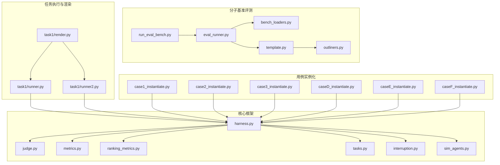
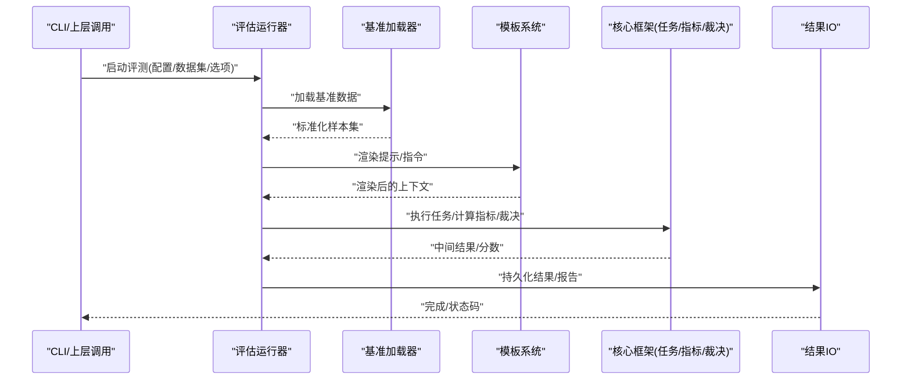
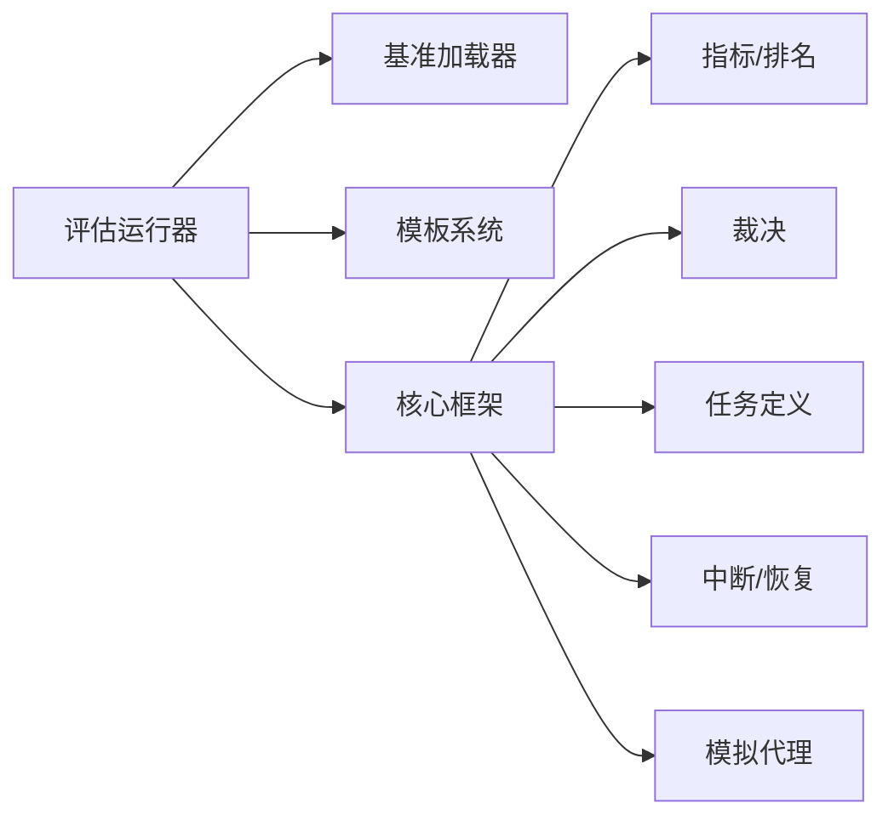

# API参考文档

<cite>
**本文引用的文件**   
- [autonomy_mvp/core/harness.py](file://autonomy_mvp/core/harness.py)
- [autonomy_mvp/core/judge.py](file://autonomy_mvp/core/judge.py)
- [autonomy_mvp/core/metrics.py](file://autonomy_mvp/core/metrics.py)
- [autonomy_mvp/core/ranking_metrics.py](file://autonomy_mvp/core/ranking_metrics.py)
- [autonomy_mvp/core/tasks.py](file://autonomy_mvp/core/tasks.py)
- [autonomy_mvp/core/interruption.py](file://autonomy_mvp/core/interruption.py)
- [autonomy_mvp/core/sim_agents.py](file://autonomy_mvp/core/sim_agents.py)
- [autonomy_mvp/run_validation.py](file://autonomy_mvp/run_validation.py)
- [autonomy_mvp/tests/test_core.py](file://autonomy_mvp/tests/test_core.py)
- [docs/prd/molbench_repo/eval/bench_loaders.py](file://docs/prd/molbench_repo/eval/bench_loaders.py)
- [docs/prd/molbench_repo/eval/eval_runner.py](file://docs/prd/molbench_repo/eval/eval_runner.py)
- [docs/prd/molbench_repo/eval/run_eval_bench.py](file://docs/prd/molbench_repo/eval/run_eval_bench.py)
- [docs/prd/molbench_repo/templates/template.py](file://docs/prd/molbench_repo/templates/template.py)
- [docs/prd/molbench_repo/templates/outliners.py](file://docs/prd/molbench_repo/templates/outliners.py)
- [task1/runner.py](file://task1/runner.py)
- [task1/runner2.py](file://task1/runner2.py)
- [task1/render.py](file://task1/render.py)
- [longhorizon/instantiate/case1_instantiate.py](file://longhorizon/instantiate/case1_instantiate.py)
- [longhorizon/instantiate/case2_instantiate.py](file://longhorizon/instantiate/case2_instantiate.py)
- [longhorizon/instantiate/case3_instantiate.py](file://longhorizon/instantiate/case3_instantiate.py)
- [longhorizon/instantiate/caseD_instantiate.py](file://longhorizon/instantiate/caseD_instantiate.py)
- [longhorizon/instantiate/caseE_instantiate.py](file://longhorizon/instantiate/caseE_instantiate.py)
- [longhorizon/instantiate/caseF_instantiate.py](file://longhorizon/instantiate/caseF_instantiate.py)
</cite>

## 目录
1. [简介](#简介)
2. [项目结构](#项目结构)
3. [核心组件](#核心组件)
4. [架构总览](#架构总览)
5. [详细组件分析](#详细组件分析)
6. [依赖关系分析](#依赖关系分析)
7. [性能考量](#性能考量)
8. [故障排查指南](#故障排查指南)
9. [结论](#结论)
10. [附录](#附录)

## 简介
本API参考文档面向科学计算基准测试框架，覆盖评估运行器、基准加载器、模板系统与核心框架的公共接口规范。文档提供函数签名、参数说明、返回值格式、错误与异常处理、版本兼容性与迁移策略，并给出RESTful接口、WebSocket连接与异步调用的使用示例（概念性）。读者可据此快速集成、扩展与运维该框架。

## 项目结构
仓库采用“领域+工具”的分层组织方式：
- 核心框架：autonomy_mvp/core 下包含任务定义、评测指标、中断控制、模拟代理与编排入口等。
- 分子基准评测：docs/prd/molbench_repo/eval 提供基准加载器与评估运行器；templates 提供模板系统。
- 用例实例化：longhorizon/instantiate 提供多类场景的实例化脚本。
- 任务执行与渲染：task1 提供运行器与渲染工具。

图表来源
- [autonomy_mvp/core/harness.py](file://autonomy_mvp/core/harness.py)
- [autonomy_mvp/core/judge.py](file://autonomy_mvp/core/judge.py)
- [autonomy_mvp/core/metrics.py](file://autonomy_mvp/core/metrics.py)
- [autonomy_mvp/core/ranking_metrics.py](file://autonomy_mvp/core/ranking_metrics.py)
- [autonomy_mvp/core/tasks.py](file://autonomy_mvp/core/tasks.py)
- [autonomy_mvp/core/interruption.py](file://autonomy_mvp/core/interruption.py)
- [autonomy_mvp/core/sim_agents.py](file://autonomy_mvp/core/sim_agents.py)
- [docs/prd/molbench_repo/eval/bench_loaders.py](file://docs/prd/molbench_repo/eval/bench_loaders.py)
- [docs/prd/molbench_repo/eval/eval_runner.py](file://docs/prd/molbench_repo/eval/eval_runner.py)
- [docs/prd/molbench_repo/eval/run_eval_bench.py](file://docs/prd/molbench_repo/eval/run_eval_bench.py)
- [docs/prd/molbench_repo/templates/template.py](file://docs/prd/molbench_repo/templates/template.py)
- [docs/prd/molbench_repo/templates/outliners.py](file://docs/prd/molbench_repo/templates/outliners.py)
- [task1/runner.py](file://task1/runner.py)
- [task1/runner2.py](file://task1/runner2.py)
- [task1/render.py](file://task1/render.py)
- [longhorizon/instantiate/case1_instantiate.py](file://longhorizon/instantiate/case1_instantiate.py)
- [longhorizon/instantiate/case2_instantiate.py](file://longhorizon/instantiate/case2_instantiate.py)
- [longhorizon/instantiate/case3_instantiate.py](file://longhorizon/instantiate/case3_instantiate.py)
- [longhorizon/instantiate/caseD_instantiate.py](file://longhorizon/instantiate/caseD_instantiate.py)
- [longhorizon/instantiate/caseE_instantiate.py](file://longhorizon/instantiate/caseE_instantiate.py)
- [longhorizon/instantiate/caseF_instantiate.py](file://longhorizon/instantiate/caseF_instantiate.py)

章节来源
- [autonomy_mvp/core/harness.py](file://autonomy_mvp/core/harness.py)
- [docs/prd/molbench_repo/eval/eval_runner.py](file://docs/prd/molbench_repo/eval/eval_runner.py)
- [docs/prd/molbench_repo/eval/bench_loaders.py](file://docs/prd/molbench_repo/eval/bench_loaders.py)
- [docs/prd/molbench_repo/templates/template.py](file://docs/prd/molbench_repo/templates/template.py)
- [task1/runner.py](file://task1/runner.py)
- [longhorizon/instantiate/case1_instantiate.py](file://longhorizon/instantiate/case1_instantiate.py)

## 核心组件
本节概述核心模块的职责与对外暴露的关键能力，便于快速定位API位置。

- 评估运行器（eval_runner）
  - 负责解析配置、加载基准数据、驱动评测流程、聚合结果与输出报告。
  - 典型入口：命令行或Python调用，内部组合基准加载器与模板系统。
- 基准加载器（bench_loaders）
  - 提供统一的数据加载接口，支持多种数据集格式与路径约定。
  - 返回标准化样本列表与元信息，供运行器消费。
- 模板系统（template, outliners）
  - 提供提示词/指令模板渲染、变量路由与大纲生成能力。
  - 支持按任务类型选择不同模板族，注入上下文与约束。
- 核心框架（core）
  - tasks：任务描述、输入输出契约、校验规则。
  - metrics / ranking_metrics：指标计算与排序统计。
  - judge：评分逻辑与裁决协议。
  - interruption：中断与恢复机制。
  - sim_agents：模拟代理行为与交互协议。

章节来源
- [docs/prd/molbench_repo/eval/eval_runner.py](file://docs/prd/molbench_repo/eval/eval_runner.py)
- [docs/prd/molbench_repo/eval/bench_loaders.py](file://docs/prd/molbench_repo/eval/bench_loaders.py)
- [docs/prd/molbench_repo/templates/template.py](file://docs/prd/molbench_repo/templates/template.py)
- [docs/prd/molbench_repo/templates/outliners.py](file://docs/prd/molbench_repo/templates/outliners.py)
- [autonomy_mvp/core/tasks.py](file://autonomy_mvp/core/tasks.py)
- [autonomy_mvp/core/metrics.py](file://autonomy_mvp/core/metrics.py)
- [autonomy_mvp/core/ranking_metrics.py](file://autonomy_mvp/core/ranking_metrics.py)
- [autonomy_mvp/core/judge.py](file://autonomy_mvp/core/judge.py)
- [autonomy_mvp/core/interruption.py](file://autonomy_mvp/core/interruption.py)
- [autonomy_mvp/core/sim_agents.py](file://autonomy_mvp/core/sim_agents.py)

## 架构总览
下图展示从配置到评测输出的端到端流程，以及各组件间的依赖关系。

图表来源
- [docs/prd/molbench_repo/eval/eval_runner.py](file://docs/prd/molbench_repo/eval/eval_runner.py)
- [docs/prd/molbench_repo/eval/bench_loaders.py](file://docs/prd/molbench_repo/eval/bench_loaders.py)
- [docs/prd/molbench_repo/templates/template.py](file://docs/prd/molbench_repo/templates/template.py)
- [autonomy_mvp/core/metrics.py](file://autonomy_mvp/core/metrics.py)
- [autonomy_mvp/core/judge.py](file://autonomy_mvp/core/judge.py)

## 详细组件分析

### 评估运行器API（eval_runner）
- 职责
  - 解析配置与参数，协调基准加载器与模板系统，驱动评测循环，汇总指标与输出报告。
- 关键接口（概念性）
  - run(config): 主入口，接受配置对象，返回评测摘要。
  - load_dataset(path_or_manifest): 委托基准加载器加载数据。
  - render_template(task_type, context): 委托模板系统渲染提示。
  - aggregate_and_report(results): 聚合指标并写入结果文件。
- 参数与返回
  - config：包含数据集路径、模板族、并行度、输出目录等字段。
  - 返回：评测摘要字典，含总体指标、失败计数、耗时等。
- 错误与异常
  - 配置文件缺失/非法：抛出配置校验异常。
  - 数据加载失败：抛出数据源异常，记录失败样本ID。
  - 模板渲染失败：抛出模板异常，回退默认模板或跳过。
- 使用示例（Python，概念性）
  - 通过导入运行器并传入配置对象调用主入口，捕获异常并记录日志。
- REST/WebSocket/异步
  - 可通过封装HTTP服务暴露run接口；WebSocket用于推送进度事件；异步模式适用于长时任务队列。

章节来源
- [docs/prd/molbench_repo/eval/eval_runner.py](file://docs/prd/molbench_repo/eval/eval_runner.py)
- [docs/prd/molbench_repo/eval/run_eval_bench.py](file://docs/prd/molbench_repo/eval/run_eval_bench.py)

### 基准加载器API（bench_loaders）
- 职责
  - 统一读取多源数据（JSON/CSV/JSONL等），进行格式校验与标准化，返回样本列表与元信息。
- 关键接口（概念性）
  - load(path_or_manifest, schema=None): 根据路径或清单加载数据。
  - validate(sample, schema): 对单条样本进行结构校验。
  - normalize(samples): 将原始样本转换为标准结构。
- 参数与返回
  - path_or_manifest：文件或清单路径。
  - schema：可选的数据模型定义。
  - 返回：标准化样本列表与元信息（如总数、分区、时间戳）。
- 错误与异常
  - 文件不存在/权限不足：抛出I/O异常。
  - 格式不匹配：抛出数据格式异常，附带行号与字段名。
- 使用示例（Python，概念性）
  - 指定数据集路径与schema，调用load后遍历样本进行后续处理。

章节来源
- [docs/prd/molbench_repo/eval/bench_loaders.py](file://docs/prd/molbench_repo/eval/bench_loaders.py)

### 模板系统API（template, outliners）
- 职责
  - 管理提示词模板、变量路由与大纲生成，支持按任务类型选择模板族。
- 关键接口（概念性）
  - render(template_id, variables): 渲染模板为最终文本。
  - resolve_variables(task_type, context): 解析变量映射。
  - generate_outline(task_type, prompt): 基于提示生成结构化大纲。
- 参数与返回
  - template_id：模板标识符。
  - variables：键值对形式的变量表。
  - 返回：渲染后的字符串或结构化大纲。
- 错误与异常
  - 模板缺失/变量未绑定：抛出模板异常，建议回退默认模板。
- 使用示例（Python，概念性）
  - 先resolve_variables再render，确保所有占位符被填充。

章节来源
- [docs/prd/molbench_repo/templates/template.py](file://docs/prd/molbench_repo/templates/template.py)
- [docs/prd/molbench_repo/templates/outliners.py](file://docs/prd/molbench_repo/templates/outliners.py)

### 核心框架API（core）
- 任务定义（tasks）
  - 定义任务输入输出契约、校验规则与元数据。
  - 关键接口（概念性）：get_task_spec(task_id), validate_input(data), get_output_schema(task_id)。
- 指标计算（metrics, ranking_metrics）
  - 提供常用科学计算指标与排名统计方法。
  - 关键接口（概念性）：compute(metric_name, predictions, ground_truth), rank(scores, method)。
- 裁决（judge）
  - 实现评分与裁决逻辑，支持多策略组合。
  - 关键接口（概念性）：score(prediction, ground_truth), decide(rule_set, scores)。
- 中断与恢复（interruption）
  - 提供检查点、恢复与优雅退出机制。
  - 关键接口（概念性）：checkpoint(state), restore(path), is_interrupted().
- 模拟代理（sim_agents）
  - 定义代理行为协议与交互消息格式。
  - 关键接口（概念性）：act(observation), observe(action), reset().

章节来源
- [autonomy_mvp/core/tasks.py](file://autonomy_mvp/core/tasks.py)
- [autonomy_mvp/core/metrics.py](file://autonomy_mvp/core/metrics.py)
- [autonomy_mvp/core/ranking_metrics.py](file://autonomy_mvp/core/ranking_metrics.py)
- [autonomy_mvp/core/judge.py](file://autonomy_mvp/core/judge.py)
- [autonomy_mvp/core/interruption.py](file://autonomy_mvp/core/interruption.py)
- [autonomy_mvp/core/sim_agents.py](file://autonomy_mvp/core/sim_agents.py)

### 用例实例化API（longhorizon/instantiate）
- 职责
  - 针对多类科学计算场景（材料发现、机理模拟、逆合成、靶点验证等）生成具体评测实例。
- 关键接口（概念性）
  - instantiate_case(case_type, params): 根据类型与参数生成实例。
  - export_instances(instances, output_dir): 导出实例清单与数据。
- 参数与返回
  - case_type：场景类型标识。
  - params：场景特定参数（如目标分子、材料体系等）。
  - 返回：实例集合与导出路径。
- 错误与异常
  - 参数不合法：抛出参数校验异常。
  - 导出失败：抛出I/O异常，记录部分成功状态。

章节来源
- [longhorizon/instantiate/case1_instantiate.py](file://longhorizon/instantiate/case1_instantiate.py)
- [longhorizon/instantiate/case2_instantiate.py](file://longhorizon/instantiate/case2_instantiate.py)
- [longhorizon/instantiate/case3_instantiate.py](file://longhorizon/instantiate/case3_instantiate.py)
- [longhorizon/instantiate/caseD_instantiate.py](file://longhorizon/instantiate/caseD_instantiate.py)
- [longhorizon/instantiate/caseE_instantiate.py](file://longhorizon/instantiate/caseE_instantiate.py)
- [longhorizon/instantiate/caseF_instantiate.py](file://longhorizon/instantiate/caseF_instantiate.py)

### 任务执行与渲染（task1）
- 职责
  - 提供任务级运行器与渲染工具，支撑会话式评测与结果可视化。
- 关键接口（概念性）
  - run_session(session_id, prompts, replicates): 执行会话并保存结果。
  - render_report(results, format): 渲染报告为Markdown/HTML等。
- 错误与异常
  - 会话资源缺失：抛出资源异常。
  - 渲染失败：抛出模板或格式异常。

章节来源
- [task1/runner.py](file://task1/runner.py)
- [task1/runner2.py](file://task1/runner2.py)
- [task1/render.py](file://task1/render.py)

## 依赖关系分析
- 组件耦合
  - 评估运行器强依赖基准加载器与模板系统；核心框架提供通用能力被上层复用。
- 外部依赖
  - 文件系统I/O、序列化库、可能的网络客户端（REST/WebSocket）。
- 潜在循环依赖
  - 应避免模板系统反向依赖运行器；保持单向依赖链。

图表来源
- [docs/prd/molbench_repo/eval/eval_runner.py](file://docs/prd/molbench_repo/eval/eval_runner.py)
- [docs/prd/molbench_repo/eval/bench_loaders.py](file://docs/prd/molbench_repo/eval/bench_loaders.py)
- [docs/prd/molbench_repo/templates/template.py](file://docs/prd/molbench_repo/templates/template.py)
- [autonomy_mvp/core/metrics.py](file://autonomy_mvp/core/metrics.py)
- [autonomy_mvp/core/judge.py](file://autonomy_mvp/core/judge.py)
- [autonomy_mvp/core/tasks.py](file://autonomy_mvp/core/tasks.py)
- [autonomy_mvp/core/interruption.py](file://autonomy_mvp/core/interruption.py)
- [autonomy_mvp/core/sim_agents.py](file://autonomy_mvp/core/sim_agents.py)

## 性能考量
- 数据加载
  - 优先流式读取大文件，避免一次性载入内存；对重复访问启用缓存。
- 模板渲染
  - 预编译模板、批量渲染以减少I/O与解析开销。
- 指标计算
  - 向量化计算与并行聚合，减少Python循环开销。
- 并发与异步
  - 使用线程池或进程池并行评测；长时任务采用异步队列与心跳保活。
- 检查点与断点续跑
  - 定期落盘中间状态，失败后可从最近检查点恢复。

## 故障排查指南
- 常见问题
  - 配置错误：检查必填字段与类型；打印配置快照以便定位。
  - 数据不一致：核对schema与样本结构；记录失败样本ID与原因。
  - 模板渲染失败：确认变量绑定完整性；启用回退模板。
  - 指标计算异常：检查数值范围与除零保护；输出调试统计。
- 诊断步骤
  - 开启详细日志，记录输入摘要与中间结果。
  - 使用最小复现数据集验证链路。
  - 隔离外部依赖（网络/文件系统）以定位瓶颈。

章节来源
- [autonomy_mvp/run_validation.py](file://autonomy_mvp/run_validation.py)
- [autonomy_mvp/tests/test_core.py](file://autonomy_mvp/tests/test_core.py)

## 结论
本API参考文档系统化梳理了评估运行器、基准加载器、模板系统与核心框架的接口规范与使用要点。通过清晰的依赖关系与流程图示，帮助开发者快速集成与扩展。建议在工程实践中遵循错误处理与性能优化建议，并结合检查点机制提升鲁棒性。

## 附录

### 版本兼容性与废弃策略
- 兼容性原则
  - 向后兼容：新增字段默认值需安全；旧字段保留至少两个主版本。
  - 破坏性变更：在次版本中弃用并给出迁移指引，在主版本移除。
- 废弃策略
  - 弃用警告：运行时输出弃用提示与替代方案。
  - 迁移窗口：提供过渡期脚本与对照表。
- 迁移指南
  - 逐步替换旧接口为新接口；更新配置与模板；回归测试覆盖关键路径。

### RESTful接口示例（概念性）
- POST /api/v1/evaluate
  - 请求体：{config}
  - 响应体：{job_id, status}
  - 状态码：201创建，400参数错误，500服务器错误
- GET /api/v1/jobs/{job_id}
  - 响应体：{status, progress, results_url}
- WebSocket /ws/v1/progress
  - 事件：{"type":"progress","data":{"percent":...}}

### WebSocket连接示例（概念性）
- 客户端建立连接后订阅进度事件，服务端周期性推送评测进度与中间结果URL。

### 异步调用示例（概念性）
- 使用异步队列提交评测任务，消费者拉取任务并调用评估运行器，完成后回调通知。