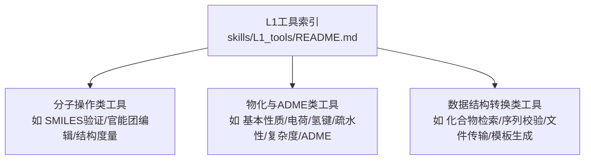
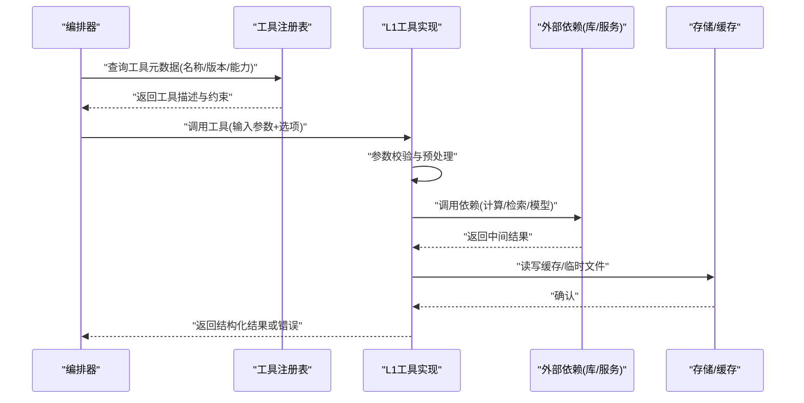
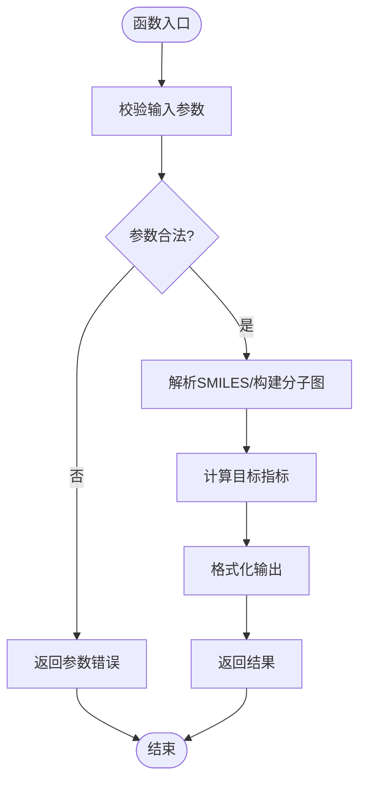
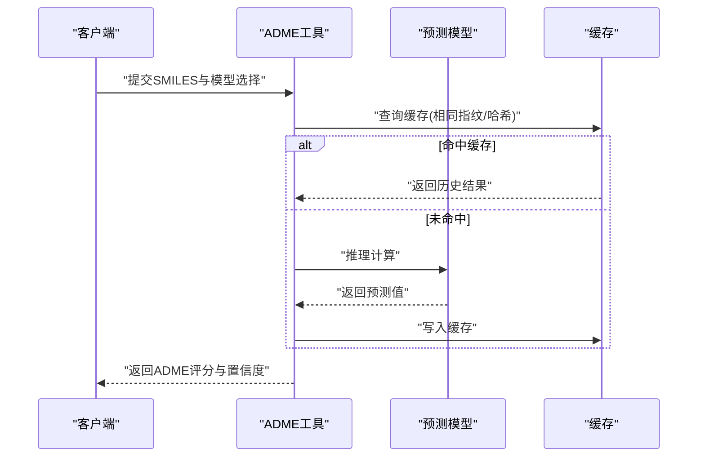
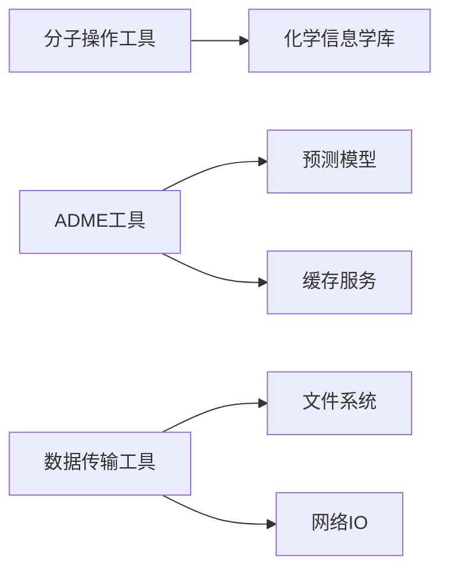

# L1基础工具接口

<cite>
**本文档引用的文件**   
- [L1工具索引](file://docs/molbench_repo/skills/L1_tools/README.md)
- [SMILES验证工具](file://docs/molbench_repo/skills/L1_tools/molclaw-smiles-valid-check/tool.py)
- [SMILES官能团编辑工具](file://docs/molbench_repo/skills/L1_tools/molclaw-smiles-fg-editor/tool.py)
- [分子基本性质计算工具](file://docs/molbench_repo/skills/L1_tools/molclaw-mol-basic-metrics/tool.py)
- [分子电荷性质计算工具](file://docs/molbench_repo/skills/L1_tools/molclaw-mol-charge-metrics/tool.py)
- [分子复杂度计算工具](file://docs/molbench_repo/skills/L1_tools/molclaw-mol-complexity-metrics/tool.py)
- [分子氢键计算工具](file://docs/molbench_repo/skills/L1_tools/molclaw-mol-hbond-metrics/tool.py)
- [分子疏水性计算工具](file://docs/molbench_repo/skills/L1_tools/molclaw-mol-hydrophobicity-metrics/tool.py)
- [分子结构度量工具](file://docs/molbench_repo/skills/L1_tools/molclaw-mol-structure-metrics/tool.py)
- [分子拓扑度量工具](file://docs/molbench_repo/skills/L1_tools/molclaw-mol-topology-metrics/tool.py)
- [ADME性质预测工具](file://docs/molbench_repo/skills/L1_tools/molclaw-admet/tool.py)
- [化合物检索工具](file://docs/molbench_repo/skills/L1_tools/molclaw-compound-retrieve/tool.py)
- [序列有效性检查工具](file://docs/molbench_repo/skills/L1_tools/molclaw-sequence-valid-check/tool.py)
- [文件传输工具](file://docs/molbench_repo/skills/L1_tools/molclaw-file-transfer/tool.py)
- [技能模板编写器](file://docs/molbench_repo/skills/L1_tools/molclaw-skill-template-writer/tool.py)
</cite>

## 目录
1. [简介](#简介)
2. [项目结构](#项目结构)
3. [核心组件](#核心组件)
4. [架构总览](#架构总览)
5. [详细组件分析](#详细组件分析)
6. [依赖关系分析](#依赖关系分析)
7. [性能考虑](#性能考虑)
8. [故障排查指南](#故障排查指南)
9. [结论](#结论)
10. [附录](#附录)

## 简介
本文件为L1基础工具的标准化接口API文档，覆盖三类工具：
- 分子操作工具：SMILES验证、官能团编辑、分子结构与拓扑度量等。
- 物理化学与ADME计算工具：基本性质、电荷、氢键、疏水性、复杂度及ADME性质预测。
- 数据结构转换工具：化合物检索、序列有效性检查、文件传输、技能模板生成等。

文档提供每个工具的输入参数校验规则、输出数据格式、错误处理机制、异步执行模式、并发控制策略与资源管理建议，并给出版本兼容性与依赖管理说明。

## 项目结构
L1工具以“技能”为单位组织，每个工具为一个独立目录，包含统一的入口脚本（通常为tool.py）与必要的配置文件。根索引文件汇总了所有L1工具及其用途。

图表来源
- [L1工具索引](file://docs/molbench_repo/skills/L1_tools/README.md)

章节来源
- [L1工具索引](file://docs/molbench_repo/skills/L1_tools/README.md)

## 核心组件
本节概述L1工具的统一调用约定与通用规范，适用于所有L1工具。

- 统一调用协议
  - 请求体：JSON对象，包含工具名、版本号、输入参数、可选的并发与超时配置。
  - 响应体：JSON对象，包含状态码、消息、结果数据或错误详情。
- 输入参数校验
  - 必填字段校验、类型校验、取值范围校验、格式校验（如SMILES正则）。
  - 失败时返回明确的错误码与修复建议。
- 输出数据格式
  - 成功：{ "status": "ok", "data": { ... } }
  - 失败：{ "status": "error", "code": "ERR_XXX", "message": "...", "details": { ... } }
- 错误处理机制
  - 分类错误码：参数错误、运行时错误、外部依赖错误、资源限制错误。
  - 重试策略：幂等接口支持指数退避重试；非幂等接口禁止自动重试。
- 异步执行模式
  - 同步：直接返回结果。
  - 异步：提交任务后返回job_id，通过查询接口获取结果。
- 并发控制与资源管理
  - 限流：按工具维度设置QPS上限。
  - 队列：任务入队、优先级调度、超时取消。
  - 资源：GPU/CPU配额、内存阈值、临时文件清理。

章节来源
- [L1工具索引](file://docs/molbench_repo/skills/L1_tools/README.md)

## 架构总览
下图展示L1工具在系统内的交互流程：上层编排器根据任务路由到具体工具，工具内部进行参数校验、计算/检索、结果封装与错误上报。

图表来源
- [L1工具索引](file://docs/molbench_repo/skills/L1_tools/README.md)

## 详细组件分析

### 分子操作工具族
涵盖SMILES验证、官能团编辑、分子结构与拓扑度量等。

- SMILES验证工具
  - 功能：校验SMILES字符串合法性，返回有效/无效及问题定位。
  - 输入参数
    - smiles: string，必需，SMILES字符串
    - strict: boolean，可选，是否启用严格模式
    - canonicalize: boolean，可选，是否规范化SMILES
  - 输出数据
    - valid: boolean
    - message: string
    - canonical_smiles: string|空
    - errors: array of object
  - 错误处理
    - 非法字符/语法错误：返回错误码与位置信息
    - 超大分子：触发资源限制错误
  - 示例路径
    - [SMILES验证工具](file://docs/molbench_repo/skills/L1_tools/molclaw-smiles-valid-check/tool.py)

- SMILES官能团编辑工具
  - 功能：基于规则对SMILES进行官能团替换/添加/删除。
  - 输入参数
    - smiles: string，必需
    - operations: array of object，必需，操作列表（type, target, value）
    - dry_run: boolean，可选，仅预览不修改
  - 输出数据
    - result_smiles: string
    - changes: array of object
    - warnings: array of string
  - 错误处理
    - 操作冲突/目标不存在：返回具体错误与修复建议
  - 示例路径
    - [SMILES官能团编辑工具](file://docs/molbench_repo/skills/L1_tools/molclaw-smiles-fg-editor/tool.py)

- 分子基本性质计算工具
  - 功能：计算分子量、原子数、重原子数、环数等基础性质。
  - 输入参数
    - smiles: string，必需
    - properties: array of string，可选，指定属性集合
  - 输出数据
    - molecular_weight: number
    - atom_count: number
    - heavy_atom_count: number
    - ring_count: number
    - ...其他属性
  - 错误处理
    - 解析失败/不支持的属性：返回错误码与可用属性列表
  - 示例路径
    - [分子基本性质计算工具](file://docs/molbench_repo/skills/L1_tools/molclaw-mol-basic-metrics/tool.py)

- 分子电荷性质计算工具
  - 功能：计算形式电荷、净电荷、电荷分布统计。
  - 输入参数
    - smiles: string，必需
    - method: string，可选，计算方法（默认内置）
  - 输出数据
    - formal_charge: number
    - net_charge: number
    - charge_distribution: array of number
  - 错误处理
    - 方法不可用/计算异常：返回错误码与日志摘要
  - 示例路径
    - [分子电荷性质计算工具](file://docs/molbench_repo/skills/L1_tools/molclaw-mol-charge-metrics/tool.py)

- 分子复杂度计算工具
  - 功能：计算分子复杂度指标（如复杂度分数、分支度等）。
  - 输入参数
    - smiles: string，必需
    - metrics: array of string，可选，指标集合
  - 输出数据
    - complexity_score: number
    - branch_index: number
    - ...其他指标
  - 错误处理
    - 指标未实现/数值溢出：返回错误码与降级策略
  - 示例路径
    - [分子复杂度计算工具](file://docs/molbench_repo/skills/L1_tools/molclaw-mol-complexity-metrics/tool.py)

- 分子氢键计算工具
  - 功能：统计供体/受体数量、潜在氢键位点。
  - 输入参数
    - smiles: string，必需
    - threshold: number，可选，距离阈值
  - 输出数据
    - donors: number
    - acceptors: number
    - hbond_sites: array of object
  - 错误处理
    - 阈值越界/计算失败：返回错误码与建议值
  - 示例路径
    - [分子氢键计算工具](file://docs/molbench_repo/skills/L1_tools/molclaw-mol-hbond-metrics/tool.py)

- 分子疏水性计算工具
  - 功能：估算logP、疏水表面积等。
  - 输入参数
    - smiles: string，必需
    - model: string，可选，模型选择
  - 输出数据
    - logp: number
    - hydrophobic_surface_area: number
  - 错误处理
    - 模型加载失败/数值异常：返回错误码与回退模型
  - 示例路径
    - [分子疏水性计算工具](file://docs/molbench_repo/skills/L1_tools/molclaw-mol-hydrophobicity-metrics/tool.py)

- 分子结构度量工具
  - 功能：计算结构相似性、指纹、Tanimoto系数等。
  - 输入参数
    - smiles_list: array of string，必需
    - fingerprint_type: string，可选，指纹类型
    - metric: string，可选，度量方式
  - 输出数据
    - similarity_matrix: array of array of number
    - fingerprints: array of string
  - 错误处理
    - 输入长度不一致/指纹类型不支持：返回错误码与修正提示
  - 示例路径
    - [分子结构度量工具](file://docs/molbench_repo/skills/L1_tools/molclaw-mol-structure-metrics/tool.py)

- 分子拓扑度量工具
  - 功能：计算拓扑指数、连通性、环系特征。
  - 输入参数
    - smiles: string，必需
    - indices: array of string，可选，指数集合
  - 输出数据
    - topological_indices: object
  - 错误处理
    - 指数未实现/图构建失败：返回错误码与替代方案
  - 示例路径
    - [分子拓扑度量工具](file://docs/molbench_repo/skills/L1_tools/molclaw-mol-topology-metrics/tool.py)

图表来源
- [SMILES验证工具](file://docs/molbench_repo/skills/L1_tools/molclaw-smiles-valid-check/tool.py)
- [分子基本性质计算工具](file://docs/molbench_repo/skills/L1_tools/molclaw-mol-basic-metrics/tool.py)

章节来源
- [SMILES验证工具](file://docs/molbench_repo/skills/L1_tools/molclaw-smiles-valid-check/tool.py)
- [SMILES官能团编辑工具](file://docs/molbench_repo/skills/L1_tools/molclaw-smiles-fg-editor/tool.py)
- [分子基本性质计算工具](file://docs/molbench_repo/skills/L1_tools/molclaw-mol-basic-metrics/tool.py)
- [分子电荷性质计算工具](file://docs/molbench_repo/skills/L1_tools/molclaw-mol-charge-metrics/tool.py)
- [分子复杂度计算工具](file://docs/molbench_repo/skills/L1_tools/molclaw-mol-complexity-metrics/tool.py)
- [分子氢键计算工具](file://docs/molbench_repo/skills/L1_tools/molclaw-mol-hbond-metrics/tool.py)
- [分子疏水性计算工具](file://docs/molbench_repo/skills/L1_tools/molclaw-mol-hydrophobicity-metrics/tool.py)
- [分子结构度量工具](file://docs/molbench_repo/skills/L1_tools/molclaw-mol-structure-metrics/tool.py)
- [分子拓扑度量工具](file://docs/molbench_repo/skills/L1_tools/molclaw-mol-topology-metrics/tool.py)

### 物理化学与ADME计算工具族
涵盖ADME性质预测等关键药代动力学指标。

- ADME性质预测工具
  - 功能：预测吸收、分布、代谢、排泄相关性质（如溶解度、渗透性、半衰期等）。
  - 输入参数
    - smiles: string，必需
    - models: array of string，可选，模型集合
    - confidence_threshold: number，可选，置信度阈值
  - 输出数据
    - adme_scores: object
    - confidence: number
    - model_version: string
    - warnings: array of string
  - 错误处理
    - 模型缺失/推理失败：返回错误码与可用模型列表
  - 示例路径
    - [ADME性质预测工具](file://docs/molbench_repo/skills/L1_tools/molclaw-admet/tool.py)

图表来源
- [ADME性质预测工具](file://docs/molbench_repo/skills/L1_tools/molclaw-admet/tool.py)

章节来源
- [ADME性质预测工具](file://docs/molbench_repo/skills/L1_tools/molclaw-admet/tool.py)

### 数据结构转换工具族
涵盖化合物检索、序列有效性检查、文件传输、模板生成等。

- 化合物检索工具
  - 功能：根据SMILES/名称/ID检索化合物信息与关联数据。
  - 输入参数
    - query: string，必需，检索关键词
    - source: string，可选，数据源
    - limit: number，可选，返回条数上限
  - 输出数据
    - results: array of object
    - total: number
    - next_cursor: string|空
  - 错误处理
    - 源不可达/权限不足：返回错误码与重试建议
  - 示例路径
    - [化合物检索工具](file://docs/molbench_repo/skills/L1_tools/molclaw-compound-retrieve/tool.py)

- 序列有效性检查工具
  - 功能：校验生物大分子序列（肽/蛋白）合法性与修饰符。
  - 输入参数
    - sequence: string，必需
    - type: string，必需，序列类型
    - validate_modifications: boolean，可选
  - 输出数据
    - valid: boolean
    - issues: array of object
    - normalized_sequence: string|空
  - 错误处理
    - 类型不支持/修饰符未知：返回错误码与修正指引
  - 示例路径
    - [序列有效性检查工具](file://docs/molbench_repo/skills/L1_tools/molclaw-sequence-valid-check/tool.py)

- 文件传输工具
  - 功能：上传/下载/移动/复制文件，支持批量与断点续传。
  - 输入参数
    - action: string，必需，动作（upload/download/move/copy）
    - paths: array of string，必需，路径列表
    - options: object，可选，传输选项
  - 输出数据
    - status: string
    - transferred: number
    - failed: array of object
  - 错误处理
    - 权限不足/磁盘空间不足：返回错误码与清理建议
  - 示例路径
    - [文件传输工具](file://docs/molbench_repo/skills/L1_tools/molclaw-file-transfer/tool.py)

- 技能模板编写器
  - 功能：生成L1工具技能模板，便于扩展新工具。
  - 输入参数
    - template_name: string，必需
    - fields: object，必需，模板字段定义
  - 输出数据
    - template_path: string
    - validation_schema: object
  - 错误处理
    - 字段冲突/模板已存在：返回错误码与解决步骤
  - 示例路径
    - [技能模板编写器](file://docs/molbench_repo/skills/L1_tools/molclaw-skill-template-writer/tool.py)

章节来源
- [化合物检索工具](file://docs/molbench_repo/skills/L1_tools/molclaw-compound-retrieve/tool.py)
- [序列有效性检查工具](file://docs/molbench_repo/skills/L1_tools/molclaw-sequence-valid-check/tool.py)
- [文件传输工具](file://docs/molbench_repo/skills/L1_tools/molclaw-file-transfer/tool.py)
- [技能模板编写器](file://docs/molbench_repo/skills/L1_tools/molclaw-skill-template-writer/tool.py)

## 依赖关系分析
L1工具依赖关系清晰，模块内聚性强，跨模块耦合低。典型依赖包括：
- 分子操作工具依赖化学信息学库（如RDKit/自定义解析器）。
- ADME工具依赖预测模型与缓存服务。
- 数据传输工具依赖文件系统与网络IO。

图表来源
- [L1工具索引](file://docs/molbench_repo/skills/L1_tools/README.md)

章节来源
- [L1工具索引](file://docs/molbench_repo/skills/L1_tools/README.md)

## 性能考虑
- 缓存优先：对重复SMILES/指纹命中缓存，减少重复计算。
- 批处理：支持批量输入，降低序列化/反序列化开销。
- 异步与并行：长耗时任务采用异步队列，合理设置并发度与超时。
- 资源隔离：GPU/CPU配额、内存阈值监控，避免OOM。
- 增量更新：模型与依赖按需加载，懒初始化。

[本节为通用指导，无需特定文件引用]

## 故障排查指南
- 参数错误
  - 现象：返回参数校验失败错误码。
  - 处理：检查必填字段、类型与取值范围，参考工具文档中的字段定义。
- 运行时错误
  - 现象：计算/推理失败，返回运行时错误码。
  - 处理：查看日志摘要，尝试降级模型或简化输入。
- 外部依赖错误
  - 现象：模型/缓存/网络不可用。
  - 处理：检查服务状态、重试策略与熔断配置。
- 资源限制错误
  - 现象：内存/磁盘/GPU不足。
  - 处理：扩容资源、清理临时文件、调整批大小。

章节来源
- [L1工具索引](file://docs/molbench_repo/skills/L1_tools/README.md)

## 结论
L1基础工具提供了标准化的接口规范与完善的错误处理机制，覆盖分子操作、物化与ADME计算、数据结构转换三大类场景。通过统一的调用协议、异步执行与并发控制策略，可在保证稳定性的同时提升吞吐与可维护性。建议在生产环境中结合缓存、批处理与资源隔离策略进一步优化性能。

[本节为总结性内容，无需特定文件引用]

## 附录
- 版本兼容性
  - 工具声明版本号，上游依赖变更需保持向后兼容。
  - 废弃接口保留过渡期，提供迁移指南。
- 依赖管理
  - 使用环境清单与环境变量模板，确保可复现。
  - 模型与权重文件纳入版本控制或制品库。
- 使用示例路径
  - 各工具的具体实现与示例均可在对应tool.py中查阅。

章节来源
- [L1工具索引](file://docs/molbench_repo/skills/L1_tools/README.md)