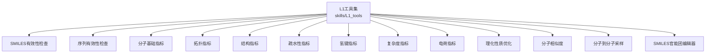
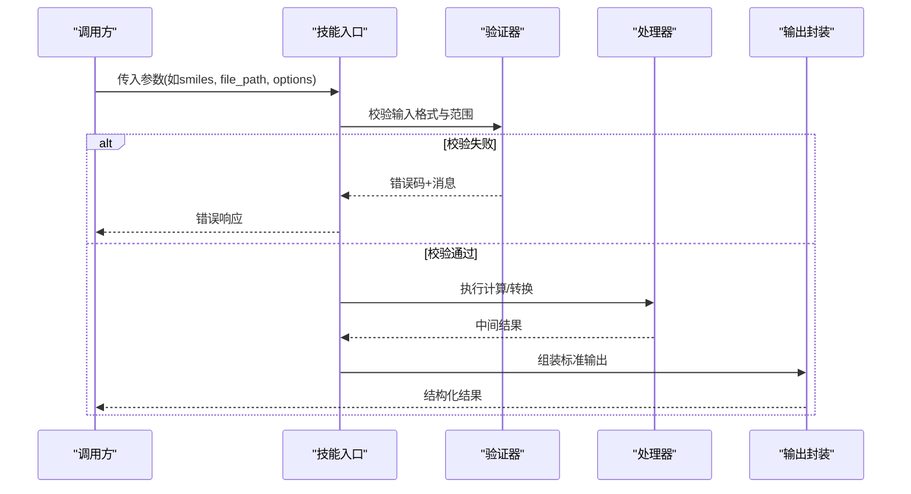
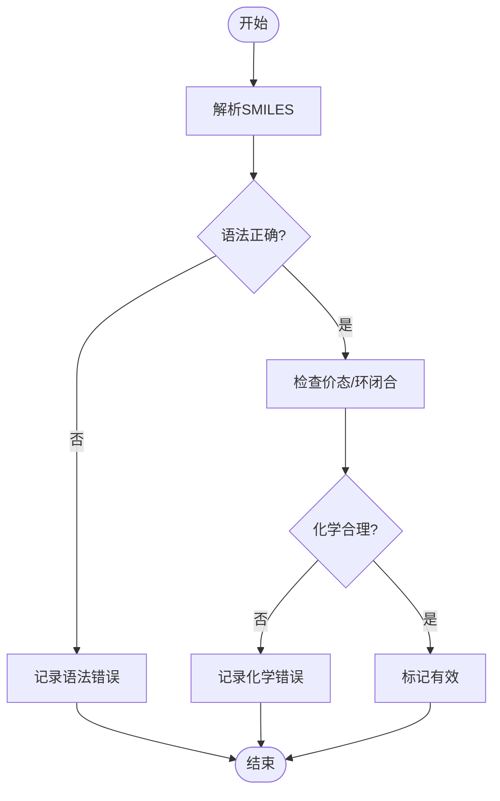
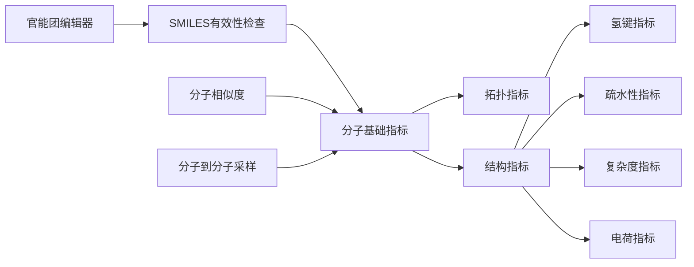

# 分子结构工具接口

<cite>
**本文引用的文件**   
- [molclaw-smiles-valid-check/skill.py](file://docs/prd/molbench_repo/skills/L1_tools/molclaw-smiles-valid-check/skill.py)
- [molclaw-sequence-valid-check/skill.py](file://docs/prd/molbench_repo/skills/L1_tools/molclaw-sequence-valid-check/skill.py)
- [molclaw-mol-basic-metrics/skill.py](file://docs/prd/molbench_repo/skills/L1_tools/molclaw-mol-basic-metrics/skill.py)
- [molclaw-mol-topology-metrics/skill.py](file://docs/prd/molbench_repo/skills/L1_tools/molclaw-mol-topology-metrics/skill.py)
- [molclaw-mol-structure-metrics/skill.py](file://docs/prd/molbench_repo/skills/L1_tools/molclaw-mol-structure-metrics/skill.py)
- [molclaw-mol-hydrophobicity-metrics/skill.py](file://docs/prd/molbench_repo/skills/L1_tools/molclaw-mol-hydrophobicity-metrics/skill.py)
- [molclaw-mol-hbond-metrics/skill.py](file://docs/prd/molbench_repo/skills/L1_tools/molclaw-mol-hbond-metrics/skill.py)
- [molclaw-mol-complexity-metrics/skill.py](file://docs/prd/molbench_repo/skills/L1_tools/molclaw-mol-complexity-metrics/skill.py)
- [molclaw-mol-charge-metrics/skill.py](file://docs/prd/molbench_repo/skills/L1_tools/molclaw-mol-charge-metrics/skill.py)
- [molclaw-mol-opt-physchem/skill.py](file://docs/prd/molbench_repo/skills/L1_tools/molclaw-mol-opt-physchem/skill.py)
- [molclaw-mol-similarity/skill.py](file://docs/prd/molbench_repo/skills/L1_tools/molclaw-mol-similarity/skill.py)
- [molclaw-mol2mol-sampling/skill.py](file://docs/prd/molbench_repo/skills/L1_tools/molclaw-mol2mol-sampling/skill.py)
- [molclaw-smiles-fg-editor/skill.py](file://docs/prd/molbench_repo/skills/L1_tools/molclaw-smiles-fg-editor/skill.py)
</cite>

## 目录
1. [简介](#简介)
2. [项目结构](#项目结构)
3. [核心组件](#核心组件)
4. [架构总览](#架构总览)
5. [详细组件分析](#详细组件分析)
6. [依赖关系分析](#依赖关系分析)
7. [性能考虑](#性能考虑)
8. [故障排查指南](#故障排查指南)
9. [结论](#结论)
10. [附录](#附录) 

## 简介
本文件为“分子结构工具”的标准化API文档，覆盖以下能力：
- SMILES与序列有效性验证
- 分子基本属性计算（分子量、原子/键计数等）
- 分子拓扑与结构度量（环数、连接性、氢键供体/受体、疏水性等）
- 分子相似性与采样、官能团编辑等进阶工具
文档明确输入参数格式（如SMILES字符串、分子文件路径）、输出数据结构（描述符、拓扑信息）、错误处理机制，并提供函数签名、类型定义、返回值格式与使用示例。

## 项目结构
该仓库将分子相关工具以“技能（skill）”形式组织在统一目录下，每个工具对应一个独立模块，便于按需调用与组合。

[本节未直接分析具体源文件，故无章节来源]

## 核心组件
- SMILES有效性检查：对SMILES进行语法与化学合理性校验，返回布尔结果与错误原因。
- 序列有效性检查：用于多肽/蛋白质序列的合法性校验（若适用）。
- 分子基础指标：计算分子量、原子/键计数、同位素信息等。
- 拓扑指标：计算环数、连通分量、分支度等拓扑特征。
- 结构指标：统计氢键供体/受体、可旋转键、芳香环等结构特征。
- 疏水性指标：估算logP或相关疏水评分。
- 氢键指标：统计氢键供体/受体数量及潜在相互作用位点。
- 复杂度指标：基于图论或经验公式的分子复杂度评分。
- 电荷指标：计算净电荷、形式电荷分布等。
- 理化性质优化：提供基于规则的筛选或优化建议（如类药性）。
- 分子相似度：Tanimoto/Jaccard等指纹相似度计算。
- 分子到分子采样：基于规则或模型的分子变换与采样。
- SMILES官能团编辑器：对SMILES进行官能团替换、添加或删除。

上述组件均以统一的输入/输出契约暴露，便于上层编排与批处理。

[本节未直接分析具体源文件，故无章节来源]

## 架构总览
各工具作为独立技能对外暴露标准化接口，上层通过统一入口按任务路由到相应技能。典型流程包括：输入校验→解析与构建分子对象→计算/转换→结构化输出→错误上报。

[本节为概念性流程图，不映射具体源文件，故无图表来源]

## 详细组件分析

### SMILES有效性检查
- 功能：验证SMILES字符串是否符合规范并具备化学合理性。
- 输入
  - smiles: 字符串，必需
  - strict: 布尔，可选；是否启用严格模式
- 输出
  - valid: 布尔
  - errors: 字符串列表（当无效时）
  - metadata: 字典（可选，包含版本、时间戳等）
- 错误处理
  - 非法字符/括号不匹配：返回错误码与定位信息
  - 价态异常/环闭合冲突：返回具体化学约束违反说明
- 使用示例
  - 成功：{"valid": true, "errors": [], "metadata": {...}}
  - 失败：{"valid": false, "errors": ["..."], "metadata": {...}}

**章节来源**
- [molclaw-smiles-valid-check/skill.py](file://docs/prd/molbench_repo/skills/L1_tools/molclaw-smiles-valid-check/skill.py)

### 序列有效性检查
- 功能：校验多肽/蛋白质序列的合法性（字母表、长度、修饰符等）。
- 输入
  - sequence: 字符串，必需
  - alphabet: 枚举，可选；默认标准氨基酸
- 输出
  - valid: 布尔
  - errors: 字符串列表
- 使用示例
  - 成功：{"valid": true, "errors": []}
  - 失败：{"valid": false, "errors": ["未知残基"]}

**章节来源**
- [molclaw-sequence-valid-check/skill.py](file://docs/prd/molbench_repo/skills/L1_tools/molclaw-sequence-valid-check/skill.py)

### 分子基础指标
- 功能：计算分子量、原子/键计数、元素组成、同位素信息等。
- 输入
  - smiles: 字符串，必需
  - compute_isotopes: 布尔，可选
- 输出
  - molecular_weight: 数值
  - atom_count: 整数
  - bond_count: 整数
  - element_counts: 字典
  - metadata: 字典
- 使用示例
  - {"molecular_weight": 180.16, "atom_count": 24, "bond_count": 23, "element_counts": {"C": 6, "H": 12, "O": 6}, "metadata": {...}}

**章节来源**
- [molclaw-mol-basic-metrics/skill.py](file://docs/prd/molbench_repo/skills/L1_tools/molclaw-mol-basic-metrics/skill.py)

### 分子拓扑指标
- 功能：计算环数、连通分量、分支度、最大环大小等。
- 输入
  - smiles: 字符串，必需
  - aromatic_mode: 枚举，可选
- 输出
  - ring_count: 整数
  - connected_components: 整数
  - branch_index: 数值
  - max_ring_size: 整数
- 使用示例
  - {"ring_count": 1, "connected_components": 1, "branch_index": 0.25, "max_ring_size": 6}

**章节来源**
- [molclaw-mol-topology-metrics/skill.py](file://docs/prd/molbench_repo/skills/L1_tools/molclaw-mol-topology-metrics/skill.py)

### 分子结构指标
- 功能：统计氢键供体/受体、可旋转键、芳香环、立体中心数等。
- 输入
  - smiles: 字符串，必需
  - include_stereo: 布尔，可选
- 输出
  - h_bond_donors: 整数
  - h_bond_acceptors: 整数
  - rotatable_bonds: 整数
  - aromatic_rings: 整数
  - stereocenters: 整数
- 使用示例
  - {"h_bond_donors": 1, "h_bond_acceptors": 2, "rotatable_bonds": 3, "aromatic_rings": 1, "stereocenters": 0}

**章节来源**
- [molclaw-mol-structure-metrics/skill.py](file://docs/prd/molbench_repo/skills/L1_tools/molclaw-mol-structure-metrics/skill.py)

### 疏水性指标
- 功能：估算logP或疏水评分。
- 输入
  - smiles: 字符串，必需
  - method: 枚举，可选
- 输出
  - logp: 数值
  - confidence: 数值（可选）
- 使用示例
  - {"logp": 2.1, "confidence": 0.85}

**章节来源**
- [molclaw-mol-hydrophobicity-metrics/skill.py](file://docs/prd/molbench_repo/skills/L1_tools/molclaw-mol-hydrophobicity-metrics/skill.py)

### 氢键指标
- 功能：统计氢键供体/受体数量及潜在位点。
- 输入
  - smiles: 字符串，必需
  - threshold: 数值，可选
- 输出
  - donors: 整数
  - acceptors: 整数
  - sites: 列表（可选）
- 使用示例
  - {"donors": 1, "acceptors": 2, "sites": [{"type": "N", "pos": 3}]}

**章节来源**
- [molclaw-mol-hbond-metrics/skill.py](file://docs/prd/molbench_repo/skills/L1_tools/molclaw-mol-hbond-metrics/skill.py)

### 复杂度指标
- 功能：基于图论或经验公式的分子复杂度评分。
- 输入
  - smiles: 字符串，必需
  - algorithm: 枚举，可选
- 输出
  - complexity_score: 数值
  - breakdown: 字典（可选）
- 使用示例
  - {"complexity_score": 45.3, "breakdown": {"rings": 10, "bonds": 20, "heteroatoms": 5}}

**章节来源**
- [molclaw-mol-complexity-metrics/skill.py](file://docs/prd/molbench_repo/skills/L1_tools/molclaw-mol-complexity-metrics/skill.py)

### 电荷指标
- 功能：计算净电荷、形式电荷分布等。
- 输入
  - smiles: 字符串，必需
  - protonation_state: 枚举，可选
- 输出
  - net_charge: 整数
  - formal_charges: 列表
- 使用示例
  - {"net_charge": 0, "formal_charges": [0, 0, 0]}

**章节来源**
- [molclaw-mol-charge-metrics/skill.py](file://docs/prd/molbench_repo/skills/L1_tools/molclaw-mol-charge-metrics/skill.py)

### 理化性质优化
- 功能：基于规则评估类药性、可合成性等，并给出优化建议。
- 输入
  - smiles: 字符串，必需
  - ruleset: 枚举，可选
- 输出
  - scores: 字典
  - recommendations: 列表
- 使用示例
  - {"scores": {"druglikeness": 0.78}, "recommendations": ["减少可旋转键"]}

**章节来源**
- [molclaw-mol-opt-physchem/skill.py](file://docs/prd/molbench_repo/skills/L1_tools/molclaw-mol-opt-physchem/skill.py)

### 分子相似度
- 功能：计算两分子的指纹相似度（如Tanimoto）。
- 输入
  - smiles_a: 字符串，必需
  - smiles_b: 字符串，必需
  - fingerprint_type: 枚举，可选
- 输出
  - similarity: 数值
- 使用示例
  - {"similarity": 0.82}

**章节来源**
- [molclaw-mol-similarity/skill.py](file://docs/prd/molbench_repo/skills/L1_tools/molclaw-mol-similarity/skill.py)

### 分子到分子采样
- 功能：基于规则或模型对分子进行变换与采样。
- 输入
  - smiles: 字符串，必需
  - strategy: 枚举，可选
  - n_samples: 整数，可选
- 输出
  - candidates: 列表
  - scores: 列表（可选）
- 使用示例
  - {"candidates": ["CCO", "CCN"], "scores": [0.9, 0.85]}

**章节来源**
- [molclaw-mol2mol-sampling/skill.py](file://docs/prd/molbench_repo/skills/L1_tools/molclaw-mol2mol-sampling/skill.py)

### SMILES官能团编辑器
- 功能：对SMILES进行官能团的添加、替换或删除。
- 输入
  - smiles: 字符串，必需
  - operations: 列表，必需；每项含操作类型与目标位置
- 输出
  - result_smiles: 字符串
  - changes: 列表
- 使用示例
  - {"result_smiles": "CC(=O)OC", "changes": [{"op": "replace", "from": "OH", "to": "OCH3"}]}

**章节来源**
- [molclaw-smiles-fg-editor/skill.py](file://docs/prd/molbench_repo/skills/L1_tools/molclaw-smiles-fg-editor/skill.py)

## 依赖关系分析
- 组件内聚性高：每个技能聚焦单一职责，输入输出契约清晰。
- 耦合度低：技能之间无直接依赖，通过上层编排组合。
- 外部依赖：主要依赖化学信息学库（如RDKit）进行解析与计算。
- 可扩展性：新增指标或算法只需实现新技能并保持契约一致。

[本节为概念性依赖图，不映射具体源文件，故无图表来源]

## 性能考虑
- 批量处理：对大量SMILES采用并行化策略，避免重复解析。
- 缓存命中：对常见子结构或指纹进行缓存，提升相似度与指标计算速度。
- 惰性计算：仅在需要时计算昂贵指标（如复杂拓扑或三维相关性质）。
- 资源限制：设置超时与内存上限，防止长尾样本拖慢整体吞吐。

[本节提供通用指导，不直接分析具体源文件，故无章节来源]

## 故障排查指南
- 输入校验失败
  - 现象：返回错误码与错误消息
  - 排查：检查SMILES语法、括号匹配、价态与环闭合
- 计算异常
  - 现象：空值或NaN
  - 排查：确认分子存在、键/原子类型合法、阈值合理
- 性能问题
  - 现象：耗时过长
  - 排查：开启缓存、减少不必要指标、调整并发度

**章节来源**
- [molclaw-smiles-valid-check/skill.py](file://docs/prd/molbench_repo/skills/L1_tools/molclaw-smiles-valid-check/skill.py)
- [molclaw-mol-basic-metrics/skill.py](file://docs/prd/molbench_repo/skills/L1_tools/molclaw-mol-basic-metrics/skill.py)

## 结论
本套分子结构工具以统一契约暴露SMILES验证、基础属性、拓扑与结构度量、相似度与采样、官能团编辑等能力。通过清晰的输入/输出结构与完善的错误处理，可在药物发现与材料科学场景中高效集成与扩展。

[本节为总结性内容，不直接分析具体源文件，故无章节来源]

## 附录
- 最佳实践
  - 先验证后计算：所有SMILES应先经有效性检查。
  - 统一错误码：保持跨工具一致的错误语义，便于上层聚合。
  - 可观测性：记录关键指标的计算时间与资源消耗。
- 参考实现路径
  - SMILES有效性检查：[molclaw-smiles-valid-check/skill.py](file://docs/prd/molbench_repo/skills/L1_tools/molclaw-smiles-valid-check/skill.py)
  - 分子基础指标：[molclaw-mol-basic-metrics/skill.py](file://docs/prd/molbench_repo/skills/L1_tools/molclaw-mol-basic-metrics/skill.py)
  - 拓扑指标：[molclaw-mol-topology-metrics/skill.py](file://docs/prd/molbench_repo/skills/L1_tools/molclaw-mol-topology-metrics/skill.py)
  - 结构指标：[molclaw-mol-structure-metrics/skill.py](file://docs/prd/molbench_repo/skills/L1_tools/molclaw-mol-structure-metrics/skill.py)
  - 疏水性指标：[molclaw-mol-hydrophobicity-metrics/skill.py](file://docs/prd/molbench_repo/skills/L1_tools/molclaw-mol-hydrophobicity-metrics/skill.py)
  - 氢键指标：[molclaw-mol-hbond-metrics/skill.py](file://docs/prd/molbench_repo/skills/L1_tools/molclaw-mol-hbond-metrics/skill.py)
  - 复杂度指标：[molclaw-mol-complexity-metrics/skill.py](file://docs/prd/molbench_repo/skills/L1_tools/molclaw-mol-complexity-metrics/skill.py)
  - 电荷指标：[molclaw-mol-charge-metrics/skill.py](file://docs/prd/molbench_repo/skills/L1_tools/molclaw-mol-charge-metrics/skill.py)
  - 理化性质优化：[molclaw-mol-opt-physchem/skill.py](file://docs/prd/molbench_repo/skills/L1_tools/molclaw-mol-opt-physchem/skill.py)
  - 分子相似度：[molclaw-mol-similarity/skill.py](file://docs/prd/molbench_repo/skills/L1_tools/molclaw-mol-similarity/skill.py)
  - 分子到分子采样：[molclaw-mol2mol-sampling/skill.py](file://docs/prd/molbench_repo/skills/L1_tools/molclaw-mol2mol-sampling/skill.py)
  - SMILES官能团编辑器：[molclaw-smiles-fg-editor/skill.py](file://docs/prd/molbench_repo/skills/L1_tools/molclaw-smiles-fg-editor/skill.py)