# 数据处理工具接口

<cite>
**本文引用的文件**   
- [molclaw-file-transfer/README.md](file://docs/prd/molbench_repo/skills/L1_tools/molclaw-file-transfer/README.md)
- [molclaw-fix-pdb/README.md](file://docs/prd/molbench_repo/skills/L1_tools/molclaw-fix-pdb/README.md)
- [molclaw-interaction-visualizer/README.md](file://docs/prd/molbench_repo/skills/L1_tools/molclaw-interaction-visualizer/README.md)
- [molclaw-prolif-tool/README.md](file://docs/prd/molbench_repo/skills/L1_tools/molclaw-prolif-tool/README.md)
- [molclaw-prolif-docking/README.md](file://docs/prd/molbench_repo/skills/L1_tools/molclaw-prolif-docking/README.md)
- [molclaw-prolif-md/README.md](file://docs/prd/molbench_repo/skills/L1_tools/molclaw-prolif-md/README.md)
- [molclaw-prolif-pdb/README.md](file://docs/prd/molbench_repo/skills/L1_tools/molclaw-prolif-pdb/README.md)
- [molclaw-protein-ligand-mmpbsa/README.md](file://docs/prd/molbench_repo/skills/L1_tools/molclaw-protein-ligand-mmpbsa/README.md)
- [molclaw-protein-openmm/README.md](file://docs/prd/molbench_repo/skills/L1_tools/molclaw-protein-openmm/README.md)
- [molclaw-fpocket-toolkit-base/README.md](file://docs/prd/molbench_repo/skills/L1_tools/molclaw-fpocket-toolkit-base/README.md)
- [molclaw-fpocket/README.md](file://docs/prd/molbench_repo/skills/L1_tools/molclaw-fpocket/README.md)
- [molclaw-hdock-tool/README.md](file://docs/prd/molbench_repo/skills/L1_tools/molclaw-hdock-tool/README.md)
- [molclaw-karmadock-tool/README.md](file://docs/prd/molbench_repo/skills/L1_tools/molclaw-karmadock-tool/README.md)
- [molclaw-quickvina-docking/README.md](file://docs/prd/molbench_repo/skills/L1_tools/molclaw-quickvina-docking/README.md)
- [molclaw-equiscore-tool/README.md](file://docs/prd/molbench_repo/skills/L1_tools/molclaw-equiscore-tool/README.md)
- [molclaw-equiscore-docking/README.md](file://docs/prd/molbench_repo/skills/L1_tools/molclaw-equiscore-docking/README.md)
- [molclaw-prolif-toolkit-base/README.md](file://docs/prd/molbench_repo/skills/L1_tools/molclaw-prolif-toolkit-base/README.md)
- [molclaw-scp-server/README.md](file://docs/prd/molbench_repo/skills/L1_tools/molclaw-scp-server/README.md)
- [L2_workflows/01-target-protein-preparation.md](file://docs/prd/molbench_repo/skills/L2_workflows/01-target-protein-preparation.md)
- [L2_workflows/02-molecular-docking-screening.md](file://docs/prd/molbench_repo/skills/L2_workflows/02-molecular-docking-screening.md)
- [L2_workflows/03-molecular-property-analysis-filtering.md](file://docs/prd/molbench_repo/skills/L2_workflows/03-molecular-property-analysis-filtering.md)
- [L2_workflows/06-binding-free-energy-calculation.md](file://docs/prd/molbench_repo/skills/L2_workflows/06-binding-free-energy-calculation.md)
- [L2_workflows/07-conformational-sampling-analysis.md](file://docs/prd/molbench_repo/skills/L2_workflows/07-conformational-sampling-analysis.md)
- [L2_workflows/08-post-docking-evaluation.md](file://docs/prd/molbench_repo/skills/L2_workflows/08-post-docking-evaluation.md)
</cite>

## 目录
1. [简介](#简介)
2. [项目结构](#项目结构)
3. [核心组件](#核心组件)
4. [架构总览](#架构总览)
5. [详细组件分析](#详细组件分析)
6. [依赖关系分析](#依赖关系分析)
7. [性能考虑](#性能考虑)
8. [故障排查指南](#故障排查指南)
9. [结论](#结论)
10. [附录](#附录)

## 简介
本文件为“数据处理工具”的API文档，聚焦于以下能力：
- 蛋白质-配体相互作用分析（基于Prolif、EQuiScore等）
- 文件传输与远程协作（SCP服务）
- PDB文件修复与预处理（PDBFixer/Fix-PDB）
- 分子对接与筛选（QuickVina、KarmaDock、HDock等）
- 结合自由能计算（MM/PBSA）
- 构象采样与MD轨迹分析（OpenMM + Prolif）
- 口袋检测（FPocket）

文档覆盖输入数据格式要求、处理参数配置、输出结果结构、批量处理能力、完整流水线示例、错误恢复机制与性能监控方法，并包含文件格式兼容性、数据完整性验证与大文件处理的优化策略。

## 项目结构
该仓库以“技能（Skill）”为单位组织数据处理工具，每个工具提供统一的描述与接口约定，便于编排成工作流（Workflow）。关键目录：
- skills/L1_tools：原子级数据处理工具（单步操作）
- skills/L2_workflows：多步组合流程（目标蛋白准备、对接筛选、性质分析、自由能计算、构象采样、对接后评估等）

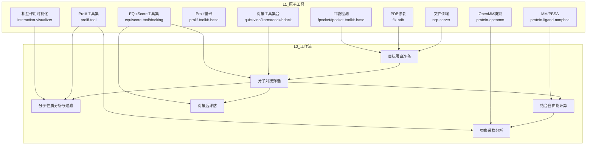

图表来源
- [molclaw-scp-server/README.md](file://docs/prd/molbench_repo/skills/L1_tools/molclaw-scp-server/README.md)
- [molclaw-fix-pdb/README.md](file://docs/prd/molbench_repo/skills/L1_tools/molclaw-fix-pdb/README.md)
- [molclaw-fpocket/README.md](file://docs/prd/molbench_repo/skills/L1_tools/molclaw-fpocket/README.md)
- [molclaw-prolif-tool/README.md](file://docs/prd/molbench_repo/skills/L1_tools/molclaw-prolif-tool/README.md)
- [molclaw-quickvina-docking/README.md](file://docs/prd/molbench_repo/skills/L1_tools/molclaw-quickvina-docking/README.md)
- [molclaw-equiscore-tool/README.md](file://docs/prd/molbench_repo/skills/L1_tools/molclaw-equiscore-tool/README.md)
- [molclaw-protein-ligand-mmpbsa/README.md](file://docs/prd/molbench_repo/skills/L1_tools/molclaw-protein-ligand-mmpbsa/README.md)
- [molclaw-protein-openmm/README.md](file://docs/prd/molbench_repo/skills/L1_tools/molclaw-protein-openmm/README.md)
- [L2_workflows/01-target-protein-preparation.md](file://docs/prd/molbench_repo/skills/L2_workflows/01-target-protein-preparation.md)
- [L2_workflows/02-molecular-docking-screening.md](file://docs/prd/molbench_repo/skills/L2_workflows/02-molecular-docking-screening.md)
- [L2_workflows/03-molecular-property-analysis-filtering.md](file://docs/prd/molbench_repo/skills/L2_workflows/03-molecular-property-analysis-filtering.md)
- [L2_workflows/06-binding-free-energy-calculation.md](file://docs/prd/molbench_repo/skills/L2_workflows/06-binding-free-energy-calculation.md)
- [L2_workflows/07-conformational-sampling-analysis.md](file://docs/prd/molbench_repo/skills/L2_workflows/07-conformational-sampling-analysis.md)
- [L2_workflows/08-post-docking-evaluation.md](file://docs/prd/molbench_repo/skills/L2_workflows/08-post-docking-evaluation.md)

章节来源
- [L2_workflows/01-target-protein-preparation.md](file://docs/prd/molbench_repo/skills/L2_workflows/01-target-protein-preparation.md)
- [L2_workflows/02-molecular-docking-screening.md](file://docs/prd/molbench_repo/skills/L2_workflows/02-molecular-docking-screening.md)
- [L2_workflows/03-molecular-property-analysis-filtering.md](file://docs/prd/molbench_repo/skills/L2_workflows/03-molecular-property-analysis-filtering.md)
- [L2_workflows/06-binding-free-energy-calculation.md](file://docs/prd/molbench_repo/skills/L2_workflows/06-binding-free-energy-calculation.md)
- [L2_workflows/07-conformational-sampling-analysis.md](file://docs/prd/molbench_repo/skills/L2_workflows/07-conformational-sampling-analysis.md)
- [L2_workflows/08-post-docking-evaluation.md](file://docs/prd/molbench_repo/skills/L2_workflows/08-post-docking-evaluation.md)

## 核心组件
本节概述各工具的输入/输出契约、关键参数与典型用法要点。为避免冗长代码，所有实现细节均以“源码路径”形式引用。

- 文件传输（SCP服务器）
  - 功能：在任务节点间安全传输文件，支持断点续传与并发控制
  - 输入：源路径/目标路径、认证凭据、并发度
  - 输出：传输日志、校验摘要（可选）、状态码
  - 参考：[molclaw-scp-server/README.md](file://docs/prd/molbench_repo/skills/L1_tools/molclaw-scp-server/README.md)

- PDB修复（Fix-PDB）
  - 功能：修复缺失残基/原子、补全水分子、去除冲突、标准化命名
  - 输入：PDB或PDBx/mmCIF；修复选项（添加氢、去溶剂化、最小化）
  - 输出：修复后的PDB/PDBx；修复报告（缺失项、替换记录）
  - 参考：[molclaw-fix-pdb/README.md](file://docs/prd/molbench_repo/skills/L1_tools/molclaw-fix-pdb/README.md)

- 相互作用可视化（Interaction Visualizer）
  - 功能：生成蛋白质-配体相互作用图（氢键、疏水、π-堆积等）
  - 输入：复合物结构（PDB/PDBx）、配体ID、可视阈值
  - 输出：交互图（PNG/SVG）、JSON描述
  - 参考：[molclaw-interaction-visualizer/README.md](file://docs/prd/molbench_repo/skills/L1_tools/molclaw-interaction-visualizer/README.md)

- Prolif工具集（ProLIF）
  - 功能：从轨迹/构象中计算相互作用特征（接触、氢键、盐桥、卤键等）
  - 输入：复合物结构或轨迹（PDB/PDBx/MDCRD/NetCDF）、配体定义
  - 输出：结构化指标表（CSV/JSON）、时间序列
  - 参考：
    - [molclaw-prolif-toolkit-base/README.md](file://docs/prd/molbench_repo/skills/L1_tools/molclaw-prolif-toolkit-base/README.md)
    - [molclaw-prolif-tool/README.md](file://docs/prd/molbench_repo/skills/L1_tools/molclaw-prolif-tool/README.md)
    - [molclaw-prolif-docking/README.md](file://docs/prd/molbench_repo/skills/L1_tools/molclaw-prolif-docking/README.md)
    - [molclaw-prolif-md/README.md](file://docs/prd/molbench_repo/skills/L1_tools/molclaw-prolif-md/README.md)
    - [molclaw-prolif-pdb/README.md](file://docs/prd/molbench_repo/skills/L1_tools/molclaw-prolif-pdb/README.md)

- 对接工具（QuickVina/KarmaDock/HDock）
  - 功能：小分子对接到蛋白口袋，输出打分与构象簇
  - 输入：受体（PDB/PDBx）、配体（SDF/MOL2）、搜索空间/网格、采样参数
  - 输出：对接构象（PDBQT/PDB）、打分、聚类统计
  - 参考：
    - [molclaw-quickvina-docking/README.md](file://docs/prd/molbench_repo/skills/L1_tools/molclaw-quickvina-docking/README.md)
    - [molclaw-karmadock-tool/README.md](file://docs/prd/molbench_repo/skills/L1_tools/molclaw-karmadock-tool/README.md)
    - [molclaw-hdock-tool/README.md](file://docs/prd/molbench_repo/skills/L1_tools/molclaw-hdock-tool/README.md)

- EQuiScore工具集
  - 功能：基于能量分解的评分与对比，支持对接后排序
  - 输入：复合物构象、力场参数、环境设置
  - 输出：能量项分解、排名、可视化
  - 参考：
    - [molclaw-equiscore-tool/README.md](file://docs/prd/molbench_repo/skills/L1_tools/molclaw-equiscore-tool/README.md)
    - [molclaw-equiscore-docking/README.md](file://docs/prd/molbench_repo/skills/L1_tools/molclaw-equiscore-docking/README.md)

- MM/PBSA结合自由能计算
  - 功能：基于轨迹计算ΔG_bind，输出各项贡献
  - 输入：轨迹（MDCRD/NetCDF）、拓扑、初始复合物
  - 输出：自由能分解（静电、范德华、极性/非极性溶剂化）、误差估计
  - 参考：[molclaw-protein-ligand-mmpbsa/README.md](file://docs/prd/molbench_repo/skills/L1_tools/molclaw-protein-ligand-mmpbsa/README.md)

- OpenMM分子动力学
  - 功能：体系搭建、平衡与生产运行，输出轨迹与热力学量
  - 输入：复合物、力场、盒子、温度/压力耦合参数
  - 输出：轨迹、能量日志、RMSD/RMSF
  - 参考：[molclaw-protein-openmm/README.md](file://docs/prd/molbench_repo/skills/L1_tools/molclaw-protein-openmm/README.md)

- FPocket口袋检测
  - 功能：识别潜在结合位点，输出口袋几何与打分
  - 输入：蛋白结构（PDB/PDBx）
  - 输出：口袋列表（坐标、体积、疏水性、可成药性指标）
  - 参考：
    - [molclaw-fpocket-toolkit-base/README.md](file://docs/prd/molbench_repo/skills/L1_tools/molclaw-fpocket-toolkit-base/README.md)
    - [molclaw-fpocket/README.md](file://docs/prd/molbench_repo/skills/L1_tools/molclaw-fpocket/README.md)

章节来源
- [molclaw-scp-server/README.md](file://docs/prd/molbench_repo/skills/L1_tools/molclaw-scp-server/README.md)
- [molclaw-fix-pdb/README.md](file://docs/prd/molbench_repo/skills/L1_tools/molclaw-fix-pdb/README.md)
- [molclaw-interaction-visualizer/README.md](file://docs/prd/molbench_repo/skills/L1_tools/molclaw-interaction-visualizer/README.md)
- [molclaw-prolif-toolkit-base/README.md](file://docs/prd/molbench_repo/skills/L1_tools/molclaw-prolif-toolkit-base/README.md)
- [molclaw-prolif-tool/README.md](file://docs/prd/molbench_repo/skills/L1_tools/molclaw-prolif-tool/README.md)
- [molclaw-prolif-docking/README.md](file://docs/prd/molbench_repo/skills/L1_tools/molclaw-prolif-docking/README.md)
- [molclaw-prolif-md/README.md](file://docs/prd/molbench_repo/skills/L1_tools/molclaw-prolif-md/README.md)
- [molclaw-prolif-pdb/README.md](file://docs/prd/molbench_repo/skills/L1_tools/molclaw-prolif-pdb/README.md)
- [molclaw-quickvina-docking/README.md](file://docs/prd/molbench_repo/skills/L1_tools/molclaw-quickvina-docking/README.md)
- [molclaw-karmadock-tool/README.md](file://docs/prd/molbench_repo/skills/L1_tools/molclaw-karmadock-tool/README.md)
- [molclaw-hdock-tool/README.md](file://docs/prd/molbench_repo/skills/L1_tools/molclaw-hdock-tool/README.md)
- [molclaw-equiscore-tool/README.md](file://docs/prd/molbench_repo/skills/L1_tools/molclaw-equiscore-tool/README.md)
- [molclaw-equiscore-docking/README.md](file://docs/prd/molbench_repo/skills/L1_tools/molclaw-equiscore-docking/README.md)
- [molclaw-protein-ligand-mmpbsa/README.md](file://docs/prd/molbench_repo/skills/L1_tools/molclaw-protein-ligand-mmpbsa/README.md)
- [molclaw-protein-openmm/README.md](file://docs/prd/molbench_repo/skills/L1_tools/molclaw-protein-openmm/README.md)
- [molclaw-fpocket-toolkit-base/README.md](file://docs/prd/molbench_repo/skills/L1_tools/molclaw-fpocket-toolkit-base/README.md)
- [molclaw-fpocket/README.md](file://docs/prd/molbench_repo/skills/L1_tools/molclaw-fpocket/README.md)

## 架构总览
整体采用“原子工具→工作流”的分层架构。上层工作流通过声明式编排调用下层工具，统一输入/输出契约，确保可插拔与可扩展。

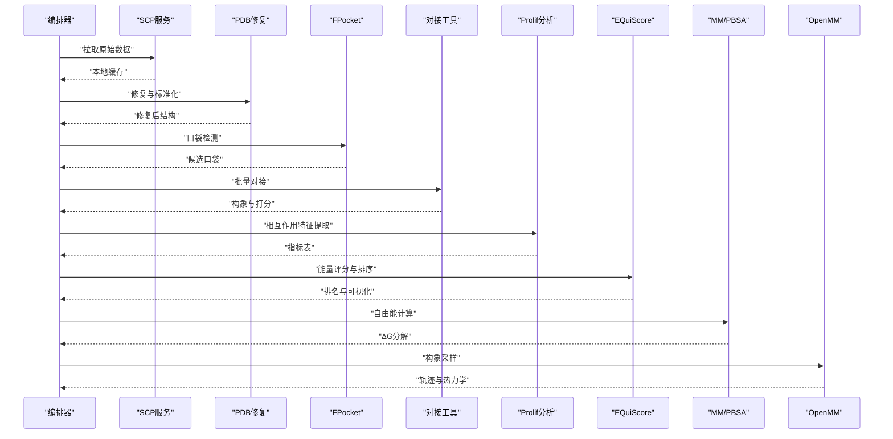

图表来源
- [L2_workflows/01-target-protein-preparation.md](file://docs/prd/molbench_repo/skills/L2_workflows/01-target-protein-preparation.md)
- [L2_workflows/02-molecular-docking-screening.md](file://docs/prd/molbench_repo/skills/L2_workflows/02-molecular-docking-screening.md)
- [L2_workflows/03-molecular-property-analysis-filtering.md](file://docs/prd/molbench_repo/skills/L2_workflows/03-molecular-property-analysis-filtering.md)
- [L2_workflows/06-binding-free-energy-calculation.md](file://docs/prd/molbench_repo/skills/L2_workflows/06-binding-free-energy-calculation.md)
- [L2_workflows/07-conformational-sampling-analysis.md](file://docs/prd/molbench_repo/skills/L2_workflows/07-conformational-sampling-analysis.md)
- [L2_workflows/08-post-docking-evaluation.md](file://docs/prd/molbench_repo/skills/L2_workflows/08-post-docking-evaluation.md)

## 详细组件分析

### 组件A：PDB修复（Fix-PDB）
- 职责：修复缺失残基/原子、加氢、去冲突、标准化命名
- 输入：PDB/PDBx；修复选项（如添加氢、最小化、去溶剂化）
- 输出：修复后结构；修复报告（缺失项、替换记录）
- 错误处理：对不可修复的结构返回诊断信息；支持重试与回退策略
- 性能：大文件分块解析；内存映射读取；并行子链处理

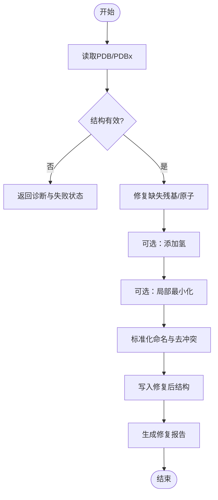

图表来源
- [molclaw-fix-pdb/README.md](file://docs/prd/molbench_repo/skills/L1_tools/molclaw-fix-pdb/README.md)

章节来源
- [molclaw-fix-pdb/README.md](file://docs/prd/molbench_repo/skills/L1_tools/molclaw-fix-pdb/README.md)

### 组件B：相互作用可视化（Interaction Visualizer）
- 职责：生成蛋白质-配体相互作用图与JSON描述
- 输入：复合物结构、配体ID、可视阈值
- 输出：图像（PNG/SVG）、JSON（键类型、距离、角度）
- 兼容性：支持PDB/PDBx；自动识别配体编号与原子类型
- 批处理：按批次生成图像与汇总JSON

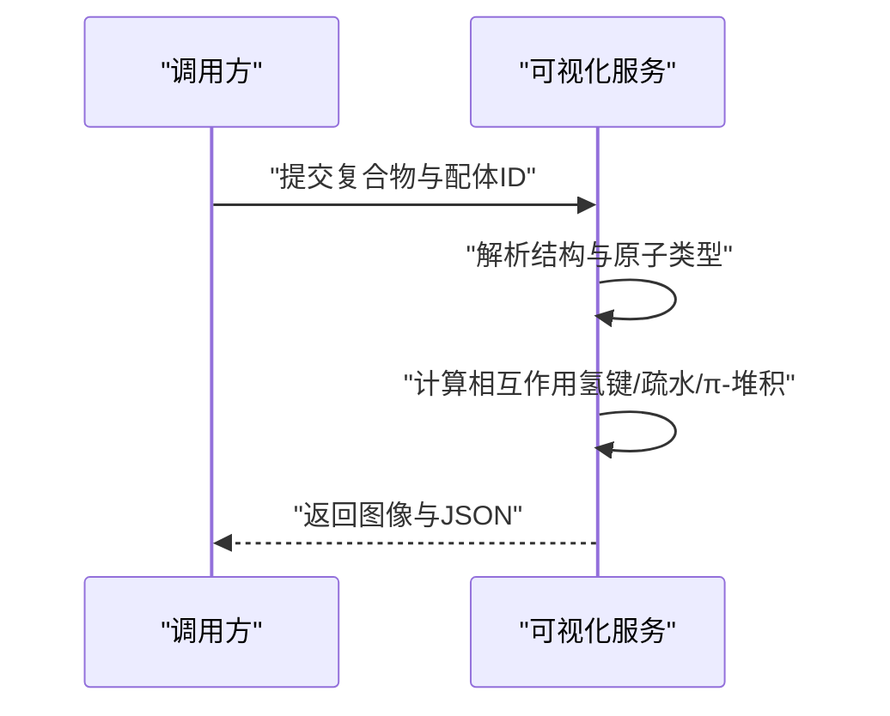

图表来源
- [molclaw-interaction-visualizer/README.md](file://docs/prd/molbench_repo/skills/L1_tools/molclaw-interaction-visualizer/README.md)

章节来源
- [molclaw-interaction-visualizer/README.md](file://docs/prd/molbench_repo/skills/L1_tools/molclaw-interaction-visualizer/README.md)

### 组件C：Prolif工具集（ProLIF）
- 职责：从结构/轨迹中提取相互作用特征，支持对接后与MD轨迹分析
- 输入：复合物结构或轨迹（PDB/PDBx/MDCRD/NetCDF）、配体定义
- 输出：指标表（CSV/JSON）、时间序列
- 关键参数：阈值、相互作用类型、采样频率
- 批处理：按构象/帧遍历，增量写入，避免内存溢出

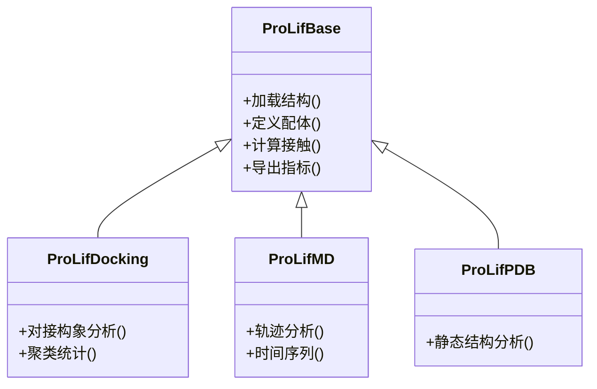

图表来源
- [molclaw-prolif-toolkit-base/README.md](file://docs/prd/molbench_repo/skills/L1_tools/molclaw-prolif-toolkit-base/README.md)
- [molclaw-prolif-tool/README.md](file://docs/prd/molbench_repo/skills/L1_tools/molclaw-prolif-tool/README.md)
- [molclaw-prolif-docking/README.md](file://docs/prd/molbench_repo/skills/L1_tools/molclaw-prolif-docking/README.md)
- [molclaw-prolif-md/README.md](file://docs/prd/molbench_repo/skills/L1_tools/molclaw-prolif-md/README.md)
- [molclaw-prolif-pdb/README.md](file://docs/prd/molbench_repo/skills/L1_tools/molclaw-prolif-pdb/README.md)

章节来源
- [molclaw-prolif-toolkit-base/README.md](file://docs/prd/molbench_repo/skills/L1_tools/molclaw-prolif-toolkit-base/README.md)
- [molclaw-prolif-tool/README.md](file://docs/prd/molbench_repo/skills/L1_tools/molclaw-prolif-tool/README.md)
- [molclaw-prolif-docking/README.md](file://docs/prd/molbench_repo/skills/L1_tools/molclaw-prolif-docking/README.md)
- [molclaw-prolif-md/README.md](file://docs/prd/molbench_repo/skills/L1_tools/molclaw-prolif-md/README.md)
- [molclaw-prolif-pdb/README.md](file://docs/prd/molbench_repo/skills/L1_tools/molclaw-prolif-pdb/README.md)

### 组件D：对接工具（QuickVina/KarmaDock/HDock）
- 职责：将配体对接到蛋白口袋，输出打分与构象簇
- 输入：受体、配体、搜索空间/网格、采样参数
- 输出：构象（PDBQT/PDB）、打分、聚类统计
- 批处理：按配体列表并行对接；结果聚合与去重
- 错误恢复：对接失败重试、降级参数、跳过异常条目

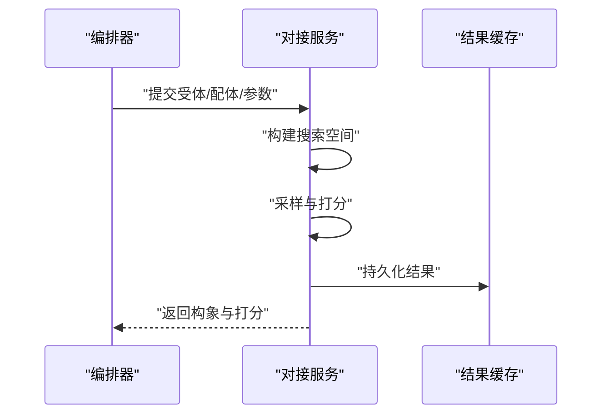

图表来源
- [molclaw-quickvina-docking/README.md](file://docs/prd/molbench_repo/skills/L1_tools/molclaw-quickvina-docking/README.md)
- [molclaw-karmadock-tool/README.md](file://docs/prd/molbench_repo/skills/L1_tools/molclaw-karmadock-tool/README.md)
- [molclaw-hdock-tool/README.md](file://docs/prd/molbench_repo/skills/L1_tools/molclaw-hdock-tool/README.md)

章节来源
- [molclaw-quickvina-docking/README.md](file://docs/prd/molbench_repo/skills/L1_tools/molclaw-quickvina-docking/README.md)
- [molclaw-karmadock-tool/README.md](file://docs/prd/molbench_repo/skills/L1_tools/molclaw-karmadock-tool/README.md)
- [molclaw-hdock-tool/README.md](file://docs/prd/molbench_repo/skills/L1_tools/molclaw-hdock-tool/README.md)

### 组件E：EQuiScore工具集
- 职责：基于能量分解进行评分与排序，支持对接后评估
- 输入：复合物构象、力场参数、环境设置
- 输出：能量项分解、排名、可视化
- 批处理：批量构象评分与排序；结果合并

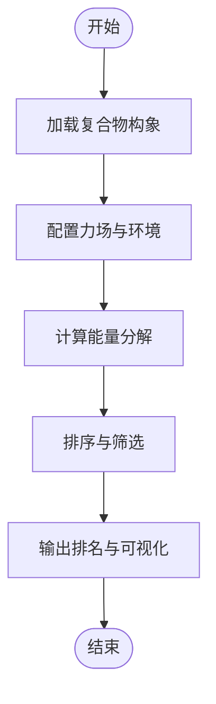

图表来源
- [molclaw-equiscore-tool/README.md](file://docs/prd/molbench_repo/skills/L1_tools/molclaw-equiscore-tool/README.md)
- [molclaw-equiscore-docking/README.md](file://docs/prd/molbench_repo/skills/L1_tools/molclaw-equiscore-docking/README.md)

章节来源
- [molclaw-equiscore-tool/README.md](file://docs/prd/molbench_repo/skills/L1_tools/molclaw-equiscore-tool/README.md)
- [molclaw-equiscore-docking/README.md](file://docs/prd/molbench_repo/skills/L1_tools/molclaw-equiscore-docking/README.md)

### 组件F：MM/PBSA结合自由能计算
- 职责：基于轨迹计算ΔG_bind，输出各项贡献
- 输入：轨迹、拓扑、初始复合物
- 输出：自由能分解、误差估计
- 批处理：按快照采样；增量计算与汇总
- 错误恢复：轨迹断裂检测与插值；失败快照跳过

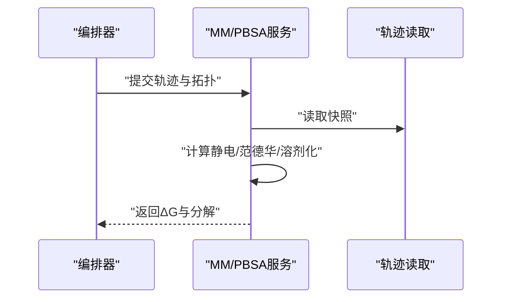

图表来源
- [molclaw-protein-ligand-mmpbsa/README.md](file://docs/prd/molbench_repo/skills/L1_tools/molclaw-protein-ligand-mmpbsa/README.md)

章节来源
- [molclaw-protein-ligand-mmpbsa/README.md](file://docs/prd/molbench_repo/skills/L1_tools/molclaw-protein-ligand-mmpbsa/README.md)

### 组件G：OpenMM分子动力学
- 职责：体系搭建、平衡与生产运行，输出轨迹与热力学量
- 输入：复合物、力场、盒子、温度/压力耦合参数
- 输出：轨迹、能量日志、RMSD/RMSF
- 批处理：多体系并行；检查点与恢复
- 错误恢复：能量发散检测；自动降时步与重启

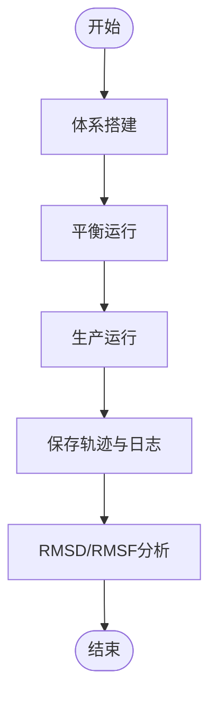

图表来源
- [molclaw-protein-openmm/README.md](file://docs/prd/molbench_repo/skills/L1_tools/molclaw-protein-openmm/README.md)

章节来源
- [molclaw-protein-openmm/README.md](file://docs/prd/molbench_repo/skills/L1_tools/molclaw-protein-openmm/README.md)

### 组件H：FPocket口袋检测
- 职责：识别潜在结合位点，输出口袋几何与打分
- 输入：蛋白结构（PDB/PDBx）
- 输出：口袋列表（坐标、体积、疏水性、可成药性指标）
- 批处理：多蛋白批量检测；结果聚合
- 错误恢复：无效结构跳过；兜底默认口袋

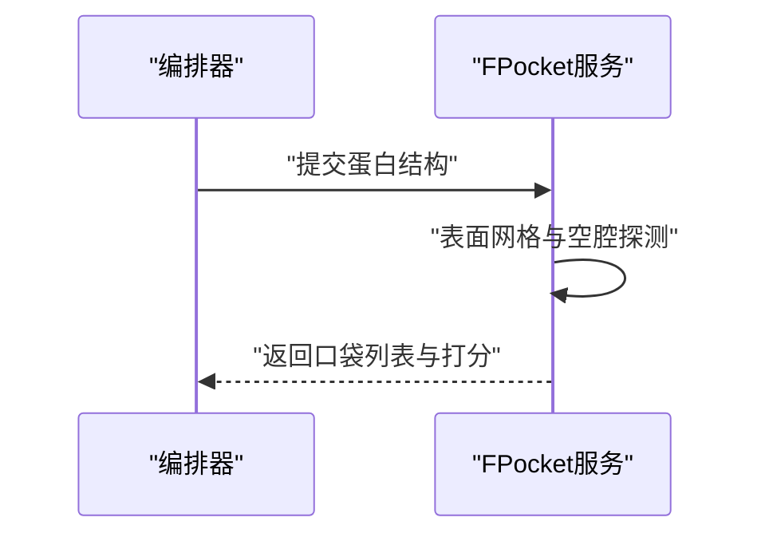

图表来源
- [molclaw-fpocket-toolkit-base/README.md](file://docs/prd/molbench_repo/skills/L1_tools/molclaw-fpocket-toolkit-base/README.md)
- [molclaw-fpocket/README.md](file://docs/prd/molbench_repo/skills/L1_tools/molclaw-fpocket/README.md)

章节来源
- [molclaw-fpocket-toolkit-base/README.md](file://docs/prd/molbench_repo/skills/L1_tools/molclaw-fpocket-toolkit-base/README.md)
- [molclaw-fpocket/README.md](file://docs/prd/molbench_repo/skills/L1_tools/molclaw-fpocket/README.md)

### 组件I：文件传输（SCP服务器）
- 职责：在任务节点间安全传输文件，支持断点续传与并发控制
- 输入：源路径/目标路径、认证凭据、并发度
- 输出：传输日志、校验摘要（可选）、状态码
- 错误恢复：网络中断重试；校验失败重传
- 性能：分块传输；并发队列；带宽限制

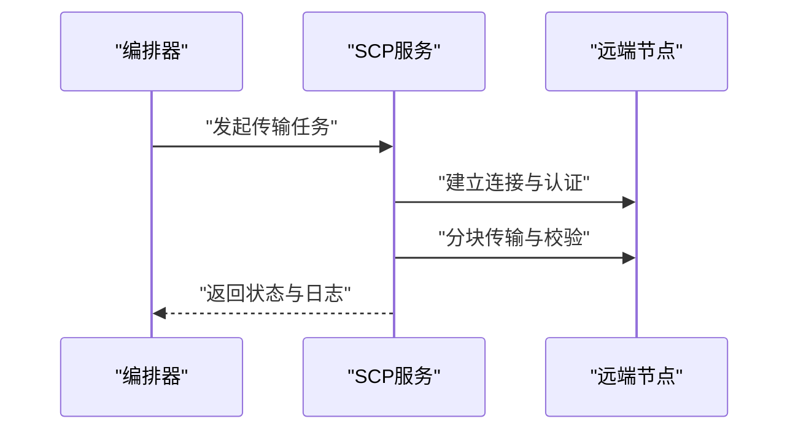

图表来源
- [molclaw-scp-server/README.md](file://docs/prd/molbench_repo/skills/L1_tools/molclaw-scp-server/README.md)

章节来源
- [molclaw-scp-server/README.md](file://docs/prd/molbench_repo/skills/L1_tools/molclaw-scp-server/README.md)

## 依赖关系分析
- 工具内聚性：每个工具围绕单一职责设计，输入/输出契约清晰
- 间接依赖：工作流通过统一契约编排工具，降低耦合
- 外部集成：对接工具、EQuiScore、MM/PBSA、OpenMM、FPocket作为外部依赖被封装
- 循环依赖：无直接循环；通过工作流解耦

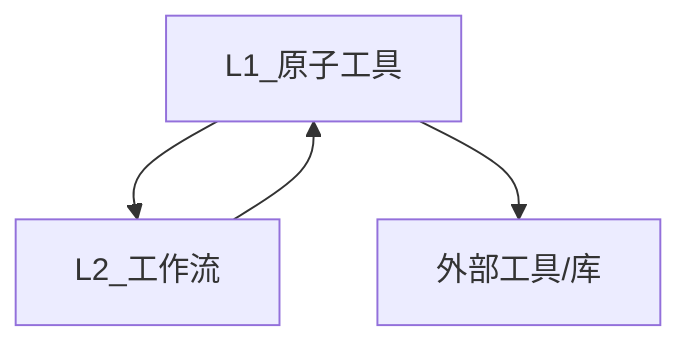

图表来源
- [L2_workflows/01-target-protein-preparation.md](file://docs/prd/molbench_repo/skills/L2_workflows/01-target-protein-preparation.md)
- [L2_workflows/02-molecular-docking-screening.md](file://docs/prd/molbench_repo/skills/L2_workflows/02-molecular-docking-screening.md)
- [L2_workflows/03-molecular-property-analysis-filtering.md](file://docs/prd/molbench_repo/skills/L2_workflows/03-molecular-property-analysis-filtering.md)
- [L2_workflows/06-binding-free-energy-calculation.md](file://docs/prd/molbench_repo/skills/L2_workflows/06-binding-free-energy-calculation.md)
- [L2_workflows/07-conformational-sampling-analysis.md](file://docs/prd/molbench_repo/skills/L2_workflows/07-conformational-sampling-analysis.md)
- [L2_workflows/08-post-docking-evaluation.md](file://docs/prd/molbench_repo/skills/L2_workflows/08-post-docking-evaluation.md)

章节来源
- [L2_workflows/01-target-protein-preparation.md](file://docs/prd/molbench_repo/skills/L2_workflows/01-target-protein-preparation.md)
- [L2_workflows/02-molecular-docking-screening.md](file://docs/prd/molbench_repo/skills/L2_workflows/02-molecular-docking-screening.md)
- [L2_workflows/03-molecular-property-analysis-filtering.md](file://docs/prd/molbench_repo/skills/L2_workflows/03-molecular-property-analysis-filtering.md)
- [L2_workflows/06-binding-free-energy-calculation.md](file://docs/prd/molbench_repo/skills/L2_workflows/06-binding-free-energy-calculation.md)
- [L2_workflows/07-conformational-sampling-analysis.md](file://docs/prd/molbench_repo/skills/L2_workflows/07-conformational-sampling-analysis.md)
- [L2_workflows/08-post-docking-evaluation.md](file://docs/prd/molbench_repo/skills/L2_workflows/08-post-docking-evaluation.md)

## 性能考虑
- 大文件处理
  - 使用分块读取与内存映射，避免一次性加载
  - 增量写入中间结果，减少峰值内存
- 并行与并发
  - 对接与MD任务按批次并行；SCP传输启用并发队列
  - 合理设置线程/进程池大小，避免资源争用
- I/O优化
  - 使用压缩格式（如xz/gzip）存储中间产物
  - 本地缓存热点数据，减少重复计算
- 监控与度量
  - 记录CPU/内存/磁盘I/O与网络吞吐
  - 关键步骤耗时打点，生成性能报告

## 故障排查指南
- 常见错误
  - 结构无效或缺失原子：检查修复报告与输入格式
  - 对接失败：确认搜索空间与网格参数；查看失败日志
  - 轨迹断裂：检测时间戳连续性；必要时插值或截断
  - 传输中断：检查网络连通性与认证；启用断点续传
- 恢复策略
  - 重试与降级参数；失败条目跳过并记录
  - 检查点与恢复；增量计算
- 诊断工具
  - 生成结构化日志与诊断摘要
  - 输出中间产物用于离线分析

章节来源
- [molclaw-fix-pdb/README.md](file://docs/prd/molbench_repo/skills/L1_tools/molclaw-fix-pdb/README.md)
- [molclaw-quickvina-docking/README.md](file://docs/prd/molbench_repo/skills/L1_tools/molclaw-quickvina-docking/README.md)
- [molclaw-protein-openmm/README.md](file://docs/prd/molbench_repo/skills/L1_tools/molclaw-protein-openmm/README.md)
- [molclaw-scp-server/README.md](file://docs/prd/molbench_repo/skills/L1_tools/molclaw-scp-server/README.md)

## 结论
本API文档系统化梳理了数据处理工具的核心能力与接口规范，覆盖从PDB修复、口袋检测、对接筛选、相互作用分析到自由能与MD的全链路。通过统一契约与分层架构，工具具备高内聚、低耦合与良好扩展性。建议在生产环境中结合监控与容错策略，确保大规模批处理的稳定性与效率。

## 附录
- 完整流水线示例
  - 目标蛋白准备：修复与标准化、口袋检测
  - 分子对接筛选：批量对接、聚类与初筛
  - 分子性质分析与过滤：相互作用特征与可视化
  - 结合自由能计算：MM/PBSA分解与排序
  - 构象采样分析：OpenMM轨迹与Prolif时序分析
  - 对接后评估：EQuiScore能量分解与最终排名
- 数据完整性验证
  - 输入格式校验（PDB/PDBx/SDF/MOL2/MDCRD/NetCDF）
  - 结构合理性检查（键合、电荷、立体化学）
  - 输出一致性验证（字段完整性、数值范围）
- 大文件优化策略
  - 分块与流式处理
  - 增量计算与检查点
  - 压缩与归档

章节来源
- [L2_workflows/01-target-protein-preparation.md](file://docs/prd/molbench_repo/skills/L2_workflows/01-target-protein-preparation.md)
- [L2_workflows/02-molecular-docking-screening.md](file://docs/prd/molbench_repo/skills/L2_workflows/02-molecular-docking-screening.md)
- [L2_workflows/03-molecular-property-analysis-filtering.md](file://docs/prd/molbench_repo/skills/L2_workflows/03-molecular-property-analysis-filtering.md)
- [L2_workflows/06-binding-free-energy-calculation.md](file://docs/prd/molbench_repo/skills/L2_workflows/06-binding-free-energy-calculation.md)
- [L2_workflows/07-conformational-sampling-analysis.md](file://docs/prd/molbench_repo/skills/L2_workflows/07-conformational-sampling-analysis.md)
- [L2_workflows/08-post-docking-evaluation.md](file://docs/prd/molbench_repo/skills/L2_workflows/08-post-docking-evaluation.md)