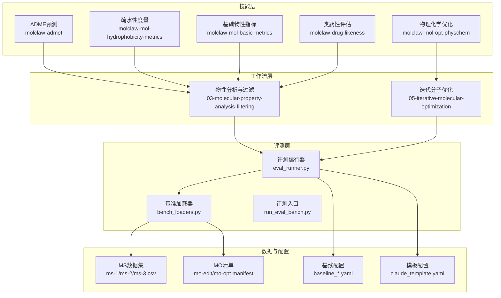
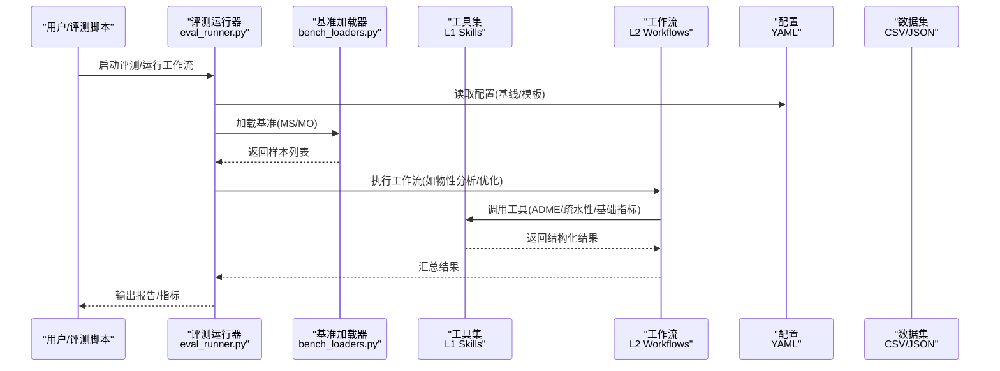
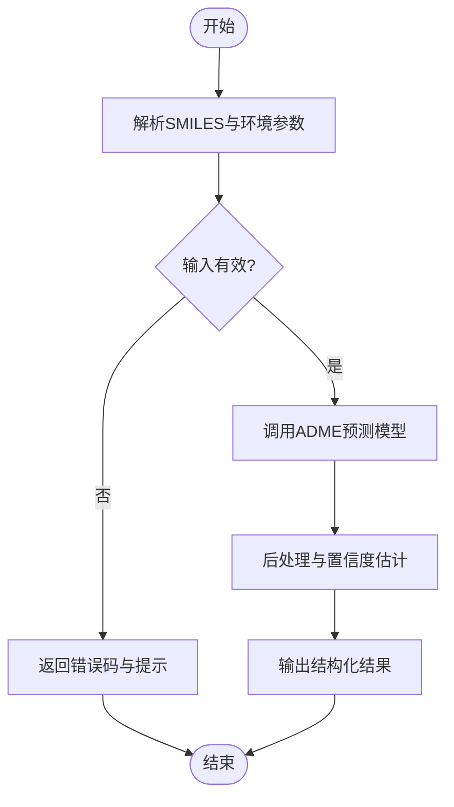
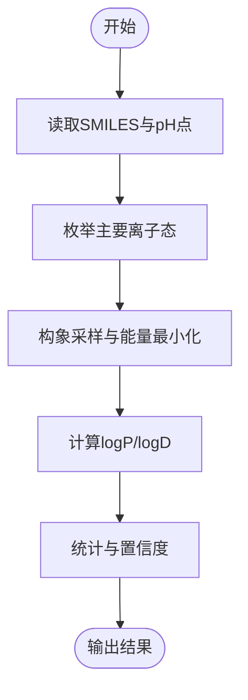
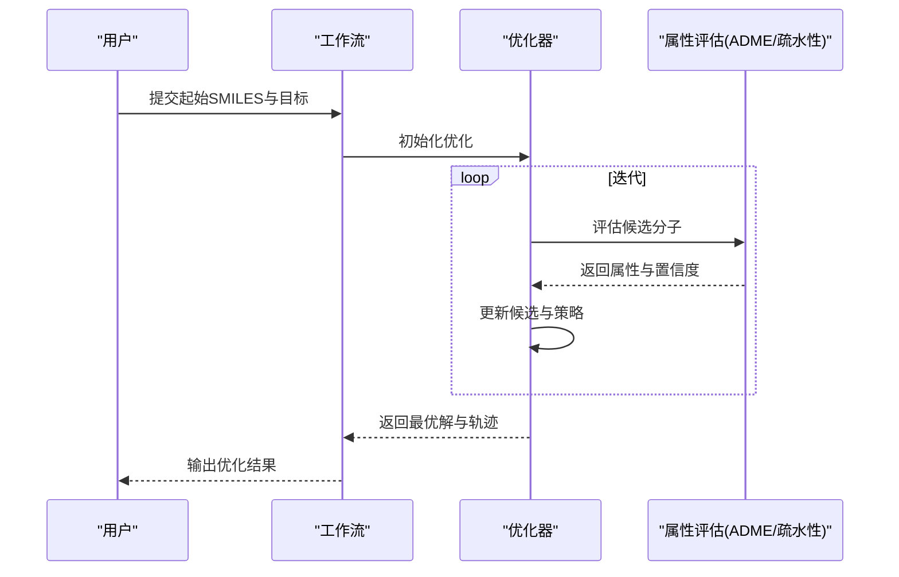
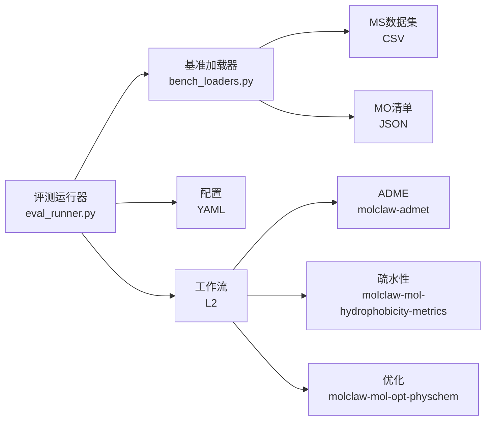

# 物理化学计算工具接口

<cite>
**本文引用的文件**   
- [README.md](file://docs/prd/molbench_repo/README.md)
- [REUSABLE_INDEX.md](file://docs/prd/molbench_repo/REUSABLE_INDEX.md)
- [tool_routing.md](file://docs/prd/molbench_repo/templates/tool_routing.md)
- [variable_routing.md](file://docs/prd/molbench_repo/templates/variable_routing.md)
- [baseline_molbench-ms-1.yaml](file://docs/prd/molbench_repo/config/baseline_molbench-ms-1.yaml)
- [baseline_molbench-ms-2.yaml](file://docs/prd/molbench_repo/config/baseline_molbench-ms-2.yaml)
- [baseline_molbench-ms-3.yaml](file://docs/prd/molbench_repo/config/baseline_molbench-ms-3.yaml)
- [chemcot_mo_edit.yaml](file://docs/prd/molbench_repo/config/chemcot_mo_edit.yaml)
- [chemcot_mo_opt.yaml](file://docs/prd/molbench_repo/config/chemcot_mo_opt.yaml)
- [claude_template.yaml](file://docs/prd/molbench_repo/config/claude_template.yaml)
- [molbench-mo-edit/manifest.json](file://docs/prd/molbench_repo/data_full/molbench-mo/molbench-mo-edit/manifest.json)
- [molbench-mo-opt/manifest.json](file://docs/prd/molbench_repo/data_full/molbench-mo/molbench-mo-opt/manifest.json)
- [molbench-ms-1.csv](file://docs/prd/molbench_repo/data_full/molbench-ms-1/molbench-ms-1.csv)
- [molbench-ms-2.csv](file://docs/prd/molbench_repo/data_full/molbench-ms-2/molbench-ms-2.csv)
- [molbench-ms-3.csv](file://docs/prd/molbench_repo/data_full/molbench-ms-3/molbench-ms-3.csv)
- [eval_runner.py](file://docs/prd/molbench_repo/eval/eval_runner.py)
- [run_eval_bench.py](file://docs/prd/molbench_repo/eval/run_eval_bench.py)
- [bench_loaders.py](file://docs/prd/molbench_repo/eval/bench_loaders.py)
- [__init__.py](file://docs/prd/molbench_repo/eval/__init__.py)
- [molclaw-admet/skill.md](file://docs/prd/molbench_repo/skills/L1_tools/molclaw-admet/skill.md)
- [molclaw-mol-hydrophobicity-metrics/skill.md](file://docs/prd/molbench_repo/skills/L1_tools/molclaw-mol-hydrophobicity-metrics/skill.md)
- [molclaw-mol-opt-physchem/skill.md](file://docs/prd/molbench_repo/skills/L1_tools/molclaw-mol-opt-physchem/skill.md)
- [molclaw-mol-basic-metrics/skill.md](file://docs/prd/molbench_repo/skills/L1_tools/molclaw-mol-basic-metrics/skill.md)
- [molclaw-drug-likeness/skill.md](file://docs/prd/molbench_repo/skills/L1_tools/molclaw-drug-likeness/skill.md)
- [03-molecular-property-analysis-filtering.md](file://docs/prd/molbench_repo/skills/L2_workflows/03-molecular-property-analysis-filtering.md)
- [05-iterative-molecular-optimization.md](file://docs/prd/molbench_repo/skills/L2_workflows/05-iterative-molecular-optimization.md)
</cite>

## 目录
1. [简介](#简介)
2. [项目结构](#项目结构)
3. [核心组件](#核心组件)
4. [架构总览](#架构总览)
5. [详细组件分析](#详细组件分析)
6. [依赖关系分析](#依赖关系分析)
7. [性能与资源考量](#性能与资源考量)
8. [故障排查指南](#故障排查指南)
9. [结论](#结论)
10. [附录](#附录)

## 简介
本文件为“物理化学计算工具”的API文档，聚焦以下能力：
- ADME性质预测（吸收、分布、代谢、排泄）
- 物理化学性质优化（多目标或单目标优化）
- 疏水性度量（如logD/logP等）

文档覆盖输入分子表示方式、参数配置、输出结果格式、置信度评估方法；并提供调用示例路径、参数调优策略、计算方法选择建议、精度控制与资源消耗分析。

## 项目结构
仓库采用“技能（Skill）+工作流（Workflow）+评测（Eval）+数据（Data）+配置（Config）”的分层组织方式：
- L1工具（skills/L1_tools）：原子化科学计算工具，每个工具以skill.md描述其接口规范（输入、参数、输出、单位、约束）。
- L2工作流（skills/L2_workflows）：将多个L1工具编排成端到端流程（如物性分析与过滤、迭代优化）。
- 评测（eval）：提供基准加载器、评测运行器与入口脚本。
- 数据（data_full）：包含MS系列数据集与MO系列任务清单。
- 配置（config）：包含不同场景的基线与模板配置。

图表来源
- [eval_runner.py](file://docs/prd/molbench_repo/eval/eval_runner.py)
- [run_eval_bench.py](file://docs/prd/molbench_repo/eval/run_eval_bench.py)
- [bench_loaders.py](file://docs/prd/molbench_repo/eval/bench_loaders.py)
- [molclaw-admet/skill.md](file://docs/prd/molbench_repo/skills/L1_tools/molclaw-admet/skill.md)
- [molclaw-mol-hydrophobicity-metrics/skill.md](file://docs/prd/molbench_repo/skills/L1_tools/molclaw-mol-hydrophobicity-metrics/skill.md)
- [molclaw-mol-opt-physchem/skill.md](file://docs/prd/molbench_repo/skills/L1_tools/molclaw-mol-opt-physchem/skill.md)
- [molclaw-mol-basic-metrics/skill.md](file://docs/prd/molbench_repo/skills/L1_tools/molclaw-mol-basic-metrics/skill.md)
- [molclaw-drug-likeness/skill.md](file://docs/prd/molbench_repo/skills/L1_tools/molclaw-drug-likeness/skill.md)
- [03-molecular-property-analysis-filtering.md](file://docs/prd/molbench_repo/skills/L2_workflows/03-molecular-property-analysis-filtering.md)
- [05-iterative-molecular-optimization.md](file://docs/prd/molbench_repo/skills/L2_workflows/05-iterative-molecular-optimization.md)
- [molbench-ms-1.csv](file://docs/prd/molbench_repo/data_full/molbench-ms-1/molbench-ms-1.csv)
- [molbench-ms-2.csv](file://docs/prd/molbench_repo/data_full/molbench-ms-2/molbench-ms-2.csv)
- [molbench-ms-3.csv](file://docs/prd/molbench_repo/data_full/molbench-ms-3/molbench-ms-3.csv)
- [molbench-mo-edit/manifest.json](file://docs/prd/molbench_repo/data_full/molbench-mo/molbench-mo-edit/manifest.json)
- [molbench-mo-opt/manifest.json](file://docs/prd/molbench_repo/data_full/molbench-mo/molbench-mo-opt/manifest.json)
- [baseline_molbench-ms-1.yaml](file://docs/prd/molbench_repo/config/baseline_molbench-ms-1.yaml)
- [baseline_molbench-ms-2.yaml](file://docs/prd/molbench_repo/config/baseline_molbench-ms-2.yaml)
- [baseline_molbench-ms-3.yaml](file://docs/prd/molbench_repo/config/baseline_molbench-ms-3.yaml)
- [claude_template.yaml](file://docs/prd/molbench_repo/config/claude_template.yaml)

章节来源
- [README.md](file://docs/prd/molbench_repo/README.md)
- [REUSABLE_INDEX.md](file://docs/prd/molbench_repo/REUSABLE_INDEX.md)

## 核心组件
本节概述各L1工具的接口要点（输入、参数、输出、单位与约束），并给出在评测与工作流中的使用位置。

- ADME预测（molclaw-admet）
  - 输入：SMILES字符串；可选pH、溶剂模型、采样设置等
  - 参数：预测模型版本、阈值、并行度
  - 输出：吸收/分布/代谢/排泄相关指标及置信度
  - 参考：[molclaw-admet/skill.md](file://docs/prd/molbench_repo/skills/L1_tools/molclaw-admet/skill.md)

- 疏水性度量（molclaw-mol-hydrophobicity-metrics）
  - 输入：SMILES；可选pH、离子态枚举策略
  - 参数：logD/pH点、logP算法、构象采样数
  - 输出：logD(logP)值、标准差、采样覆盖率
  - 参考：[molclaw-mol-hydrophobicity-metrics/skill.md](file://docs/prd/molbench_repo/skills/L1_tools/molclaw-mol-hydrophobicity-metrics/skill.md)

- 物理化学优化（molclaw-mol-opt-physchem）
  - 输入：起始SMILES、目标属性范围、权重
  - 参数：优化器类型、步长、最大迭代、收敛阈值
  - 输出：优化后SMILES、属性变化、收敛信息
  - 参考：[molclaw-mol-opt-physchem/skill.md](file://docs/prd/molbench_repo/skills/L1_tools/molclaw-mol-opt-physchem/skill.md)

- 基础物性指标（molclaw-mol-basic-metrics）
  - 输入：SMILES
  - 输出：分子量、重原子数、旋转键数、氢键供体/受体、TPSA等
  - 参考：[molclaw-mol-basic-metrics/skill.md](file://docs/prd/molbench_repo/skills/L1_tools/molclaw-mol-basic-metrics/skill.md)

- 类药性评估（molclaw-drug-likeness）
  - 输入：SMILES
  - 输出：类药性评分、规则命中情况（如Lipinski等）
  - 参考：[molclaw-drug-likeness/skill.md](file://docs/prd/molbench_repo/skills/L1_tools/molclaw-drug-likeness/skill.md)

章节来源
- [molclaw-admet/skill.md](file://docs/prd/molbench_repo/skills/L1_tools/molclaw-admet/skill.md)
- [molclaw-mol-hydrophobicity-metrics/skill.md](file://docs/prd/molbench_repo/skills/L1_tools/molclaw-mol-hydrophobicity-metrics/skill.md)
- [molclaw-mol-opt-physchem/skill.md](file://docs/prd/molbench_repo/skills/L1_tools/molclaw-mol-opt-physchem/skill.md)
- [molclaw-mol-basic-metrics/skill.md](file://docs/prd/molbench_repo/skills/L1_tools/molclaw-mol-basic-metrics/skill.md)
- [molclaw-drug-likeness/skill.md](file://docs/prd/molbench_repo/skills/L1_tools/molclaw-drug-likeness/skill.md)

## 架构总览
系统由“工具—工作流—评测—数据—配置”五层构成。评测运行器负责加载基准、调度工具、汇总结果；工作流将多个工具串联形成端到端任务；配置驱动不同场景与参数。

图表来源
- [eval_runner.py](file://docs/prd/molbench_repo/eval/eval_runner.py)
- [run_eval_bench.py](file://docs/prd/molbench_repo/eval/run_eval_bench.py)
- [bench_loaders.py](file://docs/prd/molbench_repo/eval/bench_loaders.py)
- [03-molecular-property-analysis-filtering.md](file://docs/prd/molbench_repo/skills/L2_workflows/03-molecular-property-analysis-filtering.md)
- [05-iterative-molecular-optimization.md](file://docs/prd/molbench_repo/skills/L2_workflows/05-iterative-molecular-optimization.md)
- [baseline_molbench-ms-1.yaml](file://docs/prd/molbench_repo/config/baseline_molbench-ms-1.yaml)
- [baseline_molbench-ms-2.yaml](file://docs/prd/molbench_repo/config/baseline_molbench-ms-2.yaml)
- [baseline_molbench-ms-3.yaml](file://docs/prd/molbench_repo/config/baseline_molbench-ms-3.yaml)
- [claude_template.yaml](file://docs/prd/molbench_repo/config/claude_template.yaml)
- [molbench-ms-1.csv](file://docs/prd/molbench_repo/data_full/molbench-ms-1/molbench-ms-1.csv)
- [molbench-ms-2.csv](file://docs/prd/molbench_repo/data_full/molbench-ms-2/molbench-ms-2.csv)
- [molbench-ms-3.csv](file://docs/prd/molbench_repo/data_full/molbench-ms-3/molbench-ms-3.csv)
- [molbench-mo-edit/manifest.json](file://docs/prd/molbench_repo/data_full/molbench-mo/molbench-mo-edit/manifest.json)
- [molbench-mo-opt/manifest.json](file://docs/prd/molbench_repo/data_full/molbench-mo/molbench-mo-opt/manifest.json)

## 详细组件分析

### ADME预测接口（molclaw-admet）
- 输入
  - 分子表示：SMILES字符串
  - 可选环境：pH、溶剂、温度
- 参数
  - 模型版本、阈值、并行度、随机种子
- 输出
  - 吸收/分布/代谢/排泄相关指标
  - 置信度（区间或概率）
- 典型用法
  - 在“物性分析与过滤”工作流中作为筛选步骤
  - 在评测中用于生成ADME指标并与基准对比
- 参考实现与说明
  - 接口定义与字段说明见：[molclaw-admet/skill.md](file://docs/prd/molbench_repo/skills/L1_tools/molclaw-admet/skill.md)
  - 工作流集成见：[03-molecular-property-analysis-filtering.md](file://docs/prd/molbench_repo/skills/L2_workflows/03-molecular-property-analysis-filtering.md)

图表来源
- [molclaw-admet/skill.md](file://docs/prd/molbench_repo/skills/L1_tools/molclaw-admet/skill.md)
- [03-molecular-property-analysis-filtering.md](file://docs/prd/molbench_repo/skills/L2_workflows/03-molecular-property-analysis-filtering.md)

章节来源
- [molclaw-admet/skill.md](file://docs/prd/molbench_repo/skills/L1_tools/molclaw-admet/skill.md)
- [03-molecular-property-analysis-filtering.md](file://docs/prd/molbench_repo/skills/L2_workflows/03-molecular-property-analysis-filtering.md)

### 疏水性度量接口（molclaw-mol-hydrophobicity-metrics）
- 输入
  - SMILES；可选pH点集合、离子态枚举策略
- 参数
  - logD/pH点、logP算法、构象采样数、收敛阈值
- 输出
  - logD(logP)值、标准差、采样覆盖率、失败原因
- 典型用法
  - 作为物性分析的独立指标或在优化目标中使用
- 参考实现与说明
  - 接口定义与字段说明见：[molclaw-mol-hydrophobicity-metrics/skill.md](file://docs/prd/molbench_repo/skills/L1_tools/molclaw-mol-hydrophobicity-metrics/skill.md)

图表来源
- [molclaw-mol-hydrophobicity-metrics/skill.md](file://docs/prd/molbench_repo/skills/L1_tools/molclaw-mol-hydrophobicity-metrics/skill.md)

章节来源
- [molclaw-mol-hydrophobicity-metrics/skill.md](file://docs/prd/molbench_repo/skills/L1_tools/molclaw-mol-hydrophobicity-metrics/skill.md)

### 物理化学优化接口（molclaw-mol-opt-physchem）
- 输入
  - 起始SMILES、目标属性范围、权重向量
- 参数
  - 优化器类型、步长、最大迭代、收敛阈值、多样性惩罚
- 输出
  - 优化后SMILES、属性变化、收敛信息、中间轨迹（可选）
- 典型用法
  - 在“迭代分子优化”工作流中循环调用，结合ADME与疏水性反馈
- 参考实现与说明
  - 接口定义与字段说明见：[molclaw-mol-opt-physchem/skill.md](file://docs/prd/molbench_repo/skills/L1_tools/molclaw-mol-opt-physchem/skill.md)
  - 工作流集成见：[05-iterative-molecular-optimization.md](file://docs/prd/molbench_repo/skills/L2_workflows/05-iterative-molecular-optimization.md)

图表来源
- [molclaw-mol-opt-physchem/skill.md](file://docs/prd/molbench_repo/skills/L1_tools/molclaw-mol-opt-physchem/skill.md)
- [05-iterative-molecular-optimization.md](file://docs/prd/molbench_repo/skills/L2_workflows/05-iterative-molecular-optimization.md)

章节来源
- [molclaw-mol-opt-physchem/skill.md](file://docs/prd/molbench_repo/skills/L1_tools/molclaw-mol-opt-physchem/skill.md)
- [05-iterative-molecular-optimization.md](file://docs/prd/molbench_repo/skills/L2_workflows/05-iterative-molecular-optimization.md)

### 基础物性与类药性接口
- 基础物性（molclaw-mol-basic-metrics）
  - 输入：SMILES
  - 输出：MW、HBA/HBD、TPSA、旋转键数等
  - 参考：[molclaw-mol-basic-metrics/skill.md](file://docs/prd/molbench_repo/skills/L1_tools/molclaw-mol-basic-metrics/skill.md)
- 类药性（molclaw-drug-likeness）
  - 输入：SMILES
  - 输出：类药性评分与规则命中
  - 参考：[molclaw-drug-likeness/skill.md](file://docs/prd/molbench_repo/skills/L1_tools/molclaw-drug-likeness/skill.md)

章节来源
- [molclaw-mol-basic-metrics/skill.md](file://docs/prd/molbench_repo/skills/L1_tools/molclaw-mol-basic-metrics/skill.md)
- [molclaw-drug-likeness/skill.md](file://docs/prd/molbench_repo/skills/L1_tools/molclaw-drug-likeness/skill.md)

### 评测与工作流集成
- 评测运行器
  - 负责加载基准、调度工具、汇总结果
  - 参考：[eval_runner.py](file://docs/prd/molbench_repo/eval/eval_runner.py)、[run_eval_bench.py](file://docs/prd/molbench_repo/eval/run_eval_bench.py)
- 基准加载器
  - 支持MS系列CSV与MO系列manifest
  - 参考：[bench_loaders.py](file://docs/prd/molbench_repo/eval/bench_loaders.py)、[molbench-ms-1.csv](file://docs/prd/molbench_repo/data_full/molbench-ms-1/molbench-ms-1.csv)、[molbench-mo-edit/manifest.json](file://docs/prd/molbench_repo/data_full/molbench-mo/molbench-mo-edit/manifest.json)
- 工作流
  - 物性分析与过滤：组合基础指标、ADME、疏水性进行筛选
  - 迭代分子优化：循环调用优化器与评估器
  - 参考：[03-molecular-property-analysis-filtering.md](file://docs/prd/molbench_repo/skills/L2_workflows/03-molecular-property-analysis-filtering.md)、[05-iterative-molecular-optimization.md](file://docs/prd/molbench_repo/skills/L2_workflows/05-iterative-molecular-optimization.md)

章节来源
- [eval_runner.py](file://docs/prd/molbench_repo/eval/eval_runner.py)
- [run_eval_bench.py](file://docs/prd/molbench_repo/eval/run_eval_bench.py)
- [bench_loaders.py](file://docs/prd/molbench_repo/eval/bench_loaders.py)
- [molbench-ms-1.csv](file://docs/prd/molbench_repo/data_full/molbench-ms-1/molbench-ms-1.csv)
- [molbench-ms-2.csv](file://docs/prd/molbench_repo/data_full/molbench-ms-2/molbench-ms-2.csv)
- [molbench-ms-3.csv](file://docs/prd/molbench_repo/data_full/molbench-ms-3/molbench-ms-3.csv)
- [molbench-mo-edit/manifest.json](file://docs/prd/molbench_repo/data_full/molbench-mo/molbench-mo-edit/manifest.json)
- [molbench-mo-opt/manifest.json](file://docs/prd/molbench_repo/data_full/molbench-mo/molbench-mo-opt/manifest.json)
- [03-molecular-property-analysis-filtering.md](file://docs/prd/molbench_repo/skills/L2_workflows/03-molecular-property-analysis-filtering.md)
- [05-iterative-molecular-optimization.md](file://docs/prd/molbench_repo/skills/L2_workflows/05-iterative-molecular-optimization.md)

## 依赖关系分析
- 模块耦合
  - 评测运行器依赖基准加载器与配置；工作流依赖L1工具；工具之间通过统一的结构化输入/输出契约交互。
- 外部依赖
  - 数据格式：CSV（MS）、JSON（MO清单）
  - 配置格式：YAML（基线与模板）
- 潜在循环依赖
  - 当前分层清晰，未见直接循环依赖；若新增工具需确保仅通过工作流或评测运行器间接耦合。

图表来源
- [eval_runner.py](file://docs/prd/molbench_repo/eval/eval_runner.py)
- [bench_loaders.py](file://docs/prd/molbench_repo/eval/bench_loaders.py)
- [baseline_molbench-ms-1.yaml](file://docs/prd/molbench_repo/config/baseline_molbench-ms-1.yaml)
- [baseline_molbench-ms-2.yaml](file://docs/prd/molbench_repo/config/baseline_molbench-ms-2.yaml)
- [baseline_molbench-ms-3.yaml](file://docs/prd/molbench_repo/config/baseline_molbench-ms-3.yaml)
- [claude_template.yaml](file://docs/prd/molbench_repo/config/claude_template.yaml)
- [molclaw-admet/skill.md](file://docs/prd/molbench_repo/skills/L1_tools/molclaw-admet/skill.md)
- [molclaw-mol-hydrophobicity-metrics/skill.md](file://docs/prd/molbench_repo/skills/L1_tools/molclaw-mol-hydrophobicity-metrics/skill.md)
- [molclaw-mol-opt-physchem/skill.md](file://docs/prd/molbench_repo/skills/L1_tools/molclaw-mol-opt-physchem/skill.md)
- [molbench-ms-1.csv](file://docs/prd/molbench_repo/data_full/molbench-ms-1/molbench-ms-1.csv)
- [molbench-mo-edit/manifest.json](file://docs/prd/molbench_repo/data_full/molbench-mo/molbench-mo-edit/manifest.json)

章节来源
- [eval_runner.py](file://docs/prd/molbench_repo/eval/eval_runner.py)
- [bench_loaders.py](file://docs/prd/molbench_repo/eval/bench_loaders.py)
- [baseline_molbench-ms-1.yaml](file://docs/prd/molbench_repo/config/baseline_molbench-ms-1.yaml)
- [baseline_molbench-ms-2.yaml](file://docs/prd/molbench_repo/config/baseline_molbench-ms-2.yaml)
- [baseline_molbench-ms-3.yaml](file://docs/prd/molbench_repo/config/baseline_molbench-ms-3.yaml)
- [claude_template.yaml](file://docs/prd/molbench_repo/config/claude_template.yaml)
- [molclaw-admet/skill.md](file://docs/prd/molbench_repo/skills/L1_tools/molclaw-admet/skill.md)
- [molclaw-mol-hydrophobicity-metrics/skill.md](file://docs/prd/molbench_repo/skills/L1_tools/molclaw-mol-hydrophobicity-metrics/skill.md)
- [molclaw-mol-opt-physchem/skill.md](file://docs/prd/molbench_repo/skills/L1_tools/molclaw-mol-opt-physchem/skill.md)
- [molbench-ms-1.csv](file://docs/prd/molbench_repo/data_full/molbench-ms-1/molbench-ms-1.csv)
- [molbench-mo-edit/manifest.json](file://docs/prd/molbench_repo/data_full/molbench-mo/molbench-mo-edit/manifest.json)

## 性能与资源考量
- 并行与批处理
  - 在评测运行器中启用批量推理与并发调用可显著降低端到端时延；注意限制并发以避免外部服务限流。
- 采样与收敛
  - 疏水性度量与优化过程涉及构象采样与迭代收敛，适当调整采样数与收敛阈值可在精度与耗时间取得平衡。
- 内存与I/O
  - 大规模数据集（MS/CSV）加载时需分页或流式读取；避免一次性载入全部样本导致内存峰值过高。
- 缓存与复用
  - 对重复SMILES的结果进行缓存可减少冗余计算；工作流中可对中间结果做增量更新。

[本节为通用指导，不直接分析具体文件]

## 故障排查指南
- 输入校验失败
  - 检查SMILES合法性、pH与溶剂参数是否在支持范围内；查看工具skill.md中的约束说明。
- 超时与资源不足
  - 降低并发度、减少采样数或迭代次数；检查评测运行器的资源限制配置。
- 结果缺失或异常
  - 确认基准加载器是否正确解析CSV/JSON；核对配置项是否完整；在工作流中增加日志输出定位断点。
- 参考入口
  - 评测入口与运行器：[run_eval_bench.py](file://docs/prd/molbench_repo/eval/run_eval_bench.py)、[eval_runner.py](file://docs/prd/molbench_repo/eval/eval_runner.py)
  - 基准加载器：[bench_loaders.py](file://docs/prd/molbench_repo/eval/bench_loaders.py)

章节来源
- [run_eval_bench.py](file://docs/prd/molbench_repo/eval/run_eval_bench.py)
- [eval_runner.py](file://docs/prd/molbench_repo/eval/eval_runner.py)
- [bench_loaders.py](file://docs/prd/molbench_repo/eval/bench_loaders.py)

## 结论
本接口体系以“工具—工作流—评测—数据—配置”分层设计，提供ADME预测、疏水性度量与物理化学优化的标准化接口。通过统一的输入/输出契约与配置驱动，可在不同场景下灵活组合与扩展。建议在工程实践中关注并行与缓存策略，并在评测中严格遵循基准与配置约定以保证结果可比性。

[本节为总结性内容，不直接分析具体文件]

## 附录

### 输入分子表示与单位约定
- 分子表示：SMILES字符串
- pH与溶剂：按工具skill.md指定范围与默认值
- 数值单位：遵循各工具skill.md的单位说明（如logD无单位、TPSA单位为Ų等）

章节来源
- [molclaw-admet/skill.md](file://docs/prd/molbench_repo/skills/L1_tools/molclaw-admet/skill.md)
- [molclaw-mol-hydrophobicity-metrics/skill.md](file://docs/prd/molbench_repo/skills/L1_tools/molclaw-mol-hydrophobicity-metrics/skill.md)
- [molclaw-mol-basic-metrics/skill.md](file://docs/prd/molbench_repo/skills/L1_tools/molclaw-mol-basic-metrics/skill.md)

### 参数调优指南
- ADME预测
  - 模型版本与阈值：根据目标适应症与监管要求选择；必要时开启不确定性估计。
- 疏水性度量
  - pH点与离子态枚举：覆盖生理相关pH；合理设置构象采样数以稳定logD。
- 物理化学优化
  - 权重与约束：依据先导化合物需求设定；引入多样性惩罚避免局部最优。

章节来源
- [molclaw-admet/skill.md](file://docs/prd/molbench_repo/skills/L1_tools/molclaw-admet/skill.md)
- [molclaw-mol-hydrophobicity-metrics/skill.md](file://docs/prd/molbench_repo/skills/L1_tools/molclaw-mol-hydrophobicity-metrics/skill.md)
- [molclaw-mol-opt-physchem/skill.md](file://docs/prd/molbench_repo/skills/L1_tools/molclaw-mol-opt-physchem/skill.md)

### 计算方法选择策略与精度控制
- 方法选择
  - 快速初筛：基础物性与类药性
  - 精细评估：ADME与疏水性度量
  - 设计迭代：物理化学优化
- 精度控制
  - 提高采样数与迭代上限；引入交叉验证或多模型一致性检验；记录置信度与误差范围。

章节来源
- [03-molecular-property-analysis-filtering.md](file://docs/prd/molbench_repo/skills/L2_workflows/03-molecular-property-analysis-filtering.md)
- [05-iterative-molecular-optimization.md](file://docs/prd/molbench_repo/skills/L2_workflows/05-iterative-molecular-optimization.md)

### 评测与基准
- 基准数据
  - MS系列：CSV格式，包含分子与标签列
  - MO系列：manifest.json描述任务与期望输出
- 评测入口
  - 运行评测脚本与加载器，结合配置执行端到端评估

章节来源
- [molbench-ms-1.csv](file://docs/prd/molbench_repo/data_full/molbench-ms-1/molbench-ms-1.csv)
- [molbench-ms-2.csv](file://docs/prd/molbench_repo/data_full/molbench-ms-2/molbench-ms-2.csv)
- [molbench-ms-3.csv](file://docs/prd/molbench_repo/data_full/molbench-ms-3/molbench-ms-3.csv)
- [molbench-mo-edit/manifest.json](file://docs/prd/molbench_repo/data_full/molbench-mo/molbench-mo-edit/manifest.json)
- [molbench-mo-opt/manifest.json](file://docs/prd/molbench_repo/data_full/molbench-mo/molbench-mo-opt/manifest.json)
- [run_eval_bench.py](file://docs/prd/molbench_repo/eval/run_eval_bench.py)
- [bench_loaders.py](file://docs/prd/molbench_repo/eval/bench_loaders.py)

### 配置与模板
- 基线配置
  - baseline_molbench-ms-1.yaml / ms-2 / ms-3：针对不同MS任务的基线参数
- 模板配置
  - claude_template.yaml：通用模板与变量路由
- 路由与模板
  - tool_routing.md：工具路由策略
  - variable_routing.md：变量路由策略

章节来源
- [baseline_molbench-ms-1.yaml](file://docs/prd/molbench_repo/config/baseline_molbench-ms-1.yaml)
- [baseline_molbench-ms-2.yaml](file://docs/prd/molbench_repo/config/baseline_molbench-ms-2.yaml)
- [baseline_molbench-ms-3.yaml](file://docs/prd/molbench_repo/config/baseline_molbench-ms-3.yaml)
- [claude_template.yaml](file://docs/prd/molbench_repo/config/claude_template.yaml)
- [tool_routing.md](file://docs/prd/molbench_repo/templates/tool_routing.md)
- [variable_routing.md](file://docs/prd/molbench_repo/templates/variable_routing.md)