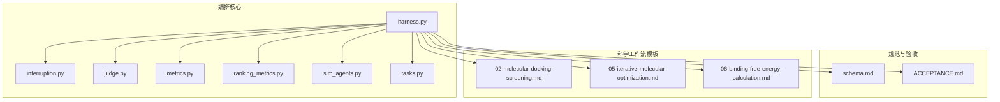
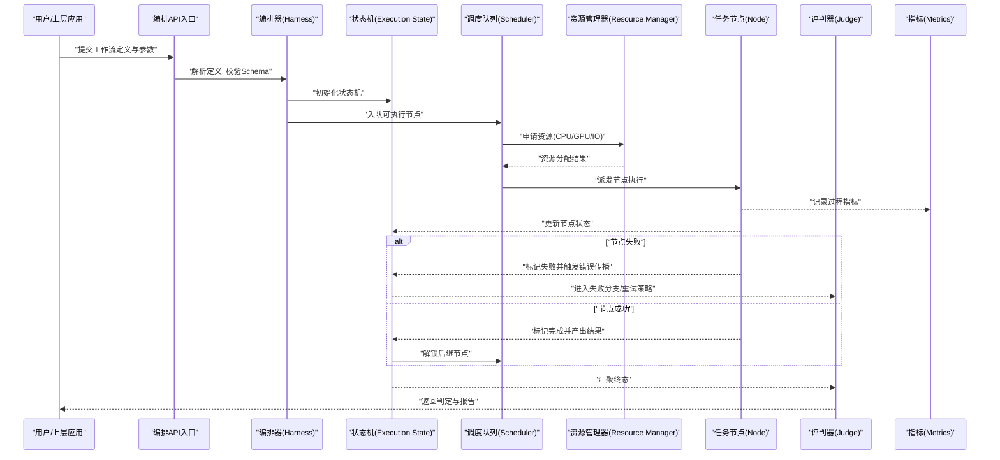
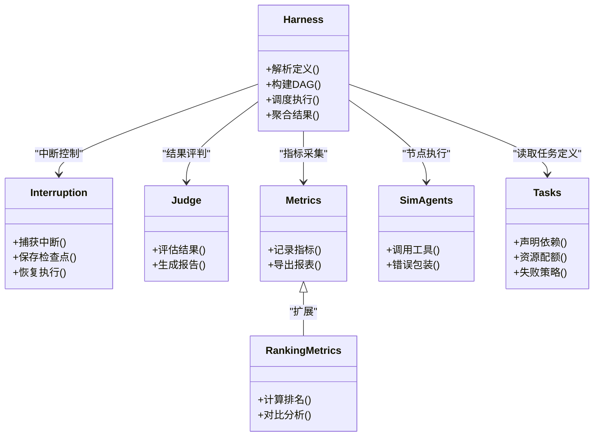

# L2工作流工具接口

<cite>
**本文引用的文件**   
- [autonomy_mvp/core/harness.py](file://autonomy_mvp/core/harness.py)
- [autonomy_mvp/core/interruption.py](file://autonomy_mvp/core/interruption.py)
- [autonomy_mvp/core/judge.py](file://autonomy_mvp/core/judge.py)
- [autonomy_mvp/core/metrics.py](file://autonomy_mvp/core/metrics.py)
- [autonomy_mvp/core/ranking_metrics.py](file://autonomy_mvp/core/ranking_metrics.py)
- [autonomy_mvp/core/sim_agents.py](file://autonomy_mvp/core/sim_agents.py)
- [autonomy_mvp/core/tasks.py](file://autonomy_mvp/core/tasks.py)
- [autonomy_mvp/schema.md](file://autonomy_mvp/schema.md)
- [autonomy_mvp/ACCEPTANCE.md](file://autonomy_mvp/ACCEPTANCE.md)
- [docs/prd/molbench_repo/skills/L2_workflows/02-molecular-docking-screening.md](file://docs/prd/molbench_repo/skills/L2_workflows/02-molecular-docking-screening.md)
- [docs/prd/molbench_repo/skills/L2_workflows/05-iterative-molecular-optimization.md](file://docs/prd/molbench_repo/skills/L2_workflows/05-iterative-molecular-optimization.md)
- [docs/prd/molbench_repo/skills/L2_workflows/06-binding-free-energy-calculation.md](file://docs/prd/molbench_repo/skills/L2_workflows/06-binding-free-energy-calculation.md)
</cite>

## 目录
1. [简介](#简介)
2. [项目结构](#项目结构)
3. [核心组件](#核心组件)
4. [架构总览](#架构总览)
5. [详细组件分析](#详细组件分析)
6. [依赖关系分析](#依赖关系分析)
7. [性能与并发](#性能与并发)
8. [监控、日志与调试](#监控日志与调试)
9. [编排API规范](#编排api规范)
10. [科学工作流定义语法](#科学工作流定义语法)
11. [典型工作流API示例](#典型工作流api示例)
12. [错误处理与传播](#错误处理与传播)
13. [自定义工作流开发指南](#自定义工作流开发指南)
14. [故障排查](#故障排查)
15. [结论](#结论)

## 简介
本文件面向L2工作流工具的编排接口，聚焦于“任务依赖管理、状态机控制、错误传播机制”，并覆盖复杂科学工作流的定义语法、参数传递模式与结果聚合方法。文档同时给出分子对接筛选、迭代分子优化、结合自由能计算等典型工作流的API规范，以及执行引擎的异步调度、并行执行与资源分配接口说明，并提供监控、日志与调试支持能力，最后给出自定义工作流开发与最佳实践建议。

## 项目结构
仓库中与L2工作流编排相关的关键位置包括：
- 编排与执行核心：autonomy_mvp/core 下的 harness、interruption、judge、metrics、ranking_metrics、sim_agents、tasks 等模块
- 工作流定义与验收：autonomy_mvp/schema.md、autonomy_mvp/ACCEPTANCE.md
- 科学工作流模板：docs/prd/molbench_repo/skills/L2_workflows 下包含对接筛选、迭代优化、自由能计算等工作流描述

图表来源
- [autonomy_mvp/core/harness.py](file://autonomy_mvp/core/harness.py)
- [autonomy_mvp/core/interruption.py](file://autonomy_mvp/core/interruption.py)
- [autonomy_mvp/core/judge.py](file://autonomy_mvp/core/judge.py)
- [autonomy_mvp/core/metrics.py](file://autonomy_mvp/core/metrics.py)
- [autonomy_mvp/core/ranking_metrics.py](file://autonomy_mvp/core/ranking_metrics.py)
- [autonomy_mvp/core/sim_agents.py](file://autonomy_mvp/core/sim_agents.py)
- [autonomy_mvp/core/tasks.py](file://autonomy_mvp/core/tasks.py)
- [autonomy_mvp/schema.md](file://autonomy_mvp/schema.md)
- [autonomy_mvp/ACCEPTANCE.md](file://autonomy_mvp/ACCEPTANCE.md)
- [docs/prd/molbench_repo/skills/L2_workflows/02-molecular-docking-screening.md](file://docs/prd/molbench_repo/skills/L2_workflows/02-molecular-docking-screening.md)
- [docs/prd/molbench_repo/skills/L2_workflows/05-iterative-molecular-optimization.md](file://docs/prd/molbench_repo/skills/L2_workflows/05-iterative-molecular-optimization.md)
- [docs/prd/molbench_repo/skills/L2_workflows/06-binding-free-energy-calculation.md](file://docs/prd/molbench_repo/skills/L2_workflows/06-binding-free-energy-calculation.md)

章节来源
- [autonomy_mvp/core/harness.py](file://autonomy_mvp/core/harness.py)
- [autonomy_mvp/schema.md](file://autonomy_mvp/schema.md)
- [autonomy_mvp/ACCEPTANCE.md](file://autonomy_mvp/ACCEPTANCE.md)

## 核心组件
- 编排器（Harness）：负责解析工作流定义、构建任务图、调度执行、收集指标与判定结果。
- 中断控制器（Interruption）：提供可中断的执行语义，支持在长时间运行中安全暂停与恢复。
- 评判器（Judge）：对最终输出进行质量评估与通过性判定。
- 指标系统（Metrics/Ranking Metrics）：采集过程与结果指标，支持排序与对比。
- 模拟代理（Sim Agents）：为工作流节点提供可插拔的Agent或工具调用封装。
- 任务模型（Tasks）：定义任务类型、输入输出契约与依赖声明。

章节来源
- [autonomy_mvp/core/harness.py](file://autonomy_mvp/core/harness.py)
- [autonomy_mvp/core/interruption.py](file://autonomy_mvp/core/interruption.py)
- [autonomy_mvp/core/judge.py](file://autonomy_mvp/core/judge.py)
- [autonomy_mvp/core/metrics.py](file://autonomy_mvp/core/metrics.py)
- [autonomy_mvp/core/ranking_metrics.py](file://autonomy_mvp/core/ranking_metrics.py)
- [autonomy_mvp/core/sim_agents.py](file://autonomy_mvp/core/sim_agents.py)
- [autonomy_mvp/core/tasks.py](file://autonomy_mvp/core/tasks.py)

## 架构总览
下图展示了从工作流定义到执行、监控与产出的端到端流程。

图表来源
- [autonomy_mvp/core/harness.py](file://autonomy_mvp/core/harness.py)
- [autonomy_mvp/core/interruption.py](file://autonomy_mvp/core/interruption.py)
- [autonomy_mvp/core/judge.py](file://autonomy_mvp/core/judge.py)
- [autonomy_mvp/core/metrics.py](file://autonomy_mvp/core/metrics.py)
- [autonomy_mvp/core/ranking_metrics.py](file://autonomy_mvp/core/ranking_metrics.py)
- [autonomy_mvp/core/sim_agents.py](file://autonomy_mvp/core/sim_agents.py)
- [autonomy_mvp/core/tasks.py](file://autonomy_mvp/core/tasks.py)

## 详细组件分析

### 编排器（Harness）
- 职责：加载工作流定义、构建DAG、维护执行状态、驱动调度、聚合结果、触发评判。
- 关键行为：
  - 定义解析与校验：依据 schema 对工作流结构、节点类型、依赖关系进行校验。
  - 状态机推进：节点状态包括待执行、排队中、运行中、成功、失败、已取消、中断等。
  - 错误传播：任一节点失败时，按策略向下游传播（短路、重试、补偿）。
  - 指标采集：在关键阶段埋点，汇总至统一指标存储。
- 扩展点：
  - 自定义节点类型注册
  - 自定义资源分配策略
  - 自定义评判规则

章节来源
- [autonomy_mvp/core/harness.py](file://autonomy_mvp/core/harness.py)
- [autonomy_mvp/schema.md](file://autonomy_mvp/schema.md)

### 中断控制器（Interruption）
- 职责：在执行过程中响应中断信号，保存检查点，保证可恢复性。
- 关键行为：
  - 捕获中断事件，触发当前节点的清理逻辑。
  - 持久化中间状态，支持断点续跑。
  - 与状态机协作，将节点置为“中断”状态以便后续恢复。

章节来源
- [autonomy_mvp/core/interruption.py](file://autonomy_mvp/core/interruption.py)

### 评判器（Judge）
- 职责：基于预设规则或学习模型对工作流最终产物进行评分与通过性判定。
- 关键行为：
  - 读取指标与结果数据。
  - 应用阈值、排序与组合规则。
  - 输出结构化判定报告。

章节来源
- [autonomy_mvp/core/judge.py](file://autonomy_mvp/core/judge.py)

### 指标系统（Metrics / Ranking Metrics）
- 职责：采集过程与结果指标，提供排序与对比能力。
- 关键行为：
  - 标准化指标命名与单位。
  - 支持时间序列与快照式记录。
  - 提供排名计算与可视化所需的数据结构。

章节来源
- [autonomy_mvp/core/metrics.py](file://autonomy_mvp/core/metrics.py)
- [autonomy_mvp/core/ranking_metrics.py](file://autonomy_mvp/core/ranking_metrics.py)

### 模拟代理（Sim Agents）
- 职责：封装外部工具或Agent调用，屏蔽底层差异，提供统一接口给工作流节点使用。
- 关键行为：
  - 参数映射与类型转换。
  - 错误包装与重试策略。
  - 与指标系统对接，记录调用耗时与成功率。

章节来源
- [autonomy_mvp/core/sim_agents.py](file://autonomy_mvp/core/sim_agents.py)

### 任务模型（Tasks）
- 职责：定义任务类型、输入输出契约、依赖声明与资源需求。
- 关键行为：
  - 声明前置依赖与可选依赖。
  - 指定资源配额（CPU/GPU/内存/IO）。
  - 定义失败策略（重试、跳过、短路）。

章节来源
- [autonomy_mvp/core/tasks.py](file://autonomy_mvp/core/tasks.py)

## 依赖关系分析
- 低耦合高内聚：各模块通过明确接口交互，避免直接共享全局状态。
- 关键依赖链：
  - Harness 依赖 Tasks 定义、Interruption 控制、Judge 判定、Metrics 采集、Sim Agents 执行。
  - Sim Agents 可能依赖外部工具或服务，需通过资源管理器进行隔离。
- 潜在循环依赖：应避免在 Tasks 与 Harness 之间形成双向强依赖，建议使用接口抽象。

图表来源
- [autonomy_mvp/core/harness.py](file://autonomy_mvp/core/harness.py)
- [autonomy_mvp/core/interruption.py](file://autonomy_mvp/core/interruption.py)
- [autonomy_mvp/core/judge.py](file://autonomy_mvp/core/judge.py)
- [autonomy_mvp/core/metrics.py](file://autonomy_mvp/core/metrics.py)
- [autonomy_mvp/core/ranking_metrics.py](file://autonomy_mvp/core/ranking_metrics.py)
- [autonomy_mvp/core/sim_agents.py](file://autonomy_mvp/core/sim_agents.py)
- [autonomy_mvp/core/tasks.py](file://autonomy_mvp/core/tasks.py)

章节来源
- [autonomy_mvp/core/harness.py](file://autonomy_mvp/core/harness.py)
- [autonomy_mvp/core/tasks.py](file://autonomy_mvp/core/tasks.py)

## 性能与并发
- 异步调度：采用事件驱动的调度器，支持非阻塞执行与回调通知。
- 并行执行：根据任务依赖与资源可用性，动态提升并发度；对I/O密集型与CPU/GPU密集型任务分别优化。
- 资源分配：通过资源管理器进行配额管理与抢占控制，避免资源争用导致的抖动。
- 批处理与流水线：对相似任务进行批处理，减少启动开销；对长链路任务采用流水线并行。

[本节为通用指导，不直接分析具体文件]

## 监控、日志与调试
- 监控：暴露执行状态、节点进度、资源利用率与指标趋势。
- 日志：结构化日志，包含请求ID、节点ID、时间戳与上下文变量，便于追踪。
- 调试：支持断点、单步执行、回放历史轨迹与差异对比。

章节来源
- [autonomy_mvp/core/metrics.py](file://autonomy_mvp/core/metrics.py)
- [autonomy_mvp/core/judge.py](file://autonomy_mvp/core/judge.py)

## 编排API规范
以下为面向用户的编排接口约定（以概念性描述为主，具体字段以 schema 为准）：

- 创建工作流实例
  - 输入：工作流定义（JSON/YAML）、运行时参数、资源配额、执行选项（重试、超时、中断策略）
  - 输出：工作流实例ID、初始状态、监控URL
  - 错误：定义校验失败、资源不足、权限不足

- 查询工作流状态
  - 输入：工作流实例ID
  - 输出：整体状态、节点状态列表、指标摘要、最近日志片段
  - 错误：实例不存在、权限不足

- 暂停/恢复工作流
  - 输入：工作流实例ID、操作类型（pause/resume）
  - 输出：新状态、检查点位置
  - 错误：不支持的操作、状态冲突

- 终止工作流
  - 输入：工作流实例ID、原因
  - 输出：终止确认、清理状态
  - 错误：已在终止中、权限不足

- 获取结果与报告
  - 输入：工作流实例ID、结果范围（全部/部分）
  - 输出：聚合结果、指标报表、判定报告
  - 错误：结果未就绪、权限不足

- 订阅事件
  - 输入：工作流实例ID、事件类型过滤
  - 输出：事件流（状态变更、指标上报、错误告警）
  - 错误：订阅无效、连接失败

章节来源
- [autonomy_mvp/schema.md](file://autonomy_mvp/schema.md)
- [autonomy_mvp/ACCEPTANCE.md](file://autonomy_mvp/ACCEPTANCE.md)

## 科学工作流定义语法
- 顶层结构
  - id/name/description：工作流标识与元信息
  - inputs：输入参数集合（类型、默认值、约束）
  - nodes：节点列表（类型、依赖、资源、参数映射）
  - edges：边定义（显式依赖，可选）
  - policies：策略配置（重试、超时、中断、错误传播）
  - outputs：输出聚合规则（合并、过滤、排序）

- 节点类型
  - tool：调用外部工具或脚本
  - agent：调用Agent服务
  - compute：本地计算任务
  - io：数据读写与格式转换
  - control：条件分支、循环、汇合

- 依赖与边
  - 显式依赖：node_a -> node_b
  - 隐式依赖：通过数据流自动推断
  - 可选依赖：不影响主路径，用于增强或旁路

- 参数传递模式
  - 静态注入：编译期常量
  - 运行时绑定：从上游节点输出映射
  - 环境变量：从环境注入敏感或平台相关参数
  - 模板表达式：字符串插值与函数调用

- 结果聚合方法
  - 合并：拼接、去重、归一化
  - 过滤：阈值、规则、采样
  - 排序：按指标降序/升序
  - 统计：均值、方差、分位数

章节来源
- [autonomy_mvp/schema.md](file://autonomy_mvp/schema.md)
- [autonomy_mvp/ACCEPTANCE.md](file://autonomy_mvp/ACCEPTANCE.md)

## 典型工作流API示例

### 分子对接筛选
- 目标：对候选分子库进行批量对接，筛选出高亲和力的复合物构象。
- 关键节点
  - 数据准备：分子库下载与预处理
  - 对接计算：并行对接任务（按靶点/配体分组）
  - 结果过滤：基于打分阈值与几何约束
  - 结果聚合：Top-N 列表与可视化数据
- 参数要点
  - 分子库路径、靶点结构、对接软件参数、并发度、阈值
- 错误传播
  - 单个分子对接失败不影响其他分子；汇总失败率与重试策略

章节来源
- [docs/prd/molbench_repo/skills/L2_workflows/02-molecular-docking-screening.md](file://docs/prd/molbench_repo/skills/L2_workflows/02-molecular-docking-screening.md)

### 迭代分子优化
- 目标：基于反馈循环持续改进分子性质，直至满足多目标约束。
- 关键节点
  - 生成/变异：基于规则或模型的分子生成
  - 评估：理化性质、成药性、预测活性
  - 选择：多目标排序与多样性保持
  - 收敛判断：指标稳定或达到最大迭代次数
- 参数要点
  - 生成策略、评估指标权重、收敛阈值、最大迭代数
- 错误传播
  - 单次评估失败可跳过该样本；整体失败需回退到上一代

章节来源
- [docs/prd/molbench_repo/skills/L2_workflows/05-iterative-molecular-optimization.md](file://docs/prd/molbench_repo/skills/L2_workflows/05-iterative-molecular-optimization.md)

### 结合自由能计算
- 目标：对候选复合物进行高精度结合自由能估算，辅助决策。
- 关键节点
  - 体系准备：蛋白-配体复合物构建与溶剂化
  - 采样：MD或增强采样
  - 计算：MM/PBSA、FEP/TI等方法
  - 误差估计：置信区间与敏感性分析
- 参数要点
  - 力场、采样时长、温度/压力、计算方法、并行度
- 错误传播
  - 采样发散或能量爆炸需触发异常路径与回滚

章节来源
- [docs/prd/molbench_repo/skills/L2_workflows/06-binding-free-energy-calculation.md](file://docs/prd/molbench_repo/skills/L2_workflows/06-binding-free-energy-calculation.md)

## 错误处理与传播
- 节点级错误
  - 分类：参数错误、资源不足、外部服务不可用、计算异常
  - 策略：重试（指数退避）、跳过、短路、补偿
- 工作流级错误
  - 传播方向：自顶向下（短路）或自底向上（汇总）
  - 恢复手段：断点续跑、回滚到检查点、降级执行
- 监控与告警
  - 实时告警：失败率、延迟、资源饱和
  - 事后分析：根因定位、影响面评估

章节来源
- [autonomy_mvp/core/interruption.py](file://autonomy_mvp/core/interruption.py)
- [autonomy_mvp/core/judge.py](file://autonomy_mvp/core/judge.py)

## 自定义工作流开发指南
- 步骤
  - 定义工作流：遵循 schema 编写定义文件，明确输入输出与依赖
  - 实现节点：封装工具/Agent，提供统一的输入输出契约
  - 配置策略：设置重试、超时、中断与错误传播策略
  - 测试验证：使用样例数据进行端到端测试与回归
  - 发布与复用：纳入技能索引，提供文档与示例
- 最佳实践
  - 幂等设计：节点可重复执行且结果一致
  - 资源隔离：为不同节点分配独立资源池
  - 可观测性：完善日志与指标埋点
  - 渐进式复杂度：先线性后分支，再引入循环与条件

章节来源
- [autonomy_mvp/schema.md](file://autonomy_mvp/schema.md)
- [autonomy_mvp/ACCEPTANCE.md](file://autonomy_mvp/ACCEPTANCE.md)

## 故障排查
- 常见问题
  - 工作流无法启动：检查定义合法性、资源配额与权限
  - 节点长期挂起：检查外部服务健康、资源竞争与死锁
  - 结果不一致：核对随机种子、缓存与并发顺序
  - 指标缺失：确认埋点是否生效、导出通道是否正常
- 诊断工具
  - 状态查询：获取实例与节点状态
  - 日志检索：按实例/节点/时间范围过滤
  - 指标回溯：查看趋势与异常峰值
  - 回放模式：重现历史执行轨迹

章节来源
- [autonomy_mvp/core/metrics.py](file://autonomy_mvp/core/metrics.py)
- [autonomy_mvp/core/judge.py](file://autonomy_mvp/core/judge.py)

## 结论
本接口文档围绕L2工作流编排的核心能力展开，涵盖定义语法、依赖管理、状态机控制、错误传播、异步调度与并行执行，并结合分子对接筛选、迭代分子优化与结合自由能计算等典型场景给出API规范与实践建议。通过完善的监控、日志与调试支持，以及清晰的自定义开发指南，帮助用户高效构建与运维复杂的科学工作流。