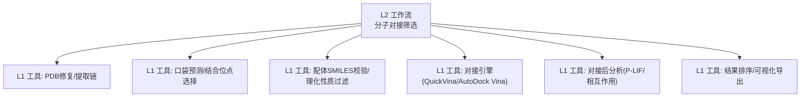
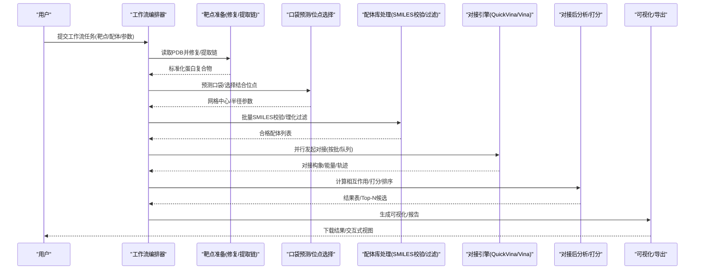
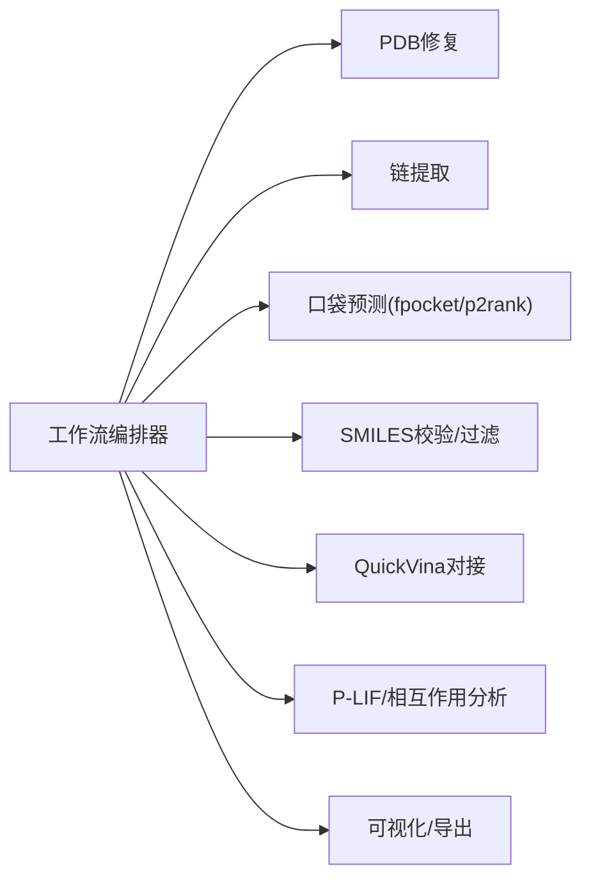

# 分子对接筛选工作流

<cite>
**本文引用的文件**   
- [docs/molbench_repo/skills/L2_workflows/02-molecular-docking-screening.md](file://docs/molbench_repo/skills/L2_workflows/02-molecular-docking-screening.md)
- [docs/molbench_repo/skills/L1_tools/molclaw-quickvina-docking/README.md](file://docs/molbench_repo/skills/L1_tools/molclaw-quickvina-docking/README.md)
- [docs/molbench_repo/skills/L1_tools/molclaw-docking-screening/README.md](file://docs/molbench_repo/skills/L1_tools/molclaw-docking-screening/README.md)
- [docs/molbench_repo/skills/L1_tools/molclaw-prolif-docking/README.md](file://docs/molbench_repo/skills/L1_tools/molclaw-prolif-docking/README.md)
- [docs/molbench_repo/skills/L1_tools/molclaw-interaction-visualizer/README.md](file://docs/molbench_repo/skills/L1_tools/molclaw-interaction-visualizer/README.md)
- [docs/molbench_repo/skills/L1_tools/molclaw-fix-pdb/README.md](file://docs/molbench_repo/skills/L1_tools/molclaw-fix-pdb/README.md)
- [docs/molbench_repo/skills/L1_tools/molclaw-extract-chains/README.md](file://docs/molbench_repo/skills/L1_tools/molclaw-extract-chains/README.md)
- [docs/molbench_repo/skills/L1_tools/molclaw-fpocket-toolkit-base/README.md](file://docs/molbench_repo/skills/L1_tools/molclaw-fpocket-toolkit-base/README.md)
- [docs/molbench_repo/skills/L1_tools/molclaw-p2rank/README.md](file://docs/molbench_repo/skills/L1_tools/molclaw-p2rank/README.md)
- [docs/molbench_repo/skills/L1_tools/molclaw-equiscore-tool/README.md](file://docs/molbench_repo/skills/L1_tools/molclaw-equiscore-tool/README.md)
- [docs/molbench_repo/skills/L1_tools/molclaw-equiscore-docking/README.md](file://docs/molbench_repo/skills/L1_tools/molclaw-equiscore-docking/README.md)
- [docs/molbench_repo/skills/L1_tools/molclaw-prolif-tool/README.md](file://docs/molbench_repo/skills/L1_tools/molclaw-prolif-tool/README.md)
- [docs/molbench_repo/skills/L1_tools/molclaw-mol-basic-metrics/README.md](file://docs/molbench_repo/skills/L1_tools/molclaw-mol-basic-metrics/README.md)
- [docs/molbench_repo/skills/L1_tools/molclaw-mol-hbond-metrics/README.md](file://docs/molbench_repo/skills/L1_tools/molclaw-mol-hbond-metrics/README.md)
- [docs/molbench_repo/skills/L1_tools/molclaw-mol-hydrophobicity-metrics/README.md](file://docs/molbench_repo/skills/L1_tools/molclaw-mol-hydrophobicity-metrics/README.md)
- [docs/molbench_repo/skills/L1_tools/molclaw-mol-complexity-metrics/README.md](file://docs/molbench_repo/skills/L1_tools/molclaw-mol-complexity-metrics/README.md)
- [docs/molbench_repo/skills/L1_tools/molclaw-mol-structure-metrics/README.md](file://docs/molbench_repo/skills/L1_tools/molclaw-mol-structure-metrics/README.md)
- [docs/molbench_repo/skills/L1_tools/molclaw-mol-topology-metrics/README.md](file://docs/molbench_repo/skills/L1_tools/molclaw-mol-topology-metrics/README.md)
- [docs/molbench_repo/skills/L1_tools/molclaw-mol-similarity/README.md](file://docs/molbench_repo/skills/L1_tools/molclaw-mol-similarity/README.md)
- [docs/molbench_repo/skills/L1_tools/molclaw-drug-likeness/README.md](file://docs/molbench_repo/skills/L1_tools/molclaw-drug-likeness/README.md)
- [docs/molbench_repo/skills/L1_tools/molclaw-smiles-valid-check/README.md](file://docs/molbench_repo/skills/L1_tools/molclaw-smiles-valid-check/README.md)
- [docs/molbench_repo/skills/L1_tools/molclaw-sequence-valid-check/README.md](file://docs/molbench_repo/skills/L1_tools/molclaw-sequence-valid-check/README.md)
- [docs/molbench_repo/skills/L1_tools/molclaw-file-transfer/README.md](file://docs/molbench_repo/skills/L1_tools/molclaw-file-transfer/README.md)
- [docs/molbench_repo/skills/L1_tools/molclaw-scp-server/README.md](file://docs/molbench_repo/skills/L1_tools/molclaw-scp-server/README.md)
- [docs/molbench_repo/skills/L1_tools/molclaw-run-bioemu/README.md](file://docs/molbench_repo/skills/L1_tools/molclaw-run-bioemu/README.md)
- [docs/molbench_repo/skills/L1_tools/molclaw-openawsem-tool/README.md](file://docs/molbench_repo/skills/L1_tools/molclaw-openawsem-tool/README.md)
- [docs/molbench_repo/skills/L1_tools/molclaw-protein-openmm/README.md](file://docs/molbench_repo/skills/L1_tools/molclaw-protein-openmm/README.md)
- [docs/molbench_repo/skills/L1_tools/molclaw-protein-protein-mmpbsa/README.md](file://docs/molbench_repo/skills/L1_tools/molclaw-protein-protein-mmpbsa/README.md)
- [docs/molbench_repo/skills/L1_tools/molclaw-protein-ligand-mmpbsa/README.md](file://docs/molbench_repo/skills/L1_tools/molclaw-protein-ligand-mmpbsa/README.md)
- [docs/molbench_repo/skills/L1_tools/molclaw-foldx-tool/README.md](file://docs/molbench_repo/skills/L1_tools/molclaw-foldx-tool/README.md)
- [docs/molbench_repo/skills/L1_tools/molclaw-goca-tool/README.md](file://docs/molbench_repo/skills/L1_tools/molclaw-goca-tool/README.md)
- [docs/molbench_repo/skills/L1_tools/molclaw-karmadock-tool/README.md](file://docs/molbench_repo/skills/L1_tools/molclaw-karmadock-tool/README.md)
- [docs/molbench_repo/skills/L1_tools/molclaw-hdock-tool/README.md](file://docs/molbench_repo/skills/L1_tools/molclaw-hdock-tool/README.md)
- [docs/molbench_repo/skills/L1_tools/molclaw-diffdock-auto/README.md](file://docs/molbench_repo/skills/L1_tools/molclaw-diffdock-auto/README.md)
- [docs/molbench_repo/skills/L1_tools/molclaw-evobind-tool/README.md](file://docs/molbench_repo/skills/L1_tools/molclaw-evobind-tool/README.md)
- [docs/molbench_repo/skills/L1_tools/molclaw-chai1-predict/README.md](file://docs/molbench_repo/skills/L1_tools/molclaw-chai1-predict/README.md)
- [docs/molbench_repo/skills/L1_tools/molclaw-esmfold/README.md](file://docs/molbench_repo/skills/L1_tools/molclaw-esmfold/README.md)
- [docs/molbench_repo/skills/L1_tools/molclaw-pulchura-rebuild/README.md](file://docs/molbench_repo/skills/L1_tools/molclaw-pulchura-rebuild/README.md)
- [docs/molbench_repo/skills/L1_tools/molclaw-pack-sidechains/README.md](file://docs/molbench_repo/skills/L1_tools/molclaw-pack-sidechains/README.md)
- [docs/molbench_repo/skills/L1_tools/molclaw-peptide-sampling/README.md](file://docs/molbench_repo/skills/L1_tools/molclaw-peptide-sampling/README.md)
- [docs/molbench_repo/skills/L1_tools/molclaw-rgroup-sampling/README.md](file://docs/molbench_repo/skills/L1_tools/molclaw-rgroup-sampling/README.md)
- [docs/molbench_repo/skills/L1_tools/molclaw-mol2mol-sampling/README.md](file://docs/molbench_repo/skills/L1_tools/molclaw-mol2mol-sampling/README.md)
- [docs/molbench_repo/skills/L1_tools/molclaw-compound-retrieve/README.md](file://docs/molbench_repo/skills/L1_tools/molclaw-compound-retrieve/README.md)
- [docs/molbench_repo/skills/L1_tools/molclaw-chroma-toolkit/README.md](file://docs/molbench_repo/skills/L1_tools/molclaw-chroma-toolkit/README.md)
- [docs/molbench_repo/skills/L1_tools/molclaw-prolif-md/README.md](file://docs/molbench_repo/skills/L1_tools/molclaw-prolif-md/README.md)
- [docs/molbench_repo/skills/L1_tools/molclaw-prolif-pdb/README.md](file://docs/molbench_repo/skills/L1_tools/molclaw-prolif-pdb/README.md)
- [docs/molbench_repo/skills/L1_tools/molclaw-prolif-protein-protein/README.md](file://docs/molbench_repo/skills/L1_tools/molclaw-prolif-protein-protein/README.md)
- [docs/molbench_repo/skills/L1_tools/molclaw-protein-sequence-retrieve/README.md](file://docs/molbench_repo/skills/L1_tools/molclaw-protein-sequence-retrieve/README.md)
- [docs/molbench_repo/skills/L1_tools/molclaw-protein-structure-retrieve/README.md](file://docs/molbench_repo/skills/L1_tools/molclaw-protein-structure-retrieve/README.md)
- [docs/molbench_repo/skills/L1_tools/molclaw-pdbfixer/README.md](file://docs/molbench_repo/skills/L1_tools/molclaw-pdbfixer/README.md)
- [docs/molbench_repo/skills/L1_tools/molclaw-linker-sampling/README.md](file://docs/molbench_repo/skills/L1_tools/molclaw-linker-sampling/README.md)
- [docs/molbench_repo/skills/L1_tools/molclaw-smiles-fg-editor/README.md](file://docs/molbench_repo/skills/L1_tools/molclaw-smiles-fg编辑器/README.md)
- [docs/molbench_repo/skills/L1_tools/molclaw-dleps/README.md](file://docs/molbench_repo/skills/L1_tools/molclaw-dleps/README.md)
- [docs/molbench_repo/skills/L1_tools/molclaw-denovo-sampling/README.md](file://docs/molbench_repo/skills/L1_tools/molclaw-denovo-sampling/README.md)
- [docs/molbench_repo/skills/L1_tools/molclaw-mol-opt-physchem/README.md](file://docs/molbench_repo/skills/L1_tools/molclaw-mol-opt-physchem/README.md)
- [docs/molbench_repo/skills/L1_tools/molclaw-mol-charge-metrics/README.md](file://docs/molbench_repo/skills/L1_tools/molclaw-mol-charge-metrics/README.md)
- [docs/molbench_repo/skills/L1_tools/molclaw-molclaw-skill-template-writer/README.md](file://docs/molbench_repo/skills/L1_tools/molclaw-molclaw-skill-template-writer/README.md)
- [docs/molbench_repo/skills/L1_tools/molclaw-molclaw-admet/README.md](file://docs/molbench_repo/skills/L1_tools/molclaw-molclaw-admet/README.md)
- [docs/molbench_repo/skills/L1_tools/molclaw-molclaw-boltz2-affinity/README.md](file://docs/molbench_repo/skills/L1_tools/molclaw-molclaw-boltz2-affinity/README.md)
- [docs/molbench_repo/skills/L1_tools/molclaw-molclaw-equiscore-tool/README.md](file://docs/molbench_repo/skills/L1_tools/molclaw-molclaw-equiscore-tool/README.md)
- [docs/molbench_repo/skills/L1_tools/molclaw-molclaw-equiscore-docking/README.md](file://docs/molbench_repo/skills/L1_tools/molclaw-molclaw-equiscore-docking/README.md)
- [docs/molbench_repo/skills/L1_tools/molclaw-molclaw-prolif-docking/README.md](file://docs/molbench_repo/skills/L1_tools/molclaw-molclaw-prolif-docking/README.md)
- [docs/molbench_repo/skills/L1_tools/molclaw-molclaw-prolif-tool/README.md](file://docs/molbench_repo/skills/L1_tools/molclaw-molclaw-prolif-tool/README.md)
- [docs/molbench_repo/skills/L1_tools/molclaw-molclaw-interaction-visualizer/README.md](file://docs/molbench_repo/skills/L1_tools/molclaw-molclaw-interaction-visualizer/README.md)
- [docs/molbench_repo/skills/L1_tools/molclaw-molclaw-fix-pdb/README.md](file://docs/molbench_repo/skills/L1_tools/molclaw-molclaw-fix-pdb/README.md)
- [docs/molbench_repo/skills/L1_tools/molclaw-molclaw-extract-chains/README.md](file://docs/molbench_repo/skills/L1_tools/molclaw-molclaw-extract-chains/README.md)
- [docs/molbench_repo/skills/L1_tools/molclaw-molclaw-fpocket-toolkit-base/README.md](file://docs/molbench_repo/skills/L1_tools/molclaw-molclaw-fpocket-toolkit-base/README.md)
- [docs/molbench_repo/skills/L1_tools/molclaw-molclaw-p2rank/README.md](file://docs/molbench_repo/skills/L1_tools/molclaw-molclaw-p2rank/README.md)
- [docs/molbench_repo/skills/L1_tools/molclaw-molclaw-quickvina-docking/README.md](file://docs/molbench_repo/skills/L1_tools/molclaw-molclaw-quickvina-docking/README.md)
- [docs/molbench_repo/skills/L1_tools/molclaw-molclaw-docking-screening/README.md](file://docs/molbench_repo/skills/L1_tools/molclaw-molclaw-docking-screening/README.md)
- [docs/molbench_repo/skills/L1_tools/molclaw-molclaw-prolif-md/README.md](file://docs/molbench_repo/skills/L1_tools/molclaw-molclaw-prolif-md/README.md)
- [docs/molbench_repo/skills/L1_tools/molclaw-molclaw-prolif-pdb/README.md](file://docs/molbench_repo/skills/L1_tools/molclaw-molclaw-prolif-pdb/README.md)
- [docs/molbench_repo/skills/L1_tools/molclaw-molclaw-prolif-protein-protein/README.md](file://docs/molbench_repo/skills/L1_tools/molclaw-molclaw-prolif-protein-protein/README.md)
- [docs/molbench_repo/skills/L1_tools/molclaw-molclaw-protein-openmm/README.md](file://docs/molbench_repo/skills/L1_tools/molclaw-molclaw-protein-openmm/README.md)
- [docs/molbench_repo/skills/L1_tools/molclaw-molclaw-protein-ligand-mmpbsa/README.md](file://docs/molbench_repo/skills/L1_tools/molclaw-molclaw-protein-ligand-mmpbsa/README.md)
- [docs/molbench_repo/skills/L1_tools/molclaw-molclaw-protein-protein-mmpbsa/README.md](file://docs/molbench_repo/skills/L1_tools/molclaw-molclaw-protein-protein-mmpbsa/README.md)
- [docs/molbench_repo/skills/L1_tools/molclaw-molclaw-foldx-tool/README.md](file://docs/molbench_repo/skills/L1_tools/molclaw-molclaw-foldx-tool/README.md)
- [docs/molbench_repo/skills/L1_tools/molclaw-molclaw-goca-tool/README.md](file://docs/molbench_repo/skills/L1_tools/molclaw-molclaw-goca-tool/README.md)
- [docs/molbench_repo/skills/L1_tools/molclaw-molclaw-karmadock-tool/README.md](file://docs/molbench_repo/skills/L1_tools/molclaw-molclaw-karmadock-tool/README.md)
- [docs/molbench_repo/skills/L1_tools/molclaw-molclaw-hdock-tool/README.md](file://docs/molbench_repo/skills/L1_tools/molclaw-molclaw-hdock-tool/README.md)
- [docs/molbench_repo/skills/L1_tools/molclaw-molclaw-diffdock-auto/README.md](file://docs/molbench_repo/skills/L1_tools/molclaw-molclaw-diffdock-auto/README.md)
- [docs/molbench_repo/skills/L1_tools/molclaw-molclaw-evobind-tool/README.md](file://docs/molbench_repo/skills/L1_tools/molclaw-molclaw-evobind-tool/README.md)
- [docs/molbench_repo/skills/L1_tools/molclaw-molclaw-chai1-predict/README.md](file://docs/molbench_repo/skills/L1_tools/molclaw-molclaw-chai1-predict/README.md)
- [docs/molbench_repo/skills/L1_tools/molclaw-molclaw-esmfold/README.md](file://docs/molbench_repo/skills/L1_tools/molclaw-molclaw-esmfold/README.md)
- [docs/molbench_repo/skills/L1_tools/molclaw-molclaw-pulchura-rebuild/README.md](file://docs/molbench_repo/skills/L1_tools/molclaw-molclaw-pulchura-rebuild/README.md)
- [docs/molbench_repo/skills/L1_tools/molclaw-molclaw-pack-sidechains/README.md](file://docs/molbench_repo/skills/L1_tools/molclaw-molclaw-pack-sidechains/README.md)
- [docs/molbench_repo/skills/L1_tools/molclaw-molclaw-peptide-sampling/README.md](file://docs/molbench_repo/skills/L1_tools/molclaw-molclaw-peptide-sampling/README.md)
- [docs/molbench_repo/skills/L1_tools/molclaw-molclaw-rgroup-sampling/README.md](file://docs/molbench_repo/skills/L1_tools/molclaw-molclaw-rgroup-sampling/README.md)
- [docs/molbench_repo/skills/L1_tools/molclaw-molclaw-mol2mol-sampling/README.md](file://docs/molbench_repo/skills/L1_tools/molclaw-molclaw-mol2mol-sampling/README.md)
- [docs/molbench_repo/skills/L1_tools/molclaw-molclaw-compound-retrieve/README.md](file://docs/molbench_repo/skills/L1_tools/molclaw-molclaw-compound-retrieve/README.md)
- [docs/molbench_repo/skills/L1_tools/molclaw-molclaw-chroma-toolkit/README.md](file://docs/molbench_repo/skills/L1_tools/molclaw-molclaw-chroma-toolkit/README.md)
- [docs/molbench_repo/skills/L1_tools/molclaw-molclaw-protein-sequence-retrieve/README.md](file://docs/molbench_repo/skills/L1_tools/molclaw-molclaw-protein-sequence-retrieve/README.md)
- [docs/molbench_repo/skills/L1_tools/molclaw-molclaw-protein-structure-retrieve/README.md](file://docs/molbench_repo/skills/L1_tools/molclaw-molclaw-protein-structure-retrieve/README.md)
- [docs/molbench_repo/skills/L1_tools/molclaw-molclaw-pdbfixer/README.md](file://docs/molbench_repo/skills/L1_tools/molclaw-molclaw-pdbfixer/README.md)
- [docs/molbench_repo/skills/L1_tools/molclaw-molclaw-linker-sampling/README.md](file://docs/molbench_repo/skills/L1_tools/molclaw-molclaw-linker-sampling/README.md)
- [docs/molbench_repo/skills/L1_tools/molclaw-molclaw-smiles-fg-editor/README.md](file://docs/molbench_repo/skills/L1_tools/molclaw-molclaw-smiles-fg-editor/README.md)
- [docs/molbench_repo/skills/L1_tools/molclaw-molclaw-dleps/README.md](file://docs/molbench_repo/skills/L1_tools/molclaw-molclaw-dleps/README.md)
- [docs/molbench_repo/skills/L1_tools/molclaw-molclaw-denovo-sampling/README.md](file://docs/molbench_repo/skills/L1_tools/molclaw-molclaw-denovo-sampling/README.md)
- [docs/molbench_repo/skills/L1_tools/molclaw-molclaw-mol-opt-physchem/README.md](file://docs/molbench_repo/skills/L1_tools/molclaw-molclaw-mol-opt-physchem/README.md)
- [docs/molbench_repo/skills/L1_tools/molclaw-molclaw-mol-charge-metrics/README.md](file://docs/molbench_repo/skills/L1_tools/molclaw-molclaw-mol-charge-metrics/README.md)
- [docs/molbench_repo/skills/L1_tools/molclaw-molclaw-molclaw-skill-template-writer/README.md](file://docs/molbench_repo/skills/L1_tools/molclaw-molclaw-molclaw-skill-template-writer/README.md)
- [docs/molbench_repo/skills/L1_tools/molclaw-molclaw-molclaw-admet/README.md](file://docs/molbench_repo/skills/L1_tools/molclaw-molclaw-molclaw-admet/README.md)
- [docs/molbench_repo/skills/L1_tools/molclaw-molclaw-molclaw-boltz2-affinity/README.md](file://docs/molbench_repo/skills/L1_tools/molclaw-molclaw-molclaw-boltz2-affinity/README.md)
- [docs/molbench_repo/skills/L1_tools/molclaw-molclaw-molclaw-equiscore-tool/README.md](file://docs/molbench_repo/skills/L1_tools/molclaw-molclaw-molclaw-equiscore-tool/README.md)
- [docs/molbench_repo/skills/L1_tools/molclaw-molclaw-molclaw-equiscore-docking/README.md](file://docs/molbench_repo/skills/L1_tools/molclaw-molclaw-molclaw-equiscore-docking/README.md)
- [docs/molbench_repo/skills/L1_tools/molclaw-molclaw-molclaw-prolif-docking/README.md](file://docs/molbench_repo/skills/L1_tools/molclaw-molclaw-molclaw-prolif-docking/README.md)
- [docs/molbench_repo/skills/L1_tools/molclaw-molclaw-molclaw-prolif-tool/README.md](file://docs/molbench_repo/skills/L1_tools/molclaw-molclaw-molclaw-prolif-tool/README.md)
- [docs/molbench_repo/skills/L1_tools/molclaw-molclaw-molclaw-interaction-visualizer/README.md](file://docs/molbench_repo/skills/L1_tools/molclaw-molclaw-molclaw-interaction-visualizer/README.md)
- [docs/molbench_repo/skills/L1_tools/molclaw-molclaw-molclaw-fix-pdb/README.md](file://docs/molbench_repo/skills/L1_tools/molclaw-molclaw-molclaw-fix-pdb/README.md)
- [docs/molbench_repo/skills/L1_tools/molclaw-molclaw-molclaw-extract-chains/README.md](file://docs/molbench_repo/skills/L1_tools/molclaw-molclaw-molclaw-extract-chains/README.md)
- [docs/molbench_repo/skills/L1_tools/molclaw-molclaw-molclaw-fpocket-toolkit-base/README.md](file://docs/molbench_repo/skills/L1_tools/molclaw-molclaw-molclaw-fpocket-toolkit-base/README.md)
- [docs/molbench_repo/skills/L1_tools/molclaw-molclaw-molclaw-p2rank/README.md](file://docs/molbench_repo/skills/L1_tools/molclaw-molclaw-molclaw-p2rank/README.md)
- [docs/molbench_repo/skills/L1_tools/molclaw-molclaw-molclaw-quickvina-docking/README.md](file://docs/molbench_repo/skills/L1_tools/molclaw-molclaw-molclaw-quickvina-docking/README.md)
- [docs/molbench_repo/skills/L1_tools/molclaw-molclaw-molclaw-docking-screening/README.md](file://docs/molbench_repo/skills/L1_tools/molclaw-molclaw-molclaw-docking-screening/README.md)
- [docs/molbench_repo/skills/L1_tools/molclaw-molclaw-molclaw-prolif-md/README.md](file://docs/molbench_repo/skills/L1_tools/molclaw-molclaw-molclaw-prolif-md/README.md)
- [docs/molbench_repo/skills/L1_tools/molclaw-molclaw-molclaw-prolif-pdb/README.md](file://docs/molbench_repo/skills/L1_tools/molclaw-molclaw-molclaw-prolif-pdb/README.md)
- [docs/molbench_repo/skills/L1_tools/molclaw-molclaw-molclaw-prolif-protein-protein/README.md](file://docs/molbench_repo/skills/L1_tools/molclaw-molclaw-molclaw-prolif-protein-protein/README.md)
- [docs/molbench_repo/skills/L1_tools/molclaw-molclaw-molclaw-protein-openmm/README.md](file://docs/molbench_repo/skills/L1_tools/molclaw-molclaw-molclaw-protein-openmm/README.md)
- [docs/molbench_repo/skills/L1_tools/molclaw-molclaw-molclaw-protein-ligand-mmpbsa/README.md](file://docs/molbench_repo/skills/L1_tools/molclaw-molclaw-molclaw-protein-ligand-mmpbsa/README.md)
- [docs/molbench_repo/skills/L1_tools/molclaw-molclaw-molclaw-protein-protein-mmpbsa/README.md](file://docs/molbench_repo/skills/L1_tools/molclaw-molclaw-molclaw-protein-protein-mmpbsa/README.md)
- [docs/molbench_repo/skills/L1_tools/molclaw-molclaw-molclaw-foldx-tool/README.md](file://docs/molbench_repo/skills/L1_tools/molclaw-molclaw-molclaw-foldx-tool/README.md)
- [docs/molbench_repo/skills/L1_tools/molclaw-molclaw-molclaw-goca-tool/README.md](file://docs/molbench_repo/skills/L1_tools/molclaw-molclaw-molclaw-goca-tool/README.md)
- [docs/molbench_repo/skills/L1_tools/molclaw-molclaw-molclaw-karmadock-tool/README.md](file://docs/molbench_repo/skills/L1_tools/molclaw-molclaw-molclaw-karmadock-tool/README.md)
- [docs/molbench_repo/skills/L1_tools/molclaw-molclaw-molclaw-hdock-tool/README.md](file://docs/molbench_repo/sskills/L1_tools/molclaw-molclaw-molclaw-hdock-tool/README.md)
- [docs/molbench_repo/skills/L1_tools/molclaw-molclaw-molclaw-diffdock-auto/README.md](file://docs/molbench_repo/skills/L1_tools/molclaw-molclaw-molclaw-diffdock-auto/README.md)
- [docs/molbench_repo/skills/L1_tools/molclaw-molclaw-molclaw-evobind-tool/README.md](file://docs/molbench_repo/skills/L1_tools/molclaw-molclaw-molclaw-evobind-tool/README.md)
- [docs/molbench_repo/skills/L1_tools/molclaw-molclaw-molclaw-chai1-predict/README.md](file://docs/molbench_repo/skills/L1_tools/molclaw-molclaw-molclaw-chai1-predict/README.md)
- [docs/molbench_repo/skills/L1_tools/molclaw-molclaw-molclaw-esmfold/README.md](file://docs/molbench_repo/skills/L1_tools/molclaw-molclaw-molclaw-esmfold/README.md)
- [docs/molbench_repo/skills/L1_tools/molclaw-molclaw-molclaw-pulchura-rebuild/README.md](file://docs/molbench_repo/skills/L1_tools/molclaw-molclaw-molclaw-pulchura-rebuild/README.md)
- [docs/molbench_repo/skills/L1_tools/molclaw-molclaw-molclaw-pack-sidechains/README.md](file://docs/molbench_repo/skills/L1_tools/molclaw-molclaw-molclaw-pack-sidechains/README.md)
- [docs/molbench_repo/skills/L1_tools/molclaw-molclaw-molclaw-peptide-sampling/README.md](file://docs/molbench_repo/skills/L1_tools/molclaw-molclaw-molclaw-peptide-sampling/README.md)
- [docs/molbench_repo/skills/L1_tools/molclaw-molclaw-molclaw-rgroup-sampling/README.md](file://docs/molbench_repo/skills/L1_tools/molclaw-molclaw-molclaw-rgroup-sampling/README.md)
- [docs/molbench_repo/skills/L1_tools/molclaw-molclaw-molclaw-mol2mol-sampling/README.md](file://docs/molbench_repo/skills/L1_tools/molclaw-molclaw-molclaw-mol2mol-sampling/README.md)
- [docs/molbench_repo/skills/L1_tools/molclaw-molclaw-molclaw-compound-retrieve/README.md](file://docs/molbench_repo/skills/L1_tools/molclaw-molclaw-molclaw-compound-retrieve/README.md)
- [docs/molbench_repo/skills/L1_tools/molclaw-molclaw-molclaw-chroma-toolkit/README.md](file://docs/molbench_repo/skills/L1_tools/molclaw-molclaw-molclaw-chroma-toolkit/README.md)
- [docs/molbench_repo/skills/L1_tools/molclaw-molclaw-molclaw-protein-sequence-retrieve/README.md](file://docs/molbench_repo/skills/L1_tools/molclaw-molclaw-molclaw-protein-sequence-retrieve/README.md)
- [docs/molbench_repo/skills/L1_tools/molclaw-molclaw-molclaw-protein-structure-retrieve/README.md](file://docs/molbench_repo/skills/L1_tools/molclaw-molclaw-molclaw-protein-structure-retrieve/README.md)
- [docs/molbench_repo/skills/L1_tools/molclaw-molclaw-molclaw-pdbfixer/README.md](file://docs/molbench_repo/skills/L1_tools/molclaw-molclaw-molclaw-pdbfixer/README.md)
- [docs/molbench_repo/skills/L1_tools/molclaw-molclaw-molclaw-linker-sampling/README.md](file://docs/molbench_repo/skills/L1_tools/molclaw-molclaw-molclaw-linker-sampling/README.md)
- [docs/molbench_repo/skills/L1_tools/molclaw-molclaw-molclaw-smiles-fg-editor/README.md](file://docs/molbench_repo/skills/L1_tools/molclaw-molclaw-molclaw-smiles-fg-editor/README.md)
- [docs/molbench_repo/skills/L1_tools/molclaw-molclaw-molclaw-dleps/README.md](file://docs/molbench_repo/skills/L1_tools/molclaw-molclaw-molclaw-dleps/README.md)
- [docs/molbench_repo/skills/L1_tools/molclaw-molclaw-molclaw-denovo-sampling/README.md](file://docs/molbench_repo/skills/L1_tools/molclaw-molclaw-molclaw-denovo-sampling/README.md)
- [docs/molbench_repo/skills/L1_tools/molclaw-molclaw-molclaw-mol-opt-physchem/README.md](file://docs/molbench_repo/skills/L1_tools/molclaw-molclaw-molclaw-mol-opt-physchem/README.md)
- [docs/molbench_repo/skills/L1_tools/molclaw-molclaw-molclaw-mol-charge-metrics/README.md](file://docs/molbench_repo/skills/L1_tools/molclaw-molclaw-molclaw-mol-charge-metrics/README.md)
</cite>

## 目录
1. [简介](#简介)
2. [项目结构](#项目结构)
3. [核心组件](#核心组件)
4. [架构总览](#架构总览)
5. [详细组件分析](#详细组件分析)
6. [依赖关系分析](#依赖关系分析)
7. [性能与并行配置](#性能与并行配置)
8. [结果评分、排序与可视化](#结果评分排序与可视化)
9. [监控、进度与调试日志](#监控进度与调试日志)
10. [故障排查指南](#故障排查指南)
11. [结论](#结论)

## 简介
本文件面向“分子对接筛选工作流”的API与编排文档，覆盖从靶点准备、配体库处理、对接计算到结果分析与可视化的完整流程。重点说明：
- 工作流编排步骤与接口契约（输入/输出/参数）
- 对接工具集成规范（QuickVina、AutoDock Vina等）
- 并行计算、GPU资源与性能优化选项
- 结果评分标准、排序算法与可视化接口
- 执行监控、进度查询与调试日志能力

## 项目结构
仓库采用“技能（Skill）+ 工作流（Workflow）”的组织方式：
- L2工作流：定义端到端流程（如分子对接筛选）
- L1工具：封装具体计算工具或数据处理能力（如对接、打分、可视化、数据检索等）

图表来源
- [docs/molbench_repo/skills/L2_workflows/02-molecular-docking-screening.md](file://docs/molbench_repo/skills/L2_workflows/02-molecular-docking-screening.md)
- [docs/molbench_repo/skills/L1_tools/molclaw-fix-pdb/README.md](file://docs/molbench_repo/skills/L1_tools/molclaw-fix-pdb/README.md)
- [docs/molbench_repo/skills/L1_tools/molclaw-extract-chains/README.md](file://docs/molbench_repo/skills/L1_tools/molclaw-extract-chains/README.md)
- [docs/molbench_repo/skills/L1_tools/molclaw-fpocket-toolkit-base/README.md](file://docs/molbench_repo/skills/L1_tools/molclaw-fpocket-toolkit-base/README.md)
- [docs/molbench_repo/skills/L1_tools/molclaw-p2rank/README.md](file://docs/molbench_repo/skills/L1_tools/molclaw-p2rank/README.md)
- [docs/molbench_repo/skills/L1_tools/molclaw-quickvina-docking/README.md](file://docs/molbench_repo/skills/L1_tools/molclaw-quickvina-docking/README.md)
- [docs/molbench_repo/skills/L1_tools/molclaw-docking-screening/README.md](file://docs/molbench_repo/skills/L1_tools/molclaw-docking-screening/README.md)
- [docs/molbench_repo/skills/L1_tools/molclaw-prolif-docking/README.md](file://docs/molbench_repo/skills/L1_tools/molclaw-prolif-docking/README.md)
- [docs/molbench_repo/skills/L1_tools/molclaw-interaction-visualizer/README.md](file://docs/molbench_repo/skills/L1_tools/molclaw-interaction-visualizer/README.md)

章节来源
- [docs/molbench_repo/skills/L2_workflows/02-molecular-docking-screening.md](file://docs/molbench_repo/skills/L2_workflows/02-molecular-docking-screening.md)

## 核心组件
- 工作流编排器：负责串联各L1工具，管理任务状态、错误重试与结果聚合
- 对接引擎适配器：统一对接工具的调用接口（QuickVina、AutoDock Vina等），屏蔽差异
- 数据管道：PDB/配体SMILES/网格参数/对接结果的标准化输入输出
- 评估与可视化：对接后相互作用分析、打分、排序与可视化导出

章节来源
- [docs/molbench_repo/skills/L2_workflows/02-molecular-docking-screening.md](file://docs/molbench_repo/skills/L2_workflows/02-molecular-docking-screening.md)
- [docs/molbench_repo/skills/L1_tools/molclaw-docking-screening/README.md](file://docs/molbench_repo/skills/L1_tools/molclaw-docking-screening/README.md)
- [docs/molbench_repo/skills/L1_tools/molclaw-quickvina-docking/README.md](file://docs/molbench_repo/skills/L1_tools/molclaw-quickvina-docking/README.md)

## 架构总览
下图展示从靶点到最终报告的关键节点与数据流转。

图表来源
- [docs/molbench_repo/skills/L2_workflows/02-molecular-docking-screening.md](file://docs/molbench_repo/skills/L2_workflows/02-molecular-docking-screening.md)
- [docs/molbench_repo/skills/L1_tools/molclaw-fix-pdb/README.md](file://docs/molbench_repo/skills/L1_tools/molclaw-fix-pdb/README.md)
- [docs/molbench_repo/skills/L1_tools/molclaw-extract-chains/README.md](file://docs/molbench_repo/skills/L1_tools/molclaw-extract-chains/README.md)
- [docs/molbench_repo/skills/L1_tools/molclaw-fpocket-toolkit-base/README.md](file://docs/molbench_repo/skills/L1_tools/molclaw-fpocket-toolkit-base/README.md)
- [docs/molbench_repo/skills/L1_tools/molclaw-p2rank/README.md](file://docs/molbench_repo/skills/L1_tools/molclaw-p2rank/README.md)
- [docs/molbench_repo/skills/L1_tools/molclaw-quickvina-docking/README.md](file://docs/molbench_repo/skills/L1_tools/molclaw-quickvina-docking/README.md)
- [docs/molbench_repo/skills/L1_tools/molclaw-docking-screening/README.md](file://docs/molbench_repo/skills/L1_tools/molclaw-docking-screening/README.md)
- [docs/molbench_repo/skills/L1_tools/molclaw-prolif-docking/README.md](file://docs/molbench_repo/skills/L1_tools/molclaw-prolif-docking/README.md)
- [docs/molbench_repo/skills/L1_tools/molclaw-interaction-visualizer/README.md](file://docs/molbench_repo/skills/L1_tools/molclaw-interaction-visualizer/README.md)

## 详细组件分析

### 工作流编排接口（L2）
- 功能：接收任务描述，调度L1工具，维护中间状态，汇总结果
- 关键输入：
  - 靶点源（PDB路径或ID）、链选择、水分子/辅因子处理策略
  - 配体库（SMILES/文件集合）、过滤规则（有效性、理化阈值）
  - 对接参数（搜索空间、采样次数、收敛阈值、并行度）
  - 评估与可视化选项（指标、Top-N、导出格式）
- 关键输出：
  - 中间产物（修复后的PDB、网格参数、合格配体清单）
  - 对接结果（构象、能量、位置信息）
  - 分析报告（排序、可视化图、可下载包）

章节来源
- [docs/molbench_repo/skills/L2_workflows/02-molecular-docking-screening.md](file://docs/molbench_repo/skills/L2_workflows/02-molecular-docking-screening.md)

### 靶点准备（PDB修复与链提取）
- 目标：确保蛋白结构可用，去除无效残基/原子，提取目标链
- 典型步骤：
  - PDB修复：清理缺失原子、重命名不合法元素、去盐/水（可选）
  - 链提取：根据活性位点或研究需求保留特定链
- 输入/输出：
  - 输入：原始PDB、链标识、修复选项
  - 输出：标准化PDB（可用于后续网格构建）

章节来源
- [docs/molbench_repo/skills/L1_tools/molclaw-fix-pdb/README.md](file://docs/molbench_repo/skills/L1_tools/molclaw-fix-pdb/README.md)
- [docs/molbench_repo/skills/L1_tools/molclaw-extract-chains/README.md](file://docs/molbench_repo/skills/L1_tools/molclaw-extract-chains/README.md)

### 口袋预测与结合位点选择
- 目标：自动识别潜在结合口袋，提供网格中心与半径
- 常用方法：基于空腔检测（如fpocket）或机器学习位点评分（如p2rank）
- 输入/输出：
  - 输入：修复后的PDB
  - 输出：候选口袋列表、推荐位点、网格参数（中心坐标/尺寸）

章节来源
- [docs/molbench_repo/skills/L1_tools/molclaw-fpocket-toolkit-base/README.md](file://docs/molbench_repo/skills/L1_tools/molclaw-fpocket-toolkit-base/README.md)
- [docs/molbench_repo/skills/L1_tools/molclaw-p2rank/README.md](file://docs/molbench_repo/skills/L1_tools/molclaw-p2rank/README.md)

### 配体库处理（SMILES校验与过滤）
- 目标：保证配体化学合理性，减少无效对接
- 典型步骤：
  - SMILES有效性检查
  - 理化性质过滤（如分子量、LogP、H键供体/受体数等）
- 输入/输出：
  - 输入：SMILES列表或SDF/MOL2集合
  - 输出：合格配体清单及元数据

章节来源
- [docs/molbench_repo/skills/L1_tools/molclaw-smiles-valid-check/README.md](file://docs/molbench_repo/skills/L1_tools/molclaw-smiles-valid-check/README.md)
- [docs/molbench_repo/skills/L1_tools/molclaw-mol-basic-metrics/README.md](file://docs/molbench_repo/skills/L1_tools/molclaw-mol-basic-metrics/README.md)
- [docs/molbench_repo/skills/L1_tools/molclaw-mol-hbond-metrics/README.md](file://docs/molbench_repo/skills/L1_tools/molclaw-mol-hbond-metrics/README.md)
- [docs/molbench_repo/skills/L1_tools/molclaw-mol-hydrophobicity-metrics/README.md](file://docs/molbench_repo/skills/L1_tools/molclaw-mol-hydrophobicity-metrics/README.md)
- [docs/molbench_repo/skills/L1_tools/molclaw-mol-complexity-metrics/README.md](file://docs/molbench_repo/skills/L1_tools/molclaw-mol-complexity-metrics/README.md)
- [docs/molbench_repo/skills/L1_tools/molclaw-mol-structure-metrics/README.md](file://docs/molbench_repo/skills/L1_tools/molclaw-mol-structure-metrics/README.md)
- [docs/molbench_repo/skills/L1_tools/molclaw-mol-topology-metrics/README.md](file://docs/molbench_repo/skills/L1_tools/molclaw-mol-topology-metrics/README.md)
- [docs/molbench_repo/skills/L1_tools/molclaw-drug-likeness/README.md](file://docs/molbench_repo/skills/L1_tools/molclaw-drug-likeness/README.md)

### 对接引擎集成（QuickVina / AutoDock Vina）
- 目标：统一对接工具调用，支持多引擎切换
- 关键参数：
  - 搜索空间（中心坐标/尺寸）
  - 采样规模（运行次数/最大迭代）
  - 收敛阈值/温度/权重
  - 并行度（CPU/GPU分配）
- 输入/输出：
  - 输入：蛋白PDB、配体结构、网格参数、引擎配置
  - 输出：对接构象、结合能、位置信息、日志

章节来源
- [docs/molbench_repo/skills/L1_tools/molclaw-quickvina-docking/README.md](file://docs/molbench_repo/skills/L1_tools/molclaw-quickvina-docking/README.md)
- [docs/molbench_repo/skills/L1_tools/molclaw-docking-screening/README.md](file://docs/molbench_repo/skills/L1_tools/molclaw-docking-screening/README.md)

### 对接后分析与打分（P-LIF/相互作用）
- 目标：量化蛋白质-配体相互作用，辅助排序
- 常见指标：氢键、疏水接触、π-π堆积、盐桥、距离分布等
- 输入/输出：
  - 输入：对接构象、蛋白-配体复合物
  - 输出：相互作用矩阵/统计、打分表

章节来源
- [docs/molbench_repo/skills/L1_tools/molclaw-prolif-docking/README.md](file://docs/molbench_repo/skills/L1_tools/molclaw-prolif-docking/README.md)
- [docs/molbench_repo/skills/L1_tools/molclaw-interaction-visualizer/README.md](file://docs/molbench_repo/skills/L1_tools/molclaw-interaction-visualizer/README.md)

### 结果排序与可视化
- 排序策略：
  - 以结合能为主，辅以相互作用特征加权
  - Top-N候选筛选与去重（结构相似性/构象聚类）
- 可视化：
  - 生成二维/三维交互图、热图、趋势图
  - 导出PNG/SVG/HTML报告

章节来源
- [docs/molbench_repo/skills/L1_tools/molclaw-interaction-visualizer/README.md](file://docs/molbench_repo/skills/L1_tools/molclaw-interaction-visualizer/README.md)
- [docs/molbench_repo/skills/L1_tools/molclaw-mol-similarity/README.md](file://docs/molbench_repo/skills/L1_tools/molclaw-mol-similarity/README.md)

### 序列/结构前置工具（可选）
- 当需要从头建模或补充侧链时，可引入以下工具：
  - 序列有效性检查、蛋白质结构获取、侧链重建、折叠预测等

章节来源
- [docs/molbench_repo/skills/L1_tools/molclaw-sequence-valid-check/README.md](file://docs/molbench_repo/skills/L1_tools/molclaw-sequence-valid-check/README.md)
- [docs/molbench_repo/skills/L1_tools/molclaw-protein-structure-retrieve/README.md](file://docs/molbench_repo/skills/L1_tools/molclaw-protein-structure-retrieve/README.md)
- [docs/molbench_repo/skills/L1_tools/molclaw-pulchura-rebuild/README.md](file://docs/molbench_repo/skills/L1_tools/molclaw-pulchura-rebuild/README.md)
- [docs/molbench_repo/skills/L1_tools/molclaw-pack-sidechains/README.md](file://docs/molbench_repo/skills/L1_tools/molclaw-pack-sidechains/README.md)
- [docs/molbench_repo/skills/L1_tools/molclaw-esmfold/README.md](file://docs/molbench_repo/skills/L1_tools/molclaw-esmfold/README.md)
- [docs/molbench_repo/skills/L1_tools/molclaw-chai1-predict/README.md](file://docs/molbench_repo/skills/L1_tools/molclaw-chai1-predict/README.md)

## 依赖关系分析
- 工作流对L1工具存在强耦合：每个阶段由对应工具实现
- 工具间通过标准化数据契约（PDB/SMILES/网格参数/结果表）解耦
- 外部依赖：对接引擎二进制/库、可视化渲染库、网络服务（可选）

图表来源
- [docs/molbench_repo/skills/L2_workflows/02-molecular-docking-screening.md](file://docs/molbench_repo/skills/L2_workflows/02-molecular-docking-screening.md)
- [docs/molbench_repo/skills/L1_tools/molclaw-fix-pdb/README.md](file://docs/molbench_repo/skills/L1_tools/molclaw-fix-pdb/README.md)
- [docs/molbench_repo/skills/L1_tools/molclaw-extract-chains/README.md](file://docs/molbench_repo/skills/L1_tools/molclaw-extract-chains/README.md)
- [docs/molbench_repo/skills/L1_tools/molclaw-fpocket-toolkit-base/README.md](file://docs/molbench_repo/skills/L1_tools/molclaw-fpocket-toolkit-base/README.md)
- [docs/molbench_repo/skills/L1_tools/molclaw-p2rank/README.md](file://docs/molbench_repo/skills/L1_tools/molclaw-p2rank/README.md)
- [docs/molbench_repo/skills/L1_tools/molclaw-quickvina-docking/README.md](file://docs/molbench_repo/skills/L1_tools/molclaw-quickvina-docking/README.md)
- [docs/molbench_repo/skills/L1_tools/molclaw-prolif-docking/README.md](file://docs/molbench_repo/skills/L1_tools/molclaw-prolif-docking/README.md)
- [docs/molbench_repo/skills/L1_tools/molclaw-interaction-visualizer/README.md](file://docs/molbench_repo/skills/L1_tools/molclaw-interaction-visualizer/README.md)

## 性能与并行配置
- 并行策略：
  - 任务级并行：按配体批次并发对接
  - 进程/线程池：控制每批并发度，避免资源争用
- GPU资源：
  - 若引擎支持GPU，需显式声明设备ID与内存上限
  - CPU密集型步骤（如P-LIF）建议限制线程数
- 优化建议：
  - 预计算网格、复用蛋白预处理结果
  - 合理设置采样次数与收敛阈值，平衡精度与耗时
  - 使用本地缓存与增量更新，避免重复计算

章节来源
- [docs/molbench_repo/skills/L1_tools/molclaw-docking-screening/README.md](file://docs/molbench_repo/skills/L1_tools/molclaw-docking-screening/README.md)
- [docs/molbench_repo/skills/L1_tools/molclaw-quickvina-docking/README.md](file://docs/molbench_repo/skills/L1_tools/molclaw-quickvina-docking/README.md)

## 结果评分、排序与可视化
- 评分维度：
  - 结合能（主要）
  - 相互作用特征（氢键数量、疏水接触比例、π-π堆积等）
  - 结构稳定性（RMSD、构象多样性）
- 排序算法：
  - 单指标排序（结合能升序）
  - 多指标加权排序（归一化后线性加权）
  - Top-N去重（基于相似性或构象聚类）
- 可视化接口：
  - 生成热图/散点图/条形图
  - 导出交互式HTML或静态图片

章节来源
- [docs/molbench_repo/skills/L1_tools/molclaw-prolif-docking/README.md](file://docs/molbench_repo/skills/L1_tools/molclaw-prolif-docking/README.md)
- [docs/molbench_repo/skills/L1_tools/molclaw-interaction-visualizer/README.md](file://docs/molbench_repo/skills/L1_tools/molclaw-interaction-visualizer/README.md)
- [docs/molbench_repo/skills/L1_tools/molclaw-mol-similarity/README.md](file://docs/molbench_repo/skills/L1_tools/molclaw-mol-similarity/README.md)

## 监控、进度与调试日志
- 执行监控：
  - 任务生命周期状态（排队/运行/完成/失败）
  - 资源占用（CPU/GPU/内存）
- 进度查询：
  - 按任务ID/批次查询当前进度
  - 预估剩余时间（基于历史吞吐）
- 调试日志：
  - 工具级日志（stdout/stderr）
  - 异常堆栈与上下文（输入摘要、参数快照）

章节来源
- [docs/molbench_repo/skills/L2_workflows/02-molecular-docking-screening.md](file://docs/molbench_repo/skills/L2_workflows/02-molecular-docking-screening.md)
- [docs/molbench_repo/skills/L1_tools/molclaw-docking-screening/README.md](file://docs/molbench_repo/skills/L1_tools/molclaw-docking-screening/README.md)

## 故障排查指南
- 常见问题定位：
  - PDB解析失败：检查链名/残基编号/非标准原子
  - 网格参数异常：确认中心坐标在蛋白范围内、尺寸足够
  - 配体无效：SMILES非法或价态异常
  - 对接崩溃：资源不足、引擎版本不兼容、许可证问题
- 处理建议：
  - 启用最小复现用例（单配体/小网格）
  - 查看工具级日志与中间产物
  - 逐步回退至上游步骤验证数据正确性

章节来源
- [docs/molbench_repo/skills/L1_tools/molclaw-fix-pdb/README.md](file://docs/molbench_repo/skills/L1_tools/molclaw-fix-pdb/README.md)
- [docs/molbench_repo/skills/L1_tools/molclaw-smiles-valid-check/README.md](file://docs/molbench_repo/skills/L1_tools/molclaw-smiles-valid-check/README.md)
- [docs/molbench_repo/skills/L1_tools/molclaw-docking-screening/README.md](file://docs/molbench_repo/skills/L1_tools/molclaw-docking-screening/README.md)

## 结论
本工作流将“靶点准备—口袋预测—配体处理—对接计算—结果分析—可视化”形成闭环，通过L1工具模块化与L2工作流编排实现灵活扩展。建议在大规模筛选中优先优化并行与缓存策略，并结合多指标打分提升候选质量。