# 工作流引擎核心

<cite>
**本文引用的文件**   
- [autonomy_mvp/core/harness.py](file://autonomy_mvp/core/harness.py)
- [autonomy_mvp/core/interruption.py](file://autonomy_mvp/core/interruption.py)
- [autonomy_mvp/core/judge.py](file://autonomy_mvp/core/judge.py)
- [autonomy_mvp/core/metrics.py](file://autonomy_mvp/core/metrics.py)
- [autonomy_mvp/core/ranking_metrics.py](file://autonomy_mvp/core/ranking_metrics.py)
- [autonomy_mvp/core/sim_agents.py](file://autonomy_mvp/core/sim_agents.py)
- [autonomy_mvp/core/tasks.py](file://autonomy_mvp/core/tasks.py)
- [autonomy_mvp/run_validation.py](file://autonomy_mvp/run_validation.py)
- [autonomy_mvp/tests/test_core.py](file://autonomy_mvp/tests/test_core.py)
- [autonomy_mvp/schema.md](file://autonomy_mvp/schema.md)
- [docs/templates/template.py](file://docs/templates/template.py)
- [docs/templates/outliners.py](file://docs/templates/outliners.py)
- [docs/templates/tool_routing.md](file://docs/templates/tool_routing.md)
- [docs/templates/variable_routing.md](file://docs/templates/variable_routing.md)
</cite>

## 目录
1. [简介](#简介)
2. [项目结构](#项目结构)
3. [核心组件](#核心组件)
4. [架构总览](#架构总览)
5. [详细组件分析](#详细组件分析)
6. [依赖分析](#依赖分析)
7. [性能考虑](#性能考虑)
8. [故障排查指南](#故障排查指南)
9. [结论](#结论)
10. [附录](#附录)

## 简介
本文件为“工作流引擎核心”的API与实现文档，聚焦以下目标：
- 工作流定义语法、任务依赖图构建与执行调度机制的接口设计
- 状态机管理、事件驱动架构与异步执行模型
- 工作流模板系统、变量路由与条件分支控制接口
- 工作流实例化、版本管理与生命周期控制
- 监控、日志收集、性能统计与故障恢复
- 调试工具、断点设置与单步执行
- 安全沙箱、权限控制与资源隔离

说明：仓库中未包含完整的工作流引擎源码，但存在若干可映射到工作流能力的模块（如编排入口、中断处理、评测指标、模拟代理、任务定义等）以及模板系统与路由文档。本文基于这些材料进行系统化梳理，并以概念性图示呈现通用工作流能力，同时标注实际代码来源以增强可追溯性。

## 项目结构
从仓库视角看，与工作流相关的关键位置包括：
- autonomy_mvp/core：核心运行时与评估能力（编排、中断、评测、模拟代理、任务定义）
- docs/templates：模板系统与路由文档（变量路由、工具路由）
- tests：核心行为验证用例
- run_validation：端到端校验脚本

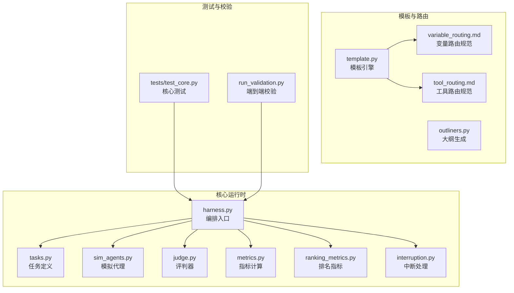

图表来源
- [autonomy_mvp/core/harness.py](file://autonomy_mvp/core/harness.py)
- [autonomy_mvp/core/tasks.py](file://autonomy_mvp/core/tasks.py)
- [autonomy_mvp/core/sim_agents.py](file://autonomy_mvp/core/sim_agents.py)
- [autonomy_mvp/core/judge.py](file://autonomy_mvp/core/judge.py)
- [autonomy_mvp/core/metrics.py](file://autonomy_mvp/core/metrics.py)
- [autonomy_mvp/core/ranking_metrics.py](file://autonomy_mvp/core/ranking_metrics.py)
- [autonomy_mvp/core/interruption.py](file://autonomy_mvp/core/interruption.py)
- [docs/templates/template.py](file://docs/templates/template.py)
- [docs/templates/outliners.py](file://docs/templates/outliners.py)
- [docs/templates/variable_routing.md](file://docs/templates/variable_routing.md)
- [docs/templates/tool_routing.md](file://docs/templates/tool_routing.md)
- [autonomy_mvp/tests/test_core.py](file://autonomy_mvp/tests/test_core.py)
- [autonomy_mvp/run_validation.py](file://autonomy_mvp/run_validation.py)

章节来源
- [autonomy_mvp/core/harness.py](file://autonomy_mvp/core/harness.py)
- [autonomy_mvp/core/tasks.py](file://autonomy_mvp/core/tasks.py)
- [autonomy_mvp/core/sim_agents.py](file://autonomy_mvp/core/sim_agents.py)
- [autonomy_mvp/core/judge.py](file://autonomy_mvp/core/judge.py)
- [autonomy_mvp/core/metrics.py](file://autonomy_mvp/core/metrics.py)
- [autonomy_mvp/core/ranking_metrics.py](file://autonomy_mvp/core/ranking_metrics.py)
- [autonomy_mvp/core/interruption.py](file://autonomy_mvp/core/interruption.py)
- [docs/templates/template.py](file://docs/templates/template.py)
- [docs/templates/outliners.py](file://docs/templates/outliners.py)
- [docs/templates/variable_routing.md](file://docs/templates/variable_routing.md)
- [docs/templates/tool_routing.md](file://docs/templates/tool_routing.md)
- [autonomy_mvp/tests/test_core.py](file://autonomy_mvp/tests/test_core.py)
- [autonomy_mvp/run_validation.py](file://autonomy_mvp/run_validation.py)

## 核心组件
本节概述与“工作流引擎核心”相关的核心模块职责与交互关系，并给出面向API设计的要点。

- 编排入口（harness）
  - 职责：加载任务、组装上下文、驱动执行流程、协调中断与结果汇总
  - API关注点：启动参数、上下文注入、回调钩子、错误传播
- 任务定义（tasks）
  - 职责：声明式描述任务节点、输入输出契约、依赖关系
  - API关注点：任务注册、参数校验、依赖解析
- 模拟代理（sim_agents）
  - 职责：提供可插拔的执行体，用于替代真实外部调用或LLM调用
  - API关注点：代理注册、调用协议、超时与重试
- 评判器（judge）
  - 职责：对执行结果进行判定与打分
  - API关注点：评分策略、阈值配置、失败归因
- 指标与排名（metrics, ranking_metrics）
  - 职责：计算过程与结果指标，支持多指标聚合与排序
  - API关注点：指标注册、聚合函数、导出格式
- 中断处理（interruption）
  - 职责：响应外部中断信号，支持优雅退出与检查点保存
  - API关注点：中断事件、恢复点、持久化策略
- 模板与路由（template, outliners, variable_routing, tool_routing）
  - 职责：模板渲染、大纲生成、变量与工具的路由规则
  - API关注点：模板语言、变量作用域、路由匹配与优先级

章节来源
- [autonomy_mvp/core/harness.py](file://autonomy_mvp/core/harness.py)
- [autonomy_mvp/core/tasks.py](file://autonomy_mvp/core/tasks.py)
- [autonomy_mvp/core/sim_agents.py](file://autonomy_mvp/core/sim_agents.py)
- [autonomy_mvp/core/judge.py](file://autonomy_mvp/core/judge.py)
- [autonomy_mvp/core/metrics.py](file://autonomy_mvp/core/metrics.py)
- [autonomy_mvp/core/ranking_metrics.py](file://autonomy_mvp/core/ranking_metrics.py)
- [autonomy_mvp/core/interruption.py](file://autonomy_mvp/core/interruption.py)
- [docs/templates/template.py](file://docs/templates/template.py)
- [docs/templates/outliners.py](file://docs/templates/outliners.py)
- [docs/templates/variable_routing.md](file://docs/templates/variable_routing.md)
- [docs/templates/tool_routing.md](file://docs/templates/tool_routing.md)

## 架构总览
下图展示工作流引擎的核心分层与数据流：定义层（任务与依赖）、运行时（编排与调度）、支撑层（指标、中断、模板与路由）、观测层（日志与监控）。

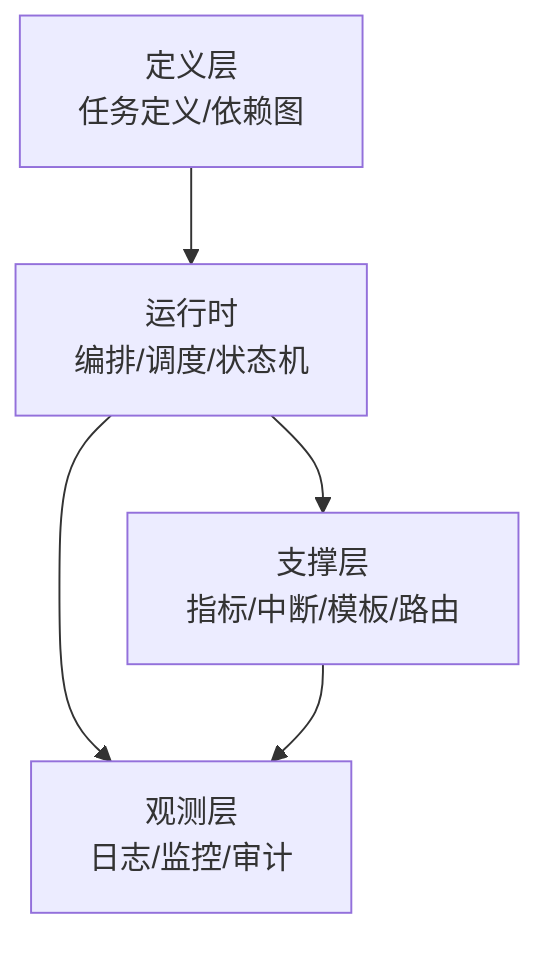

[此图为概念性架构图，不直接映射具体源文件]

## 详细组件分析

### 编排与执行（harness）
- 功能要点
  - 加载任务清单与上下文
  - 构建任务依赖图并进行拓扑排序
  - 按依赖顺序调度任务执行，支持并行度控制
  - 捕获异常并记录诊断信息
  - 暴露中断钩子，支持优雅停止与检查点
- 关键接口建议
  - 初始化：传入配置、上下文、插件注册表
  - 运行：提交工作流定义，返回实例ID与状态查询句柄
  - 控制：暂停、恢复、终止、重启
  - 查询：获取任务状态、进度、输出与错误
- 错误处理
  - 区分可恢复与不可恢复错误
  - 提供重试策略与退避算法
  - 将错误分类并写入审计日志

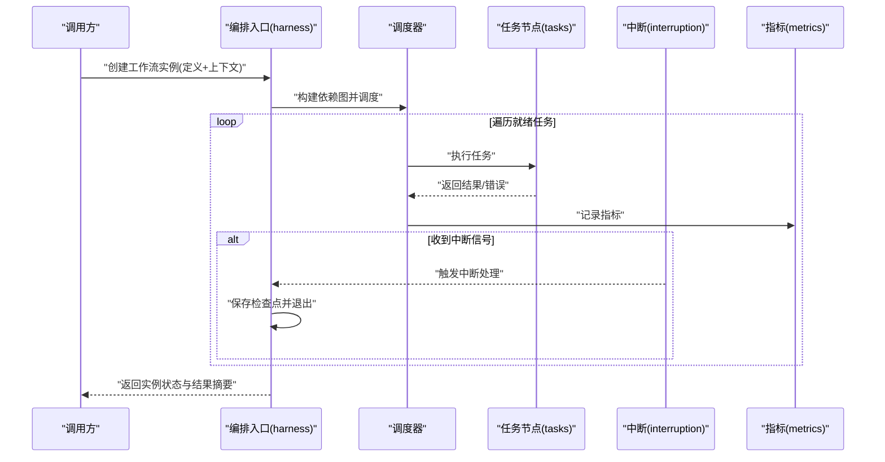

图表来源
- [autonomy_mvp/core/harness.py](file://autonomy_mvp/core/harness.py)
- [autonomy_mvp/core/tasks.py](file://autonomy_mvp/core/tasks.py)
- [autonomy_mvp/core/interruption.py](file://autonomy_mvp/core/interruption.py)
- [autonomy_mvp/core/metrics.py](file://autonomy_mvp/core/metrics.py)

章节来源
- [autonomy_mvp/core/harness.py](file://autonomy_mvp/core/harness.py)
- [autonomy_mvp/core/tasks.py](file://autonomy_mvp/core/tasks.py)
- [autonomy_mvp/core/interruption.py](file://autonomy_mvp/core/interruption.py)
- [autonomy_mvp/core/metrics.py](file://autonomy_mvp/core/metrics.py)

### 任务定义与依赖图（tasks）
- 功能要点
  - 声明式任务节点：名称、输入输出、执行体、资源需求
  - 依赖关系：显式边或隐式通过变量名推断
  - 校验：循环依赖检测、缺失输入提示
- 关键接口建议
  - 注册任务：类型、处理器、参数模式
  - 解析依赖：生成DAG并校验
  - 序列化/反序列化：支持版本迁移
- 复杂度与优化
  - DAG构建时间复杂度近似O(V+E)
  - 缓存已解析的依赖图以提升重复实例化效率

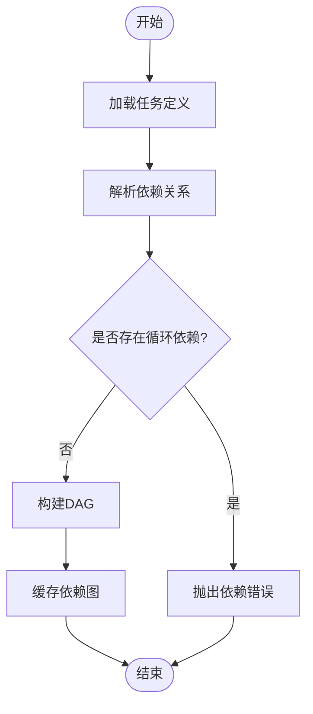

图表来源
- [autonomy_mvp/core/tasks.py](file://autonomy_mvp/core/tasks.py)

章节来源
- [autonomy_mvp/core/tasks.py](file://autonomy_mvp/core/tasks.py)

### 模拟代理（sim_agents）
- 功能要点
  - 提供可替换的执行体，便于离线测试与基准对比
  - 支持固定输出、随机扰动、延迟注入
- 关键接口建议
  - 注册代理：名称、行为策略、参数
  - 调用协议：统一入参出参与错误码
  - 可观测性：记录调用耗时与采样分布

章节来源
- [autonomy_mvp/core/sim_agents.py](file://autonomy_mvp/core/sim_agents.py)

### 评判器（judge）
- 功能要点
  - 根据策略对任务输出进行评分与判定
  - 支持多策略组合与权重配置
- 关键接口建议
  - 注册评分器：名称、评分函数、阈值
  - 批量评分：对多个实例进行一致性评估
  - 报告生成：结构化评分结果与归因

章节来源
- [autonomy_mvp/core/judge.py](file://autonomy_mvp/core/judge.py)

### 指标与排名（metrics, ranking_metrics）
- 功能要点
  - 计算过程指标（耗时、吞吐、错误率）与结果指标（准确率、F1等）
  - 聚合与排序：按指定维度分组与排名
- 关键接口建议
  - 指标注册：名称、计算函数、单位
  - 导出：JSON/CSV/时序数据库
  - 排名：自定义排序键与稳定性保证

章节来源
- [autonomy_mvp/core/metrics.py](file://autonomy_mvp/core/metrics.py)
- [autonomy_mvp/core/ranking_metrics.py](file://autonomy_mvp/core/ranking_metrics.py)

### 中断处理（interruption）
- 功能要点
  - 监听系统信号与内部事件
  - 触发检查点保存与资源清理
- 关键接口建议
  - 订阅中断事件：注册回调
  - 检查点：持久化当前状态与未完成任务队列
  - 恢复：从最近检查点重建执行环境

章节来源
- [autonomy_mvp/core/interruption.py](file://autonomy_mvp/core/interruption.py)

### 模板系统与路由（template, outliners, variable_routing, tool_routing）
- 功能要点
  - 模板渲染：支持占位符、条件片段、循环
  - 大纲生成：按模板结构自动产出步骤大纲
  - 变量路由：根据上下文选择变量绑定路径
  - 工具路由：根据输入特征选择工具执行路径
- 关键接口建议
  - 模板注册：名称、模板内容、编译选项
  - 渲染API：传入上下文，返回渲染结果
  - 路由规则：声明式匹配与优先级
  - 调试：渲染轨迹与命中规则可视化

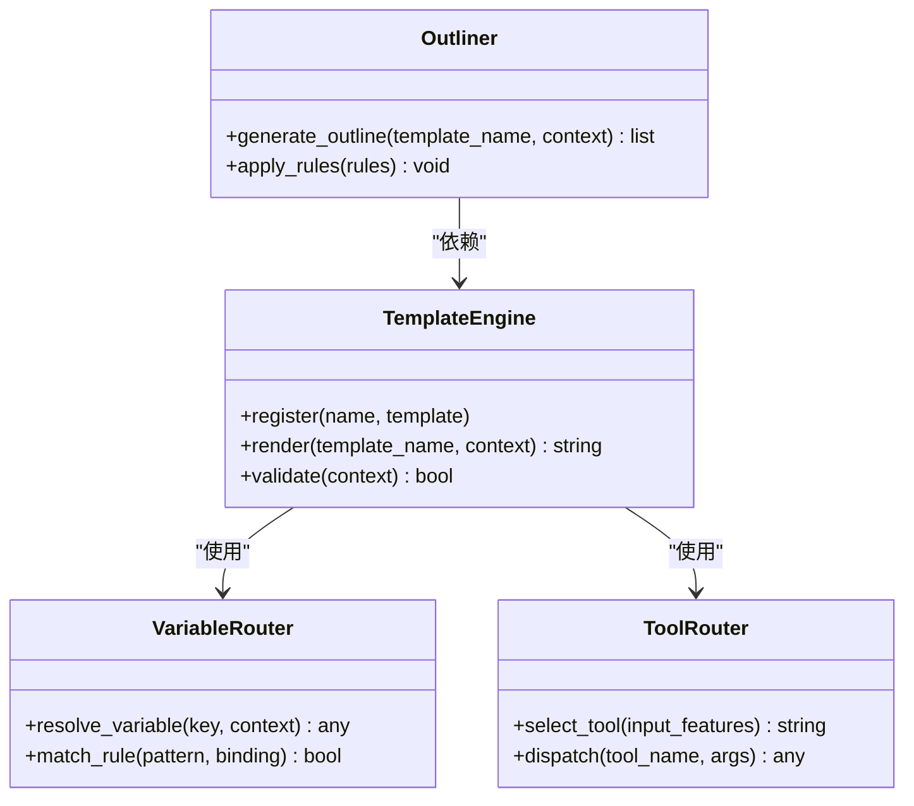

图表来源
- [docs/templates/template.py](file://docs/templates/template.py)
- [docs/templates/outliners.py](file://docs/templates/outliners.py)
- [docs/templates/variable_routing.md](file://docs/templates/variable_routing.md)
- [docs/templates/tool_routing.md](file://docs/templates/tool_routing.md)

章节来源
- [docs/templates/template.py](file://docs/templates/template.py)
- [docs/templates/outliners.py](file://docs/templates/outliners.py)
- [docs/templates/variable_routing.md](file://docs/templates/variable_routing.md)
- [docs/templates/tool_routing.md](file://docs/templates/tool_routing.md)

### 端到端校验与测试（run_validation, test_core）
- 功能要点
  - 端到端校验：加载示例工作流，验证依赖解析、执行与指标输出
  - 单元测试：覆盖核心路径与边界条件
- 关键接口建议
  - 校验入口：配置文件路径、期望结果、容忍阈值
  - 测试夹具：构造最小可复现工作流与上下文
  - 断言：状态转换、指标范围、错误消息

章节来源
- [autonomy_mvp/run_validation.py](file://autonomy_mvp/run_validation.py)
- [autonomy_mvp/tests/test_core.py](file://autonomy_mvp/tests/test_core.py)

## 依赖分析
- 组件耦合
  - 编排入口强依赖任务定义与中断处理
  - 指标与排名作为横切关注点被多处消费
  - 模板与路由为上层应用提供扩展点
- 外部依赖
  - 文件系统：模板与检查点持久化
  - 进程/线程：并发调度与资源隔离
  - 日志与监控：结构化输出与采集

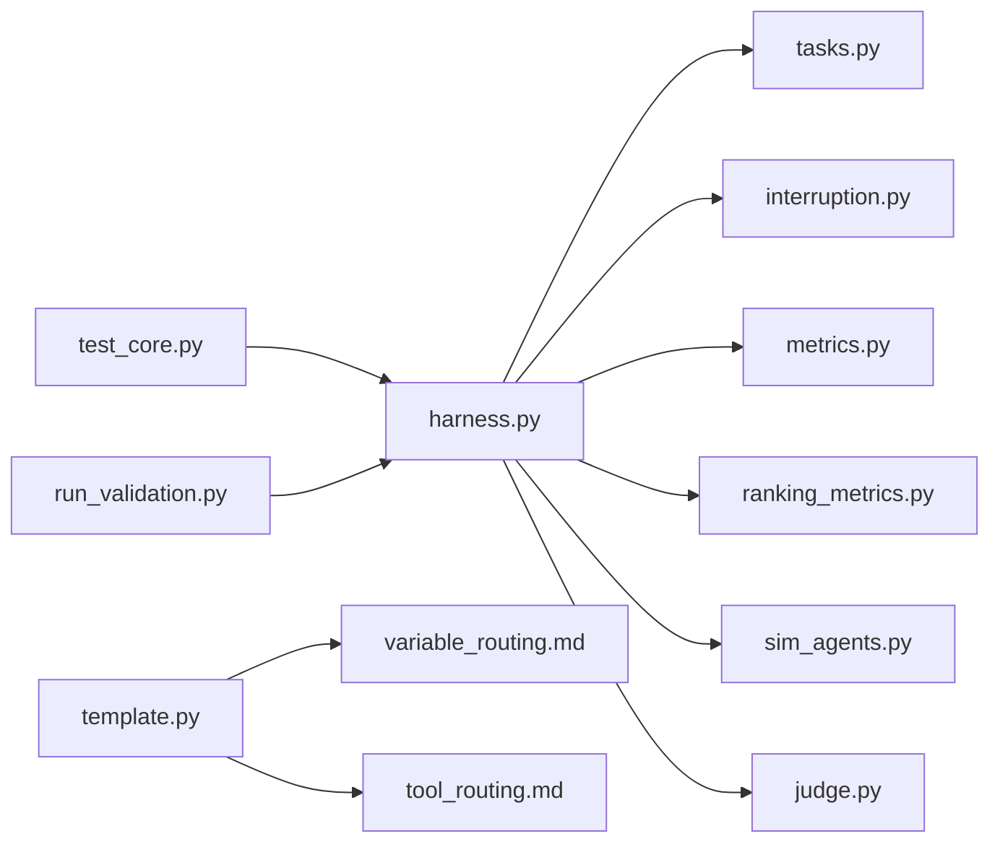

图表来源
- [autonomy_mvp/core/harness.py](file://autonomy_mvp/core/harness.py)
- [autonomy_mvp/core/tasks.py](file://autonomy_mvp/core/tasks.py)
- [autonomy_mvp/core/interruption.py](file://autonomy_mvp/core/interruption.py)
- [autonomy_mvp/core/metrics.py](file://autonomy_mvp/core/metrics.py)
- [autonomy_mvp/core/ranking_metrics.py](file://autonomy_mvp/core/ranking_metrics.py)
- [autonomy_mvp/core/sim_agents.py](file://autonomy_mvp/core/sim_agents.py)
- [autonomy_mvp/core/judge.py](file://autonomy_mvp/core/judge.py)
- [docs/templates/template.py](file://docs/templates/template.py)
- [docs/templates/variable_routing.md](file://docs/templates/variable_routing.md)
- [docs/templates/tool_routing.md](file://docs/templates/tool_routing.md)
- [autonomy_mvp/tests/test_core.py](file://autonomy_mvp/tests/test_core.py)
- [autonomy_mvp/run_validation.py](file://autonomy_mvp/run_validation.py)

章节来源
- [autonomy_mvp/core/harness.py](file://autonomy_mvp/core/harness.py)
- [autonomy_mvp/core/tasks.py](file://autonomy_mvp/core/tasks.py)
- [autonomy_mvp/core/interruption.py](file://autonomy_mvp/core/interruption.py)
- [autonomy_mvp/core/metrics.py](file://autonomy_mvp/core/metrics.py)
- [autonomy_mvp/core/ranking_metrics.py](file://autonomy_mvp/core/ranking_metrics.py)
- [autonomy_mvp/core/sim_agents.py](file://autonomy_mvp/core/sim_agents.py)
- [autonomy_mvp/core/judge.py](file://autonomy_mvp/core/judge.py)
- [docs/templates/template.py](file://docs/templates/template.py)
- [docs/templates/variable_routing.md](file://docs/templates/variable_routing.md)
- [docs/templates/tool_routing.md](file://docs/templates/tool_routing.md)
- [autonomy_mvp/tests/test_core.py](file://autonomy_mvp/tests/test_core.py)
- [autonomy_mvp/run_validation.py](file://autonomy_mvp/run_validation.py)

## 性能考虑
- 依赖图构建与缓存
  - 首次构建后缓存DAG，避免重复解析
  - 增量更新：仅重算变更的子图
- 并发与资源限制
  - 控制最大并行度，防止资源争用
  - 任务级资源配额与抢占策略
- I/O与序列化
  - 批量化写入指标与日志
  - 压缩与分片存储大对象
- 容错与重试
  - 指数退避与抖动
  - 幂等执行与去重

[本节为通用指导，不直接分析具体文件]

## 故障排查指南
- 常见问题定位
  - 依赖解析失败：检查循环依赖与缺失输入
  - 执行超时：确认任务超时配置与外部服务可用性
  - 指标异常：核对指标注册与聚合逻辑
- 诊断手段
  - 启用详细日志与追踪ID
  - 导出中间状态与检查点
  - 使用模拟代理隔离外部依赖问题
- 恢复策略
  - 从最近检查点恢复
  - 跳过失败任务并记录原因
  - 降级执行路径与回滚

章节来源
- [autonomy_mvp/core/interruption.py](file://autonomy_mvp/core/interruption.py)
- [autonomy_mvp/core/metrics.py](file://autonomy_mvp/core/metrics.py)
- [autonomy_mvp/core/sim_agents.py](file://autonomy_mvp/core/sim_agents.py)

## 结论
本仓库提供了工作流引擎核心的若干关键能力与扩展点：编排入口、任务定义、中断处理、指标与排名、模拟代理、评判器，以及模板与路由体系。结合概念性架构图与序列图，可以形成一套完整的API设计与实现蓝图。后续可在现有基础上完善版本管理、安全沙箱与更丰富的调试工具链，以满足生产级工作流的需求。

[本节为总结性内容，不直接分析具体文件]

## 附录

### 工作流定义语法（概念性）
- 节点声明：名称、类型、输入输出、资源需求
- 依赖关系：显式边或基于变量名的隐式依赖
- 条件分支：基于变量值的分支选择
- 并行与串行：控制执行顺序与并发度
- 版本化：定义版本字段与兼容性矩阵

[本节为概念性说明，不直接分析具体文件]

### 状态机管理（概念性）
- 状态集合：待调度、运行中、成功、失败、取消、检查点
- 事件：开始、完成、失败、中断、恢复
- 转换规则：明确允许的状态转移与前置条件

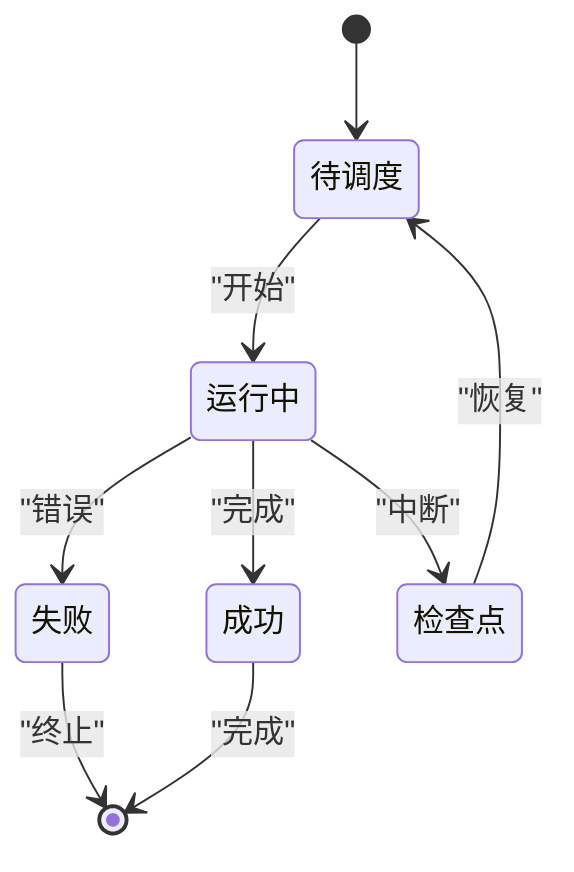

[此图为概念性状态图，不直接映射具体源文件]

### 事件驱动与异步执行（概念性）
- 事件总线：发布/订阅模型解耦组件
- 异步执行：协程或线程池驱动任务
- 背压与限流：保护下游资源

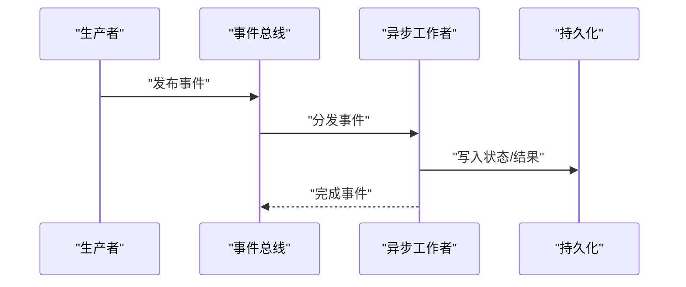

[此图为概念性序列图，不直接映射具体源文件]

### 模板系统与变量/工具路由（概念性）
- 模板语言：占位符、条件、循环
- 变量作用域：全局、局部、任务级
- 工具路由：基于输入特征的匹配与优先级

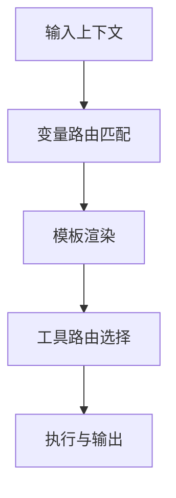

[此图为概念性流程图，不直接映射具体源文件]

### 工作流实例化、版本管理与生命周期控制（概念性）
- 实例化：从定义创建实例，分配唯一ID
- 版本管理：定义版本、兼容性与迁移脚本
- 生命周期：创建、运行、暂停、恢复、终止、归档

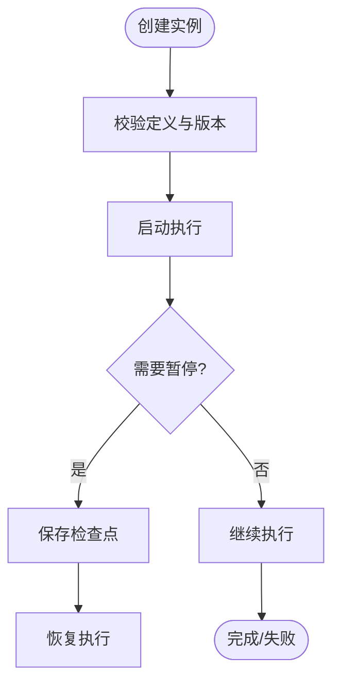

[此图为概念性流程图，不直接映射具体源文件]

### 监控、日志、性能统计与故障恢复（概念性）
- 监控：指标采集、告警规则、仪表盘
- 日志：结构化日志、链路追踪、审计
- 性能：吞吐、延迟、资源利用率
- 恢复：检查点、重试、降级

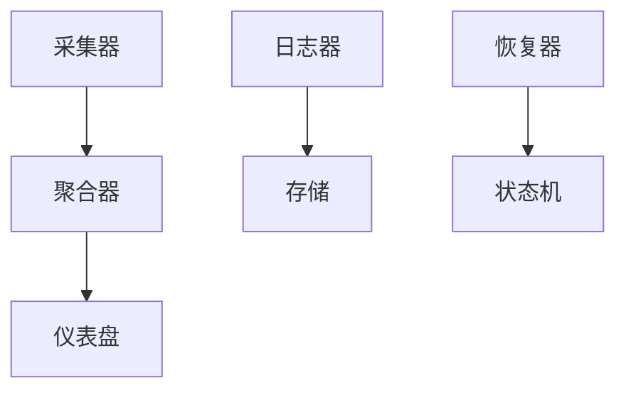

[此图为概念性架构图，不直接映射具体源文件]

### 调试工具、断点与单步执行（概念性）
- 断点：在任务边界设置断点
- 单步：逐步推进任务执行
- 快照：保存执行快照与上下文
- 回放：基于快照重放执行路径

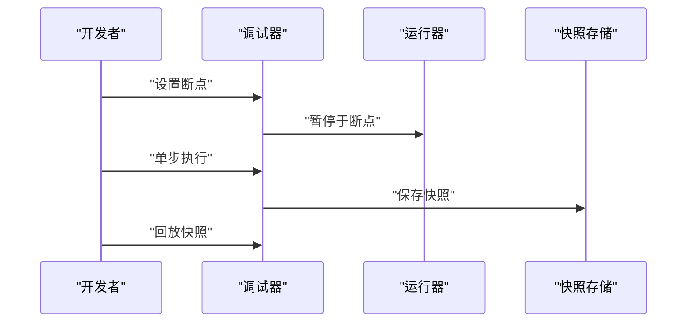

[此图为概念性序列图，不直接映射具体源文件]

### 安全沙箱、权限控制与资源隔离（概念性）
- 沙箱：限制系统调用与网络访问
- 权限：最小权限原则与角色访问控制
- 资源隔离：CPU/内存/磁盘配额与配额上限

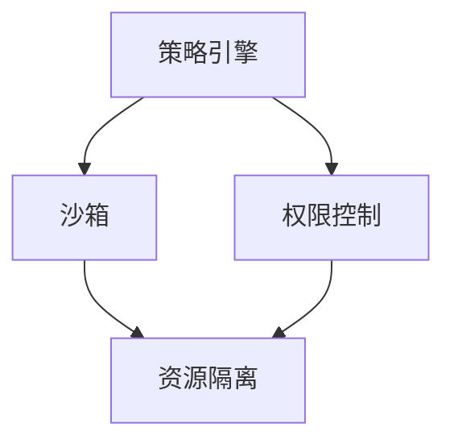

[此图为概念性架构图，不直接映射具体源文件]