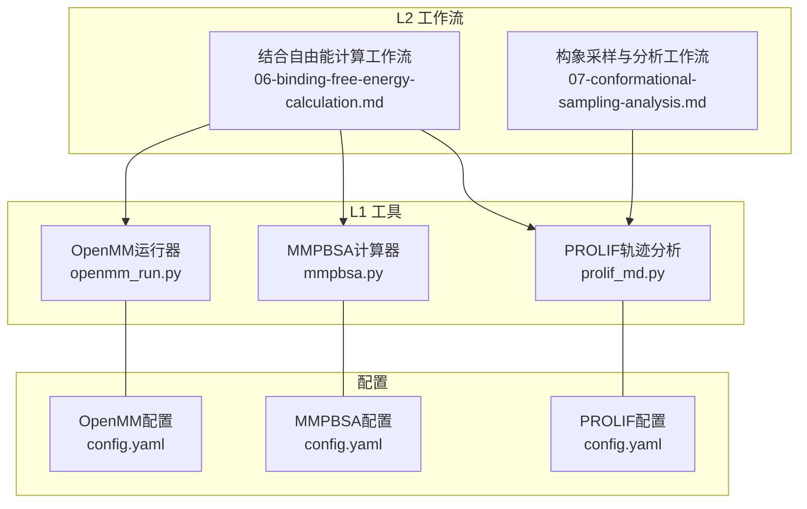
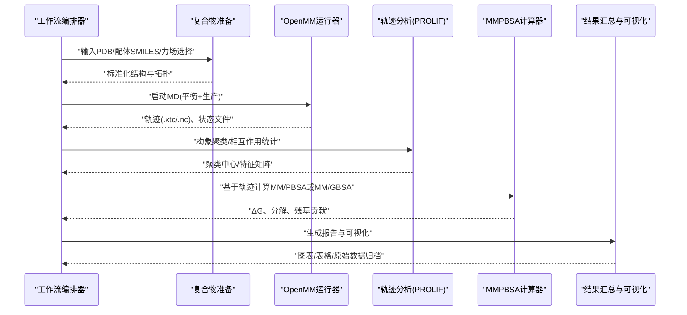
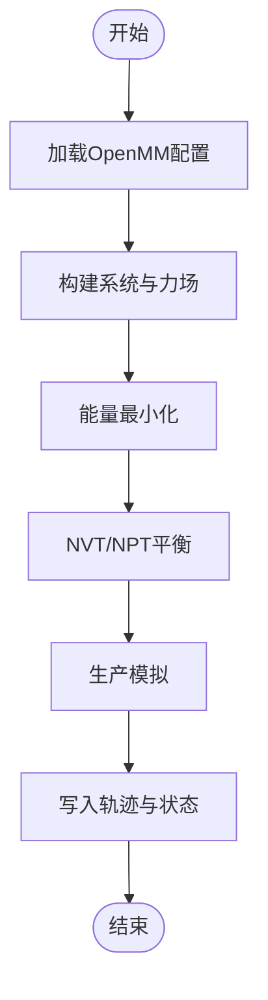
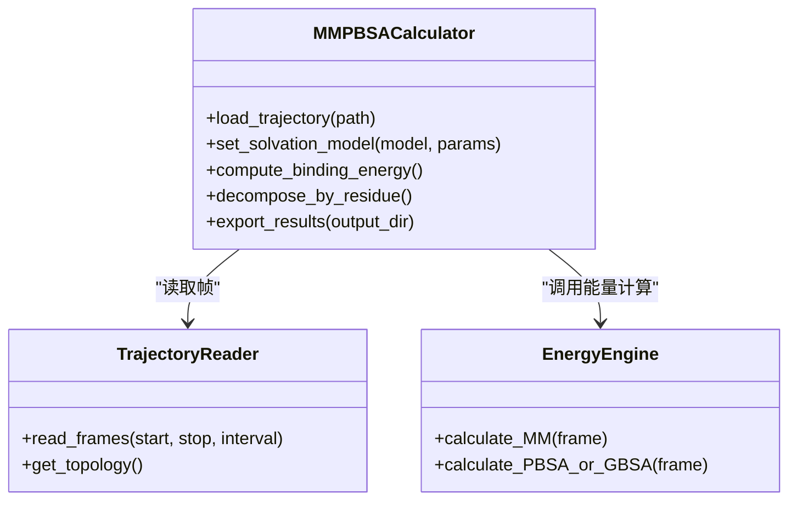
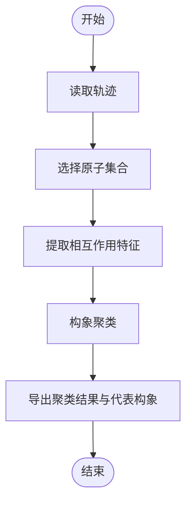
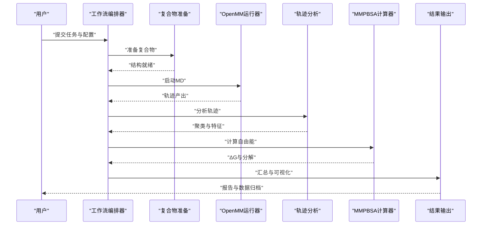
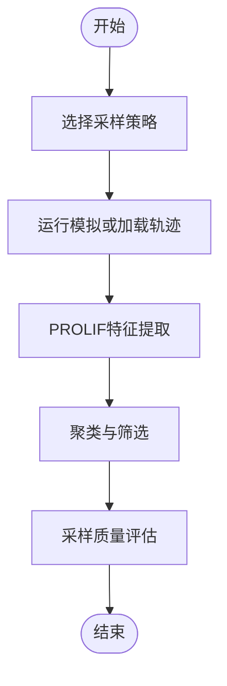
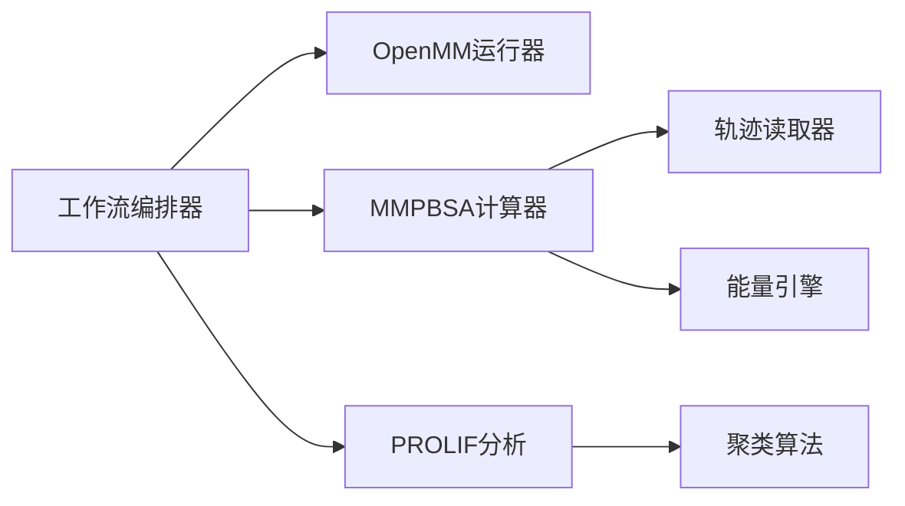

# 结合自由能计算工作流

<cite>
**本文引用的文件**   
- [docs/prd/molbench_repo/skills/L1_tools/molclaw-protein-ligand-mmpbsa/README.md](file://docs/prd/molbench_repo/skills/L1_tools/molclaw-protein-ligand-mmpbsa/README.md)
- [docs/prd/molbench_repo/skills/L1_tools/molclaw-protein-ligand-mmpbsa/mmpbsa.py](file://docs/prd/molbench_repo/skills/L1_tools/molclaw-protein-ligand-mmpbsa/mmpbsa.py)
- [docs/prd/molbench_repo/skills/L1_tools/molclaw-protein-ligand-mmpbsa/config.yaml](file://docs/prd/molbench_repo/skills/L1_tools/molclaw-protein-ligand-mmpbsa/config.yaml)
- [docs/prd/molbench_repo/skills/L1_tools/molclaw-protein-openmm/openmm_run.py](file://docs/prd/molbench_repo/skills/L1_tools/molclaw-protein-openmm/openmm_run.py)
- [docs/prd/molbench_repo/skills/L1_tools/molclaw-protein-openmm/config.yaml](file://docs/prd/molbench_repo/skills/L1_tools/molclaw-protein-openmm/config.yaml)
- [docs/prd/molbench_repo/skills/L2_workflows/06-binding-free-energy-calculation.md](file://docs/prd/molbench_repo/skills/L2_workflows/06-binding-free-energy-calculation.md)
- [docs/prd/molbench_repo/skills/L2_workflows/07-conformational-sampling-analysis.md](file://docs/prd/molbench_repo/skills/L2_workflows/07-conformational-sampling-analysis.md)
- [docs/prd/molbench_repo/skills/L1_tools/molclaw-prolif-md/prolif_md.py](file://docs/prd/molbench_repo/skills/L1_tools/molclaw-prolif-md/prolif_md.py)
- [docs/prd/molbench_repo/skills/L1_tools/molclaw-prolif-md/config.yaml](file://docs/prd/molbench_repo/skills/L1_tools/molclaw-prolif-md/config.yaml)
</cite>

## 目录
1. [简介](#简介)
2. [项目结构](#项目结构)
3. [核心组件](#核心组件)
4. [架构总览](#架构总览)
5. [详细组件分析](#详细组件分析)
6. [依赖关系分析](#依赖关系分析)
7. [性能与精度考量](#性能与精度考量)
8. [故障排查指南](#故障排查指南)
9. [结论](#结论)
10. [附录：接口定义与配置项](#附录接口定义与配置项)

## 简介
本文件面向“结合自由能计算”工作流的API文档，覆盖从复合物准备、分子动力学（MD）模拟、轨迹分析与能量计算的端到端流程。重点说明MM/PBSA与MM/GBSA方法的工作流编排，提供OpenMM等模拟引擎的集成接口规范，并给出轨迹处理、构象聚类与分析工具的数据接口约定。同时包含自由能分解、残基贡献分析与热力学积分的计算方法说明，以及计算精度评估、误差分析与结果可视化的API支持建议。

## 项目结构
围绕自由能计算的相关能力主要分布在以下位置：
- L1工具层：提供具体算法或软件封装，如OpenMM运行、MMPBSA计算、PROLIF轨迹分析等。
- L2工作流层：将多个L1工具串联为可编排的自由能计算流程。
- 配置文件：以YAML形式声明力场、溶剂模型、采样策略、轨迹路径、输出格式等参数。

图表来源
- [docs/prd/molbench_repo/skills/L1_tools/molclaw-protein-openmm/openmm_run.py](file://docs/prd/molbench_repo/skills/L1_tools/molclaw-protein-openmm/openmm_run.py)
- [docs/prd/molbench_repo/skills/L1_tools/molclaw-protein-ligand-mmpbsa/mmpbsa.py](file://docs/prd/molbench_repo/skills/L1_tools/molclaw-protein-ligand-mmpbsa/mmpbsa.py)
- [docs/prd/molbench_repo/skills/L1_tools/molclaw-prolif-md/prolif_md.py](file://docs/prd/molbench_repo/skills/L1_tools/molclaw-prolif-md/prolif_md.py)
- [docs/prd/molbench_repo/skills/L2_workflows/06-binding-free-energy-calculation.md](file://docs/prd/molbench_repo/skills/L2_workflows/06-binding-free-energy-calculation.md)
- [docs/prd/molbench_repo/skills/L2_workflows/07-conformational-sampling-analysis.md](file://docs/prd/molbench_repo/skills/L2_workflows/07-conformational-sampling-analysis.md)

章节来源
- [docs/prd/molbench_repo/skills/L2_workflows/06-binding-free-energy-calculation.md](file://docs/prd/molbench_repo/skills/L2_workflows/06-binding-free-energy-calculation.md)
- [docs/prd/molbench_repo/skills/L2_workflows/07-conformational-sampling-analysis.md](file://docs/prd/molbench_repo/skills/L2_workflows/07-conformational-sampling-analysis.md)

## 核心组件
- OpenMM运行器：负责加载系统拓扑与坐标、构建力场与溶剂模型、设置约束与积分器、执行平衡与生产阶段，并输出轨迹与状态文件。
- MMPBSA计算器：读取轨迹与结构，按MM/PBSA或MM/GBSA方案计算结合自由能，支持自由能分解与残基贡献统计。
- PROLIF轨迹分析：对轨迹进行相互作用特征提取（氢键、疏水、π-π等），用于构象聚类与可视化。
- 工作流编排：将上述工具按顺序或并行组合，管理输入输出、错误恢复与日志记录。

章节来源
- [docs/prd/molbench_repo/skills/L1_tools/molclaw-protein-openmm/openmm_run.py](file://docs/prd/molbench_repo/skills/L1_tools/molclaw-protein-openmm/openmm_run.py)
- [docs/prd/molbench_repo/skills/L1_tools/molclaw-protein-ligand-mmpbsa/mmpbsa.py](file://docs/prd/molbench_repo/skills/L1_tools/molclaw-protein-ligand-mmpbsa/mmpbsa.py)
- [docs/prd/molbench_repo/skills/L1_tools/molclaw-prolif-md/prolif_md.py](file://docs/prd/molbench_repo/skills/L1_tools/molclaw-prolif-md/prolif_md.py)
- [docs/prd/molbench_repo/skills/L2_workflows/06-binding-free-energy-calculation.md](file://docs/prd/molbench_repo/skills/L2_workflows/06-binding-free-energy-calculation.md)

## 架构总览
下图展示了自由能计算工作流的整体数据与控制流：从复合物准备到MD模拟、轨迹分析、自由能计算与结果汇总。

图表来源
- [docs/prd/molbench_repo/skills/L2_workflows/06-binding-free-energy-calculation.md](file://docs/prd/molbench_repo/skills/L2_workflows/06-binding-free-energy-calculation.md)
- [docs/prd/molbench_repo/skills/L1_tools/molclaw-protein-openmm/openmm_run.py](file://docs/prd/molbench_repo/skills/L1_tools/molclaw-protein-openmm/openmm_run.py)
- [docs/prd/molbench_repo/skills/L1_tools/molclaw-prolif-md/prolif_md.py](file://docs/prd/molbench_repo/skills/L1_tools/molclaw-prolif-md/prolif_md.py)
- [docs/prd/molbench_repo/skills/L1_tools/molclaw-protein-ligand-mmpbsa/mmpbsa.py](file://docs/prd/molbench_repo/skills/L1_tools/molclaw-protein-ligand-mmpbsa/mmpbsa.py)

## 详细组件分析

### 组件A：OpenMM运行器
职责
- 解析配置（力场、溶剂、离子强度、温度/压力控制、时间步长、约束、周期性边界条件）。
- 构建系统、初始化速度、设定热浴/压浴。
- 执行能量最小化、平衡与生产模拟，保存轨迹与检查点。
- 输出标准格式轨迹（如XTC、NetCDF）与必要的元数据。

关键接口约定
- 输入：复合物结构文件（PDB）、力场与溶剂模型配置、模拟时长与采样频率、输出路径。
- 输出：轨迹文件、状态快照、模拟日志。
- 错误处理：非法参数校验、GPU/CPU可用性检测、内存不足提示、异常重试策略。

图表来源
- [docs/prd/molbench_repo/skills/L1_tools/molclaw-protein-openmm/openmm_run.py](file://docs/prd/molbench_repo/skills/L1_tools/molclaw-protein-openmm/openmm_run.py)
- [docs/prd/molbench_repo/skills/L1_tools/molclaw-protein-openmm/config.yaml](file://docs/prd/molbench_repo/skills/L1_tools/molclaw-protein-openmm/config.yaml)

章节来源
- [docs/prd/molbench_repo/skills/L1_tools/molclaw-protein-openmm/openmm_run.py](file://docs/prd/molbench_repo/skills/L1_tools/molclaw-protein-openmm/openmm_run.py)
- [docs/prd/molbench_repo/skills/L1_tools/molclaw-protein-openmm/config.yaml](file://docs/prd/molbench_repo/skills/L1_tools/molclaw-protein-openmm/config.yaml)

### 组件B：MMPBSA计算器
职责
- 读取轨迹与结构，按MM/PBSA或MM/GBSA方案计算结合自由能。
- 支持自由能分解（复合物、受体、配体及各项能量分量）。
- 输出残基贡献、能量方差与置信区间估计。

关键接口约定
- 输入：轨迹文件、复合物/受体/配体拓扑与坐标、溶剂模型（PBSA/GBSA）、介电常数、离子强度、采样间隔。
- 输出：ΔG、分解结果、残基贡献表、统计指标。
- 错误处理：轨迹长度不足、收敛性检查失败、数值不稳定时的回退策略。

图表来源
- [docs/prd/molbench_repo/skills/L1_tools/molclaw-protein-ligand-mmpbsa/mmpbsa.py](file://docs/prd/molbench_repo/skills/L1_tools/molclaw-protein-ligand-mmpbsa/mmpbsa.py)
- [docs/prd/molbench_repo/skills/L1_tools/molclaw-protein-ligand-mmpbsa/config.yaml](file://docs/prd/molbench_repo/skills/L1_tools/molclaw-protein-ligand-mmpbsa/config.yaml)

章节来源
- [docs/prd/molbench_repo/skills/L1_tools/molclaw-protein-ligand-mmpbsa/mmpbsa.py](file://docs/prd/molbench_repo/skills/L1_tools/molclaw-protein-ligand-mmpbsa/mmpbsa.py)
- [docs/prd/molbench_repo/skills/L1_tools/molclaw-protein-ligand-mmpbsa/config.yaml](file://docs/prd/molbench_repo/skills/L1_tools/molclaw-protein-ligand-mmpbsa/config.yaml)
- [docs/prd/molbench_repo/skills/L1_tools/molclaw-protein-ligand-mmpbsa/README.md](file://docs/prd/molbench_repo/skills/L1_tools/molclaw-protein-ligand-mmpbsa/README.md)

### 组件C：PROLIF轨迹分析
职责
- 从轨迹中提取相互作用特征（氢键、盐桥、疏水接触、π-π堆积等）。
- 生成特征矩阵用于构象聚类与可视化。
- 输出聚类中心构象与代表性截图。

关键接口约定
- 输入：轨迹文件、原子选择掩码（受体/配体）、相互作用阈值。
- 输出：特征矩阵、聚类标签、代表性构象列表。
- 错误处理：轨迹格式不兼容、原子选择为空、聚类收敛失败的提示。

图表来源
- [docs/prd/molbench_repo/skills/L1_tools/molclaw-prolif-md/prolif_md.py](file://docs/prd/molbench_repo/skills/L1_tools/molclaw-prolif-md/prolif_md.py)
- [docs/prd/molbench_repo/skills/L1_tools/molclaw-prolif-md/config.yaml](file://docs/prd/molbench_repo/skills/L1_tools/molclaw-prolif-md/config.yaml)

章节来源
- [docs/prd/molbench_repo/skills/L1_tools/molclaw-prolif-md/prolif_md.py](file://docs/prd/molbench_repo/skills/L1_tools/molclaw-prolif-md/prolif_md.py)
- [docs/prd/molbench_repo/skills/L1_tools/molclaw-prolif-md/config.yaml](file://docs/prd/molbench_repo/skills/L1_tools/molclaw-prolif-md/config.yaml)

### 工作流编排：结合自由能计算
职责
- 串联复合物准备、MD模拟、轨迹分析、MMPBSA计算与结果汇总。
- 管理任务依赖、并发执行、失败重试与中间产物清理。
- 提供统一入口与参数模板，便于批量运行与对比实验。

关键接口约定
- 输入：任务清单（复合物ID、初始结构、目标方法、资源配额）。
- 输出：最终自由能结果、分解与残基贡献、可视化报告。
- 错误处理：上游任务失败的回退策略、资源不足时的队列调度。

图表来源
- [docs/prd/molbench_repo/skills/L2_workflows/06-binding-free-energy-calculation.md](file://docs/prd/molbench_repo/skills/L2_workflows/06-binding-free-energy-calculation.md)

章节来源
- [docs/prd/molbench_repo/skills/L2_workflows/06-binding-free-energy-calculation.md](file://docs/prd/molbench_repo/skills/L2_workflows/06-binding-free-energy-calculation.md)

### 工作流编排：构象采样与分析
职责
- 针对特定体系进行构象空间探索，结合PROLIF进行特征提取与聚类。
- 为后续自由能计算提供代表性构象与采样质量评估。

关键接口约定
- 输入：采样策略（增强采样/常规MD）、分析窗口、聚类算法与参数。
- 输出：构象分布、代表性结构、稳定性指标。

图表来源
- [docs/prd/molbench_repo/skills/L2_workflows/07-conformational-sampling-analysis.md](file://docs/prd/molbench_repo/skills/L2_workflows/07-conformational-sampling-analysis.md)

章节来源
- [docs/prd/molbench_repo/skills/L2_workflows/07-conformational-sampling-analysis.md](file://docs/prd/molbench_repo/skills/L2_workflows/07-conformational-sampling-analysis.md)

## 依赖关系分析
- 工作流编排器依赖各L1工具的Python接口与外部二进制（如OpenMM、GROMACS可选）。
- MMPBSA计算器依赖轨迹读取器与能量引擎；能量引擎可能调用外部求解器（如AMBER、gmx_MMPBSA）。
- PROLIF分析依赖轨迹格式库与聚类算法库。

图表来源
- [docs/prd/molbench_repo/skills/L2_workflows/06-binding-free-energy-calculation.md](file://docs/prd/molbench_repo/skills/L2_workflows/06-binding-free-energy-calculation.md)
- [docs/prd/molbench_repo/skills/L1_tools/molclaw-protein-openmm/openmm_run.py](file://docs/prd/molbench_repo/skills/L1_tools/molclaw-protein-openmm/openmm_run.py)
- [docs/prd/molbench_repo/skills/L1_tools/molclaw-protein-ligand-mmpbsa/mmpbsa.py](file://docs/prd/molbench_repo/skills/L1_tools/molclaw-protein-ligand-mmpbsa/mmpbsa.py)
- [docs/prd/molbench_repo/skills/L1_tools/molclaw-prolif-md/prolif_md.py](file://docs/prd/molbench_repo/skills/L1_tools/molclaw-prolif-md/prolif_md.py)

章节来源
- [docs/prd/molbench_repo/skills/L2_workflows/06-binding-free-energy-calculation.md](file://docs/prd/molbench_repo/skills/L2_workflows/06-binding-free-energy-calculation.md)

## 性能与精度考量
- 采样充分性：确保MD生产阶段足够长，轨迹帧数满足统计收敛；必要时采用增强采样或多副本并行。
- 力场与溶剂模型：根据体系选择合适的力场与隐式/显式溶剂模型；PBSA/GBSA参数需与力场一致。
- 收敛性与误差：通过块平均法或Bootstrap估计误差；监控RMSD、回转半径与相互作用稳定性。
- 资源优化：轨迹压缩、分块计算、GPU加速与I/O批处理；避免重复计算已缓存帧。

[本节为通用指导，无需引用具体文件]

## 故障排查指南
- 轨迹格式问题：确认轨迹后缀与读取器匹配；检查帧间隔与起始/终止索引。
- 力场加载失败：核对力场名称与版本；验证拓扑中缺失原子或键连接。
- 内存溢出：减少每帧原子数或降低采样频率；启用分块与增量计算。
- 收敛性差：延长模拟时间、增加副本、调整采样策略；检查温度/压力控制参数。
- 外部工具不可用：检查环境变量与路径；确认二进制安装与权限。

章节来源
- [docs/prd/molbench_repo/skills/L1_tools/molclaw-protein-openmm/openmm_run.py](file://docs/prd/molbench_repo/skills/L1_tools/molclaw-protein-openmm/openmm_run.py)
- [docs/prd/molbench_repo/skills/L1_tools/molclaw-protein-ligand-mmpbsa/mmpbsa.py](file://docs/prd/molbench_repo/skills/L1_tools/molclaw-protein-ligand-mmpbsa/mmpbsa.py)
- [docs/prd/molbench_repo/skills/L1_tools/molclaw-prolif-md/prolif_md.py](file://docs/prd/molbench_repo/skills/L1_tools/molclaw-prolif-md/prolif_md.py)

## 结论
本工作流将复合物准备、MD模拟、轨迹分析与自由能计算整合为可编排的端到端流程，支持MM/PBSA与MM/GBSA方法，并提供自由能分解与残基贡献分析。通过统一的配置与接口规范，用户可灵活切换力场、溶剂模型与采样策略，并获得一致的输出与可视化结果。建议在大规模实验中引入并行与缓存机制以提升效率，并通过严格的收敛性检验保障结果可靠性。

[本节为总结性内容，无需引用具体文件]

## 附录：接口定义与配置项

### 接口定义（示例）
- OpenMM运行器
  - 输入：结构文件、力场、溶剂模型、温度/压力控制、时间步长、约束、轨迹输出路径。
  - 输出：轨迹文件、状态快照、日志。
- MMPBSA计算器
  - 输入：轨迹、拓扑、溶剂模型（PBSA/GBSA）、介电常数、离子强度、采样间隔。
  - 输出：ΔG、分解结果、残基贡献、统计指标。
- PROLIF分析
  - 输入：轨迹、原子选择、相互作用阈值。
  - 输出：特征矩阵、聚类标签、代表性构象。

章节来源
- [docs/prd/molbench_repo/skills/L1_tools/molclaw-protein-openmm/openmm_run.py](file://docs/prd/molbench_repo/skills/L1_tools/molclaw-protein-openmm/openmm_run.py)
- [docs/prd/molbench_repo/skills/L1_tools/molclaw-protein-ligand-mmpbsa/mmpbsa.py](file://docs/prd/molbench_repo/skills/L1_tools/molclaw-protein-ligand-mmpbsa/mmpbsa.py)
- [docs/prd/molbench_repo/skills/L1_tools/molclaw-prolif-md/prolif_md.py](file://docs/prd/molbench_repo/skills/L1_tools/molclaw-prolif-md/prolif_md.py)

### 配置项（YAML）
- OpenMM配置
  - 力场、溶剂模型、离子浓度、温度/压力控制、时间步长、约束、平衡/生产时长、轨迹频率。
- MMPBSA配置
  - 溶剂模型选择、介电常数、离子强度、采样间隔、能量分量开关、输出目录。
- PROLIF配置
  - 原子选择掩码、相互作用阈值、聚类算法与参数、输出目录。

章节来源
- [docs/prd/molbench_repo/skills/L1_tools/molclaw-protein-openmm/config.yaml](file://docs/prd/molbench_repo/skills/L1_tools/molclaw-protein-openmm/config.yaml)
- [docs/prd/molbench_repo/skills/L1_tools/molclaw-protein-ligand-mmpbsa/config.yaml](file://docs/prd/molbench_repo/skills/L1_tools/molclaw-protein-ligand-mmpbsa/config.yaml)
- [docs/prd/molbench_repo/skills/L1_tools/molclaw-prolif-md/config.yaml](file://docs/prd/molbench_repo/skills/L1_tools/molclaw-prolif-md/config.yaml)