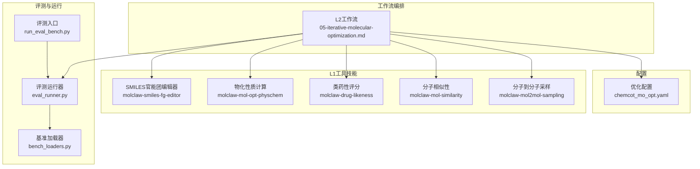
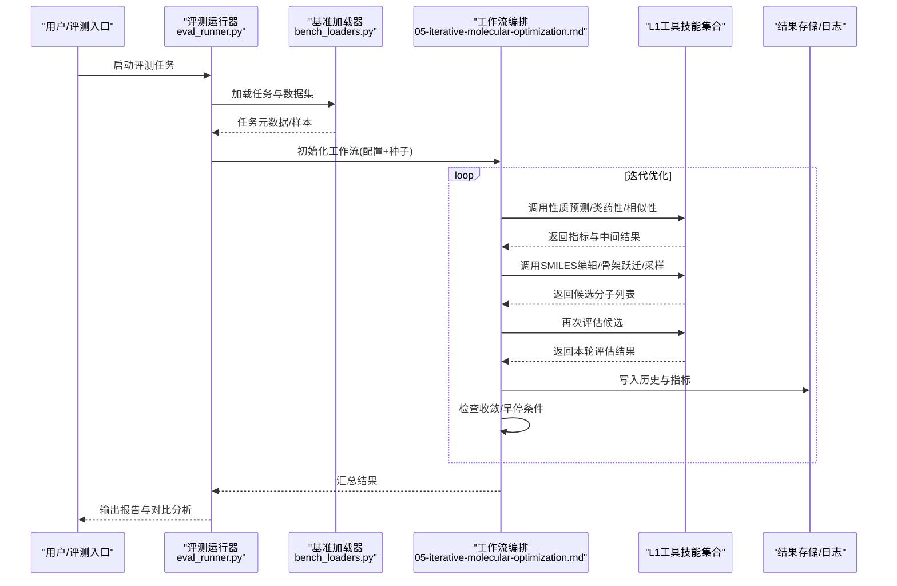
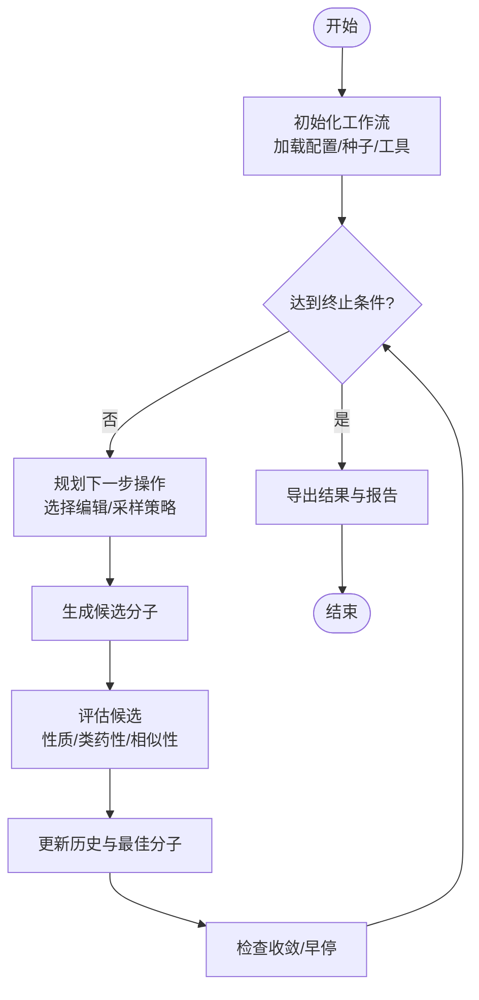
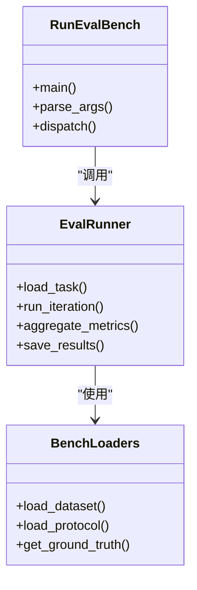
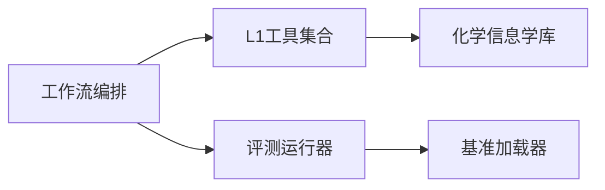

# 迭代分子优化工作流

<cite>
**本文引用的文件**   
- [05-iterative-molecular-optimization.md](file://docs/molbench_repo/skills/L2_workflows/05-iterative-molecular-optimization.md)
- [chemcot_mo_opt.yaml](file://docs/molbench_repo/config/chemcot_mo_opt.yaml)
- [molclaw-smiles-fg-editor](file://docs/molbench_repo/skills/L1_tools/molclaw-smiles-fg-editor)
- [molclaw-mol-opt-physchem](file://docs/molbench_repo/skills/L1_tools/molclaw-mol-opt-physchem)
- [molclaw-drug-likeness](file://docs/molbench_repo/skills/L1_tools/molclaw-drug-likeness)
- [molclaw-mol-similarity](file://docs/molbench_repo/skills/L1_tools/molclaw-mol-similarity)
- [molclaw-mol2mol-sampling](file://docs/molbench_repo/skills/L1_tools/molclaw-mol2mol-sampling)
- [eval_runner.py](file://docs/molbench_repo/eval/eval_runner.py)
- [bench_loaders.py](file://docs/molbench_repo/eval/bench_loaders.py)
- [run_eval_bench.py](file://docs/molbench_repo/eval/run_eval_bench.py)
</cite>

## 目录
1. [简介](#简介)
2. [项目结构](#项目结构)
3. [核心组件](#核心组件)
4. [架构总览](#架构总览)
5. [详细组件分析](#详细组件分析)
6. [依赖关系分析](#依赖关系分析)
7. [性能与可扩展性](#性能与可扩展性)
8. [故障排查指南](#故障排查指南)
9. [结论](#结论)
10. [附录](#附录)

## 简介
本文件面向“基于反馈循环的迭代分子优化”工作流，提供端到端的API文档与实践指南。内容覆盖：
- 初始分子设计与搜索空间定义
- 性质预测与多目标评估
- 结构修改（SMILES编辑、官能团替换、骨架跃迁）
- 收敛条件与参数配置
- 监控指标、历史记录保存与结果对比
- 自定义优化策略与评价函数的扩展接口

该工作流以“设计—预测—修改—评估—再设计”的闭环为核心，通过工具化技能与评测框架组合实现可复现、可追踪的分子优化流程。

## 项目结构
围绕迭代分子优化的关键代码与配置集中在以下位置：
- L2工作流编排：05-iterative-molecular-optimization.md
- 优化任务配置：chemcot_mo_opt.yaml
- L1工具技能：SMILES编辑、物化性质计算、类药性、相似性、分子到分子采样等
- 评测与运行：eval_runner.py、bench_loaders.py、run_eval_bench.py

图表来源
- [05-iterative-molecular-optimization.md](file://docs/molbench_repo/skills/L2_workflows/05-iterative-molecular-optimization.md)
- [chemcot_mo_opt.yaml](file://docs/molbench_repo/config/chemcot_mo_opt.yaml)
- [molclaw-smiles-fg-editor](file://docs/molbench_repo/skills/L1_tools/molclaw-smiles-fg-editor)
- [molclaw-mol-opt-physchem](file://docs/molbench_repo/skills/L1_tools/molclaw-mol-opt-physchem)
- [molclaw-drug-likeness](file://docs/molbench_repo/skills/L1_tools/molclaw-drug-likeness)
- [molclaw-mol-similarity](file://docs/molbench_repo/skills/L1_tools/molclaw-mol-similarity)
- [molclaw-mol2mol-sampling](file://docs/molbench_repo/skills/L1_tools/molclaw-mol2mol-sampling)
- [eval_runner.py](file://docs/molbench_repo/eval/eval_runner.py)
- [bench_loaders.py](file://docs/molbench_repo/eval/bench_loaders.py)
- [run_eval_bench.py](file://docs/molbench_repo/eval/run_eval_bench.py)

章节来源
- [05-iterative-molecular-optimization.md](file://docs/molbench_repo/skills/L2_workflows/05-iterative-molecular-optimization.md)
- [chemcot_mo_opt.yaml](file://docs/molbench_repo/config/chemcot_mo_opt.yaml)
- [eval_runner.py](file://docs/molbench_repo/eval/eval_runner.py)
- [bench_loaders.py](file://docs/molbench_repo/eval/bench_loaders.py)
- [run_eval_bench.py](file://docs/molbench_repo/eval/run_eval_bench.py)

## 核心组件
- 工作流编排器（L2）
  - 职责：串联初始分子生成、性质预测、结构修改、评估验证，形成闭环；管理迭代轮次、早停与日志记录。
  - 输入：初始分子集合或种子SMILES、优化目标与约束、搜索空间控制参数。
  - 输出：每轮候选分子、评估指标、历史轨迹与最终推荐分子集。
- 工具技能（L1）
  - SMILES官能团编辑器：支持片段替换、基团增减、连接点选择与合法性校验。
  - 物化性质计算：计算LogP、分子量、HBA/HBD、TPSA等常用描述符。
  - 类药性评分：综合规则打分（如类药五规则）。
  - 分子相似性：Tanimoto相似度、指纹计算与近邻检索。
  - 分子到分子采样：在骨架或侧链空间进行可控采样与变异。
- 评测与运行
  - 评测运行器：统一调度工具调用、聚合指标、持久化结果。
  - 基准加载器：读取任务定义、数据集与参考答案。
  - 评测入口：命令行或脚本入口，驱动评测流程。

章节来源
- [05-iterative-molecular-optimization.md](file://docs/molbench_repo/skills/L2_workflows/05-iterative-molecular-optimization.md)
- [molclaw-smiles-fg-editor](file://docs/molbench_repo/skills/L1_tools/molclaw-smiles-fg-editor)
- [molclaw-mol-opt-physchem](file://docs/molbench_repo/skills/L1_tools/molclaw-mol-opt-physchem)
- [molclaw-drug-likeness](file://docs/molbench_repo/skills/L1_tools/molclaw-drug-likeness)
- [molclaw-mol-similarity](file://docs/molbench_repo/skills/L1_tools/molclaw-mol-similarity)
- [molclaw-mol2mol-sampling](file://docs/molbench_repo/skills/L1_tools/molclaw-mol2mol-sampling)
- [eval_runner.py](file://docs/molbench_repo/eval/eval_runner.py)
- [bench_loaders.py](file://docs/molbench_repo/eval/bench_loaders.py)
- [run_eval_bench.py](file://docs/molbench_repo/eval/run_eval_bench.py)

## 架构总览
下图展示从任务配置到工具执行与评测记录的端到端数据流与控制流。

图表来源
- [eval_runner.py](file://docs/molbench_repo/eval/eval_runner.py)
- [bench_loaders.py](file://docs/molbench_repo/eval/bench_loaders.py)
- [05-iterative-molecular-optimization.md](file://docs/molbench_repo/skills/L2_workflows/05-iterative-molecular-optimization.md)
- [molclaw-smiles-fg-editor](file://docs/molbench_repo/skills/L1_tools/molclaw-smiles-fg-editor)
- [molclaw-mol-opt-physchem](file://docs/molbench_repo/skills/L1_tools/molclaw-mol-opt-physchem)
- [molclaw-drug-likeness](file://docs/molbench_repo/skills/L1_tools/molclaw-drug-likeness)
- [molclaw-mol-similarity](file://docs/molbench_repo/skills/L1_tools/molclaw-mol-similarity)
- [molclaw-mol2mol-sampling](file://docs/molbench_repo/skills/L1_tools/molclaw-mol2mol-sampling)

## 详细组件分析

### 工作流编排器（L2）
- 功能要点
  - 维护迭代状态：当前分子、历史轨迹、最佳分子、指标曲线。
  - 控制搜索空间：最大迭代次数、探索/利用比例、多样性惩罚、相似性阈值。
  - 收敛判定：目标函数改善停滞、最小改善阈值、时间/预算上限。
  - 多目标处理：加权求和、Pareto前沿近似、分层优先级。
  - 约束与偏好：硬性约束（如类药性、毒性阈值）、软性偏好（如合成可及性）。
- 关键接口（概念性）
  - 初始化：接收任务配置、种子分子、工具注册表。
  - 一步迭代：选择操作→生成候选→评估→更新状态。
  - 终止判断：根据收敛条件停止并输出结果。
  - 导出：保存历史、指标、可视化所需数据。

图表来源
- [05-iterative-molecular-optimization.md](file://docs/molbench_repo/skills/L2_workflows/05-iterative-molecular-optimization.md)

章节来源
- [05-iterative-molecular-optimization.md](file://docs/molbench_repo/skills/L2_workflows/05-iterative-molecular-optimization.md)

### 工具技能（L1）

#### SMILES官能团编辑器
- 能力
  - 片段识别与定位、官能团替换、连接点选择、产物合法性校验。
- 典型参数
  - 替换模板库、反应规则、保留骨架标志、同分异构体去重策略。
- 集成方式
  - 作为工作流中的“结构修改”原子操作被调用，返回新SMILES与变更说明。

章节来源
- [molclaw-smiles-fg-editor](file://docs/molbench_repo/skills/L1_tools/molclaw-smiles-fg-editor)

#### 物化性质计算
- 能力
  - 计算LogP、分子量、HBA/HBD、TPSA、环数、旋转键等。
- 典型参数
  - 描述符选择、单位与精度、异常值处理。
- 集成方式
  - 作为“性质预测”原子操作，返回结构化指标字典。

章节来源
- [molclaw-mol-opt-physchem](file://docs/molbench_repo/skills/L1_tools/molclaw-mol-opt-physchem)

#### 类药性评分
- 能力
  - 基于规则的综合评分（如类药五规则），快速过滤低质量分子。
- 典型参数
  - 阈值设置、权重分配、特殊基团豁免。
- 集成方式
  - 作为“筛选/约束”原子操作，返回布尔或分数。

章节来源
- [molclaw-drug-likeness](file://docs/molbench_repo/skills/L1_tools/molclaw-drug-likeness)

#### 分子相似性
- 能力
  - Tanimoto相似度、指纹计算、近邻检索与多样性控制。
- 典型参数
  - 指纹类型、相似度阈值、Top-K近邻数量。
- 集成方式
  - 用于“探索/利用平衡”与“多样性惩罚”。

章节来源
- [molclaw-mol-similarity](file://docs/molbench_repo/skills/L1_tools/molclaw-mol-similarity)

#### 分子到分子采样
- 能力
  - 在骨架或侧链空间进行受控采样、骨架跃迁、局部修饰。
- 典型参数
  - 采样温度、变异概率、骨架保持率、生成数量。
- 集成方式
  - 作为“候选生成”原子操作，批量产出候选SMILES。

章节来源
- [molclaw-mol2mol-sampling](file://docs/molbench_repo/skills/L1_tools/molclaw-mol2mol-sampling)

### 评测与运行（Eval）
- 评测运行器
  - 负责任务生命周期管理、工具调度、指标聚合与结果持久化。
- 基准加载器
  - 解析任务定义、数据集路径、参考答案与评测协议。
- 评测入口
  - 提供命令行或脚本入口，驱动一次完整评测。

图表来源
- [eval_runner.py](file://docs/molbench_repo/eval/eval_runner.py)
- [bench_loaders.py](file://docs/molbench_repo/eval/bench_loaders.py)
- [run_eval_bench.py](file://docs/molbench_repo/eval/run_eval_bench.py)

章节来源
- [eval_runner.py](file://docs/molbench_repo/eval/eval_runner.py)
- [bench_loaders.py](file://docs/molbench_repo/eval/bench_loaders.py)
- [run_eval_bench.py](file://docs/molbench_repo/eval/run_eval_bench.py)

## 依赖关系分析
- 耦合与内聚
  - 工作流编排器对L1工具为松耦合调用，便于替换与扩展。
  - 评测模块与工作流解耦，仅通过标准化输入输出交互。
- 外部依赖
  - 化学信息学工具（SMILES解析、指纹、描述符计算）由L1技能封装。
  - 评测框架提供统一的加载与运行契约。
- 潜在循环依赖
  - 通过明确分层（L2编排→L1工具→评测）避免循环。

图表来源
- [05-iterative-molecular-optimization.md](file://docs/molbench_repo/skills/L2_workflows/05-iterative-molecular-optimization.md)
- [eval_runner.py](file://docs/molbench_repo/eval/eval_runner.py)
- [bench_loaders.py](file://docs/molbench_repo/eval/bench_loaders.py)

章节来源
- [05-iterative-molecular-optimization.md](file://docs/molbench_repo/skills/L2_workflows/05-iterative-molecular-optimization.md)
- [eval_runner.py](file://docs/molbench_repo/eval/eval_runner.py)
- [bench_loaders.py](file://docs/molbench_repo/eval/bench_loaders.py)

## 性能与可扩展性
- 并行与批处理
  - 建议对候选分子的性质预测与类药性评分进行批处理与并行化。
- 缓存与去重
  - 对重复SMILES与已计算指标进行缓存，减少冗余计算。
- 搜索空间控制
  - 通过相似性阈值与多样性惩罚限制过度集中，提升全局探索效率。
- 可扩展性
  - 新增工具技能遵循统一接口即可接入工作流；新增评价指标可在评测层扩展。

[本节为通用指导，不直接分析具体文件]

## 故障排查指南
- 常见问题
  - SMILES非法或价态错误：检查官能团编辑器规则与产物合法性校验。
  - 指标缺失或NaN：确认物化性质计算与类药性评分的参数范围与异常处理。
  - 收敛过早：调整相似性阈值、多样性惩罚与采样温度。
  - 资源不足：降低并发度或批次大小，启用缓存。
- 诊断步骤
  - 查看工作流日志与历史轨迹，定位失败迭代。
  - 单独运行对应L1工具，验证输入输出格式。
  - 使用评测入口的最小样例复现问题。

章节来源
- [05-iterative-molecular-optimization.md](file://docs/molbench_repo/skills/L2_workflows/05-iterative-molecular-optimization.md)
- [eval_runner.py](file://docs/molbench_repo/eval/eval_runner.py)

## 结论
本工作流以模块化L1工具与L2编排为核心，结合评测框架实现了可复现、可追踪的迭代分子优化闭环。通过合理的搜索空间控制、多目标优化与约束设置，能够在保证质量的同时提升探索效率。扩展新的工具与评价函数只需遵循既定接口，即可无缝融入现有体系。

[本节为总结性内容，不直接分析具体文件]

## 附录

### API规范摘要（概念性）
- 工作流初始化
  - 输入：任务配置（含优化目标、约束、搜索空间控制）、种子分子、工具注册表。
  - 输出：工作流句柄、初始状态。
- 单步迭代
  - 输入：当前状态、可选策略参数。
  - 输出：候选分子、本轮指标、更新后的状态。
- 终止与导出
  - 输入：终止条件、导出路径。
  - 输出：历史轨迹、指标曲线、推荐分子集、报告。
- 工具接口（概念）
  - 结构修改：输入SMILES与修改指令，输出新SMILES与变更说明。
  - 性质预测：输入SMILES，输出指标字典。
  - 相似性：输入两分子或分子集合，输出相似度矩阵或Top-K列表。
  - 采样：输入种子与采样参数，输出候选SMILES列表。

[本节为概念性规范，不直接分析具体文件]

### 配置项参考（示例字段）
- 优化目标与权重
  - 主目标、辅助目标、权重向量。
- 搜索空间控制
  - 最大迭代次数、相似度阈值、多样性惩罚系数、采样温度。
- 收敛条件
  - 最小改善阈值、停滞轮数、时间/预算上限。
- 约束与偏好
  - 硬性约束（类药性、毒性阈值）、软性偏好（合成可及性、可制造性）。

章节来源
- [chemcot_mo_opt.yaml](file://docs/molbench_repo/config/chemcot_mo_opt.yaml)