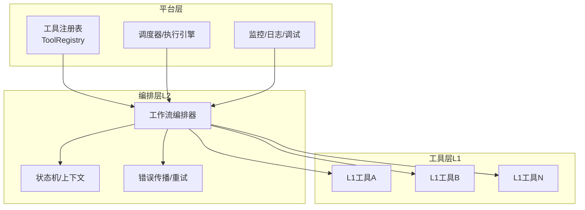
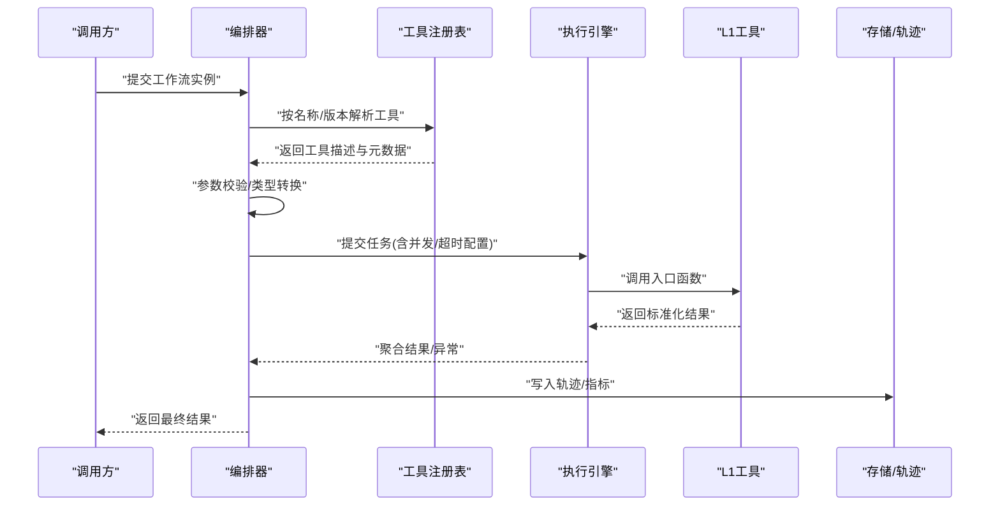
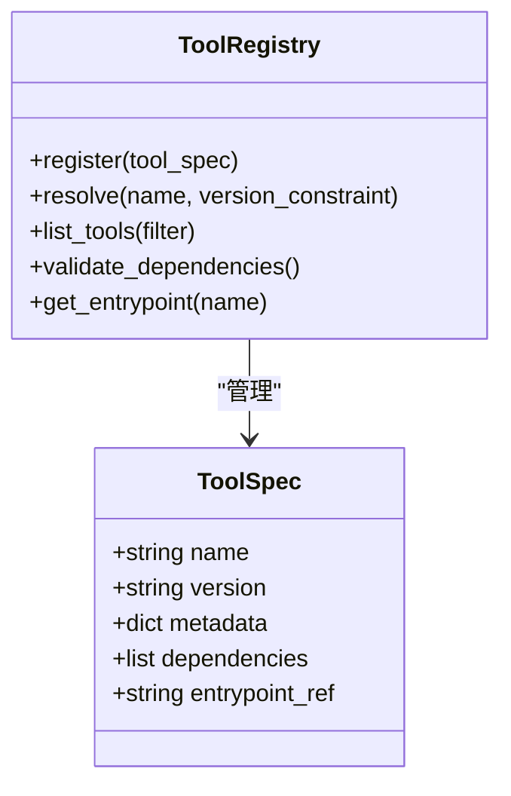
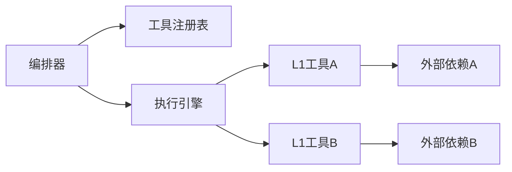

# 工具接口API

<cite>
**本文引用的文件**   
- [autonomy_mvp/core/harness.py](file://autonomy_mvp/core/harness.py)
- [autonomy_mvp/core/interruption.py](file://autonomy_mvp/core/interruption.py)
- [autonomy_mvp/core/judge.py](file://autonomy_mvp/core/judge.py)
- [autonomy_mvp/core/metrics.py](file://autonomy_mvp/core/metrics.py)
- [autonomy_mvp/core/ranking_metrics.py](file://autonomy_mvp/core/ranking_metrics.py)
- [autonomy_mvp/core/sim_agents.py](file://autonomy_mvp/core/sim_agents.py)
- [autonomy_mvp/core/tasks.py](file://autonomy_mvp/core/tasks.py)
- [autonomy_mvp/run_validation.py](file://autonomy_mvp/run_validation.py)
- [autonomy_mvp/tests/test_core.py](file://autonomy_mvp/tests/test_core.py)
- [task7/poc3_physicianbench/PhysicianBench/agent/tool_registry.py](file://task7/poc3_physicianbench/PhysicianBench/agent/tool_registry.py)
- [task7/poc3_physicianbench/PhysicianBench/agent/trajectory.py](file://task7/poc3_physicianbench/PhysicianBench/agent/trajectory.py)
- [task7/poc3_physicianbench/PhysicianBench/tools/fhir_api_functions.py](file://task7/poc3_physicianbench/PhysicianBench/tools/fhir_api_functions.py)
- [task7/poc3_physicianbench/PhysicianBench/tools/file_tools.py](file://task7/poc3_physicianbench/PhysicianBench/tools/file_tools.py)
- [docs/prd/molbench_repo/skills/L1_tools/molclaw-mol-basic-metrics/molclaw-mol-basic-metrics.md](file://docs/prd/molbench_repo/skills/L1_tools/molclaw-mol-basic-metrics/molclaw-mol-basic-metrics.md)
- [docs/prd/molbench_repo/skills/L2_workflows/02-molecular-docking-screening.md](file://docs/prd/molbench_repo/skills/L2_workflows/02-molecular-docking-screening.md)
</cite>

## 目录
1. [简介](#简介)
2. [项目结构](#项目结构)
3. [核心组件](#核心组件)
4. [架构总览](#架构总览)
5. [详细组件分析](#详细组件分析)
6. [依赖分析](#依赖分析)
7. [性能考虑](#性能考虑)
8. [故障排查指南](#故障排查指南)
9. [结论](#结论)
10. [附录](#附录)

## 简介
本文件为“工具生态系统”的接口API文档，聚焦以下目标：
- L1基础工具的标准化调用接口、参数验证与数据转换机制
- L2工作流工具的组合编排接口、状态管理与错误传播机制
- 工具注册表ToolRegistry的动态发现、版本管理与依赖解析
- 工具调用的异步执行、并发控制与资源管理
- 自定义工具开发指南、接口规范与最佳实践
- 工具性能监控、日志记录与调试支持接口

说明：
- 本仓库包含多个子项目。本文档重点围绕以下可运行代码与规范文件进行系统化梳理：
  - autonomy_mvp：评测与任务编排核心（harness、tasks、sim_agents等）
  - task7/poc3_physicianbench：Agent与工具生态的最小实现（tool_registry、trajectory、tools）
  - docs/prd/molbench_repo：L1/L2工具技能定义与编排示例

## 项目结构
从工程视角看，工具生态由三层构成：
- 工具层（L1）：原子能力封装，提供统一输入输出契约
- 编排层（L2）：将多个L1工具组合为工作流，负责状态机、分支与错误传播
- 平台层：工具注册表、调度器、监控与日志基础设施

[此图为概念性结构图，不直接映射具体源码文件]

## 核心组件
本节对关键组件进行概览式说明，并在后续章节展开细节。

- 工具注册表 ToolRegistry
  - 职责：动态发现、版本选择、依赖解析、路由分发
  - 典型能力：注册/注销、按名称或标签查询、语义化版本比较、依赖拓扑校验
- 编排器（Workflow Orchestrator）
  - 职责：读取L2工作流定义，构建DAG/状态机，驱动L1工具执行
  - 典型能力：变量路由、条件分支、并行扇出/汇聚、失败回滚/补偿
- 执行引擎（Scheduler/Executor）
  - 职责：并发控制、资源配额、超时与中断、结果缓存
  - 典型能力：线程/进程池、限流、背压、幂等键
- 监控与可观测性（Monitoring & Observability）
  - 职责：指标采集、结构化日志、链路追踪、断点调试
  - 典型能力：耗时/吞吐/错误率、采样策略、告警规则

**章节来源**
- [autonomy_mvp/core/harness.py](file://autonomy_mvp/core/harness.py)
- [autonomy_mvp/core/tasks.py](file://autonomy_mvp/core/tasks.py)
- [autonomy_mvp/core/sim_agents.py](file://autonomy_mvp/core/sim_agents.py)
- [task7/poc3_physicianbench/PhysicianBench/agent/tool_registry.py](file://task7/poc3_physicianbench/PhysicianBench/agent/tool_registry.py)
- [task7/poc3_physicianbench/PhysicianBench/agent/trajectory.py](file://task7/poc3_physicianbench/PhysicianBench/agent/trajectory.py)

## 架构总览
下图展示一次典型“L2工作流调用L1工具”的执行序列，涵盖注册表查找、参数校验、执行与结果落盘。

**图表来源**
- [autonomy_mvp/core/harness.py](file://autonomy_mvp/core/harness.py)
- [autonomy_mvp/core/tasks.py](file://autonomy_mvp/core/tasks.py)
- [task7/poc3_physicianbench/PhysicianBench/agent/tool_registry.py](file://task7/poc3_physicianbench/PhysicianBench/agent/tool_registry.py)
- [task7/poc3_physicianbench/PhysicianBench/agent/trajectory.py](file://task7/poc3_physicianbench/PhysicianBench/agent/trajectory.py)

## 详细组件分析

### L1基础工具接口规范
- 统一入口
  - 每个L1工具暴露一个稳定的入口函数（或类方法），对外仅暴露最小必要参数集
  - 参数通过声明式Schema进行校验（必填/可选、类型、范围、枚举）
- 输入输出契约
  - 输入：以字典/对象形式传递，字段名与类型严格遵循Schema
  - 输出：标准化数据结构（如JSON兼容对象），包含业务结果与元信息（耗时、版本、trace_id等）
- 数据转换机制
  - 在工具边界进行格式归一化（例如字符串到数值、路径到句柄、编码转换）
  - 对不可信输入进行白名单/正则/长度限制等安全校验
- 错误模型
  - 使用统一的错误码/异常层次，区分参数错误、运行时错误、外部依赖错误
  - 错误消息需包含定位信息（工具名、步骤、输入摘要）

参考实现位置（用于对照接口风格与约定）：
- [fhir_api_functions.py](file://task7/poc3_physicianbench/PhysicianBench/tools/fhir_api_functions.py)
- [file_tools.py](file://task7/poc3_physicianbench/PhysicianBench/tools/file_tools.py)

**章节来源**
- [task7/poc3_physicianbench/PhysicianBench/tools/fhir_api_functions.py](file://task7/poc3_physicianbench/PhysicianBench/tools/fhir_api_functions.py)
- [task7/poc3_physicianbench/PhysicianBench/tools/file_tools.py](file://task7/poc3_physicianbench/PhysicianBench/tools/file_tools.py)

### L2工作流编排接口
- 编排模型
  - 以声明式方式描述节点（L1工具）、边（数据依赖）、变量路由与条件分支
  - 支持扇出/汇聚、循环、重试、超时、熔断等通用模式
- 状态管理
  - 工作流上下文保存中间结果、环境变量、用户会话态
  - 支持检查点与恢复（至少持久化关键节点输出）
- 错误传播
  - 上游失败应快速失败并向上冒泡，同时保留完整轨迹以便诊断
  - 支持局部重试与补偿动作（如清理临时文件）

参考实现位置（用于对照编排与轨迹记录风格）：
- [harness.py](file://autonomy_mvp/core/harness.py)
- [tasks.py](file://autonomy_mvp/core/tasks.py)
- [trajectory.py](file://task7/poc3_physicianbench/PhysicianBench/agent/trajectory.py)

**章节来源**
- [autonomy_mvp/core/harness.py](file://autonomy_mvp/core/harness.py)
- [autonomy_mvp/core/tasks.py](file://autonomy_mvp/core/tasks.py)
- [task7/poc3_physicianbench/PhysicianBench/agent/trajectory.py](file://task7/poc3_physicianbench/PhysicianBench/agent/trajectory.py)

### 工具注册表 ToolRegistry
- 动态发现
  - 扫描指定目录/包，加载工具清单（名称、版本、依赖、入口）
  - 支持热更新与增量注册
- 版本管理
  - 采用语义化版本；默认选择满足约束的最新稳定版
  - 冲突检测与降级策略
- 依赖解析
  - 基于声明式依赖构建有向无环图，进行拓扑排序与循环依赖检测
  - 按需预加载依赖项

**图表来源**
- [task7/poc3_physicianbench/PhysicianBench/agent/tool_registry.py](file://task7/poc3_physicianbench/PhysicianBench/agent/tool_registry.py)

**章节来源**
- [task7/poc3_physicianbench/PhysicianBench/agent/tool_registry.py](file://task7/poc3_physicianbench/PhysicianBench/agent/tool_registry.py)

### 异步执行、并发控制与资源管理
- 异步执行
  - 使用事件循环或协程池执行I/O密集型工具
  - 提供同步/异步双入口，便于不同场景接入
- 并发控制
  - 全局/工具级并发度上限、令牌桶/漏桶限流
  - 任务优先级与队列隔离（高优/低优通道）
- 资源管理
  - 连接池、文件句柄、GPU/CPU配额
  - 自动释放与泄漏检测

参考实现位置（用于对照执行与任务组织风格）：
- [harness.py](file://autonomy_mvp/core/harness.py)
- [sim_agents.py](file://autonomy_mvp/core/sim_agents.py)

**章节来源**
- [autonomy_mvp/core/harness.py](file://autonomy_mvp/core/harness.py)
- [autonomy_mvp/core/sim_agents.py](file://autonomy_mvp/core/sim_agents.py)

### 监控、日志与调试
- 指标采集
  - 工具级：QPS、P95/P99延迟、错误率、重试次数
  - 系统级：CPU/内存/GPU占用、队列长度、锁等待
- 日志记录
  - 结构化日志（JSON），包含trace_id、span_id、工具名、入参摘要、耗时
  - 分级输出（DEBUG/INFO/WARN/ERROR），敏感字段脱敏
- 调试支持
  - 单步执行、断点注入、回放已录制轨迹
  - 可视化依赖图与执行时序

参考实现位置（用于对照评估与指标统计风格）：
- [metrics.py](file://autonomy_mvp/core/metrics.py)
- [ranking_metrics.py](file://autonomy_mvp/core/ranking_metrics.py)
- [judge.py](file://autonomy_mvp/core/judge.py)

**章节来源**
- [autonomy_mvp/core/metrics.py](file://autonomy_mvp/core/metrics.py)
- [autonomy_mvp/core/ranking_metrics.py](file://autonomy_mvp/core/ranking_metrics.py)
- [autonomy_mvp/core/judge.py](file://autonomy_mvp/core/judge.py)

### 自定义工具开发指南与最佳实践
- 接口规范
  - 单一职责：每个工具只做一件事，输入输出尽量小且明确
  - 幂等设计：相同输入产生相同输出，避免副作用或可补偿
  - 错误可观测：抛出带上下文的异常，记录必要日志
- 参数验证
  - 使用Schema声明式校验，拒绝非法输入尽早失败
  - 对路径/URL/编码等进行安全白名单校验
- 数据转换
  - 在边界做格式归一化，内部保持领域模型
  - 大对象走引用/路径传递，避免内存拷贝
- 测试与回归
  - 单元测试覆盖正常/异常路径
  - 集成测试模拟外部依赖（Mock/Fixture）
- 发布与版本
  - 遵循语义化版本；变更影响面清晰标注
  - 提供向后兼容策略与弃用提示

参考实现位置（用于对照工具组织与测试风格）：
- [test_core.py](file://autonomy_mvp/tests/test_core.py)
- [run_validation.py](file://autonomy_mvp/run_validation.py)

**章节来源**
- [autonomy_mvp/tests/test_core.py](file://autonomy_mvp/tests/test_core.py)
- [autonomy_mvp/run_validation.py](file://autonomy_mvp/run_validation.py)

### L1/L2工具示例与编排参考
- L1工具示例（分子基础指标计算）
  - 参考技能定义与调用约定，理解输入输出结构与参数约束
  - 参考路径：[molclaw-mol-basic-metrics.md](file://docs/prd/molbench_repo/skills/L1_tools/molclaw-mol-basic-metrics/molclaw-mol-basic-metrics.md)
- L2工作流示例（分子对接筛选）
  - 参考多步编排、分支与结果聚合方式
  - 参考路径：[02-molecular-docking-screening.md](file://docs/prd/molbench_repo/skills/L2_workflows/02-molecular-docking-screening.md)

**章节来源**
- [docs/prd/molbench_repo/skills/L1_tools/molclaw-mol-basic-metrics/molclaw-mol-basic-metrics.md](file://docs/prd/molbench_repo/skills/L1_tools/molclaw-mol-basic-metrics/molclaw-mol-basic-metrics.md)
- [docs/prd/molbench_repo/skills/L2_workflows/02-molecular-docking-screening.md](file://docs/prd/molbench_repo/skills/L2_workflows/02-molecular-docking-screening.md)

## 依赖分析
- 组件耦合
  - 编排器强依赖注册表（名称/版本解析）
  - 工具弱依赖外部系统（数据库、网络、文件系统），应在工具内完成适配与错误包装
- 潜在循环依赖
  - 注册表不应反向依赖具体工具实现，仅持有元数据与入口引用
- 外部依赖
  - I/O、第三方库、硬件资源需在工具层显式声明，便于资源配额与隔离

[此图为概念性依赖图，不直接映射具体源码文件]

## 性能考虑
- 批处理与流水线
  - 对批量输入采用分片+流水线处理，提升吞吐
- 缓存与去重
  - 对纯函数型L1工具启用结果缓存（按输入指纹）
- 资源隔离
  - 按工具类别划分资源池，避免热点工具抢占资源
- 背压与削峰
  - 当下游慢时主动降速，避免雪崩

[本节为通用指导，无需源码引用]

## 故障排查指南
- 常见问题定位
  - 参数校验失败：检查Schema与入参类型/范围
  - 依赖缺失：确认注册表是否成功加载与版本匹配
  - 超时/中断：核对超时阈值与中断信号处理
- 诊断手段
  - 查看轨迹与日志，定位失败节点与输入摘要
  - 使用断点/回放复现问题
  - 对比不同版本的差异，必要时回滚

参考实现位置（用于对照中断与评估流程）：
- [interruption.py](file://autonomy_mvp/core/interruption.py)
- [judge.py](file://autonomy_mvp/core/judge.py)

**章节来源**
- [autonomy_mvp/core/interruption.py](file://autonomy_mvp/core/interruption.py)
- [autonomy_mvp/core/judge.py](file://autonomy_mvp/core/judge.py)

## 结论
本API文档定义了L1/L2工具的标准化接口、编排与注册机制，以及异步执行、并发控制、监控与调试能力。通过统一的输入输出契约、严格的参数校验与完善的错误模型，结合注册表的动态发现与依赖解析，可实现高内聚、低耦合的工具生态。建议在实际落地中持续完善Schema治理、版本策略与可观测性指标，确保系统的可扩展性与稳定性。

[本节为总结性内容，无需源码引用]

## 附录
- 术语
  - L1工具：原子能力封装
  - L2工作流：多工具编排
  - 注册表：工具元数据与路由中心
  - 轨迹：执行过程的结构化记录
- 参考文件索引
  - 编排与任务：[harness.py](file://autonomy_mvp/core/harness.py)、[tasks.py](file://autonomy_mvp/core/tasks.py)
  - Agent与工具：[tool_registry.py](file://task7/poc3_physicianbench/PhysicianBench/agent/tool_registry.py)、[trajectory.py](file://task7/poc3_physicianbench/PhysicianBench/agent/trajectory.py)、[fhir_api_functions.py](file://task7/poc3_physicianbench/PhysicianBench/tools/fhir_api_functions.py)、[file_tools.py](file://task7/poc3_physicianbench/PhysicianBench/tools/file_tools.py)
  - 指标与评估：[metrics.py](file://autonomy_mvp/core/metrics.py)、[ranking_metrics.py](file://autonomy_mvp/core/ranking_metrics.py)、[judge.py](file://autonomy_mvp/core/judge.py)
  - 测试与验证：[test_core.py](file://autonomy_mvp/tests/test_core.py)、[run_validation.py](file://autonomy_mvp/run_validation.py)
  - L1/L2示例：[molclaw-mol-basic-metrics.md](file://docs/prd/molbench_repo/skills/L1_tools/molclaw-mol-basic-metrics/molclaw-mol-basic-metrics.md)、[02-molecular-docking-screening.md](file://docs/prd/molbench_repo/skills/L2_workflows/02-molecular-docking-screening.md)