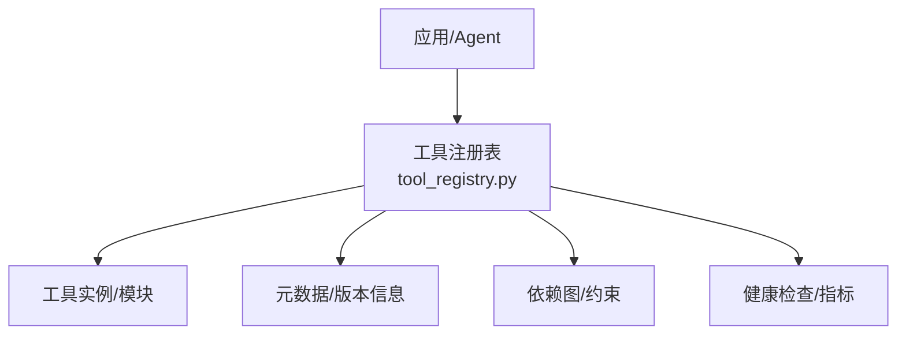
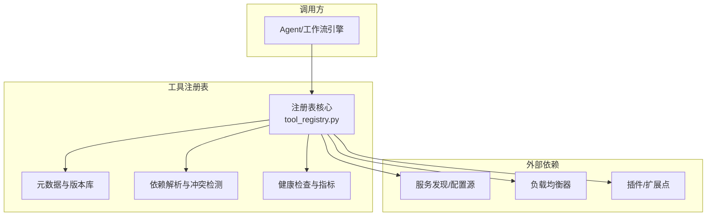
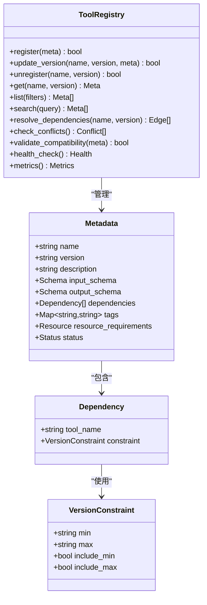
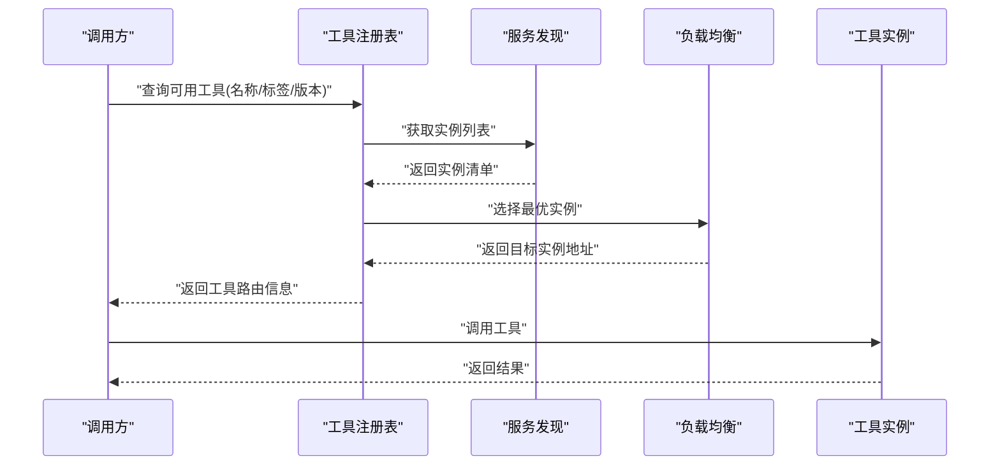
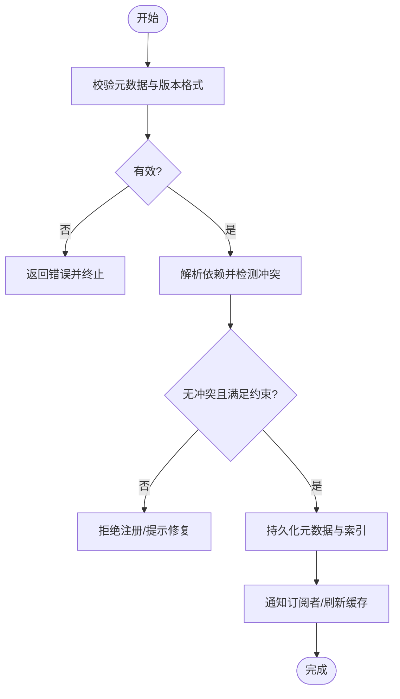
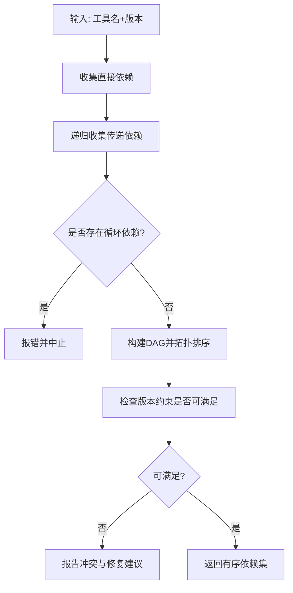
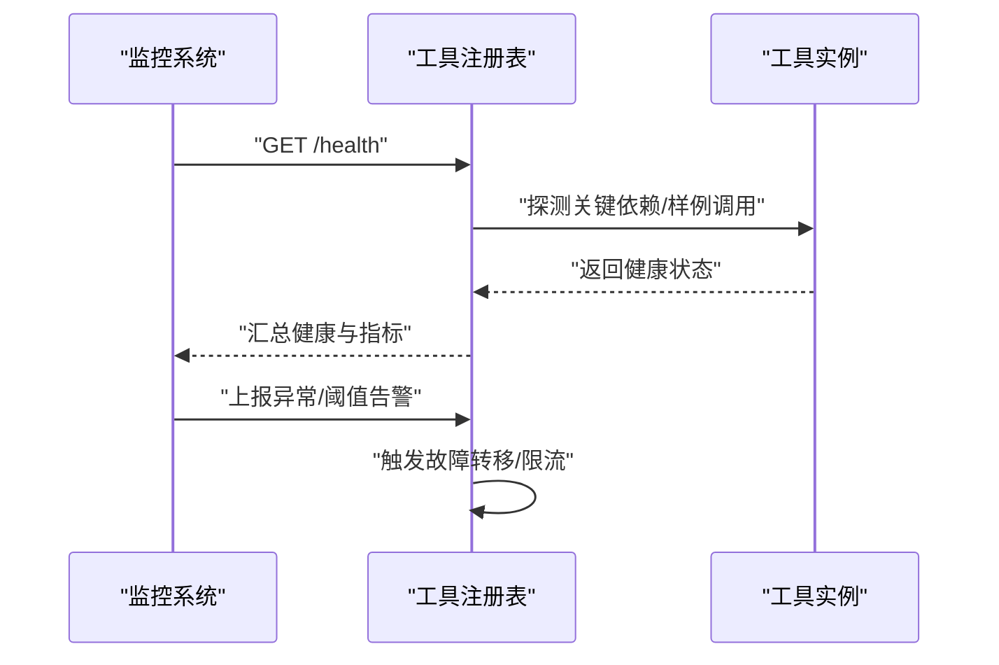
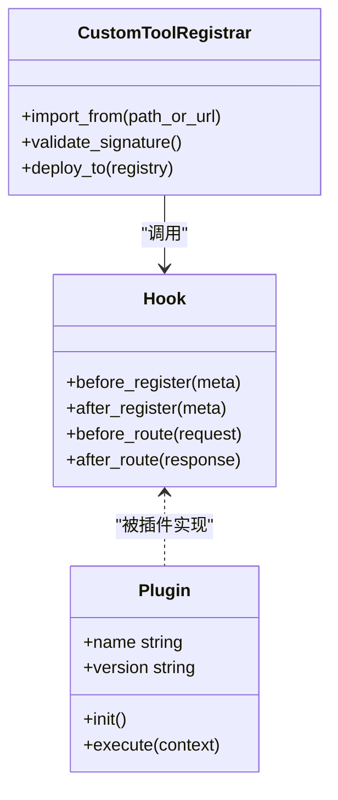
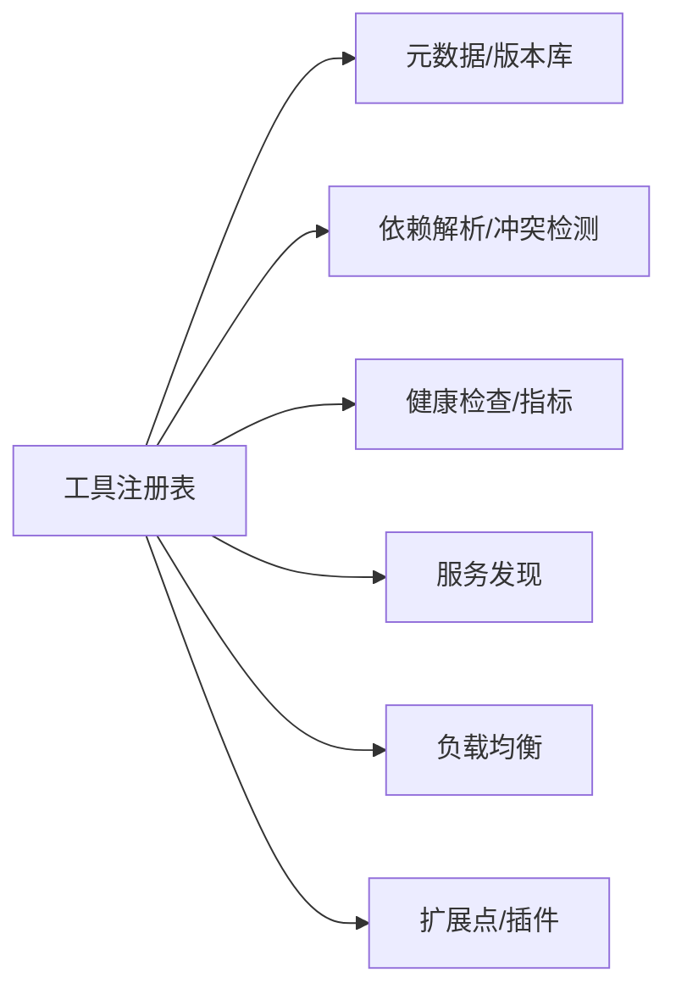

# 工具注册表API

<cite>
**本文引用的文件**   
- [tool_registry.py](file://task7/poc3_physicianbench/PhysicianBench/agent/tool_registry.py)
</cite>

## 目录
1. [简介](#简介)
2. [项目结构](#项目结构)
3. [核心组件](#核心组件)
4. [架构总览](#架构总览)
5. [详细组件分析](#详细组件分析)
6. [依赖分析](#依赖分析)
7. [性能考虑](#性能考虑)
8. [故障排查指南](#故障排查指南)
9. [结论](#结论)
10. [附录](#附录)

## 简介
本文件为“工具注册表系统”的核心API文档，聚焦以下能力：
- 动态发现机制与工具元数据管理
- 版本控制接口（注册、注销、更新）
- 依赖解析、冲突检测与兼容性验证
- 工具发现协议、服务发现与负载均衡
- 性能监控、健康检查与故障转移
- 扩展点、插件系统与自定义工具注册

说明：当前仓库中仅包含一个与工具注册相关的实现文件。本文档基于该实现进行梳理，并对缺失或待完善的能力给出建议性设计，以便后续演进。

## 项目结构
与工具注册表直接相关的代码位于：
- task7/poc3_physicianbench/PhysicianBench/agent/tool_registry.py

该文件承担工具注册、发现、生命周期管理与扩展点等职责，是工具注册表系统的核心入口。

[本节未直接分析具体源码行，故不附“章节来源”]

## 核心组件
- 工具注册中心：提供工具的注册、注销、查询、更新等API
- 元数据管理器：维护工具名称、描述、输入输出Schema、版本、标签、资源需求等
- 依赖解析器：根据声明的依赖构建有向无环图并进行拓扑排序
- 冲突检测器：检测同名/同版本冲突、依赖版本不一致等
- 兼容性校验器：依据语义化版本规则与最小/最大版本约束进行兼容判断
- 服务发现与负载均衡：在分布式场景下聚合多节点工具清单并做选择策略
- 监控与健康检查：暴露健康探针、关键指标（注册数、调用成功率、延迟分布等）
- 扩展点与插件：支持通过约定式接口或钩子函数扩展注册流程、校验逻辑与路由策略

[本节为概念性概述，不直接分析具体源码行，故不附“章节来源”]

## 架构总览
下图展示了工具注册表在系统中的位置与交互关系。

[本节为概念性架构图，不直接映射到具体源码行，故不附“图表来源”]

## 详细组件分析

### 工具注册表核心类与方法
- 职责
  - 维护工具集合与索引（按名称、标签、版本）
  - 提供注册、注销、更新、查询、列出、过滤等API
  - 协调依赖解析、冲突检测与兼容性校验
  - 暴露健康检查端点与基础指标
- 典型方法族
  - 注册/更新：register(tool_meta), update_version(name, version, meta)
  - 注销：unregister(name, version?)
  - 查询：get(name, version?), list(filters), search(query)
  - 依赖与兼容：resolve_dependencies(name, version?), check_conflicts(), validate_compatibility(meta)
  - 健康与指标：health_check(), metrics()
- 数据结构要点
  - 工具元数据：名称、版本、描述、输入/输出Schema、依赖列表、标签、资源需求、状态
  - 版本索引：名称->版本列表；版本->元数据
  - 依赖图：名称+版本->依赖边集合
  - 健康状态：就绪/退化/不可用及原因
- 并发与一致性
  - 注册/更新需加锁或采用原子操作，避免竞态
  - 查询可走只读快照或读写分离缓存
- 错误处理
  - 非法元数据返回明确错误码与消息
  - 依赖循环/缺失依赖时拒绝注册并提示修复路径
  - 版本冲突时提供回滚或降级策略

**图表来源**
- [tool_registry.py](file://task7/poc3_physicianbench/PhysicianBench/agent/tool_registry.py)

**章节来源**
- [tool_registry.py](file://task7/poc3_physicianbench/PhysicianBench/agent/tool_registry.py)

### 动态发现机制与服务发现
- 本地发现
  - 扫描内置包/目录，加载符合约定的工具模块
  - 自动提取元数据（名称、版本、Schema、依赖）
- 远程发现
  - 定期拉取远端注册表清单或服务目录
  - 增量同步变更，合并本地与远端视图
- 服务发现集成
  - 对接DNS/Consul/Kubernetes等服务目录
  - 将工具实例作为服务条目注册，附带健康状态与权重
- 负载均衡
  - 基于权重、延迟、容量、地域等策略选择实例
  - 失败重试与快速熔断，避免雪崩

**图表来源**
- [tool_registry.py](file://task7/poc3_physicianbench/PhysicianBench/agent/tool_registry.py)

**章节来源**
- [tool_registry.py](file://task7/poc3_physicianbench/PhysicianBench/agent/tool_registry.py)

### 版本控制接口与生命周期
- 版本模型
  - 遵循语义化版本（主.次.修订），支持范围约束
- 生命周期
  - 注册：新增版本并写入元数据与依赖
  - 更新：替换指定版本的元数据或二进制/镜像
  - 注销：删除版本或标记废弃（soft delete）
  - 切换：灰度发布、蓝绿/金丝雀、回滚
- 一致性
  - 注册/更新采用事务或幂等键，保证最终一致
  - 历史版本保留，支持审计与回溯

**图表来源**
- [tool_registry.py](file://task7/poc3_physicianbench/PhysicianBench/agent/tool_registry.py)

**章节来源**
- [tool_registry.py](file://task7/poc3_physicianbench/PhysicianBench/agent/tool_registry.py)

### 依赖解析、冲突检测与兼容性验证
- 依赖解析
  - 构建依赖图，执行拓扑排序，识别循环依赖
  - 支持可选依赖与条件依赖
- 冲突检测
  - 同名不同版本共存时的选择策略
  - 依赖版本区间重叠导致的不可解冲突
- 兼容性验证
  - 基于语义化版本的最小/最大边界校验
  - 破坏性变更（主版本升级）告警与强制升级路径

**图表来源**
- [tool_registry.py](file://task7/poc3_physicianbench/PhysicianBench/agent/tool_registry.py)

**章节来源**
- [tool_registry.py](file://task7/poc3_physicianbench/PhysicianBench/agent/tool_registry.py)

### 监控、健康检查与故障转移
- 健康检查
  - 存活探针：进程/端口可达
  - 就绪探针：依赖可用、元数据完整
  - 业务探针：关键用例抽样执行
- 指标采集
  - 注册/更新/注销次数
  - 调用成功率、P95/P99延迟、错误码分布
  - 实例负载、队列深度、缓存命中率
- 故障转移
  - 实例下线后自动剔除
  - 多副本间流量切换与限流
  - 降级策略：返回缓存结果或默认实现

**图表来源**
- [tool_registry.py](file://task7/poc3_physicianbench/PhysicianBench/agent/tool_registry.py)

**章节来源**
- [tool_registry.py](file://task7/poc3_physicianbench/PhysicianBench/agent/tool_registry.py)

### 扩展点、插件系统与自定义工具注册
- 扩展点
  - 注册前钩子：元数据清洗、权限校验、配额检查
  - 注册后钩子：索引重建、缓存预热、通知广播
  - 路由钩子：按标签/租户/地域定制选择策略
- 插件体系
  - 插件以独立包形式提供，遵循约定式接口
  - 支持热插拔与版本隔离
- 自定义工具注册
  - 通过CLI或SDK批量导入
  - 支持从Git/制品库自动拉取与签名校验

**图表来源**
- [tool_registry.py](file://task7/poc3_physicianbench/PhysicianBench/agent/tool_registry.py)

**章节来源**
- [tool_registry.py](file://task7/poc3_physicianbench/PhysicianBench/agent/tool_registry.py)

## 依赖分析
- 内部依赖
  - 元数据与版本库：用于持久化与查询
  - 依赖解析与冲突检测：确保注册正确性与运行期稳定
  - 健康检查与指标：支撑运维与SLA保障
- 外部依赖
  - 服务发现：集中式或去中心化目录
  - 负载均衡：选择最优实例
  - 插件/扩展点：增强注册与路由能力

**图表来源**
- [tool_registry.py](file://task7/poc3_physicianbench/PhysicianBench/agent/tool_registry.py)

**章节来源**
- [tool_registry.py](file://task7/poc3_physicianbench/PhysicianBench/agent/tool_registry.py)

## 性能考虑
- 索引优化
  - 名称/标签/版本建立倒排索引，加速过滤与搜索
  - 热点工具元数据缓存，降低重复计算
- 并发控制
  - 写路径加锁或采用乐观并发控制
  - 读路径走只读副本或内存快照
- 批处理
  - 批量注册/更新合并提交，减少IO与锁竞争
- 资源限制
  - 对重型工具设置资源上限与超时
  - 按需懒加载，避免冷启动开销

[本节为通用性能建议，不直接分析具体源码行，故不附“章节来源”]

## 故障排查指南
- 常见问题
  - 注册失败：检查元数据格式、必填字段、版本合法性
  - 依赖冲突：查看依赖图与版本约束，消除循环依赖
  - 健康检查失败：确认依赖服务可用性、网络连通与证书
  - 负载均衡异常：核对实例权重、健康状态与地域策略
- 定位手段
  - 查看注册表日志与指标面板
  - 导出最近一次变更的元数据快照
  - 回放失败请求，复现问题链路
- 恢复策略
  - 回滚到上一稳定版本
  - 临时降级至备用实现或缓存结果
  - 清理脏数据并重建索引

**章节来源**
- [tool_registry.py](file://task7/poc3_physicianbench/PhysicianBench/agent/tool_registry.py)

## 结论
当前仓库提供了工具注册表的核心骨架与关键能力，包括注册/更新/注销、元数据管理、依赖解析与冲突检测、健康检查与指标、以及扩展点与插件机制。建议在后续迭代中完善：
- 更完善的版本约束与兼容性矩阵
- 更强的服务发现与负载均衡策略
- 更丰富的监控指标与告警规则
- 更完备的错误码与诊断信息

[本节为总结性内容，不直接分析具体源码行，故不附“章节来源”]

## 附录
- 术语
  - 工具：可被调用的功能单元，具备输入/输出Schema与依赖
  - 元数据：描述工具属性、版本、依赖、标签等的结构化信息
  - 依赖图：由工具与其依赖构成的有向图
  - 语义化版本：主.次.修订的版本规范
- 参考
  - 工具注册表实现文件：task7/poc3_physicianbench/PhysicianBench/agent/tool_registry.py