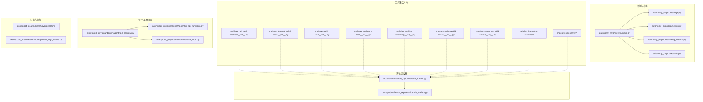
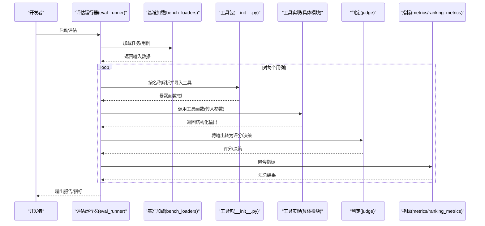
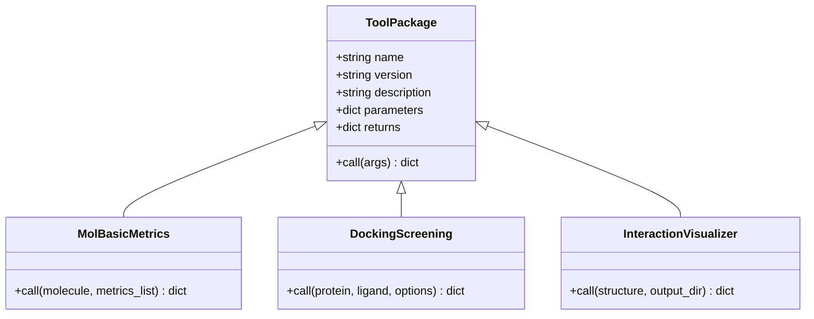
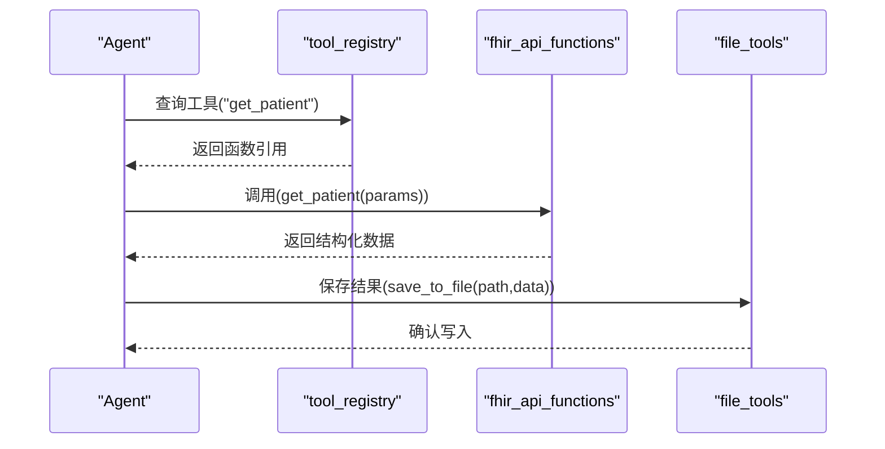
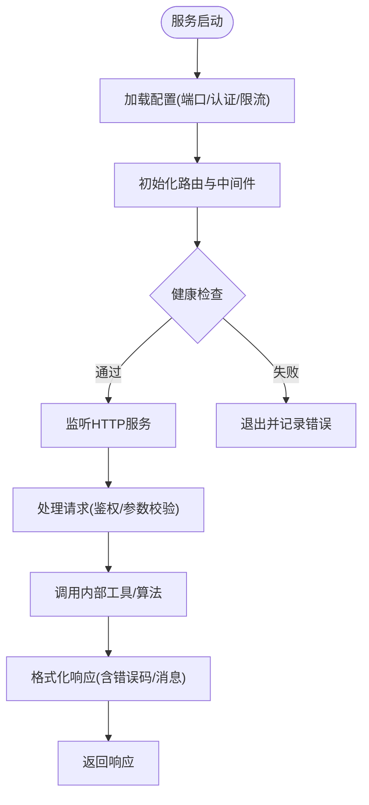
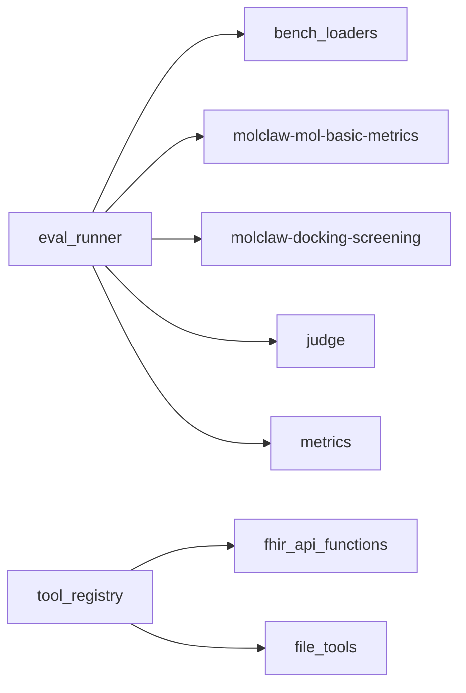

# 自定义工具开发指南

<cite>
**本文引用的文件**   
- [autonomy_mvp/core/harness.py](file://autonomy_mvp/core/harness.py)
- [autonomy_mvp/core/judge.py](file://autonomy_mvp/core/judge.py)
- [autonomy_mvp/core/metrics.py](file://autonomy_mvp/core/metrics.py)
- [autonomy_mvp/core/ranking_metrics.py](file://autonomy_mvp/core/ranking_metrics.py)
- [autonomy_mvp/core/interruption.py](file://autonomy_mvp/core/interruption.py)
- [autonomy_mvp/core/sim_agents.py](file://autonomy_mvp/core/sim_agents.py)
- [autonomy_mvp/core/tasks.py](file://autonomy_mvp/core/tasks.py)
- [autonomy_mvp/tests/test_core.py](file://autonomy_mvp/tests/test_core.py)
- [autonomy_mvp/run_validation.py](file://autonomy_mvp/run_validation.py)
- [task7/poc3_physicianbench/agent/tool_registry.py](file://task7/poc3_physicianbench/agent/tool_registry.py)
- [task7/poc3_physicianbench/tools/fhir_api_functions.py](file://task7/poc3_physicianbench/tools/fhir_api_functions.py)
- [task7/poc3_physicianbench/tools/file_tools.py](file://task7/poc3_physicianbench/tools/file_tools.py)
- [task7/poc4_pharmabench/pyproject.toml](file://task7/poc4_pharmabench/pyproject.toml)
- [task7/poc4_pharmabench/tools/predict_logd_oracle.py](file://task7/poc4_pharmabench/tools/predict_logd_oracle.py)
- [docs/prd/molbench_repo/skills/L1_tools/molclaw-mol-basic-metrics/__init__.py](file://docs/prd/molbench_repo/skills/L1_tools/molclaw-mol-basic-metrics/__init__.py)
- [docs/prd/molbench_repo/skills/L1_tools/molclaw-fpocket-toolkit-base/__init__.py](file://docs/prd/molbench_repo/skills/L1_tools/molclaw-fpocket-toolkit-base/__init__.py)
- [docs/prd/molbench_repo/skills/L1_tools/molclaw-prolif-tool/__init__.py](file://docs/prd/molbench_repo/skills/L1_tools/molclaw-prolif-tool/__init__.py)
- [docs/prd/molbench_repo/skills/L1_tools/molclaw-equiscore-tool/__init__.py](file://docs/prd/molbench_repo/skills/L1_tools/molclaw-equiscore-tool/__init__.py)
- [docs/prd/molbench_repo/skills/L1_tools/molclaw-docking-screening/__init__.py](file://docs/prd/molbench_repo/skills/L1_tools/molclaw-docking-screening/__init__.py)
- [docs/prd/molbench_repo/skills/L1_tools/molclaw-smiles-valid-check/__init__.py](file://docs/prd/molbench_repo/skills/L1_tools/molclaw-smiles-valid-check/__init__.py)
- [docs/prd/molbench_repo/skills/L1_tools/molclaw-sequence-valid-check/__init__.py](file://docs/prd/molbench_repo/skills/L1_tools/molclaw-sequence-valid-check/__init__.py)
- [docs/prd/molbench_repo/skills/L1_tools/molclaw-interaction-visualizer/__init__.py](file://docs/prd/molbench_repo/skills/L1_tools/molclaw-interaction-visualizer/__init__.py)
- [docs/prd/molbench_repo/skills/L1_tools/molclaw-interaction-visualizer/interaction_visualizer.py](file://docs/prd/molbench_repo/skills/L1_tools/molclaw-interaction-visualizer/interaction_visualizer.py)
- [docs/prd/molbench_repo/skills/L1_tools/molclaw-scp-server/__init__.py](file://docs/prd/molbench_repo/skills/L1_tools/molclaw-scp-server/__init__.py)
- [docs/prd/molbench_repo/skills/L1_tools/molclaw-scp-server/scp_server.py](file://docs/prd/molbench_repo/skills/L1_tools/molclaw-scp-server/scp_server.py)
- [docs/prd/molbench_repo/eval/bench_loaders.py](file://docs/prd/molbench_repo/eval/bench_loaders.py)
- [docs/prd/molbench_repo/eval/eval_runner.py](file://docs/prd/molbench_repo/eval/eval_runner.py)
</cite>

## 目录
1. [简介](#简介)
2. [项目结构](#项目结构)
3. [核心组件](#核心组件)
4. [架构总览](#架构总览)
5. [详细组件分析](#详细组件分析)
6. [依赖关系分析](#依赖关系分析)
7. [性能与资源管理](#性能与资源管理)
8. [测试框架与实践](#测试框架与实践)
9. [打包、分发与版本管理](#打包分发与版本管理)
10. [调试、日志与错误处理](#调试日志与错误处理)
11. [结论](#结论)
12. [附录：API参考与规范清单](#附录api参考与规范清单)

## 简介
本指南面向“自定义工具”开发者，围绕仓库中已有的工具生态（分子计算技能、评估运行器、Agent工具注册等）总结出一套可复用的开发范式。内容覆盖：
- 工具框架结构与基类继承约定
- 元数据定义、参数校验与输出格式化
- 单元测试与集成测试最佳实践
- 打包、分发与版本管理流程
- 性能优化、内存管理与资源清理规范
- 调试、日志与错误处理的接口建议

## 项目结构
仓库包含多个子项目与示例工具集，其中与“工具开发”直接相关的部分包括：
- autonomy_mvp：评测与任务编排核心，提供执行与度量能力
- docs/prd/molbench_repo/skills/L1_tools：大量L1级工具包，每个工具以独立包形式组织，具备统一的入口与描述
- task7/poc3_physicianbench：Agent侧工具注册与调用示例
- task7/poc4_pharmabench：工具作为Python包的打包与运行示例

图表来源
- [autonomy_mvp/core/harness.py](file://autonomy_mvp/core/harness.py)
- [autonomy_mvp/core/judge.py](file://autonomy_mvp/core/judge.py)
- [autonomy_mvp/core/metrics.py](file://autonomy_mvp/core/metrics.py)
- [autonomy_mvp/core/ranking_metrics.py](file://autonomy_mvp/core/ranking_metrics.py)
- [autonomy_mvp/core/tasks.py](file://autonomy_mvp/core/tasks.py)
- [docs/prd/molbench_repo/eval/bench_loaders.py](file://docs/prd/molbench_repo/eval/bench_loaders.py)
- [docs/prd/molbench_repo/eval/eval_runner.py](file://docs/prd/molbench_repo/eval/eval_runner.py)
- [task7/poc3_physicianbench/agent/tool_registry.py](file://task7/poc3_physicianbench/agent/tool_registry.py)
- [task7/poc3_physicianbench/tools/fhir_api_functions.py](file://task7/poc3_physicianbench/tools/fhir_api_functions.py)
- [task7/poc3_physicianbench/tools/file_tools.py](file://task7/poc3_physicianbench/tools/file_tools.py)
- [docs/prd/molbench_repo/skills/L1_tools/molclaw-mol-basic-metrics/__init__.py](file://docs/prd/molbench_repo/skills/L1_tools/molclaw-mol-basic-metrics/__init__.py)
- [docs/prd/molbench_repo/skills/L1_tools/molclaw-fpocket-toolkit-base/__init__.py](file://docs/prd/molbench_repo/skills/L1_tools/molclaw-fpocket-toolkit-base/__init__.py)
- [docs/prd/molbench_repo/skills/L1_tools/molclaw-prolif-tool/__init__.py](file://docs/prd/molbench_repo/skills/L1_tools/molclaw-prolif-tool/__init__.py)
- [docs/prd/molbench_repo/skills/L1_tools/molclaw-equiscore-tool/__init__.py](file://docs/prd/molbench_repo/skills/L1_tools/molclaw-equiscore-tool/__init__.py)
- [docs/prd/molbench_repo/skills/L1_tools/molclaw-docking-screening/__init__.py](file://docs/prd/molbench_repo/skills/L1_tools/molclaw-docking-screening/__init__.py)
- [docs/prd/molbench_repo/skills/L1_tools/molclaw-smiles-valid-check/__init__.py](file://docs/prd/molbench_repo/skills/L1_tools/molclaw-smiles-valid-check/__init__.py)
- [docs/prd/molbench_repo/skills/L1_tools/molclaw-sequence-valid-check/__init__.py](file://docs/prd/molbench_repo/skills/L1_tools/molclaw-sequence-valid-check/__init__.py)
- [docs/prd/molbench_repo/skills/L1_tools/molclaw-interaction-visualizer/__init__.py](file://docs/prd/molbench_repo/skills/L1_tools/molclaw-interaction-visualizer/__init__.py)
- [docs/prd/molbench_repo/skills/L1_tools/molclaw-scp-server/__init__.py](file://docs/prd/molbench_repo/skills/L1_tools/molclaw-scp-server/__init__.py)

章节来源
- [autonomy_mvp/core/harness.py](file://autonomy_mvp/core/harness.py)
- [autonomy_mvp/core/judge.py](file://autonomy_mvp/core/judge.py)
- [autonomy_mvp/core/metrics.py](file://autonomy_mvp/core/metrics.py)
- [autonomy_mvp/core/ranking_metrics.py](file://autonomy_mvp/core/ranking_metrics.py)
- [autonomy_mvp/core/tasks.py](file://autonomy_mvp/core/tasks.py)
- [docs/prd/molbench_repo/eval/bench_loaders.py](file://docs/prd/molbench_repo/eval/bench_loaders.py)
- [docs/prd/molbench_repo/eval/eval_runner.py](file://docs/prd/molbench_repo/eval/eval_runner.py)
- [task7/poc3_physicianbench/agent/tool_registry.py](file://task7/poc3_physicianbench/agent/tool_registry.py)
- [task7/poc3_physicianbench/tools/fhir_api_functions.py](file://task7/poc3_physicianbench/tools/fhir_api_functions.py)
- [task7/poc3_physicianbench/tools/file_tools.py](file://task7/poc3_physicianbench/tools/file_tools.py)
- [docs/prd/molbench_repo/skills/L1_tools/molclaw-mol-basic-metrics/__init__.py](file://docs/prd/molbench_repo/skills/L1_tools/molclaw-mol-basic-metrics/__init__.py)
- [docs/prd/molbench_repo/skills/L1_tools/molclaw-fpocket-toolkit-base/__init__.py](file://docs/prd/molbench_repo/skills/L1_tools/molclaw-fpocket-toolkit-base/__init__.py)
- [docs/prd/molbench_repo/skills/L1_tools/molclaw-prolif-tool/__init__.py](file://docs/prd/molbench_repo/skills/L1_tools/molclaw-prolif-tool/__init__.py)
- [docs/prd/molbench_repo/skills/L1_tools/molclaw-equiscore-tool/__init__.py](file://docs/prd/molbench_repo/skills/L1_tools/molclaw-equiscore-tool/__init__.py)
- [docs/prd/molbench_repo/skills/L1_tools/molclaw-docking-screening/__init__.py](file://docs/prd/molbench_repo/skills/L1_tools/molclaw-docking-screening/__init__.py)
- [docs/prd/molbench_repo/skills/L1_tools/molclaw-smiles-valid-check/__init__.py](file://docs/prd/molbench_repo/skills/L1_tools/molclaw-smiles-valid-check/__init__.py)
- [docs/prd/molbench_repo/skills/L1_tools/molclaw-sequence-valid-check/__init__.py](file://docs/prd/molbench_repo/skills/L1_tools/molclaw-sequence-valid-check/__init__.py)
- [docs/prd/molbench_repo/skills/L1_tools/molclaw-interaction-visualizer/__init__.py](file://docs/prd/molbench_repo/skills/L1_tools/molclaw-interaction-visualizer/__init__.py)
- [docs/prd/molbench_repo/skills/L1_tools/molclaw-scp-server/__init__.py](file://docs/prd/molbench_repo/skills/L1_tools/molclaw-scp-server/__init__.py)

## 核心组件
- 评测与任务编排
  - harness：统一编排入口，负责加载任务、驱动执行、收集结果与指标
  - judge：判定逻辑封装，用于将原始输出映射为评分或布尔决策
  - metrics：通用指标计算与聚合
  - ranking_metrics：排序型指标的专用实现
  - tasks：任务定义与数据装载契约
- 工具集合（L1）
  - 每个工具为一个独立包，__init__.py暴露工具元数据与可调用的函数/类
  - 典型工具类别：基础度量、对接筛选、可视化、序列/SMILES校验、远程服务封装等
- Agent工具注册
  - tool_registry：集中注册工具名称、描述、参数签名与调用入口
  - fhir_api_functions / file_tools：具体工具实现示例
- 评估运行器
  - bench_loaders：基准数据集与用例加载
  - eval_runner：端到端运行流程（加载→执行→评估→汇总）

章节来源
- [autonomy_mvp/core/harness.py](file://autonomy_mvp/core/harness.py)
- [autonomy_mvp/core/judge.py](file://autonomy_mvp/core/judge.py)
- [autonomy_mvp/core/metrics.py](file://autonomy_mvp/core/metrics.py)
- [autonomy_mvp/core/ranking_metrics.py](file://autonomy_mvp/core/ranking_metrics.py)
- [autonomy_mvp/core/tasks.py](file://autonomy_mvp/core/tasks.py)
- [docs/prd/molbench_repo/eval/bench_loaders.py](file://docs/prd/molbench_repo/eval/bench_loaders.py)
- [docs/prd/molbench_repo/eval/eval_runner.py](file://docs/prd/molbench_repo/eval/eval_runner.py)
- [task7/poc3_physicianbench/agent/tool_registry.py](file://task7/poc3_physicianbench/agent/tool_registry.py)
- [task7/poc3_physicianbench/tools/fhir_api_functions.py](file://task7/poc3_physicianbench/tools/fhir_api_functions.py)
- [task7/poc3_physicianbench/tools/file_tools.py](file://task7/poc3_physicianbench/tools/file_tools.py)
- [docs/prd/molbench_repo/skills/L1_tools/molclaw-mol-basic-metrics/__init__.py](file://docs/prd/molbench_repo/skills/L1_tools/molclaw-mol-basic-metrics/__init__.py)
- [docs/prd/molbench_repo/skills/L1_tools/molclaw-fpocket-toolkit-base/__init__.py](file://docs/prd/molbench_repo/skills/L1_tools/molclaw-fpocket-toolkit-base/__init__.py)
- [docs/prd/molbench_repo/skills/L1_tools/molclaw-prolif-tool/__init__.py](file://docs/prd/molbench_repo/skills/L1_tools/molclaw-prolif-tool/__init__.py)
- [docs/prd/molbench_repo/skills/L1_tools/molclaw-equiscore-tool/__init__.py](file://docs/prd/molbench_repo/skills/L1_tools/molclaw-equiscore-tool/__init__.py)
- [docs/prd/molbench_repo/skills/L1_tools/molclaw-docking-screening/__init__.py](file://docs/prd/molbench_repo/skills/L1_tools/molclaw-docking-screening/__init__.py)
- [docs/prd/molbench_repo/skills/L1_tools/molclaw-smiles-valid-check/__init__.py](file://docs/prd/molbench_repo/skills/L1_tools/molclaw-smiles-valid-check/__init__.py)
- [docs/prd/molbench_repo/skills/L1_tools/molclaw-sequence-valid-check/__init__.py](file://docs/prd/molbench_repo/skills/L1_tools/molclaw-sequence-valid-check/__init__.py)
- [docs/prd/molbench_repo/sskills/L1_tools/molclaw-interaction-visualizer/__init__.py](file://docs/prd/molbench_repo/skills/L1_tools/molclaw-interaction-visualizer/__init__.py)
- [docs/prd/molbench_repo/skills/L1_tools/molclaw-scp-server/__init__.py](file://docs/prd/molbench_repo/skills/L1_tools/molclaw-scp-server/__init__.py)

## 架构总览
下图展示了从“工具包”到“评估运行器”的端到端调用链，以及Agent侧的工具注册与调用路径。

图表来源
- [docs/prd/molbench_repo/eval/eval_runner.py](file://docs/prd/molbench_repo/eval/eval_runner.py)
- [docs/prd/molbench_repo/eval/bench_loaders.py](file://docs/prd/molbench_repo/eval/bench_loaders.py)
- [autonomy_mvp/core/judge.py](file://autonomy_mvp/core/judge.py)
- [autonomy_mvp/core/metrics.py](file://autonomy_mvp/core/metrics.py)
- [autonomy_mvp/core/ranking_metrics.py](file://autonomy_mvp/core/ranking_metrics.py)
- [docs/prd/molbench_repo/skills/L1_tools/molclaw-mol-basic-metrics/__init__.py](file://docs/prd/molbench_repo/skills/L1_tools/molclaw-mol-basic-metrics/__init__.py)
- [docs/prd/molbench_repo/skills/L1_tools/molclaw-docking-screening/__init__.py](file://docs/prd/molbench_repo/skills/L1_tools/molclaw-docking-screening/__init__.py)

## 详细组件分析

### 工具包规范（L1工具）
- 包结构
  - 每个工具一个独立包，根目录包含__init__.py，用于导出工具元数据与可调用的函数/类
  - 复杂工具可在包内拆分为多模块（如交互可视化工具包含主模块与辅助脚本）
- 元数据约定
  - 在__init__.py中声明工具名称、版本、作者、描述、参数签名、返回值结构等
  - 使用一致的键名与类型标注，便于运行时解析与文档生成
- 参数校验
  - 建议在工具入口进行参数类型与取值范围校验，失败时抛出明确异常
  - 对于外部依赖（如第三方库），应在初始化阶段检查可用性并提供友好提示
- 输出格式化
  - 统一返回结构（字典/对象），包含必要字段与可选扩展字段
  - 数值结果附带单位与精度说明；文件结果附带路径与哈希

图表来源
- [docs/prd/molbench_repo/skills/L1_tools/molclaw-mol-basic-metrics/__init__.py](file://docs/prd/molbench_repo/skills/L1_tools/molclaw-mol-basic-metrics/__init__.py)
- [docs/prd/molbench_repo/skills/L1_tools/molclaw-docking-screening/__init__.py](file://docs/prd/molbench_repo/skills/L1_tools/molclaw-docking-screening/__init__.py)
- [docs/prd/molbench_repo/skills/L1_tools/molclaw-interaction-visualizer/__init__.py](file://docs/prd/molbench_repo/skills/L1_tools/molclaw-interaction-visualizer/__init__.py)
- [docs/prd/molbench_repo/skills/L1_tools/molclaw-interaction-visualizer/interaction_visualizer.py](file://docs/prd/molbench_repo/skills/L1_tools/molclaw-interaction-visualizer/interaction_visualizer.py)

章节来源
- [docs/prd/molbench_repo/skills/L1_tools/molclaw-mol-basic-metrics/__init__.py](file://docs/prd/molbench_repo/skills/L1_tools/molclaw-mol-basic-metrics/__init__.py)
- [docs/prd/molbench_repo/skills/L1_tools/molclaw-fpocket-toolkit-base/__init__.py](file://docs/prd/molbench_repo/skills/L1_tools/molclaw-fpocket-toolkit-base/__init__.py)
- [docs/prd/molbench_repo/skills/L1_tools/molclaw-prolif-tool/__init__.py](file://docs/prd/molbench_repo/skills/L1_tools/molclaw-prolif-tool/__init__.py)
- [docs/prd/molbench_repo/skills/L1_tools/molclaw-equiscore-tool/__init__.py](file://docs/prd/molbench_repo/skills/L1_tools/molclaw-equiscore-tool/__init__.py)
- [docs/prd/molbench_repo/skills/L1_tools/molclaw-docking-screening/__init__.py](file://docs/prd/molbench_repo/skills/L1_tools/molclaw-docking-screening/__init__.py)
- [docs/prd/molbench_repo/skills/L1_tools/molclaw-smiles-valid-check/__init__.py](file://docs/prd/molbench_repo/skills/L1_tools/molclaw-smiles-valid-check/__init__.py)
- [docs/prd/molbench_repo/skills/L1_tools/molclaw-sequence-valid-check/__init__.py](file://docs/prd/molbench_repo/skills/L1_tools/molclaw-sequence-valid-check/__init__.py)
- [docs/prd/molbench_repo/skills/L1_tools/molclaw-interaction-visualizer/__init__.py](file://docs/prd/molbench_repo/skills/L1_tools/molclaw-interaction-visualizer/__init__.py)
- [docs/prd/molbench_repo/skills/L1_tools/molclaw-interaction-visualizer/interaction_visualizer.py](file://docs/prd/molbench_repo/skills/L1_tools/molclaw-interaction-visualizer/interaction_visualizer.py)

### Agent工具注册与调用
- 注册中心
  - tool_registry维护工具名称到实现的映射，支持动态导入与参数签名解析
- 工具实现
  - fhir_api_functions：封装FHIR API调用，提供标准化请求/响应处理
  - file_tools：文件读写、路径管理等通用I/O工具
- 调用流程
  - Agent通过注册中心查找工具，构造参数后调用，捕获异常并记录日志

图表来源
- [task7/poc3_physicianbench/agent/tool_registry.py](file://task7/poc3_physicianbench/agent/tool_registry.py)
- [task7/poc3_physicianbench/tools/fhir_api_functions.py](file://task7/poc3_physicianbench/tools/fhir_api_functions.py)
- [task7/poc3_physicianbench/tools/file_tools.py](file://task7/poc3_physicianbench/tools/file_tools.py)

章节来源
- [task7/poc3_physicianbench/agent/tool_registry.py](file://task7/poc3_physicianbench/agent/tool_registry.py)
- [task7/poc3_physicianbench/tools/fhir_api_functions.py](file://task7/poc3_physicianbench/tools/fhir_api_functions.py)
- [task7/poc3_physicianbench/tools/file_tools.py](file://task7/poc3_physicianbench/tools/file_tools.py)

### 远程服务封装（SCP Server）
- 目的：将本地计算或服务以HTTP接口暴露，供其他进程或Agent调用
- 要点：
  - 在__init__.py中暴露服务配置与启动入口
  - 在scp_server.py中实现路由、鉴权、限流与错误码规范
  - 提供健康检查与监控指标

图表来源
- [docs/prd/molbench_repo/skills/L1_tools/molclaw-scp-server/__init__.py](file://docs/prd/molbench_repo/skills/L1_tools/molclaw-scp-server/__init__.py)
- [docs/prd/molbench_repo/skills/L1_tools/molclaw-scp-server/scp_server.py](file://docs/prd/molbench_repo/skills/L1_tools/molclaw-scp-server/scp_server.py)

章节来源
- [docs/prd/molbench_repo/skills/L1_tools/molclaw-scp-server/__init__.py](file://docs/prd/molbench_repo/skills/L1_tools/molclaw-scp-server/__init__.py)
- [docs/prd/molbench_repo/skills/L1_tools/molclaw-scp-server/scp_server.py](file://docs/prd/molbench_repo/skills/L1_tools/molclaw-scp-server/scp_server.py)

## 依赖关系分析
- 评测层依赖
  - eval_runner依赖bench_loaders获取数据，再调用各工具包完成计算，最后交由judge与metrics产出结果
- 工具包间耦合
  - L1工具包之间尽量保持低耦合，通过标准输入输出协议交互
  - 需要跨工具协作时，建议使用临时文件或共享数据结构，避免强依赖
- Agent与工具
  - tool_registry解耦Agent与具体工具实现，便于热插拔与动态发现

图表来源
- [docs/prd/molbench_repo/eval/eval_runner.py](file://docs/prd/molbench_repo/eval/eval_runner.py)
- [docs/prd/molbench_repo/eval/bench_loaders.py](file://docs/prd/molbench_repo/eval/bench_loaders.py)
- [autonomy_mvp/core/judge.py](file://autonomy_mvp/core/judge.py)
- [autonomy_mvp/core/metrics.py](file://autonomy_mvp/core/metrics.py)
- [task7/poc3_physicianbench/agent/tool_registry.py](file://task7/poc3_physicianbench/agent/tool_registry.py)
- [task7/poc3_physicianbench/tools/fhir_api_functions.py](file://task7/poc3_physicianbench/tools/fhir_api_functions.py)
- [task7/poc3_physicianbench/tools/file_tools.py](file://task7/poc3_physicianbench/tools/file_tools.py)
- [docs/prd/molbench_repo/skills/L1_tools/molclaw-mol-basic-metrics/__init__.py](file://docs/prd/molbench_repo/skills/L1_tools/molclaw-mol-basic-metrics/__init__.py)
- [docs/prd/molbench_repo/skills/L1_tools/molclaw-docking-screening/__init__.py](file://docs/prd/molbench_repo/skills/L1_tools/molclaw-docking-screening/__init__.py)

章节来源
- [docs/prd/molbench_repo/eval/eval_runner.py](file://docs/prd/molbench_repo/eval/eval_runner.py)
- [docs/prd/molbench_repo/eval/bench_loaders.py](file://docs/prd/molbench_repo/eval/bench_loaders.py)
- [autonomy_mvp/core/judge.py](file://autonomy_mvp/core/judge.py)
- [autonomy_mvp/core/metrics.py](file://autonomy_mvp/core/metrics.py)
- [task7/poc3_physicianbench/agent/tool_registry.py](file://task7/poc3_physicianbench/agent/tool_registry.py)
- [task7/poc3_physicianbench/tools/fhir_api_functions.py](file://task7/poc3_physicianbench/tools/fhir_api_functions.py)
- [task7/poc3_physicianbench/tools/file_tools.py](file://task7/poc3_physicianbench/tools/file_tools.py)
- [docs/prd/molbench_repo/skills/L1_tools/molclaw-mol-basic-metrics/__init__.py](file://docs/prd/molbench_repo/skills/L1_tools/molclaw-mol-basic-metrics/__init__.py)
- [docs/prd/molbench_repo/skills/L1_tools/molclaw-docking-screening/__init__.py](file://docs/prd/molbench_repo/skills/L1_tools/molclaw-docking-screening/__init__.py)

## 性能与资源管理
- 批量与并行
  - 对CPU密集型工具采用进程级并行；对IO密集型工具采用异步或线程池
  - 在评估运行器中控制并发度，避免资源争用
- 内存管理
  - 大对象及时释放，避免全局缓存持有长生命周期引用
  - 使用生成器与流式处理减少峰值内存占用
- 资源清理
  - 显式关闭文件句柄、网络连接与外部进程
  - 使用上下文管理器确保异常路径也能正确清理
- 缓存策略
  - 对重复计算结果进行磁盘或内存缓存，结合输入指纹去重
  - 缓存失效策略需与工具版本与依赖版本绑定

[本节为通用指导，不直接分析具体文件]

## 测试框架与实践
- 单元测试
  - 针对工具函数的边界条件、异常分支与性能回归编写用例
  - 使用固定夹具（fixtures）保证输入一致性
- 集成测试
  - 模拟完整评估流程，验证工具与运行器的兼容性
  - 对外部依赖（数据库、网络服务）使用Mock或轻量替代
- 持续集成
  - 在CI中运行最小化用例集，快速反馈问题
  - 对关键工具增加覆盖率阈值

章节来源
- [autonomy_mvp/tests/test_core.py](file://autonomy_mvp/tests/test_core.py)
- [autonomy_mvp/run_validation.py](file://autonomy_mvp/run_validation.py)

## 打包、分发与版本管理
- 包结构
  - 每个工具包遵循PEP 8与PEP 420命名规范，__init__.py暴露稳定API
- 构建与发布
  - 使用pyproject.toml声明依赖、入口点与元数据
  - 通过标准构建工具生成wheel并上传至私有或公共索引
- 版本管理
  - 语义化版本号（主.次.修订），变更日志与迁移指南同步更新
  - 工具元数据中的version应与包版本保持一致

章节来源
- [task7/poc4_pharmabench/pyproject.toml](file://task7/poc4_pharmabench/pyproject.toml)
- [task7/poc4_pharmabench/tools/predict_logd_oracle.py](file://task7/poc4_pharmabench/tools/predict_logd_oracle.py)
- [docs/prd/molbench_repo/skills/L1_tools/molclaw-mol-basic-metrics/__init__.py](file://docs/prd/molbench_repo/skills/L1_tools/molclaw-mol-basic-metrics/__init__.py)
- [docs/prd/molbench_repo/skills/L1_tools/molclaw-fpocket-toolkit-base/__init__.py](file://docs/prd/molbench_repo/skills/L1_tools/molclaw-fpocket-toolkit-base/__init__.py)
- [docs/prd/molbench_repo/skills/L1_tools/molclaw-prolif-tool/__init__.py](file://docs/prd/molbench_repo/skills/L1_tools/molclaw-prolif-tool/__init__.py)
- [docs/prd/molbench_repo/skills/L1_tools/molclaw-equiscore-tool/__init__.py](file://docs/prd/molbench_repo/skills/L1_tools/molclaw-equiscore-tool/__init__.py)
- [docs/prd/molbench_repo/skills/L1_tools/molclaw-docking-screening/__init__.py](file://docs/prd/molbench_repo/skills/L1_tools/molclaw-docking-screening/__init__.py)
- [docs/prd/molbench_repo/skills/L1_tools/molclaw-smiles-valid-check/__init__.py](file://docs/prd/molbench_repo/skills/L1_tools/molclaw-smiles-valid-check/__init__.py)
- [docs/prd/molbench_repo/skills/L1_tools/molclaw-sequence-valid-check/__init__.py](file://docs/prd/molbench_repo/skills/L1_tools/molclaw-sequence-valid-check/__init__.py)
- [docs/prd/molbench_repo/skills/L1_tools/molclaw-interaction-visualizer/__init__.py](file://docs/prd/molbench_repo/skills/L1_tools/molclaw-interaction-visualizer/__init__.py)
- [docs/prd/molbench_repo/skills/L1_tools/molclaw-scp-server/__init__.py](file://docs/prd/molbench_repo/skills/L1_tools/molclaw-scp-server/__init__.py)

## 调试、日志与错误处理
- 日志记录
  - 为每个工具提供结构化日志（时间戳、级别、上下文、trace_id）
  - 区分信息、警告、错误等级，便于检索与告警
- 错误处理
  - 定义统一错误码与消息模板，客户端可据此做重试或降级
  - 对超时、网络异常、外部依赖不可用等情况进行兜底
- 调试支持
  - 提供调试开关与详细模式，输出中间状态与耗时统计
  - 在Agent侧记录工具调用轨迹，便于回放与定位问题

[本节为通用指导，不直接分析具体文件]

## 结论
通过统一的工具包规范、清晰的注册与调用机制、完善的评估运行器与测试体系，本项目为“自定义工具”的开发提供了可扩展、可维护且可观测的工程化基础。遵循本文档的规范与最佳实践，可显著提升工具质量与交付效率。

[本节为总结性内容，不直接分析具体文件]

## 附录：API参考与规范清单
- 工具包元数据（在__init__.py中声明）
  - 字段：name、version、author、description、parameters、returns、examples
  - 约束：类型标注清晰、默认值合理、异常说明完备
- 参数校验器
  - 输入类型检查、取值范围、必填项、格式正则
  - 失败时抛出带错误码的异常，并附带修复建议
- 输出格式化器
  - 统一返回结构，包含status、data、meta、errors
  - 数值结果附带单位与精度；文件结果附带路径与哈希
- 评估运行器接口
  - 加载：load_dataset(task_id) → dataset
  - 执行：run_tool(tool_name, args) → result
  - 评估：score(result, ground_truth) → metric
  - 汇总：aggregate(metrics) → report
- Agent工具注册接口
  - register(name, func, metadata)
  - resolve(name) → func
  - call(name, args) → result

[本节为概念性参考，不直接分析具体文件]