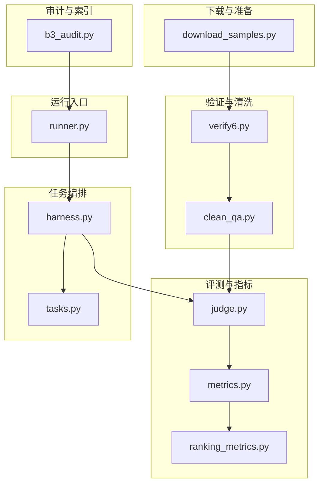
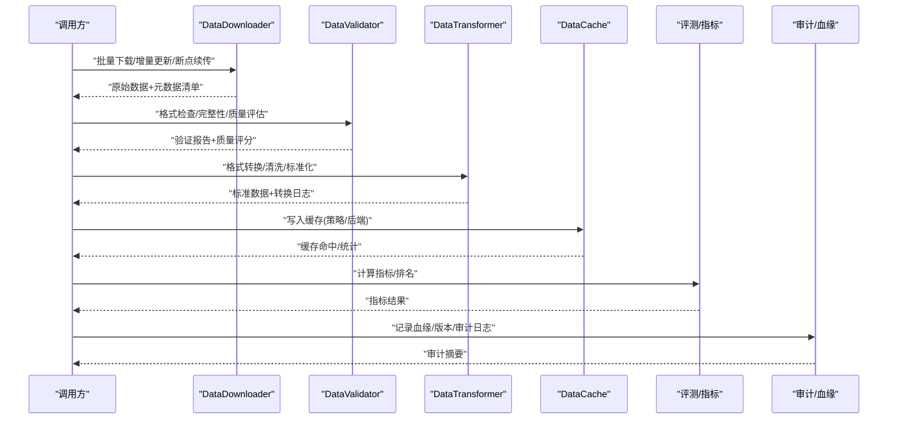
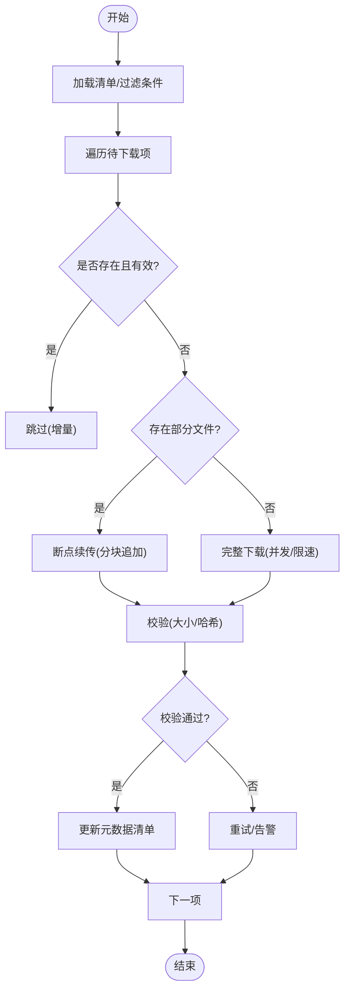
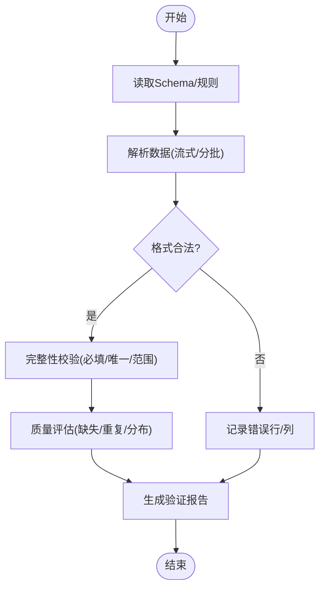
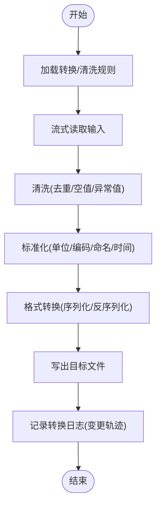
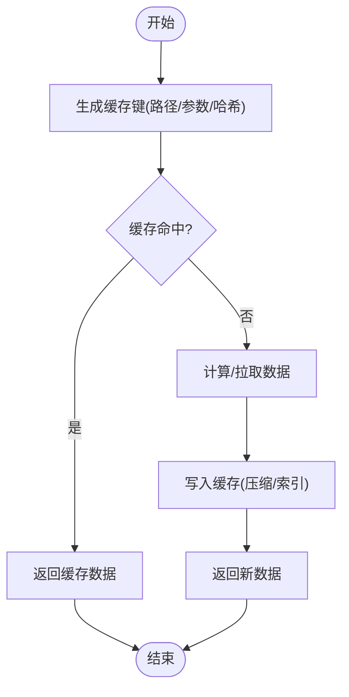
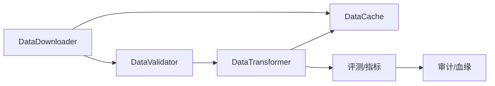

# 数据处理API

<cite>
**本文引用的文件**   
- [autonomy_mvp/core/harness.py](file://autonomy_mvp/core/harness.py)
- [autonomy_mvp/core/judge.py](file://autonomy_mvp/core/judge.py)
- [autonomy_mvp/core/metrics.py](file://autonomy_mvp/core/metrics.py)
- [autonomy_mvp/core/ranking_metrics.py](file://autonomy_mvp/core/ranking_metrics.py)
- [autonomy_mvp/core/tasks.py](file://autonomy_mvp/core/tasks.py)
- [deep_research_longhorizon/download_samples.py](file://deep_research_longhorizon/download_samples.py)
- [longhorizon/instantiate/b3_audit.py](file://longhorizon/instantiate/b3_audit.py)
- [task1/runner.py](file://task1/runner.py)
- [task1/verify6.py](file://task1/verify6.py)
- [task1/clean_qa.py](file://task1/clean_qa.py)
</cite>

## 目录
1. [简介](#简介)
2. [项目结构](#项目结构)
3. [核心组件](#核心组件)
4. [架构总览](#架构总览)
5. [详细组件分析](#详细组件分析)
6. [依赖关系分析](#依赖关系分析)
7. [性能考虑](#性能考虑)
8. [故障排查指南](#故障排查指南)
9. [结论](#结论)
10. [附录](#附录)

## 简介
本文件为“数据处理模块”的API文档，围绕以下目标展开：
- 数据集下载器 DataDownloader：批量下载、增量更新与断点续传
- 数据验证器 DataValidator：格式检查、完整性验证与质量评估
- 数据转换器 DataTransformer：格式转换、清洗处理与标准化
- 数据缓存器 DataCache：缓存策略、存储后端与性能优化
- 大规模数据处理、流式传输与内存管理最佳实践
- 数据血缘追踪、版本控制与审计日志接口

说明：当前仓库未提供上述四个类的直接实现。本文基于仓库中已有的下载脚本、验证与清理脚本、评测与指标模块以及审计脚本，抽象出统一的API契约与参考实现建议，并给出可落地的流程图与序列图，便于后续在工程中落地实现。

## 项目结构
从现有代码看，数据处理相关能力分散于多个子任务与工具脚本中：
- 下载与样本准备：deep_research_longhorizon/download_samples.py
- 验证与清理：task1/verify6.py、task1/clean_qa.py
- 评测与指标：autonomy_mvp/core/judge.py、metrics.py、ranking_metrics.py
- 任务编排与执行：autonomy_mvp/core/harness.py、tasks.py
- 审计与索引：longhorizon/instantiate/b3_audit.py
- 任务运行入口：task1/runner.py

图表来源
- [deep_research_longhorizon/download_samples.py](file://deep_research_longhorizon/download_samples.py)
- [task1/verify6.py](file://task1/verify6.py)
- [task1/clean_qa.py](file://task1/clean_qa.py)
- [autonomy_mvp/core/judge.py](file://autonomy_mvp/core/judge.py)
- [autonomy_mvp/core/metrics.py](file://autonomy_mvp/core/metrics.py)
- [autonomy_mvp/core/ranking_metrics.py](file://autonomy_mvp/core/ranking_metrics.py)
- [autonomy_mvp/core/harness.py](file://autonomy_mvp/core/harness.py)
- [autonomy_mvp/core/tasks.py](file://autonomy_mvp/core/tasks.py)
- [longhorizon/instantiate/b3_audit.py](file://longhorizon/instantiate/b3_audit.py)
- [task1/runner.py](file://task1/runner.py)

章节来源
- [deep_research_longhorizon/download_samples.py](file://deep_research_longhorizon/download_samples.py)
- [task1/verify6.py](file://task1/verify6.py)
- [task1/clean_qa.py](file://task1/clean_qa.py)
- [autonomy_mvp/core/judge.py](file://autonomy_mvp/core/judge.py)
- [autonomy_mvp/core/metrics.py](file://autonomy_mvp/core/metrics.py)
- [autonomy_mvp/core/ranking_metrics.py](file://autonomy_mvp/core/ranking_metrics.py)
- [autonomy_mvp/core/harness.py](file://autonomy_mvp/core/harness.py)
- [autonomy_mvp/core/tasks.py](file://autonomy_mvp/core/tasks.py)
- [longhorizon/instantiate/b3_audit.py](file://longhorizon/instantiate/b3_audit.py)
- [task1/runner.py](file://task1/runner.py)

## 核心组件
本节定义四个核心组件的API契约与行为约定，供工程实现时遵循。

- DataDownloader（数据集下载器）
  - 批量下载：支持按清单或通配规则并行拉取多资源
  - 增量更新：基于元信息（如时间戳、哈希）判断是否需要重新下载
  - 断点续传：对大文件支持分块写入与进度持久化，异常恢复后继续
  - 输出产物：原始数据文件 + 元数据清单（含来源、大小、校验和、时间戳）

- DataValidator（数据验证器）
  - 格式检查：JSON/CSV/JSONL等结构的schema校验
  - 完整性验证：必填字段、唯一性、外键一致性、范围约束
  - 质量评估：缺失率、重复率、分布异常检测、抽样人工复核标记
  - 输出产物：验证报告（通过/失败+问题明细）、质量评分

- DataTransformer（数据转换器）
  - 格式转换：源格式到目标格式的映射与类型转换
  - 清洗处理：去重、空值填充、异常值裁剪、文本规范化
  - 标准化：单位统一、编码归一、命名规范、时间与时区统一
  - 输出产物：标准数据集 + 转换日志（变更轨迹）

- DataCache（数据缓存器）
  - 缓存策略：LRU/TTL/按内容哈希命中；冷热分层
  - 存储后端：本地文件系统、对象存储、SQLite/Redis
  - 性能优化：预取、并发读写、压缩与索引、惰性加载
  - 输出产物：缓存命中统计、命中率、延迟分布

章节来源
- [deep_research_longhorizon/download_samples.py](file://deep_research_longhorizon/download_samples.py)
- [task1/verify6.py](file://task1/verify6.py)
- [task1/clean_qa.py](file://task1/clean_qa.py)
- [autonomy_mvp/core/judge.py](file://autonomy_mvp/core/judge.py)
- [autonomy_mvp/core/metrics.py](file://autonomy_mvp/core/metrics.py)
- [autonomy_mvp/core/ranking_metrics.py](file://autonomy_mvp/core/ranking_metrics.py)
- [autonomy_mvp/core/harness.py](file://autonomy_mvp/core/harness.py)
- [autonomy_mvp/core/tasks.py](file://autonomy_mvp/core/tasks.py)
- [longhorizon/instantiate/b3_audit.py](file://longhorizon/instantiate/b3_audit.py)
- [task1/runner.py](file://task1/runner.py)

## 架构总览
下图展示数据处理流水线的高层交互：下载→验证→转换→缓存→评测→审计。

图表来源
- [deep_research_longhorizon/download_samples.py](file://deep_research_longhorizon/download_samples.py)
- [task1/verify6.py](file://task1/verify6.py)
- [task1/clean_qa.py](file://task1/clean_qa.py)
- [autonomy_mvp/core/judge.py](file://autonomy_mvp/core/judge.py)
- [autonomy_mvp/core/metrics.py](file://autonomy_mvp/core/metrics.py)
- [autonomy_mvp/core/ranking_metrics.py](file://autonomy_mvp/core/ranking_metrics.py)
- [longhorizon/instantiate/b3_audit.py](file://longhorizon/instantiate/b3_audit.py)

## 详细组件分析

### DataDownloader（数据集下载器）
- 功能要点
  - 批量下载：根据清单并行请求，支持限速与重试
  - 增量更新：对比远程元信息（大小、时间戳、哈希），仅拉取差异
  - 断点续传：分块写入临时文件，异常中断后可恢复
- 关键流程

- 与仓库现有脚本的对应关系
  - 下载与样本准备流程可参考：[deep_research_longhorizon/download_samples.py](file://deep_research_longhorizon/download_samples.py)

章节来源
- [deep_research_longhorizon/download_samples.py](file://deep_research_longhorizon/download_samples.py)

### DataValidator（数据验证器）
- 功能要点
  - 格式检查：针对JSON/CSV/JSONL的结构与类型校验
  - 完整性验证：必填字段、唯一性、关联一致性
  - 质量评估：缺失率、重复率、异常分布、抽样标记
- 关键流程

- 与仓库现有脚本的对应关系
  - 验证逻辑可参考：[task1/verify6.py](file://task1/verify6.py)

章节来源
- [task1/verify6.py](file://task1/verify6.py)

### DataTransformer（数据转换器）
- 功能要点
  - 格式转换：源格式到目标格式映射与类型转换
  - 清洗处理：去重、空值填充、异常值裁剪、文本规范化
  - 标准化：单位、编码、命名、时间与时区统一
- 关键流程

- 与仓库现有脚本的对应关系
  - 清洗与预处理逻辑可参考：[task1/clean_qa.py](file://task1/clean_qa.py)

章节来源
- [task1/clean_qa.py](file://task1/clean_qa.py)

### DataCache（数据缓存器）
- 功能要点
  - 缓存策略：LRU/TTL/按内容哈希命中；冷热分层
  - 存储后端：本地文件系统、对象存储、SQLite/Redis
  - 性能优化：预取、并发读写、压缩与索引、惰性加载
- 关键流程

- 与仓库现有脚本的对应关系
  - 该组件为通用基础设施，可在各脚本中按需集成

章节来源
- [deep_research_longhorizon/download_samples.py](file://deep_research_longhorizon/download_samples.py)
- [task1/verify6.py](file://task1/verify6.py)
- [task1/clean_qa.py](file://task1/clean_qa.py)

### 评测与指标（与数据处理联动）
- 功能要点
  - 指标计算：准确率、召回率、F1、AUC、排序指标等
  - 排名与汇总：跨任务/跨模型聚合与可视化
- 与仓库现有脚本的对应关系
  - 评测与指标实现可参考：
    - [autonomy_mvp/core/judge.py](file://autonomy_mvp/core/judge.py)
    - [autonomy_mvp/core/metrics.py](file://autonomy_mvp/core/metrics.py)
    - [autonomy_mvp/core/ranking_metrics.py](file://autonomy_mvp/core/ranking_metrics.py)

章节来源
- [autonomy_mvp/core/judge.py](file://autonomy_mvp/core/judge.py)
- [autonomy_mvp/core/metrics.py](file://autonomy_mvp/core/metrics.py)
- [autonomy_mvp/core/ranking_metrics.py](file://autonomy_mvp/core/ranking_metrics.py)

### 任务编排与运行
- 功能要点
  - 任务调度：串行/并行、重试、超时、资源限制
  - 生命周期：启动、监控、收尾、状态上报
- 与仓库现有脚本的对应关系
  - 任务编排与执行可参考：
    - [autonomy_mvp/core/harness.py](file://autonomy_mvp/core/harness.py)
    - [autonomy_mvp/core/tasks.py](file://autonomy_mvp/core/tasks.py)
    - [task1/runner.py](file://task1/runner.py)

章节来源
- [autonomy_mvp/core/harness.py](file://autonomy_mvp/core/harness.py)
- [autonomy_mvp/core/tasks.py](file://autonomy_mvp/core/tasks.py)
- [task1/runner.py](file://task1/runner.py)

### 审计与血缘
- 功能要点
  - 数据血缘：记录数据来源、转换步骤、依赖关系
  - 版本控制：数据集版本、配置版本、模型版本
  - 审计日志：操作者、时间、输入输出摘要、校验结果
- 与仓库现有脚本的对应关系
  - 审计与索引可参考：[longhorizon/instantiate/b3_audit.py](file://longhorizon/instantiate/b3_audit.py)

章节来源
- [longhorizon/instantiate/b3_audit.py](file://longhorizon/instantiate/b3_audit.py)

## 依赖关系分析
- 组件耦合
  - DataDownloader 与 DataCache：下载产物优先入缓存，减少重复IO
  - DataValidator 与 DataTransformer：验证通过后进入转换阶段
  - DataTransformer 与 DataCache：转换结果缓存，避免重复计算
  - 评测与审计：消费标准数据，产出指标与审计记录
- 外部依赖
  - 网络I/O（HTTP/HTTPS/S3等）
  - 文件系统与对象存储
  - 数据库（SQLite/Redis）用于元数据与缓存索引

图表来源
- [deep_research_longhorizon/download_samples.py](file://deep_research_longhorizon/download_samples.py)
- [task1/verify6.py](file://task1/verify6.py)
- [task1/clean_qa.py](file://task1/clean_qa.py)
- [autonomy_mvp/core/judge.py](file://autonomy_mvp/core/judge.py)
- [autonomy_mvp/core/metrics.py](file://autonomy_mvp/core/metrics.py)
- [autonomy_mvp/core/ranking_metrics.py](file://autonomy_mvp/core/ranking_metrics.py)
- [longhorizon/instantiate/b3_audit.py](file://longhorizon/instantiate/b3_audit.py)

## 性能考虑
- 大规模数据处理
  - 使用流式读取/写入，避免一次性加载全量数据
  - 批处理与分页：固定批次大小，控制内存峰值
  - 并行与并发：CPU密集型用进程池，I/O密集型用协程/线程池
- 流式传输
  - 下载端使用分块写入与断点续传
  - 转换与验证采用迭代器模式，边读边处理
- 内存管理
  - 显式释放引用，及时关闭句柄
  - 使用生成器/迭代器替代列表累积
  - 缓存键设计合理，避免键爆炸
- 缓存与I/O
  - 热点数据常驻内存，冷数据落盘
  - 压缩与索引提升吞吐
  - 预取与异步I/O降低等待

## 故障排查指南
- 下载失败
  - 检查网络连通性与限速策略
  - 确认断点续传状态文件是否损坏
  - 查看重试次数与退避策略
- 验证失败
  - 定位错误行/列，核对Schema与数据类型
  - 检查必填字段与唯一性约束
  - 关注质量阈值（缺失率/重复率）
- 转换异常
  - 核对转换规则与映射表
  - 检查编码与时区设置
  - 查看转换日志中的变更轨迹
- 缓存问题
  - 检查缓存键冲突与TTL过期
  - 观察命中率与延迟分布
  - 确认存储后端可用性与配额
- 审计与血缘
  - 核对版本标签与时间戳
  - 检查审计日志完整性
  - 确认血缘链路无断裂

章节来源
- [deep_research_longhorizon/download_samples.py](file://deep_research_longhorizon/download_samples.py)
- [task1/verify6.py](file://task1/verify6.py)
- [task1/clean_qa.py](file://task1/clean_qa.py)
- [autonomy_mvp/core/judge.py](file://autonomy_mvp/core/judge.py)
- [autonomy_mvp/core/metrics.py](file://autonomy_mvp/core/metrics.py)
- [autonomy_mvp/core/ranking_metrics.py](file://autonomy_mvp/core/ranking_metrics.py)
- [longhorizon/instantiate/b3_audit.py](file://longhorizon/instantiate/b3_audit.py)

## 结论
本文基于仓库现有脚本与模块，抽象出数据处理四大核心组件的API契约与参考实现建议，并提供了流程图与序列图以指导工程落地。建议在后续开发中：
- 将下载、验证、转换、缓存封装为可复用服务
- 建立统一的元数据与审计体系
- 引入指标与排名模块，形成闭环的数据质量与效果评估

## 附录
- 术语
  - 元数据清单：描述数据资源的来源、大小、校验和、时间戳等信息
  - 血缘：数据从来源到产物的完整链路
  - 审计日志：记录数据处理过程中的关键事件与结果
- 参考实现位置
  - 下载与样本准备：[deep_research_longhorizon/download_samples.py](file://deep_research_longhorizon/download_samples.py)
  - 验证与清洗：[task1/verify6.py](file://task1/verify6.py)、[task1/clean_qa.py](file://task1/clean_qa.py)
  - 评测与指标：[autonomy_mvp/core/judge.py](file://autonomy_mvp/core/judge.py)、[autonomy_mvp/core/metrics.py](file://autonomy_mvp/core/metrics.py)、[autonomy_mvp/core/ranking_metrics.py](file://autonomy_mvp/core/ranking_metrics.py)
  - 任务编排与运行：[autonomy_mvp/core/harness.py](file://autonomy_mvp/core/harness.py)、[autonomy_mvp/core/tasks.py](file://autonomy_mvp/core/tasks.py)、[task1/runner.py](file://task1/runner.py)
  - 审计与索引：[longhorizon/instantiate/b3_audit.py](file://longhorizon/instantiate/b3_audit.py)