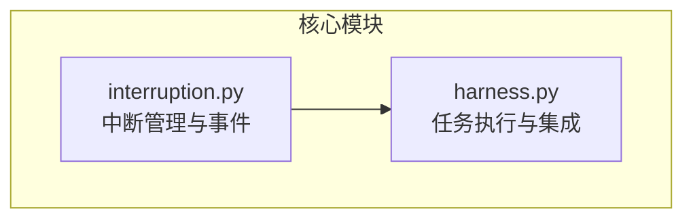
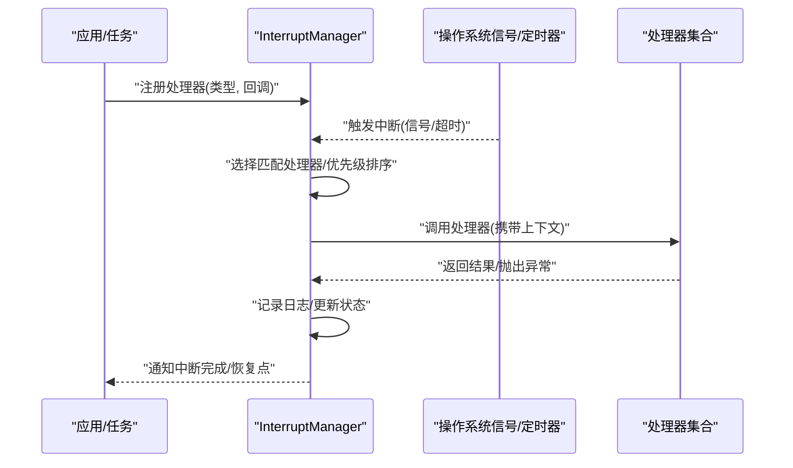
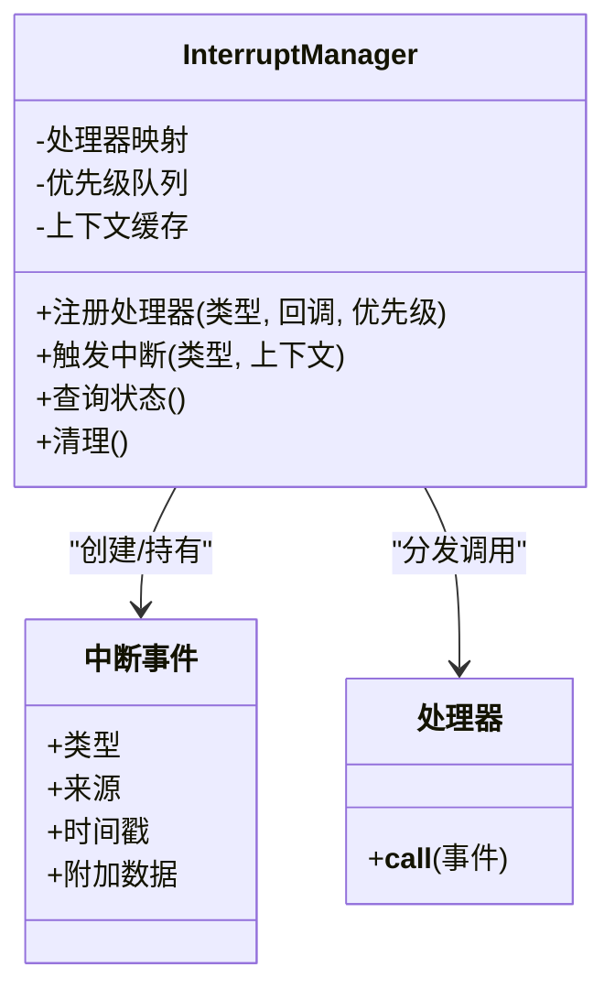
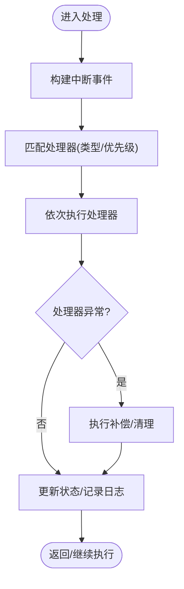
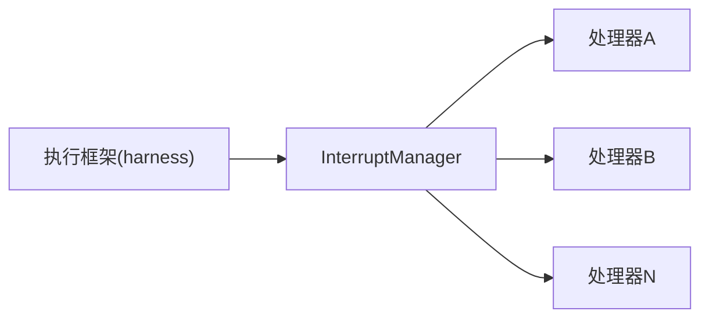

# 中断管理API

<cite>
**本文引用的文件**   
- [autonomy_mvp/core/interruption.py](file://autonomy_mvp/core/interruption.py)
- [autonomy_mvp/core/harness.py](file://autonomy_mvp/core/harness.py)
</cite>

## 目录
1. [简介](#简介)
2. [项目结构](#项目结构)
3. [核心组件](#核心组件)
4. [架构总览](#架构总览)
5. [详细组件分析](#详细组件分析)
6. [依赖关系分析](#依赖关系分析)
7. [性能考虑](#性能考虑)
8. [故障排查指南](#故障排查指南)
9. [结论](#结论)
10. [附录](#附录) 

## 简介
本文件为“中断管理API”的技术文档，聚焦于中断处理机制的设计模式、核心接口与使用方式。内容涵盖：
- InterruptManager类的设计模式与核心接口
- 中断信号的处理流程、恢复机制与错误恢复策略
- 中断事件的注册、触发与管理方法
- 完整的Python代码示例（设置处理器、处理异步中断、优雅退出）
- 中断优先级、超时处理与资源清理的最佳实践
- 与操作系统信号的集成方式及跨平台兼容性考虑

## 项目结构
本项目中与中断相关的实现位于 autonomy_mvp/core 目录下，关键文件如下：
- interruption.py：提供中断管理器与相关工具
- harness.py：在任务执行框架中集成中断能力

图表来源
- [autonomy_mvp/core/interruption.py](file://autonomy_mvp/core/interruption.py)
- [autonomy_mvp/core/harness.py](file://autonomy_mvp/core/harness.py)

章节来源
- [autonomy_mvp/core/interruption.py](file://autonomy_mvp/core/interruption.py)
- [autonomy_mvp/core/harness.py](file://autonomy_mvp/core/harness.py)

## 核心组件
本节概述中断管理的核心抽象与职责划分：
- 中断管理器：负责全局状态、处理器注册、事件分发与生命周期管理
- 中断事件：表示一次中断的语义（如用户取消、超时、外部终止等）
- 处理器：针对特定中断类型的回调或可调用对象
- 集成层：将中断能力嵌入到任务执行循环中，确保可观测性与可控性

章节来源
- [autonomy_mvp/core/interruption.py](file://autonomy_mvp/core/interruption.py)
- [autonomy_mvp/core/harness.py](file://autonomy_mvp/core/harness.py)

## 架构总览
下图展示了中断管理在系统中的位置与交互关系：应用通过管理器注册处理器；系统或外部信号触发中断事件；管理器按策略调度处理器并协调恢复与清理。

图表来源
- [autonomy_mvp/core/interruption.py](file://autonomy_mvp/core/interruption.py)
- [autonomy_mvp/core/harness.py](file://autonomy_mvp/core/harness.py)

## 详细组件分析

### InterruptManager 类设计
- 设计模式
  - 单例/集中式管理：统一入口，避免分散的中断状态
  - 观察者模式：基于处理器注册表进行事件分发
  - 责任链/策略：根据中断类型与优先级选择处理器
- 核心接口
  - 注册处理器：支持按类型/标签绑定回调
  - 触发中断：内部或外部触发，携带上下文数据
  - 查询状态：当前是否处于中断、最近一次中断信息
  - 清理与销毁：释放资源、注销处理器、重置状态
- 数据结构
  - 处理器映射：类型到处理器列表的映射
  - 优先级队列：用于决定处理器执行顺序
  - 上下文对象：包含时间戳、来源、附加数据等
- 复杂度与性能
  - 注册/注销：O(n) 或 O(log n)，取决于存储结构与去重策略
  - 触发：O(k) 遍历匹配处理器，k 为同类型处理器数量
  - 建议：对热点类型使用索引或缓存命中路径

图表来源
- [autonomy_mvp/core/interruption.py](file://autonomy_mvp/core/interruption.py)

章节来源
- [autonomy_mvp/core/interruption.py](file://autonomy_mvp/core/interruption.py)

### 中断信号处理流程与恢复机制
- 处理流程
  - 接收信号：来自操作系统信号、定时器或内部触发器
  - 构造事件：封装类型、来源、时间与上下文
  - 选择处理器：按类型匹配与优先级排序
  - 执行处理器：串行或受控并发执行，捕获异常
  - 恢复与清理：回滚部分状态、释放临时资源、记录审计
- 错误恢复策略
  - 幂等性：处理器应保证多次调用的安全性
  - 补偿动作：失败时执行补偿逻辑（如关闭连接、删除临时文件）
  - 降级模式：关键路径不可用时切换至安全路径
  - 重试与退避：对瞬时错误采用指数退避重试
- 超时处理
  - 基于定时器的软中断：周期性检查长耗时操作
  - 硬中断：由外部信号强制终止，需配合清理钩子

图表来源
- [autonomy_mvp/core/interruption.py](file://autonomy_mvp/core/interruption.py)

章节来源
- [autonomy_mvp/core/interruption.py](file://autonomy_mvp/core/interruption.py)

### 事件注册、触发与管理方法
- 注册
  - 支持多处理器绑定同一类型
  - 可选优先级参数控制执行顺序
  - 支持条件注册（仅当满足某些前置条件时生效）
- 触发
  - 同步触发：在当前线程内立即执行处理器
  - 异步触发：将事件投递到队列，由工作线程消费
- 管理
  - 列出已注册处理器
  - 动态注销处理器
  - 批量启用/禁用某类处理器
  - 导出/导入配置（便于测试与复现）

章节来源
- [autonomy_mvp/core/interruption.py](file://autonomy_mvp/core/interruption.py)

### 与操作系统信号的集成与跨平台兼容
- 集成方式
  - Unix/Linux：监听 SIGINT/SIGTERM 等信号，转换为内部中断事件
  - Windows：使用控制台事件或定时器模拟软中断
  - 跨平台抽象：对外暴露统一接口，屏蔽平台差异
- 兼容性考虑
  - 主线程限制：信号处理需在主线程注册
  - 线程安全：处理器应避免阻塞主线程，必要时异步派发
  - 进程模型：多进程场景下每个进程独立维护管理器实例

章节来源
- [autonomy_mvp/core/interruption.py](file://autonomy_mvp/core/interruption.py)

### 在任务执行框架中的集成
- 集成点
  - 在任务启动时初始化管理器并注册默认处理器（如日志、监控）
  - 在执行循环中定期检查中断标志或消费事件队列
  - 在任务结束或异常路径上执行清理与上报
- 最佳实践
  - 将中断视为一等公民：在关键路径显式检查与响应
  - 保持处理器短小精悍：复杂逻辑下沉到服务层
  - 可观测性：记录中断来源、处理器执行时间与结果

章节来源
- [autonomy_mvp/core/harness.py](file://autonomy_mvp/core/harness.py)

## 依赖关系分析
- 组件耦合
  - InterruptionManager 与处理器之间松耦合，通过类型与优先级解耦
  - 与执行框架通过最小接口集成，降低侵入性
- 外部依赖
  - 操作系统信号库（platform-specific）
  - 计时器/定时器（标准库或第三方）
- 潜在循环依赖
  - 处理器不应反向依赖管理器以避免循环引用
- 接口契约
  - 处理器签名稳定：输入事件、输出结果/异常
  - 事件字段稳定：类型、来源、时间戳、附加数据

图表来源
- [autonomy_mvp/core/interruption.py](file://autonomy_mvp/core/interruption.py)
- [autonomy_mvp/core/harness.py](file://autonomy_mvp/core/harness.py)

章节来源
- [autonomy_mvp/core/interruption.py](file://autonomy_mvp/core/interruption.py)
- [autonomy_mvp/core/harness.py](file://autonomy_mvp/core/harness.py)

## 性能考虑
- 减少锁竞争：尽量无锁注册/注销，或使用细粒度锁
- 批量处理：合并高频低优先级事件
- 异步派发：避免阻塞主循环
- 内存管理：及时清理不再使用的处理器与上下文
- 基准测试：对热点路径进行压测，关注延迟与吞吐

[本节为通用指导，不直接分析具体文件]

## 故障排查指南
- 常见问题
  - 处理器未执行：检查类型匹配与优先级配置
  - 死锁/阻塞：确认处理器未长时间占用锁或I/O
  - 资源泄漏：验证清理钩子是否被调用
  - 跨平台差异：确认信号注册在主线程且平台兼容
- 诊断手段
  - 启用详细日志：记录事件到达、处理器选择与执行结果
  - 快照导出：导出当前处理器列表与状态
  - 最小复现：剥离无关逻辑，定位问题范围

章节来源
- [autonomy_mvp/core/interruption.py](file://autonomy_mvp/core/interruption.py)
- [autonomy_mvp/core/harness.py](file://autonomy_mvp/core/harness.py)

## 结论
本API以集中式中断管理器为核心，结合观察者与策略模式，提供了可扩展、可观测、可恢复的中断处理能力。通过清晰的接口与最佳实践，可在多平台环境下实现一致的中断体验，并在任务执行框架中无缝集成。

[本节为总结性内容，不直接分析具体文件]

## 附录

### Python 使用示例（步骤说明）
以下为典型用法步骤（不包含具体代码内容，请参照对应源码路径获取实现细节）：
- 初始化与注册
  - 创建管理器实例
  - 注册处理器（类型、回调、优先级）
  - 参考路径：[autonomy_mvp/core/interruption.py](file://autonomy_mvp/core/interruption.py)
- 触发与处理
  - 在任务循环中触发中断事件
  - 处理器中实现幂等与补偿逻辑
  - 参考路径：[autonomy_mvp/core/interruption.py](file://autonomy_mvp/core/interruption.py)
- 异步中断与优雅退出
  - 使用异步派发避免阻塞
  - 在退出前执行清理与上报
  - 参考路径：[autonomy_mvp/core/harness.py](file://autonomy_mvp/core/harness.py)
- 超时与资源清理
  - 设置软中断定时器
  - 在处理器中释放临时资源
  - 参考路径：[autonomy_mvp/core/interruption.py](file://autonomy_mvp/core/interruption.py)

章节来源
- [autonomy_mvp/core/interruption.py](file://autonomy_mvp/core/interruption.py)
- [autonomy_mvp/core/harness.py](file://autonomy_mvp/core/harness.py)