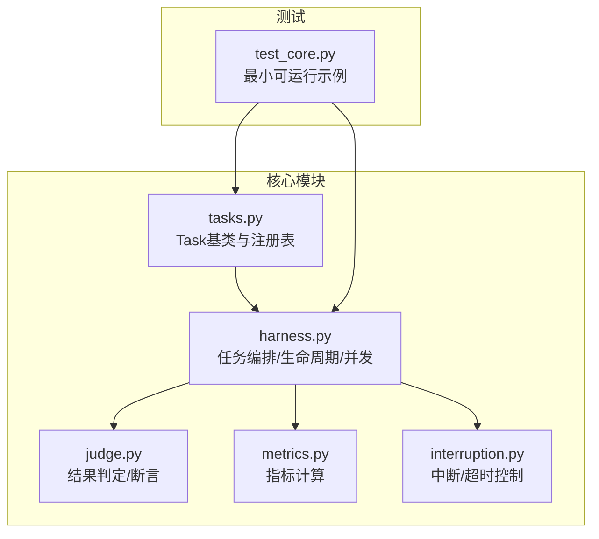
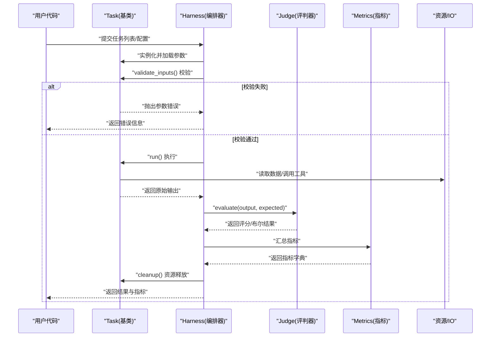
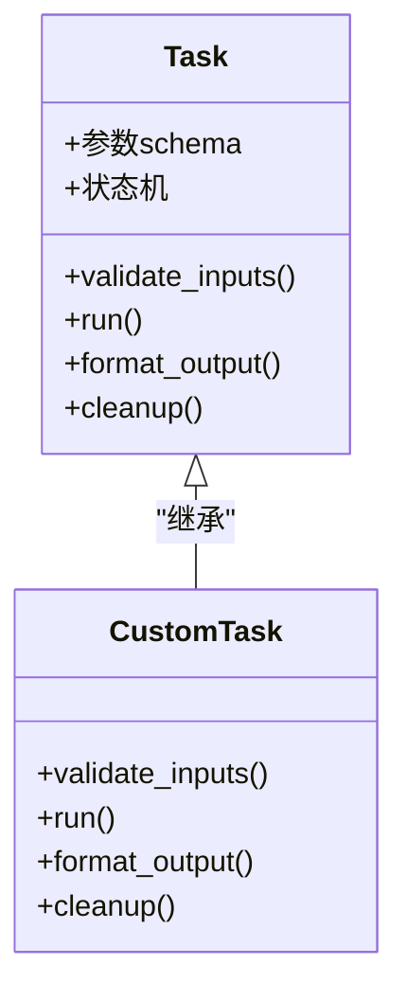
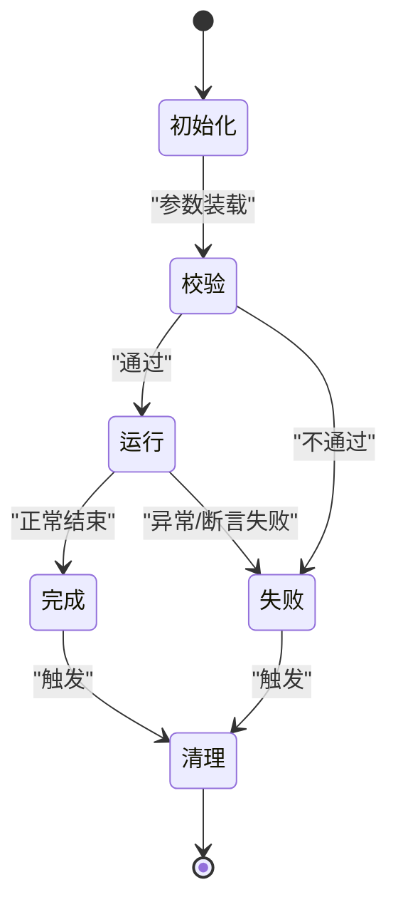
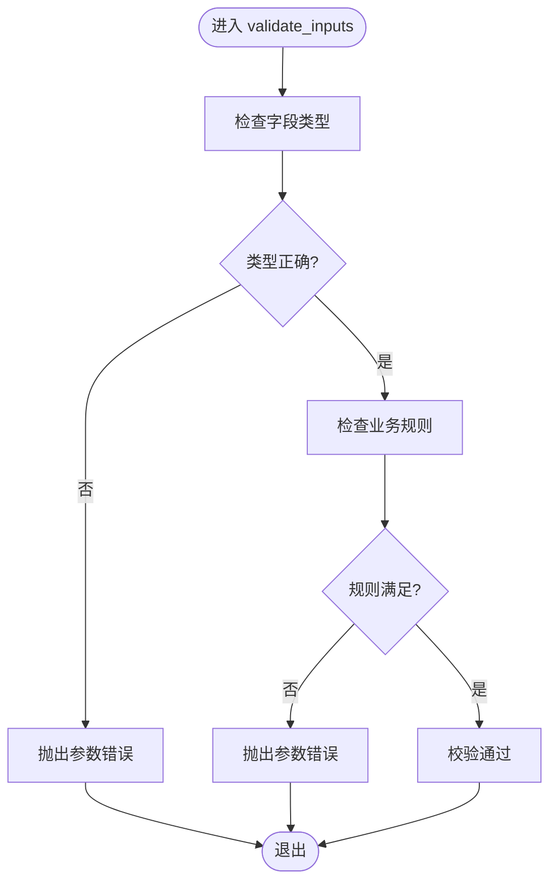
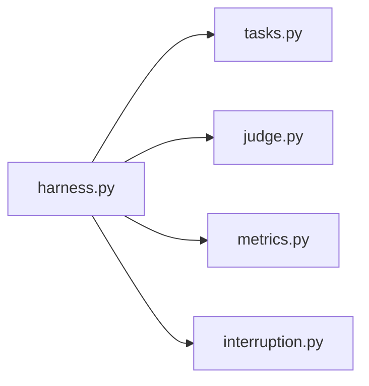

# 任务系统API

<cite>
**本文引用的文件**   
- [autonomy_mvp/core/tasks.py](file://autonomy_mvp/core/tasks.py)
- [autonomy_mvp/core/harness.py](file://autonomy_mvp/core/harness.py)
- [autonomy_mvp/core/judge.py](file://autonomy_mvp/core/judge.py)
- [autonomy_mvp/core/metrics.py](file://autonomy_mvp/core/metrics.py)
- [autonomy_mvp/core/interruption.py](file://autonomy_mvp/core/interruption.py)
- [autonomy_mvp/tests/test_core.py](file://autonomy_mvp/tests/test_core.py)
</cite>

## 目录
1. [简介](#简介)
2. [项目结构](#项目结构)
3. [核心组件](#核心组件)
4. [架构总览](#架构总览)
5. [详细组件分析](#详细组件分析)
6. [依赖关系分析](#依赖关系分析)
7. [性能与并发](#性能与并发)
8. [故障排查指南](#故障排查指南)
9. [结论](#结论)
10. [附录：自定义任务实现清单](#附录自定义任务实现清单)

## 简介
本文件为“任务定义框架”的API文档，聚焦于任务基类的设计模式、抽象方法与继承规范，并系统化说明任务生命周期管理、状态转换、输入验证与输出格式化接口。同时提供自定义任务的实现步骤、必需方法与可选扩展点，以及完整的Python代码示例路径（以源码引用形式给出），覆盖参数定义、执行逻辑与异常处理。最后对任务依赖管理、并行执行支持与资源清理机制进行说明。

## 项目结构
与任务系统相关的核心代码集中在 autonomy_mvp/core 目录下，包含任务基类、编排器、评判器、指标计算与中断控制等模块；tests 下提供最小可运行的测试用例，便于理解使用方式。

图示来源
- [autonomy_mvp/core/tasks.py](file://autonomy_mvp/core/tasks.py)
- [autonomy_mvp/core/harness.py](file://autonomy_mvp/core/harness.py)
- [autonomy_mvp/core/judge.py](file://autonomy_mvp/core/judge.py)
- [autonomy_mvp/core/metrics.py](file://autonomy_mvp/core/metrics.py)
- [autonomy_mvp/core/interruption.py](file://autonomy_mvp/core/interruption.py)
- [autonomy_mvp/tests/test_core.py](file://autonomy_mvp/tests/test_core.py)

章节来源
- [autonomy_mvp/core/tasks.py](file://autonomy_mvp/core/tasks.py)
- [autonomy_mvp/core/harness.py](file://autonomy_mvp/core/harness.py)
- [autonomy_mvp/core/judge.py](file://autonomy_mvp/core/judge.py)
- [autonomy_mvp/core/metrics.py](file://autonomy_mvp/core/metrics.py)
- [autonomy_mvp/core/interruption.py](file://autonomy_mvp/core/interruption.py)
- [autonomy_mvp/tests/test_core.py](file://autonomy_mvp/tests/test_core.py)

## 核心组件
- Task 基类：定义任务契约（参数、执行、输出格式、资源清理）、生命周期钩子与默认行为。
- Harness 编排器：负责实例化、校验、调度、并发执行、状态跟踪与结果聚合。
- Judge 评判器：将模型/Agent输出与期望答案进行比对，生成布尔或结构化评分。
- Metrics 指标：在单任务或批量维度上汇总评估结果。
- Interruption 中断：提供超时、信号与外部中断能力，保障任务可控终止。

章节来源
- [autonomy_mvp/core/tasks.py](file://autonomy_mvp/core/tasks.py)
- [autonomy_mvp/core/harness.py](file://autonomy_mvp/core/harness.py)
- [autonomy_mvp/core/judge.py](file://autonomy_mvp/core/judge.py)
- [autonomy_mvp/core/metrics.py](file://autonomy_mvp/core/metrics.py)
- [autonomy_mvp/core/interruption.py](file://autonomy_mvp/core/interruption.py)

## 架构总览
下图展示从用户定义的任务到最终评估输出的端到端流程，包括参数校验、执行、结果判定、指标汇总与资源释放。

图示来源
- [autonomy_mvp/core/tasks.py](file://autonomy_mvp/core/tasks.py)
- [autonomy_mvp/core/harness.py](file://autonomy_mvp/core/harness.py)
- [autonomy_mvp/core/judge.py](file://autonomy_mvp/core/judge.py)
- [autonomy_mvp/core/metrics.py](file://autonomy_mvp/core/metrics.py)

## 详细组件分析

### Task 基类设计模式与继承规范
- 设计模式
  - 模板方法：基类定义 run 的标准流程（校验→执行→格式化→清理），子类仅覆写关键步骤。
  - 工厂/注册表：通过统一入口按名称或类型创建任务实例，便于动态装配。
  - 策略：输入校验与输出格式化可通过策略对象注入，提高可扩展性。
- 抽象方法与约定
  - 参数声明：以类属性或显式 schema 描述必填/选填字段、类型与约束。
  - 输入校验：validate_inputs 负责强类型检查与业务规则校验。
  - 执行逻辑：run 返回标准化中间结果，尽量幂等且可重试。
  - 输出格式化：format_output 将内部结果转换为对外一致的 JSON/字典结构。
  - 资源清理：cleanup 确保文件句柄、网络连接、临时目录等被释放。
- 继承规范
  - 子类必须实现 run 与必要的 validate_inputs/format_output。
  - 若涉及外部资源，需实现 cleanup 或在上下文管理器中托管。
  - 保持 run 的幂等性与可观测性（日志、指标埋点）。

图示来源
- [autonomy_mvp/core/tasks.py](file://autonomy_mvp/core/tasks.py)

章节来源
- [autonomy_mvp/core/tasks.py](file://autonomy_mvp/core/tasks.py)

### 任务生命周期与状态转换
- 典型状态
  - 初始化：构造与参数装载
  - 校验：validate_inputs 成功/失败
  - 运行：run 进行中
  - 完成：成功产出结果
  - 失败：异常或断言失败
  - 清理：cleanup 释放资源
- 转换图

图示来源
- [autonomy_mvp/core/tasks.py](file://autonomy_mvp/core/tasks.py)
- [autonomy_mvp/core/harness.py](file://autonomy_mvp/core/harness.py)

章节来源
- [autonomy_mvp/core/tasks.py](file://autonomy_mvp/core/tasks.py)
- [autonomy_mvp/core/harness.py](file://autonomy_mvp/core/harness.py)

### 输入验证与输出格式化接口
- 输入验证
  - 类型检查：强制字段类型、枚举值、范围边界。
  - 业务规则：如依赖存在性、权限、配额、路径有效性。
  - 错误语义：区分参数错误与运行时错误，便于上层捕获与重试。
- 输出格式化
  - 统一结构：固定键名、数据类型与可选元数据。
  - 容错：缺失字段降级为默认值或标记未计算。
  - 序列化：JSON 友好，避免循环引用与大对象。

图示来源
- [autonomy_mvp/core/tasks.py](file://autonomy_mvp/core/tasks.py)

章节来源
- [autonomy_mvp/core/tasks.py](file://autonomy_mvp/core/tasks.py)

### 执行逻辑与异常处理
- 执行阶段
  - 幂等设计：相同输入应产生相同输出，支持重试。
  - 可观测性：记录关键事件与耗时，便于定位瓶颈。
  - 资源隔离：尽量使用独立工作目录或命名空间。
- 异常分类
  - 参数错误：由 validate_inputs 抛出，应在运行前拦截。
  - 运行时错误：网络/IO/第三方库异常，建议包装为领域异常。
  - 断言失败：由 judge 判定，影响评分但不一定视为任务崩溃。
- 恢复策略
  - 重试：针对瞬时错误（网络抖动）采用指数退避。
  - 回滚：清理中间产物，保证状态一致。
  - 降级：部分指标不可用时返回占位值并标注。

章节来源
- [autonomy_mvp/core/tasks.py](file://autonomy_mvp/core/tasks.py)
- [autonomy_mvp/core/judge.py](file://autonomy_mvp/core/judge.py)

### 依赖管理与并行执行
- 依赖管理
  - 声明式依赖：通过参数或配置文件声明外部工具/数据集。
  - 版本锁定：固定第三方库版本，确保可复现。
  - 环境检查：启动时探测可用性与连通性。
- 并行执行
  - 线程/进程池：根据任务I/O或CPU密集特性选择。
  - 资源上限：限制并发度，防止资源争用。
  - 结果聚合：按任务ID归并，保证顺序无关。
- 资源清理
  - 统一清理：在 finally 或上下文管理器中释放。
  - 原子写入：先写临时文件再重命名，避免脏读。
  - 垃圾回收：及时断开连接、关闭句柄、删除临时目录。

章节来源
- [autonomy_mvp/core/harness.py](file://autonomy_mvp/core/harness.py)
- [autonomy_mvp/core/interruption.py](file://autonomy_mvp/core/interruption.py)

### 评测与指标
- 评判器
  - 精确匹配/模糊匹配：字符串、数值、集合比较。
  - 结构化评分：多字段加权或规则打分。
  - 可插拔策略：不同任务可绑定不同评判策略。
- 指标
  - 单任务指标：准确率、F1、AUC、耗时等。
  - 批量指标：均值、方差、分位数、置信区间。
  - 持久化：将指标与元数据一并落盘。

章节来源
- [autonomy_mvp/core/judge.py](file://autonomy_mvp/core/judge.py)
- [autonomy_mvp/core/metrics.py](file://autonomy_mvp/core/metrics.py)

## 依赖关系分析
- 模块耦合
  - harness 依赖 tasks、judge、metrics、interruption。
  - tasks 应尽量低耦合，仅暴露必要接口给 harness。
  - judge 与 metrics 解耦，便于替换评估方案。
- 外部依赖
  - IO/网络：建议在 tasks 中封装，便于模拟与测试。
  - 第三方库：通过依赖声明与环境检查管理。

图示来源
- [autonomy_mvp/core/harness.py](file://autonomy_mvp/core/harness.py)
- [autonomy_mvp/core/tasks.py](file://autonomy_mvp/core/tasks.py)
- [autonomy_mvp/core/judge.py](file://autonomy_mvp/core/judge.py)
- [autonomy_mvp/core/metrics.py](file://autonomy_mvp/core/metrics.py)
- [autonomy_mvp/core/interruption.py](file://autonomy_mvp/core/interruption.py)

章节来源
- [autonomy_mvp/core/harness.py](file://autonomy_mvp/core/harness.py)
- [autonomy_mvp/core/tasks.py](file://autonomy_mvp/core/tasks.py)
- [autonomy_mvp/core/judge.py](file://autonomy_mvp/core/judge.py)
- [autonomy_mvp/core/metrics.py](file://autonomy_mvp/core/metrics.py)
- [autonomy_mvp/core/interruption.py](file://autonomy_mvp/core/interruption.py)

## 性能与并发
- 并发模型
  - I/O 密集型：优先线程池或异步协程。
  - CPU 密集型：优先进程池以避免GIL限制。
- 吞吐优化
  - 批处理：合并小请求，减少往返。
  - 缓存：对稳定输入的结果做短期缓存。
  - 流式处理：大对象分块读写，降低内存峰值。
- 稳定性
  - 超时保护：结合 interruption 设置全局/任务级超时。
  - 限流与熔断：对下游服务进行保护。
  - 优雅停机：接收中断信号后完成当前任务并释放资源。

[本节为通用指导，无需特定文件引用]

## 故障排查指南
- 常见问题
  - 参数校验失败：检查字段类型、必填项与取值范围。
  - 运行期异常：查看任务日志与堆栈，确认外部依赖可用性。
  - 结果不一致：核对随机种子、时间戳与外部数据版本。
  - 资源泄漏：确认 cleanup 是否被调用，是否存在未关闭的连接。
- 诊断手段
  - 启用调试日志与指标埋点。
  - 使用最小可运行测试用例快速复现问题。
  - 隔离网络与IO，使用Mock替代不稳定依赖。

章节来源
- [autonomy_mvp/tests/test_core.py](file://autonomy_mvp/tests/test_core.py)
- [autonomy_mvp/core/interruption.py](file://autonomy_mvp/core/interruption.py)

## 结论
本任务系统以 Task 基类为核心，配合 harness 编排、judge 评判与 metrics 指标，形成高内聚、低耦合的可扩展框架。通过统一的输入校验、输出格式与资源清理约定，开发者可以快速构建高质量自定义任务，并在依赖管理、并行执行与异常处理方面获得良好支撑。

[本节为总结性内容，无需特定文件引用]

## 附录：自定义任务实现清单
- 必需步骤
  - 继承 Task 基类，实现以下方法：
    - validate_inputs：参数与业务规则校验
    - run：核心执行逻辑，返回中间结果
    - format_output：将中间结果转为标准输出结构
    - cleanup：释放外部资源与临时文件
  - 在 harness 中注册或按名称实例化任务
  - 编写单元测试，覆盖正常路径与异常路径
- 可选扩展点
  - 自定义输入校验策略/输出格式化策略
  - 自定义评判器（judge）与指标（metrics）
  - 并行执行策略与资源池配置
  - 中断与超时策略定制
- 参考示例（以源码路径代替代码片段）
  - 最小可运行示例与用法：[autonomy_mvp/tests/test_core.py](file://autonomy_mvp/tests/test_core.py)
  - 任务基类与生命周期：[autonomy_mvp/core/tasks.py](file://autonomy_mvp/core/tasks.py)
  - 编排与并发：[autonomy_mvp/core/harness.py](file://autonomy_mvp/core/harness.py)
  - 评判与指标：[autonomy_mvp/core/judge.py](file://autonomy_mvp/core/judge.py), [autonomy_mvp/core/metrics.py](file://autonomy_mvp/core/metrics.py)
  - 中断与超时：[autonomy_mvp/core/interruption.py](file://autonomy_mvp/core/interruption.py)

章节来源
- [autonomy_mvp/tests/test_core.py](file://autonomy_mvp/tests/test_core.py)
- [autonomy_mvp/core/tasks.py](file://autonomy_mvp/core/tasks.py)
- [autonomy_mvp/core/harness.py](file://autonomy_mvp/core/harness.py)
- [autonomy_mvp/core/judge.py](file://autonomy_mvp/core/judge.py)
- [autonomy_mvp/core/metrics.py](file://autonomy_mvp/core/metrics.py)
- [autonomy_mvp/core/interruption.py](file://autonomy_mvp/core/interruption.py)