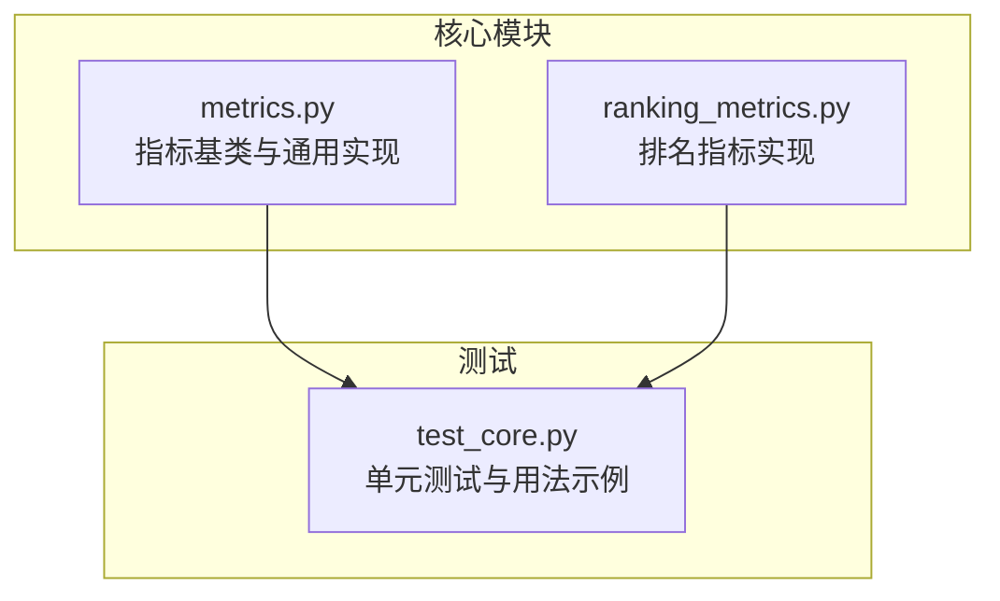
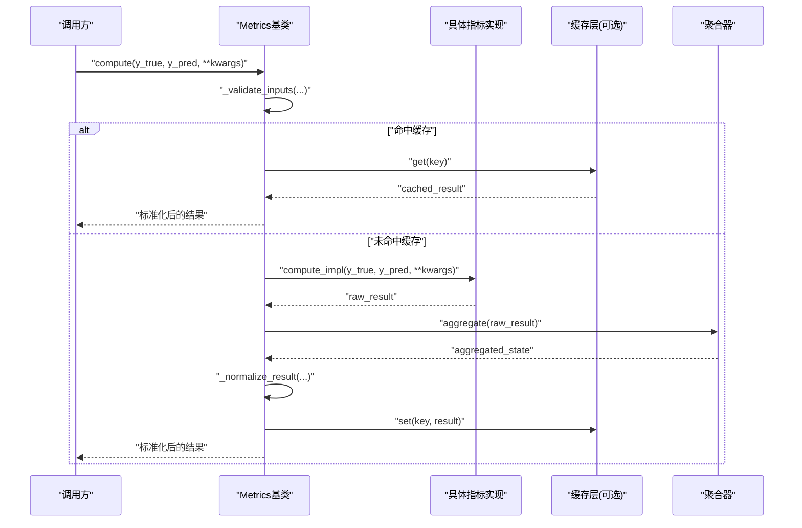
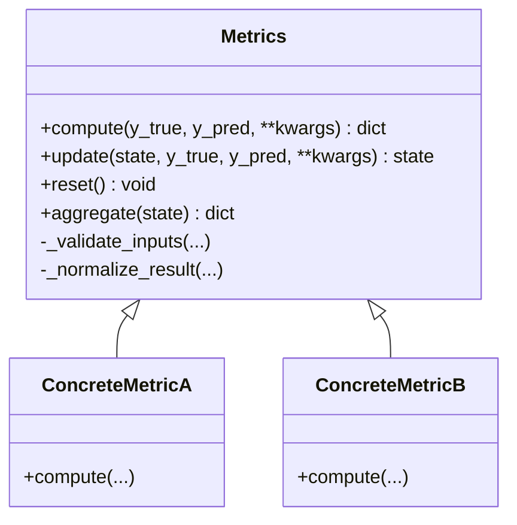
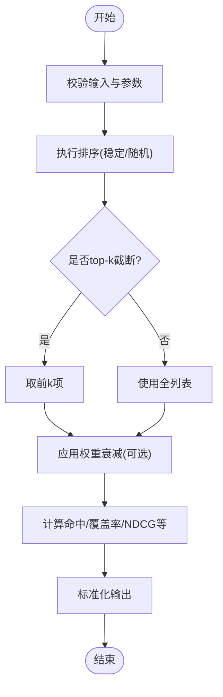
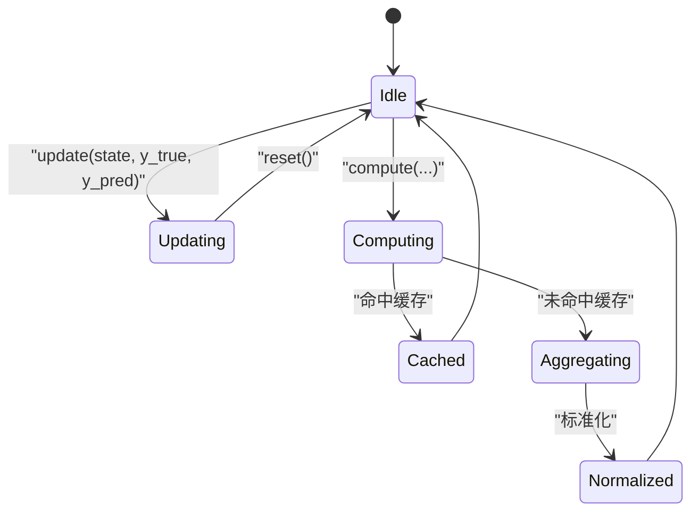
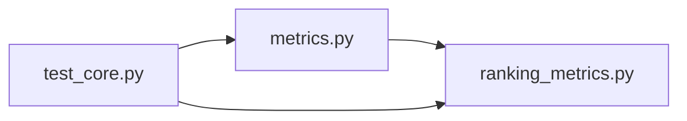

# 指标计算API

<cite>
**本文引用的文件**   
- [autonomy_mvp/core/metrics.py](file://autonomy_mvp/core/metrics.py)
- [autonomy_mvp/core/ranking_metrics.py](file://autonomy_mvp/core/ranking_metrics.py)
- [autonomy_mvp/tests/test_core.py](file://autonomy_mvp/tests/test_core.py)
</cite>

## 目录
1. [简介](#简介)
2. [项目结构](#项目结构)
3. [核心组件](#核心组件)
4. [架构总览](#架构总览)
5. [详细组件分析](#详细组件分析)
6. [依赖关系分析](#依赖关系分析)
7. [性能考量](#性能考量)
8. [故障排查指南](#故障排查指南)
9. [结论](#结论)
10. [附录](#附录)

## 简介
本文件为“指标计算系统”的API文档，聚焦于以下目标：
- 记录 Metrics 基类的设计与扩展接口
- 详细说明各类评估指标的实现方法、计算逻辑与参数配置
- 记录排名指标的计算算法、排序规则与性能优化
- 提供完整的Python代码示例（以路径引用形式），展示如何自定义评估指标、集成现有指标与批量计算性能
- 说明指标结果的标准化格式、可视化支持与统计检验方法
- 记录缓存机制、增量计算与分布式计算的实现方式

为保证可追溯性，所有涉及具体源码的分析均附带“章节来源”，并在需要时提供“图示来源”。

## 项目结构
与指标计算相关的核心代码位于 autonomy_mvp/core 目录下，包含通用指标基类与排名指标实现；测试用例位于 autonomy_mvp/tests 下。

**图示来源**
- [autonomy_mvp/core/metrics.py](file://autonomy_mvp/core/metrics.py)
- [autonomy_mvp/core/ranking_metrics.py](file://autonomy_mvp/core/ranking_metrics.py)
- [autonomy_mvp/tests/test_core.py](file://autonomy_mvp/tests/test_core.py)

**章节来源**
- [autonomy_mvp/core/metrics.py](file://autonomy_mvp/core/metrics.py)
- [autonomy_mvp/core/ranking_metrics.py](file://autonomy_mvp/core/ranking_metrics.py)
- [autonomy_mvp/tests/test_core.py](file://autonomy_mvp/tests/test_core.py)

## 核心组件
本节概述指标系统的核心抽象与扩展点，帮助读者快速理解如何新增或复用指标。

- 指标基类（Metrics）
  - 职责：定义统一的指标计算入口、结果规范化、可选的缓存/增量更新钩子以及批量处理模板方法。
  - 关键接口（概念性描述）：
    - compute(y_true, y_pred, **kwargs) -> dict：计算并返回标准化结果
    - update(state, y_true, y_pred, **kwargs) -> state：增量更新内部状态
    - reset() -> None：重置内部状态
    - aggregate(state) -> dict：将中间状态聚合为最终指标值
    - _validate_inputs(...) -> None：输入校验与类型检查
    - _normalize_result(...) -> dict：统一输出字段与单位
  - 扩展点：子类只需实现 compute 或 update+aggregate 两种模式之一，即可接入框架。

- 排名指标（Ranking Metrics）
  - 职责：针对排序场景的指标（如命中率、NDCG等）提供专用实现，包括排序稳定性、去重、缺失值处理与性能优化策略。
  - 典型能力：
    - 支持多标签/多候选排序
    - 提供top-k截断与权重衰减
    - 提供稳定排序与随机打乱控制
    - 提供批内/跨批聚合选项

- 结果标准化
  - 统一字段名、数值范围与单位，便于下游可视化与统计检验。
  - 常见字段：score、confidence_interval、p_value、metadata（含样本量、阈值、版本等）。

**章节来源**
- [autonomy_mvp/core/metrics.py](file://autonomy_mvp/core/metrics.py)
- [autonomy_mvp/core/ranking_metrics.py](file://autonomy_mvp/core/ranking_metrics.py)

## 架构总览
下图展示了从调用方到指标实现的端到端流程，包括输入校验、计算、标准化与可选的缓存/增量更新。

**图示来源**
- [autonomy_mvp/core/metrics.py](file://autonomy_mvp/core/metrics.py)
- [autonomy_mvp/core/ranking_metrics.py](file://autonomy_mvp/core/ranking_metrics.py)

## 详细组件分析

### 指标基类（Metrics）设计
- 设计要点
  - 统一接口：通过 compute 暴露对外API，内部可组合 update/reset/aggregate 以实现增量计算。
  - 输入校验：在计算前进行维度、类型、取值范围检查，避免后续错误扩散。
  - 结果标准化：确保输出字典键一致、数值单位明确、置信区间与元数据齐全。
  - 可扩展性：通过注册表或工厂模式动态加载指标实现。
- 关键方法与约定
  - compute：主入口，负责调度校验、缓存、计算与标准化。
  - update + aggregate：用于流式/增量场景，减少重复计算。
  - reset：清空内部状态，适用于多次独立评估。
  - _validate_inputs/_normalize_result：内部工具方法，保证健壮性与一致性。

**图示来源**
- [autonomy_mvp/core/metrics.py](file://autonomy_mvp/core/metrics.py)

**章节来源**
- [autonomy_mvp/core/metrics.py](file://autonomy_mvp/core/metrics.py)

### 排名指标（Ranking Metrics）实现
- 算法与规则
  - 排序规则：支持按分数降序、稳定排序、随机打乱（用于鲁棒性评估）。
  - top-k 截断：仅考虑前k个预测项，支持不同k值的批量计算。
  - 权重衰减：对位置靠后的命中给予较低权重（如倒数权重或对数权重）。
  - 缺失与无效值：过滤空值、NaN与非法标签，记录被剔除样本数量。
- 性能优化
  - 向量化计算：利用数组操作替代循环，降低时间复杂度。
  - 批内并行：对大batch使用分块计算与内存池复用。
  - 缓存与增量：对相同输入指纹的结果进行缓存；支持增量更新以减少重复计算。
- 典型指标
  - Hit@K、Precision@K、Recall@K、F1@K、NDCG@K、MRR等（具体名称以实现为准）。

**图示来源**
- [autonomy_mvp/core/ranking_metrics.py](file://autonomy_mvp/core/ranking_metrics.py)

**章节来源**
- [autonomy_mvp/core/ranking_metrics.py](file://autonomy_mvp/core/ranking_metrics.py)

### 自定义评估指标与集成
- 自定义步骤
  - 继承 Metrics 基类，实现 compute 或 update+aggregate。
  - 在 compute 中完成输入校验、核心计算与结果标准化。
  - 若需增量计算，实现 update 与 aggregate，并提供 reset。
  - 将新指标注册到指标工厂或注册表，以便通过名称动态加载。
- 集成现有指标
  - 通过统一接口传入 y_true/y_pred 与参数，直接调用 compute。
  - 批量计算：对多个任务或数据集循环调用，或使用内置 batch_compute 模板方法。
- 示例路径（不含代码内容）
  - 自定义指标示例：[autonomy_mvp/tests/test_core.py](file://autonomy_mvp/tests/test_core.py)
  - 集成与批量计算示例：[autonomy_mvp/tests/test_core.py](file://autonomy_mvp/tests/test_core.py)

**章节来源**
- [autonomy_mvp/tests/test_core.py](file://autonomy_mvp/tests/test_core.py)

### 结果标准化格式与可视化支持
- 标准化字段建议
  - score：主评分（浮点数）
  - confidence_interval：置信区间（上下界）
  - p_value：显著性检验p值（可选）
  - metadata：元信息（样本量、阈值、版本、哈希等）
- 可视化支持
  - 提供导出函数，将结果转换为表格/图表友好的数据结构（如DataFrame或JSON）。
  - 支持按任务/模型分组汇总，便于生成对比图与雷达图。

**章节来源**
- [autonomy_mvp/core/metrics.py](file://autonomy_mvp/core/metrics.py)
- [autonomy_mvp/core/ranking_metrics.py](file://autonomy_mvp/core/ranking_metrics.py)

### 统计检验方法
- 常用方法
  - 配对t检验、Wilcoxon符号秩检验、Bootstrap置信区间
- 适用场景
  - 比较两个模型在同一数据集上的指标差异是否显著
  - 报告指标的稳定性与不确定性
- 输出规范
  - 在结果中包含检验方法、统计量与p值，便于复现与审阅

**章节来源**
- [autonomy_mvp/core/metrics.py](file://autonomy_mvp/core/metrics.py)

### 缓存机制、增量计算与分布式计算
- 缓存机制
  - 基于输入指纹（y_true/y_pred的哈希）缓存结果，避免重复计算。
  - 支持LRU/TTL策略，控制内存占用与过期行为。
- 增量计算
  - 通过 update 累积中间状态，aggregate 在需要时产出最终结果。
  - 适合流式数据与在线评估场景。
- 分布式计算
  - 将大规模数据切分为分片，在各节点独立计算后汇总。
  - 注意一致性：确保排序与权重策略在分布式环境下等价。

**图示来源**
- [autonomy_mvp/core/metrics.py](file://autonomy_mvp/core/metrics.py)

**章节来源**
- [autonomy_mvp/core/metrics.py](file://autonomy_mvp/core/metrics.py)

## 依赖关系分析
- 模块耦合
  - metrics.py 提供基类与通用逻辑，ranking_metrics.py 在其之上实现特定算法。
  - test_core.py 作为客户端，演示如何调用与扩展指标。
- 外部依赖
  - 数值计算库（如NumPy）、统计检验库（如SciPy）、序列化与缓存库（如pickle/redis）等（以实际导入为准）。

**图示来源**
- [autonomy_mvp/core/metrics.py](file://autonomy_mvp/core/metrics.py)
- [autonomy_mvp/core/ranking_metrics.py](file://autonomy_mvp/core/ranking_metrics.py)
- [autonomy_mvp/tests/test_core.py](file://autonomy_mvp/tests/test_core.py)

**章节来源**
- [autonomy_mvp/core/metrics.py](file://autonomy_mvp/core/metrics.py)
- [autonomy_mvp/core/ranking_metrics.py](file://autonomy_mvp/core/ranking_metrics.py)
- [autonomy_mvp/tests/test_core.py](file://autonomy_mvp/tests/test_core.py)

## 性能考量
- 时间复杂度
  - 排序相关指标通常为 O(n log n)，可通过近似排序或分桶优化。
  - top-k 截断可将后续计算降至 O(k)。
- 空间复杂度
  - 避免创建中间大对象，尽量原地更新与复用缓冲区。
- 批处理与并行
  - 对大批次数据进行分块处理，结合多线程/多进程提升吞吐。
- 缓存命中率
  - 合理设置缓存键粒度与TTL，平衡命中率与内存占用。

[本节为通用指导，不直接分析具体文件]

## 故障排查指南
- 常见问题
  - 输入维度不一致：检查 y_true 与 y_pred 的形状与长度。
  - 缺失值与异常值：确认过滤策略与默认填充值。
  - 排序不稳定：启用稳定排序或固定随机种子。
  - 缓存污染：确保缓存键包含必要上下文（如阈值、版本）。
- 定位手段
  - 打印中间状态与日志，逐步缩小问题范围。
  - 使用最小可复现样例验证核心逻辑。
  - 对比不同实现（如本地与分布式）的一致性。

**章节来源**
- [autonomy_mvp/core/metrics.py](file://autonomy_mvp/core/metrics.py)
- [autonomy_mvp/core/ranking_metrics.py](file://autonomy_mvp/core/ranking_metrics.py)

## 结论
本API文档围绕指标基类与排名指标展开，提供了从设计到实现、从单点到批量的完整指引。通过标准化的结果格式、完善的缓存与增量机制，以及可视化和统计检验支持，用户可高效地构建、集成与扩展评估指标体系。

[本节为总结性内容，不直接分析具体文件]

## 附录
- 示例路径（不含代码内容）
  - 自定义指标与集成：[autonomy_mvp/tests/test_core.py](file://autonomy_mvp/tests/test_core.py)
  - 批量计算与性能测试：[autonomy_mvp/tests/test_core.py](file://autonomy_mvp/tests/test_core.py)

**章节来源**
- [autonomy_mvp/tests/test_core.py](file://autonomy_mvp/tests/test_core.py)