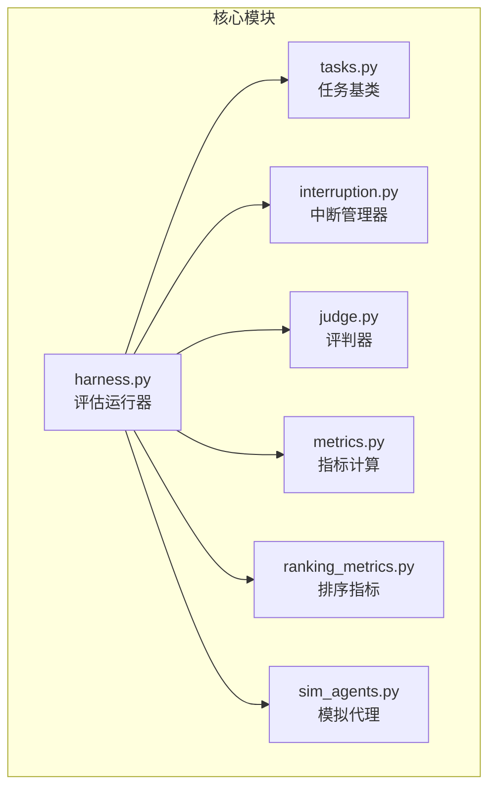
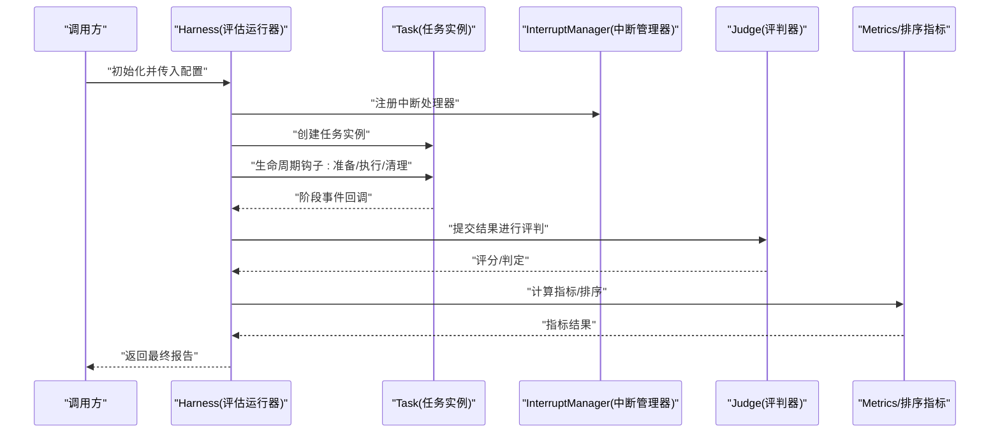
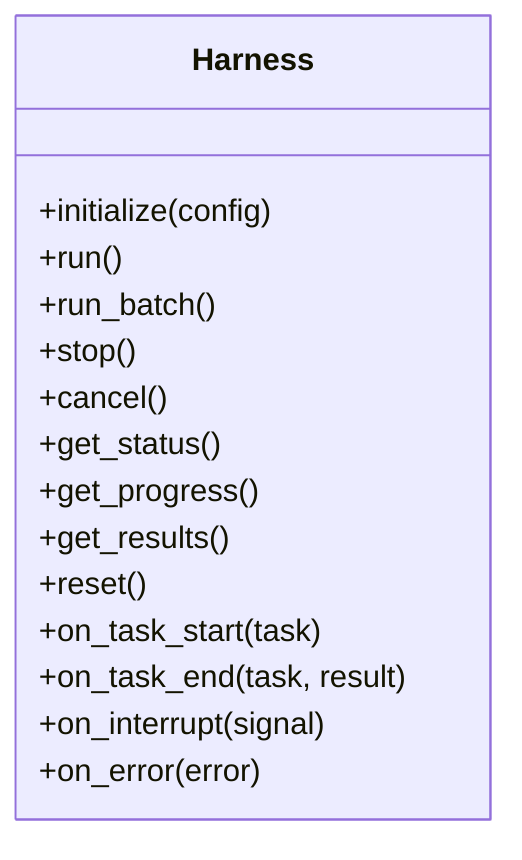
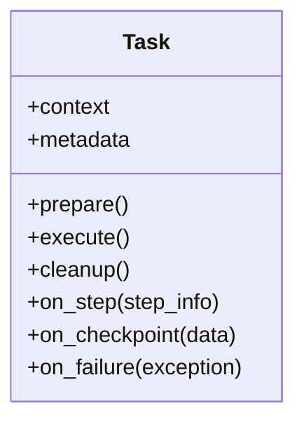
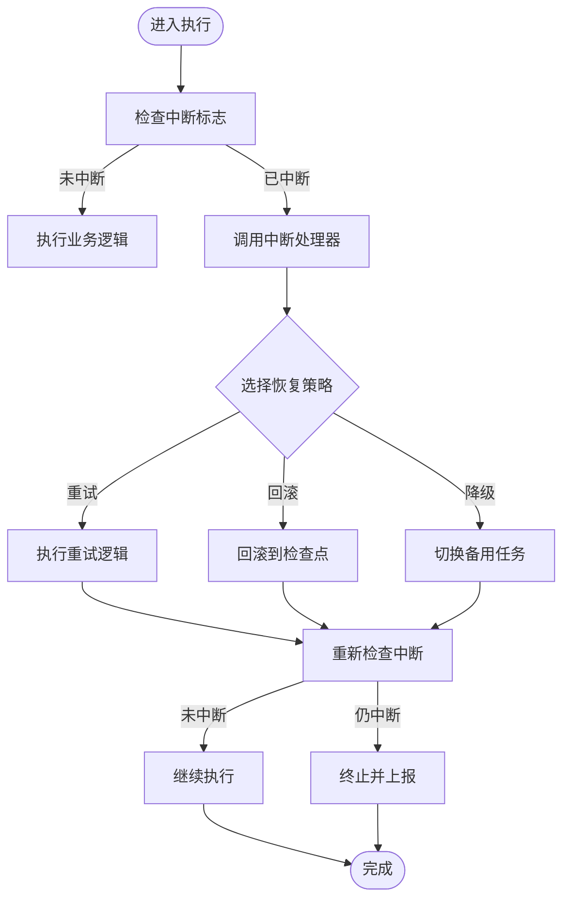
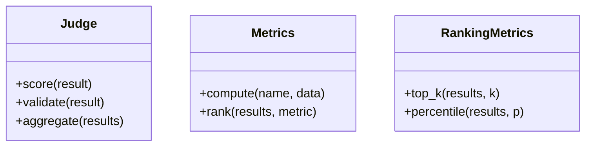
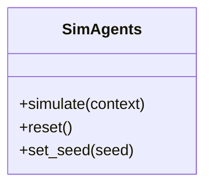
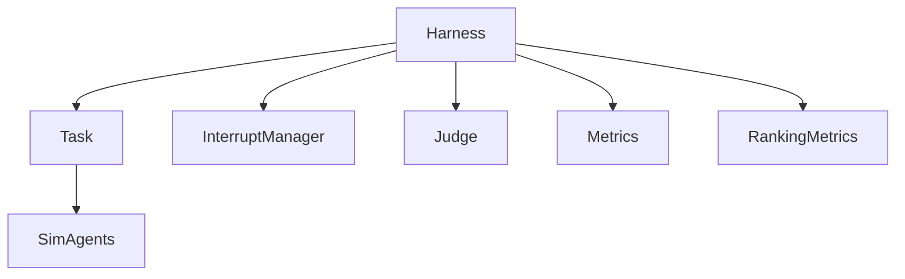

# 核心框架API

<cite>
**本文引用的文件**   
- [harness.py](file://autonomy_mvp/core/harness.py)
- [interruption.py](file://autonomy_mvp/core/interruption.py)
- [tasks.py](file://autonomy_mvp/core/tasks.py)
- [judge.py](file://autonomy_mvp/core/judge.py)
- [metrics.py](file://autonomy_mvp/core/metrics.py)
- [ranking_metrics.py](file://autonomy_mvp/core/ranking_metrics.py)
- [sim_agents.py](file://autonomy_mvp/core/sim_agents.py)
- [test_core.py](file://autonomy_mvp/tests/test_core.py)
</cite>

## 目录
1. [简介](#简介)
2. [项目结构](#项目结构)
3. [核心组件](#核心组件)
4. [架构总览](#架构总览)
5. [详细组件分析](#详细组件分析)
6. [依赖关系分析](#依赖关系分析)
7. [性能考虑](#性能考虑)
8. [故障排查指南](#故障排查指南)
9. [结论](#结论)
10. [附录](#附录)

## 简介
本文件为核心框架模块的API文档，聚焦评估引擎的核心接口、任务定义框架与中断处理机制。重点覆盖：
- Harness类：初始化参数、执行方法、状态管理接口
- Task基类：设计模式、生命周期管理、事件回调机制
- InterruptManager：中断信号处理、恢复机制与错误恢复策略
- 异常类型、错误码与调试信息格式
- 提供Python代码示例（以路径引用形式）展示如何继承和扩展这些核心类

## 项目结构
核心框架位于 autonomy_mvp/core 目录下，主要文件职责如下：
- harness.py：评估运行器（Harness），负责任务编排、生命周期控制、结果收集与状态管理
- tasks.py：任务抽象（Task基类），定义任务生命周期钩子与回调约定
- interruption.py：中断管理器（InterruptManager），统一处理中断信号、恢复与错误恢复策略
- judge.py：评判器（Judge），封装评分/判定逻辑
- metrics.py / ranking_metrics.py：指标计算与排序指标
- sim_agents.py：模拟代理（用于离线或沙箱场景）
- tests/test_core.py：核心能力测试用例，验证关键流程与边界条件

图表来源
- [harness.py](file://autonomy_mvp/core/harness.py)
- [tasks.py](file://autonomy_mvp/core/tasks.py)
- [interruption.py](file://autonomy_mvp/core/interruption.py)
- [judge.py](file://autonomy_mvp/core/judge.py)
- [metrics.py](file://autonomy_mvp/core/metrics.py)
- [ranking_metrics.py](file://autonomy_mvp/core/ranking_metrics.py)
- [sim_agents.py](file://autonomy_mvp/core/sim_agents.py)

章节来源
- [harness.py](file://autonomy_mvp/core/harness.py)
- [tasks.py](file://autonomy_mvp/core/tasks.py)
- [interruption.py](file://autonomy_mvp/core/interruption.py)
- [judge.py](file://autonomy_mvp/core/judge.py)
- [metrics.py](file://autonomy_mvp/core/metrics.py)
- [ranking_metrics.py](file://autonomy_mvp/core/ranking_metrics.py)
- [sim_agents.py](file://autonomy_mvp/core/sim_agents.py)

## 核心组件
本节概述各核心组件的职责与对外API要点：
- Harness：评估引擎主控制器，负责加载任务、调度执行、捕获中断、聚合结果与输出报告
- Task：任务抽象基类，定义生命周期钩子（如准备、执行、清理）、事件回调与上下文共享
- InterruptManager：集中式中断处理，支持信号注册、传播、恢复与错误恢复策略
- Judge：评判器接口，定义评分函数、阈值与判定规则
- Metrics/RankingMetrics：指标计算与排序工具
- SimAgents：在无需真实环境时提供可插拔的模拟代理

章节来源
- [harness.py](file://autonomy_mvp/core/harness.py)
- [tasks.py](file://autonomy_mvp/core/tasks.py)
- [interruption.py](file://autonomy_mvp/core/interruption.py)
- [judge.py](file://autonomy_mvp/core/judge.py)
- [metrics.py](file://autonomy_mvp/core/metrics.py)
- [ranking_metrics.py](file://autonomy_mvp/core/ranking_metrics.py)
- [sim_agents.py](file://autonomy_mvp/core/sim_agents.py)

## 架构总览
下图展示了评估引擎的整体交互：用户通过Harness启动任务；Task实现具体业务逻辑；InterruptManager统一管理中断；Judge与Metrics对结果进行评判与度量；SimAgents提供替代执行路径。

图表来源
- [harness.py](file://autonomy_mvp/core/harness.py)
- [tasks.py](file://autonomy_mvp/core/tasks.py)
- [interruption.py](file://autonomy_mvp/core/interruption.py)
- [judge.py](file://autonomy_mvp/core/judge.py)
- [metrics.py](file://autonomy_mvp/core/metrics.py)
- [ranking_metrics.py](file://autonomy_mvp/core/ranking_metrics.py)

## 详细组件分析

### Harness类API规范
- 初始化参数
  - 任务列表或任务工厂：用于批量或按需生成任务实例
  - 中断管理器实例或配置：决定是否启用中断处理及策略
  - 评判器与指标配置：指定Judge与Metrics的具体实现
  - 日志与调试开关：控制输出级别与调试信息格式
  - 资源与环境上下文：工作目录、临时存储、外部服务连接等
- 执行方法
  - run()：按顺序或并行执行任务，捕获异常与中断，汇总结果
  - run_batch()：批处理入口，支持重试与断点续跑
  - stop()/cancel()：触发中断与优雅退出
- 状态管理接口
  - get_status()：返回当前运行状态（待执行、执行中、已完成、已中断、失败）
  - get_progress()：返回进度百分比与阶段信息
  - get_results()：返回任务级与全局级结果
  - reset()：重置内部状态以便重复使用
- 事件回调
  - on_task_start/on_task_end：任务开始/结束回调
  - on_interrupt：中断发生时的回调，便于记录与清理
  - on_error：错误回调，包含错误类型、消息与堆栈摘要

图表来源
- [harness.py](file://autonomy_mvp/core/harness.py)

章节来源
- [harness.py](file://autonomy_mvp/core/harness.py)

### Task基类API规范
- 设计模式
  - 模板方法模式：定义生命周期骨架（prepare/execute/cleanup），子类仅实现必要步骤
  - 观察者模式：通过事件回调通知外部系统（开始、完成、错误、中断）
- 生命周期管理
  - prepare()：初始化数据、资源与上下文
  - execute()：核心业务逻辑，可能抛出异常或被中断
  - cleanup()：释放资源、保存中间结果
- 事件回调机制
  - on_step(step_info)：步骤级事件
  - on_checkpoint(checkpoint_data)：检查点事件，支持断点续跑
  - on_failure(exception)：失败回调，附带错误信息与上下文快照
- 上下文与共享状态
  - context：任务内共享字典，供多阶段传递数据
  - metadata：元数据（版本、标签、依赖等）

图表来源
- [tasks.py](file://autonomy_mvp/core/tasks.py)

章节来源
- [tasks.py](file://autonomy_mvp/core/tasks.py)

### InterruptManager API规范
- 中断信号处理
  - register_handler(signal_type, handler)：注册自定义中断处理器
  - emit(signal_type, payload)：发出中断信号，触发所有处理器
  - is_interrupted()：查询是否已被中断
- 恢复机制
  - recover(strategy)：根据策略尝试恢复（重试、回滚、降级）
  - checkpoint_restore(path)：从检查点恢复上下文
- 错误恢复策略
  - retry(max_attempts, backoff)：带退避的重试策略
  - rollback(state_snapshot)：基于快照的回滚策略
  - fallback(fallback_task)：切换到备用任务的降级策略

图表来源
- [interruption.py](file://autonomy_mvp/core/interruption.py)

章节来源
- [interruption.py](file://autonomy_mvp/core/interruption.py)

### Judge与Metrics API规范
- Judge
  - score(result)：对单个任务结果打分
  - validate(result)：校验结果合法性
  - aggregate(results)：聚合多个结果得到总体评分
- Metrics
  - compute(metric_name, data)：计算指定指标
  - rank(results, metric)：基于指标进行排序
- RankingMetrics
  - top_k(results, k)：返回Top-K结果
  - percentile(results, p)：计算分位数

图表来源
- [judge.py](file://autonomy_mvp/core/judge.py)
- [metrics.py](file://autonomy_mvp/core/metrics.py)
- [ranking_metrics.py](file://autonomy_mvp/core/ranking_metrics.py)

章节来源
- [judge.py](file://autonomy_mvp/core/judge.py)
- [metrics.py](file://autonomy_mvp/core/metrics.py)
- [ranking_metrics.py](file://autonomy_mvp/core/ranking_metrics.py)

### SimAgents API规范
- 作用：在无真实环境或需要隔离执行时，提供模拟代理以驱动Task执行
- 接口
  - simulate(task_context)：返回模拟的执行结果
  - reset()：重置模拟状态
  - set_seed(seed)：设置随机种子以保证可复现性

图表来源
- [sim_agents.py](file://autonomy_mvp/core/sim_agents.py)

章节来源
- [sim_agents.py](file://autonomy_mvp/core/sim_agents.py)

## 依赖关系分析
- 耦合与内聚
  - Harness与Task为强耦合（生命周期控制），但通过回调与上下文解耦具体实现
  - InterruptManager独立于业务逻辑，通过信号与策略降低耦合度
  - Judge/Metrics作为可插拔组件，通过接口契约与Harness松耦合
- 直接/间接依赖
  - Harness直接依赖Task、InterruptManager、Judge、Metrics
  - Task可能间接依赖SimAgents（当无真实环境时）
- 外部依赖与集成点
  - 文件系统（检查点、日志、结果持久化）
  - 进程/线程模型（并发执行与中断传播）
  - 外部服务（评测平台、指标服务）

图表来源
- [harness.py](file://autonomy_mvp/core/harness.py)
- [tasks.py](file://autonomy_mvp/core/tasks.py)
- [interruption.py](file://autonomy_mvp/core/interruption.py)
- [judge.py](file://autonomy_mvp/core/judge.py)
- [metrics.py](file://autonomy_mvp/core/metrics.py)
- [ranking_metrics.py](file://autonomy_mvp/core/ranking_metrics.py)
- [sim_agents.py](file://autonomy_mvp/core/sim_agents.py)

章节来源
- [harness.py](file://autonomy_mvp/core/harness.py)
- [tasks.py](file://autonomy_mvp/core/tasks.py)
- [interruption.py](file://autonomy_mvp/core/interruption.py)
- [judge.py](file://autonomy_mvp/core/judge.py)
- [metrics.py](file://autonomy_mvp/core/metrics.py)
- [ranking_metrics.py](file://autonomy_mvp/core/ranking_metrics.py)
- [sim_agents.py](file://autonomy_mvp/core/sim_agents.py)

## 性能考虑
- 并发与并行
  - 合理设置任务并行度，避免I/O瓶颈与资源争用
  - 使用检查点减少重复计算
- 内存与资源管理
  - 及时释放大对象，避免内存泄漏
  - 限制中间结果大小，必要时落盘
- 中断与恢复
  - 短周期检查点提升恢复效率
  - 退避重试避免雪崩效应

## 故障排查指南
- 常见问题
  - 任务执行超时：检查Task.execute中的阻塞操作与资源占用
  - 中断无法恢复：确认InterruptManager的策略配置与检查点有效性
  - 指标计算异常：核对输入数据格式与Judge.validate逻辑
- 调试信息格式
  - 结构化日志：包含时间戳、任务ID、阶段、错误码与堆栈摘要
  - 错误码约定：统一前缀+细分码（例如：INTERRUPT_001表示中断信号未注册）
- 定位建议
  - 开启详细日志与检查点
  - 使用最小可复现用例隔离问题
  - 结合测试用例对比预期行为

章节来源
- [test_core.py](file://autonomy_mvp/tests/test_core.py)

## 结论
本框架通过Harness统一编排、Task抽象生命周期、InterruptManager集中处理中断，配合Judge与Metrics形成完整的评估闭环。其模块化设计与清晰的API契约使得扩展与复用变得简单可靠。

## 附录
- Python代码示例（路径引用）
  - 继承Task并实现生命周期钩子：[tasks.py](file://autonomy_mvp/core/tasks.py)
  - 使用Harness执行任务与状态查询：[harness.py](file://autonomy_mvp/core/harness.py)
  - 注册中断处理器与恢复策略：[interruption.py](file://autonomy_mvp/core/interruption.py)
  - 自定义Judge与Metrics：[judge.py](file://autonomy_mvp/core/judge.py), [metrics.py](file://autonomy_mvp/core/metrics.py), [ranking_metrics.py](file://autonomy_mvp/core/ranking_metrics.py)
  - 使用SimAgents进行模拟执行：[sim_agents.py](file://autonomy_mvp/core/sim_agents.py)
  - 参考测试用例了解用法与边界条件：[test_core.py](file://autonomy_mvp/tests/test_core.py)