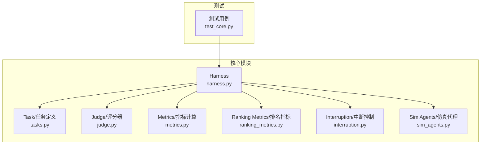
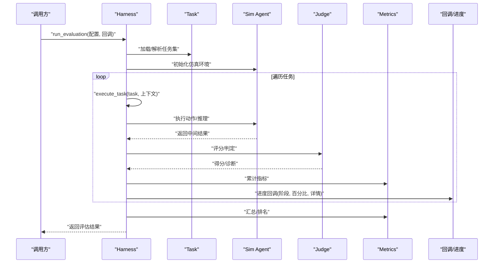
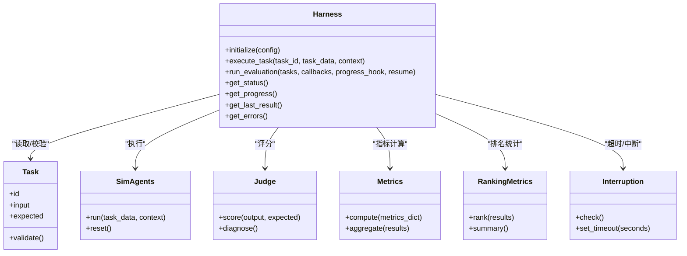
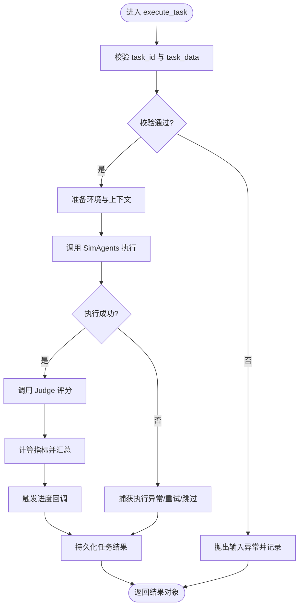
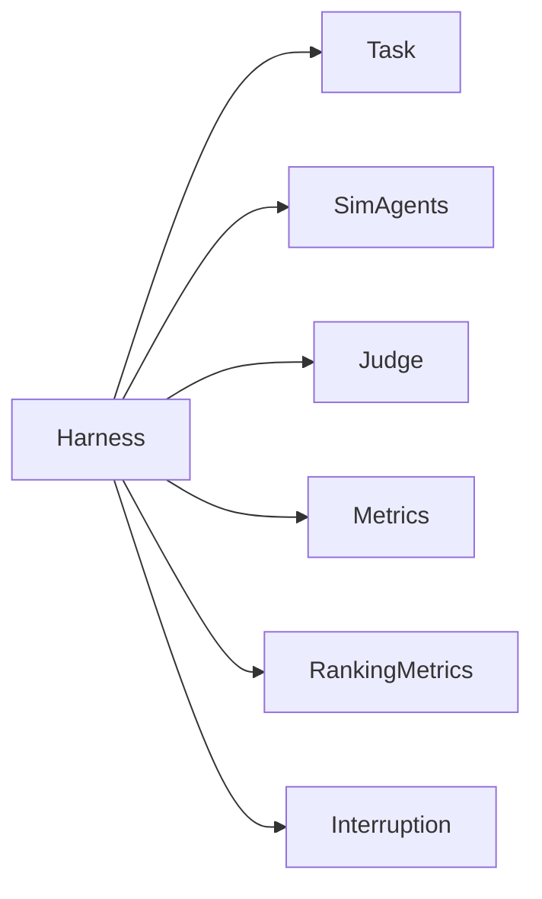

# 评估引擎API

<cite>
**本文引用的文件**   
- [harness.py](file://autonomy_mvp/core/harness.py)
- [tasks.py](file://autonomy_mvp/core/tasks.py)
- [judge.py](file://autonomy_mvp/core/judge.py)
- [metrics.py](file://autonomy_mvp/core/metrics.py)
- [ranking_metrics.py](file://autonomy_mvp/core/ranking_metrics.py)
- [interruption.py](file://autonomy_mvp/core/interruption.py)
- [sim_agents.py](file://autonomy_mvp/core/sim_agents.py)
- [test_core.py](file://autonomy_mvp/tests/test_core.py)
</cite>

## 目录
1. [简介](#简介)
2. [项目结构](#项目结构)
3. [核心组件](#核心组件)
4. [架构总览](#架构总览)
5. [详细组件分析](#详细组件分析)
6. [依赖分析](#依赖分析)
7. [性能考虑](#性能考虑)
8. [故障排查指南](#故障排查指南)
9. [结论](#结论)
10. [附录](#附录)

## 简介
本文件面向评估引擎的核心类 Harness，提供完整的 API 文档与使用指南。内容涵盖：
- 初始化参数与环境配置
- 任务执行接口（含 execute_task() 的参数、返回值与异常处理）
- 状态管理与进度监控
- 结果收集与汇总机制
- run_evaluation() 流程的阶段划分、回调注册与进度上报
- 错误处理策略、日志记录与调试信息输出格式
- 完整 Python 示例路径（以源码位置引用代替代码片段）

## 项目结构
评估引擎位于 autonomy_mvp/core 目录下，核心由 harness.py 驱动，配合 tasks、judge、metrics、ranking_metrics、interruption、sim_agents 等模块协同工作。测试用例位于 autonomy_mvp/tests/test_core.py，用于验证 Harness 的行为与边界条件。

图表来源
- [harness.py](file://autonomy_mvp/core/harness.py)
- [tasks.py](file://autonomy_mvp/core/tasks.py)
- [judge.py](file://autonomy_mvp/core/judge.py)
- [metrics.py](file://autonomy_mvp/core/metrics.py)
- [ranking_metrics.py](file://autonomy_mvp/core/ranking_metrics.py)
- [interruption.py](file://autonomy_mvp/core/interruption.py)
- [sim_agents.py](file://autonomy_mvp/core/sim_agents.py)
- [test_core.py](file://autonomy_mvp/tests/test_core.py)

章节来源
- [harness.py](file://autonomy_mvp/core/harness.py)
- [tasks.py](file://autonomy_mvp/core/tasks.py)
- [judge.py](file://autonomy_mvp/core/judge.py)
- [metrics.py](file://autonomy_mvp/core/metrics.py)
- [ranking_metrics.py](file://autonomy_mvp/core/ranking_metrics.py)
- [interruption.py](file://autonomy_mvp/core/interruption.py)
- [sim_agents.py](file://autonomy_mvp/core/sim_agents.py)
- [test_core.py](file://autonomy_mvp/tests/test_core.py)

## 核心组件
- Harness：评估编排主类，负责生命周期管理、任务调度、状态跟踪、进度回调、结果聚合与持久化。
- Task：任务抽象与数据契约，定义输入、环境、动作空间与期望输出。
- Judge：评分与判定逻辑，将模型输出与标准答案或规则进行比对并打分。
- Metrics/Ranking Metrics：指标计算与排序统计，支持多种评测维度。
- Interruption：中断与超时控制，保障长时间运行的稳定性。
- Sim Agents：仿真代理封装，便于在受控环境中执行任务。

章节来源
- [harness.py](file://autonomy_mvp/core/harness.py)
- [tasks.py](file://autonomy_mvp/core/tasks.py)
- [judge.py](file://autonomy_mvp/core/judge.py)
- [metrics.py](file://autonomy_mvp/core/metrics.py)
- [ranking_metrics.py](file://autonomy_mvp/core/ranking_metrics.py)
- [interruption.py](file://autonomy_mvp/core/interruption.py)
- [sim_agents.py](file://autonomy_mvp/core/sim_agents.py)

## 架构总览
下图展示了 Harness 在评估过程中的关键交互：从任务加载、环境准备、执行、评分到结果汇总与回调通知。

图表来源
- [harness.py](file://autonomy_mvp/core/harness.py)
- [tasks.py](file://autonomy_mvp/core/tasks.py)
- [judge.py](file://autonomy_mvp/core/judge.py)
- [metrics.py](file://autonomy_mvp/core/metrics.py)
- [ranking_metrics.py](file://autonomy_mvp/core/ranking_metrics.py)
- [sim_agents.py](file://autonomy_mvp/core/sim_agents.py)

## 详细组件分析

### Harness 类 API 概览
- 初始化与配置
  - 构造参数：任务源、环境配置、评分器、指标集合、回调函数、并发度、超时与重试策略、日志级别、输出目录等。
  - 环境准备：创建隔离工作区、加载数据集、初始化仿真代理、预热资源。
- 任务执行
  - execute_task(task_id, task_data, context=None): 单任务执行入口，包含前置校验、环境注入、执行、评分、指标更新、异常捕获与回滚。
  - 参数规范：task_id 为唯一标识；task_data 遵循 Task 契约；context 可携带运行时变量（如随机种子、工具句柄）。
  - 返回值：标准化结果对象，包含状态码、得分、指标字典、诊断信息与时间戳。
  - 异常处理：统一包装为评估异常类型，记录堆栈与上下文快照，支持重试与跳过策略。
- 批量评估
  - run_evaluation(tasks, callbacks=None, progress_hook=None, resume=False): 多任务编排，分阶段推进，支持断点续跑与进度上报。
  - 阶段划分：准备、执行、评分、汇总、持久化。
  - 回调注册：on_start、on_task_start、on_task_progress、on_task_end、on_summary、on_error。
  - 进度监控：通过 progress_hook 推送百分比、当前任务索引、耗时与最近错误摘要。
- 状态管理
  - 内部状态机：idle -> preparing -> running -> summarizing -> done/error。
  - 查询接口：get_status()、get_progress()、get_last_result()、get_errors()。
- 结果收集
  - 结果结构：每个任务的明细 + 全局汇总（均值、方差、排名、分布）。
  - 持久化：JSON/CSV 导出，附带元数据与运行配置。

章节来源
- [harness.py](file://autonomy_mvp/core/harness.py)

#### execute_task() 方法详解
- 参数
  - task_id: 字符串，任务唯一键。
  - task_data: 字典或对象，遵循 tasks.Task 的数据契约。
  - context: 可选字典，传递运行时上下文（如工具、环境变量）。
- 返回值
  - 结构化结果对象，字段包括：
    - status: 枚举（成功/失败/跳过/中断）
    - score: 数值或字典
    - metrics: 指标字典
    - diagnostics: 诊断信息（步骤轨迹、错误堆栈、资源占用）
    - timing: 耗时统计
- 异常处理
  - 捕获并分类异常（输入校验、执行期、评分期、IO 异常）。
  - 根据配置决定是否重试、跳过或终止。
  - 记录结构化日志与快照，便于复现。

章节来源
- [harness.py](file://autonomy_mvp/core/harness.py)
- [tasks.py](file://autonomy_mvp/core/tasks.py)

#### run_evaluation() 流程与回调
- 阶段
  - 准备：解析任务列表、校验配置、创建输出目录、初始化日志。
  - 执行：按并发度调度 execute_task()，维护任务队列与锁。
  - 评分：调用 judge 与 metrics 计算分数与指标。
  - 汇总：生成全局统计与排名。
  - 持久化：写入结果文件与元数据。
- 回调
  - on_task_progress(task_id, percent, detail): 细粒度进度上报。
  - on_summary(summary): 汇总完成回调。
  - on_error(error_info): 错误上报，包含错误类型、消息与上下文。
- 进度监控
  - get_progress(): 返回总体进度、各阶段进度与最近事件。
  - 支持外部 UI 或 CLI 实时展示。

章节来源
- [harness.py](file://autonomy_mvp/core/harness.py)
- [judge.py](file://autonomy_mvp/core/judge.py)
- [metrics.py](file://autonomy_mvp/core/metrics.py)
- [ranking_metrics.py](file://autonomy_mvp/core/ranking_metrics.py)

#### 状态管理与进度接口
- 状态查询
  - get_status(): 返回当前状态机节点。
  - get_progress(): 返回进度对象（百分比、阶段、计数）。
  - get_last_result(): 返回最近一次任务或汇总结果。
  - get_errors(): 返回错误列表（去重与分页）。
- 进度事件
  - 通过回调与 get_progress() 双通道暴露，确保外部系统可订阅与轮询。

章节来源
- [harness.py](file://autonomy_mvp/core/harness.py)

#### 结果收集与持久化
- 结果结构
  - 任务级：id、status、score、metrics、diagnostics、timing。
  - 汇总级：指标均值/方差、Top-K、分布直方图、失败率。
- 持久化
  - 默认 JSON 输出，支持 CSV 导出。
  - 附带运行配置、版本信息与随机种子，保证可复现性。

章节来源
- [harness.py](file://autonomy_mvp/core/harness.py)
- [metrics.py](file://autonomy_mvp/core/metrics.py)
- [ranking_metrics.py](file://autonomy_mvp/core/ranking_metrics.py)

### 相关组件协作关系

图表来源
- [harness.py](file://autonomy_mvp/core/harness.py)
- [tasks.py](file://autonomy_mvp/core/tasks.py)
- [judge.py](file://autonomy_mvp/core/judge.py)
- [metrics.py](file://autonomy_mvp/core/metrics.py)
- [ranking_metrics.py](file://autonomy_mvp/core/ranking_metrics.py)
- [interruption.py](file://autonomy_mvp/core/interruption.py)
- [sim_agents.py](file://autonomy_mvp/core/sim_agents.py)

章节来源
- [harness.py](file://autonomy_mvp/core/harness.py)
- [tasks.py](file://autonomy_mvp/core/tasks.py)
- [judge.py](file://autonomy_mvp/core/judge.py)
- [metrics.py](file://autonomy_mvp/core/metrics.py)
- [ranking_metrics.py](file://autonomy_mvp/core/ranking_metrics.py)
- [interruption.py](file://autonomy_mvp/core/interruption.py)
- [sim_agents.py](file://autonomy_mvp/core/sim_agents.py)

### 复杂逻辑流程图（execute_task 内部）

图表来源
- [harness.py](file://autonomy_mvp/core/harness.py)
- [sim_agents.py](file://autonomy_mvp/core/sim_agents.py)
- [judge.py](file://autonomy_mvp/core/judge.py)
- [metrics.py](file://autonomy_mvp/core/metrics.py)

章节来源
- [harness.py](file://autonomy_mvp/core/harness.py)

## 依赖分析
- 内聚性与耦合
  - Harness 作为编排中心，对 Task、SimAgents、Judge、Metrics、RankingMetrics 存在直接依赖，但通过明确接口解耦，便于替换实现。
  - Interruption 作为横切关注点，被 Harness 在关键路径中周期性检查，避免长时阻塞。
- 外部依赖与集成点
  - IO 层：结果持久化、日志输出、配置加载。
  - 并发控制：线程/进程池或异步调度（由 Harness 内部实现对外透明）。
- 潜在循环依赖
  - 当前设计无循环导入迹象，模块职责清晰。

图表来源
- [harness.py](file://autonomy_mvp/core/harness.py)
- [tasks.py](file://autonomy_mvp/core/tasks.py)
- [judge.py](file://autonomy_mvp/core/judge.py)
- [metrics.py](file://autonomy_mvp/core/metrics.py)
- [ranking_metrics.py](file://autonomy_mvp/core/ranking_metrics.py)
- [interruption.py](file://autonomy_mvp/core/interruption.py)
- [sim_agents.py](file://autonomy_mvp/core/sim_agents.py)

章节来源
- [harness.py](file://autonomy_mvp/core/harness.py)

## 性能考虑
- 并发与吞吐
  - 合理设置并发度，结合 CPU/GPU 资源与 IO 瓶颈调优。
  - 对 I/O 密集型任务采用异步或批处理策略。
- 内存与资源
  - 及时释放仿真代理与临时文件，避免内存泄漏。
  - 大结果集增量写入，减少一次性序列化开销。
- 指标计算
  - 对大规模结果采用流式聚合与近似算法，降低峰值内存。
- 重试与退避
  - 对不稳定外部服务采用指数退避与最大重试次数限制。

[本节为通用指导，不直接分析具体文件]

## 故障排查指南
- 常见错误与定位
  - 输入校验失败：检查 task_data 是否符合 Task 契约，确认必填字段与类型。
  - 执行期异常：查看 diagnostics 中的步骤轨迹与堆栈，定位 SimAgents 调用链。
  - 评分异常：核对 Judge 的期望输出格式与阈值。
  - 指标计算异常：检查空值、NaN 与除零保护。
- 日志与调试
  - 日志级别：DEBUG/INFO/WARNING/ERROR，建议生产使用 INFO 及以上。
  - 调试信息：包含任务 ID、时间戳、上下文快照、资源占用与最近错误摘要。
- 恢复策略
  - 启用 resume 模式断点续跑。
  - 对失败任务单独重试或跳过，不影响整体评估。

章节来源
- [harness.py](file://autonomy_mvp/core/harness.py)
- [test_core.py](file://autonomy_mvp/tests/test_core.py)

## 结论
Harness 提供了统一的评估编排能力，覆盖任务执行、评分、指标计算、进度监控与结果持久化。通过清晰的接口与可扩展的组件设计，用户可快速搭建稳定高效的评估流水线。建议在生产环境中开启进度回调与结构化日志，并结合断点续跑与重试策略提升鲁棒性。

[本节为总结性内容，不直接分析具体文件]

## 附录

### Python 使用示例（路径引用）
- 实例化 Harness 与配置评估环境
  - 参考路径：[harness.py](file://autonomy_mvp/core/harness.py)
- 注册回调与进度监控
  - 参考路径：[harness.py](file://autonomy_mvp/core/harness.py)
- 执行单个任务与获取结果
  - 参考路径：[harness.py](file://autonomy_mvp/core/harness.py)
- 批量评估与结果持久化
  - 参考路径：[harness.py](file://autonomy_mvp/core/harness.py)
- 单元测试与行为验证
  - 参考路径：[test_core.py](file://autonomy_mvp/tests/test_core.py)

章节来源
- [harness.py](file://autonomy_mvp/core/harness.py)
- [test_core.py](file://autonomy_mvp/tests/test_core.py)