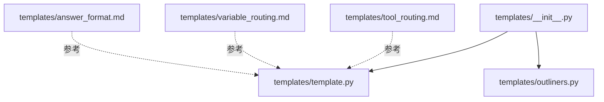
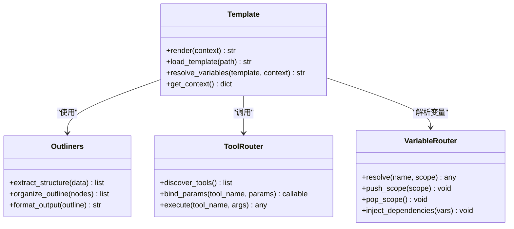
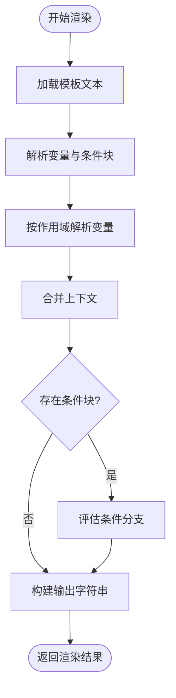
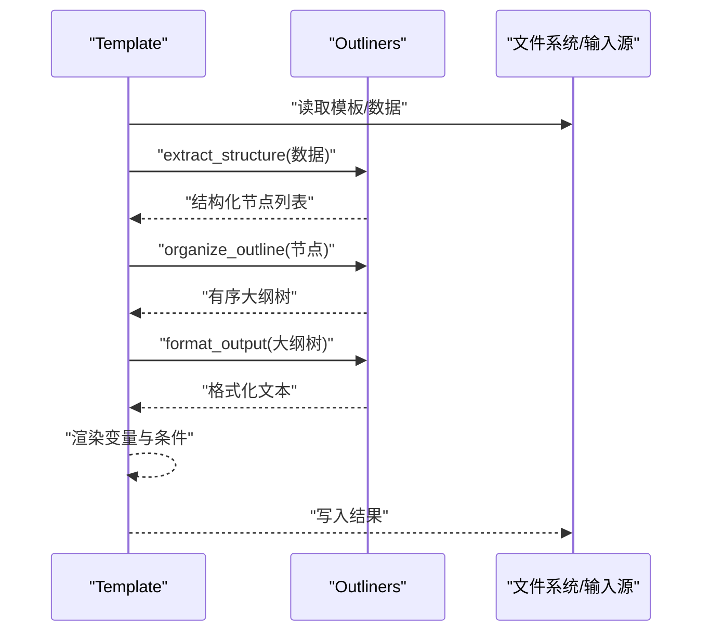
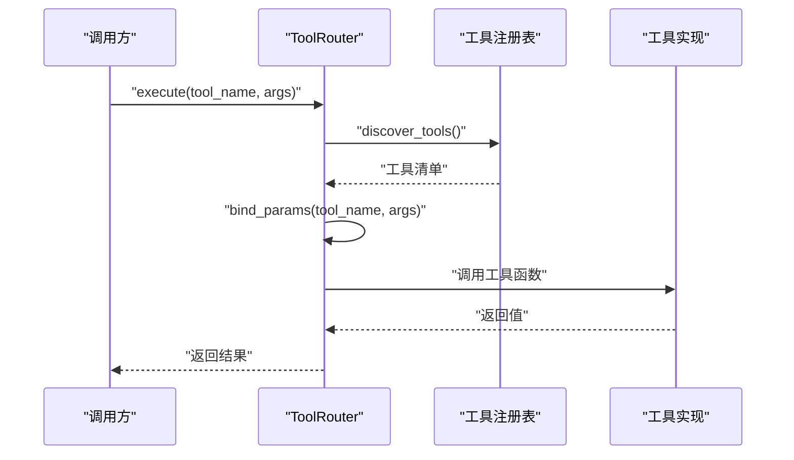
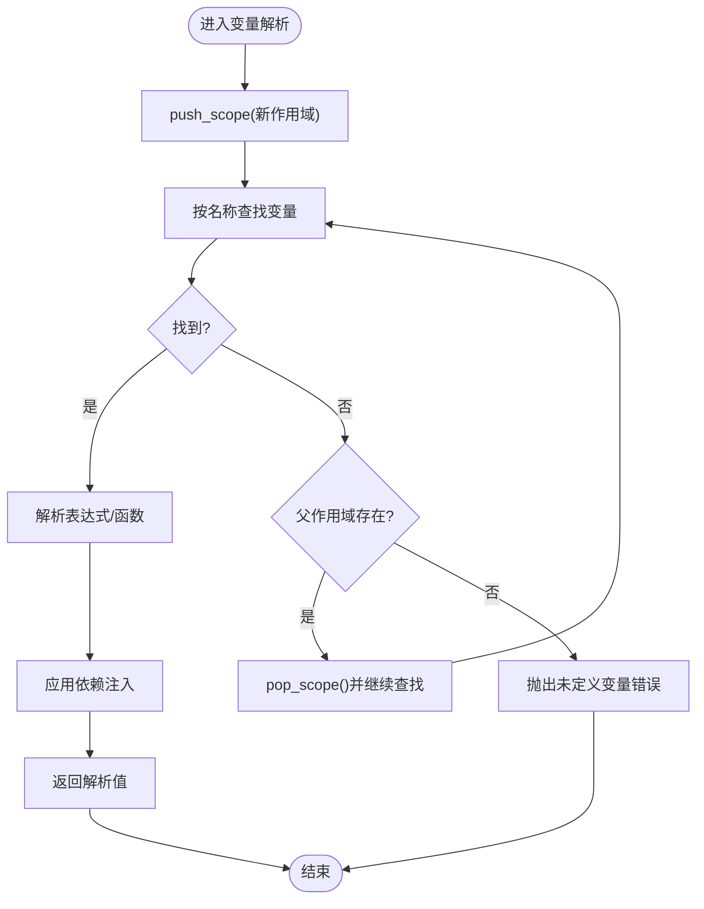
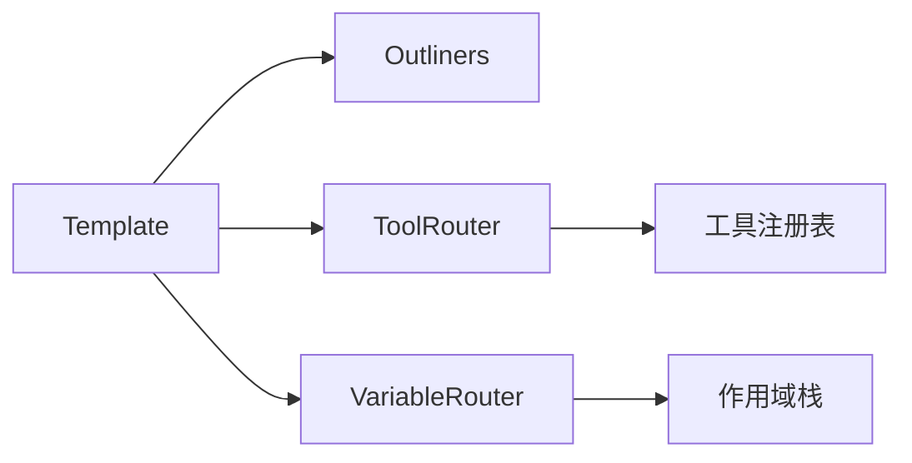

# 模板系统API

<cite>
**本文引用的文件**   
- [template.py](file://docs/molbench_repo/templates/template.py)
- [outliners.py](file://docs/molbench_repo/templates/outliners.py)
- [tool_routing.md](file://docs/molbench_repo/templates/tool_routing.md)
- [variable_routing.md](file://docs/molbench_repo/templates/variable_routing.md)
- [answer_format.md](file://docs/molbench_repo/templates/answer_format.md)
- [__init__.py](file://docs/molbench_repo/templates/__init__.py)
</cite>

## 目录
1. [简介](#简介)
2. [项目结构](#项目结构)
3. [核心组件](#核心组件)
4. [架构总览](#架构总览)
5. [详细组件分析](#详细组件分析)
6. [依赖关系分析](#依赖关系分析)
7. [性能与缓存](#性能与缓存)
8. [故障排查指南](#故障排查指南)
9. [结论](#结论)
10. [附录：示例与最佳实践](#附录示例与最佳实践)

## 简介
本文件为模板系统的API文档，聚焦以下能力：
- Template基类的模板渲染机制、变量替换规则与上下文管理
- Outliners大纲生成器的结构提取、内容组织与格式化输出
- ToolRouter工具路由的工具发现、参数绑定与执行调度接口
- VariableRouter变量路由的动态变量解析、作用域管理与依赖注入
- 自定义模板开发、动态内容生成与条件渲染的实现指引
- 模板版本管理、缓存策略与性能优化建议

## 项目结构
模板系统位于 docs/molbench_repo/templates 目录下，包含模板引擎、大纲生成器、路由说明与答案格式等。

图表来源
- [__init__.py](file://docs/molbench_repo/templates/__init__.py)
- [template.py](file://docs/molbench_repo/templates/template.py)
- [outliners.py](file://docs/molbench_repo/templates/outliners.py)
- [tool_routing.md](file://docs/molbench_repo/templates/tool_routing.md)
- [variable_routing.md](file://docs/molbench_repo/templates/variable_routing.md)
- [answer_format.md](file://docs/molbench_repo/templates/answer_format.md)

章节来源
- [__init__.py](file://docs/molbench_repo/templates/__init__.py)
- [template.py](file://docs/molbench_repo/templates/template.py)
- [outliners.py](file://docs/molbench_repo/templates/outliners.py)
- [tool_routing.md](file://docs/molbench_repo/templates/tool_routing.md)
- [variable_routing.md](file://docs/molbench_repo/templates/variable_routing.md)
- [answer_format.md](file://docs/molbench_repo/templates/answer_format.md)

## 核心组件
- Template基类：提供模板加载、渲染入口、变量替换与上下文管理。
- Outliners大纲生成器：从结构化输入中提取层级信息，组织并输出标准化大纲。
- ToolRouter工具路由：基于声明式配置发现工具、绑定参数并调度执行。
- VariableRouter变量路由：在运行时解析变量、维护作用域与依赖注入。

章节来源
- [template.py](file://docs/molbench_repo/templates/template.py)
- [outliners.py](file://docs/molbench_repo/templates/outliners.py)
- [tool_routing.md](file://docs/molbench_repo/templates/tool_routing.md)
- [variable_routing.md](file://docs/molbench_repo/templates/variable_routing.md)

## 架构总览
模板系统以Template为核心，结合Outliners进行结构化输出，并通过ToolRouter与VariableRouter实现“工具+变量”的运行时扩展。

图表来源
- [template.py](file://docs/molbench_repo/templates/template.py)
- [outliners.py](file://docs/molbench_repo/templates/outliners.py)
- [tool_routing.md](file://docs/molbench_repo/templates/tool_routing.md)
- [variable_routing.md](file://docs/molbench_repo/templates/variable_routing.md)

## 详细组件分析

### Template基类：渲染机制、变量替换与上下文管理
- 渲染流程
  - 加载模板文本（支持路径或内联）
  - 解析变量占位符，按作用域顺序查找值
  - 将结果合并到上下文中，返回最终字符串
- 变量替换规则
  - 支持点号访问嵌套键（如 a.b.c）
  - 支持默认值语法（如 var|default）
  - 支持条件片段（如 if/else）
- 上下文管理
  - 提供全局上下文与局部上下文合并
  - 支持作用域压栈/出栈，便于嵌套渲染
- 错误处理
  - 缺失变量时抛出明确异常或回退默认值
  - 模板语法错误定位行号与片段

图表来源
- [template.py](file://docs/molbench_repo/templates/template.py)

章节来源
- [template.py](file://docs/molbench_repo/templates/template.py)

### Outliners大纲生成器：结构提取、内容组织与格式化输出
- 结构提取
  - 从JSON/字典/列表等输入中识别标题、段落、列表项与表格
  - 自动推断层级关系（H1/H2/H3…）
- 内容组织
  - 将节点按层级排序，去重与合并相邻同类节点
  - 生成稳定的锚点与索引
- 格式化输出
  - 输出Markdown大纲，支持目录、编号与超链接
  - 可切换纯文本或结构化数据输出

图表来源
- [outliners.py](file://docs/molbench_repo/templates/outliners.py)
- [template.py](file://docs/molbench_repo/templates/template.py)

章节来源
- [outliners.py](file://docs/molbench_repo/templates/outliners.py)

### ToolRouter工具路由：工具发现、参数绑定与执行调度
- 工具发现
  - 扫描注册表或配置文件，列出可用工具及其元数据（名称、描述、参数签名）
- 参数绑定
  - 将上下文中的变量映射到工具参数，支持类型校验与默认值
- 执行调度
  - 根据工具名选择实现函数，传入已绑定的参数并返回结果
  - 支持异步执行与重试策略（可选）

图表来源
- [tool_routing.md](file://docs/molbench_repo/templates/tool_routing.md)

章节来源
- [tool_routing.md](file://docs/molbench_repo/templates/tool_routing.md)

### VariableRouter变量路由：动态解析、作用域管理与依赖注入
- 动态解析
  - 支持表达式求值与函数调用（受限环境）
  - 支持链式访问与短路求值
- 作用域管理
  - push_scope/pop_scope实现嵌套作用域
  - 父作用域可见性控制
- 依赖注入
  - 通过inject_dependencies批量注入外部服务或配置
  - 支持按需懒加载与缓存

图表来源
- [variable_routing.md](file://docs/molbench_repo/templates/variable_routing.md)

章节来源
- [variable_routing.md](file://docs/molbench_repo/templates/variable_routing.md)

## 依赖关系分析
- 模块耦合
  - Template依赖Outliners进行结构化输出
  - Template通过ToolRouter与VariableRouter扩展运行时能力
- 外部依赖
  - 文件系统用于模板与数据读写
  - JSON/Markdown作为主要数据交换格式

图表来源
- [template.py](file://docs/molbench_repo/templates/template.py)
- [outliners.py](file://docs/molbench_repo/templates/outliners.py)
- [tool_routing.md](file://docs/molbench_repo/templates/tool_routing.md)
- [variable_routing.md](file://docs/molbench_repo/templates/variable_routing.md)

章节来源
- [template.py](file://docs/molbench_repo/templates/template.py)
- [outliners.py](file://docs/molbench_repo/templates/outliners.py)
- [tool_routing.md](file://docs/molbench_repo/templates/tool_routing.md)
- [variable_routing.md](file://docs/molbench_repo/templates/variable_routing.md)

## 性能与缓存
- 模板缓存
  - 对已加载模板文本与编译后的AST进行缓存，避免重复I/O与解析
- 变量解析缓存
  - 对复杂表达式结果与作用域快照进行缓存，减少重复计算
- 大纲生成优化
  - 增量更新：仅重新组织变更的子树
  - 并行化：对独立节点进行并发处理（注意线程安全）
- 资源限制
  - 设置最大递归深度与超时，防止恶意或异常模板导致资源耗尽

[本节为通用性能建议，不直接分析具体文件]

## 故障排查指南
- 常见错误
  - 变量未定义：检查作用域是否正确压栈，确认变量名拼写与路径
  - 工具不存在：确认工具注册表是否包含该工具，参数签名是否匹配
  - 模板语法错误：查看错误位置提示，修正条件块或占位符
- 调试技巧
  - 启用详细日志，记录变量解析过程与工具调用轨迹
  - 使用最小复现用例隔离问题
  - 分阶段验证：先渲染静态部分，再逐步引入变量与工具

章节来源
- [template.py](file://docs/molbench_repo/templates/template.py)
- [tool_routing.md](file://docs/molbench_repo/templates/tool_routing.md)
- [variable_routing.md](file://docs/molbench_repo/templates/variable_routing.md)

## 结论
模板系统以Template为核心，结合Outliners的结构化输出能力与ToolRouter/VariableRouter的运行时扩展，形成高内聚、低耦合的可插拔架构。通过合理的缓存与错误处理策略，可在保证灵活性的同时获得良好的性能与稳定性。

[本节为总结性内容，不直接分析具体文件]

## 附录：示例与最佳实践

### 自定义模板开发
- 步骤
  - 继承Template基类，覆盖必要的钩子方法（如变量解析、条件评估）
  - 在模板中使用标准占位符与条件语法
  - 通过Outliners生成结构化内容，提升可读性与可维护性
- 参考
  - [template.py](file://docs/molbench_repo/templates/template.py)
  - [outliners.py](file://docs/molbench_repo/templates/outliners.py)

章节来源
- [template.py](file://docs/molbench_repo/templates/template.py)
- [outliners.py](file://docs/molbench_repo/templates/outliners.py)

### 动态内容生成
- 使用VariableRouter在运行时注入数据与服务
- 结合ToolRouter调用外部工具获取实时数据
- 参考
  - [variable_routing.md](file://docs/molbench_repo/templates/variable_routing.md)
  - [tool_routing.md](file://docs/molbench_repo/templates/tool_routing.md)

章节来源
- [variable_routing.md](file://docs/molbench_repo/templates/variable_routing.md)
- [tool_routing.md](file://docs/molbench_repo/templates/tool_routing.md)

### 条件渲染
- 在模板中使用if/else块控制输出
- 结合变量解析结果进行分支判断
- 参考
  - [template.py](file://docs/molbench_repo/templates/template.py)

章节来源
- [template.py](file://docs/molbench_repo/templates/template.py)

### 模板版本管理
- 为每个模板文件添加版本号字段
- 在渲染前校验版本兼容性
- 参考
  - [template.py](file://docs/molbench_repo/templates/template.py)

章节来源
- [template.py](file://docs/molbench_repo/templates/template.py)

### 缓存策略
- 模板文本缓存：按路径哈希存储
- 变量解析缓存：按作用域快照与表达式哈希存储
- 参考
  - [template.py](file://docs/molbench_repo/templates/template.py)
  - [variable_routing.md](file://docs/molbench_repo/templates/variable_routing.md)

章节来源
- [template.py](file://docs/molbench_repo/templates/template.py)
- [variable_routing.md](file://docs/molbench_repo/templates/variable_routing.md)

### 性能优化建议
- 预编译模板与重用AST
- 批量渲染以减少上下文切换开销
- 限制递归深度与超时时间
- 参考
  - [template.py](file://docs/molbench_repo/templates/template.py)

章节来源
- [template.py](file://docs/molbench_repo/templates/template.py)

### 答案格式规范
- 遵循统一的答案格式，便于后续处理与评估
- 参考
  - [answer_format.md](file://docs/molbench_repo/templates/answer_format.md)

章节来源
- [answer_format.md](file://docs/molbench_repo/templates/answer_format.md)