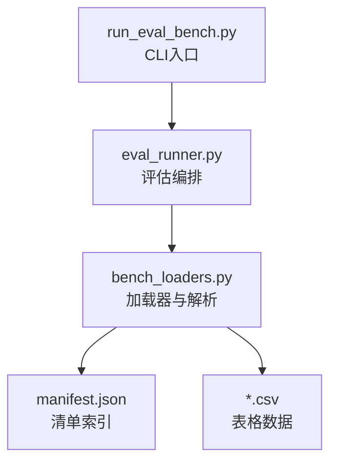
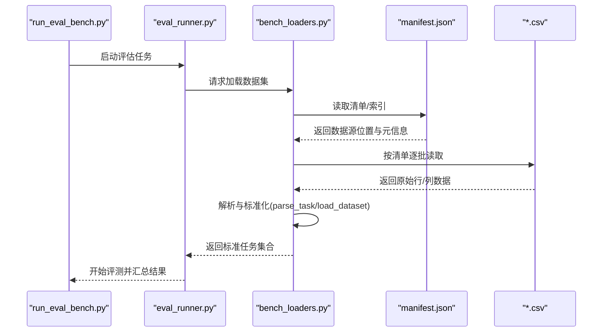
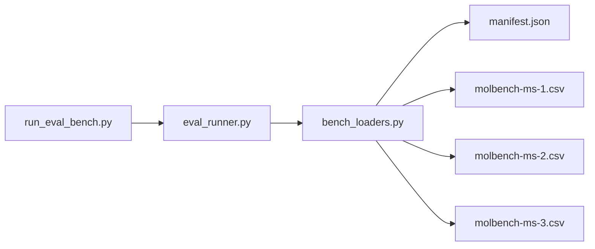
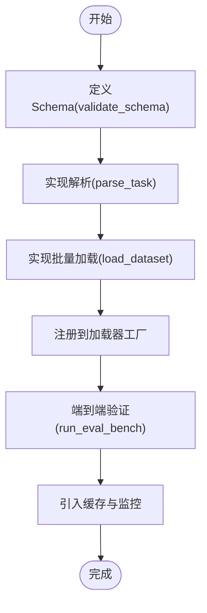

# 基准加载器API

<cite>
**本文引用的文件**   
- [bench_loaders.py](file://docs/prd/molbench_repo/eval/bench_loaders.py)
- [eval_runner.py](file://docs/prd/molbench_repo/eval/eval_runner.py)
- [run_eval_bench.py](file://docs/prd/molbench_repo/eval/run_eval_bench.py)
- [manifest.json](file://docs/prd/molbench_repo/data_full/molbench-mo/manifest.json)
- [molbench-ms-1.csv](file://docs/prd/molbench_repo/data_full/molbench-ms-1/molbench-ms-1.csv)
- [molbench-ms-2.csv](file://docs/prd/molbench_repo/data_full/molbench-ms-2/molbench-ms-2.csv)
- [molbench-ms-3.csv](file://docs/prd/molbench_repo/data_full/molbench-ms-3/molbench-ms-3.csv)
</cite>

## 目录
1. [简介](#简介)
2. [项目结构](#项目结构)
3. [核心组件](#核心组件)
4. [架构总览](#架构总览)
5. [详细组件分析](#详细组件分析)
6. [依赖关系分析](#依赖关系分析)
7. [性能与缓存](#性能与缓存)
8. [故障排查指南](#故障排查指南)
9. [结论](#结论)
10. [附录：自定义数据加载器开发指南](#附录自定义数据加载器开发指南)

## 简介
本文件为基准测试加载器模块的完整API参考，聚焦于以下能力：
- 统一的数据加载接口 load_dataset()
- 任务解析接口 parse_task()
- 数据模式校验接口 validate_schema()
- 支持的基准格式、数据源类型与解析规则
- 自定义数据加载器的开发与集成方式
- 数据预处理、缓存策略与性能优化建议

该文档面向需要扩展或集成新基准数据集的用户与维护者，提供从概念到落地的全链路说明。

## 项目结构
与基准加载器相关的代码位于评估子系统中，关键文件如下：
- 加载器实现与注册：docs/prd/molbench_repo/eval/bench_loaders.py
- 评估运行入口与调度：docs/prd/molbench_repo/eval/eval_runner.py
- 命令行执行脚本：docs/prd/molbench_repo/eval/run_eval_bench.py
- 示例数据清单与CSV样例：docs/prd/molbench_repo/data_full/...

图表来源
- [run_eval_bench.py](file://docs/prd/molbench_repo/eval/run_eval_bench.py)
- [eval_runner.py](file://docs/prd/molbench_repo/eval/eval_runner.py)
- [bench_loaders.py](file://docs/prd/molbench_repo/eval/bench_loaders.py)
- [manifest.json](file://docs/prd/molbench_repo/data_full/molbench-mo/manifest.json)
- [molbench-ms-1.csv](file://docs/prd/molbench_repo/data_full/molbench-ms-1/molbench-ms-1.csv)
- [molbench-ms-2.csv](file://docs/prd/molbench_repo/data_full/molbench-ms-2/molbench-ms-2.csv)
- [molbench-ms-3.csv](file://docs/prd/molbench_repo/data_full/molbench-ms-3/molbench-ms-3.csv)

章节来源
- [bench_loaders.py](file://docs/prd/molbench_repo/eval/bench_loaders.py)
- [eval_runner.py](file://docs/prd/molbench_repo/eval/eval_runner.py)
- [run_eval_bench.py](file://docs/prd/molbench_repo/eval/run_eval_bench.py)
- [manifest.json](file://docs/prd/molbench_repo/data_full/molbench-mo/manifest.json)
- [molbench-ms-1.csv](file://docs/prd/molbench_repo/data_full/molbench-ms-1/molbench-ms-1.csv)
- [molbench-ms-2.csv](file://docs/prd/molbench_repo/data_full/molbench-ms-2/molbench-ms-2.csv)
- [molbench-ms-3.csv](file://docs/prd/molbench_repo/data_full/molbench-ms-3/molbench-ms-3.csv)

## 核心组件
本节概述加载器对外暴露的核心API及其职责边界。

- 数据加载接口
  - 方法名：load_dataset
  - 作用：根据配置或路径定位数据源，完成读取、解析与标准化，返回供评测使用的统一数据结构。
  - 输入：数据源标识（如清单条目、目录或文件路径）、可选解析参数（如字段映射、过滤条件）。
  - 输出：标准化的任务/样本集合对象，包含元数据与样本列表。
  - 异常：当数据缺失、格式不匹配或权限不足时抛出明确错误。

- 任务解析接口
  - 方法名：parse_task
  - 作用：将原始数据项解析为内部任务模型，进行字段补齐、类型转换与约束检查。
  - 输入：单条或多条原始记录。
  - 输出：规范化后的任务对象。
  - 异常：字段缺失、类型错误或业务约束违反时抛出可诊断的错误。

- 模式校验接口
  - 方法名：validate_schema
  - 作用：对输入数据的结构与字段进行静态校验，确保满足基准要求的Schema。
  - 输入：待校验的数据或Schema定义。
  - 输出：校验结果（通过/失败）及错误详情。
  - 异常：Schema非法或数据严重不一致时抛出错误。

使用要点
- 推荐先调用 validate_schema 快速发现结构性问题，再进入 parse_task 与 load_dataset。
- 对于大规模数据，优先基于清单 manifest.json 进行分批加载与增量处理。
- 所有接口均支持在异常中携带上下文信息，便于定位具体样本与字段。

章节来源
- [bench_loaders.py](file://docs/prd/molbench_repo/eval/bench_loaders.py)
- [eval_runner.py](file://docs/prd/molbench_repo/eval/eval_runner.py)

## 架构总览
加载器与评估流程的整体交互如下：

图表来源
- [run_eval_bench.py](file://docs/prd/molbench_repo/eval/run_eval_bench.py)
- [eval_runner.py](file://docs/prd/molbench_repo/eval/eval_runner.py)
- [bench_loaders.py](file://docs/prd/molbench_repo/eval/bench_loaders.py)
- [manifest.json](file://docs/prd/molbench_repo/data_full/molbench-mo/manifest.json)
- [molbench-ms-1.csv](file://docs/prd/molbench_repo/data_full/molbench-ms-1/molbench-ms-1.csv)
- [molbench-ms-2.csv](file://docs/prd/molbench_repo/data_full/molbench-ms-2/molbench-ms-2.csv)
- [molbench-ms-3.csv](file://docs/prd/molbench_repo/data_full/molbench-ms-3/molbench-ms-3.csv)

## 详细组件分析

### 加载器实现与注册（bench_loaders.py）
- 职责
  - 维护加载器注册表，支持按数据源类型选择对应解析器。
  - 实现 load_dataset、parse_task、validate_schema 等核心接口。
  - 封装统一的错误类型与诊断信息。
- 关键点
  - 注册机制：新增数据源类型只需实现解析逻辑并注册到加载器工厂。
  - 解析管线：读取→校验→解析→标准化→缓存（可选）。
  - 可扩展性：通过插件式注册表接入新的CSV结构或清单格式。

章节来源
- [bench_loaders.py](file://docs/prd/molbench_repo/eval/bench_loaders.py)

### 评估编排（eval_runner.py）
- 职责
  - 协调加载器、评测器与结果聚合。
  - 管理批次、并发与重试策略。
- 关键点
  - 与加载器解耦：仅依赖统一接口，不关心具体数据格式。
  - 错误传播：将加载期异常转换为可恢复的评测事件。

章节来源
- [eval_runner.py](file://docs/prd/molbench_repo/eval/eval_runner.py)

### 命令行入口（run_eval_bench.py）
- 职责
  - 解析命令行参数，驱动评估流程。
  - 提供便捷的一键评测体验。
- 关键点
  - 参数透传：将用户配置传递给评估编排层。
  - 日志与退出码：便于自动化集成。

章节来源
- [run_eval_bench.py](file://docs/prd/molbench_repo/eval/run_eval_bench.py)

### 数据清单与样例（manifest.json 与 *.csv）
- 清单 manifest.json
  - 用于描述数据源位置、版本、字段说明与访问策略。
  - 作为批量加载的权威索引，避免硬编码路径。
- CSV 样例
  - molbench-ms-1.csv、molbench-ms-2.csv、molbench-ms-3.csv 提供不同维度的基准样例。
  - 字段命名与类型需符合 validate_schema 的定义。

章节来源
- [manifest.json](file://docs/prd/molbench_repo/data_full/molbench-mo/manifest.json)
- [molbench-ms-1.csv](file://docs/prd/molbench_repo/data_full/molbench-ms-1/molbench-ms-1.csv)
- [molbench-ms-2.csv](file://docs/prd/molbench_repo/data_full/molbench-ms-2/molbench-ms-2.csv)
- [molbench-ms-3.csv](file://docs/prd/molbench_repo/data_full/molbench-ms-3/molbench-ms-3.csv)

## 依赖关系分析
加载器与外部资源的依赖关系如下：

图表来源
- [bench_loaders.py](file://docs/prd/molbench_repo/eval/bench_loaders.py)
- [eval_runner.py](file://docs/prd/molbench_repo/eval/eval_runner.py)
- [run_eval_bench.py](file://docs/prd/molbench_repo/eval/run_eval_bench.py)
- [manifest.json](file://docs/prd/molbench_repo/data_full/molbench-mo/manifest.json)
- [molbench-ms-1.csv](file://docs/prd/molbench_repo/data_full/molbench-ms-1/molbench-ms-1.csv)
- [molbench-ms-2.csv](file://docs/prd/molbench_repo/data_full/molbench-ms-2/molbench-ms-2.csv)
- [molbench-ms-3.csv](file://docs/prd/molbench_repo/data_full/molbench-ms-3/molbench-ms-3.csv)

章节来源
- [bench_loaders.py](file://docs/prd/molbench_repo/eval/bench_loaders.py)
- [eval_runner.py](file://docs/prd/molbench_repo/eval/eval_runner.py)
- [run_eval_bench.py](file://docs/prd/molbench_repo/eval/run_eval_bench.py)
- [manifest.json](file://docs/prd/molbench_repo/data_full/molbench-mo/manifest.json)
- [molbench-ms-1.csv](file://docs/prd/molbench_repo/data_full/molbench-ms-1/molbench-ms-1.csv)
- [molbench-ms-2.csv](file://docs/prd/molbench_repo/data_full/molbench-ms-2/molbench-ms-2.csv)
- [molbench-ms-3.csv](file://docs/prd/molbench_repo/data_full/molbench-ms-3/molbench-ms-3.csv)

## 性能与缓存
- 流式读取与分批处理
  - 针对大体积CSV，建议采用分块读取与惰性迭代，降低内存峰值。
- 清单驱动的增量加载
  - 基于 manifest.json 的版本化索引，可实现增量更新与断点续跑。
- 缓存策略
  - 建议在解析后产物（标准化任务对象）写入本地缓存，避免重复IO与解析开销。
  - 缓存键应包含数据源版本、字段映射与过滤条件哈希，保证一致性。
- 并发与并行
  - 评估编排层可按任务粒度并行执行；加载阶段保持顺序以保证清单一致性。
- I/O优化
  - 使用列式读取与只读必要字段，减少不必要的反序列化。
- 监控与度量
  - 记录加载耗时、失败率与缓存命中率，辅助容量规划与调优。

[本节为通用性能建议，无需特定文件引用]

## 故障排查指南
常见问题与定位步骤：
- 数据缺失或路径错误
  - 现象：加载时报找不到文件或清单条目无效。
  - 排查：核对 manifest.json 中的路径与权限；确认数据已下载且未被移动。
- 字段缺失或类型不匹配
  - 现象：validate_schema 或 parse_task 报错。
  - 排查：对照Schema定义检查列名、数据类型与必填字段；必要时增加字段映射。
- 解析异常
  - 现象：个别样本解析失败导致整体中断。
  - 排查：启用跳过模式或隔离失败样本，定位具体记录；修复数据或放宽非关键约束。
- 性能退化
  - 现象：加载缓慢或内存占用过高。
  - 排查：开启缓存、改用分块读取、减少冗余字段；评估并发度是否合理。

章节来源
- [bench_loaders.py](file://docs/prd/molbench_repo/eval/bench_loaders.py)
- [eval_runner.py](file://docs/prd/molbench_repo/eval/eval_runner.py)

## 结论
本API围绕 load_dataset、parse_task、validate_schema 三个核心方法构建，配合清单与CSV样例形成可扩展、可验证、可观测的基准加载体系。通过注册表机制与统一错误模型，用户可低成本接入新数据源，并在生产环境中获得稳定高效的评测体验。

[本节为总结性内容，无需特定文件引用]

## 附录：自定义数据加载器开发指南

### 设计原则
- 单一职责：每个加载器仅负责一种数据源类型的读取与解析。
- 契约清晰：严格遵循 load_dataset、parse_task、validate_schema 的输入输出约定。
- 可测试性：为每种数据源编写最小可复现的样例与用例。

### 开发步骤
1. 定义Schema
   - 使用 validate_schema 声明字段、类型、必填性与取值范围。
   - 在清单中补充字段说明与版本信息。
2. 实现解析器
   - 实现 parse_task：将原始记录转换为内部任务对象。
   - 实现 load_dataset：按清单或路径批量加载，返回标准集合。
3. 注册加载器
   - 将新解析器注册至加载器工厂，使系统能自动识别数据源类型。
4. 集成与验证
   - 通过 eval_runner 与 run_eval_bench 端到端验证。
   - 加入缓存与监控，观察性能指标。

### 集成示例（概念流程）

[此图为概念流程图，不直接映射具体源码文件]

### 最佳实践
- 渐进式校验：先做轻量结构校验，再做深度语义校验。
- 容错与隔离：允许跳过坏样本并生成错误报告，保障长任务稳定性。
- 版本化管理：清单与Schema变更需带版本号，避免破坏历史评测。
- 文档与样例：为每种数据源提供README与最小样例，降低接入成本。

[本节为通用指导，无需特定文件引用]