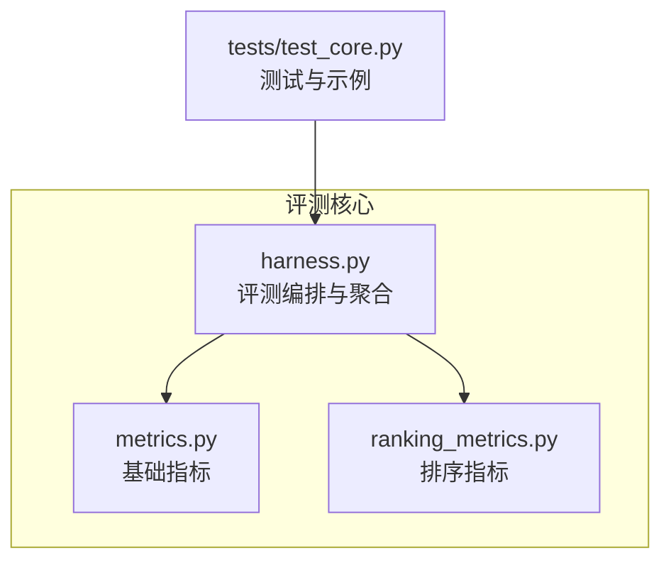
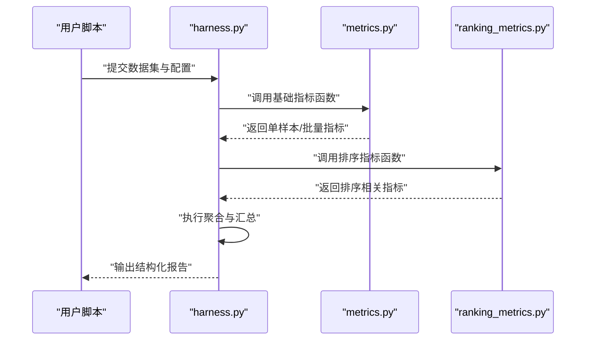
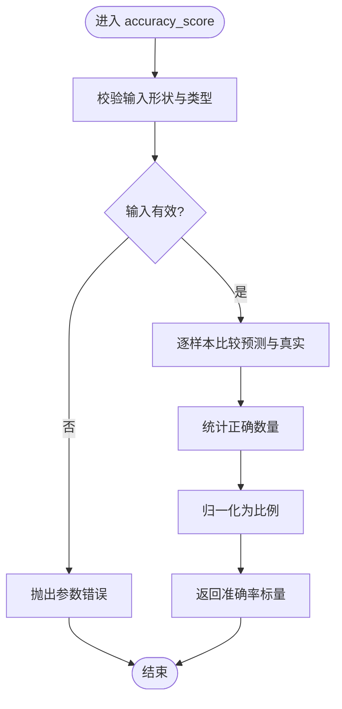
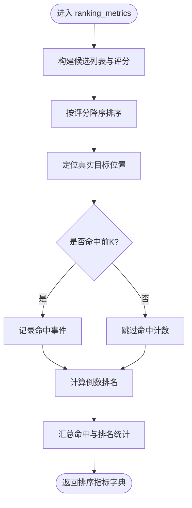
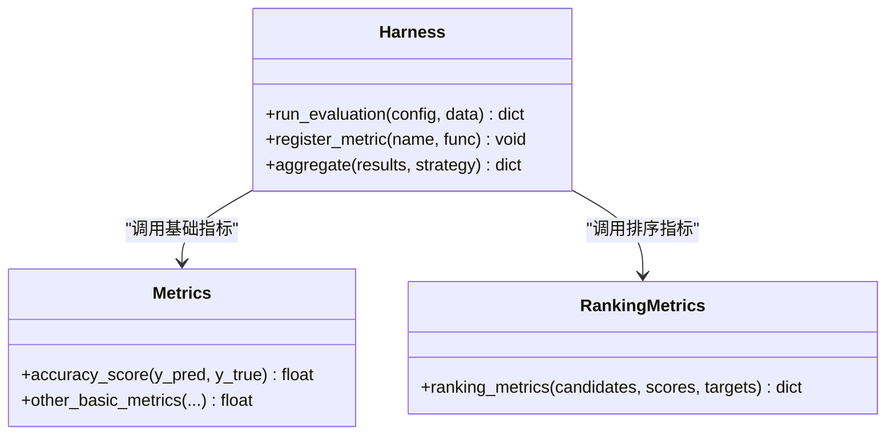
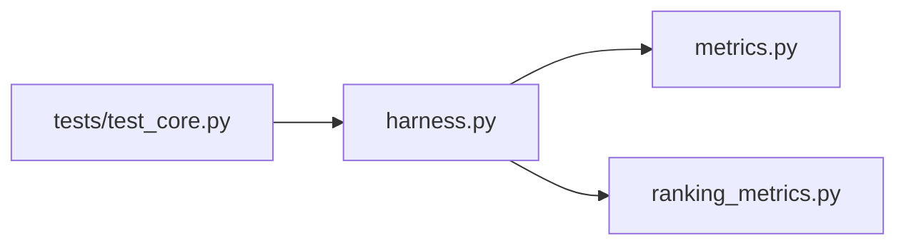
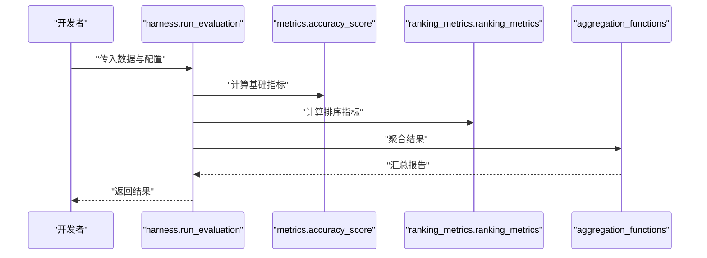

# 指标计算API

<cite>
**本文引用的文件**   
- [autonomy_mvp/core/metrics.py](file://autonomy_mvp/core/metrics.py)
- [autonomy_mvp/core/ranking_metrics.py](file://autonomy_mvp/core/ranking_metrics.py)
- [autonomy_mvp/core/harness.py](file://autonomy_mvp/core/harness.py)
- [autonomy_mvp/tests/test_core.py](file://autonomy_mvp/tests/test_core.py)
</cite>

## 目录
1. [简介](#简介)
2. [项目结构](#项目结构)
3. [核心组件](#核心组件)
4. [架构总览](#架构总览)
5. [详细组件分析](#详细组件分析)
6. [依赖关系分析](#依赖关系分析)
7. [性能考量](#性能考量)
8. [故障排查指南](#故障排查指南)
9. [结论](#结论)
10. [附录](#附录)

## 简介
本文件为“指标计算系统 Metrics”的API参考文档，聚焦以下能力：
- 分类准确率等基础评估指标接口（如 accuracy_score）
- 排序与检索类评估指标（ranking_metrics）
- 聚合函数与汇总统计（aggregation_functions）
- 统计计算方法、输出格式说明
- 自定义指标开发指南与集成示例
- 性能指标、业务指标与复合指标的完整使用案例

目标读者包括算法工程师、评测平台开发者以及需要构建可复现实验流程的研究人员。

## 项目结构
与指标计算相关的核心代码位于 autonomy_mvp/core 目录下，主要包含：
- metrics.py：通用指标实现（如准确率等）
- ranking_metrics.py：排序/检索相关指标
- harness.py：评测编排与结果聚合入口
- tests/test_core.py：单元测试与用法示例

图表来源
- [autonomy_mvp/core/metrics.py](file://autonomy_mvp/core/metrics.py)
- [autonomy_mvp/core/ranking_metrics.py](file://autonomy_mvp/core/ranking_metrics.py)
- [autonomy_mvp/core/harness.py](file://autonomy_mvp/core/harness.py)
- [autonomy_mvp/tests/test_core.py](file://autonomy_mvp/tests/test_core.py)

章节来源
- [autonomy_mvp/core/metrics.py](file://autonomy_mvp/core/metrics.py)
- [autonomy_mvp/core/ranking_metrics.py](file://autonomy_mvp/core/ranking_metrics.py)
- [autonomy_mvp/core/harness.py](file://autonomy_mvp/core/harness.py)
- [autonomy_mvp/tests/test_core.py](file://autonomy_mvp/tests/test_core.py)

## 核心组件
本节概述三大模块的职责与对外暴露的主要接口类型：
- 基础指标（metrics.py）
  - 提供常见分类/回归/匹配类指标的计算函数，例如准确率等
  - 输入通常为预测值与真实标签，返回标量或数组
- 排序指标（ranking_metrics.py）
  - 提供针对排序/检索场景的指标，如命中率、平均倒数排名等
  - 输入多为候选列表、评分或排序位置
- 聚合函数（harness.py）
  - 提供跨任务/跨样本的统计聚合能力，如均值、方差、分位数等
  - 支持将多个子任务的指标汇总为统一报告

章节来源
- [autonomy_mvp/core/metrics.py](file://autonomy_mvp/core/metrics.py)
- [autonomy_mvp/core/ranking_metrics.py](file://autonomy_mvp/core/ranking_metrics.py)
- [autonomy_mvp/core/harness.py](file://autonomy_mvp/core/harness.py)

## 架构总览
评测流程从 harness 编排开始，调用具体指标函数完成计算，最终通过聚合函数生成报告。

图表来源
- [autonomy_mvp/core/harness.py](file://autonomy_mvp/core/harness.py)
- [autonomy_mvp/core/metrics.py](file://autonomy_mvp/core/metrics.py)
- [autonomy_mvp/core/ranking_metrics.py](file://autonomy_mvp/core/ranking_metrics.py)

## 详细组件分析

### 基础指标模块（metrics.py）
- 职责
  - 实现常用分类/回归/匹配类指标，如准确率等
  - 提供统一的输入校验与数值处理逻辑
- 关键接口
  - accuracy_score()：计算分类准确率
    - 输入：预测标签、真实标签
    - 输出：标量准确率
  - 其他基础指标：根据实际实现扩展（如精确率、召回率、F1、均方误差等）
- 数据流
  - 输入验证 → 数值对齐 → 逐样本比较/误差计算 → 聚合为标量
- 错误处理
  - 维度不一致、空输入、非法数据类型时抛出明确异常
- 性能特性
  - 向量化计算优先；对大规模数据建议批量传入以减少开销

图表来源
- [autonomy_mvp/core/metrics.py](file://autonomy_mvp/core/metrics.py)

章节来源
- [autonomy_mvp/core/metrics.py](file://autonomy_mvp/core/metrics.py)

### 排序指标模块（ranking_metrics.py）
- 职责
  - 面向排序/检索场景的指标计算，如命中率、平均倒数排名等
- 关键接口
  - ranking_metrics()：综合排序指标计算
    - 输入：候选集、评分或排序位置、真实目标
    - 输出：多项排序指标（命中、倒数排名等）
- 数据流
  - 构造候选序列 → 依据评分或位置排序 → 定位真实目标 → 计算命中与排名统计
- 错误处理
  - 候选为空、重复元素、缺失真实目标时的边界处理
- 性能特性
  - 排序复杂度 O(n log n)，对大规模候选集建议预过滤或近似策略

图表来源
- [autonomy_mvp/core/ranking_metrics.py](file://autonomy_mvp/core/ranking_metrics.py)

章节来源
- [autonomy_mvp/core/ranking_metrics.py](file://autonomy_mvp/core/ranking_metrics.py)

### 聚合与编排模块（harness.py）
- 职责
  - 编排评测流程，组合基础指标与排序指标，进行跨任务/跨样本聚合
- 关键接口
  - aggregation_functions()：提供多种聚合方式（均值、方差、分位数、加权平均等）
  - run_evaluation()：端到端评测入口，加载数据、调用指标、输出报告
- 数据流
  - 读取任务配置 → 遍历样本/任务 → 调用指标函数 → 收集中间结果 → 聚合输出
- 输出格式
  - 结构化字典/表格，包含各指标名称、数值、单位与置信区间（可选）
- 错误处理
  - 任务缺失、指标未注册、聚合键冲突时的回退策略与日志提示

图表来源
- [autonomy_mvp/core/harness.py](file://autonomy_mvp/core/harness.py)
- [autonomy_mvp/core/metrics.py](file://autonomy_mvp/core/metrics.py)
- [autonomy_mvp/core/ranking_metrics.py](file://autonomy_mvp/core/ranking_metrics.py)

章节来源
- [autonomy_mvp/core/harness.py](file://autonomy_mvp/core/harness.py)

## 依赖关系分析
- 内部依赖
  - harness.py 依赖 metrics.py 与 ranking_metrics.py 提供的指标函数
  - tests/test_core.py 依赖上述模块以验证行为与边界条件
- 外部依赖
  - 数值计算库（如 numpy/pandas）用于向量化与聚合
  - 可选可视化库（如 matplotlib/seaborn）用于报告渲染（若存在）

图表来源
- [autonomy_mvp/tests/test_core.py](file://autonomy_mvp/tests/test_core.py)
- [autonomy_mvp/core/harness.py](file://autonomy_mvp/core/harness.py)
- [autonomy_mvp/core/metrics.py](file://autonomy_mvp/core/metrics.py)
- [autonomy_mvp/core/ranking_metrics.py](file://autonomy_mvp/core/ranking_metrics.py)

章节来源
- [autonomy_mvp/tests/test_core.py](file://autonomy_mvp/tests/test_core.py)
- [autonomy_mvp/core/harness.py](file://autonomy_mvp/core/harness.py)

## 性能考量
- 向量化与批处理
  - 尽量使用向量化操作减少循环开销
  - 对大批量数据采用分块处理以降低内存峰值
- 排序优化
  - 在候选集较大时考虑近似排序或阈值预筛
- 缓存与复用
  - 对重复计算的中间结果进行缓存（如特征提取、相似度矩阵）
- I/O与序列化
  - 避免频繁磁盘读写，必要时使用高效格式（如 parquet）

[本节为通用指导，不直接分析具体文件]

## 故障排查指南
- 常见问题
  - 输入维度不一致：检查预测与真实标签的形状与长度
  - 空候选/空标签：确保数据清洗与预处理步骤完备
  - 指标未注册：确认 harness 中已正确注册并命名
- 调试建议
  - 打印中间结果（如排序位置、命中标记）
  - 使用最小可复现样例逐步定位问题
  - 开启详细日志以便追踪调用链

章节来源
- [autonomy_mvp/tests/test_core.py](file://autonomy_mvp/tests/test_core.py)
- [autonomy_mvp/core/harness.py](file://autonomy_mvp/core/harness.py)

## 结论
本API围绕基础指标、排序指标与聚合编排三大模块构建，提供清晰的数据流与可扩展的接口设计。通过合理的输入校验、错误处理与性能优化，可满足多场景下的评测需求。建议结合测试用例与最小样例快速上手，并在生产环境中关注大数据量的性能与稳定性。

[本节为总结性内容，不直接分析具体文件]

## 附录

### API参考速览
- 基础指标
  - accuracy_score(y_pred, y_true) → float
- 排序指标
  - ranking_metrics(candidates, scores, targets) → dict
- 聚合函数
  - aggregation_functions(results, strategy) → dict
- 编排入口
  - run_evaluation(config, data) → dict

章节来源
- [autonomy_mvp/core/metrics.py](file://autonomy_mvp/core/metrics.py)
- [autonomy_mvp/core/ranking_metrics.py](file://autonomy_mvp/core/ranking_metrics.py)
- [autonomy_mvp/core/harness.py](file://autonomy_mvp/core/harness.py)

### 自定义指标开发指南
- 步骤
  - 定义函数签名：接受必要输入（如预测、真实标签、元数据），返回标量或字典
  - 实现输入校验与数值处理，保证鲁棒性
  - 在 harness 中注册新指标，指定名称与默认参数
  - 编写单元测试覆盖正常路径与边界情况
- 最佳实践
  - 保持幂等性与无副作用
  - 提供清晰的文档与示例
  - 对耗时计算提供缓存或并行选项

章节来源
- [autonomy_mvp/core/harness.py](file://autonomy_mvp/core/harness.py)
- [autonomy_mvp/tests/test_core.py](file://autonomy_mvp/tests/test_core.py)

### 集成示例（概念流程）
- 加载数据与配置
- 调用 run_evaluation 启动评测
- 获取结构化报告并进行可视化或导出
- 根据需要扩展指标与聚合策略

图表来源
- [autonomy_mvp/core/harness.py](file://autonomy_mvp/core/harness.py)
- [autonomy_mvp/core/metrics.py](file://autonomy_mvp/core/metrics.py)
- [autonomy_mvp/core/ranking_metrics.py](file://autonomy_mvp/core/ranking_metrics.py)

### 使用案例
- 性能指标
  - 使用 accuracy_score 评估分类模型整体表现
  - 使用 ranking_metrics 评估检索/推荐系统的命中率与倒数排名
- 业务指标
  - 基于领域规则定义业务指标函数，并通过 harness 注册与聚合
- 复合指标
  - 组合多个基础与排序指标，利用 aggregation_functions 进行加权或分层汇总

章节来源
- [autonomy_mvp/core/metrics.py](file://autonomy_mvp/core/metrics.py)
- [autonomy_mvp/core/ranking_metrics.py](file://autonomy_mvp/core/ranking_metrics.py)
- [autonomy_mvp/core/harness.py](file://autonomy_mvp/core/harness.py)