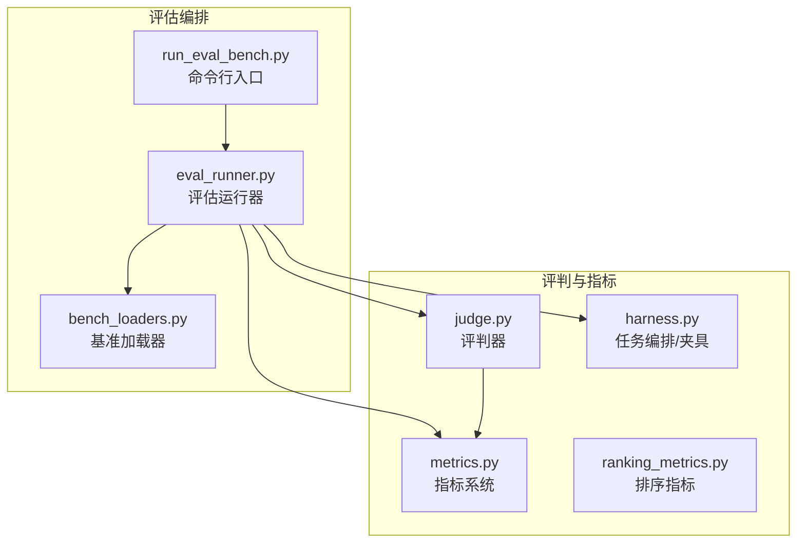
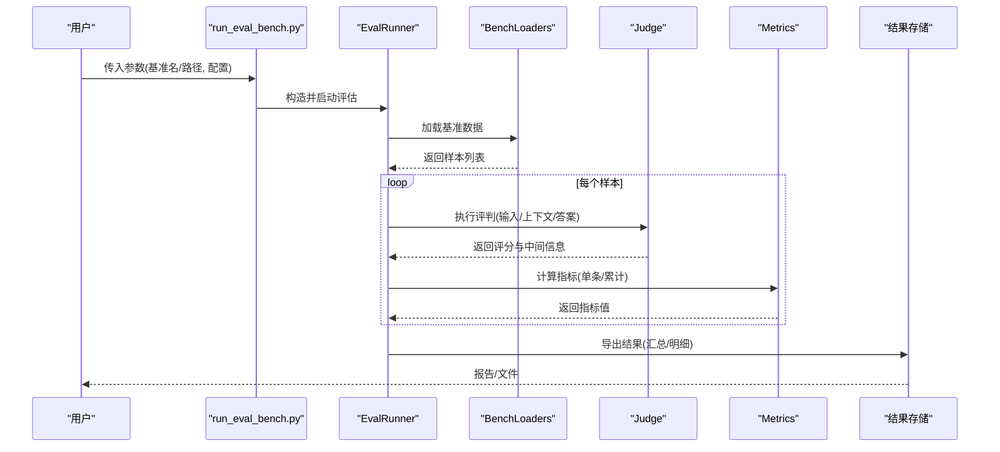
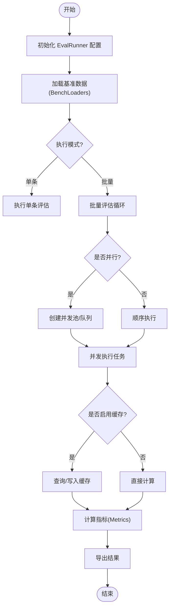
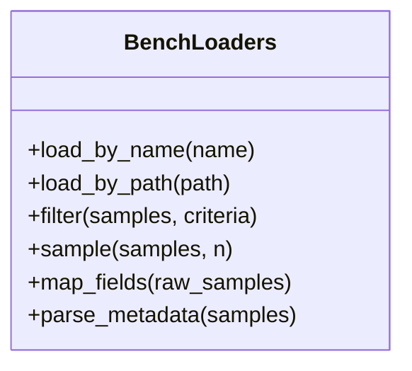
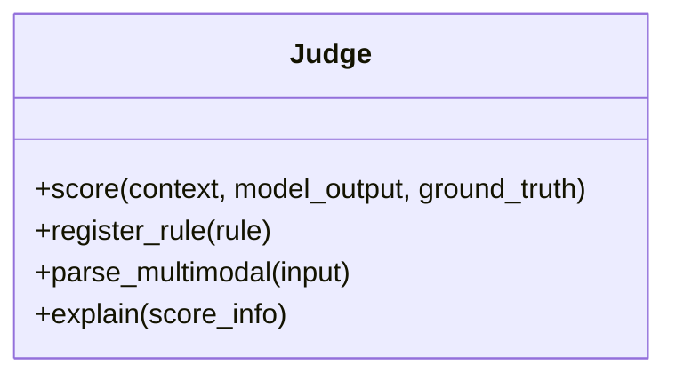
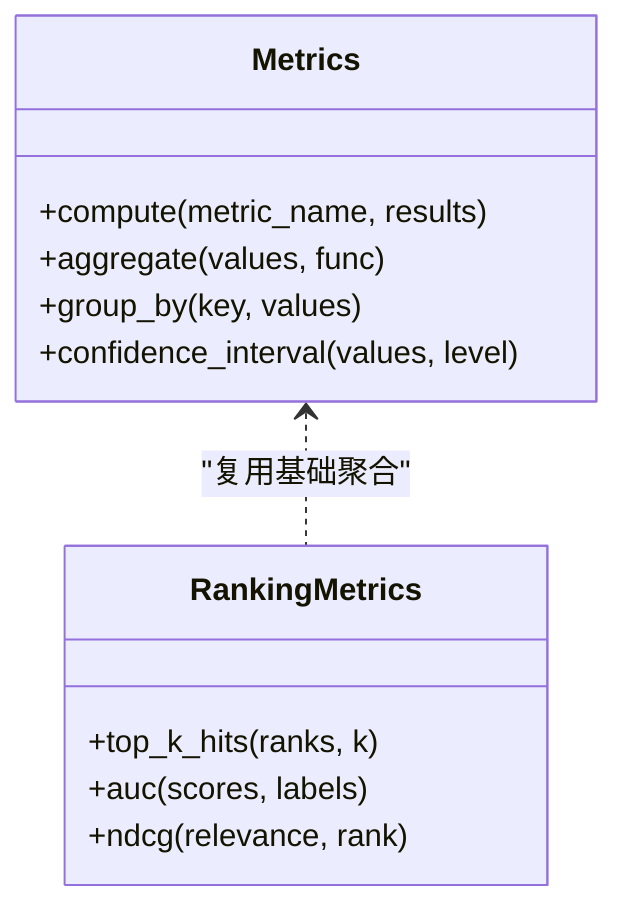
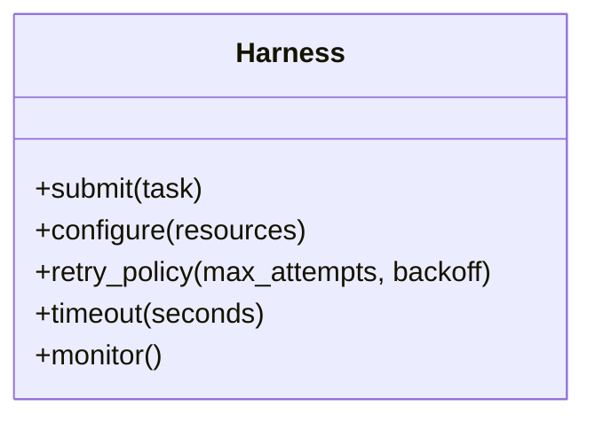
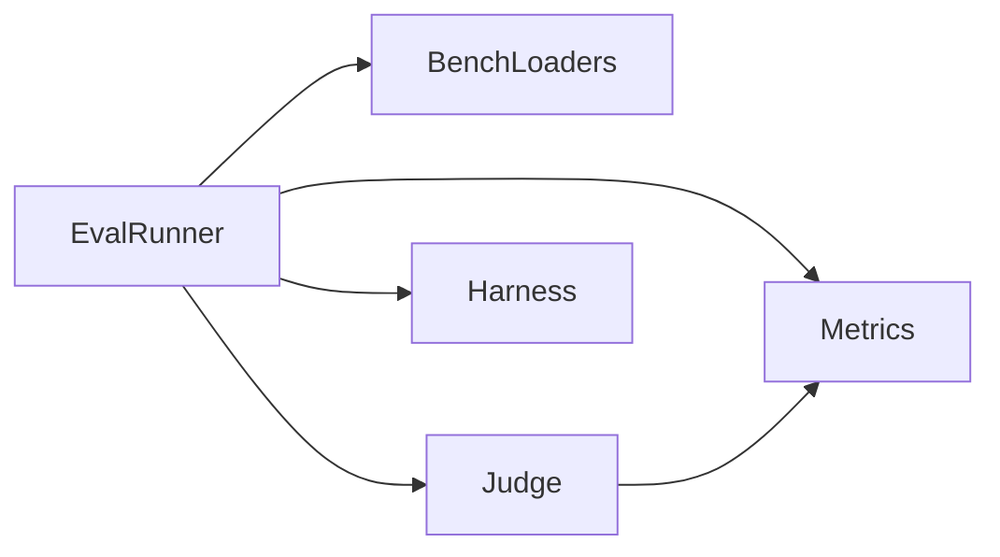

# 评估系统API

<cite>
**本文引用的文件**   
- [eval_runner.py](file://docs/prd/molbench_repo/eval/eval_runner.py)
- [bench_loaders.py](file://docs/prd/molbench_repo/eval/bench_loaders.py)
- [run_eval_bench.py](file://docs/prd/molbench_repo/eval/run_eval_bench.py)
- [judge.py](file://autonomy_mvp/core/judge.py)
- [metrics.py](file://autonomy_mvp/core/metrics.py)
- [ranking_metrics.py](file://autonomy_mvp/core/ranking_metrics.py)
- [harness.py](file://autonomy_mvp/core/harness.py)
</cite>

## 目录
1. [简介](#简介)
2. [项目结构](#项目结构)
3. [核心组件](#核心组件)
4. [架构总览](#架构总览)
5. [详细组件分析](#详细组件分析)
6. [依赖关系分析](#依赖关系分析)
7. [性能考虑](#性能考虑)
8. [故障排查指南](#故障排查指南)
9. [结论](#结论)
10. [附录](#附录)

## 简介
本文件为评估系统的API参考文档，面向需要运行基准测试、自定义评判规则与指标计算的用户。文档覆盖以下关键能力：
- 评估运行器 EvalRunner 的方法与配置项
- 基准加载器 BenchLoaders 的数据获取接口
- 评判器 Judge 的智能评分算法、多模态评估逻辑与自定义评判规则
- 指标系统 Metrics 的评估指标实现、聚合函数与统计方法
- 批量评估、并行执行、结果缓存等高级功能的API使用示例
- 错误处理、性能监控与结果导出接口

## 项目结构
评估相关代码主要分布在两个子系统中：
- docs/prd/molbench_repo/eval：评估编排与数据加载（EvalRunner、BenchLoaders、CLI入口）
- autonomy_mvp/core：评判与指标（Judge、Metrics、Ranking Metrics、Harnes）

图表来源
- [eval_runner.py](file://docs/prd/molbench_repo/eval/eval_runner.py)
- [bench_loaders.py](file://docs/prd/molbench_repo/eval/bench_loaders.py)
- [run_eval_bench.py](file://docs/prd/molbench_repo/eval/run_eval_bench.py)
- [judge.py](file://autonomy_mvp/core/judge.py)
- [metrics.py](file://autonomy_mvp/core/metrics.py)
- [ranking_metrics.py](file://autonomy_mvp/core/ranking_metrics.py)
- [harness.py](file://autonomy_mvp/core/harness.py)

章节来源
- [eval_runner.py](file://docs/prd/molbench_repo/eval/eval_runner.py)
- [bench_loaders.py](file://docs/prd/molbench_repo/eval/bench_loaders.py)
- [run_eval_bench.py](file://docs/prd/molbench_repo/eval/run_eval_bench.py)
- [judge.py](file://autonomy_mvp/core/judge.py)
- [metrics.py](file://autonomy_mvp/core/metrics.py)
- [ranking_metrics.py](file://autonomy_mvp/core/ranking_metrics.py)
- [harness.py](file://autonomy_mvp/core/harness.py)

## 核心组件
本节概述各核心组件的职责与对外暴露的主要接口，便于快速定位API。

- 评估运行器 EvalRunner
  - 负责加载基准数据集、调度任务执行、调用评判器与指标系统、汇总与导出结果。
  - 典型方法包括：初始化配置、加载基准、单条/批量评估、并行执行、结果缓存、导出报告。
  - 配置项通常包含：工作目录、日志级别、并发度、缓存开关、输出格式等。

- 基准加载器 BenchLoaders
  - 提供统一的数据读取接口，支持多种数据源（JSON/CSV/JSONL等）。
  - 典型方法包括：按名称或路径加载、过滤与采样、字段映射、元数据解析。

- 评判器 Judge
  - 封装智能评分算法与多模态评估逻辑，支持自定义评判规则扩展。
  - 典型方法包括：评分入口、规则注册、多模态输入解析、置信度/可解释性输出。

- 指标系统 Metrics
  - 提供常用评估指标的实现与聚合函数，支持统计方法与分组统计。
  - 典型方法包括：指标计算、聚合（均值/方差/分位数）、排名指标、可视化辅助。

- 任务编排 Harness
  - 提供任务生命周期管理、资源隔离、重试与超时控制等通用能力。

章节来源
- [eval_runner.py](file://docs/prd/molbench_repo/eval/eval_runner.py)
- [bench_loaders.py](file://docs/prd/molbench_repo/eval/bench_loaders.py)
- [judge.py](file://autonomy_mvp/core/judge.py)
- [metrics.py](file://autonomy_mvp/core/metrics.py)
- [ranking_metrics.py](file://autonomy_mvp/core/ranking_metrics.py)
- [harness.py](file://autonomy_mvp/core/harness.py)

## 架构总览
下图展示了从命令行到数据加载、评估执行、评判与指标计算的端到端流程。

图表来源
- [run_eval_bench.py](file://docs/prd/molbench_repo/eval/run_eval_bench.py)
- [eval_runner.py](file://docs/prd/molbench_repo/eval/eval_runner.py)
- [bench_loaders.py](file://docs/prd/molbench_repo/eval/bench_loaders.py)
- [judge.py](file://autonomy_mvp/core/judge.py)
- [metrics.py](file://autonomy_mvp/core/metrics.py)

## 详细组件分析

### 评估运行器 EvalRunner
- 职责
  - 协调数据加载、任务执行、评判与指标计算、结果持久化。
  - 提供批量与并行执行能力，支持结果缓存以减少重复计算。
- 关键方法（概念性描述）
  - 初始化：接收配置对象（如工作目录、日志、并发度、缓存策略、输出格式）。
  - 加载基准：通过 BenchLoaders 获取样本集合。
  - 单条评估：对单个样本执行“准备输入→调用评判→计算指标→记录结果”。
  - 批量评估：遍历样本集，支持顺序或并行模式。
  - 并行执行：基于线程/进程池或异步队列进行并发控制。
  - 结果缓存：以样本标识为键，缓存评分与指标结果，避免重复计算。
  - 导出报告：将明细与汇总写入文件或数据库。
- 配置选项（常见项）
  - 工作目录、日志级别、并发度、缓存开关、缓存TTL、输出路径、输出格式（JSON/CSV/Markdown）。
- 使用示例（步骤说明）
  - 构建配置对象并实例化 EvalRunner。
  - 指定基准名称或数据路径，调用加载方法。
  - 选择单条或批量评估；如需并行，设置并发度。
  - 启用缓存后，相同输入可直接命中缓存。
  - 完成后导出结果至目标路径。

图表来源
- [eval_runner.py](file://docs/prd/molbench_repo/eval/eval_runner.py)
- [bench_loaders.py](file://docs/prd/molbench_repo/eval/bench_loaders.py)
- [metrics.py](file://autonomy_mvp/core/metrics.py)

章节来源
- [eval_runner.py](file://docs/prd/molbench_repo/eval/eval_runner.py)

### 基准加载器 BenchLoaders
- 职责
  - 统一数据接入层，屏蔽不同数据源的差异，提供稳定的迭代与查询接口。
- 关键方法（概念性描述）
  - 按名称加载：根据基准名解析到对应数据位置。
  - 按路径加载：直接从本地/远程路径读取数据。
  - 过滤与采样：按条件筛选样本、随机采样固定数量。
  - 字段映射：将原始字段映射为模型/评判所需的标准化结构。
  - 元数据解析：提取任务类型、难度、标签等元信息。
- 数据格式支持
  - JSON/JSONL/CSV 等常见结构化格式。
- 使用示例（步骤说明）
  - 选择加载方式（名称或路径）。
  - 可选地应用过滤与采样策略。
  - 获取标准化后的样本列表供 EvalRunner 使用。

图表来源
- [bench_loaders.py](file://docs/prd/molbench_repo/eval/bench_loaders.py)

章节来源
- [bench_loaders.py](file://docs/prd/molbench_repo/eval/bench_loaders.py)

### 评判器 Judge
- 职责
  - 实现智能评分算法，支持多模态输入（文本、图像、表格等），并提供自定义评判规则的扩展点。
- 关键方法（概念性描述）
  - 评分入口：接收样本上下文、模型输出与参考答案，返回分数与解释。
  - 规则注册：动态注册新的评判规则或权重组合。
  - 多模态解析：解析并融合多模态输入特征。
  - 置信度与可解释性：输出评分置信度、关键依据与失败原因。
- 自定义评判规则
  - 通过规则接口或装饰器机制扩展新规则，并在配置中启用。
- 使用示例（步骤说明）
  - 初始化 Judge 并注册所需规则。
  - 调用评分接口，传入标准化后的输入与输出。
  - 获取评分结果与解释信息，用于后续指标计算。

图表来源
- [judge.py](file://autonomy_mvp/core/judge.py)

章节来源
- [judge.py](file://autonomy_mvp/core/judge.py)

### 指标系统 Metrics
- 职责
  - 提供丰富的评估指标实现、聚合函数与统计方法，支持分组与排名指标。
- 关键方法（概念性描述）
  - 指标计算：针对单条或批量结果计算具体指标值。
  - 聚合函数：均值、方差、标准差、分位数、最大值/最小值等。
  - 统计方法：置信区间估计、显著性检验（若实现）。
  - 排名指标：Top-K命中率、AUC、NDCG等（见 ranking_metrics）。
- 使用示例（步骤说明）
  - 在 EvalRunner 中按需调用指标计算。
  - 对多轮或分组结果进行聚合统计。
  - 导出指标摘要与明细。

图表来源
- [metrics.py](file://autonomy_mvp/core/metrics.py)
- [ranking_metrics.py](file://autonomy_mvp/core/ranking_metrics.py)

章节来源
- [metrics.py](file://autonomy_mvp/core/metrics.py)
- [ranking_metrics.py](file://autonomy_mvp/core/ranking_metrics.py)

### 任务编排 Harness
- 职责
  - 提供任务生命周期管理、资源隔离、重试与超时控制等通用能力，支撑稳定评估。
- 关键方法（概念性描述）
  - 任务提交：将评估任务加入队列。
  - 资源管理：限制并发、分配内存/CPU/GPU资源。
  - 重试与超时：对失败任务进行自动重试与超时中断。
- 使用示例（步骤说明）
  - 在 EvalRunner 内部通过 Harness 管理任务执行。
  - 配置重试次数与超时阈值，确保鲁棒性。

图表来源
- [harness.py](file://autonomy_mvp/core/harness.py)

章节来源
- [harness.py](file://autonomy_mvp/core/harness.py)

## 依赖关系分析
- 模块耦合
  - EvalRunner 依赖 BenchLoaders、Judge、Metrics 与 Harness，形成“编排中心”角色。
  - Judge 可能依赖外部模型或服务，但通过接口抽象降低耦合。
  - Metrics 与 RankingMetrics 共享基础聚合能力，保持高内聚。
- 外部依赖
  - 数据IO（JSON/CSV/JSONL）、并发库（线程/进程/异步）、文件系统与可能的网络访问。
- 潜在循环依赖
  - 当前设计通过分层与接口解耦，未见明显循环依赖风险。

图表来源
- [eval_runner.py](file://docs/prd/molbench_repo/eval/eval_runner.py)
- [bench_loaders.py](file://docs/prd/molbench_repo/eval/bench_loaders.py)
- [judge.py](file://autonomy_mvp/core/judge.py)
- [metrics.py](file://autonomy_mvp/core/metrics.py)
- [harness.py](file://autonomy_mvp/core/harness.py)

章节来源
- [eval_runner.py](file://docs/prd/molbench_repo/eval/eval_runner.py)
- [bench_loaders.py](file://docs/prd/molbench_repo/eval/bench_loaders.py)
- [judge.py](file://autonomy_mvp/core/judge.py)
- [metrics.py](file://autonomy_mvp/core/metrics.py)
- [harness.py](file://autonomy_mvp/core/harness.py)

## 性能考虑
- 并发与并行
  - 合理设置并发度，避免I/O或外部服务限流导致的阻塞。
  - 对于CPU密集型指标计算，优先使用进程池；对于I/O密集，优先使用线程或异步。
- 结果缓存
  - 启用缓存可减少重复计算，注意缓存键的唯一性与失效策略（TTL）。
- 批大小与内存
  - 大样本批量处理时，采用分块读取与增量聚合，避免内存峰值过高。
- 指标计算优化
  - 对高频指标进行向量化或近似计算，减少重复遍历。
- 监控与埋点
  - 记录关键耗时、吞吐与错误率，便于定位瓶颈。

[本节为通用指导，不直接分析具体文件]

## 故障排查指南
- 常见问题
  - 数据加载失败：检查路径权限、文件格式与字段映射。
  - 评判异常：确认输入格式是否符合多模态解析要求，查看 Judge 的解释输出。
  - 指标计算错误：核对数值范围与缺失值处理策略。
  - 并发问题：观察锁竞争、死锁与资源耗尽情况，调整并发度与超时。
- 调试建议
  - 开启详细日志，定位失败样本与堆栈。
  - 使用小样本验证流水线，逐步放大规模。
  - 利用缓存关闭模式对比，判断是否为缓存一致性问题。
- 恢复策略
  - 对失败任务启用重试与退避策略。
  - 断点续跑：基于已导出结果跳过已完成样本。

章节来源
- [eval_runner.py](file://docs/prd/molbench_repo/eval/eval_runner.py)
- [judge.py](file://autonomy_mvp/core/judge.py)
- [metrics.py](file://autonomy_mvp/core/metrics.py)
- [harness.py](file://autonomy_mvp/core/harness.py)

## 结论
本评估系统通过 EvalRunner 作为编排中心，结合 BenchLoaders 的数据接入、Judge 的智能评判与 Metrics 的指标体系，提供了可扩展、高性能且易于使用的评估能力。借助批量与并行执行、结果缓存与完善的错误处理与监控，可满足多样化评测场景的需求。

[本节为总结性内容，不直接分析具体文件]

## 附录
- 命令行入口 run_eval_bench.py
  - 提供便捷的一键评估入口，支持传入基准名、路径、配置与输出选项。
  - 适合快速验证与自动化集成。

章节来源
- [run_eval_bench.py](file://docs/prd/molbench_repo/eval/run_eval_bench.py)