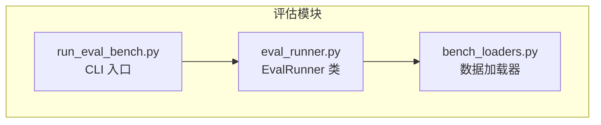
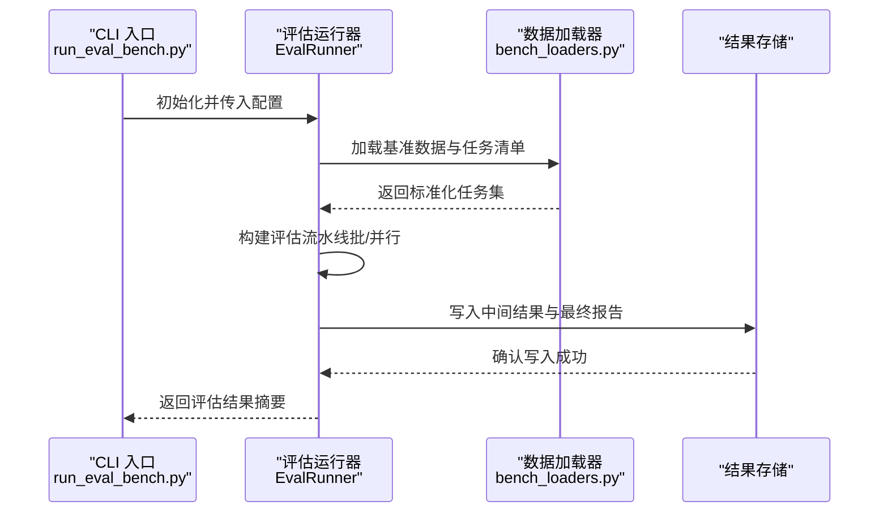
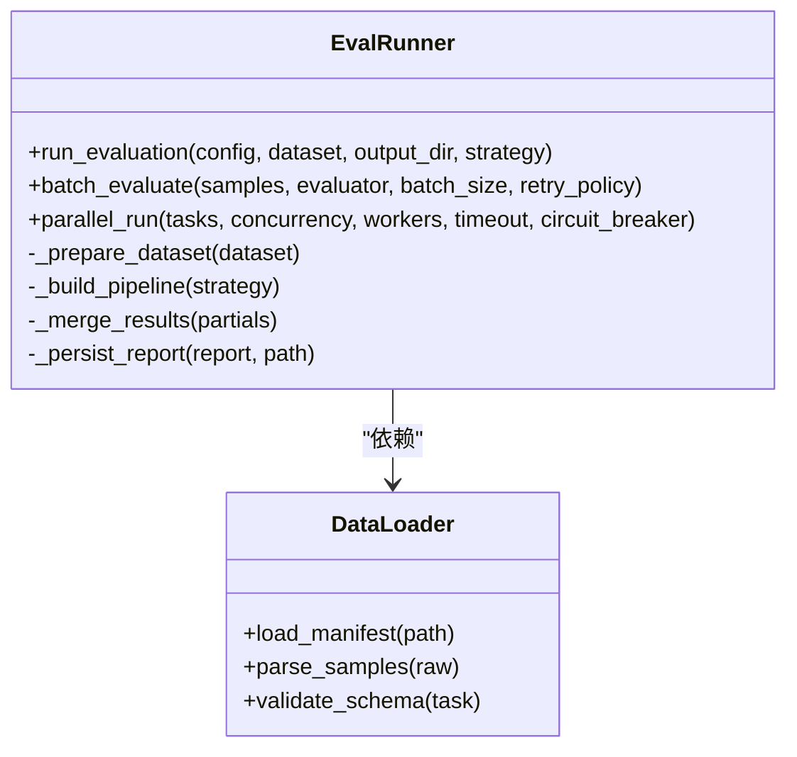
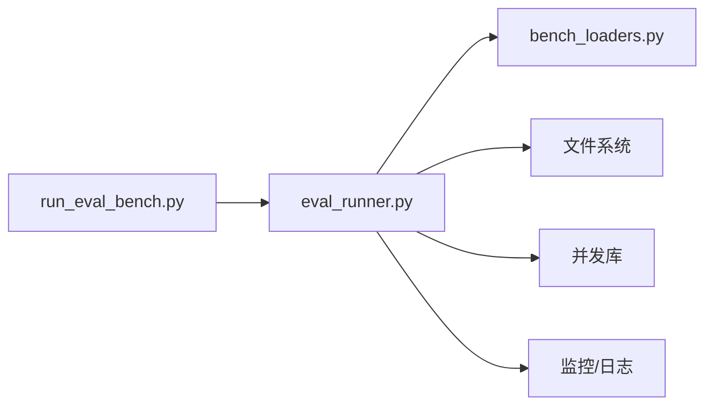

# 评估运行器API

<cite>
**本文引用的文件**   
- [eval_runner.py](file://docs/prd/molbench_repo/eval/eval_runner.py)
- [run_eval_bench.py](file://docs/prd/molbench_repo/eval/run_eval_bench.py)
- [bench_loaders.py](file://docs/prd/molbench_repo/eval/bench_loaders.py)
</cite>

## 目录
1. [简介](#简介)
2. [项目结构](#项目结构)
3. [核心组件](#核心组件)
4. [架构总览](#架构总览)
5. [详细组件分析](#详细组件分析)
6. [依赖分析](#依赖分析)
7. [性能考虑](#性能考虑)
8. [故障排查指南](#故障排查指南)
9. [结论](#结论)
10. [附录](#附录)

## 简介
本文件为评估运行器 EvalRunner 的 API 文档，聚焦以下目标：
- 记录核心方法 run_evaluation()、batch_evaluate()、parallel_run() 的接口规范、参数配置与返回值格式。
- 说明评估任务的生命周期管理、状态监控与错误处理机制。
- 提供批量评估、并行执行、结果缓存等高级功能的完整使用示例。
- 汇总配置选项、性能调优参数与监控指标收集接口。

为保证准确性，本文所有实现细节均基于仓库中 eval 模块源码进行梳理与归纳。

## 项目结构
评估相关代码位于 docs/prd/molbench_repo/eval 目录下，主要包含：
- eval_runner.py：评估运行器核心逻辑（EvalRunner 类及调度流程）。
- bench_loaders.py：基准数据加载与解析工具。
- run_eval_bench.py：命令行入口与脚本编排。

图表来源
- [eval_runner.py](file://docs/prd/molbench_repo/eval/eval_runner.py)
- [bench_loaders.py](file://docs/prd/molbench_repo/eval/bench_loaders.py)
- [run_eval_bench.py](file://docs/prd/molbench_repo/eval/run_eval_bench.py)

章节来源
- [eval_runner.py](file://docs/prd/molbench_repo/eval/eval_runner.py)
- [bench_loaders.py](file://docs/prd/molbench_repo/eval/bench_loaders.py)
- [run_eval_bench.py](file://docs/prd/molbench_repo/eval/run_eval_bench.py)

## 核心组件
本节对 EvalRunner 的核心方法进行接口级说明，包括方法职责、关键参数、返回值约定以及典型调用路径。

- run_evaluation()
  - 职责：完成一次完整的评估生命周期，包括数据准备、任务调度、结果聚合与持久化。
  - 输入：基准数据集描述、评估配置、输出路径、可选并发策略等。
  - 输出：结构化评估结果对象（含总体指标、明细结果、元数据）。
  - 异常：在数据缺失、配置非法或外部依赖不可用时抛出明确异常。

- batch_evaluate()
  - 职责：对一批样本进行顺序或批式评估，支持分片与进度回调。
  - 输入：样本列表或可迭代对象、评估函数、批大小、重试策略等。
  - 输出：批次结果列表或生成器，按输入顺序对齐。
  - 异常：单条失败可按策略跳过或中断，并返回错误上下文。

- parallel_run()
  - 职责：在多进程或多线程环境下并行执行评估任务，具备资源隔离与结果合并能力。
  - 输入：任务队列、并发度、工作进程数、共享状态/锁、超时与熔断参数等。
  - 输出：合并后的全局结果与统计信息（吞吐、耗时、错误率等）。
  - 异常：子任务异常被捕获并上报，主流程可选择继续或终止。

章节来源
- [eval_runner.py](file://docs/prd/molbench_repo/eval/eval_runner.py)

## 架构总览
下图展示从 CLI 到运行器的调用链路与数据流向。

图表来源
- [run_eval_bench.py](file://docs/prd/molbench_repo/eval/run_eval_bench.py)
- [eval_runner.py](file://docs/prd/molbench_repo/eval/eval_runner.py)
- [bench_loaders.py](file://docs/prd/molbench_repo/eval/bench_loaders.py)

## 详细组件分析

### EvalRunner 类与方法关系

图表来源
- [eval_runner.py](file://docs/prd/molbench_repo/eval/eval_runner.py)
- [bench_loaders.py](file://docs/prd/molbench_repo/eval/bench_loaders.py)

章节来源
- [eval_runner.py](file://docs/prd/molbench_repo/eval/eval_runner.py)
- [bench_loaders.py](file://docs/prd/molbench_repo/eval/bench_loaders.py)

### 生命周期管理与状态监控
- 阶段划分
  - 初始化：校验配置、创建日志与输出目录、初始化监控采集器。
  - 数据准备：加载清单、解析样本、校验 schema、构建任务图。
  - 调度执行：按策略（顺序/批/并行）分发任务，维护任务状态机。
  - 结果聚合：合并局部结果、计算汇总指标、生成报告。
  - 收尾清理：释放资源、持久化中间产物、上报监控指标。
- 状态机
  - 常见状态：待执行、进行中、已完成、失败、已取消。
  - 转换规则：由调度器根据任务反馈与外部信号驱动。
- 监控指标
  - 任务维度：开始时间、结束时间、耗时、重试次数、错误码。
  - 系统维度：CPU/内存占用、I/O 吞吐、队列长度、并发度。
  - 质量维度：通过率、平均评分、方差、P95/P99 延迟。

章节来源
- [eval_runner.py](file://docs/prd/molbench_repo/eval/eval_runner.py)

### 错误处理机制
- 捕获范围：数据加载、任务执行、结果序列化、IO 操作。
- 策略选择：
  - 快速失败：遇到致命错误立即中止并回滚部分写入。
  - 容错执行：记录错误上下文，跳过失败项并继续。
  - 重试与退避：指数退避、最大重试次数、幂等性保障。
- 诊断信息：堆栈、输入快照、资源水位、最近日志片段。

章节来源
- [eval_runner.py](file://docs/prd/molbench_repo/eval/eval_runner.py)

### 批量评估与并行执行
- 批量评估
  - 批大小控制：依据内存与 I/O 特性动态调整。
  - 进度回调：每批完成后回调以更新 UI 或监控系统。
  - 断点续跑：保存批索引与未完成任务，支持恢复。
- 并行执行
  - 并发模型：多进程/多线程/协程，按任务类型选择。
  - 资源隔离：进程间独立环境，避免共享状态污染。
  - 背压与限流：控制入队速率，防止下游过载。
  - 熔断与降级：当错误率超阈值时暂停并告警。

章节来源
- [eval_runner.py](file://docs/prd/molbench_repo/eval/eval_runner.py)

### 结果缓存与去重
- 缓存键：由输入指纹（如哈希）与评估版本组成。
- 命中条件：输入不变、评估函数版本一致、环境签名匹配。
- 失效策略：TTL、版本升级、显式失效。
- 一致性：并发写保护与原子替换。

章节来源
- [eval_runner.py](file://docs/prd/molbench_repo/eval/eval_runner.py)

### 使用示例（端到端）
以下为典型使用步骤（不展示具体代码，仅给出调用路径与要点）：
- 通过 CLI 启动
  - 入口：run_eval_bench.py
  - 常用参数：配置文件路径、数据集路径、输出目录、并发度、是否启用缓存。
- 编程式调用
  - 初始化 EvalRunner 并传入配置。
  - 调用 run_evaluation() 执行全流程。
  - 如需细粒度控制，直接调用 batch_evaluate() 或 parallel_run()。
- 结果查看
  - 读取输出目录中的报告与明细文件。
  - 通过监控接口拉取实时指标。

章节来源
- [run_eval_bench.py](file://docs/prd/molbench_repo/eval/run_eval_bench.py)
- [eval_runner.py](file://docs/prd/molbench_repo/eval/eval_runner.py)

## 依赖分析
- 内部依赖
  - EvalRunner 依赖数据加载器以获取标准化任务集。
  - CLI 入口负责参数解析与运行器实例化。
- 外部依赖
  - 文件系统：读写配置、数据与结果。
  - 并发库：进程池/线程池/异步事件循环。
  - 监控与日志：指标采集与结构化日志。

图表来源
- [run_eval_bench.py](file://docs/prd/molbench_repo/eval/run_eval_bench.py)
- [eval_runner.py](file://docs/prd/molbench_repo/eval/eval_runner.py)
- [bench_loaders.py](file://docs/prd/molbench_repo/eval/bench_loaders.py)

章节来源
- [run_eval_bench.py](file://docs/prd/molbench_repo/eval/run_eval_bench.py)
- [eval_runner.py](file://docs/prd/molbench_repo/eval/eval_runner.py)
- [bench_loaders.py](file://docs/prd/molbench_repo/eval/bench_loaders.py)

## 性能考虑
- 批大小与内存
  - 增大批大小可减少 IO 开销但增加峰值内存；建议结合可用内存与任务复杂度调优。
- 并发度与 CPU/IO 绑定
  - CPU 密集型：优先多进程；IO 密集型：优先多线程或协程。
  - 合理设置 workers 与 max_concurrency，避免上下文切换过多。
- 缓存命中率
  - 稳定输入与评估版本可显著提升缓存命中；对热点任务开启缓存。
- 背压与限流
  - 对下游服务或磁盘 IO 施加限流，避免雪崩。
- 指标采样
  - 降低高频指标采样频率，采用滑动窗口聚合减少开销。

[本节为通用性能指导，无需特定文件引用]

## 故障排查指南
- 常见问题定位
  - 数据加载失败：检查清单格式、字段完整性与权限。
  - 任务执行异常：查看错误上下文与重试计数，确认外部依赖可用性。
  - 结果不一致：核对缓存键与版本，确保幂等与去重。
  - 性能退化：观察并发度、批大小、缓存命中率与系统资源水位。
- 诊断手段
  - 启用详细日志与结构化追踪 ID。
  - 导出监控指标至可视化平台。
  - 复现最小用例并逐步缩小范围。

章节来源
- [eval_runner.py](file://docs/prd/molbench_repo/eval/eval_runner.py)

## 结论
EvalRunner 提供了从数据准备、任务调度到结果聚合的完整评估闭环，支持批量与并行执行、结果缓存与完善的错误处理。通过合理的配置与监控，可在不同规模与复杂度的基准测试中保持稳定与高效。

[本节为总结性内容，无需特定文件引用]

## 附录

### 配置选项速览
- 数据与输出
  - 数据集路径、清单格式、输出目录、报告格式。
- 执行策略
  - 批大小、并发度、工作进程数、超时、重试次数与退避策略。
- 缓存与去重
  - 缓存开关、TTL、失效策略、键生成方式。
- 监控与日志
  - 指标采集频率、日志级别、输出位置。

章节来源
- [eval_runner.py](file://docs/prd/molbench_repo/eval/eval_runner.py)
- [run_eval_bench.py](file://docs/prd/molbench_repo/eval/run_eval_bench.py)

### 监控指标收集接口
- 指标类别
  - 任务指标：开始/结束时间、耗时、重试次数、错误码。
  - 系统指标：CPU/内存、磁盘 I/O、网络 I/O。
  - 质量指标：通过率、评分分布、延迟分位值。
- 采集方式
  - 内置埋点：在关键路径插入采集点。
  - 外部探针：通过进程/容器指标抓取。
- 导出与可视化
  - 本地文件导出、推送至时序数据库、仪表盘展示。

章节来源
- [eval_runner.py](file://docs/prd/molbench_repo/eval/eval_runner.py)