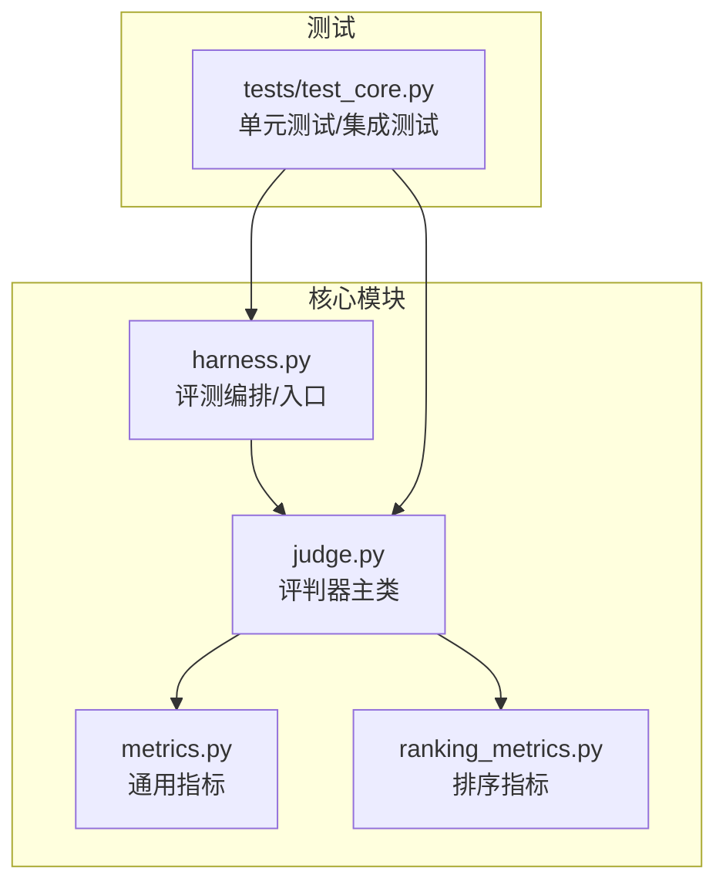
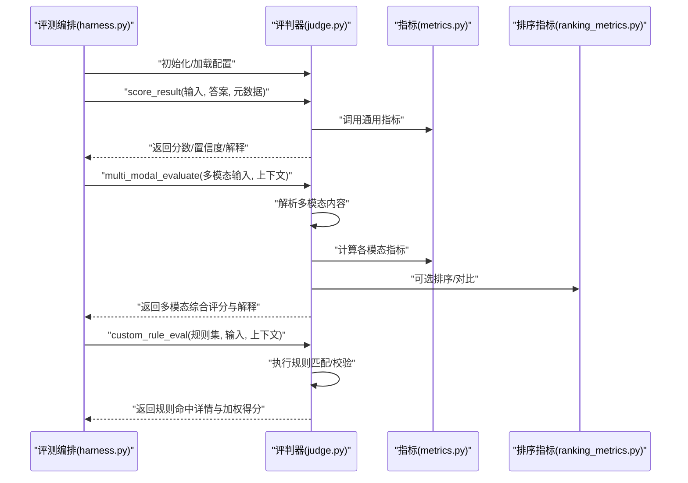
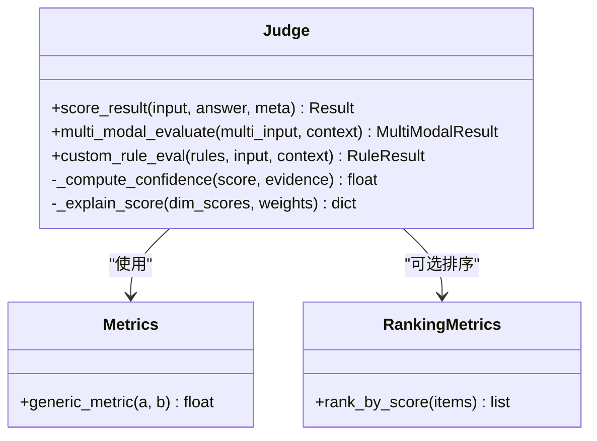
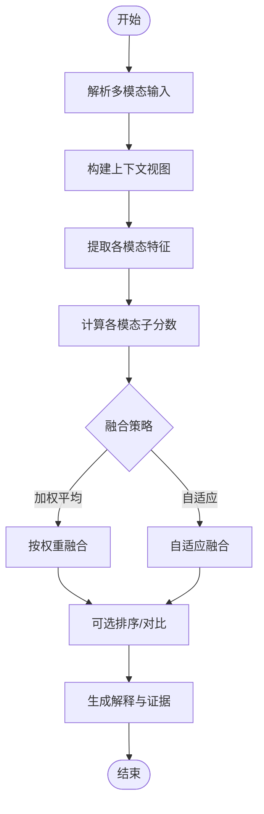
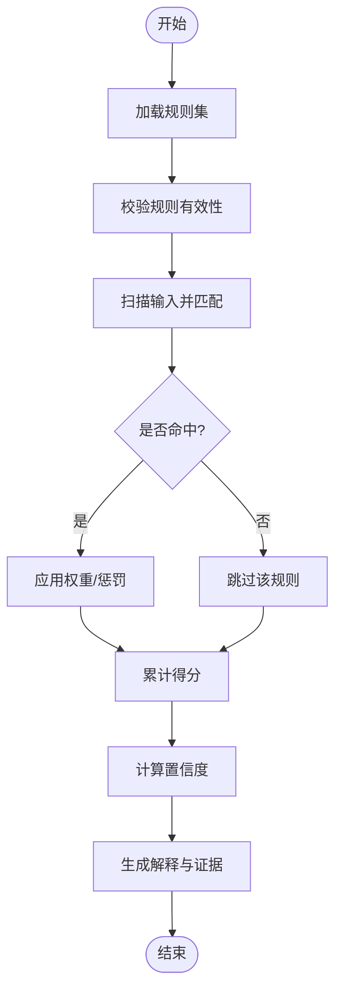
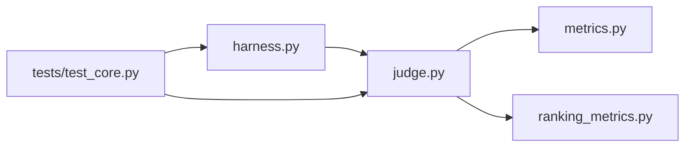

# 评判器API

<cite>
**本文引用的文件**   
- [autonomy_mvp/core/judge.py](file://autonomy_mvp/core/judge.py)
- [autonomy_mvp/core/harness.py](file://autonomy_mvp/core/harness.py)
- [autonomy_mvp/core/metrics.py](file://autonomy_mvp/core/metrics.py)
- [autonomy_mvp/core/ranking_metrics.py](file://autonomy_mvp/core/ranking_metrics.py)
- [autonomy_mvp/tests/test_core.py](file://autonomy_mvp/tests/test_core.py)
</cite>

## 目录
1. [简介](#简介)
2. [项目结构](#项目结构)
3. [核心组件](#核心组件)
4. [架构总览](#架构总览)
5. [详细组件分析](#详细组件分析)
6. [依赖关系分析](#依赖关系分析)
7. [性能考虑](#性能考虑)
8. [故障排查指南](#故障排查指南)
9. [结论](#结论)
10. [附录](#附录)

## 简介
本文件为智能评判器 Judge 的 API 文档，聚焦以下能力：
- 评分算法 score_result()
- 多模态评估 multi_modal_evaluate()
- 自定义规则评估 custom_rule_eval()
并围绕多模态评估逻辑、上下文理解与推理验证机制进行说明。同时提供扩展自定义评判规则的方法与集成示例，覆盖评分标准配置、置信度计算与结果解释接口。

## 项目结构
与评判器相关的核心代码位于 autonomy_mvp/core 目录下，包含评判主类、评测编排、指标与排序指标等模块；测试用例位于 tests 目录，用于验证关键流程。

图表来源
- [autonomy_mvp/core/judge.py](file://autonomy_mvp/core/judge.py)
- [autonomy_mvp/core/harness.py](file://autonomy_mvp/core/harness.py)
- [autonomy_mvp/core/metrics.py](file://autonomy_mvp/core/metrics.py)
- [autonomy_mvp/core/ranking_metrics.py](file://autonomy_mvp/core/ranking_metrics.py)
- [autonomy_mvp/tests/test_core.py](file://autonomy_mvp/tests/test_core.py)

章节来源
- [autonomy_mvp/core/judge.py](file://autonomy_mvp/core/judge.py)
- [autonomy_mvp/core/harness.py](file://autonomy_mvp/core/harness.py)
- [autonomy_mvp/core/metrics.py](file://autonomy_mvp/core/metrics.py)
- [autonomy_mvp/core/ranking_metrics.py](file://autonomy_mvp/core/ranking_metrics.py)
- [autonomy_mvp/tests/test_core.py](file://autonomy_mvp/tests/test_core.py)

## 核心组件
- 评判器主类（Judge）
  - 负责统一调度评分、多模态评估与自定义规则评估。
  - 对外暴露三大核心方法：score_result()、multi_modal_evaluate()、custom_rule_eval()。
- 指标与排序指标
  - metrics.py 提供通用指标实现，供评判器在打分时复用。
  - ranking_metrics.py 提供排序相关指标，用于对多个候选结果进行排序或比较。
- 评测编排（Harness）
  - harness.py 作为评测入口，组织任务数据、调用评判器并汇总输出。
- 测试
  - tests/test_core.py 覆盖关键路径，确保评分、多模态评估与自定义规则评估的正确性。

章节来源
- [autonomy_mvp/core/judge.py](file://autonomy_mvp/core/judge.py)
- [autonomy_mvp/core/metrics.py](file://autonomy_mvp/core/metrics.py)
- [autonomy_mvp/core/ranking_metrics.py](file://autonomy_mvp/core/ranking_metrics.py)
- [autonomy_mvp/core/harness.py](file://autonomy_mvp/core/harness.py)
- [autonomy_mvp/tests/test_core.py](file://autonomy_mvp/tests/test_core.py)

## 架构总览
下图展示了评测编排到评判器的调用链路，以及评判器内部的多模态与自定义规则评估分支。

图表来源
- [autonomy_mvp/core/harness.py](file://autonomy_mvp/core/harness.py)
- [autonomy_mvp/core/judge.py](file://autonomy_mvp/core/judge.py)
- [autonomy_mvp/core/metrics.py](file://autonomy_mvp/core/metrics.py)
- [autonomy_mvp/core/ranking_metrics.py](file://autonomy_mvp/core/ranking_metrics.py)

## 详细组件分析

### 评判器主类（Judge）
- 职责
  - 统一封装评分、多模态评估与自定义规则评估。
  - 维护评分标准配置、置信度计算与结果解释。
- 关键方法
  - score_result()
    - 功能：基于输入、答案与元数据进行评分，返回分数、置信度与解释。
    - 输入要点：待评内容、参考答案、可选上下文与权重配置。
    - 输出要点：数值分数、置信度区间、可解释字段（如维度分、依据）。
  - multi_modal_evaluate()
    - 功能：处理文本、图像、表格等多模态输入，结合上下文进行综合评估。
    - 处理流程：模态解析 -> 特征提取 -> 指标计算 -> 融合策略 -> 排序/对比（可选）-> 输出。
    - 输出要点：各模态子分数、融合总分、置信度、解释（含模态贡献度）。
  - custom_rule_eval()
    - 功能：根据用户提供的规则集对输入进行评估，支持规则命中统计与加权计分。
    - 输入要点：规则定义（条件、权重、惩罚）、输入数据、上下文。
    - 输出要点：规则命中明细、加权得分、置信度、解释（规则链路与证据）。
- 设计要点
  - 可扩展：通过注册新指标或规则类型扩展能力。
  - 可解释：每个评分均附带解释字段，便于审计与调试。
  - 可配置：评分标准、权重、阈值均可通过配置对象传入。

图表来源
- [autonomy_mvp/core/judge.py](file://autonomy_mvp/core/judge.py)
- [autonomy_mvp/core/metrics.py](file://autonomy_mvp/core/metrics.py)
- [autonomy_mvp/core/ranking_metrics.py](file://autonomy_mvp/core/ranking_metrics.py)

章节来源
- [autonomy_mvp/core/judge.py](file://autonomy_mvp/core/judge.py)

### 多模态评估逻辑（multi_modal_evaluate）
- 流程概览
  - 输入解析：识别文本、图像、表格等模态片段。
  - 上下文理解：抽取与当前任务相关的上下文信息，构建评估视图。
  - 指标计算：对各模态分别计算指标，得到子分数。
  - 融合策略：按权重或自适应策略融合子分数，得到总分。
  - 排序与对比：可选地对多个候选结果进行排序或对比。
  - 输出：返回总分、置信度与解释（含模态贡献度与关键证据）。

图表来源
- [autonomy_mvp/core/judge.py](file://autonomy_mvp/core/judge.py)
- [autonomy_mvp/core/metrics.py](file://autonomy_mvp/core/metrics.py)
- [autonomy_mvp/core/ranking_metrics.py](file://autonomy_mvp/core/ranking_metrics.py)

章节来源
- [autonomy_mvp/core/judge.py](file://autonomy_mvp/core/judge.py)

### 自定义规则评估（custom_rule_eval）
- 规则定义
  - 条件：字符串匹配、正则表达式、结构化字段校验等。
  - 权重：每条规则的贡献权重，支持正负权重与惩罚项。
  - 阈值：触发条件与置信度阈值。
- 执行流程
  - 规则加载与校验
  - 输入扫描与匹配
  - 命中统计与加权计分
  - 置信度计算与解释生成
- 扩展方法
  - 新增规则类型：实现新的匹配函数并在规则注册表中注册。
  - 动态权重：根据上下文或历史表现调整权重。
  - 组合规则：支持规则分组与优先级控制。

图表来源
- [autonomy_mvp/core/judge.py](file://autonomy_mvp/core/judge.py)

章节来源
- [autonomy_mvp/core/judge.py](file://autonomy_mvp/core/judge.py)

### 评分标准配置、置信度计算与结果解释
- 评分标准配置
  - 维度：文本准确性、完整性、相关性、格式合规性等。
  - 权重：各维度权重总和为1，支持动态调整。
  - 阈值：最低合格线、优秀线等。
- 置信度计算
  - 依据：证据强度、一致性、样本量、不确定性估计。
  - 输出：置信度区间或概率分布。
- 结果解释
  - 字段：维度分、依据摘要、关键证据位置、改进建议。
  - 用途：审计、回溯、模型迭代优化。

章节来源
- [autonomy_mvp/core/judge.py](file://autonomy_mvp/core/judge.py)

### 集成示例（基于评测编排）
- 典型调用顺序
  - 初始化评判器与配置
  - 调用 score_result() 进行基础评分
  - 调用 multi_modal_evaluate() 进行多模态评估
  - 调用 custom_rule_eval() 进行规则化评估
  - 汇总输出与可视化
- 参考路径
  - 评测编排入口与调用方式参见 harness.py
  - 测试用例覆盖关键流程参见 tests/test_core.py

章节来源
- [autonomy_mvp/core/harness.py](file://autonomy_mvp/core/harness.py)
- [autonomy_mvp/tests/test_core.py](file://autonomy_mvp/tests/test_core.py)

## 依赖关系分析
- 直接依赖
  - judge.py 依赖 metrics.py 与 ranking_metrics.py 以完成指标计算与排序。
  - harness.py 作为编排层，依赖 judge.py 完成具体评估。
- 间接依赖
  - 测试用例依赖 harness.py 与 judge.py，确保端到端正确性。
- 耦合与内聚
  - judge.py 将评分、多模态与规则评估聚合，提升内聚性。
  - metrics.py 与 ranking_metrics.py 保持低耦合，便于替换与扩展。

图表来源
- [autonomy_mvp/core/harness.py](file://autonomy_mvp/core/harness.py)
- [autonomy_mvp/core/judge.py](file://autonomy_mvp/core/judge.py)
- [autonomy_mvp/core/metrics.py](file://autonomy_mvp/core/metrics.py)
- [autonomy_mvp/core/ranking_metrics.py](file://autonomy_mvp/core/ranking_metrics.py)
- [autonomy_mvp/tests/test_core.py](file://autonomy_mvp/tests/test_core.py)

章节来源
- [autonomy_mvp/core/harness.py](file://autonomy_mvp/core/harness.py)
- [autonomy_mvp/core/judge.py](file://autonomy_mvp/core/judge.py)
- [autonomy_mvp/core/metrics.py](file://autonomy_mvp/core/metrics.py)
- [autonomy_mvp/core/ranking_metrics.py](file://autonomy_mvp/core/ranking_metrics.py)
- [autonomy_mvp/tests/test_core.py](file://autonomy_mvp/tests/test_core.py)

## 性能考虑
- 批处理与并行
  - 对大量样本可采用批处理与并行策略，减少重复计算。
- 缓存与复用
  - 对稳定指标（如格式校验）结果进行缓存，避免重复开销。
- 增量更新
  - 在多轮评估中仅对变更部分重新计算，降低整体耗时。
- 资源限制
  - 合理设置并发度与内存上限，防止资源耗尽。

[本节为通用指导，不直接分析具体文件]

## 故障排查指南
- 常见问题
  - 输入格式错误：检查多模态输入的结构与字段完整性。
  - 规则未命中：确认规则条件与权重配置是否正确。
  - 置信度过低：检查证据强度与一致性，必要时增加样本或调整阈值。
- 定位步骤
  - 查看解释字段中的证据与依据摘要。
  - 使用测试用例复现问题，逐步缩小范围。
  - 启用日志与断点，追踪关键计算路径。
- 参考路径
  - 测试用例覆盖关键路径，便于快速定位问题。

章节来源
- [autonomy_mvp/tests/test_core.py](file://autonomy_mvp/tests/test_core.py)

## 结论
本 API 文档围绕评判器 Judge 的核心接口展开，系统说明了评分算法、多模态评估与自定义规则评估的实现思路与使用方法。通过清晰的配置、置信度计算与结果解释机制，用户可在不同场景下灵活扩展与集成评判能力。

[本节为总结性内容，不直接分析具体文件]

## 附录
- 术语表
  - 多模态：包含文本、图像、表格等多种数据类型的输入。
  - 置信度：对评分结果的可靠程度估计。
  - 规则集：一组可执行的评估条件与权重的集合。
- 扩展清单
  - 新增指标：在 metrics.py 中实现新指标并在 judge.py 中注册。
  - 新增规则类型：在 judge.py 的规则注册表中添加新类型。
  - 自定义融合策略：在 multi_modal_evaluate() 中实现新的融合算法。

[本节为补充信息，不直接分析具体文件]