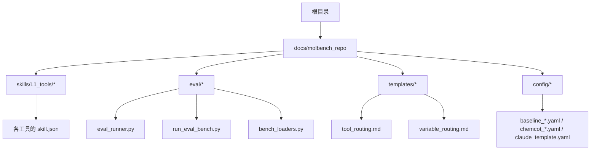
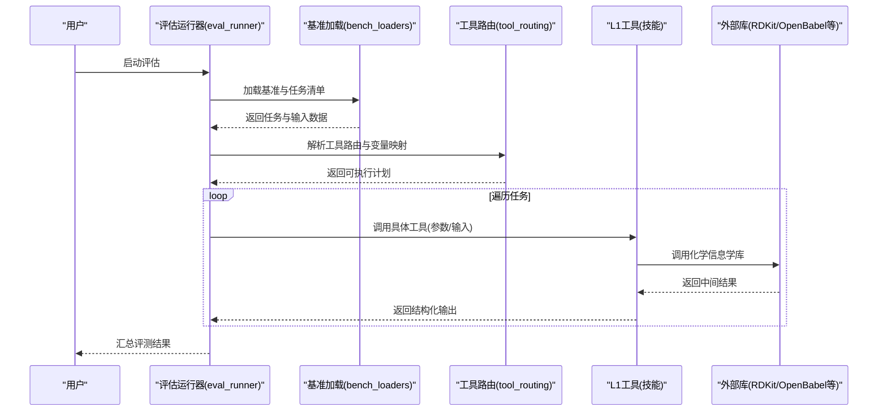
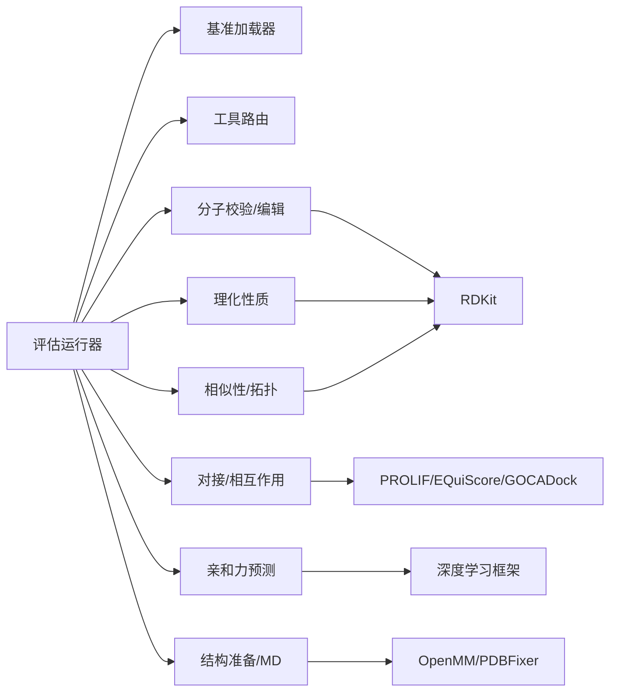

# L1基础工具

<cite>
**本文引用的文件**   
- [README.md](file://docs/molbench_repo/README.md)
- [REUSABLE_INDEX.md](file://docs/molbench_repo/REUSABLE_INDEX.md)
- [tool_routing.md](file://docs/molbench_repo/templates/tool_routing.md)
- [variable_routing.md](file://docs/molbench_repo/templates/variable_routing.md)
- [baseline_molbench-ms-1.yaml](file://docs/molbench_repo/config/baseline_molbench-ms-1.yaml)
- [baseline_molbench-ms-2.yaml](file://docs/molbench_repo/config/baseline_molbench-ms-2.yaml)
- [baseline_molbench-ms-3.yaml](file://docs/molbench_repo/config/baseline_molbench-ms-3.yaml)
- [chemcot_mo_edit.yaml](file://docs/molbench_repo/config/chemcot_mo_edit.yaml)
- [chemcot_mo_opt.yaml](file://docs/molbench_repo/config/chemcot_mo_opt.yaml)
- [claude_template.yaml](file://docs/molbench_repo/config/claude_template.yaml)
- [eval_runner.py](file://docs/molbench_repo/eval/eval_runner.py)
- [run_eval_bench.py](file://docs/molbench_repo/eval/run_eval_bench.py)
- [bench_loaders.py](file://docs/molbench_repo/eval/bench_loaders.py)
- [__init__.py](file://docs/molbench_repo/eval/__init__.py)
- [molclaw-mol-basic-metrics/skill.json](file://docs/molbench_repo/skills/L1_tools/molclaw-mol-basic-metrics/skill.json)
- [molclaw-mol-opt-physchem/skill.json](file://docs/molbench_repo/skills/L1_tools/molclaw-mol-opt-physchem/skill.json)
- [molclaw-mol-similarity/skill.json](file://docs/molbench_repo/skills/L1_tools/molclaw-mol-similarity/skill.json)
- [molclaw-mol-structure-metrics/skill.json](file://docs/molbench_repo/skills/L1_tools/molclaw-mol-structure-metrics/skill.json)
- [molclaw-mol-topology-metrics/skill.json](file://docs/molbench_repo/skills/L1_tools/molclaw-mol-topology-metrics/skill.json)
- [molclaw-mol-hydrophobicity-metrics/skill.json](file://docs/molbench_repo/skills/L1_tools/molclaw-mol-hydrophobicity-metrics/skill.json)
- [molclaw-mol-hbond-metrics/skill.json](file://docs/molbench_repo/skills/L1_tools/molclaw-mol-hbond-metrics/skill.json)
- [molclaw-mol-complexity-metrics/skill.json](file://docs/molbench_repo/skills/L1_tools/molclaw-mol-complexity-metrics/skill.json)
- [molclaw-mol-charge-metrics/skill.json](file://docs/molbench_repo/skills/L1_tools/molclaw-mol-charge-metrics/skill.json)
- [molclaw-smiles-valid-check/skill.json](file://docs/molbench_repo/skills/L1_tools/molclaw-smiles-valid-check/skill.json)
- [molclaw-sequence-valid-check/skill.json](file://docs/molbench_repo/skills/L1_tools/molclaw-sequence-valid-check/skill.json)
- [molclaw-chroma-toolkit/skill.json](file://docs/molbench_repo/skills/L1_tools/molclaw-chroma-toolkit/skill.json)
- [molclaw-compound-retrieve/skill.json](file://docs/molbench_repo/skills/L1_tools/molclaw-compound-retrieve/skill.json)
- [molclaw-prolif-tool/skill.json](file://docs/molbench_repo/skills/L1_tools/molclaw-prolif-tool/skill.json)
- [molclaw-equiscore-tool/skill.json](file://docs/molbench_repo/skills/L1_tools/molclaw-equiscore-tool/skill.json)
- [molclaw-goca-tool/skill.json](file://docs/molbench_repo/skills/L1_tools/molclaw-goca-tool/skill.json)
- [molclaw-dleps/skill.json](file://docs/molbench_repo/skills/L1_tools/molclaw-dleps/skill.json)
- [molclaw-fpocket-toolkit-base/skill.json](file://docs/molbench_repo/skills/L1_tools/molclaw-fpocket-toolkit-base/skill.json)
- [molclaw-p2rank/skill.json](file://docs/molbench_repo/skills/L1_tools/molclaw-p2rank/skill.json)
- [molclaw-linker-sampling/skill.json](file://docs/molbench_repo/skills/L1_tools/molclaw-linker-sampling/skill.json)
- [molclaw-rgroup-sampling/skill.json](file://docs/molbench_repo/skills/L1_tools/molclaw-rgroup-sampling/skill.json)
- [molclaw-peptide-sampling/skill.json](file://docs/molbench_repo/skills/L1_tools/molclaw-peptide-sampling/skill.json)
- [molclaw-mol2mol-sampling/skill.json](file://docs/molbench_repo/skills/L1_tools/molclaw-mol2mol-sampling/skill.json)
- [molclaw-denovo-sampling/skill.json](file://docs/molbench_repo/skills/L1_tools/molclaw-denovo-sampling/skill.json)
- [molclaw-smiles-fg-editor/skill.json](file://docs/molbench_repo/skills/L1_tools/molclaw-smiles-fg-editor/skill.json)
- [molclaw-extract-chains/skill.json](file://docs/molbench_repo/skills/L1_tools/molclaw-extract-chains/skill.json)
- [molclaw-fix-pdb/skill.json](file://docs/molbench_repo/skills/L1_tools/molclaw-fix-pdb/skill.json)
- [molclaw-pack-sidechains/skill.json](file://docs/molbench_repo/skills/L1_tools/molclaw-pack-sidechains/skill.json)
- [molclaw-protein-openmm/skill.json](file://docs/molbench_repo/skills/L1_tools/molclaw-protein-openmm/skill.json)
- [molclaw-prolif-md/skill.json](file://docs/molbench_repo/skills/L1_tools/molclaw-prolif-md/skill.json)
- [molclaw-prolif-pdb/skill.json](file://docs/molbench_repo/skills/L1_tools/molclaw-prolif-pdb/skill.json)
- [molclaw-prolif-protein-protein/skill.json](file://docs/molbench_repo/skills/L1_tools/molclaw-prolif-protein-protein/skill.json)
- [molclaw-prolif-docking/skill.json](file://docs/molbench_repo/skills/L1_tools/molclaw-prolif-docking/skill.json)
- [molclaw-foldx-tool/skill.json](file://docs/molbench_repo/skills/L1_tools/molclaw-foldx-tool/skill.json)
- [molclaw-evobind-tool/skill.json](file://docs/molbench_repo/skills/L1_tools/molclaw-evobind-tool/skill.json)
- [molclaw-equiscore-docking/skill.json](file://docs/molbench_repo/skills/L1_tools/molclaw-equiscore-docking/skill.json)
- [molclaw-karmadock-tool/skill.json](file://docs/molbench_repo/skills/L1_tools/molclaw-karmadock-tool/skill.json)
- [molclaw-hdock-tool/skill.json](file://docs/molbench_repo/skills/L1_tools/molclaw-hdock-tool/skill.json)
- [molclaw-quickvina-docking/skill.json](file://docs/molbench_repo/skills/L1_tools/molclaw-quickvina-docking/skill.json)
- [molclaw-docking-screening/skill.json](file://docs/molbench_repo/skills/L1_tools/molclaw-docking-screening/skill.json)
- [molclaw-drug-likeness/skill.json](file://docs/molbench_repo/skills/L1_tools/molclaw-drug-likeness/skill.json)
- [molclaw-admet/skill.json](file://docs/molbench_repo/skills/L1_tools/molclaw-admet/skill.json)
- [molclaw-boltz2-affinity/skill.json](file://docs/molbench_repo/skills/L1_tools/molclaw-boltz2-affinity/skill.json)
- [molclaw-chai1-predict/skill.json](file://docs/molbench_repo/skills/L1_tools/molclaw-chai1-predict/skill.json)
- [molclaw-esmfold/skill.json](file://docs/molbench_repo/skills/L1_tools/molclaw-esmfold/sskill.json)
- [molclaw-protein-sequence-retrieve/skill.json](file://docs/molbench_repo/skills/L1_tools/molclaw-protein-sequence-retrieve/skill.json)
- [molclaw-protein-structure-retrieve/skill.json](file://docs/molbench_repo/skills/L1_tools/molclaw-protein-structure-retrieve/skill.json)
- [molclaw-run-bioemu/skill.json](file://docs/molbench_repo/skills/L1_tools/molclaw-run-bioemu/skill.json)
- [molclaw-pulchura-rebuild/skill.json](file://docs/molbench_repo/skills/L1_tools/molclaw-pulchura-rebuild/skill.json)
- [molclaw-proteinmpnn-tool/skill.json](file://docs/molbench_repo/skills/L1_tools/molclaw-proteinmpnn-tool/skill.json)
- [molclaw-openawsem-tool/skill.json](file://docs/molbench_repo/skills/L1_tools/molclaw-openawsem-tool/skill.json)
- [molclaw-file-transfer/skill.json](file://docs/molbench_repo/skills/L1_tools/molclaw-file-transfer/skill.json)
- [molclaw-scp-server/skill.json](file://docs/molbench_repo/skills/L1_tools/molclaw-scp-server/skill.json)
- [molclaw-interaction-visualizer/skill.json](file://docs/molbench_repo/skills/L1_tools/molclaw-interaction-visualizer/skill.json)
- [molclaw-skill-template-writer/skill.json](file://docs/molbench_repo/skills/L1_tools/molclaw-skill-template-writer/skill.json)
</cite>

## 目录
1. [简介](#简介)
2. [项目结构](#项目结构)
3. [核心组件](#核心组件)
4. [架构总览](#架构总览)
5. [详细组件分析](#详细组件分析)
6. [依赖关系分析](#依赖关系分析)
7. [性能考虑](#性能考虑)
8. [故障排查指南](#故障排查指南)
9. [结论](#结论)
10. [附录](#附录)

## 简介
本技术文档聚焦于L1基础工具，覆盖分子操作、物理化学计算与数据结构转换等能力。文档面向不同技术背景的读者，提供从高层架构到代码级实现的渐进式说明，包括：
- 工具能力边界与职责划分
- 参数配置、输入输出格式与错误处理机制
- 与RDKit、OpenBabel等化学信息学库的集成方式
- 批量处理与性能优化实践
- 工具间依赖关系与数据流转路径

## 项目结构
仓库中L1工具以“技能（Skill）”形式组织，每个工具对应一个独立目录，包含描述与运行元数据的配置文件。评估与基准执行逻辑集中在eval目录下，模板与路由定义位于templates目录，配置项集中于config目录。

图表来源
- [README.md:1-200](file://docs/molbench_repo/README.md#L1-L200)
- [REUSABLE_INDEX.md:1-200](file://docs/molbench_repo/REUSABLE_INDEX.md#L1-L200)
- [eval_runner.py:1-200](file://docs/molbench_repo/eval/eval_runner.py#L1-L200)
- [run_eval_bench.py:1-200](file://docs/molbench_repo/eval/run_eval_bench.py#L1-L200)
- [bench_loaders.py:1-200](file://docs/molbench_repo/eval/bench_loaders.py#L1-L200)
- [tool_routing.md:1-200](file://docs/molbench_repo/templates/tool_routing.md#L1-L200)
- [variable_routing.md:1-200](file://docs/molbench_repo/templates/variable_routing.md#L1-L200)
- [baseline_molbench-ms-1.yaml:1-200](file://docs/molbench_repo/config/baseline_molbench-ms-1.yaml#L1-L200)
- [baseline_molbench-ms-2.yaml:1-200](file://docs/molbench_repo/config/baseline_molbench-ms-2.yaml#L1-L200)
- [baseline_molbench-ms-3.yaml:1-200](file://docs/molbench_repo/config/baseline_molbench-ms-3.yaml#L1-L200)
- [chemcot_mo_edit.yaml:1-200](file://docs/molbench_repo/config/chemcot_mo_edit.yaml#L1-L200)
- [chemcot_mo_opt.yaml:1-200](file://docs/molbench_repo/config/chemcot_mo_opt.yaml#L1-L200)
- [claude_template.yaml:1-200](file://docs/molbench_repo/config/claude_template.yaml#L1-L200)

章节来源
- [README.md:1-200](file://docs/molbench_repo/README.md#L1-L200)
- [REUSABLE_INDEX.md:1-200](file://docs/molbench_repo/REUSABLE_INDEX.md#L1-L200)

## 核心组件
L1基础工具围绕以下能力域展开：
- 分子结构与SMILES校验与编辑
- 分子基本属性与理化性质计算
- 分子相似性与拓扑/结构度量
- 氢键、疏水性、电荷分布等特性指标
- 序列有效性检查（多肽/蛋白质）
- 化合物检索与外部数据库对接
- 分子对接与相互作用分析（基于PROLIF、EQuiScore、GOCADock等）
- 结合亲和力预测（Boltz2、Chai1、ESMFold等）
- 蛋白结构准备与MD相关预处理（PDBFixer、OpenMM、Sidechain Packing等）
- 采样与生成（Linker/R-group/De Novo/Mol2Mol/Peptide）
- 可视化与文件传输辅助

上述能力通过统一的“技能”元数据（skill.json）进行声明，并由评估框架加载与编排。

章节来源
- [REUSABLE_INDEX.md:1-200](file://docs/molbench_repo/REUSABLE_INDEX.md#L1-L200)
- [eval_runner.py:1-200](file://docs/molbench_repo/eval/eval_runner.py#L1-L200)
- [run_eval_bench.py:1-200](file://docs/molbench_repo/eval/run_eval_bench.py#L1-L200)
- [bench_loaders.py:1-200](file://docs/molbench_repo/eval/bench_loaders.py#L1-L200)

## 架构总览
整体架构由“技能注册—任务编排—工具执行—结果汇总”构成。评估器读取基准配置，解析变量与工具路由，按顺序或并行调用相应L1工具，收集并标准化输出以供评测。

图表来源
- [eval_runner.py:1-200](file://docs/molbench_repo/eval/eval_runner.py#L1-L200)
- [run_eval_bench.py:1-200](file://docs/molbench_repo/eval/run_eval_bench.py#L1-L200)
- [bench_loaders.py:1-200](file://docs/molbench_repo/eval/bench_loaders.py#L1-L200)
- [tool_routing.md:1-200](file://docs/molbench_repo/templates/tool_routing.md#L1-L200)
- [variable_routing.md:1-200](file://docs/molbench_repo/templates/variable_routing.md#L1-L200)

## 详细组件分析

### 分子结构与SMILES校验与编辑
- 能力范围
  - SMILES合法性校验、规范化、去盐、立体化学修复
  - 官能团编辑、片段替换、连接子/末端基团采样
- 典型输入/输出
  - 输入：SMILES字符串、可选过滤规则、编辑策略
  - 输出：经处理的SMILES列表、变更日志、失败原因
- 错误处理
  - 非法SMILES抛出明确错误码与提示
  - 对不合法结构进行回退策略（如保留原样或跳过）
- 集成点
  - 主要依赖RDKit进行结构解析与操作；必要时使用OpenBabel进行格式互转
- 示例调用模式
  - 单条SMILES校验与规范化
  - 批量SMILES清洗与统计报告
- 性能建议
  - 批量处理时启用进程内缓存（如已计算的指纹/属性）
  - 合理设置并行度，避免I/O瓶颈

章节来源
- [molclaw-smiles-valid-check/skill.json:1-200](file://docs/molbench_repo/skills/L1_tools/molclaw-smiles-valid-check/skill.json#L1-L200)
- [molclaw-smiles-fg-editor/skill.json:1-200](file://docs/molbench_repo/skills/L1_tools/molclaw-smiles-fg-editor/skill.json#L1-L200)
- [molclaw-linker-sampling/skill.json:1-200](file://docs/molbench_repo/skills/L1_tools/molclaw-linker-sampling/skill.json#L1-L200)
- [molclaw-rgroup-sampling/skill.json:1-200](file://docs/molbench_repo/skills/L1_tools/molclaw-rgroup-sampling/skill.json#L1-L200)
- [molclaw-mol2mol-sampling/skill.json:1-200](file://docs/molbench_repo/skills/L1_tools/molclaw-mol2mol-sampling/skill.json#L1-L200)
- [molclaw-denovo-sampling/skill.json:1-200](file://docs/molbench_repo/skills/L1_tools/molclaw-denovo-sampling/skill.json#L1-L200)

### 分子基本属性与理化性质计算
- 能力范围
  - 分子量、LogP、HBA/HBD、TPSA、旋转键数、环系计数、复杂度等
  - 药物相似性评分（如QED、类药性）
- 典型输入/输出
  - 输入：SMILES或结构文件
  - 输出：JSON字典（字段名与单位需统一）
- 错误处理
  - 缺失原子/价态异常时记录并跳过
  - 数值越界给出警告
- 集成点
  - RDKit属性计算为主；部分指标可能依赖第三方库
- 示例调用模式
  - 单分子属性计算
  - 批量属性计算并导出CSV
- 性能建议
  - 预构建分子对象缓存，避免重复解析
  - 使用向量化计算减少Python层开销

章节来源
- [molclaw-mol-basic-metrics/skill.json:1-200](file://docs/molbench_repo/skills/L1_tools/molclaw-mol-basic-metrics/skill.json#L1-L200)
- [molclaw-mol-opt-physchem/skill.json:1-200](file://docs/molbench_repo/skills/L1_tools/molclaw-mol-opt-physchem/skill.json#L1-L200)
- [molclaw-drug-likeness/skill.json:1-200](file://docs/molbench_repo/skills/L1_tools/molclaw-drug-likeness/skill.json#L1-L200)

### 分子相似性与拓扑/结构度量
- 能力范围
  - Tanimoto相似度、MACCS/Fingerprint比较
  - 拓扑指数、环系统特征、骨架提取
- 典型输入/输出
  - 输入：一对或多对分子（SMILES/结构）
  - 输出：相似度矩阵或指标列表
- 错误处理
  - 空结构或无效指纹时返回NaN并记录
- 集成点
  - RDKit指纹与相似度计算
- 示例调用模式
  - 针对参考分子的Top-N相似物筛选
- 性能建议
  - 大规模比对采用分块与索引加速

章节来源
- [molclaw-mol-similarity/skill.json:1-200](file://docs/molbench_repo/skills/L1_tools/molclaw-mol-similarity/skill.json#L1-L200)
- [molclaw-mol-structure-metrics/skill.json:1-200](file://docs/molbench_repo/skills/L1_tools/molclaw-mol-structure-metrics/skill.json#L1-L200)
- [molclaw-mol-topology-metrics/skill.json:1-200](file://docs/molbench_repo/skills/L1_tools/molclaw-mol-topology-metrics/skill.json#L1-L200)

### 氢键、疏水性与电荷分布指标
- 能力范围
  - 氢键供体/受体计数、疏水性贡献、净电荷、静电势近似
- 典型输入/输出
  - 输入：分子结构
  - 输出：各项指标及阈值判定
- 错误处理
  - 未成功分配电荷或质子化状态异常时告警
- 集成点
  - RDKit与可选外部库（如AMBER力场前处理）
- 示例调用模式
  - 在筛选流程中加入氢键与疏水性约束
- 性能建议
  - 将常用指标合并为一次性计算以减少重复解析

章节来源
- [molclaw-mol-hbond-metrics/skill.json:1-200](file://docs/molbench_repo/skills/L1_tools/molclaw-mol-hbond-metrics/skill.json#L1-L200)
- [molclaw-mol-hydrophobicity-metrics/skill.json:1-200](file://docs/molbench_repo/skills/L1_tools/molclaw-mol-hydrophobicity-metrics/skill.json#L1-L200)
- [molclaw-mol-charge-metrics/skill.json:1-200](file://docs/molbench_repo/skills/L1_tools/molclaw-mol-charge-metrics/skill.json#L1-L200)

### 序列有效性检查（多肽/蛋白质）
- 能力范围
  - 氨基酸序列合法性、终止符检查、非标准残基标注
- 典型输入/输出
  - 输入：FASTA/序列字符串
  - 输出：有效性标志与问题定位
- 错误处理
  - 非法字符或长度异常时返回错误详情
- 集成点
  - 自定义规则与BioPython/第三方库校验
- 示例调用模式
  - 在生成后快速过滤无效序列
- 性能建议
  - 流式读取大文件，避免一次性加载

章节来源
- [molclaw-sequence-valid-check/skill.json:1-200](file://docs/molbench_repo/skills/L1_tools/molclaw-sequence-valid-check/skill.json#L1-L200)

### 化合物检索与外部数据库对接
- 能力范围
  - 基于名称/标识符/结构的化合物检索
  - 与PubChem/ZINC等数据库交互
- 典型输入/输出
  - 输入：查询条件（ID/SMILES/名称）
  - 输出：结构化记录（含SMILES、属性、链接）
- 错误处理
  - 网络超时、无结果、速率限制时的重试与降级
- 集成点
  - HTTP客户端与API封装
- 示例调用模式
  - 批量ID转SMILES与属性回填
- 性能建议
  - 并发请求+限流控制，结果落盘断点续传

章节来源
- [molclaw-compound-retrieve/skill.json:1-200](file://docs/molbench_repo/skills/L1_tools/molclaw-compound-retrieve/skill.json#L1-L200)

### 分子对接与相互作用分析（PROLIF/EQuiScore/GOCADock等）
- 能力范围
  - 配体-受体复合物相互作用分析（氢键、π-π、卤键等）
  - 对接打分与构象评分
- 典型输入/输出
  - 输入：PDB/复合物文件、配体SMILES
  - 输出：相互作用列表、打分、可视化摘要
- 错误处理
  - 缺失原子/链ID冲突/坐标异常时给出修复建议
- 集成点
  - PROLIF用于相互作用识别；EQuiScore/GOCADock用于打分
- 示例调用模式
  - 对接后自动提取关键相互作用并排序
- 性能建议
  - 复用受体网格/预计算特征，减少重复IO

章节来源
- [molclaw-prolif-tool/skill.json:1-200](file://docs/molbench_repo/skills/L1_tools/molclaw-prolif-tool/skill.json#L1-L200)
- [molclaw-equiscore-tool/skill.json:1-200](file://docs/molbench_repo/skills/L1_tools/molclaw-equiscore-tool/skill.json#L1-L200)
- [molclaw-goca-tool/skill.json:1-200](file://docs/molbench_repo/skills/L1_tools/molclaw-goca-tool/skill.json#L1-L200)
- [molclaw-prolif-docking/skill.json:1-200](file://docs/molbench_repo/skills/L1_tools/molclaw-prolif-docking/skill.json#L1-L200)

### 结合亲和力预测（Boltz2/Chai1/ESMFold等）
- 能力范围
  - 蛋白-配体/蛋白-蛋白亲和力预测
  - 结构预测与复合物建模
- 典型输入/输出
  - 输入：序列/PDB/复合物结构
  - 输出：亲和力值、置信度、结构文件
- 错误处理
  - 模型加载失败、GPU不可用时的CPU回退
- 集成点
  - 深度学习推理引擎与模型权重管理
- 示例调用模式
  - 批量预测并输出排序结果
- 性能建议
  - 批大小调优、混合精度推理、模型预热

章节来源
- [molclaw-boltz2-affinity/skill.json:1-200](file://docs/molbench_repo/skills/L1_tools/molclaw-boltz2-affinity/skill.json#L1-L200)
- [molclaw-chai1-predict/skill.json:1-200](file://docs/molbench_repo/skills/L1_tools/molclaw-chai1-predict/skill.json#L1-L200)
- [molclaw-esmfold/skill.json:1-200](file://docs/molbench_repo/skills/L1_tools/molclaw-esmfold/skill.json#L1-L200)

### 蛋白结构准备与MD相关预处理
- 能力范围
  - PDB修复、侧链重建、链提取、溶剂化与加氢
  - OpenMM体系构建与能量最小化
- 典型输入/输出
  - 输入：原始PDB/序列
  - 输出：修复后的PDB、体系文件、轨迹片段
- 错误处理
  - 缺失原子/链ID不一致/力场不匹配时给出修复步骤
- 集成点
  - PDBFixer、OpenMM、侧链打包工具
- 示例调用模式
  - 自动化准备流程：修复→加氢→溶剂化→最小化
- 性能建议
  - 并行准备多个体系，共享环境初始化

章节来源
- [molclaw-fix-pdb/skill.json:1-200](file://docs/molbench_repo/skills/L1_tools/molclaw-fix-pdb/skill.json#L1-L200)
- [molclaw-pack-sidechains/skill.json:1-200](file://docs/molbench_repo/skills/L1_tools/molclaw-pack-sidechains/skill.json#L1-L200)
- [molclaw-extract-chains/skill.json:1-200](file://docs/molbench_repo/skills/L1_tools/molclaw-extract-chains/skill.json#L1-L200)
- [molclaw-protein-openmm/skill.json:1-200](file://docs/molbench_repo/skills/L1_tools/molclaw-protein-openmm/skill.json#L1-L200)
- [molclaw-prolif-md/skill.json:1-200](file://docs/molbench_repo/skills/L1_tools/molclaw-prolif-md/skill.json#L1-L200)
- [molclaw-prolif-pdb/skill.json:1-200](file://docs/molbench_repo/skills/L1_tools/molclaw-prolif-pdb/skill.json#L1-L200)

### 采样与生成（Linker/R-group/De Novo/Mol2Mol/Peptide）
- 能力范围
  - 连接子/末端基团替换、从头设计、分子到分子转化、多肽采样
- 典型输入/输出
  - 输入：母核/片段/序列模板与约束
  - 输出：候选分子/序列集合与评分
- 错误处理
  - 生成失败/不满足约束时回退或调整参数
- 集成点
  - 专用生成算法与评分函数
- 示例调用模式
  - 基于药效团约束的定向生成
- 性能建议
  - 分层采样：先粗筛再精排，降低计算量

章节来源
- [molclaw-linker-sampling/skill.json:1-200](file://docs/molbench_repo/skills/L1_tools/molclaw-linker-sampling/skill.json#L1-L200)
- [molclaw-rgroup-sampling/skill.json:1-200](file://docs/molbench_repo/skills/L1_tools/molclaw-rgroup-sampling/skill.json#L1-L200)
- [molclaw-denovo-sampling/skill.json:1-200](file://docs/molbench_repo/skills/L1_tools/molclaw-denovo-sampling/skill.json#L1-L200)
- [molclaw-mol2mol-sampling/skill.json:1-200](file://docs/molbench_repo/skills/L1_tools/molclaw-mol2mol-sampling/skill.json#L1-L200)
- [molclaw-peptide-sampling/skill.json:1-200](file://docs/molbench_repo/skills/L1_tools/molclaw-peptide-sampling/skill.json#L1-L200)

### 可视化与文件传输辅助
- 能力范围
  - 相互作用可视化、结果归档、跨节点文件传输
- 典型输入/输出
  - 输入：结构/相互作用/结果文件
  - 输出：可视化图、压缩包、远程位置
- 错误处理
  - 权限不足/磁盘空间不足/网络中断时的重试与告警
- 集成点
  - 本地文件系统与SCP/HTTP上传
- 示例调用模式
  - 批量结果打包与分发
- 性能建议
  - 增量传输与断点续传

章节来源
- [molclaw-interaction-visualizer/skill.json:1-200](file://docs/molbench_repo/skills/L1_tools/molclaw-interaction-visualizer/skill.json#L1-L200)
- [molclaw-file-transfer/skill.json:1-200](file://docs/molbench_repo/skills/L1_tools/molclaw-file-transfer/skill.json#L1-L200)
- [molclaw-scp-server/skill.json:1-200](file://docs/molbench_repo/skills/L1_tools/molclaw-scp-server/skill.json#L1-L200)

### 其他L1工具概览
- 口袋检测与位点分析（FPocket、p2Rank）
- 折叠稳定性与突变效应（FoldX、EvoBind）
- 对接与筛选（QuickVina、HDock、KarmaDock、Docking Screening）
- 通用工具集（Chroma Toolkit）
- 技能模板编写器（便于扩展新工具）

章节来源
- [molclaw-fpocket-toolkit-base/skill.json:1-200](file://docs/molbench_repo/skills/L1_tools/molclaw-fpocket-toolkit-base/skill.json#L1-L200)
- [molclaw-p2rank/skill.json:1-200](file://docs/molbench_repo/skills/L1_tools/molclaw-p2rank/skill.json#L1-L200)
- [molclaw-foldx-tool/skill.json:1-200](file://docs/molbench_repo/skills/L1_tools/molclaw-foldx-tool/skill.json#L1-L200)
- [molclaw-evobind-tool/skill.json:1-200](file://docs/molbench_repo/skills/L1_tools/molclaw-evobind-tool/skill.json#L1-L200)
- [molclaw-equiscore-docking/skill.json:1-200](file://docs/molbench_repo/skills/L1_tools/molclaw-equiscore-docking/skill.json#L1-L200)
- [molclaw-karmadock-tool/skill.json:1-200](file://docs/molbench_repo/skills/L1_tools/molclaw-karmadock-tool/skill.json#L1-L200)
- [molclaw-hdock-tool/skill.json:1-200](file://docs/molbench_repo/skills/L1_tools/molclaw-hdock-tool/skill.json#L1-L200)
- [molclaw-quickvina-docking/skill.json:1-200](file://docs/molbench_repo/skills/L1_tools/molclaw-quickvina-docking/skill.json#L1-L200)
- [molclaw-docking-screening/skill.json:1-200](file://docs/molbench_repo/skills/L1_tools/molclaw-docking-screening/skill.json#L1-L200)
- [molclaw-chroma-toolkit/skill.json:1-200](file://docs/molbench_repo/skills/L1_tools/molclaw-chroma-toolkit/skill.json#L1-L200)
- [molclaw-skill-template-writer/skill.json:1-200](file://docs/molbench_repo/skills/L1_tools/molclaw-skill-template-writer/skill.json#L1-L200)

## 依赖关系分析
- 内部依赖
  - 评估运行器依赖基准加载器与模板路由，负责调度L1工具
  - 各工具之间通过统一的数据契约（SMILES/PDB/JSON）交换数据
- 外部依赖
  - RDKit：分子解析、指纹、属性计算
  - OpenBabel：格式转换与补充功能
  - 深度学习框架：用于亲和力预测与结构预测
  - 网络库：用于数据库检索与远程传输
- 耦合与内聚
  - 工具粒度细、职责单一，利于组合与复用
  - 通过skill.json声明接口，降低耦合度

图表来源
- [eval_runner.py:1-200](file://docs/molbench_repo/eval/eval_runner.py#L1-L200)
- [bench_loaders.py:1-200](file://docs/molbench_repo/eval/bench_loaders.py#L1-L200)
- [tool_routing.md:1-200](file://docs/molbench_repo/templates/tool_routing.md#L1-L200)
- [molclaw-mol-basic-metrics/skill.json:1-200](file://docs/molbench_repo/skills/L1_tools/molclaw-mol-basic-metrics/skill.json#L1-L200)
- [molclaw-prolif-tool/skill.json:1-200](file://docs/molbench_repo/skills/L1_tools/molclaw-prolif-tool/skill.json#L1-L200)
- [molclaw-boltz2-affinity/skill.json:1-200](file://docs/molbench_repo/skills/L1_tools/molclaw-boltz2-affinity/skill.json#L1-L200)
- [molclaw-protein-openmm/skill.json:1-200](file://docs/molbench_repo/skills/L1_tools/molclaw-protein-openmm/skill.json#L1-L200)

章节来源
- [eval_runner.py:1-200](file://docs/molbench_repo/eval/eval_runner.py#L1-L200)
- [bench_loaders.py:1-200](file://docs/molbench_repo/eval/bench_loaders.py#L1-L200)
- [tool_routing.md:1-200](file://docs/molbench_repo/templates/tool_routing.md#L1-L200)

## 性能考虑
- 批处理策略
  - 将小任务聚合为批次，减少进程/线程切换开销
  - 对I/O密集型任务采用异步与缓冲写入
- 资源利用
  - CPU密集：合理设置worker数量，避免上下文切换过多
  - GPU密集：批大小与显存占用平衡，启用混合精度
- 缓存与复用
  - 分子对象、指纹、网格、模型权重等全局缓存
  - 中间结果持久化，支持断点续跑
- 监控与诊断
  - 记录耗时与内存峰值，定位热点
  - 失败重试与熔断机制，提升鲁棒性

[本节为通用指导，无需特定文件引用]

## 故障排查指南
- 常见问题
  - 依赖缺失：确认RDKit/OpenBabel/深度学习框架安装与环境变量
  - 输入格式错误：核对SMILES/PDB/FASTA规范与编码
  - 资源不足：检查磁盘空间、内存与GPU显存
  - 网络问题：数据库检索超时或限速，启用重试与代理
- 定位方法
  - 查看工具日志与错误码
  - 缩小输入规模复现问题
  - 逐步禁用下游工具隔离问题源
- 恢复措施
  - 修正输入或参数后重试
  - 切换到CPU回退或降级模式
  - 清理临时文件与缓存后重跑

章节来源
- [eval_runner.py:1-200](file://docs/molbench_repo/eval/eval_runner.py#L1-L200)
- [run_eval_bench.py:1-200](file://docs/molbench_repo/eval/run_eval_bench.py#L1-L200)

## 结论
L1基础工具以模块化“技能”形式提供丰富的分子与生物信息学能力，配合评估框架实现灵活编排与高效执行。通过统一的数据契约与清晰的错误处理，可在复杂工作流中稳定协作。建议在大规模应用中重视批处理、缓存与监控，以获得最佳性能与可维护性。

[本节为总结性内容，无需特定文件引用]

## 附录
- 配置与模板
  - 基准配置：baseline_molbench-ms-*.yaml
  - 化学CoT配置：chemcot_mo_edit.yaml / chemcot_mo_opt.yaml
  - 模板：claude_template.yaml
- 路由与变量
  - 工具路由：tool_routing.md
  - 变量路由：variable_routing.md
- 评估入口
  - 运行器：eval_runner.py
  - 基准脚本：run_eval_bench.py
  - 加载器：bench_loaders.py

章节来源
- [baseline_molbench-ms-1.yaml:1-200](file://docs/molbench_repo/config/baseline_molbench-ms-1.yaml#L1-L200)
- [baseline_molbench-ms-2.yaml:1-200](file://docs/molbench_repo/config/baseline_molbench-ms-2.yaml#L1-L200)
- [baseline_molbench-ms-3.yaml:1-200](file://docs/molbench_repo/config/baseline_molbench-ms-3.yaml#L1-L200)
- [chemcot_mo_edit.yaml:1-200](file://docs/molbench_repo/config/chemcot_mo_edit.yaml#L1-L200)
- [chemcot_mo_opt.yaml:1-200](file://docs/molbench_repo/config/chemcot_mo_opt.yaml#L1-L200)
- [claude_template.yaml:1-200](file://docs/molbench_repo/config/claude_template.yaml#L1-L200)
- [tool_routing.md:1-200](file://docs/molbench_repo/templates/tool_routing.md#L1-L200)
- [variable_routing.md:1-200](file://docs/molbench_repo/templates/variable_routing.md#L1-L200)
- [eval_runner.py:1-200](file://docs/molbench_repo/eval/eval_runner.py#L1-L200)
- [run_eval_bench.py:1-200](file://docs/molbench_repo/eval/run_eval_bench.py#L1-L200)
- [bench_loaders.py:1-200](file://docs/molbench_repo/eval/bench_loaders.py#L1-L200)