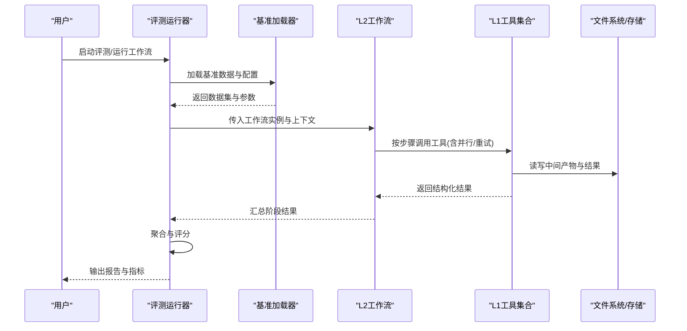
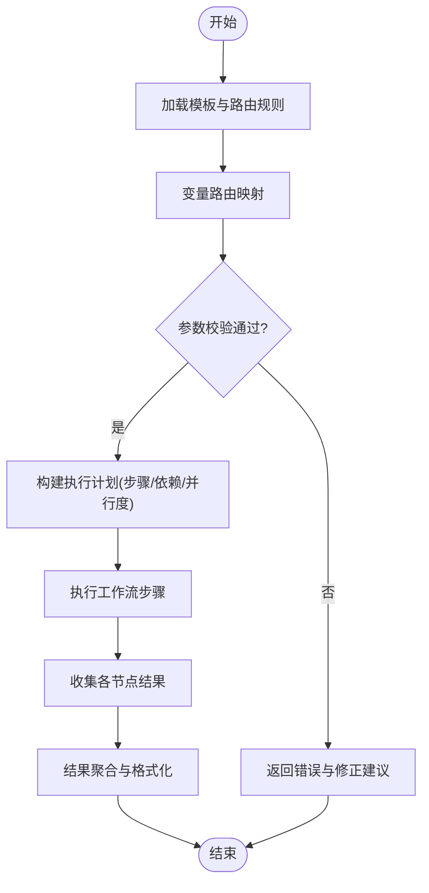
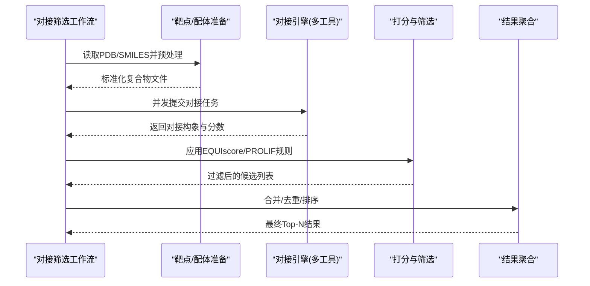
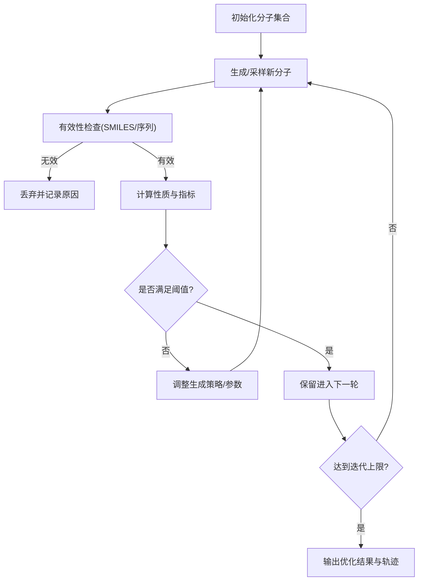
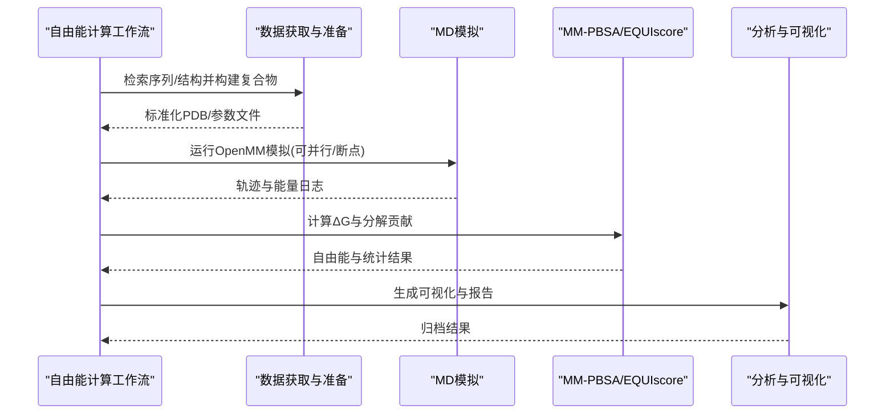
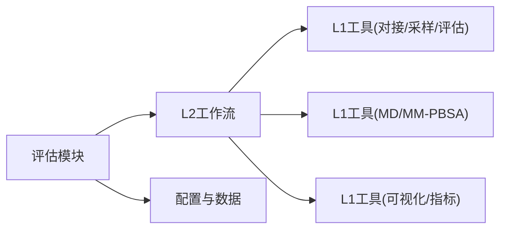

# L2工作流工具

<cite>
**本文引用的文件**   
- [docs/prd/molbench_repo/skills/L2_workflows/02-molecular-docking-screening.md](file://docs/prd/molbench_repo/skills/L2_workflows/02-molecular-docking-screening.md)
- [docs/prd/molbench_repo/skills/L2_workflows/05-iterative-molecular-optimization.md](file://docs/prd/molbench_repo/skills/L2_workflows/05-iterative-molecular-optimization.md)
- [docs/prd/molbench_repo/skills/L2_workflows/06-binding-free-energy-calculation.md](file://docs/prd/molbench_repo/skills/L2_workflows/06-binding-free-energy-calculation.md)
- [docs/prd/molbench_repo/skills/L1_tools/molclaw-docking-screening/tool.py](file://docs/prd/molbench_repo/skills/L1_tools/molclaw-docking-screening/tool.py)
- [docs/prd/molbench_repo/skills/L1_tools/molclaw-protein-ligand-mmpbsa/tool.py](file://docs/prd/molbench_repo/skills/L1_tools/molclaw-protein-ligand-mmpbsa/tool.py)
- [docs/prd/molbench_repo/skills/L1_tools/molclaw-equiscore-tool/tool.py](file://docs/prd/molbench_repo/skills/L1_tools/molclaw-equiscore-tool/tool.py)
- [docs/prd/molbench_repo/skills/L1_tools/molclaw-smiles-valid-check/tool.py](file://docs/prd/molbench_repo/skills/L1_tools/molclaw-smiles-valid-check/tool.py)
- [docs/prd/molbench_repo/skills/L1_tools/molclaw-openawsem-tool/tool.py](file://docs/prd/molbench_repo/skills/L1_tools/molclaw-openawsem-tool/tool.py)
- [docs/prd/molbench_repo/skills/L1_tools/molclaw-prolif-tool/tool.py](file://docs/prd/molbench_repo/skills/L1_tools/molclaw-prolif-tool/tool.py)
- [docs/prd/molbench_repo/skills/L1_tools/molclaw-fpocket-toolkit-base/tool.py](file://docs/prd/molbench_repo/skills/L1_tools/molclaw-fpocket-toolkit-base/tool.py)
- [docs/prd/molbench_repo/skills/L1_tools/molclaw-pdbfixer/tool.py](file://docs/prd/molbench_repo/skills/L1_tools/molclaw-pdbfixer/tool.py)
- [docs/prd/molbench_repo/skills/L1_tools/molclaw-quickvina-docking/tool.py](file://docs/prd/molbench_repo/skills/L1_tools/molclaw-quickvina-docking/tool.py)
- [docs/prd/molbench_repo/skills/L1_tools/molclaw-chai1-predict/tool.py](file://docs/prd/molbench_repo/skills/L1_tools/molclaw-chai1-predict/tool.py)
- [docs/prd/molbench_repo/skills/L1_tools/molclaw-esmfold/tool.py](file://docs/prd/molbench_repo/skills/L1_tools/molclaw-esmfold/tool.py)
- [docs/prd/molbench_repo/skills/L1_tools/molclaw-protein-sequence-retrieve/tool.py](file://docs/prd/molbench_repo/skills/L1_tools/molclaw-protein-sequence-retrieve/tool.py)
- [docs/prd/molbench_repo/skills/L1_tools/molclaw-protein-structure-retrieve/tool.py](file://docs/prd/molbench_repo/skills/L1_tools/molclaw-protein-structure-retrieve/tool.py)
- [docs/prd/molbench_repo/skills/L1_tools/molclaw-compound-retrieve/tool.py](file://docs/prd/molbench_repo/skills/L1_tools/molclaw-compound-retrieve/tool.py)
- [docs/prd/molbench_repo/skills/L1_tools/molclaw-diffdock-auto/tool.py](file://docs/prd/molbench_repo/skills/L1_tools/molclaw-diffdock-auto/tool.py)
- [docs/prd/molbench_repo/skills/L1_tools/molclaw-linker-sampling/tool.py](file://docs/prd/molbench_repo/skills/L1_tools/molclaw-linker-sampling/tool.py)
- [docs/prd/molbench_repo/skills/L1_tools/molclaw-rgroup-sampling/tool.py](file://docs/prd/molbench_repo/skills/L1_tools/molclaw-rgroup-sampling/tool.py)
- [docs/prd/molbench_repo/skills/L1_tools/molclaw-mol2mol-sampling/tool.py](file://docs/prd/molbench_repo/skills/L1_tools/molclaw-mol2mol-sampling/tool.py)
- [docs/prd/molbench_repo/skills/L1_tools/molclaw-smiles-fg-editor/tool.py](file://docs/prd/molbench_repo/skills/L1_tools/molclaw-smiles-fg-editor/tool.py)
- [docs/prd/molbench_repo/skills/L1_tools/molclaw-drug-likeness/tool.py](file://docs/prd/molbench_repo/skills/L1_tools/molclaw-drug-likeness/tool.py)
- [docs/prd/molbench_repo/skills/L1_tools/molclaw-mol-basic-metrics/tool.py](file://docs/prd/molbench_repo/skills/L1_tools/molclaw-mol-basic-metrics/tool.py)
- [docs/prd/molbench_repo/skills/L1_tools/molclaw-mol-hydrophobicity-metrics/tool.py](file://docs/prd/molbench_repo/skills/L1_tools/molclaw-mol-hydrophobicity-metrics/tool.py)
- [docs/prd/molbench_repo/skills/L1_tools/molclaw-mol-hbond-metrics/tool.py](file://docs/prd/molbench_repo/skills/L1_tools/molclaw-mol-hbond-metrics/tool.py)
- [docs/prd/molbench_repo/skills/L1_tools/molclaw-mol-complexity-metrics/tool.py](file://docs/prd/molbench_repo/skills/L1_tools/molclaw-mol-complexity-metrics/tool.py)
- [docs/prd/molbench_repo/skills/L1_tools/molclaw-mol-topology-metrics/tool.py](file://docs/prd/molbench_repo/skills/L1_tools/molclaw-mol-topology-metrics/tool.py)
- [docs/prd/molbench_repo/skills/L1_tools/molclaw-mol-structure-metrics/tool.py](file://docs/prd/molbench_repo/skills/L1_tools/molclaw-mol-structure-metrics/tool.py)
- [docs/prd/molbench_repo/skills/L1_tools/molclaw-mol-opt-physchem/tool.py](file://docs/prd/molbench_repo/skills/L1_tools/molclaw-mol-opt-physchem/tool.py)
- [docs/prd/molbench_repo/skills/L1_tools/molclaw-interaction-visualizer/tool.py](file://docs/prd/molbench_repo/skills/L1_tools/molclaw-interaction-visualizer/tool.py)
- [docs/prd/molbench_repo/skills/L1_tools/molclaw-extract-chains/tool.py](file://docs/prd/molbench_repo/skills/L1_tools/molclaw-extract-chains/tool.py)
- [docs/prd/molbench_repo/skills/L1_tools/molclaw-fix-pdb/tool.py](file://docs/prd/molbench_repo/skills/L1_tools/molclaw-fix-pdb/tool.py)
- [docs/prd/molbench_repo/skills/L1_tools/molclaw-pack-sidechains/tool.py](file://docs/prd/molbench_repo/skills/L1_tools/molclaw-pack-sidechains/tool.py)
- [docs/prd/molbench_repo/skills/L1_tools/molclaw-prolif-md/tool.py](file://docs/prd/molbench_repo/skills/L1_tools/molclaw-prolif-md/tool.py)
- [docs/prd/molbench_repo/skills/L1_tools/molclaw-prolif-pdb/tool.py](file://docs/prd/molbench_repo/skills/L1_tools/molclaw-prolif-pdb/tool.py)
- [docs/prd/molbench_repo/skills/L1_tools/molclaw-protein-protein-mmpbsa/tool.py](file://docs/prd/molbench_repo/skills/L1_tools/molclaw-protein-protein-mmpbsa/tool.py)
- [docs/prd/molbench_repo/skills/L1_tools/molclaw-protein-openmm/tool.py](file://docs/prd/molbench_repo/skills/L1_tools/molclaw-protein-openmm/tool.py)
- [docs/prd/molbench_repo/skills/L1_tools/molclaw-run-bioemu/tool.py](file://docs/prd/molbench_repo/skills/L1_tools/molclaw-run-bioemu/tool.py)
- [docs/prd/molbench_repo/skills/L1_tools/molclaw-sequence-valid-check/tool.py](file://docs/prd/molbench_repo/skills/L1_tools/molclaw-sequence-valid-check/tool.py)
- [docs/prd/molbench_repo/skills/L1_tools/molclaw-scp-server/tool.py](file://docs/prd/molbench_repo/skills/L1_tools/molclaw-scp-server/tool.py)
- [docs/prd/molbench_repo/skills/L1_tools/molclaw-file-transfer/tool.py](file://docs/prd/molbench_repo/skills/L1_tools/molclaw-file_transfer/tool.py)
- [docs/prd/molbench_repo/skills/L1_tools/molclaw-dleps/tool.py](file://docs/prd/molbench_repo/skills/L1_tools/molclaw-dleps/tool.py)
- [docs/prd/molbench_repo/skills/L1_tools/molclaw-goca-tool/tool.py](file://docs/prd/molbench_repo/skills/L1_tools/molclaw-goca-tool/tool.py)
- [docs/prd/molbench_repo/skills/L1_tools/molclaw-hdock-tool/tool.py](file://docs/prd/molbench_repo/skills/L1_tools/molclaw-hdock-tool/tool.py)
- [docs/prd/molbench_repo/skills/L1_tools/molclaw-karmadock-tool/tool.py](file://docs/prd/molbench_repo/skills/L1_tools/molclaw-karmadock-tool/tool.py)
- [docs/prd/molbench_repo/skills/L1_tools/molclaw-p2rank/tool.py](file://docs/prd/molbench_repo/skills/L1_tools/molclaw-p2rank/tool.py)
- [docs/prd/molbench_repo/skills/L1_tools/molclaw-prolif-toolkit-base/tool.py](file://docs/prd/molbench_repo/skills/L1_tools/molclaw-prolif-toolkit-base/tool.py)
- [docs/prd/molbench_repo/skills/L1_tools/molclaw-prolif-toolkit-base/__init__.py](file://docs/prd/molbench_repo/skills/L1_tools/molclaw-prolif-toolkit-base/__init__.py)
- [docs/prd/molbench_repo/skills/L1_tools/molclaw-prolif-toolkit-base/utils.py](file://docs/prd/molbench_repo/skills/L1_tools/molclaw-prolif-toolkit-base/utils.py)
- [docs/prd/molbench_repo/templates/template.py](file://docs/prd/molbench_repo/templates/template.py)
- [docs/prd/molbench_repo/templates/outliners.py](file://docs/prd/molbench_repo/templates/outliners.py)
- [docs/prd/molbench_repo/templates/variable_routing.md](file://docs/prd/molbench_repo/templates/variable_routing.md)
- [docs/prd/molbench_repo/templates/tool_routing.md](file://docs/prd/molbench_repo/templates/tool_routing.md)
- [docs/prd/molbench_repo/templates/answer_format.md](file://docs/prd/molbench_repo/templates/answer_format.md)
- [docs/prd/molbench_repo/config/baseline_molbench-ms-3.yaml](file://docs/prd/molbench_repo/config/baseline_molbench-ms-3.yaml)
- [docs/prd/molbench_repo/config/chemcot_mo_edit.yaml](file://docs/prd/molbench_repo/config/chemcot_mo_edit.yaml)
- [docs/prd/molbench_repo/config/chemcot_mo_opt.yaml](file://docs/prd/molbench_repo/config/chemcot_mo_opt.yaml)
- [docs/prd/molbench_repo/config/claude_template.yaml](file://docs/prd/molbench_repo/config/claude_template.yaml)
- [docs/prd/molbench_repo/data_full/molbench-mo/manifest.json](file://docs/prd/molbench_repo/data_full/molbench-mo/manifest.json)
- [docs/prd/molbench_repo/data_full/molbench-ms-1/molbench-ms-1.csv](file://docs/prd/molbench_repo/data_full/molbench-ms-1/molbench-ms-1.csv)
- [docs/prd/molbench_repo/data_full/molbench-ms-2/molbench-ms-2.csv](file://docs/prd/molbench_repo/data_full/molbench-ms-2/molbench-ms-2.csv)
- [docs/prd/molbench_repo/data_full/molbench-ms-3/molbench-ms-3.csv](file://docs/prd/molbench_repo/data_full/molbench-ms-3/molbench-ms-3.csv)
- [docs/prd/molbench_repo/eval/eval_runner.py](file://docs/prd/molbench_repo/eval/eval_runner.py)
- [docs/prd/molbench_repo/eval/bench_loaders.py](file://docs/prd/molbench_repo/eval/bench_loaders.py)
- [docs/prd/molbench_repo/eval/run_eval_bench.py](file://docs/prd/molbench_repo/eval/run_eval_bench.py)
</cite>

## 目录
1. [简介](#简介)
2. [项目结构](#项目结构)
3. [核心组件](#核心组件)
4. [架构总览](#架构总览)
5. [详细组件分析](#详细组件分析)
6. [依赖分析](#依赖分析)
7. [性能考虑](#性能考虑)
8. [故障排查指南](#故障排查指南)
9. [结论](#结论)
10. [附录](#附录)

## 简介
本文件为L2工作流工具的全面架构文档，聚焦于分子对接筛选、迭代分子优化与结合自由能计算等复杂科学工作流的编排机制。文档涵盖：
- 工作流定义格式与模板体系
- 任务调度策略与并行执行模型
- 状态管理与错误恢复机制
- 资源管理与多步骤任务的容错设计
- 数据在各节点间的传递方式与结果聚合机制
- 工作流模板使用方法与自定义开发指南

## 项目结构
仓库围绕“技能（L1工具）—工作流（L2）—评估与配置”分层组织：
- L1工具层：提供原子能力（如对接、打分、采样、结构修复、可视化、指标计算等），每个工具以独立目录和tool.py实现，便于组合复用。
- L2工作流层：将多个L1工具按业务逻辑编排成端到端流程，覆盖从靶点准备、对接筛选、性质过滤、生成设计、迭代优化到自由能计算的完整链路。
- 模板与路由：提供变量路由、工具路由、答案格式等模板，支撑工作流的可配置化与可解释性。
- 配置与数据：通过YAML与CSV/JSON清单管理基准数据集、参数与环境；评估模块负责加载数据、运行评测并汇总结果。

```mermaid
graph TB
subgraph "L1工具层"
T1["对接工具<br/>molclaw-docking-screening"]
T2["MM-PBSA工具<br/>molclaw-protein-ligand-mmpbsa"]
T3["EQUIscore工具<br/>molclaw-equiscore-tool"]
T4["SMILES校验<br/>molclaw-smiles-valid-check"]
T5["OpenAWSEM工具<br/>molclaw-openawsem-tool"]
T6["PROLIF工具集<br/>molclaw-prolif-tool"]
T7["FPocket基础<br/>molclaw-fpocket-toolkit-base"]
T8["PDBFixer<br/>molclaw-pdbfixer"]
T9["QuickVina对接<br/>molclaw-quickvina-docking"]
T10["Chai1预测<br/>molclaw-chai1-predict"]
T11["ESMFold<br/>molclaw-esmfold"]
T12["序列/结构检索<br/>protein-sequence-retrieve / protein-structure-retrieve"]
T13["化合物检索<br/>compound-retrieve"]
T14["DiffDock自动对接<br/>molclaw-diffdock-auto"]
T15["Linker/Rgroup/Mol2Mol采样<br/>linker-sampling / rgroup-sampling / mol2mol-sampling"]
T16["SMILES官能团编辑<br/>smiles-fg-editor"]
T17["药物相似性与理化指标<br/>drug-likeness / mol-* metrics"]
T18["相互作用可视化<br/>interaction-visualizer"]
T19["链提取/PDB修复/侧链填充<br/>extract-chains / fix-pdb / pack-sidechains"]
T20["MD与PROLIF分析<br/>prolif-md / profif-pdb"]
T21["蛋白-蛋白MM-PBSA<br/>protein-protein-mmpbsa"]
T22["OpenMM模拟<br/>protein-openmm"]
T23["BioEmu运行<br/>run-bioemu"]
T24["序列有效性检查<br/>sequence-valid-check"]
T25["SCP服务器/文件传输<br/>scp-server / file-transfer"]
T26["DLPS/GOCA/HDOCK/KarMaDock<br/>dleps / goca-tool / hdock-tool / karmadock-tool"]
T27["p2rank位点预测<br/>p2rank"]
T28["PROLIF工具包基类<br/>prolif-toolkit-base"]
end
subgraph "L2工作流层"
W1["分子对接筛选<br/>02-molecular-docking-screening"]
W2["迭代分子优化<br/>05-iterative-molecular-optimization"]
W3["结合自由能计算<br/>06-binding-free-energy-calculation"]
end
subgraph "模板与路由"
M1["变量路由模板<br/>variable_routing.md"]
M2["工具路由模板<br/>tool_routing.md"]
M3["答案格式模板<br/>answer_format.md"]
M4["模板引擎<br/>template.py / outliners.py"]
end
subgraph "配置与数据"
C1["基准配置<br/>baseline_molbench-ms-3.yaml"]
C2["MO编辑/优化配置<br/>chemcot_mo_edit.yaml / chemcot_mo_opt.yaml"]
D1["MO清单<br/>data_full/molbench-mo/manifest.json"]
D2["MS-1/2/3数据集<br/>csv"]
end
subgraph "评估"
E1["评测运行器<br/>eval_runner.py"]
E2["基准加载器<br/>bench_loaders.py"]
E3["评测入口<br/>run_eval_bench.py"]
end
W1 --> T1
W1 --> T9
W1 --> T14
W1 --> T8
W1 --> T7
W1 --> T18
W2 --> T15
W2 --> T16
W2 --> T17
W2 --> T4
W2 --> T5
W2 --> T1
W3 --> T2
W3 --> T3
W3 --> T20
W3 --> T21
W3 --> T22
W3 --> T23
W3 --> T19
W3 --> T12
W3 --> T13
W3 --> T24
W3 --> T25
W3 --> T26
W3 --> T27
W3 --> T28
M1 --> W1
M2 --> W1
M3 --> W1
M4 --> W1
C1 --> E1
C2 --> E1
D1 --> E2
D2 --> E2
E1 --> E3
```

图表来源
- [docs/prd/molbench_repo/skills/L2_workflows/02-molecular-docking-screening.md](file://docs/prd/molbench_repo/skills/L2_workflows/02-molecular-docking-screening.md)
- [docs/prd/molbench_repo/skills/L2_workflows/05-iterative-molecular-optimization.md](file://docs/prd/molbench_repo/skills/L2_workflows/05-iterative-molecular-optimization.md)
- [docs/prd/molbench_repo/skills/L2_workflows/06-binding-free-energy-calculation.md](file://docs/prd/molbench_repo/skills/L2_workflows/06-binding-free-energy-calculation.md)
- [docs/prd/molbench_repo/templates/template.py](file://docs/prd/molbench_repo/templates/template.py)
- [docs/prd/molbench_repo/templates/outliners.py](file://docs/prd/molbench_repo/templates/outliners.py)
- [docs/prd/molbench_repo/templates/variable_routing.md](file://docs/prd/molbench_repo/templates/variable_routing.md)
- [docs/prd/molbench_repo/templates/tool_routing.md](file://docs/prd/molbench_repo/templates/tool_routing.md)
- [docs/prd/molbench_repo/templates/answer_format.md](file://docs/prd/molbench_repo/templates/answer_format.md)
- [docs/prd/molbench_repo/config/baseline_molbench-ms-3.yaml](file://docs/prd/molbench_repo/config/baseline_molbench-ms-3.yaml)
- [docs/prd/molbench_repo/config/chemcot_mo_edit.yaml](file://docs/prd/molbench_repo/config/chemcot_mo_edit.yaml)
- [docs/prd/molbench_repo/config/chemcot_mo_opt.yaml](file://docs/prd/molbench_repo/config/chemcot_mo_opt.yaml)
- [docs/prd/molbench_repo/data_full/molbench-mo/manifest.json](file://docs/prd/molbench_repo/data_full/molbench-mo/manifest.json)
- [docs/prd/molbench_repo/data_full/molbench-ms-1/molbench-ms-1.csv](file://docs/prd/molbench_repo/data_full/molbench-ms-1/molbench-ms-1.csv)
- [docs/prd/molbench_repo/data_full/molbench-ms-2/molbench-ms-2.csv](file://docs/prd/molbench_repo/data_full/molbench-ms-2/molbench-ms-2.csv)
- [docs/prd/molbench_repo/data_full/molbench-ms-3/molbench-ms-3.csv](file://docs/prd/molbench_repo/data_full/molbench-ms-3/molbench-ms-3.csv)
- [docs/prd/molbench_repo/eval/eval_runner.py](file://docs/prd/molbench_repo/eval/eval_runner.py)
- [docs/prd/molbench_repo/eval/bench_loaders.py](file://docs/prd/molbench_repo/eval/bench_loaders.py)
- [docs/prd/molbench_repo/eval/run_eval_bench.py](file://docs/prd/molbench_repo/eval/run_eval_bench.py)

章节来源
- [docs/prd/molbench_repo/skills/L2_workflows/02-molecular-docking-screening.md](file://docs/prd/molbench_repo/skills/L2_workflows/02-molecular-docking-screening.md)
- [docs/prd/molbench_repo/skills/L2_workflows/05-iterative-molecular-optimization.md](file://docs/prd/molbench_repo/skills/L2_workflows/05-iterative-molecular-optimization.md)
- [docs/prd/molbench_repo/skills/L2_workflows/06-binding-free-energy-calculation.md](file://docs/prd/molbench_repo/skills/L2_workflows/06-binding-free-energy-calculation.md)
- [docs/prd/molbench_repo/templates/template.py](file://docs/prd/molbench_repo/templates/template.py)
- [docs/prd/molbench_repo/templates/outliners.py](file://docs/prd/molbench_repo/templates/outliners.py)
- [docs/prd/molbench_repo/templates/variable_routing.md](file://docs/prd/molbench_repo/templates/variable_routing.md)
- [docs/prd/molbench_repo/templates/tool_routing.md](file://docs/prd/molbench_repo/templates/tool_routing.md)
- [docs/prd/molbench_repo/templates/answer_format.md](file://docs/prd/molbench_repo/templates/answer_format.md)
- [docs/prd/molbench_repo/config/baseline_molbench-ms-3.yaml](file://docs/prd/molbench_repo/config/baseline_molbench-ms-3.yaml)
- [docs/prd/molbench_repo/config/chemcot_mo_edit.yaml](file://docs/prd/molbench_repo/config/chemcot_mo_edit.yaml)
- [docs/prd/molbench_repo/config/chemcot_mo_opt.yaml](file://docs/prd/molbench_repo/config/chemcot_mo_opt.yaml)
- [docs/prd/molbench_repo/data_full/molbench-mo/manifest.json](file://docs/prd/molbench_repo/data_full/molbench-mo/manifest.json)
- [docs/prd/molbench_repo/data_full/molbench-ms-1/molbench-ms-1.csv](file://docs/prd/molbench_repo/data_full/molbench-ms-1/molbench-ms-1.csv)
- [docs/prd/molbench_repo/data_full/molbench-ms-2/molbench-ms-2.csv](file://docs/prd/molbench_repo/data_full/molbench-ms-2/molbench-ms-2.csv)
- [docs/prd/molbench_repo/data_full/molbench-ms-3/molbench-ms-3.csv](file://docs/prd/molbench_repo/data_full/molbench-ms-3/molbench-ms-3.csv)
- [docs/prd/molbench_repo/eval/eval_runner.py](file://docs/prd/molbench_repo/eval/eval_runner.py)
- [docs/prd/molbench_repo/eval/bench_loaders.py](file://docs/prd/molbench_repo/eval/bench_loaders.py)
- [docs/prd/molbench_repo/eval/run_eval_bench.py](file://docs/prd/molbench_repo/eval/run_eval_bench.py)

## 核心组件
- L1工具集合：封装具体算法与外部依赖，统一暴露输入输出契约，支持跨工作流复用。
- L2工作流：以“步骤”为单位编排L1工具，定义数据流转、条件分支、循环与重试策略。
- 模板与路由：通过变量路由与工具路由模板，将用户输入与工作流参数解耦，增强可配置性。
- 配置与数据：YAML/CSV/JSON驱动的数据与参数管理，配合评估模块进行批处理与结果汇总。
- 评估系统：加载基准数据、执行工作流、收集指标与报告，形成闭环验证。

章节来源
- [docs/prd/molbench_repo/skills/L2_workflows/02-molecular-docking-screening.md](file://docs/prd/molbench_repo/skills/L2_workflows/02-molecular-docking-screening.md)
- [docs/prd/molbench_repo/skills/L2_workflows/05-iterative-molecular-optimization.md](file://docs/prd/molbench_repo/skills/L2_workflows/05-iterative-molecular-optimization.md)
- [docs/prd/molbench_repo/skills/L2_workflows/06-binding-free-energy-calculation.md](file://docs/prd/molbench_repo/skills/L2_workflows/06-binding-free-energy-calculation.md)
- [docs/prd/molbench_repo/templates/variable_routing.md](file://docs/prd/molbench_repo/templates/variable_routing.md)
- [docs/prd/molbench_repo/templates/tool_routing.md](file://docs/prd/molbench_repo/templates/tool_routing.md)
- [docs/prd/molbench_repo/templates/answer_format.md](file://docs/prd/molbench_repo/templates/answer_format.md)
- [docs/prd/molbench_repo/config/baseline_molbench-ms-3.yaml](file://docs/prd/molbench_repo/config/baseline_molbench-ms-3.yaml)
- [docs/prd/molbench_repo/data_full/molbench-mo/manifest.json](file://docs/prd/molbench_repo/data_full/molbench-mo/manifest.json)
- [docs/prd/molbench_repo/eval/eval_runner.py](file://docs/prd/molbench_repo/eval/eval_runner.py)
- [docs/prd/molbench_repo/eval/bench_loaders.py](file://docs/prd/molbench_repo/eval/bench_loaders.py)
- [docs/prd/molbench_repo/eval/run_eval_bench.py](file://docs/prd/molbench_repo/eval/run_eval_bench.py)

## 架构总览
L2工作流作为编排层，调用L1工具完成具体计算。模板与路由负责将用户意图转化为可执行的参数映射；配置与数据层提供输入源与评测目标；评估模块驱动整体运行并产出报告。

图表来源
- [docs/prd/molbench_repo/eval/eval_runner.py](file://docs/prd/molbench_repo/eval/eval_runner.py)
- [docs/prd/molbench_repo/eval/bench_loaders.py](file://docs/prd/molbench_repo/eval/bench_loaders.py)
- [docs/prd/molbench_repo/eval/run_eval_bench.py](file://docs/prd/molbench_repo/eval/run_eval_bench.py)
- [docs/prd/molbench_repo/skills/L2_workflows/02-molecular-docking-screening.md](file://docs/prd/molbench_repo/skills/L2_workflows/02-molecular-docking-screening.md)
- [docs/prd/molbench_repo/skills/L2_workflows/05-iterative-molecular-optimization.md](file://docs/prd/molbench_repo/skills/L2_workflows/05-iterative-molecular-optimization.md)
- [docs/prd/molbench_repo/skills/L2_workflows/06-binding-free-energy-calculation.md](file://docs/prd/molbench_repo/skills/L2_workflows/06-binding-free-energy-calculation.md)

## 详细组件分析

### 工作流定义与模板体系
- 工作流定义：以Markdown描述步骤、输入输出、依赖关系与条件分支，明确数据在节点间传递的字段名与类型。
- 模板引擎：提供模板渲染与大纲生成能力，使工作流具备可插拔的结构化输出。
- 变量路由：将用户输入映射到工作流参数，支持默认值、必填校验与类型转换。
- 工具路由：根据上下文选择合适工具或工具版本，屏蔽底层差异。
- 答案格式：统一输出结构，便于后续聚合与评测。

图表来源
- [docs/prd/molbench_repo/templates/template.py](file://docs/prd/molbench_repo/templates/template.py)
- [docs/prd/molbench_repo/templates/outliners.py](file://docs/prd/molbench_repo/templates/outliners.py)
- [docs/prd/molbench_repo/templates/variable_routing.md](file://docs/prd/molbench_repo/templates/variable_routing.md)
- [docs/prd/molbench_repo/templates/tool_routing.md](file://docs/prd/molbench_repo/templates/tool_routing.md)
- [docs/prd/molbench_repo/templates/answer_format.md](file://docs/prd/molbench_repo/templates/answer_format.md)

章节来源
- [docs/prd/molbench_repo/templates/template.py](file://docs/prd/molbench_repo/templates/template.py)
- [docs/prd/molbench_repo/templates/outliners.py](file://docs/prd/molbench_repo/templates/outliners.py)
- [docs/prd/molbench_repo/templates/variable_routing.md](file://docs/prd/molbench_repo/templates/variable_routing.md)
- [docs/prd/molbench_repo/templates/tool_routing.md](file://docs/prd/molbench_repo/templates/tool_routing.md)
- [docs/prd/molbench_repo/templates/answer_format.md](file://docs/prd/molbench_repo/templates/answer_format.md)

### 分子对接筛选工作流（L2）
- 典型步骤：
  - 靶点准备：链提取、PDB修复、侧链填充、口袋识别（FPocket）、受体预处理。
  - 配体准备：SMILES校验、官能团编辑、构象生成。
  - 对接执行：多工具并行（QuickVina、DiffDock、HDOCK、KarMaDock等）。
  - 初筛与排序：EQUIscore打分、相互作用分析（PROLIF）、可视化。
  - 结果聚合：去重、阈值过滤、Top-N候选导出。
- 数据流转：以文件路径与结构化元数据为主，确保下游工具可直接消费。
- 并行与容错：对接任务可并行执行；单任务失败触发重试或降级至备选工具。

图表来源
- [docs/prd/molbench_repo/skills/L2_workflows/02-molecular-docking-screening.md](file://docs/prd/molbench_repo/skills/L2_workflows/02-molecular-docking-screening.md)
- [docs/prd/molbench_repo/skills/L1_tools/molclaw-docking-screening/tool.py](file://docs/prd/molbench_repo/skills/L1_tools/molclaw-docking-screening/tool.py)
- [docs/prd/molbench_repo/skills/L1_tools/molclaw-quickvina-docking/tool.py](file://docs/prd/molbench_repo/skills/L1_tools/molclaw-quickvina-docking/tool.py)
- [docs/prd/molbench_repo/skills/L1_tools/molclaw-diffdock-auto/tool.py](file://docs/prd/molbench_repo/skills/L1_tools/molclaw-diffdock-auto/tool.py)
- [docs/prd/molbench_repo/skills/L1_tools/molclaw-hdock-tool/tool.py](file://docs/prd/molbench_repo/skills/L1_tools/molclaw-hdock-tool/tool.py)
- [docs/prd/molbench_repo/skills/L1_tools/molclaw-karmadock-tool/tool.py](file://docs/prd/molbench_repo/skills/L1_tools/molclaw-karmadock-tool/tool.py)
- [docs/prd/molbench_repo/skills/L1_tools/molclaw-equiscore-tool/tool.py](file://docs/prd/molbench_repo/skills/L1_tools/molclaw-equiscore-tool/tool.py)
- [docs/prd/molbench_repo/skills/L1_tools/molclaw-prolif-tool/tool.py](file://docs/prd/molbench_repo/skills/L1_tools/molclaw-prolif-tool/tool.py)
- [docs/prd/molbench_repo/skills/L1_tools/molclaw-fpocket-toolkit-base/tool.py](file://docs/prd/molbench_repo/skills/L1_tools/molclaw-fpocket-toolkit-base/tool.py)
- [docs/prd/molbench_repo/skills/L1_tools/molclaw-pdbfixer/tool.py](file://docs/prd/molbench_repo/skills/L1_tools/molclaw-pdbfixer/tool.py)
- [docs/prd/molbench_repo/skills/L1_tools/molclaw-extract-chains/tool.py](file://docs/prd/molbench_repo/skills/L1_tools/molclaw-extract-chains/tool.py)
- [docs/prd/molbench_repo/skills/L1_tools/molclaw-pack-sidechains/tool.py](file://docs/prd/molbench_repo/skills/L1_tools/molclaw-pack-sidechains/tool.py)
- [docs/prd/molbench_repo/skills/L1_tools/molclaw-smiles-valid-check/tool.py](file://docs/prd/molbench_repo/skills/L1_tools/molclaw-smiles-valid-check/tool.py)
- [docs/prd/molbench_repo/skills/L1_tools/molclaw-smiles-fg-editor/tool.py](file://docs/prd/molbench_repo/skills/L1_tools/molclaw-smiles-fg-editor/tool.py)
- [docs/prd/molbench_repo/skills/L1_tools/molclaw-interaction-visualizer/tool.py](file://docs/prd/molbench_repo/skills/L1_tools/molclaw-interaction-visualizer/tool.py)

章节来源
- [docs/prd/molbench_repo/skills/L2_workflows/02-molecular-docking-screening.md](file://docs/prd/molbench_repo/skills/L2_workflows/02-molecular-docking-screening.md)
- [docs/prd/molbench_repo/skills/L1_tools/molclaw-docking-screening/tool.py](file://docs/prd/molbench_repo/skills/L1_tools/molclaw-docking-screening/tool.py)
- [docs/prd/molbench_repo/skills/L1_tools/molclaw-quickvina-docking/tool.py](file://docs/prd/molbench_repo/skills/L1_tools/molclaw-quickvina-docking/tool.py)
- [docs/prd/molbench_repo/skills/L1_tools/molclaw-diffdock-auto/tool.py](file://docs/prd/molbench_repo/skills/L1_tools/molclaw-diffdock-auto/tool.py)
- [docs/prd/molbench_repo/skills/L1_tools/molclaw-hdock-tool/tool.py](file://docs/prd/molbench_repo/skills/L1_tools/molclaw-hdock-tool/tool.py)
- [docs/prd/molbench_repo/skills/L1_tools/molclaw-karmadock-tool/tool.py](file://docs/prd/molbench_repo/skills/L1_tools/molclaw-karmadock-tool/tool.py)
- [docs/prd/molbench_repo/skills/L1_tools/molclaw-equiscore-tool/tool.py](file://docs/prd/molbench_repo/skills/L1_tools/molclaw-equiscore-tool/tool.py)
- [docs/prd/molbench_repo/skills/L1_tools/molclaw-prolif-tool/tool.py](file://docs/prd/molbench_repo/skills/L1_tools/molclaw-prolif-tool/tool.py)
- [docs/prd/molbench_repo/skills/L1_tools/molclaw-fpocket-toolkit-base/tool.py](file://docs/prd/molbench_repo/skills/L1_tools/molclaw-fpocket-toolkit-base/tool.py)
- [docs/prd/molbench_repo/skills/L1_tools/molclaw-pdbfixer/tool.py](file://docs/prd/molbench_repo/skills/L1_tools/molclaw-pdbfixer/tool.py)
- [docs/prd/molbench_repo/skills/L1_tools/molclaw-extract-chains/tool.py](file://docs/prd/molbench_repo/skills/L1_tools/molclaw-extract-chains/tool.py)
- [docs/prd/molbench_repo/skills/L1_tools/molclaw-pack-sidechains/tool.py](file://docs/prd/molbench_repo/skills/L1_tools/molclaw-pack-sidechains/tool.py)
- [docs/prd/molbench_repo/skills/L1_tools/molclaw-smiles-valid-check/tool.py](file://docs/prd/molbench_repo/skills/L1_tools/molclaw-smiles-valid-check/tool.py)
- [docs/prd/molbench_repo/skills/L1_tools/molclaw-smiles-fg-editor/tool.py](file://docs/prd/molbench_repo/skills/L1_tools/molclaw-smiles-fg-editor/tool.py)
- [docs/prd/molbench_repo/skills/L1_tools/molclaw-interaction-visualizer/tool.py](file://docs/prd/molbench_repo/skills/L1_tools/molclaw-interaction-visualizer/tool.py)

### 迭代分子优化工作流（L2）
- 典型步骤：
  - 初始分子生成/采样：Linker/Rgroup/Mol2Mol采样、官能团编辑。
  - 性质评估：药物相似性、理化指标、拓扑/结构度量、氢键/疏水性等。
  - 约束与过滤：SMILES有效性、序列/结构有效性（若涉及肽/蛋白片段）。
  - 优化循环：基于反馈调整生成策略，重复直至收敛或达到预算。
  - 结果归档：记录每代分子、指标与变更原因。
- 并行与容错：采样与评估可并行；无效分子快速失败并跳过；循环设置最大迭代次数与早停条件。

图表来源
- [docs/prd/molbench_repo/skills/L2_workflows/05-iterative-molecular-optimization.md](file://docs/prd/molbench_repo/skills/L2_workflows/05-iterative-molecular-optimization.md)
- [docs/prd/molbench_repo/skills/L1_tools/molclaw-linker-sampling/tool.py](file://docs/prd/molbench_repo/skills/L1_tools/molclaw-linker-sampling/tool.py)
- [docs/prd/molbench_repo/skills/L1_tools/molclaw-rgroup-sampling/tool.py](file://docs/prd/molbench_repo/skills/L1_tools/molclaw-rgroup-sampling/tool.py)
- [docs/prd/molbench_repo/skills/L1_tools/molclaw-mol2mol-sampling/tool.py](file://docs/prd/molbench_repo/skills/L1_tools/molclaw-mol2mol-sampling/tool.py)
- [docs/prd/molbench_repo/skills/L1_tools/molclaw-smiles-fg-editor/tool.py](file://docs/prd/molbench_repo/skills/L1_tools/molclaw-smiles-fg-editor/tool.py)
- [docs/prd/molbench_repo/skills/L1_tools/molclaw-drug-likeness/tool.py](file://docs/prd/molbench_repo/skills/L1_tools/molclaw-drug-likeness/tool.py)
- [docs/prd/molbench_repo/skills/L1_tools/molclaw-mol-basic-metrics/tool.py](file://docs/prd/molbench_repo/skills/L1_tools/molclaw-mol-basic-metrics/tool.py)
- [docs/prd/molbench_repo/skills/L1_tools/molclaw-mol-hydrophobicity-metrics/tool.py](file://docs/prd/molbench_repo/skills/L1_tools/molclaw-mol-hydrophobicity-metrics/tool.py)
- [docs/prd/molbench_repo/skills/L1_tools/molclaw-mol-hbond-metrics/tool.py](file://docs/prd/molbench_repo/skills/L1_tools/molclaw-mol-hbond-metrics/tool.py)
- [docs/prd/molbench_repo/skills/L1_tools/molclaw-mol-complexity-metrics/tool.py](file://docs/prd/molbench_repo/skills/L1_tools/molclaw-mol-complexity-metrics/tool.py)
- [docs/prd/molbench_repo/skills/L1_tools/molclaw-mol-topology-metrics/tool.py](file://docs/prd/molbench_repo/skills/L1_tools/molclaw-mol-topology-metrics/tool.py)
- [docs/prd/molbench_repo/skills/L1_tools/molclaw-mol-structure-metrics/tool.py](file://docs/prd/molbench_repo/skills/L1_tools/molclaw-mol-structure-metrics/tool.py)
- [docs/prd/molbench_repo/skills/L1_tools/molclaw-mol-opt-physchem/tool.py](file://docs/prd/molbench_repo/skills/L1_tools/molclaw-mol-opt-physchem/tool.py)
- [docs/prd/molbench_repo/skills/L1_tools/molclaw-smiles-valid-check/tool.py](file://docs/prd/molbench_repo/skills/L1_tools/molclaw-smiles-valid-check/tool.py)
- [docs/prd/molbench_repo/skills/L1_tools/molclaw-openawsem-tool/tool.py](file://docs/prd/molbench_repo/skills/L1_tools/molclaw-openawsem-tool/tool.py)

章节来源
- [docs/prd/molbench_repo/skills/L2_workflows/05-iterative-molecular-optimization.md](file://docs/prd/molbench_repo/skills/L2_workflows/05-iterative-molecular-optimization.md)
- [docs/prd/molbench_repo/skills/L1_tools/molclaw-linker-sampling/tool.py](file://docs/prd/molbench_repo/skills/L1_tools/molclaw-linker-sampling/tool.py)
- [docs/prd/molbench_repo/skills/L1_tools/molclaw-rgroup-sampling/tool.py](file://docs/prd/molbench_repo/skills/L1_tools/molclaw-rgroup-sampling/tool.py)
- [docs/prd/molbench_repo/skills/L1_tools/molclaw-mol2mol-sampling/tool.py](file://docs/prd/molbench_repo/skills/L1_tools/molclaw-mol2mol-sampling/tool.py)
- [docs/prd/molbench_repo/skills/L1_tools/molclaw-smiles-fg-editor/tool.py](file://docs/prd/molbench_repo/skills/L1_tools/molclaw-smiles-fg-editor/tool.py)
- [docs/prd/molbench_repo/skills/L1_tools/molclaw-drug-likeness/tool.py](file://docs/prd/molbench_repo/skills/L1_tools/molclaw-drug-likeness/tool.py)
- [docs/prd/molbench_repo/skills/L1_tools/molclaw-mol-basic-metrics/tool.py](file://docs/prd/molbench_repo/skills/L1_tools/molclaw-mol-basic-metrics/tool.py)
- [docs/prd/molbench_repo/skills/L1_tools/molclaw-mol-hydrophobicity-metrics/tool.py](file://docs/prd/molbench_repo/skills/L1_tools/molclaw-mol-hydrophobicity-metrics/tool.py)
- [docs/prd/molbench_repo/skills/L1_tools/molclaw-mol-hbond-metrics/tool.py](file://docs/prd/molbench_repo/skills/L1_tools/molclaw-mol-hbond-metrics/tool.py)
- [docs/prd/molbench_repo/skills/L1_tools/molclaw-mol-complexity-metrics/tool.py](file://docs/prd/molbench_repo/skills/L1_tools/molclaw-mol-complexity-metrics/tool.py)
- [docs/prd/molbench_repo/skills/L1_tools/molclaw-mol-topology-metrics/tool.py](file://docs/prd/molbench_repo/skills/L1_tools/molclaw-mol-topology-metrics/tool.py)
- [docs/prd/molbench_repo/skills/L1_tools/molclaw-mol-structure-metrics/tool.py](file://docs/prd/molbench_repo/skills/L1_tools/molclaw-mol-structure-metrics/tool.py)
- [docs/prd/molbench_repo/skills/L1_tools/molclaw-mol-opt-physchem/tool.py](file://docs/prd/molbench_repo/skills/L1_tools/molclaw-mol-opt-physchem/tool.py)
- [docs/prd/molbench_repo/skills/L1_tools/molclaw-smiles-valid-check/tool.py](file://docs/prd/molbench_repo/skills/L1_tools/molclaw-smiles-valid-check/tool.py)
- [docs/prd/molbench_repo/skills/L1_tools/molclaw-openawsem-tool/tool.py](file://docs/prd/molbench_repo/skills/L1_tools/molclaw-openawsem-tool/tool.py)

### 结合自由能计算工作流（L2）
- 典型步骤：
  - 数据获取：蛋白序列/结构检索、复合物构建、链提取与修复。
  - MD准备与运行：侧链填充、力场准备、OpenMM模拟、轨迹保存。
  - 自由能计算：MM-PBSA（配体-蛋白/蛋白-蛋白）、EQUIscore辅助评估。
  - 分析与可视化：相互作用分析、轨迹统计、结果归档。
- 资源管理：MD与MM-PBSA计算密集，需限制并发、设置超时与断点续算。
- 错误恢复：轨迹损坏或收敛失败时回退到最近稳定帧；关键步骤失败触发重试或降级。

图表来源
- [docs/prd/molbench_repo/skills/L2_workflows/06-binding-free-energy-calculation.md](file://docs/prd/molbench_repo/skills/L2_workflows/06-binding-free-energy-calculation.md)
- [docs/prd/molbench_repo/skills/L1_tools/molclaw-protein-ligand-mmpbsa/tool.py](file://docs/prd/molbench_repo/skills/L1_tools/molclaw-protein-ligand-mmpbsa/tool.py)
- [docs/prd/molbench_repo/skills/L1_tools/molclaw-protein-protein-mmpbsa/tool.py](file://docs/prd/molbench_repo/skills/L1_tools/molclaw-protein-protein-mmpbsa/tool.py)
- [docs/prd/molbench_repo/skills/L1_tools/molclaw-equiscore-tool/tool.py](file://docs/prd/molbench_repo/skills/L1_tools/molclaw-equiscore-tool/tool.py)
- [docs/prd/molbench_repo/skills/L1_tools/molclaw-protein-openmm/tool.py](file://docs/prd/molbench_repo/skills/L1_tools/molclaw-protein-openmm/tool.py)
- [docs/prd/molbench_repo/skills/L1_tools/molclaw-prolif-md/tool.py](file://docs/prd/molbench_repo/skills/L1_tools/molclaw-prolif-md/tool.py)
- [docs/prd/molbench_repo/skills/L1_tools/molclaw-prolif-pdb/tool.py](file://docs/prd/molbench_repo/skills/L1_tools/molclaw-prolif-pdb/tool.py)
- [docs/prd/molbench_repo/skills/L1_tools/molclaw-interaction-visualizer/tool.py](file://docs/prd/molbench_repo/skills/L1_tools/molclaw-interaction-visualizer/tool.py)
- [docs/prd/molbench_repo/skills/L1_tools/molclaw-extract-chains/tool.py](file://docs/prd/molbench_repo/skills/L1_tools/molclaw-extract-chains/tool.py)
- [docs/prd/molbench_repo/skills/L1_tools/molclaw-pdbfixer/tool.py](file://docs/prd/molbench_repo/skills/L1_tools/molclaw-pdbfixer/tool.py)
- [docs/prd/molbench_repo/skills/L1_tools/molclaw-pack-sidechains/tool.py](file://docs/prd/molbench_repo/skills/L1_tools/molclaw-pack-sidechains/tool.py)
- [docs/prd/molbench_repo/skills/L1_tools/molclaw-protein-sequence-retrieve/tool.py](file://docs/prd/molbench_repo/skills/L1_tools/molclaw-protein-sequence-retrieve/tool.py)
- [docs/prd/molbench_repo/skills/L1_tools/molclaw-protein-structure-retrieve/tool.py](file://docs/prd/molbench_repo/skills/L1_tools/molclaw-protein-structure-retrieve/tool.py)
- [docs/prd/molbench_repo/skills/L1_tools/molclaw-run-bioemu/tool.py](file://docs/prd/molbench_repo/skills/L1_tools/molclaw-run-bioemu/tool.py)
- [docs/prd/molbench_repo/skills/L1_tools/molclaw-sequence-valid-check/tool.py](file://docs/prd/molbench_repo/skills/L1_tools/molclaw-sequence-valid-check/tool.py)
- [docs/prd/molbench_repo/skills/L1_tools/molclaw-scp-server/tool.py](file://docs/prd/molbench_repo/skills/L1_tools/molclaw-scp-server/tool.py)
- [docs/prd/molbench_repo/skills/L1_tools/molclaw-file-transfer/tool.py](file://docs/prd/molbench_repo/skills/L1_tools/molclaw-file_transfer/tool.py)

章节来源
- [docs/prd/molbench_repo/skills/L2_workflows/06-binding-free-energy-calculation.md](file://docs/prd/molbench_repo/skills/L2_workflows/06-binding-free-energy-calculation.md)
- [docs/prd/molbench_repo/skills/L1_tools/molclaw-protein-ligand-mmpbsa/tool.py](file://docs/prd/molbench_repo/skills/L1_tools/molclaw-protein-ligand-mmpbsa/tool.py)
- [docs/prd/molbench_repo/skills/L1_tools/molclaw-protein-protein-mmpbsa/tool.py](file://docs/prd/molbench_repo/skills/L1_tools/molclaw-protein-protein-mmpbsa/tool.py)
- [docs/prd/molbench_repo/skills/L1_tools/molclaw-equiscore-tool/tool.py](file://docs/prd/molbench_repo/skills/L1_tools/molclaw-equiscore-tool/tool.py)
- [docs/prd/molbench_repo/skills/L1_tools/molclaw-protein-openmm/tool.py](file://docs/prd/molbench_repo/skills/L1_tools/molclaw-protein-openmm/tool.py)
- [docs/prd/molbench_repo/skills/L1_tools/molclaw-prolif-md/tool.py](file://docs/prd/molbench_repo/skills/L1_tools/molclaw-prolif-md/tool.py)
- [docs/prd/molbench_repo/skills/L1_tools/molclaw-prolif-pdb/tool.py](file://docs/prd/molbench_repo/skills/L1_tools/molclaw-prolif-pdb/tool.py)
- [docs/prd/molbench_repo/skills/L1_tools/molclaw-interaction-visualizer/tool.py](file://docs/prd/molbench_repo/skills/L1_tools/molclaw-interaction-visualizer/tool.py)
- [docs/prd/molbench_repo/skills/L1_tools/molclaw-extract-chains/tool.py](file://docs/prd/molbench_repo/skills/L1_tools/molclaw-extract-chains/tool.py)
- [docs/prd/molbench_repo/skills/L1_tools/molclaw-pdbfixer/tool.py](file://docs/prd/molbench_repo/skills/L1_tools/molclaw-pdbfixer/tool.py)
- [docs/prd/molbench_repo/skills/L1_tools/molclaw-pack-sidechains/tool.py](file://docs/prd/molbench_repo/skills/L1_tools/molclaw-pack-sidechains/tool.py)
- [docs/prd/molbench_repo/skills/L1_tools/molclaw-protein-sequence-retrieve/tool.py](file://docs/prd/molbench_repo/skills/L1_tools/molclaw-protein-sequence-retrieve/tool.py)
- [docs/prd/molbench_repo/skills/L1_tools/molclaw-protein-structure-retrieve/tool.py](file://docs/prd/molbench_repo/skills/L1_tools/molclaw-protein-structure-retrieve/tool.py)
- [docs/prd/molbench_repo/skills/L1_tools/molclaw-run-bioemu/tool.py](file://docs/prd/molbench_repo/skills/L1_tools/molclaw-run-bioemu/tool.py)
- [docs/prd/molbench_repo/skills/L1_tools/molclaw-sequence-valid-check/tool.py](file://docs/prd/molbench_repo/skills/L1_tools/molclaw-sequence-valid-check/tool.py)
- [docs/prd/molbench_repo/skills/L1_tools/molclaw-scp-server/tool.py](file://docs/prd/molbench_repo/skills/L1_tools/molclaw-scp-server/tool.py)
- [docs/prd/molbench_repo/skills/L1_tools/molclaw-file-transfer/tool.py](file://docs/prd/molbench_repo/skills/L1_tools/molclaw-file_transfer/tool.py)

### 数据传递与结果聚合机制
- 传递方式：以文件路径与结构化元数据（JSON/CSV）为主，保证跨工具兼容与可追溯。
- 命名规范：统一前缀与后缀约定，避免冲突；使用唯一ID关联同一工作流实例。
- 聚合策略：按工作流实例分组，合并同类指标，去重与排序后输出标准答案格式。
- 版本控制：对关键中间产物打标签，便于回溯与对比实验。

章节来源
- [docs/prd/molbench_repo/templates/answer_format.md](file://docs/prd/molbench_repo/templates/answer_format.md)
- [docs/prd/molbench_repo/data_full/molbench-mo/manifest.json](file://docs/prd/molbench_repo/data_full/molbench-mo/manifest.json)
- [docs/prd/molbench_repo/data_full/molbench-ms-1/molbench-ms-1.csv](file://docs/prd/molbench_repo/data_full/molbench-ms-1/molbench-ms-1.csv)
- [docs/prd/molbench_repo/data_full/molbench-ms-2/molbench-ms-2.csv](file://docs/prd/molbench_repo/data_full/molbench-ms-2/molbench-ms-2.csv)
- [docs/prd/molbench_repo/data_full/molbench-ms-3/molbench-ms-3.csv](file://docs/prd/molbench_repo/data_full/molbench-ms-3/molbench-ms-3.csv)

### 任务调度策略与并行执行
- 并行粒度：对接与采样类任务适合粗粒度并行；MD与MM-PBSA需细粒度资源配额控制。
- 调度策略：基于依赖图的拓扑排序，优先执行无依赖节点；动态队列管理空闲Worker。
- 资源隔离：为不同工具分配CPU/GPU/内存上限，防止资源争用。
- 超时与限流：设置任务超时与全局并发上限，避免雪崩。

章节来源
- [docs/prd/molbench_repo/skills/L2_workflows/02-molecular-docking-screening.md](file://docs/prd/molbench_repo/skills/L2_workflows/02-molecular-docking-screening.md)
- [docs/prd/molbench_repo/skills/L2_workflows/05-iterative-molecular-optimization.md](file://docs/prd/molbench_repo/skills/L2_workflows/05-iterative-molecular-optimization.md)
- [docs/prd/molbench_repo/skills/L2_workflows/06-binding-free-energy-calculation.md](file://docs/prd/molbench_repo/skills/L2_workflows/06-binding-free-energy-calculation.md)

### 状态管理与错误恢复
- 状态持久化：每步执行写入状态文件（成功/失败/进行中），支持断点续跑。
- 重试策略：指数退避与最大重试次数；针对网络/IO错误采用快速重试，计算错误采用慢重试。
- 降级方案：主工具失败时切换到备选工具或简化模式，保证工作流继续推进。
- 告警与日志：关键事件与异常堆栈记录，便于定位问题。

章节来源
- [docs/prd/molbench_repo/skills/L2_workflows/02-molecular-docking-screening.md](file://docs/prd/molbench_repo/skills/L2_workflows/02-molecular-docking-screening.md)
- [docs/prd/molbench_repo/skills/L2_workflows/05-iterative-molecular-optimization.md](file://docs/prd/molbench_repo/skills/L2_workflows/05-iterative-molecular-optimization.md)
- [docs/prd/molbench_repo/skills/L2_workflows/06-binding-free-energy-calculation.md](file://docs/prd/molbench_repo/skills/L2_workflows/06-binding-free-energy-calculation.md)

### 模板使用与自定义开发指南
- 使用模板：
  - 通过变量路由模板定义输入字段与默认值。
  - 通过工具路由模板指定工具选择逻辑与参数映射。
  - 通过答案格式模板统一输出结构。
- 自定义工作流：
  - 新增L2工作流Markdown，明确步骤、依赖与数据契约。
  - 新增L1工具目录与tool.py，遵循输入输出规范。
  - 更新模板与路由，将新工具纳入选择空间。
  - 编写配置项与数据集清单，接入评估流水线。

章节来源
- [docs/prd/molbench_repo/templates/variable_routing.md](file://docs/prd/molbench_repo/templates/variable_routing.md)
- [docs/prd/molbench_repo/templates/tool_routing.md](file://docs/prd/molbench_repo/templates/tool_routing.md)
- [docs/prd/molbench_repo/templates/answer_format.md](file://docs/prd/molbench_repo/templates/answer_format.md)
- [docs/prd/molbench_repo/config/baseline_molbench-ms-3.yaml](file://docs/prd/molbench_repo/config/baseline_molbench-ms-3.yaml)
- [docs/prd/molbench_repo/config/chemcot_mo_edit.yaml](file://docs/prd/molbench_repo/config/chemcot_mo_edit.yaml)
- [docs/prd/molbench_repo/config/chemcot_mo_opt.yaml](file://docs/prd/molbench_repo/config/chemcot_mo_opt.yaml)

## 依赖分析
- 组件耦合：
  - L2工作流对L1工具存在强依赖，但通过路由与模板降低硬编码耦合。
  - 评估模块依赖配置与数据清单，对L2工作流保持松耦合。
- 外部依赖：
  - 对接/MD/MM-PBSA等工具依赖外部二进制或Python库，需在环境配置中声明。
- 潜在循环依赖：
  - 当前结构以单向调用为主，未见明显循环依赖风险。

图表来源
- [docs/prd/molbench_repo/eval/eval_runner.py](file://docs/prd/molbench_repo/eval/eval_runner.py)
- [docs/prd/molbench_repo/eval/bench_loaders.py](file://docs/prd/molbench_repo/eval/bench_loaders.py)
- [docs/prd/molbench_repo/eval/run_eval_bench.py](file://docs/prd/molbench_repo/eval/run_eval_bench.py)
- [docs/prd/molbench_repo/config/baseline_molbench-ms-3.yaml](file://docs/prd/molbench_repo/config/baseline_molbench-ms-3.yaml)
- [docs/prd/molbench_repo/data_full/molbench-mo/manifest.json](file://docs/prd/molbench_repo/data_full/molbench-mo/manifest.json)

章节来源
- [docs/prd/molbench_repo/eval/eval_runner.py](file://docs/prd/molbench_repo/eval/eval_runner.py)
- [docs/prd/molbench_repo/eval/bench_loaders.py](file://docs/prd/molbench_repo/eval/bench_loaders.py)
- [docs/prd/molbench_repo/eval/run_eval_bench.py](file://docs/prd/molbench_repo/eval/run_eval_bench.py)
- [docs/prd/molbench_repo/config/baseline_molbench-ms-3.yaml](file://docs/prd/molbench_repo/config/baseline_molbench-ms-3.yaml)
- [docs/prd/molbench_repo/data_full/molbench-mo/manifest.json](file://docs/prd/molbench_repo/data_full/molbench-mo/manifest.json)

## 性能考虑
- 并行度调优：对接与采样任务提高并发以提升吞吐；MD与MM-PBSA限制并发以避免资源争用。
- I/O优化：批量读写中间产物，减少频繁小文件操作；使用高效序列化格式。
- 缓存策略：对不可变输入（如参考结构）缓存结果，避免重复计算。
- 监控与度量：记录CPU/GPU/内存与I/O指标，定位瓶颈。

[本节为通用指导，不直接分析具体文件]

## 故障排查指南
- 常见问题：
  - 工具未安装或依赖缺失：检查环境配置与工具清单。
  - 输入文件格式不正确：依据模板与路由校验输入字段与类型。
  - 资源不足导致超时：降低并发或增加资源配额。
  - 轨迹损坏或收敛失败：启用断点续算与回退策略。
- 诊断方法：
  - 查看工作流日志与状态文件，定位失败步骤。
  - 使用最小数据集复现问题，逐步缩小范围。
  - 切换备选工具或简化模式验证是否为特定工具问题。

章节来源
- [docs/prd/molbench_repo/skills/L2_workflows/02-molecular-docking-screening.md](file://docs/prd/molbench_repo/skills/L2_workflows/02-molecular-docking-screening.md)
- [docs/prd/molbench_repo/skills/L2_workflows/05-iterative-molecular-optimization.md](file://docs/prd/molbench_repo/skills/L2_workflows/05-iterative-molecular-optimization.md)
- [docs/prd/molbench_repo/skills/L2_workflows/06-binding-free-energy-calculation.md](file://docs/prd/molbench_repo/skills/L2_workflows/06-binding-free-energy-calculation.md)

## 结论
L2工作流工具通过清晰的层次化设计与模板化配置，实现了分子对接筛选、迭代分子优化与结合自由能计算等复杂科学流程的可编排、可扩展与可评估。借助L1工具的丰富生态与统一的输入输出契约，工作流可在多场景下灵活组合，并通过评估模块形成闭环验证。建议在大规模运行时关注并行度、资源隔离与错误恢复策略，以获得稳定高效的执行体验。

[本节为总结性内容，不直接分析具体文件]

## 附录
- 术语表：
  - L1工具：原子能力封装，供工作流调用。
  - L2工作流：多步骤编排，定义数据流转与控制逻辑。
  - 模板与路由：将用户输入映射为工作流参数与工具选择。
  - 评估模块：加载数据、运行工作流、汇总指标与报告。
- 最佳实践：
  - 明确数据契约与命名规范，提升可维护性。
  - 合理设置并行度与超时，保障稳定性。
  - 完善日志与状态持久化，便于追踪与恢复。

[本节为补充信息，不直接分析具体文件]