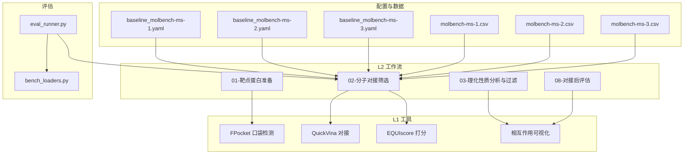
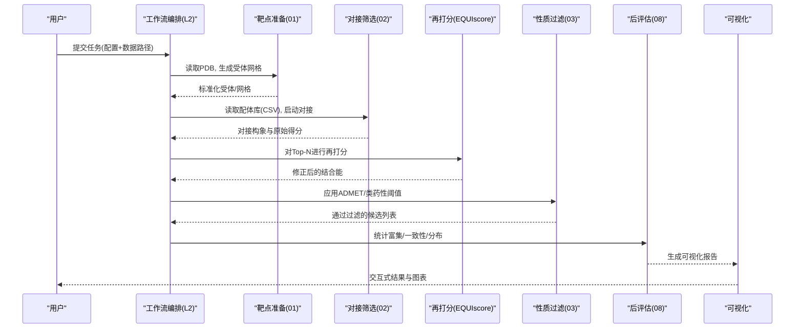
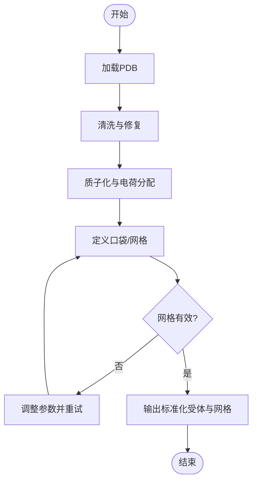
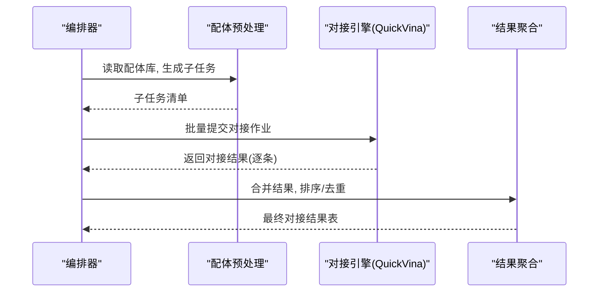
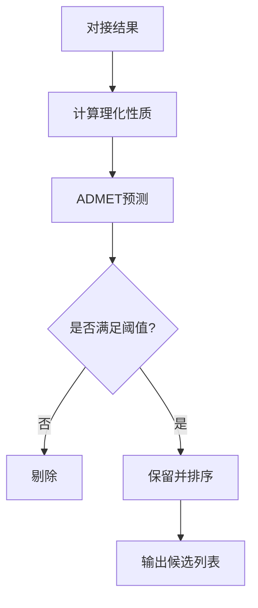
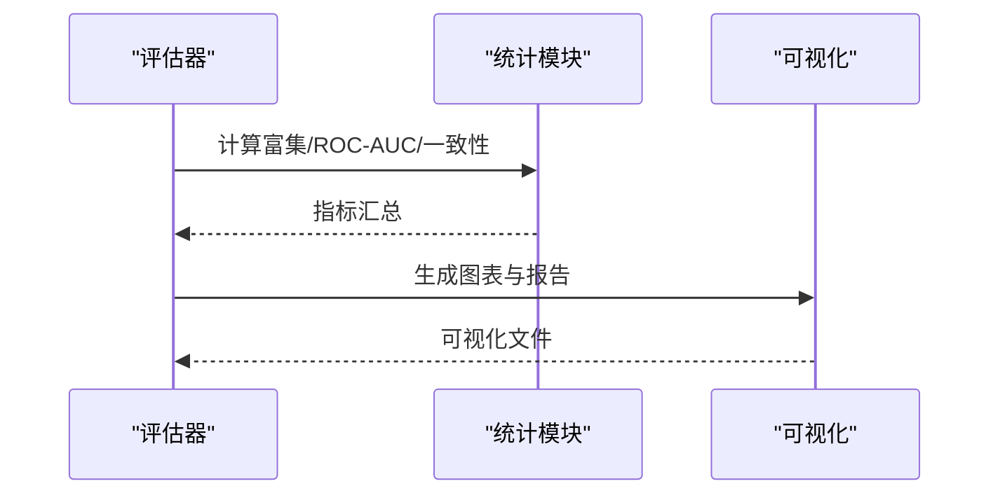
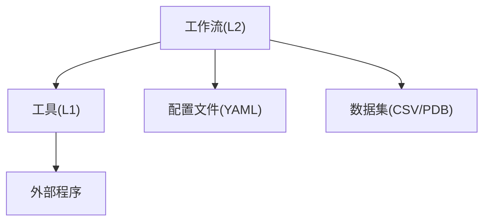

# 分子对接筛选工作流

<cite>
**本文引用的文件**   
- [docs/molbench_repo/skills/L2_workflows/01-target-protein-preparation.md](file://docs/molbench_repo/skills/L2_workflows/01-target-protein-preparation.md)
- [docs/molbench_repo/skills/L2_workflows/02-molecular-docking-screening.md](file://docs/molbench_repo/skills/L2_workflows/02-molecular-docking-screening.md)
- [docs/molbench_repo/skills/L2_workflows/03-molecular-property-analysis-filtering.md](file://docs/molbench_repo/skills/L2_workflows/03-molecular-property-analysis-filtering.md)
- [docs/molbench_repo/skills/L2_workflows/08-post-docking-evaluation.md](file://docs/molbench_repo/skills/L2_workflows/08-post-docking-evaluation.md)
- [docs/molbench_repo/skills/L1_tools/molclaw-docking-screening/README.md](file://docs/molbench_repo/skills/L1_tools/molclaw-docking-screening/README.md)
- [docs/molbench_repo/skills/L1_tools/molclaw-quickvina-docking/README.md](file://docs/molbench_repo/skills/L1_tools/molclaw-quickvina-docking/README.md)
- [docs/molbench_repo/skills/L1_tools/molclaw-equiscore-docking/README.md](file://docs/molbench_repo/skills/L1_tools/molclaw-equiscore-docking/README.md)
- [docs/molbench_repo/skills/L1_tools/molclaw-fpocket-toolkit-base/README.md](file://docs/molbench_repo/skills/L1_tools/molclaw-fpocket-toolkit-base/README.md)
- [docs/molbench_repo/skills/L1_tools/molclaw-interaction-visualizer/README.md](file://docs/molbench_repo/skills/L1_tools/molclaw-interaction-visualizer/README.md)
- [docs/molbench_repo/config/baseline_molbench-ms-1.yaml](file://docs/molbench_repo/config/baseline_molbench-ms-1.yaml)
- [docs/molbench_repo/config/baseline_molbench-ms-2.yaml](file://docs/molbench_repo/config/baseline_molbench-ms-2.yaml)
- [docs/molbench_repo/config/baseline_molbench-ms-3.yaml](file://docs/molbench_repo/config/baseline_molbench-ms-3.yaml)
- [docs/molbench_repo/data_full/molbench-ms-1/molbench-ms-1.csv](file://docs/molbench_repo/data_full/molbench-ms-1/molbench-ms-1.csv)
- [docs/molbench_repo/data_full/molbench-ms-2/molbench-ms-2.csv](file://docs/molbench_repo/data_full/molbench-ms-2/molbench-ms-2.csv)
- [docs/molbench_repo/data_full/molbench-ms-3/molbench-ms-3.csv](file://docs/molbench_repo/data_full/molbench-ms-3/molbench-ms-3.csv)
- [docs/molbench_repo/eval/eval_runner.py](file://docs/molbench_repo/eval/eval_runner.py)
- [docs/molbench_repo/eval/bench_loaders.py](file://docs/molbench_repo/eval/bench_loaders.py)
</cite>

## 目录
1. [引言](#引言)
2. [项目结构](#项目结构)
3. [核心组件](#核心组件)
4. [架构总览](#架构总览)
5. [详细组件分析](#详细组件分析)
6. [依赖关系分析](#依赖关系分析)
7. [性能与并行计算](#性能与并行计算)
8. [故障排查指南](#故障排查指南)
9. [结论](#结论)
10. [附录](#附录)

## 引言
本技术文档面向从事药物发现与虚拟筛选的研究人员与工程师，系统化阐述从靶点准备、配体库构建、对接计算到结果分析与可视化的完整工作流。文档覆盖参数配置、输入输出格式、数据转换规则、算法选择策略、评分函数优化与虚拟筛选标准，并提供不同规模化合物库的高通量筛选案例与并行资源配置建议。

## 项目结构
本项目围绕“技能（Skills）+工具（Tools）+基准配置（Config）+数据集（Data）+评估器（Eval）”的模块化组织方式展开：
- L2 工作流：定义端到端流程步骤与编排逻辑
- L1 工具：封装具体算法与外部程序调用
- Config：提供多套基线配置以适配不同规模的筛选任务
- Data：提供基准数据集与示例输入
- Eval：提供统一的数据加载与评测执行入口

图表来源
- [docs/molbench_repo/skills/L2_workflows/01-target-protein-preparation.md](file://docs/molbench_repo/skills/L2_workflows/01-target-protein-preparation.md)
- [docs/molbench_repo/skills/L2_workflows/02-molecular-docking-screening.md](file://docs/molbench_repo/skills/L2_workflows/02-molecular-docking-screening.md)
- [docs/molbench_repo/skills/L2_workflows/03-molecular-property-analysis-filtering.md](file://docs/molbench_repo/skills/L2_workflows/03-molecular-property-analysis-filtering.md)
- [docs/molbench_repo/skills/L2_workflows/08-post-docking-evaluation.md](file://docs/molbench_repo/skills/L2_workflows/08-post-docking-evaluation.md)
- [docs/molbench_repo/skills/L1_tools/molclaw-fpocket-toolkit-base/README.md](file://docs/molbench_repo/skills/L1_tools/molclaw-fpocket-toolkit-base/README.md)
- [docs/molbench_repo/skills/L1_tools/molclaw-quickvina-docking/README.md](file://docs/molbench_repo/skills/L1_tools/molclaw-quickvina-docking/README.md)
- [docs/molbench_repo/skills/L1_tools/molclaw-equiscore-docking/README.md](file://docs/molbench_repo/skills/L1_tools/molclaw-equiscore-docking/README.md)
- [docs/molbench_repo/skills/L1_tools/molclaw-interaction-visualizer/README.md](file://docs/molbench_repo/skills/L1_tools/molclaw-interaction-visualizer/README.md)
- [docs/molbench_repo/config/baseline_molbench-ms-1.yaml](file://docs/molbench_repo/config/baseline_molbench-ms-1.yaml)
- [docs/molbench_repo/config/baseline_molbench-ms-2.yaml](file://docs/molbench_repo/config/baseline_molbench-ms-2.yaml)
- [docs/molbench_repo/config/baseline_molbench-ms-3.yaml](file://docs/molbench_repo/config/baseline_molbench-ms-3.yaml)
- [docs/molbench_repo/data_full/molbench-ms-1/molbench-ms-1.csv](file://docs/molbench_repo/data_full/molbench-ms-1/molbench-ms-1.csv)
- [docs/molbench_repo/data_full/molbench-ms-2/molbench-ms-2.csv](file://docs/molbench_repo/data_full/molbench-ms-2/molbench-ms-2.csv)
- [docs/molbench_repo/data_full/molbench-ms-3/molbench-ms-3.csv](file://docs/molbench_repo/data_full/molbench-ms-3/molbench-ms-3.csv)
- [docs/molbench_repo/eval/eval_runner.py](file://docs/molbench_repo/eval/eval_runner.py)
- [docs/molbench_repo/eval/bench_loaders.py](file://docs/molbench_repo/eval/bench_loaders.py)

章节来源
- [docs/molbench_repo/skills/L2_workflows/01-target-protein-preparation.md](file://docs/molbench_repo/skills/L2_workflows/01-target-protein-preparation.md)
- [docs/molbench_repo/skills/L2_workflows/02-molecular-docking-screening.md](file://docs/molbench_repo/skills/L2_workflows/02-molecular-docking-screening.md)
- [docs/molbench_repo/skills/L2_workflows/03-molecular-property-analysis-filtering.md](file://docs/molbench_repo/skills/L2_workflows/03-molecular-property-analysis-filtering.md)
- [docs/molbench_repo/skills/L2_workflows/08-post-docking-evaluation.md](file://docs/molbench_repo/skills/L2_workflows/08-post-docking-evaluation.md)
- [docs/molbench_repo/skills/L1_tools/molclaw-docking-screening/README.md](file://docs/molbench_repo/skills/L1_tools/molclaw-docking-screening/README.md)
- [docs/molbench_repo/skills/L1_tools/molclaw-quickvina-docking/README.md](file://docs/molbench_repo/skills/L1_tools/molclaw-quickvina-docking/README.md)
- [docs/molbench_repo/skills/L1_tools/molclaw-equiscore-docking/README.md](file://docs/molbench_repo/skills/L1_tools/molclaw-equiscore-docking/README.md)
- [docs/molbench_repo/skills/L1_tools/molclaw-fpocket-toolkit-base/README.md](file://docs/molbench_repo/skills/L1_tools/molclaw-fpocket-toolkit-base/README.md)
- [docs/molbench_repo/skills/L1_tools/molclaw-interaction-visualizer/README.md](file://docs/molbench_repo/skills/L1_tools/molclaw-interaction-visualizer/README.md)
- [docs/molbench_repo/config/baseline_molbench-ms-1.yaml](file://docs/molbench_repo/config/baseline_molbench-ms-1.yaml)
- [docs/molbench_repo/config/baseline_molbench-ms-2.yaml](file://docs/molbench_repo/config/baseline_molbench-ms-2.yaml)
- [docs/molbench_repo/config/baseline_molbench-ms-3.yaml](file://docs/molbench_repo/config/baseline_molbench-ms-3.yaml)
- [docs/molbench_repo/data_full/molbench-ms-1/molbench-ms-1.csv](file://docs/molbench_repo/data_full/molbench-ms-1/molbench-ms-1.csv)
- [docs/molbench_repo/data_full/molbench-ms-2/molbench-ms-2.csv](file://docs/molbench_repo/data_full/molbench-ms-2/molbench-ms-2.csv)
- [docs/molbench_repo/data_full/molbench-ms-3/molbench-ms-3.csv](file://docs/molbench_repo/data_full/molbench-ms-3/molbench-ms-3.csv)
- [docs/molbench_repo/eval/eval_runner.py](file://docs/molbench_repo/eval/eval_runner.py)
- [docs/molbench_repo/eval/bench_loaders.py](file://docs/molbench_repo/eval/bench_loaders.py)

## 核心组件
- 靶点蛋白准备（L2）：负责PDB预处理、去水、加氢、电荷分配、缺失原子修复、链选择与受体网格生成等，为后续对接提供标准化受体。
- 分子对接筛选（L2）：基于配体库与受体网格进行构象搜索与结合能估计，支持多种对接引擎与批量作业调度。
- 理化性质分析与过滤（L2）：对候选分子进行ADMET与类药性指标计算，结合对接得分进行多级过滤。
- 对接后评估（L2）：统计对接结果质量、富集能力、一致性检验与可视化交互。
- 工具层（L1）：
  - FPocket 口袋检测：自动识别潜在结合位点并输出口袋描述文件
  - QuickVina 对接：快速对接引擎，适合大规模初筛
  - EQUIscore 打分：基于机器学习或经验函数的再打分
  - 相互作用可视化：展示关键残基-配体相互作用图

章节来源
- [docs/molbench_repo/skills/L2_workflows/01-target-protein-preparation.md](file://docs/molbench_repo/skills/L2_workflows/01-target-protein-preparation.md)
- [docs/molbench_repo/skills/L2_workflows/02-molecular-docking-screening.md](file://docs/molbench_repo/skills/L2_workflows/02-molecular-docking-screening.md)
- [docs/molbench_repo/skills/L2_workflows/03-molecular-property-analysis-filtering.md](file://docs/molbench_repo/skills/L2_workflows/03-molecular-property-analysis-filtering.md)
- [docs/molbench_repo/skills/L2_workflows/08-post-docking-evaluation.md](file://docs/molbench_repo/skills/L2_workflows/08-post-docking-evaluation.md)
- [docs/molbench_repo/skills/L1_tools/molclaw-fpocket-toolkit-base/README.md](file://docs/molbench_repo/skills/L1_tools/molclaw-fpocket-toolkit-base/README.md)
- [docs/molbench_repo/skills/L1_tools/molclaw-quickvina-docking/README.md](file://docs/molbench_repo/skills/L1_tools/molclaw-quickvina-docking/README.md)
- [docs/molbench_repo/skills/L1_tools/molclaw-equiscore-docking/README.md](file://docs/molbench_repo/skills/L1_tools/molclaw-equiscore-docking/README.md)
- [docs/molbench_repo/skills/L1_tools/molclaw-interaction-visualizer/README.md](file://docs/molbench_repo/skills/L1_tools/molclaw-interaction-visualizer/README.md)

## 架构总览
整体架构采用“工作流编排 + 工具调用 + 配置驱动 + 数据管道”的模式：
- 工作流编排：通过L2工作流串联各阶段，明确输入输出契约
- 工具调用：L1工具对外暴露命令行接口，便于批量化与并行化
- 配置驱动：使用YAML配置文件管理对接参数、阈值与资源限制
- 数据管道：CSV配体库与PDB受体作为主要输入，中间产物以结构化文件保存

图表来源
- [docs/molbench_repo/skills/L2_workflows/01-target-protein-preparation.md](file://docs/molbench_repo/skills/L2_workflows/01-target-protein-preparation.md)
- [docs/molbench_repo/skills/L2_workflows/02-molecular-docking-screening.md](file://docs/molbench_repo/skills/L2_workflows/02-molecular-docking-screening.md)
- [docs/molbench_repo/skills/L2_workflows/03-molecular-property-analysis-filtering.md](file://docs/molbench_repo/skills/L2_workflows/03-molecular-property-analysis-filtering.md)
- [docs/molbench_repo/skills/L2_workflows/08-post-docking-evaluation.md](file://docs/molbench_repo/skills/L2_workflows/08-post-docking-evaluation.md)
- [docs/molbench_repo/skills/L1_tools/molclaw-equiscore-docking/README.md](file://docs/molbench_repo/skills/L1_tools/molclaw-equiscore-docking/README.md)
- [docs/molbench_repo/skills/L1_tools/molclaw-interaction-visualizer/README.md](file://docs/molbench_repo/skills/L1_tools/molclaw-interaction-visualizer/README.md)

## 详细组件分析

### 组件A：靶点蛋白准备（01）
- 目标：将原始PDB转换为对接可用的标准化受体与网格
- 关键步骤：
  - PDB清洗：去除水分子、非标准残基处理、缺失原子重建
  - 质子化与电荷分配：根据生理pH设置可电离残基状态
  - 链选择与活性位点定义：基于已知配体或口袋检测结果
  - 网格生成：定义搜索空间中心与尺寸，确保覆盖结合口袋
- 输入/输出：
  - 输入：PDB文件、可选已知配体坐标或口袋描述
  - 输出：标准化受体文件、网格参数文件
- 参数要点：
  - pH值、力场类型、网格分辨率、边界扩展半径
- 错误处理：
  - 无效PDB结构、缺失关键原子、网格未覆盖口袋时的回退策略

图表来源
- [docs/molbench_repo/skills/L2_workflows/01-target-protein-preparation.md](file://docs/molbench_repo/skills/L2_workflows/01-target-protein-preparation.md)
- [docs/molbench_repo/skills/L1_tools/molclaw-fpocket-toolkit-base/README.md](file://docs/molbench_repo/skills/L1_tools/molclaw-fpocket-toolkit-base/README.md)

章节来源
- [docs/molbench_repo/skills/L2_workflows/01-target-protein-preparation.md](file://docs/molbench_repo/skills/L2_workflows/01-target-protein-preparation.md)
- [docs/molbench_repo/skills/L1_tools/molclaw-fpocket-toolkit-base/README.md](file://docs/molbench_repo/skills/L1_tools/molclaw-fpocket-toolkit-base/README.md)

### 组件B：分子对接筛选（02）
- 目标：在给定受体网格下对配体库进行构象搜索与结合能估计
- 关键步骤：
  - 配体预处理：加氢、互变异构体枚举、构象采样
  - 对接运行：调用QuickVina或其他引擎，批量提交作业
  - 结果收集：解析对接日志，提取最佳构象与得分
- 输入/输出：
  - 输入：标准化受体、网格参数、配体库（CSV/SDF）
  - 输出：每个配体的对接构象、原始得分、元数据
- 参数要点：
  - 搜索空间、采样步数、最大构象数、线程/进程数
- 并行策略：
  - 按配体切分任务，按节点/队列系统分发，聚合结果

图表来源
- [docs/molbench_repo/skills/L2_workflows/02-molecular-docking-screening.md](file://docs/molbench_repo/skills/L2_workflows/02-molecular-docking-screening.md)
- [docs/molbench_repo/skills/L1_tools/molclaw-quickvina-docking/README.md](file://docs/molbench_repo/skills/L1_tools/molclaw-quickvina-docking/README.md)
- [docs/molbench_repo/skills/L1_tools/molclaw-docking-screening/README.md](file://docs/molbench_repo/skills/L1_tools/molclaw-docking-screening/README.md)

章节来源
- [docs/molbench_repo/skills/L2_workflows/02-molecular-docking-screening.md](file://docs/molbench_repo/skills/L2_workflows/02-molecular-docking-screening.md)
- [docs/molbench_repo/skills/L1_tools/molclaw-quickvina-docking/README.md](file://docs/molbench_repo/skills/L1_tools/molclaw-quickvina-docking/README.md)
- [docs/molbench_repo/skills/L1_tools/molclaw-docking-screening/README.md](file://docs/molbench_repo/skills/L1_tools/molclaw-docking-screening/README.md)

### 组件C：理化性质分析与过滤（03）
- 目标：对候选分子进行ADMET与类药性指标计算，结合对接得分进行多级过滤
- 关键步骤：
  - 计算LogP、分子量、TPSA、HBA/HBD等
  - ADMET预测：溶解度、渗透性、毒性风险
  - 过滤策略：阈值过滤、加权评分、排名截断
- 输入/输出：
  - 输入：对接结果、配体SMILES/结构
  - 输出：通过过滤的候选列表及属性表
- 参数要点：
  - 各类阈值、权重系数、Top-K截断数量

图表来源
- [docs/molbench_repo/skills/L2_workflows/03-molecular-property-analysis-filtering.md](file://docs/molbench_repo/skills/L2_workflows/03-molecular-property-analysis-filtering.md)

章节来源
- [docs/molbench_repo/skills/L2_workflows/03-molecular-property-analysis-filtering.md](file://docs/molbench_repo/skills/L2_workflows/03-molecular-property-analysis-filtering.md)

### 组件D：对接后评估（08）
- 目标：评估筛选质量，包括富集因子、ROC-AUC、一致性检验与可视化
- 关键步骤：
  - 统计Top命中率、富集曲线、分布直方图
  - 对比不同打分函数与过滤策略的效果
  - 生成可视化报告（热图、散点图、网络图）
- 输入/输出：
  - 输入：筛选结果、标注信息（如已知活性）
  - 输出：评估指标、可视化图表

图表来源
- [docs/molbench_repo/skills/L2_workflows/08-post-docking-evaluation.md](file://docs/molbench_repo/skills/L2_workflows/08-post-docking-evaluation.md)
- [docs/molbench_repo/skills/L1_tools/molclaw-interaction-visualizer/README.md](file://docs/molbench_repo/skills/L1_tools/molclaw-interaction-visualizer/README.md)

章节来源
- [docs/molbench_repo/skills/L2_workflows/08-post-docking-evaluation.md](file://docs/molbench_repo/skills/L2_workflows/08-post-docking-evaluation.md)
- [docs/molbench_repo/skills/L1_tools/molclaw-interaction-visualizer/README.md](file://docs/molbench_repo/skills/L1_tools/molclaw-interaction-visualizer/README.md)

### 概念总览
以下概念图用于帮助理解整体流程，不直接映射到具体代码文件：

[此图为概念流程图，无需图表来源]

## 依赖关系分析
- 工作流与工具的耦合：
  - L2工作流通过配置文件与L1工具交互，保持松耦合
  - 工具间通过标准输入输出格式传递数据
- 外部依赖：
  - QuickVina、FPocket、EQUIscore等外部程序
  - 数据处理库（CSV读写、化学信息学库）
- 循环依赖：
  - 无显著循环依赖，工作流为单向流水线

图表来源
- [docs/molbench_repo/skills/L2_workflows/02-molecular-docking-screening.md](file://docs/molbench_repo/skills/L2_workflows/02-molecular-docking-screening.md)
- [docs/molbench_repo/skills/L1_tools/molclaw-quickvina-docking/README.md](file://docs/molbench_repo/skills/L1_tools/molclaw-quickvina-docking/README.md)
- [docs/molbench_repo/config/baseline_molbench-ms-1.yaml](file://docs/molbench_repo/config/baseline_molbench-ms-1.yaml)
- [docs/molbench_repo/data_full/molbench-ms-1/molbench-ms-1.csv](file://docs/molbench_repo/data_full/molbench-ms-1/molbench-ms-1.csv)

章节来源
- [docs/molbench_repo/skills/L2_workflows/02-molecular-docking-screening.md](file://docs/molbench_repo/skills/L2_workflows/02-molecular-docking-screening.md)
- [docs/molbench_repo/skills/L1_tools/molclaw-quickvina-docking/README.md](file://docs/molbench_repo/skills/L1_tools/molclaw-quickvina-docking/README.md)
- [docs/molbench_repo/config/baseline_molbench-ms-1.yaml](file://docs/molbench_repo/config/baseline_molbench-ms-1.yaml)
- [docs/molbench_repo/data_full/molbench-ms-1/molbench-ms-1.csv](file://docs/molbench_repo/data_full/molbench-ms-1/molbench-ms-1.csv)

## 性能与并行计算
- 并行策略：
  - 任务级并行：按配体拆分，分配到多个CPU/GPU节点
  - 进程/线程并行：对接引擎内部多线程加速
  - I/O并发：批量读写中间文件，避免阻塞
- 资源分配：
  - 小库（ms-1）：单机多核即可
  - 中库（ms-2）：集群队列，按槽位分配
  - 大库（ms-3）：分布式任务调度，失败重试与断点续跑
- 监控与诊断：
  - 记录每步耗时、内存占用、错误率
  - 动态调整并行度与超时时间

章节来源
- [docs/molbench_repo/config/baseline_molbench-ms-1.yaml](file://docs/molbench_repo/config/baseline_molbench-ms-1.yaml)
- [docs/molbench_repo/config/baseline_molbench-ms-2.yaml](file://docs/molbench_repo/config/baseline_molbench-ms-2.yaml)
- [docs/molbench_repo/config/baseline_molbench-ms-3.yaml](file://docs/molbench_repo/config/baseline_molbench-ms-3.yaml)

## 故障排查指南
- 常见问题：
  - PDB结构异常：检查缺失原子与链编号
  - 网格未覆盖口袋：调整网格中心与尺寸
  - 对接失败：确认配体预处理成功、引擎版本兼容
  - 结果聚合错误：核对字段命名与分隔符
- 定位方法：
  - 查看工作流日志与工具输出
  - 使用最小数据集复现问题
  - 逐步关闭并行，定位瓶颈

章节来源
- [docs/molbench_repo/skills/L2_workflows/01-target-protein-preparation.md](file://docs/molbench_repo/skills/L2_workflows/01-target-protein-preparation.md)
- [docs/molbench_repo/skills/L2_workflows/02-molecular-docking-screening.md](file://docs/molbench_repo/skills/L2_workflows/02-molecular-docking-screening.md)

## 结论
本工作流通过模块化设计与配置驱动，实现了从靶点准备到结果可视化的端到端虚拟筛选流程。借助多尺度基准配置与并行策略，可灵活适配不同规模的化合物库。建议在真实项目中结合领域知识定制过滤阈值与打分权重，并通过持续评估迭代优化筛选效果。

## 附录
- 实际案例演示（不同规模库）：
  - 小规模（ms-1）：单机快速验证，重点调试参数
  - 中等规模（ms-2）：集群队列，合理划分任务批次
  - 大规模（ms-3）：分布式调度，监控与容错
- 输入输出格式说明：
  - 配体库CSV字段：标识符、SMILES、名称、类别等
  - 对接结果：配体ID、构象文件、得分、元数据
  - 评估报告：指标表格、可视化图表
- 参考实现路径：
  - 工作流编排与工具调用入口见评估脚本与加载器

章节来源
- [docs/molbench_repo/data_full/molbench-ms-1/molbench-ms-1.csv](file://docs/molbench_repo/data_full/molbench-ms-1/molbench-ms-1.csv)
- [docs/molbench_repo/data_full/molbench-ms-2/molbench-ms-2.csv](file://docs/molbench_repo/data_full/molbench-ms-2/molbench-ms-2.csv)
- [docs/molbench_repo/data_full/molbench-ms-3/molbench-ms-3.csv](file://docs/molbench_repo/data_full/molbench-ms-3/molbench-ms-3.csv)
- [docs/molbench_repo/eval/eval_runner.py](file://docs/molbench_repo/eval/eval_runner.py)
- [docs/molbench_repo/eval/bench_loaders.py](file://docs/molbench_repo/eval/bench_loaders.py)