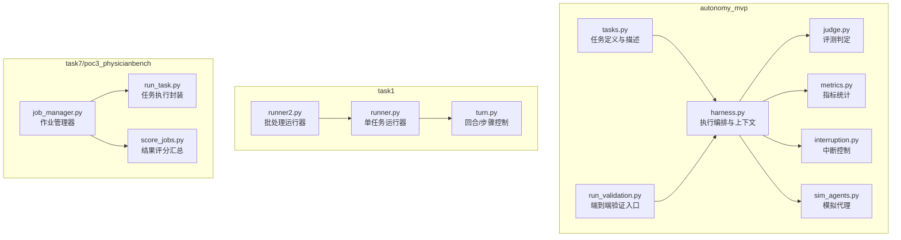
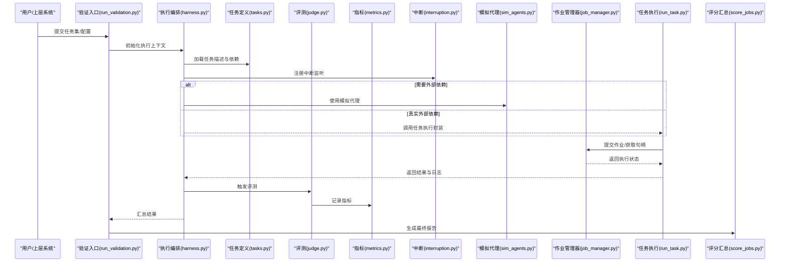
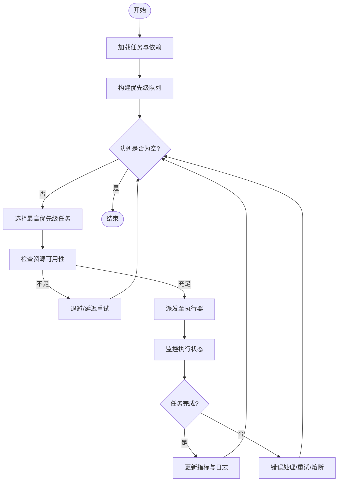
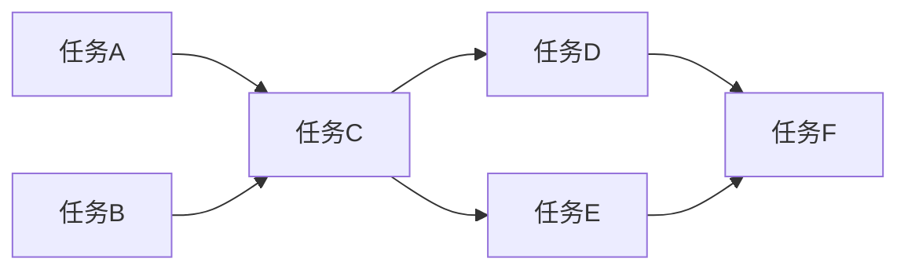
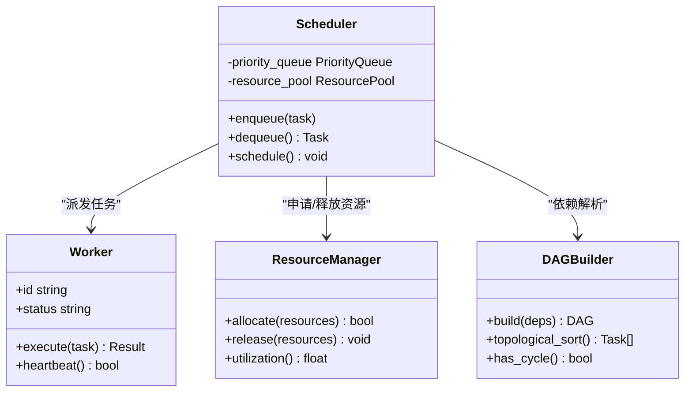
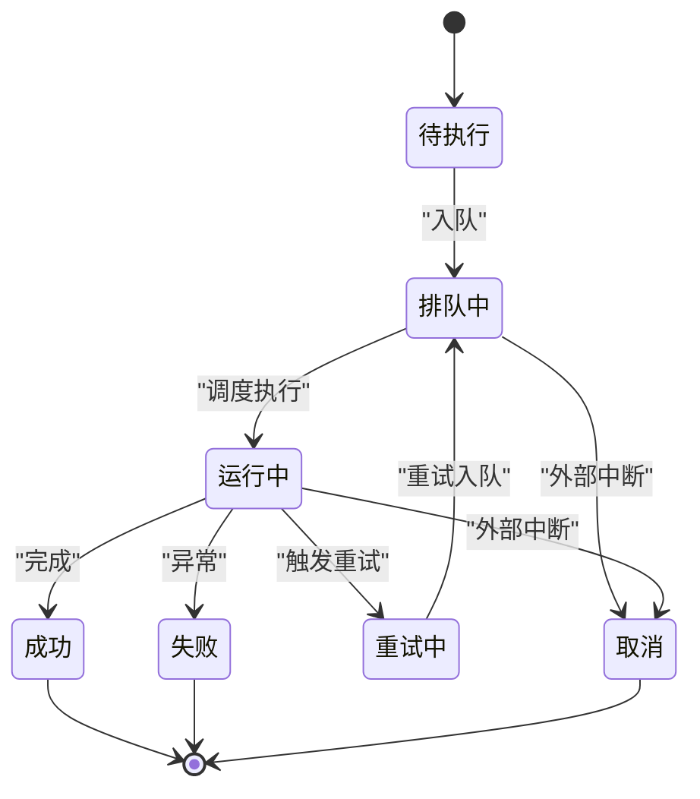
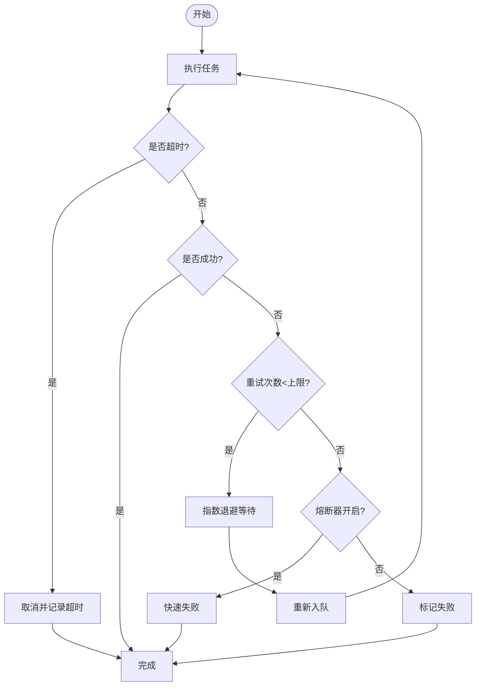
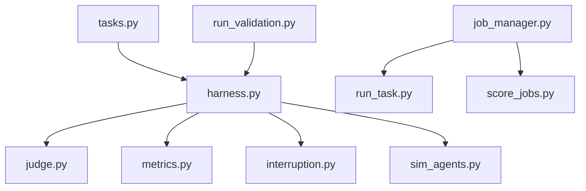

# 任务调度引擎

<cite>
**本文引用的文件**   
- [autonomy_mvp/core/tasks.py](file://autonomy_mvp/core/tasks.py)
- [autonomy_mvp/core/harness.py](file://autonomy_mvp/core/harness.py)
- [autonomy_mvp/core/judge.py](file://autonomy_mvp/core/judge.py)
- [autonomy_mvp/core/metrics.py](file://autonomy_mvp/core/metrics.py)
- [autonomy_mvp/core/interruption.py](file://autonomy_mvp/core/interruption.py)
- [autonomy_mvp/core/sim_agents.py](file://autonomy_mvp/core/sim_agents.py)
- [autonomy_mvp/run_validation.py](file://autonomy_mvp/run_validation.py)
- [task1/runner.py](file://task1/runner.py)
- [task1/runner2.py](file://task1/runner2.py)
- [task1/turn.py](file://task1/turn.py)
- [task7/poc3_physicianbench/PhysicianBench/scripts/job_manager.py](file://task7/poc3_physicianbench/PhysicianBench/scripts/job_manager.py)
- [task7/poc3_physicianbench/PhysicianBench/scripts/run_task.py](file://task7/poc3_physicianbench/PhysicianBench/scripts/run_task.py)
- [task7/poc3_physicianbench/PhysicianBench/scripts/score_jobs.py](file://task7/poc3_physicianbench/PhysicianBench/scripts/score_jobs.py)
</cite>

## 目录
1. [引言](#引言)
2. [项目结构](#项目结构)
3. [核心组件](#核心组件)
4. [架构总览](#架构总览)
5. [详细组件分析](#详细组件分析)
6. [依赖关系分析](#依赖关系分析)
7. [性能考量](#性能考量)
8. [故障排查指南](#故障排查指南)
9. [结论](#结论)
10. [附录](#附录)

## 引言
本文件面向“任务调度引擎”的核心架构设计，围绕以下目标展开：
- 任务队列管理、优先级调度与资源分配算法
- 工作流依赖解析器如何构建有向无环图（DAG）并确定执行顺序
- 并行执行策略、负载均衡机制与故障转移逻辑
- 任务状态机设计、生命周期管理与异常恢复机制
- 任务超时处理、重试策略与熔断机制
- 调度性能优化技巧、监控指标与调试方法

为便于读者理解，文档在高层概念与代码实现之间建立映射，并在必要时给出基于仓库中实际文件的图示与来源。

## 项目结构
仓库包含多个子项目与实验脚本，其中与任务调度相关的关键位置包括：
- autonomy_mvp：提供任务定义、评测与验证流程的参考实现
- task1：多轮交互与批处理运行脚本，体现任务编排与结果聚合
- task7/poc3_physicianbench：包含作业管理器与评分脚本，体现批量作业调度与评估

图表来源
- [autonomy_mvp/core/tasks.py](file://autonomy_mvp/core/tasks.py)
- [autonomy_mvp/core/harness.py](file://autonomy_mvp/core/harness.py)
- [autonomy_mvp/core/judge.py](file://autonomy_mvp/core/judge.py)
- [autonomy_mvp/core/metrics.py](file://autonomy_mvp/core/metrics.py)
- [autonomy_mvp/core/interruption.py](file://autonomy_mvp/core/interruption.py)
- [autonomy_mvp/core/sim_agents.py](file://autonomy_mvp/core/sim_agents.py)
- [autonomy_mvp/run_validation.py](file://autonomy_mvp/run_validation.py)
- [task1/runner.py](file://task1/runner.py)
- [task1/runner2.py](file://task1/runner2.py)
- [task1/turn.py](file://task1/turn.py)
- [task7/poc3_physicianbench/PhysicianBench/scripts/job_manager.py](file://task7/poc3_physicianbench/PhysicianBench/scripts/job_manager.py)
- [task7/poc3_physicianbench/PhysicianBench/scripts/run_task.py](file://task7/poc3_physicianbench/PhysicianBench/scripts/run_task.py)
- [task7/poc3_physicianbench/PhysicianBench/scripts/score_jobs.py](file://task7/poc3_physicianbench/PhysicianBench/scripts/score_jobs.py)

章节来源
- [autonomy_mvp/core/tasks.py](file://autonomy_mvp/core/tasks.py)
- [autonomy_mvp/core/harness.py](file://autonomy_mvp/core/harness.py)
- [autonomy_mvp/core/judge.py](file://autonomy_mvp/core/judge.py)
- [autonomy_mvp/core/metrics.py](file://autonomy_mvp/core/metrics.py)
- [autonomy_mvp/core/interruption.py](file://autonomy_mvp/core/interruption.py)
- [autonomy_mvp/core/sim_agents.py](file://autonomy_mvp/core/sim_agents.py)
- [autonomy_mvp/run_validation.py](file://autonomy_mvp/run_validation.py)
- [task1/runner.py](file://task1/runner.py)
- [task1/runner2.py](file://task1/runner2.py)
- [task1/turn.py](file://task1/turn.py)
- [task7/poc3_physicianbench/PhysicianBench/scripts/job_manager.py](file://task7/poc3_physicianbench/PhysicianBench/scripts/job_manager.py)
- [task7/poc3_physicianbench/PhysicianBench/scripts/run_task.py](file://task7/poc3_physicianbench/PhysicianBench/scripts/run_task.py)
- [task7/poc3_physicianbench/PhysicianBench/scripts/score_jobs.py](file://task7/poc3_physicianbench/PhysicianBench/scripts/score_jobs.py)

## 核心组件
- 任务定义与描述：集中定义任务元数据、输入输出契约与依赖声明，作为调度器的输入源
- 执行编排与上下文：负责加载任务、准备环境、驱动执行、收集日志与中间产物
- 评测与指标：对任务产出进行判定与量化，形成可追踪的指标序列
- 中断控制：支持外部信号或内部条件触发任务中止与清理
- 模拟代理：在离线场景下替代真实外部服务，保证调度流程的可重复性
- 作业管理器：在批处理场景中统一提交、跟踪与回收作业
- 任务执行封装：将具体任务逻辑包装为可被调度器调度的单元
- 结果评分汇总：聚合各作业结果，生成最终报告

章节来源
- [autonomy_mvp/core/tasks.py](file://autonomy_mvp/core/tasks.py)
- [autonomy_mvp/core/harness.py](file://autonomy_mvp/core/harness.py)
- [autonomy_mvp/core/judge.py](file://autonomy_mvp/core/judge.py)
- [autonomy_mvp/core/metrics.py](file://autonomy_mvp/core/metrics.py)
- [autonomy_mvp/core/interruption.py](file://autonomy_mvp/core/interruption.py)
- [autonomy_mvp/core/sim_agents.py](file://autonomy_mvp/core/sim_agents.py)
- [task7/poc3_physicianbench/PhysicianBench/scripts/job_manager.py](file://task7/poc3_physicianbench/PhysicianBench/scripts/job_manager.py)
- [task7/poc3_physicianbench/PhysicianBench/scripts/run_task.py](file://task7/poc3_physicianbench/PhysicianBench/scripts/run_task.py)
- [task7/poc3_physicianbench/PhysicianBench/scripts/score_jobs.py](file://task7/poc3_physicianbench/PhysicianBench/scripts/score_jobs.py)

## 架构总览
下图展示从任务定义到执行、评测与汇总的整体流程，以及关键子系统之间的交互。

图表来源
- [autonomy_mvp/run_validation.py](file://autonomy_mvp/run_validation.py)
- [autonomy_mvp/core/harness.py](file://autonomy_mvp/core/harness.py)
- [autonomy_mvp/core/tasks.py](file://autonomy_mvp/core/tasks.py)
- [autonomy_mvp/core/judge.py](file://autonomy_mvp/core/judge.py)
- [autonomy_mvp/core/metrics.py](file://autonomy_mvp/core/metrics.py)
- [autonomy_mvp/core/interruption.py](file://autonomy_mvp/core/interruption.py)
- [autonomy_mvp/core/sim_agents.py](file://autonomy_mvp/core/sim_agents.py)
- [task7/poc3_physicianbench/PhysicianBench/scripts/job_manager.py](file://task7/poc3_physicianbench/PhysicianBench/scripts/job_manager.py)
- [task7/poc3_physicianbench/PhysicianBench/scripts/run_task.py](file://task7/poc3_physicianbench/PhysicianBench/scripts/run_task.py)
- [task7/poc3_physicianbench/PhysicianBench/scripts/score_jobs.py](file://task7/poc3_physicianbench/PhysicianBench/scripts/score_jobs.py)

## 详细组件分析

### 任务队列管理与优先级调度
- 队列模型
  - 入队：由任务定义与依赖解析阶段产生待执行任务集合，按优先级排序后进入队列
  - 出队：调度器根据当前资源可用性与任务优先级选择下一个任务
- 优先级策略
  - 静态优先级：基于任务元数据（如重要性、SLA等级）设定
  - 动态优先级：结合等待时间、剩余工作量、依赖就绪度进行加权
- 资源分配
  - 资源池抽象：CPU/GPU/内存/IO等资源的容量与配额
  - 分配算法：首次适配、最佳适配或基于负载感知的启发式策略
- 并发控制
  - 最大并发度限制，避免资源争用
  - 任务亲和性：将相关任务尽量分配到同一节点以减少跨节点通信

[此图为概念流程图，不直接映射具体源码文件]

### 工作流依赖解析器与DAG构建
- DAG构建
  - 输入：任务间的显式依赖声明（前驱/后继关系）
  - 过程：拓扑排序检测环；若存在环则拒绝构建并报错
  - 输出：DAG结构与每层可并行执行的节点集合
- 执行顺序
  - 按拓扑层级推进，确保所有前驱完成后才允许后继入队
  - 支持部分失败隔离：仅受影响分支回滚或重试
- 可视化与校验
  - 导出DAG图用于人工审查
  - 提供最小路径与关键路径分析以识别瓶颈

[此图为概念图，不直接映射具体源码文件]

### 并行执行策略与负载均衡
- 并行策略
  - 粗粒度并行：以任务为单位并行，适合独立计算型任务
  - 细粒度并行：以子任务或批次为单位并行，适合I/O密集型任务
- 负载均衡
  - 基于队列长度的均衡：优先选择负载较低的Worker
  - 基于资源利用率的均衡：结合CPU/GPU/内存利用率动态调整
- Worker管理
  - Worker注册与心跳：健康检查与自动剔除
  - 弹性扩缩容：根据队列积压与资源水位动态增减Worker

[此图为概念类图，不直接映射具体源码文件]

### 任务状态机设计与生命周期管理
- 状态定义
  - 待执行、排队中、运行中、成功、失败、取消、重试中
- 状态转换
  - 正常流转：待执行→排队中→运行中→成功/失败
  - 异常流转：运行中→重试中→排队中；运行中→取消
- 生命周期钩子
  - 启动前：资源预分配、环境变量注入
  - 运行中：进度上报、心跳保活
  - 结束后：结果持久化、指标上报、清理临时文件

[此图为概念状态图，不直接映射具体源码文件]

### 异常恢复、超时处理、重试与熔断
- 超时处理
  - 任务级超时：超过阈值自动终止并标记失败
  - 依赖超时：上游任务超时导致下游不可达，提前剪枝
- 重试策略
  - 指数退避：重试间隔随次数递增，降低瞬时压力
  - 幂等性要求：重试需保证多次执行结果一致
- 熔断机制
  - 失败率阈值：当连续失败比例超过阈值时快速失败，避免雪崩
  - 冷却期：熔断后等待一段时间再尝试恢复

[此图为概念流程图，不直接映射具体源码文件]

### 调度性能优化技巧
- 队列优化
  - 使用堆结构维护优先级队列，O(log n)插入与弹出
  - 批量出队：减少锁竞争与调度开销
- 资源感知
  - 资源碎片整理：合并小任务以降低碎片
  - 亲和性调度：将同属一个工作流的子任务就近调度
- 监控与自适应
  - 采集吞吐、延迟、资源利用率等指标
  - 基于指标的自适应参数调节（如并发度、重试间隔）

[本节为通用指导，不直接分析具体文件]

### 监控指标与调试方法
- 关键指标
  - 任务吞吐（TPS）、平均/分位延迟、失败率、重试率、熔断触发次数
  - 资源利用率（CPU/GPU/内存/IO）、队列长度、等待时间
- 调试方法
  - 结构化日志：任务ID、阶段、耗时、错误码
  - 链路追踪：跨模块传递trace_id，定位慢点
  - 快照与回放：保存任务输入与中间状态，便于复现问题

[本节为通用指导，不直接分析具体文件]

## 依赖关系分析
下图展示与调度相关的核心模块及其依赖关系。

图表来源
- [autonomy_mvp/core/tasks.py](file://autonomy_mvp/core/tasks.py)
- [autonomy_mvp/core/harness.py](file://autonomy_mvp/core/harness.py)
- [autonomy_mvp/core/judge.py](file://autonomy_mvp/core/judge.py)
- [autonomy_mvp/core/metrics.py](file://autonomy_mvp/core/metrics.py)
- [autonomy_mvp/core/interruption.py](file://autonomy_mvp/core/interruption.py)
- [autonomy_mvp/core/sim_agents.py](file://autonomy_mvp/core/sim_agents.py)
- [autonomy_mvp/run_validation.py](file://autonomy_mvp/run_validation.py)
- [task7/poc3_physicianbench/PhysicianBench/scripts/job_manager.py](file://task7/poc3_physicianbench/PhysicianBench/scripts/job_manager.py)
- [task7/poc3_physicianbench/PhysicianBench/scripts/run_task.py](file://task7/poc3_physicianbench/PhysicianBench/scripts/run_task.py)
- [task7/poc3_physicianbench/PhysicianBench/scripts/score_jobs.py](file://task7/poc3_physicianbench/PhysicianBench/scripts/score_jobs.py)

章节来源
- [autonomy_mvp/core/tasks.py](file://autonomy_mvp/core/tasks.py)
- [autonomy_mvp/core/harness.py](file://autonomy_mvp/core/harness.py)
- [autonomy_mvp/core/judge.py](file://autonomy_mvp/core/judge.py)
- [autonomy_mvp/core/metrics.py](file://autonomy_mvp/core/metrics.py)
- [autonomy_mvp/core/interruption.py](file://autonomy_mvp/core/interruption.py)
- [autonomy_mvp/core/sim_agents.py](file://autonomy_mvp/core/sim_agents.py)
- [autonomy_mvp/run_validation.py](file://autonomy_mvp/run_validation.py)
- [task7/poc3_physicianbench/PhysicianBench/scripts/job_manager.py](file://task7/poc3_physicianbench/PhysicianBench/scripts/job_manager.py)
- [task7/poc3_physicianbench/PhysicianBench/scripts/run_task.py](file://task7/poc3_physicianbench/PhysicianBench/scripts/run_task.py)
- [task7/poc3_physicianbench/PhysicianBench/scripts/score_jobs.py](file://task7/poc3_physicianbench/PhysicianBench/scripts/score_jobs.py)

## 性能考量
- 调度开销控制：减少锁粒度，采用无锁或分段锁提升并发
- 任务拆分与合并：根据资源特性与网络拓扑合理划分任务
- 缓存与复用：共享只读数据与中间结果，避免重复计算
- 背压与限流：在高负载下主动降速，保护系统稳定性

[本节为通用指导，不直接分析具体文件]

## 故障排查指南
- 常见问题定位
  - 任务挂起：检查心跳与超时配置，确认Worker健康状态
  - 频繁重试：查看失败原因与熔断阈值，评估是否需要扩容
  - 资源争用：观察资源利用率曲线，调整并发度与亲和性策略
- 诊断工具
  - 日志聚合与检索：按任务ID过滤，关联上下游调用链
  - 指标看板：设置告警规则，及时发现异常波动
  - 回放与沙箱：在隔离环境中复现问题，逐步缩小范围

[本节为通用指导，不直接分析具体文件]

## 结论
本架构文档从队列管理、优先级调度、资源分配、DAG依赖解析、并行与负载均衡、状态机与生命周期、异常恢复与熔断等方面，构建了任务调度引擎的系统化设计视图。通过引入监控指标与调试方法，可在复杂生产环境中保障高吞吐、低延迟与高可用。建议在实际落地中结合业务特征持续优化调度策略与资源配置。

[本节为总结性内容，不直接分析具体文件]

## 附录
- 术语表
  - DAG：有向无环图，用于表达任务间的前驱/后继关系
  - 熔断：在失败率过高时快速失败，防止雪崩效应
  - 亲和性：将相关任务尽量调度到相同或相近的资源上
- 参考实现路径
  - 任务定义与评测：[autonomy_mvp/core/tasks.py](file://autonomy_mvp/core/tasks.py)、[autonomy_mvp/core/judge.py](file://autonomy_mvp/core/judge.py)
  - 执行编排与中断：[autonomy_mvp/core/harness.py](file://autonomy_mvp/core/harness.py)、[autonomy_mvp/core/interruption.py](file://autonomy_mvp/core/interruption.py)
  - 指标与模拟：[autonomy_mvp/core/metrics.py](file://autonomy_mvp/core/metrics.py)、[autonomy_mvp/core/sim_agents.py](file://autonomy_mvp/core/sim_agents.py)
  - 作业管理与评分：[task7/poc3_physicianbench/PhysicianBench/scripts/job_manager.py](file://task7/poc3_physicianbench/PhysicianBench/scripts/job_manager.py)、[task7/poc3_physicianbench/PhysicianBench/scripts/score_jobs.py](file://task7/poc3_physicianbench/PhysicianBench/scripts/score_jobs.py)