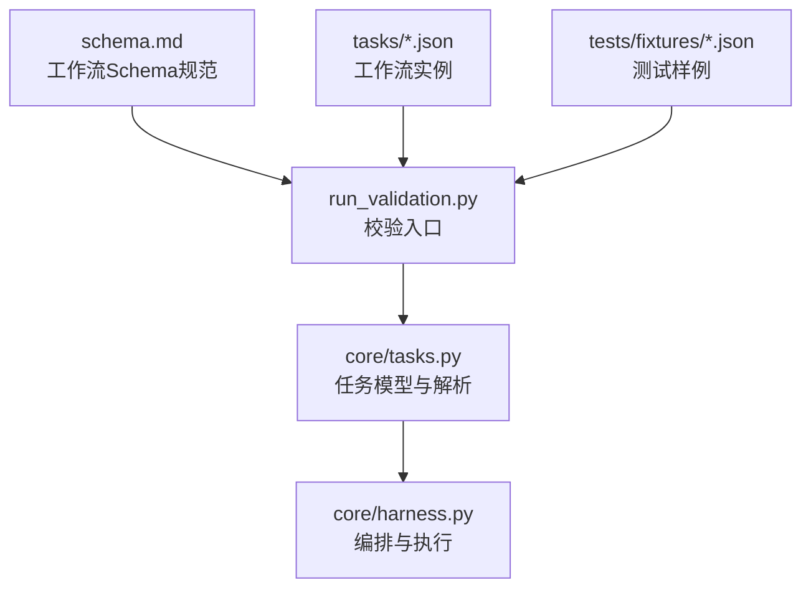
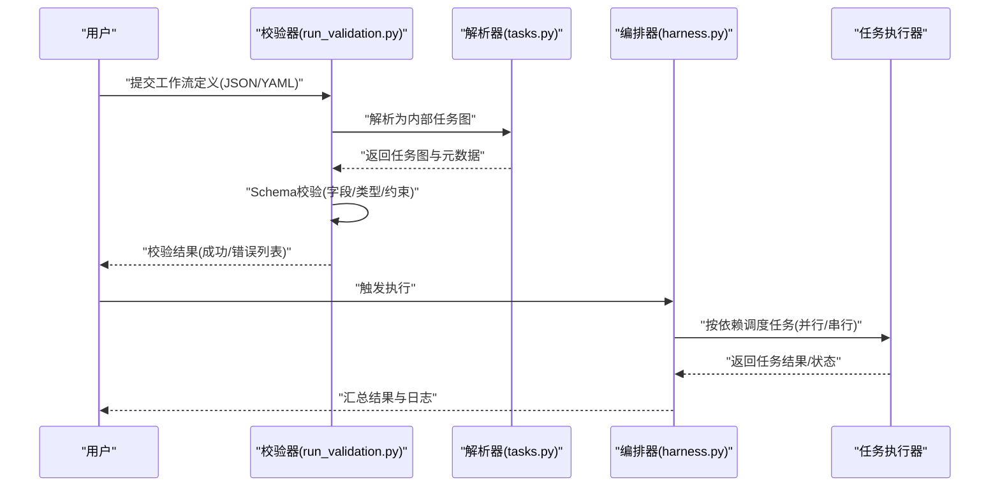
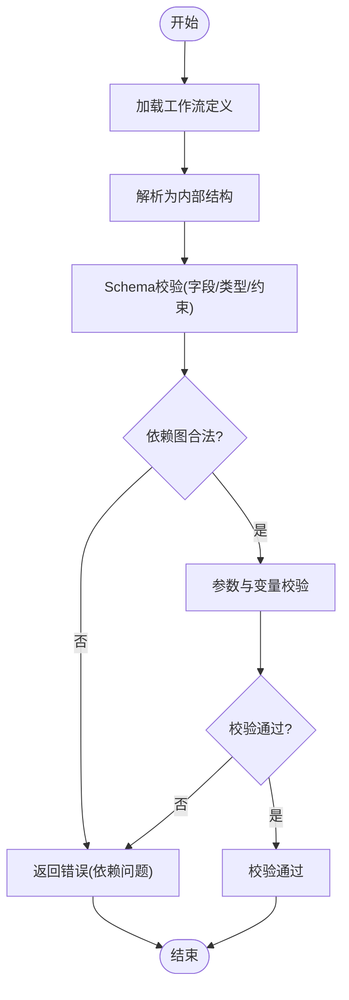
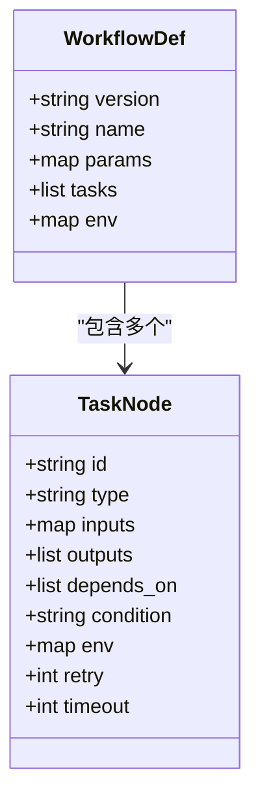
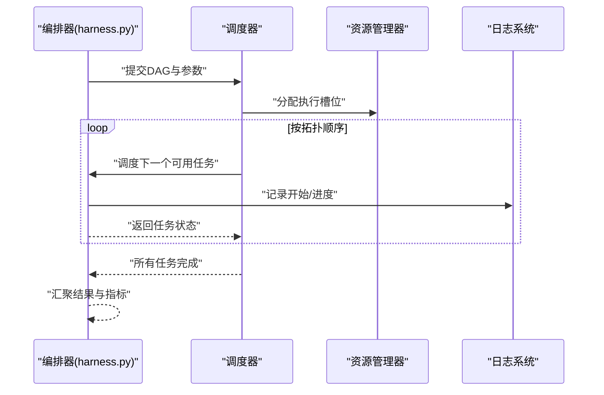
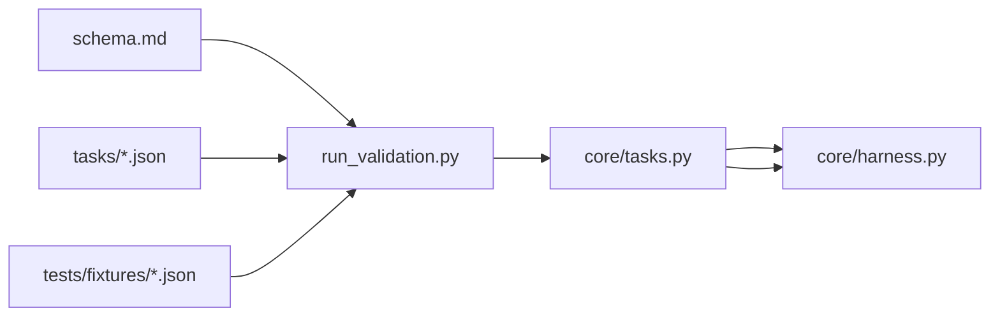

# 工作流定义格式

<cite>
**本文档引用的文件**   
- [autonomy_mvp/schema.md](file://autonomy_mvp/schema.md)
- [autonomy_mvp/run_validation.py](file://autonomy_mvp/run_validation.py)
- [autonomy_mvp/core/tasks.py](file://autonomy_mvp/core/tasks.py)
- [autonomy_mvp/core/harness.py](file://autonomy_mvp/core/harness.py)
- [autonomy_mvp/tasks/drug_admet.json](file://autonomy_mvp/tasks/drug_admet.json)
- [autonomy_mvp/tasks/drug_screen_ms3.json](file://autonomy_mvp/tasks/drug_screen_ms3.json)
- [autonomy_mvp/tasks/materials_semiconductor_bandgap.json](file://autonomy_mvp/tasks/materials_semiconductor_bandgap.json)
- [autonomy_mvp/tests/fixtures/fixture_drugscreen.json](file://autonomy_mvp/tests/fixtures/fixture_drugscreen.json)
- [autonomy_mvp/tests/fixtures/fixture_materials.json](file://autonomy_mvp/tests/fixtures/fixture_materials.json)
</cite>

## 目录
1. [引言](#引言)
2. [项目结构](#项目结构)
3. [核心组件](#核心组件)
4. [架构总览](#架构总览)
5. [详细组件分析](#详细组件分析)
6. [依赖关系分析](#依赖关系分析)
7. [性能考虑](#性能考虑)
8. [故障排查指南](#故障排查指南)
9. [结论](#结论)
10. [附录](#附录)

## 引言
本文件面向工作流定义格式的技术规范，围绕JSON/YAML配置文件的结构、任务节点定义、依赖声明、参数传递与条件分支语法进行系统化说明。同时覆盖模板系统的变量替换机制、动态参数绑定与环境配置管理，并提供涵盖线性流程、并行执行、循环迭代与错误处理的完整示例。文档还包含版本控制、向后兼容性与迁移策略，以及工作流验证规则、语法检查与最佳实践建议，帮助读者快速构建可维护、可扩展的工作流定义。

## 项目结构
仓库中与工作流定义相关的核心内容集中在 autonomy_mvp 子项目中：
- schema.md：工作流定义的Schema规范（字段、类型、约束）
- run_validation.py：工作流定义的校验入口与校验逻辑
- core/tasks.py：任务模型与解析逻辑
- core/harness.py：工作流编排与执行框架
- tasks/*.json：工作流实例（示例）
- tests/fixtures/*.json：测试用例与工作流样例

**图示来源** 
- [autonomy_mvp/schema.md](file://autonomy_mvp/schema.md)
- [autonomy_mvp/run_validation.py](file://autonomy_mvp/run_validation.py)
- [autonomy_mvp/core/tasks.py](file://autonomy_mvp/core/tasks.py)
- [autonomy_mvp/core/harness.py](file://autonomy_mvp/core/harness.py)

**章节来源**
- [autonomy_mvp/schema.md](file://autonomy_mvp/schema.md)
- [autonomy_mvp/run_validation.py](file://autonomy_mvp/run_validation.py)
- [autonomy_mvp/core/tasks.py](file://autonomy_mvp/core/tasks.py)
- [autonomy_mvp/core/harness.py](file://autonomy_mvp/core/harness.py)
- [autonomy_mvp/tasks/drug_admet.json](file://autonomy_mvp/tasks/drug_admet.json)
- [autonomy_mvp/tasks/drug_screen_ms3.json](file://autonomy_mvp/tasks/drug_screen_ms3.json)
- [autonomy_mvp/tasks/materials_semiconductor_bandgap.json](file://autonomy_mvp/tasks/materials_semiconductor_bandgap.json)
- [autonomy_mvp/tests/fixtures/fixture_drugscreen.json](file://autonomy_mvp/tests/fixtures/fixture_drugscreen.json)
- [autonomy_mvp/tests/fixtures/fixture_materials.json](file://autonomy_mvp/tests/fixtures/fixture_materials.json)

## 核心组件
- 工作流Schema与校验
  - 通过 schema.md 定义字段、类型、必填项与约束；run_validation.py 提供加载与校验能力，确保工作流定义符合规范。
- 任务模型与解析
  - core/tasks.py 定义任务节点的数据结构与解析逻辑，包括输入输出、依赖、参数映射、条件分支等。
- 编排与执行
  - core/harness.py 负责将工作流定义转换为可执行的图结构，调度任务执行、处理依赖、异常与结果汇聚。

**章节来源**
- [autonomy_mvp/schema.md](file://autonomy_mvp/schema.md)
- [autonomy_mvp/run_validation.py](file://autonomy_mvp/run_validation.py)
- [autonomy_mvp/core/tasks.py](file://autonomy_mvp/core/tasks.py)
- [autonomy_mvp/core/harness.py](file://autonomy_mvp/core/harness.py)

## 架构总览
工作流定义从JSON/YAML到执行的整体流程如下：
- 输入：工作流定义文件（JSON/YAML）
- 解析：根据Schema解析为内部任务图
- 校验：运行校验器检查字段、依赖、参数引用合法性
- 执行：编排器按依赖顺序调度任务，支持并行、条件分支与循环
- 输出：任务结果、日志与指标

**图示来源** 
- [autonomy_mvp/run_validation.py](file://autonomy_mvp/run_validation.py)
- [autonomy_mvp/core/tasks.py](file://autonomy_mvp/core/tasks.py)
- [autonomy_mvp/core/harness.py](file://autonomy_mvp/core/harness.py)

## 详细组件分析

### 工作流Schema与校验
- Schema要点
  - 顶层字段：工作流标识、版本、描述、环境变量、参数集、任务列表等
  - 任务节点字段：id、type、inputs、outputs、depends_on、condition、env、retry、timeout等
  - 参数与变量：支持模板变量占位符、环境注入、运行时参数绑定
  - 依赖与分支：声明式依赖图、条件表达式、分支选择
- 校验流程
  - 读取并解析JSON/YAML
  - 基于Schema进行类型与约束校验
  - 检查依赖图的连通性、环检测、未定义引用
  - 参数与变量的存在性、作用域与类型匹配校验

**图示来源** 
- [autonomy_mvp/run_validation.py](file://autonomy_mvp/run_validation.py)
- [autonomy_mvp/schema.md](file://autonomy_mvp/schema.md)

**章节来源**
- [autonomy_mvp/schema.md](file://autonomy_mvp/schema.md)
- [autonomy_mvp/run_validation.py](file://autonomy_mvp/run_validation.py)

### 任务模型与解析
- 任务节点结构
  - id：唯一标识
  - type：任务类型（脚本、工具调用、API、评估器等）
  - inputs：输入参数集合（静态值或变量引用）
  - outputs：输出键名与类型
  - depends_on：前置任务ID列表
  - condition：条件表达式（布尔），用于分支控制
  - env：环境变量注入
  - retry/timeout：重试与超时策略
- 解析与绑定
  - 变量替换：在模板中支持占位符，解析时按作用域查找（全局、任务级、父任务输出）
  - 动态参数：运行时传入参数与默认值合并
  - 依赖解析：构建有向无环图(DAG)，拓扑排序确定执行顺序

**图示来源** 
- [autonomy_mvp/core/tasks.py](file://autonomy_mvp/core/tasks.py)
- [autonomy_mvp/schema.md](file://autonomy_mvp/schema.md)

**章节来源**
- [autonomy_mvp/core/tasks.py](file://autonomy_mvp/core/tasks.py)
- [autonomy_mvp/schema.md](file://autonomy_mvp/schema.md)

### 编排与执行
- 执行模型
  - 将任务图转换为DAG，拓扑排序后并行调度满足依赖的任务
  - 支持条件分支：根据condition表达式决定后续路径
  - 支持循环迭代：对集合型输入进行批量任务生成与执行
  - 错误处理：捕获失败任务，支持重试、跳过或中断
- 结果汇聚
  - 收集每个任务的输出，合并为最终结果
  - 记录执行日志、耗时与资源使用信息

**图示来源** 
- [autonomy_mvp/core/harness.py](file://autonomy_mvp/core/harness.py)

**章节来源**
- [autonomy_mvp/core/harness.py](file://autonomy_mvp/core/harness.py)

### 工作流定义示例
以下为常见场景的示例参考（以文件路径代替具体代码内容）：
- 简单线性流程
  - 示例文件：[autonomy_mvp/tasks/drug_admet.json](file://autonomy_mvp/tasks/drug_admet.json)
- 并行执行
  - 示例文件：[autonomy_mvp/tasks/drug_screen_ms3.json](file://autonomy_mvp/tasks/drug_screen_ms3.json)
- 循环迭代
  - 示例文件：[autonomy_mvp/tasks/materials_semiconductor_bandgap.json](file://autonomy_mvp/tasks/materials_semiconductor_bandgap.json)
- 错误处理
  - 测试样例：[autonomy_mvp/tests/fixtures/fixture_drugscreen.json](file://autonomy_mvp/tests/fixtures/fixture_drugscreen.json)
  - 测试样例：[autonomy_mvp/tests/fixtures/fixture_materials.json](file://autonomy_mvp/tests/fixtures/fixture_materials.json)

**章节来源**
- [autonomy_mvp/tasks/drug_admet.json](file://autonomy_mvp/tasks/drug_admet.json)
- [autonomy_mvp/tasks/drug_screen_ms3.json](file://autonomy_mvp/tasks/drug_screen_ms3.json)
- [autonomy_mvp/tasks/materials_semiconductor_bandgap.json](file://autonomy_mvp/tasks/materials_semiconductor_bandgap.json)
- [autonomy_mvp/tests/fixtures/fixture_drugscreen.json](file://autonomy_mvp/tests/fixtures/fixture_drugscreen.json)
- [autonomy_mvp/tests/fixtures/fixture_materials.json](file://autonomy_mvp/tests/fixtures/fixture_materials.json)

## 依赖关系分析
- 模块耦合
  - run_validation.py 依赖 schema.md 的字段定义与约束
  - core/tasks.py 定义任务模型，被 harness.py 用于构建DAG与调度
  - 工作流实例（JSON/YAML）作为输入，经校验后交由编排器执行
- 外部依赖
  - JSON/YAML解析库
  - DAG调度与并发执行库
  - 日志与监控组件

**图示来源** 
- [autonomy_mvp/schema.md](file://autonomy_mvp/schema.md)
- [autonomy_mvp/run_validation.py](file://autonomy_mvp/run_validation.py)
- [autonomy_mvp/core/tasks.py](file://autonomy_mvp/core/tasks.py)
- [autonomy_mvp/core/harness.py](file://autonomy_mvp/core/harness.py)
- [autonomy_mvp/tasks/drug_admet.json](file://autonomy_mvp/tasks/drug_admet.json)
- [autonomy_mvp/tests/fixtures/fixture_drugscreen.json](file://autonomy_mvp/tests/fixtures/fixture_drugscreen.json)

**章节来源**
- [autonomy_mvp/schema.md](file://autonomy_mvp/schema.md)
- [autonomy_mvp/run_validation.py](file://autonomy_mvp/run_validation.py)
- [autonomy_mvp/core/tasks.py](file://autonomy_mvp/core/tasks.py)
- [autonomy_mvp/core/harness.py](file://autonomy_mvp/core/harness.py)

## 性能考虑
- 并行度控制：合理设置并发任务数，避免资源争用
- 依赖优化：最小化跨任务数据拷贝，使用共享内存或对象存储
- 缓存策略：对重复计算的结果进行缓存，减少重复执行
- 超时与重试：设置合理的超时与重试次数，提升鲁棒性
- 资源隔离：为不同任务分配独立执行环境，避免相互干扰

## 故障排查指南
- 常见错误
  - 字段缺失或类型不匹配：检查Schema定义与输入值
  - 依赖环或未定义引用：确认依赖图合法且引用存在
  - 变量未解析：检查作用域与占位符语法
  - 执行失败：查看任务日志与错误堆栈
- 调试步骤
  - 使用校验器先验检查工作流定义
  - 逐步缩小范围定位问题任务
  - 启用详细日志与中间结果输出
  - 使用测试样例对比差异

**章节来源**
- [autonomy_mvp/run_validation.py](file://autonomy_mvp/run_validation.py)
- [autonomy_mvp/core/tasks.py](file://autonomy_mvp/core/tasks.py)
- [autonomy_mvp/core/harness.py](file://autonomy_mvp/core/harness.py)

## 结论
工作流定义格式通过清晰的Schema与校验机制，结合任务模型与编排执行框架，提供了灵活、可靠的工作流管理能力。遵循本文档的规范与实践建议，可以构建出高效、可维护的工作流定义，支持复杂业务场景下的自动化执行。

## 附录
- 最佳实践
  - 明确任务边界与输入输出契约
  - 使用条件分支与循环表达复杂逻辑
  - 合理划分环境变量与参数，避免硬编码
  - 保持工作流版本化与变更记录
- 版本控制与兼容性
  - 引入版本号字段，支持向后兼容策略
  - 废弃字段需保留兼容层或提供迁移工具
  - 变更影响评估与回归测试