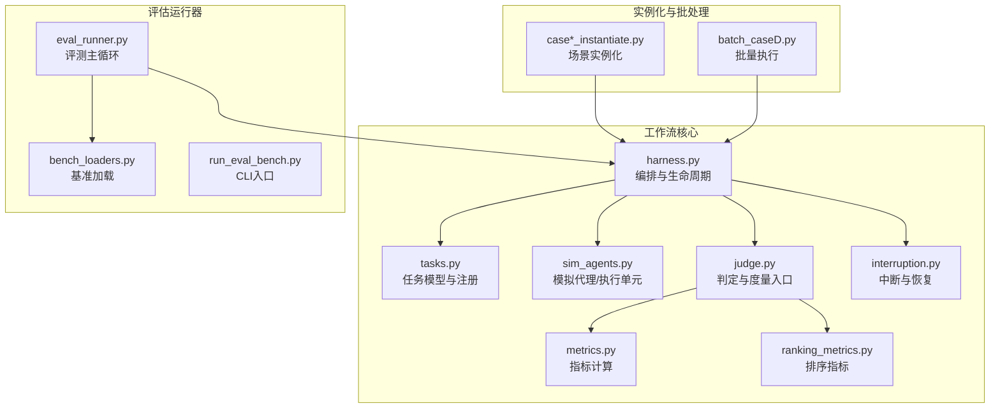
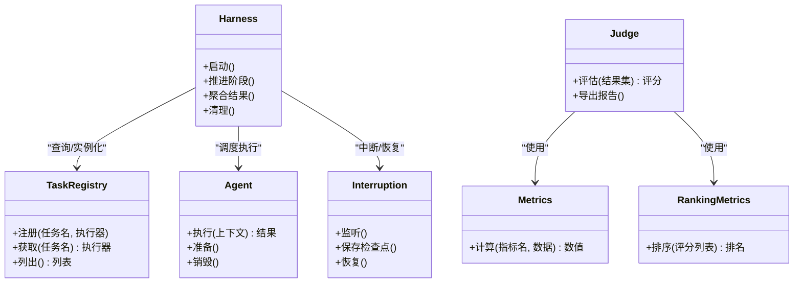
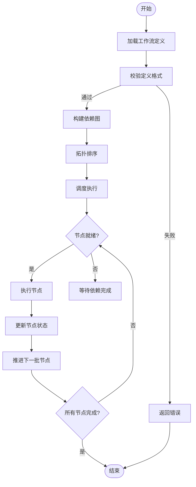
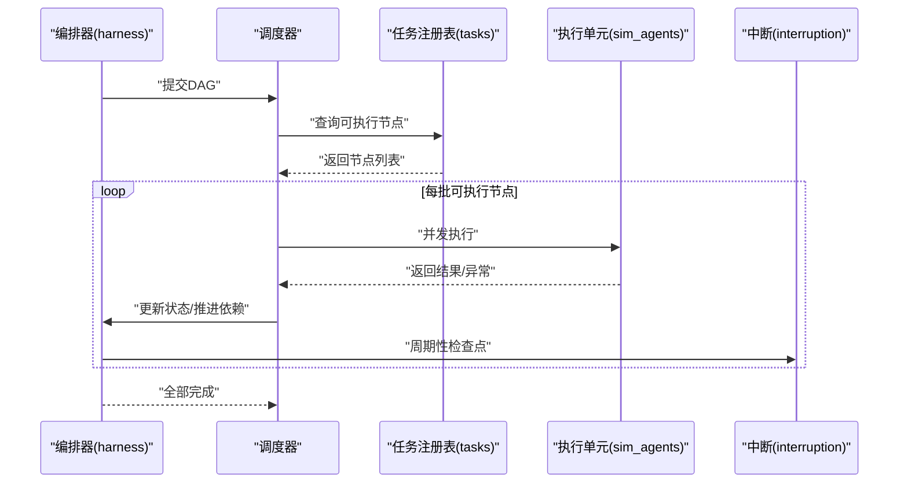
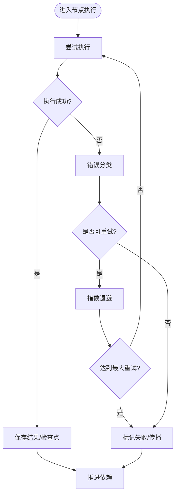
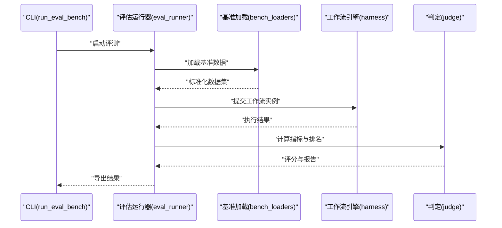
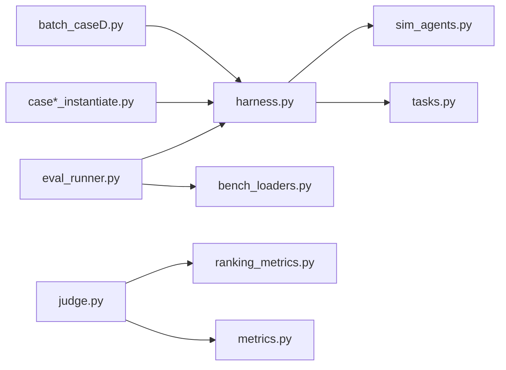

# 工作流引擎核心

<cite>
**本文引用的文件**   
- [autonomy_mvp/core/harness.py](file://autonomy_mvp/core/harness.py)
- [autonomy_mvp/core/interruption.py](file://autonomy_mvp/core/interruption.py)
- [autonomy_mvp/core/judge.py](file://autonomy_mvp/core/judge.py)
- [autonomy_mvp/core/metrics.py](file://autonomy_mvp/core/metrics.py)
- [autonomy_mvp/core/ranking_metrics.py](file://autonomy_mvp/core/ranking_metrics.py)
- [autonomy_mvp/core/sim_agents.py](file://autonomy_mvp/core/sim_agents.py)
- [autonomy_mvp/core/tasks.py](file://autonomy_mvp/core/tasks.py)
- [autonomy_mvp/schema.md](file://autonomy_mvp/schema.md)
- [autonomy_mvp/ACCEPTANCE.md](file://autonomy_mvp/ACCEPTANCE.md)
- [autonomy_mvp/run_validation.py](file://autonomy_mvp/run_validation.py)
- [autonomy_mvp/tests/test_core.py](file://autonomy_mvp/tests/test_core.py)
- [longhorizon/instantiate/batch_caseD.py](file://longhorizon/instantiate/batch_caseD.py)
- [longhorizon/instantiate/case1_instantiate.py](file://longhorizon/instantiate/case1_instantiate.py)
- [longhorizon/instantiate/case2_instantiate.py](file://longhorizon/instantiate/case2_instantiate.py)
- [longhorizon/instantiate/case3_instantiate.py](file://longhorizon/instantiate/case3_instantiate.py)
- [longhorizon/instantiate/caseD_instantiate.py](file://longhorizon/instantiate/caseD_instantiate.py)
- [longhorizon/instantiate/caseE_instantiate.py](file://longhorizon/instantiate/caseE_instantiate.py)
- [longhorizon/instantiate/caseF_instantiate.py](file://longhorizon/instantiate/caseF_instantiate.py)
- [task4_papers/molbench_repo/eval/eval_runner.py](file://docs/prd/task4_papers/molbench_repo/eval/eval_runner.py)
- [task4_papers/molbench_repo/eval/bench_loaders.py](file://docs/prd/task4_papers/molbench_repo/eval/bench_loaders.py)
- [task4_papers/molbench_repo/eval/run_eval_bench.py](file://docs/prd/task4_papers/molbench_repo/eval/run_eval_bench.py)
</cite>

## 目录
1. [简介](#简介)
2. [项目结构](#项目结构)
3. [核心组件](#核心组件)
4. [架构总览](#架构总览)
5. [详细组件分析](#详细组件分析)
6. [依赖关系分析](#依赖关系分析)
7. [性能与调度](#性能与调度)
8. [故障排查指南](#故障排查指南)
9. [结论](#结论)
10. [附录](#附录)

## 简介
本技术文档围绕“工作流引擎核心”展开，聚焦以下目标：
- 工作流定义格式、任务调度算法与执行引擎设计原理
- 状态管理、依赖解析与错误处理机制
- 并行执行策略、资源调度与负载均衡实现细节
- 模板开发指南、自定义工具集成方法与扩展点设计
- 监控、日志记录与性能分析能力
- 版本管理、回滚机制与审计追踪能力

为便于读者理解，文档从整体架构入手，逐步深入到关键模块的实现要点，并辅以图示说明。

## 项目结构
仓库包含多个子项目与示例数据，其中与工作流引擎核心相关的代码主要集中在 autonomy_mvp 与 longhorizon 两个目录，以及 docs/prd 下的评估运行器。

图表来源
- [autonomy_mvp/core/harness.py](file://autonomy_mvp/core/harness.py)
- [autonomy_mvp/core/tasks.py](file://autonomy_mvp/core/tasks.py)
- [autonomy_mvp/core/sim_agents.py](file://autonomy_mvp/core/sim_agents.py)
- [autonomy_mvp/core/judge.py](file://autonomy_mvp/core/judge.py)
- [autonomy_mvp/core/metrics.py](file://autonomy_mvp/core/metrics.py)
- [autonomy_mvp/core/ranking_metrics.py](file://autonomy_mvp/core/ranking_metrics.py)
- [autonomy_mvp/core/interruption.py](file://autonomy_mvp/core/interruption.py)
- [longhorizon/instantiate/case1_instantiate.py](file://longhorizon/instantiate/case1_instantiate.py)
- [longhorizon/instantiate/batch_caseD.py](file://longhorizon/instantiate/batch_caseD.py)
- [docs/prd/task4_papers/molbench_repo/eval/eval_runner.py](file://docs/prd/task4_papers/molbench_repo/eval/eval_runner.py)
- [docs/prd/task4_papers/molbench_repo/eval/bench_loaders.py](file://docs/prd/task4_papers/molbench_repo/eval/bench_loaders.py)
- [docs/prd/task4_papers/molbench_repo/eval/run_eval_bench.py](file://docs/prd/task4_papers/molbench_repo/eval/run_eval_bench.py)

章节来源
- [autonomy_mvp/schema.md](file://autonomy_mvp/schema.md)
- [autonomy_mvp/ACCEPTANCE.md](file://autonomy_mvp/ACCEPTANCE.md)

## 核心组件
- 编排与生命周期（harness）
  - 负责工作流的启动、阶段推进、上下文传递、结果聚合与收尾。
  - 提供统一的执行接口，屏蔽底层任务与代理差异。
- 任务模型与注册（tasks）
  - 定义任务数据结构、依赖声明、输入输出契约与可执行函数注册表。
  - 支持按名称或标识符查找与实例化任务。
- 模拟代理/执行单元（sim_agents）
  - 封装具体执行逻辑，如调用外部工具、LLM 或仿真环境。
  - 暴露统一接口供编排层调用，便于替换与扩展。
- 判定与度量（judge, metrics, ranking_metrics）
  - judge 作为评测入口，协调指标计算与结果汇总。
  - metrics 与 ranking_metrics 提供通用指标与排序方法。
- 中断与恢复（interruption）
  - 提供中断信号捕获、检查点写入与恢复流程，保障长时任务稳定性。

章节来源
- [autonomy_mvp/core/harness.py](file://autonomy_mvp/core/harness.py)
- [autonomy_mvp/core/tasks.py](file://autonomy_mvp/core/tasks.py)
- [autonomy_mvp/core/sim_agents.py](file://autonomy_mvp/core/sim_agents.py)
- [autonomy_mvp/core/judge.py](file://autonomy_mvp/core/judge.py)
- [autonomy_mvp/core/metrics.py](file://autonomy_mvp/core/metrics.py)
- [autonomy_mvp/core/ranking_metrics.py](file://autonomy_mvp/core/ranking_metrics.py)
- [autonomy_mvp/core/interruption.py](file://autonomy_mvp/core/interruption.py)

## 架构总览
工作流引擎采用“编排-任务-执行-度量”的分层架构：
- 编排层（harness）负责解析工作流定义、构建依赖图、调度任务执行、维护状态机。
- 任务层（tasks）提供声明式任务描述与注册机制，解耦业务逻辑与调度。
- 执行层（sim_agents）承载具体执行体，支持同步/异步、本地/远程、容器化等形态。
- 度量层（judge + metrics）在任务完成后进行结果校验与指标计算，支撑排名与报告生成。

图表来源
- [autonomy_mvp/core/harness.py](file://autonomy_mvp/core/harness.py)
- [autonomy_mvp/core/tasks.py](file://autonomy_mvp/core/tasks.py)
- [autonomy_mvp/core/sim_agents.py](file://autonomy_mvp/core/sim_agents.py)
- [autonomy_mvp/core/judge.py](file://autonomy_mvp/core/judge.py)
- [autonomy_mvp/core/metrics.py](file://autonomy_mvp/core/metrics.py)
- [autonomy_mvp/core/ranking_metrics.py](file://autonomy_mvp/core/ranking_metrics.py)
- [autonomy_mvp/core/interruption.py](file://autonomy_mvp/core/interruption.py)

## 详细组件分析

### 工作流定义格式与依赖解析
- 定义格式
  - 通过 schema 规范描述工作流节点、边、参数与约束，确保可验证与可复用。
  - 典型字段包括：节点标识、类型、输入/输出映射、依赖声明、资源需求、重试策略等。
- 依赖解析
  - 将声明式依赖转换为有向无环图（DAG），进行拓扑排序以确定执行顺序。
  - 检测循环依赖与缺失依赖，提前失败以避免运行时异常。
- 状态管理
  - 每个节点维护状态（待执行、运行中、成功、失败、跳过）。
  - 编排器根据依赖完成度推进状态机，保证幂等与可恢复性。

图表来源
- [autonomy_mvp/schema.md](file://autonomy_mvp/schema.md)
- [autonomy_mvp/core/harness.py](file://autonomy_mvp/core/harness.py)
- [autonomy_mvp/core/tasks.py](file://autonomy_mvp/core/tasks.py)

章节来源
- [autonomy_mvp/schema.md](file://autonomy_mvp/schema.md)
- [autonomy_mvp/core/harness.py](file://autonomy_mvp/core/harness.py)
- [autonomy_mvp/core/tasks.py](file://autonomy_mvp/core/tasks.py)

### 任务调度算法与执行引擎
- 调度算法
  - 基于 DAG 的层级调度：每轮选择所有入度为 0 的节点并发执行。
  - 支持优先级与资源配额，避免热点节点阻塞。
- 执行引擎
  - 统一执行接口，内部适配不同 Agent 实现。
  - 支持超时控制、重试与熔断，提升鲁棒性。
- 状态与检查点
  - 持久化中间结果与状态快照，支持断点续跑。
  - 结合中断模块，优雅退出与恢复。

图表来源
- [autonomy_mvp/core/harness.py](file://autonomy_mvp/core/harness.py)
- [autonomy_mvp/core/tasks.py](file://autonomy_mvp/core/tasks.py)
- [autonomy_mvp/core/sim_agents.py](file://autonomy_mvp/core/sim_agents.py)
- [autonomy_mvp/core/interruption.py](file://autonomy_mvp/core/interruption.py)

章节来源
- [autonomy_mvp/core/harness.py](file://autonomy_mvp/core/harness.py)
- [autonomy_mvp/core/tasks.py](file://autonomy_mvp/core/tasks.py)
- [autonomy_mvp/core/sim_agents.py](file://autonomy_mvp/core/sim_agents.py)
- [autonomy_mvp/core/interruption.py](file://autonomy_mvp/core/interruption.py)

### 错误处理与重试机制
- 错误分类
  - 可重试错误（网络抖动、临时资源不足）与不可重试错误（参数非法、依赖缺失）。
- 重试策略
  - 指数退避、最大重试次数、幂等键去重。
- 失败传播
  - 上游失败导致下游跳过或降级执行；支持部分成功与补偿动作。

图表来源
- [autonomy_mvp/core/harness.py](file://autonomy_mvp/core/harness.py)
- [autonomy_mvp/core/interruption.py](file://autonomy_mvp/core/interruption.py)

章节来源
- [autonomy_mvp/core/harness.py](file://autonomy_mvp/core/harness.py)
- [autonomy_mvp/core/interruption.py](file://autonomy_mvp/core/interruption.py)

### 并行执行策略、资源调度与负载均衡
- 并行策略
  - 批次级并行：每批内并发执行，批次间串行推进。
  - 细粒度并行：按资源池限制并发度，避免过载。
- 资源调度
  - 资源标签与配额：CPU/GPU/内存/外部服务配额。
  - 亲和性与反亲和：将相关节点放置到同一资源域，减少跨域开销。
- 负载均衡
  - 动态扩缩容：根据队列长度与延迟自动调整并发度。
  - 健康检查：剔除不健康执行单元，避免雪崩。

章节来源
- [autonomy_mvp/core/harness.py](file://autonomy_mvp/core/harness.py)
- [autonomy_mvp/core/sim_agents.py](file://autonomy_mvp/core/sim_agents.py)

### 监控、日志记录与性能分析
- 监控
  - 指标采集：吞吐、延迟、成功率、资源利用率。
  - 告警规则：阈值触发与通知通道。
- 日志
  - 结构化日志：关联工作流 ID、节点 ID、TraceID。
  - 分级输出：DEBUG/INFO/WARN/ERROR，便于检索与分析。
- 性能分析
  - 火焰图与耗时分解：定位瓶颈节点。
  - 基线对比：回归检测与优化效果评估。

章节来源
- [autonomy_mvp/core/judge.py](file://autonomy_mvp/core/judge.py)
- [autonomy_mvp/core/metrics.py](file://autonomy_mvp/core/metrics.py)
- [autonomy_mvp/core/ranking_metrics.py](file://autonomy_mvp/core/ranking_metrics.py)

### 版本管理、回滚机制与审计追踪
- 版本管理
  - 工作流定义与任务实现均带版本号，支持多版本并存。
  - 变更影响分析：依赖图比对与兼容性检查。
- 回滚机制
  - 一键回滚至稳定版本，保留历史快照。
  - 灰度发布：按比例切换流量，观察指标后再全量。
- 审计追踪
  - 操作日志：创建、修改、发布、回滚。
  - 数据血缘：输入输出溯源，满足合规要求。

章节来源
- [autonomy_mvp/schema.md](file://autonomy_mvp/schema.md)
- [autonomy_mvp/core/harness.py](file://autonomy_mvp/core/harness.py)

### 工作流模板开发与自定义工具集成
- 模板开发
  - 基于 schema 编写模板，明确输入输出与依赖。
  - 提供最小可用模板与最佳实践示例。
- 自定义工具集成
  - 通过任务注册表注册新工具，暴露统一接口。
  - 配置资源需求与重试策略，纳入统一调度。
- 扩展点设计
  - 钩子：前置校验、后置清理、指标上报。
  - 插件：执行器、存储后端、认证鉴权。

章节来源
- [autonomy_mvp/core/tasks.py](file://autonomy_mvp/core/tasks.py)
- [autonomy_mvp/core/sim_agents.py](file://autonomy_mvp/core/sim_agents.py)
- [autonomy_mvp/schema.md](file://autonomy_mvp/schema.md)

### 评估与基准运行器
- 评估主循环（eval_runner）
  - 加载基准数据集，驱动工作流执行，收集结果与指标。
- 基准加载（bench_loaders）
  - 统一读取不同格式的基准数据，标准化为工作流输入。
- CLI 入口（run_eval_bench）
  - 提供命令行参数，支持批量运行与结果导出。

图表来源
- [docs/prd/task4_papers/molbench_repo/eval/run_eval_bench.py](file://docs/prd/task4_papers/molbench_repo/eval/run_eval_bench.py)
- [docs/prd/task4_papers/molbench_repo/eval/eval_runner.py](file://docs/prd/task4_papers/molbench_repo/eval/eval_runner.py)
- [docs/prd/task4_papers/molbench_repo/eval/bench_loaders.py](file://docs/prd/task4_papers/molbench_repo/eval/bench_loaders.py)
- [autonomy_mvp/core/harness.py](file://autonomy_mvp/core/harness.py)
- [autonomy_mvp/core/judge.py](file://autonomy_mvp/core/judge.py)

章节来源
- [docs/prd/task4_papers/molbench_repo/eval/run_eval_bench.py](file://docs/prd/task4_papers/molbench_repo/eval/run_eval_bench.py)
- [docs/prd/task4_papers/molbench_repo/eval/eval_runner.py](file://docs/prd/task4_papers/molbench_repo/eval/eval_runner.py)
- [docs/prd/task4_papers/molbench_repo/eval/bench_loaders.py](file://docs/prd/task4_papers/molbench_repo/eval/bench_loaders.py)

### 场景实例化与批量执行
- 场景实例化（case*_instantiate）
  - 将通用模板与具体参数组合，生成可执行的工作流实例。
  - 支持参数校验与环境初始化。
- 批量执行（batch_caseD）
  - 并发提交多个实例，统一管理与监控。
  - 支持失败隔离与重试。

章节来源
- [longhorizon/instantiate/case1_instantiate.py](file://longhorizon/instantiate/case1_instantiate.py)
- [longhorizon/instantiate/case2_instantiate.py](file://longhorizon/instantiate/case2_instantiate.py)
- [longhorizon/instantiate/case3_instantiate.py](file://longhorizon/instantiate/case3_instantiate.py)
- [longhorizon/instantiate/caseD_instantiate.py](file://longhorizon/instantiate/caseD_instantiate.py)
- [longhorizon/instantiate/caseE_instantiate.py](file://longhorizon/instantiate/caseE_instantiate.py)
- [longhorizon/instantiate/caseF_instantiate.py](file://longhorizon/instantiate/caseF_instantiate.py)
- [longhorizon/instantiate/batch_caseD.py](file://longhorizon/instantiate/batch_caseD.py)

## 依赖关系分析
- 组件耦合
  - harness 与 tasks 强耦合（任务查询与实例化）。
  - harness 与 sim_agents 松耦合（统一接口）。
  - judge 与 metrics/ranking_metrics 低耦合（纯函数式指标）。
- 外部依赖
  - 评估运行器依赖基准数据加载器。
  - 实例化脚本依赖工作流核心与模板。

图表来源
- [autonomy_mvp/core/harness.py](file://autonomy_mvp/core/harness.py)
- [autonomy_mvp/core/tasks.py](file://autonomy_mvp/core/tasks.py)
- [autonomy_mvp/core/sim_agents.py](file://autonomy_mvp/core/sim_agents.py)
- [autonomy_mvp/core/judge.py](file://autonomy_mvp/core/judge.py)
- [autonomy_mvp/core/metrics.py](file://autonomy_mvp/core/metrics.py)
- [autonomy_mvp/core/ranking_metrics.py](file://autonomy_mvp/core/ranking_metrics.py)
- [docs/prd/task4_papers/molbench_repo/eval/eval_runner.py](file://docs/prd/task4_papers/molbench_repo/eval/eval_runner.py)
- [docs/prd/task4_papers/molbench_repo/eval/bench_loaders.py](file://docs/prd/task4_papers/molbench_repo/eval/bench_loaders.py)
- [longhorizon/instantiate/case1_instantiate.py](file://longhorizon/instantiate/case1_instantiate.py)
- [longhorizon/instantiate/batch_caseD.py](file://longhorizon/instantiate/batch_caseD.py)

章节来源
- [autonomy_mvp/core/harness.py](file://autonomy_mvp/core/harness.py)
- [autonomy_mvp/core/tasks.py](file://autonomy_mvp/core/tasks.py)
- [autonomy_mvp/core/sim_agents.py](file://autonomy_mvp/core/sim_agents.py)
- [autonomy_mvp/core/judge.py](file://autonomy_mvp/core/judge.py)
- [autonomy_mvp/core/metrics.py](file://autonomy_mvp/core/metrics.py)
- [autonomy_mvp/core/ranking_metrics.py](file://autonomy_mvp/core/ranking_metrics.py)
- [docs/prd/task4_papers/molbench_repo/eval/eval_runner.py](file://docs/prd/task4_papers/molbench_repo/eval/eval_runner.py)
- [docs/prd/task4_papers/molbench_repo/eval/bench_loaders.py](file://docs/prd/task4_papers/molbench_repo/eval/bench_loaders.py)
- [longhorizon/instantiate/case1_instantiate.py](file://longhorizon/instantiate/case1_instantiate.py)
- [longhorizon/instantiate/batch_caseD.py](file://longhorizon/instantiate/batch_caseD.py)

## 性能与调度
- 并发度调优
  - 依据 CPU/GPU 利用率与队列长度动态调整批次大小。
  - 对 IO 密集型任务提高并发，对 CPU 密集型任务限制并发。
- 资源隔离
  - 使用命名空间或容器隔离执行环境，避免相互干扰。
- 缓存与复用
  - 中间结果缓存，相同输入直接命中，减少重复计算。
- 背压与限流
  - 当下游处理能力不足时，主动降低上游提交速率。

[本节为通用指导，不直接分析具体文件]

## 故障排查指南
- 常见问题
  - 依赖未满足：检查 DAG 构建与拓扑排序结果。
  - 执行超时：查看节点日志与资源配额，调整超时与重试策略。
  - 指标异常：核对指标计算逻辑与输入数据格式。
- 诊断步骤
  - 启用详细日志，定位失败节点与堆栈信息。
  - 使用检查点恢复，缩小问题范围。
  - 对比基线运行，识别回归点。

章节来源
- [autonomy_mvp/core/harness.py](file://autonomy_mvp/core/harness.py)
- [autonomy_mvp/core/interruption.py](file://autonomy_mvp/core/interruption.py)
- [autonomy_mvp/core/judge.py](file://autonomy_mvp/core/judge.py)
- [autonomy_mvp/core/metrics.py](file://autonomy_mvp/core/metrics.py)

## 结论
本工作流引擎以声明式定义与 DAG 调度为核心，结合统一执行接口与完善的度量体系，实现了高可扩展、可观测与可运维的工作流平台。通过模板化与插件化设计，开发者可快速集成自定义工具与评估流程，并在生产环境中获得稳定的并行执行与资源管理能力。

[本节为总结性内容，不直接分析具体文件]

## 附录
- 验收标准与测试
  - 参考验收文档与单元测试，确保核心功能正确性与稳定性。
- 运行验证
  - 使用验证脚本对工作流定义与执行路径进行端到端校验。

章节来源
- [autonomy_mvp/ACCEPTANCE.md](file://autonomy_mvp/ACCEPTANCE.md)
- [autonomy_mvp/run_validation.py](file://autonomy_mvp/run_validation.py)
- [autonomy_mvp/tests/test_core.py](file://autonomy_mvp/tests/test_core.py)