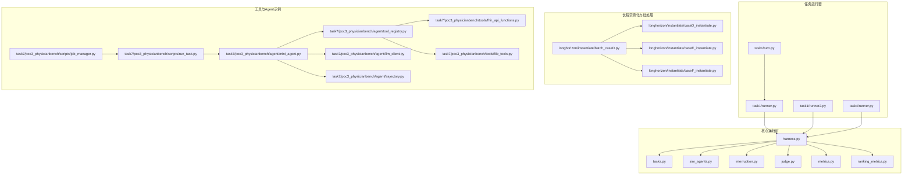
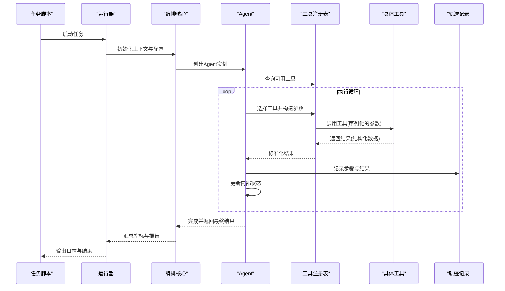
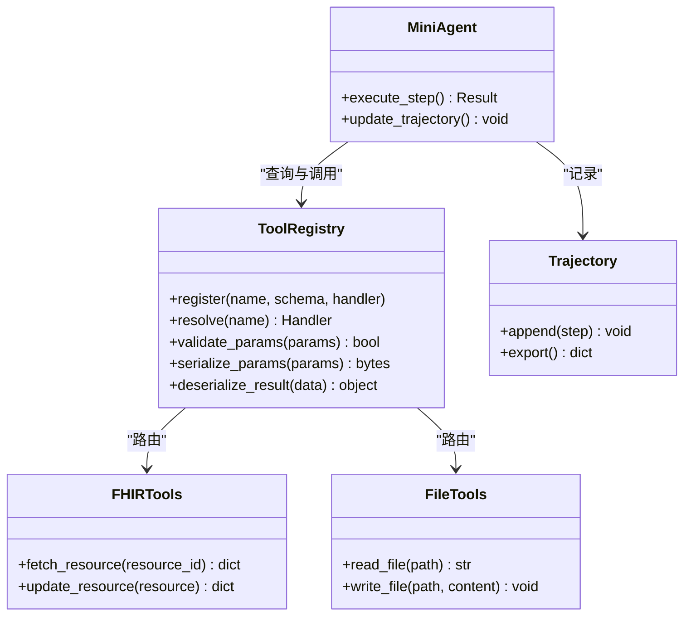
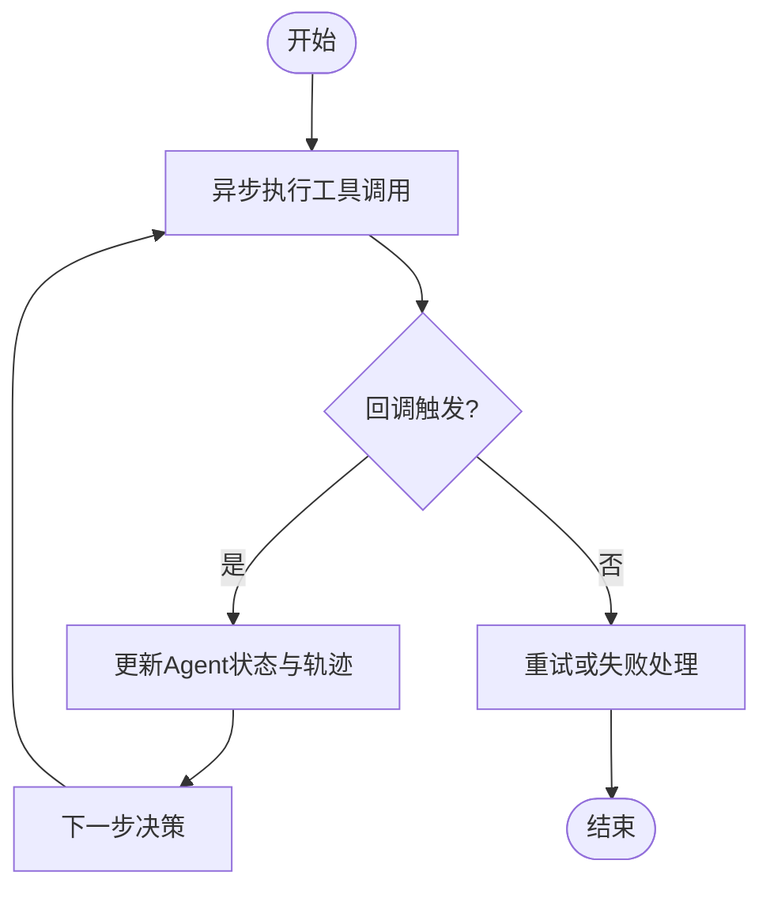
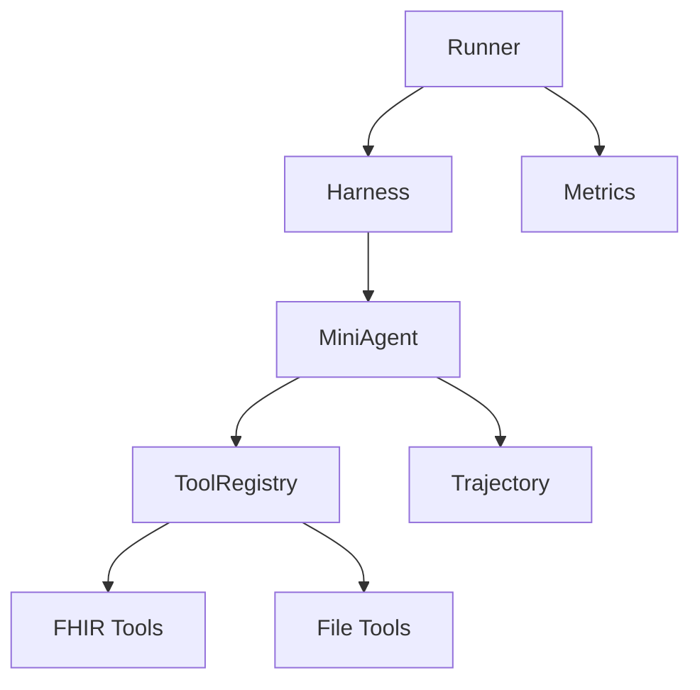

# 执行运行时

<cite>
**本文引用的文件**   
- [autonomy_mvp/core/harness.py](file://autonomy_mvp/core/harness.py)
- [autonomy_mvp/core/interruption.py](file://autonomy_mvp/core/interruption.py)
- [autonomy_mvp/core/judge.py](file://autonomy_mvp/core/judge.py)
- [autonomy_mvp/core/metrics.py](file://autonomy_mvp/core/metrics.py)
- [autonomy_mvp/core/ranking_metrics.py](file://autonomy_mvp/core/ranking_metrics.py)
- [autonomy_mvp/core/sim_agents.py](file://autonomy_mvp/core/sim_agents.py)
- [autonomy_mvp/core/tasks.py](file://autonomy_mvp/core/tasks.py)
- [task1/runner.py](file://task1/runner.py)
- [task1/runner2.py](file://task1/runner2.py)
- [task1/turn.py](file://task1/turn.py)
- [task4/runner.py](file://task4/runner.py)
- [longhorizon/instantiate/batch_caseD.py](file://longhorizon/instantiate/batch_caseD.py)
- [longhorizon/instantiate/caseD_instantiate.py](file://longhorizon/instantiate/caseD_instantiate.py)
- [longhorizon/instantiate/caseE_instantiate.py](file://longhorizon/instantiate/caseE_instantiate.py)
- [longhorizon/instantiate/caseF_instantiate.py](file://longhorizon/instantiate/caseF_instantiate.py)
- [task7/poc3_physicianbench/agent/tool_registry.py](file://task7/poc3_physicianbench/agent/tool_registry.py)
- [task7/poc3_physicianbench/agent/mini_agent.py](file://task7/poc3_physicianbench/agent/mini_agent.py)
- [task7/poc3_physicianbench/agent/llm_client.py](file://task7/poc3_physicianbench/agent/llm_client.py)
- [task7/poc3_physicianbench/agent/trajectory.py](file://task7/poc3_physicianbench/agent/trajectory.py)
- [task7/poc3_physicianbench/tools/fhir_api_functions.py](file://task7/poc3_physicianbench/tools/fhir_api_functions.py)
- [task7/poc3_physicianbench/tools/file_tools.py](file://task7/poc3_physicianbench/tools/file_tools.py)
- [task7/poc3_physicianbench/scripts/run_task.py](file://task7/poc3_physicianbench/scripts/run_task.py)
- [task7/poc3_physicianbench/scripts/job_manager.py](file://task7/poc3_physicianbench/scripts/job_manager.py)
</cite>

## 目录
1. [引言](#引言)
2. [项目结构](#项目结构)
3. [核心组件](#核心组件)
4. [架构总览](#架构总览)
5. [详细组件分析](#详细组件分析)
6. [依赖关系分析](#依赖关系分析)
7. [性能与资源管理](#性能与资源管理)
8. [故障排查指南](#故障排查指南)
9. [结论](#结论)
10. [附录](#附录)

## 引言
本技术文档面向“执行运行时”的实现，围绕工作流执行上下文管理、环境变量隔离与资源限制、工具调用接口与序列化/反序列化、内存管理与垃圾回收、性能监控集成、异步执行与回调机制、事件驱动架构、沙箱安全与权限控制、访问审计、以及运行时扩展点与插件开发进行系统化说明。文档以仓库中现有实现为依据，提炼出可复用的运行时设计模式与最佳实践，帮助读者快速理解并扩展系统能力。

## 项目结构
仓库包含多个任务与实验子项目，其中与“执行运行时”密切相关的代码主要分布在以下位置：
- autonomy_mvp/core：提供评测与仿真框架的核心模块（任务编排、中断处理、指标计算、代理模拟等）
- task1、task4：不同任务的运行器与交互流程实现
- longhorizon/instantiate：批量实例化与批处理调度入口
- task7/poc3_physicianbench：具备工具注册、LLM客户端、轨迹记录、任务脚本与作业管理的完整示例

图表来源
- [autonomy_mvp/core/harness.py](file://autonomy_mvp/core/harness.py)
- [autonomy_mvp/core/tasks.py](file://autonomy_mvp/core/tasks.py)
- [autonomy_mvp/core/sim_agents.py](file://autonomy_mvp/core/sim_agents.py)
- [autonomy_mvp/core/interruption.py](file://autonomy_mvp/core/interruption.py)
- [autonomy_mvp/core/judge.py](file://autonomy_mvp/core/judge.py)
- [autonomy_mvp/core/metrics.py](file://autonomy_mvp/core/metrics.py)
- [autonomy_mvp/core/ranking_metrics.py](file://autonomy_mvp/core/ranking_metrics.py)
- [task1/runner.py](file://task1/runner.py)
- [task1/runner2.py](file://task1/runner2.py)
- [task1/turn.py](file://task1/turn.py)
- [task4/runner.py](file://task4/runner.py)
- [longhorizon/instantiate/batch_caseD.py](file://longhorizon/instantiate/batch_caseD.py)
- [longhorizon/instantiate/caseD_instantiate.py](file://longhorizon/instantiate/caseD_instantiate.py)
- [longhorizon/instantiate/caseE_instantiate.py](file://longhorizon/instantiate/caseE_instantiate.py)
- [longhorizon/instantiate/caseF_instantiate.py](file://longhorizon/instantiate/caseF_instantiate.py)
- [task7/poc3_physicianbench/agent/tool_registry.py](file://task7/poc3_physicianbench/agent/tool_registry.py)
- [task7/poc3_physicianbench/agent/mini_agent.py](file://task7/poc3_physicianbench/agent/mini_agent.py)
- [task7/poc3_physicianbench/agent/llm_client.py](file://task7/poc3_physicianbench/agent/llm_client.py)
- [task7/poc3_physicianbench/agent/trajectory.py](file://task7/poc3_physicianbench/agent/trajectory.py)
- [task7/poc3_physicianbench/tools/fhir_api_functions.py](file://task7/poc3_physicianbench/tools/fhir_api_functions.py)
- [task7/poc3_physicianbench/tools/file_tools.py](file://task7/poc3_physicianbench/tools/file_tools.py)
- [task7/poc3_physicianbench/scripts/run_task.py](file://task7/poc3_physicianbench/scripts/run_task.py)
- [task7/poc3_physicianbench/scripts/job_manager.py](file://task7/poc3_physicianbench/scripts/job_manager.py)

章节来源
- [autonomy_mvp/core/harness.py](file://autonomy_mvp/core/harness.py)
- [autonomy_mvp/core/tasks.py](file://autonomy_mvp/core/tasks.py)
- [autonomy_mvp/core/sim_agents.py](file://autonomy_mvp/core/sim_agents.py)
- [autonomy_mvp/core/interruption.py](file://autonomy_mvp/core/interruption.py)
- [autonomy_mvp/core/judge.py](file://autonomy_mvp/core/judge.py)
- [autonomy_mvp/core/metrics.py](file://autonomy_mvp/core/metrics.py)
- [autonomy_mvp/core/ranking_metrics.py](file://autonomy_mvp/core/ranking_metrics.py)
- [task1/runner.py](file://task1/runner.py)
- [task1/runner2.py](file://task1/runner2.py)
- [task1/turn.py](file://task1/turn.py)
- [task4/runner.py](file://task4/runner.py)
- [longhorizon/instantiate/batch_caseD.py](file://longhorizon/instantiate/batch_caseD.py)
- [longhorizon/instantiate/caseD_instantiate.py](file://longhorizon/instantiate/caseD_instantiate.py)
- [longhorizon/instantiate/caseE_instantiate.py](file://longhorizon/instantiate/caseE_instantiate.py)
- [longhorizon/instantiate/caseF_instantiate.py](file://longhorizon/instantiate/caseF_instantiate.py)
- [task7/poc3_physicianbench/agent/tool_registry.py](file://task7/poc3_physicianbench/agent/tool_registry.py)
- [task7/poc3_physicianbench/agent/mini_agent.py](file://task7/poc3_physicianbench/agent/mini_agent.py)
- [task7/poc3_physicianbench/agent/llm_client.py](file://task7/poc3_physicianbench/agent/llm_client.py)
- [task7/poc3_physicianbench/agent/trajectory.py](file://task7/poc3_physicianbench/agent/trajectory.py)
- [task7/poc3_physicianbench/tools/fhir_api_functions.py](file://task7/poc3_physicianbench/tools/fhir_api_functions.py)
- [task7/poc3_physicianbench/tools/file_tools.py](file://task7/poc3_physicianbench/tools/file_tools.py)
- [task7/poc3_physicianbench/scripts/run_task.py](file://task7/poc3_physicianbench/scripts/run_task.py)
- [task7/poc3_physicianbench/scripts/job_manager.py](file://task7/poc3_physicianbench/scripts/job_manager.py)

## 核心组件
- 工作流编排与上下文管理
  - 通过任务定义与执行器组合，形成可插拔的工作流；上下文对象贯穿生命周期，保存状态、配置与环境变量快照。
- 中断与恢复
  - 支持在执行过程中捕获中断信号，持久化中间状态，以便后续恢复或回滚。
- 评估与指标
  - 统一的结果判定与指标聚合，支持多指标排名与汇总输出。
- 工具注册与调用
  - 工具集中注册，按名称解析与参数校验，返回标准化结果；支持外部API与本地文件操作。
- Agent与轨迹
  - Agent封装决策循环，维护对话与工具调用轨迹，便于回放与审计。
- 任务脚本与作业管理
  - 提供任务启动脚本与作业管理器，用于批量实例化与并发调度。

章节来源
- [autonomy_mvp/core/harness.py](file://autonomy_mvp/core/harness.py)
- [autonomy_mvp/core/interruption.py](file://autonomy_mvp/core/interruption.py)
- [autonomy_mvp/core/judge.py](file://autonomy_mvp/core/judge.py)
- [autonomy_mvp/core/metrics.py](file://autonomy_mvp/core/metrics.py)
- [autonomy_mvp/core/ranking_metrics.py](file://autonomy_mvp/core/ranking_metrics.py)
- [task7/poc3_physicianbench/agent/tool_registry.py](file://task7/poc3_physicianbench/agent/tool_registry.py)
- [task7/poc3_physicianbench/agent/mini_agent.py](file://task7/poc3_physicianbench/agent/mini_agent.py)
- [task7/poc3_physicianbench/agent/trajectory.py](file://task7/poc3_physicianbench/agent/trajectory.py)
- [task7/poc3_physicianbench/scripts/run_task.py](file://task7/poc3_physicianbench/scripts/run_task.py)
- [task7/poc3_physicianbench/scripts/job_manager.py](file://task7/poc3_physicianbench/scripts/job_manager.py)

## 架构总览
下图展示了从任务入口到工具执行的端到端流程，包括上下文初始化、工具路由、结果序列化与轨迹记录。

图表来源
- [task7/poc3_physicianbench/scripts/run_task.py](file://task7/poc3_physicianbench/scripts/run_task.py)
- [task7/poc3_physicianbench/agent/mini_agent.py](file://task7/poc3_physicianbench/agent/mini_agent.py)
- [task7/poc3_physicianbench/agent/tool_registry.py](file://task7/poc3_physicianbench/agent/tool_registry.py)
- [task7/poc3_physicianbench/agent/trajectory.py](file://task7/poc3_physicianbench/agent/trajectory.py)
- [autonomy_mvp/core/harness.py](file://autonomy_mvp/core/harness.py)

## 详细组件分析

### 工作流执行上下文管理
- 职责
  - 维护任务级配置、环境变量快照、临时工作区路径、日志与追踪ID。
  - 在工具调用前后注入/清理上下文，确保各工具对环境的可见性一致且可控。
- 关键设计
  - 使用不可变配置对象与可变状态分离，避免并发修改导致的不一致。
  - 提供上下文管理器，自动处理进入/退出时的资源分配与释放。
- 典型用法
  - 在任务入口创建上下文，传递给运行器与Agent；工具通过上下文获取只读配置与写入临时文件。

章节来源
- [autonomy_mvp/core/harness.py](file://autonomy_mvp/core/harness.py)
- [task7/poc3_physicianbench/agent/mini_agent.py](file://task7/poc3_physicianbench/agent/mini_agent.py)

### 环境变量隔离与资源限制
- 环境变量隔离
  - 为每个执行单元（任务或工具）提供独立的环境副本，避免跨任务污染。
  - 支持白名单策略，仅暴露必要变量给工具进程。
- 资源限制
  - 通过进程或线程池限制CPU与内存上限，结合超时与重试策略保障稳定性。
  - 文件I/O限制：限定工作区目录，禁止越权访问。
- 实现要点
  - 在工具调用前克隆环境，并在完成后还原；对异常与超时进行统一捕获与上报。

章节来源
- [task7/poc3_physicianbench/tools/file_tools.py](file://task7/poc3_physicianbench/tools/file_tools.py)
- [task7/poc3_physicianbench/tools/fhir_api_functions.py](file://task7/poc3_physicianbench/tools/fhir_api_functions.py)

### 工具调用接口、参数序列化与结果反序列化
- 工具注册表
  - 提供统一的注册、发现与路由机制；支持元信息描述（名称、版本、参数Schema）。
- 参数序列化
  - 将Python对象转换为JSON或协议缓冲区，确保跨进程/网络传输的稳定性。
- 结果反序列化
  - 将工具返回的结构化数据映射为强类型对象，便于后续处理与验证。
- 错误处理
  - 对非法参数、缺失字段、类型不匹配进行前置校验，返回明确错误码与消息。

图表来源
- [task7/poc3_physicianbench/agent/tool_registry.py](file://task7/poc3_physicianbench/agent/tool_registry.py)
- [task7/poc3_physicianbench/agent/mini_agent.py](file://task7/poc3_physicianbench/agent/mini_agent.py)
- [task7/poc3_physicianbench/tools/fhir_api_functions.py](file://task7/poc3_physicianbench/tools/fhir_api_functions.py)
- [task7/poc3_physicianbench/tools/file_tools.py](file://task7/poc3_physicianbench/tools/file_tools.py)
- [task7/poc3_physicianbench/agent/trajectory.py](file://task7/poc3_physicianbench/agent/trajectory.py)

章节来源
- [task7/poc3_physicianbench/agent/tool_registry.py](file://task7/poc3_physicianbench/agent/tool_registry.py)
- [task7/poc3_physicianbench/agent/mini_agent.py](file://task7/poc3_physicianbench/agent/mini_agent.py)
- [task7/poc3_physicianbench/tools/fhir_api_functions.py](file://task7/poc3_physicianbench/tools/fhir_api_functions.py)
- [task7/poc3_physicianbench/tools/file_tools.py](file://task7/poc3_physicianbench/tools/file_tools.py)
- [task7/poc3_physicianbench/agent/trajectory.py](file://task7/poc3_physicianbench/agent/trajectory.py)

### 内存管理、垃圾回收与性能监控集成
- 内存管理
  - 大对象及时释放，避免长时间持有引用；使用生成器与流式处理减少峰值内存。
- 垃圾回收
  - 合理设置GC阈值，避免频繁触发；在长任务中主动触发弱引用清理。
- 性能监控
  - 采集关键指标：CPU/内存占用、I/O吞吐、工具调用延迟与失败率。
  - 将指标写入统一存储，供后续分析与告警。

章节来源
- [autonomy_mvp/core/metrics.py](file://autonomy_mvp/core/metrics.py)
- [autonomy_mvp/core/ranking_metrics.py](file://autonomy_mvp/core/ranking_metrics.py)
- [task7/poc3_physicianbench/agent/trajectory.py](file://task7/poc3_physicianbench/agent/trajectory.py)

### 异步执行、回调机制与事件驱动架构
- 异步执行
  - 使用协程或线程池并行调用工具，提升吞吐；对阻塞型I/O采用非阻塞模型。
- 回调机制
  - 工具执行完成后触发回调，更新Agent状态与轨迹；支持错误回调与重试策略。
- 事件驱动
  - 基于事件总线发布/订阅关键事件（如工具开始/结束、异常、指标更新），解耦组件间通信。

图表来源
- [task7/poc3_physicianbench/agent/mini_agent.py](file://task7/poc3_physicianbench/agent/mini_agent.py)
- [task7/poc3_physicianbench/agent/trajectory.py](file://task7/poc3_physicianbench/agent/trajectory.py)

章节来源
- [task7/poc3_physicianbench/agent/mini_agent.py](file://task7/poc3_physicianbench/agent/mini_agent.py)
- [task7/poc3_physicianbench/agent/trajectory.py](file://task7/poc3_physicianbench/agent/trajectory.py)

### 工具沙箱安全机制、权限控制与访问审计
- 沙箱隔离
  - 工具在受限环境中执行，限制文件系统、网络与系统调用范围。
- 权限控制
  - 基于角色与白名单的策略，最小权限原则；敏感操作需显式授权。
- 访问审计
  - 记录所有工具调用的输入、输出、时间与调用者，支持回溯与合规检查。

章节来源
- [task7/poc3_physicianbench/tools/file_tools.py](file://task7/poc3_physicianbench/tools/file_tools.py)
- [task7/poc3_physicianbench/tools/fhir_api_functions.py](file://task7/poc3_physicianbench/tools/fhir_api_functions.py)
- [task7/poc3_physicianbench/agent/trajectory.py](file://task7/poc3_physicianbench/agent/trajectory.py)

### 运行时扩展点、自定义执行器与插件开发指南
- 扩展点
  - 工具注册表：新增工具只需实现接口并注册。
  - 执行器：替换默认执行器以实现不同的调度策略（如串行、并行、优先级队列）。
  - 指标收集器：接入新的监控系统或导出格式。
- 插件开发
  - 遵循约定优于配置的原则，提供元信息与Schema；编写单元测试与集成测试。
  - 使用上下文传递配置与凭据，避免硬编码。

章节来源
- [task7/poc3_physicianbench/agent/tool_registry.py](file://task7/poc3_physicianbench/agent/tool_registry.py)
- [autonomy_mvp/core/harness.py](file://autonomy_mvp/core/harness.py)

## 依赖关系分析
- 组件耦合
  - 运行器与编排核心低耦合，通过上下文与接口契约交互。
  - Agent与工具注册表松耦合，支持动态加载与热插拔。
- 外部依赖
  - LLM客户端、FHIR API、文件系统I/O等外部服务通过适配器封装，便于替换与测试。
- 潜在循环依赖
  - 通过事件总线与回调机制避免直接循环引用，保持单向依赖。

图表来源
- [task1/runner.py](file://task1/runner.py)
- [autonomy_mvp/core/harness.py](file://autonomy_mvp/core/harness.py)
- [task7/poc3_physicianbench/agent/mini_agent.py](file://task7/poc3_physicianbench/agent/mini_agent.py)
- [task7/poc3_physicianbench/agent/tool_registry.py](file://task7/poc3_physicianbench/agent/tool_registry.py)
- [task7/poc3_physicianbench/tools/fhir_api_functions.py](file://task7/poc3_physicianbench/tools/fhir_api_functions.py)
- [task7/poc3_physicianbench/tools/file_tools.py](file://task7/poc3_physicianbench/tools/file_tools.py)
- [task7/poc3_physicianbench/agent/trajectory.py](file://task7/poc3_physicianbench/agent/trajectory.py)
- [autonomy_mvp/core/metrics.py](file://autonomy_mvp/core/metrics.py)

章节来源
- [task1/runner.py](file://task1/runner.py)
- [autonomy_mvp/core/harness.py](file://autonomy_mvp/core/harness.py)
- [task7/poc3_physicianbench/agent/mini_agent.py](file://task7/poc3_physicianbench/agent/mini_agent.py)
- [task7/poc3_physicianbench/agent/tool_registry.py](file://task7/poc3_physicianbench/agent/tool_registry.py)
- [task7/poc3_physicianbench/tools/fhir_api_functions.py](file://task7/poc3_physicianbench/tools/fhir_api_functions.py)
- [task7/poc3_physicianbench/tools/file_tools.py](file://task7/poc3_physicianbench/tools/file_tools.py)
- [task7/poc3_physicianbench/agent/trajectory.py](file://task7/poc3_physicianbench/agent/trajectory.py)
- [autonomy_mvp/core/metrics.py](file://autonomy_mvp/core/metrics.py)

## 性能与资源管理
- 并发与吞吐
  - 使用线程池或进程池并行执行工具，结合限流与背压控制，避免过载。
- 内存与GC
  - 大对象及时释放，避免长期引用；在长任务中定期触发GC与弱引用清理。
- I/O优化
  - 批量读写与缓存热点数据，减少磁盘与网络往返。
- 监控与告警
  - 采集关键指标并设置阈值，异常时自动降级或熔断。

[本节为通用指导，无需特定文件来源]

## 故障排查指南
- 常见问题
  - 工具调用超时：检查网络与外部服务可用性，调整超时与重试策略。
  - 参数序列化失败：确认Schema一致性与字段完整性。
  - 权限不足：核对白名单与沙箱策略。
- 诊断手段
  - 查看轨迹与日志，定位失败步骤与输入输出。
  - 使用指标面板观察资源占用与延迟分布。
- 恢复策略
  - 利用中断与恢复机制，从最近检查点继续执行。

章节来源
- [autonomy_mvp/core/interruption.py](file://autonomy_mvp/core/interruption.py)
- [task7/poc3_physicianbench/agent/trajectory.py](file://task7/poc3_physicianbench/agent/trajectory.py)
- [autonomy_mvp/core/judge.py](file://autonomy_mvp/core/judge.py)

## 结论
本运行时以模块化与可扩展为核心设计理念，通过上下文管理、工具注册、轨迹记录与指标聚合，构建了稳定高效的执行环境。借助异步执行、回调与事件驱动，系统在吞吐与可靠性之间取得平衡。沙箱与权限控制保障了安全性与合规性，扩展点与插件机制为未来演进提供了充足空间。

[本节为总结，无需特定文件来源]

## 附录
- 术语
  - 上下文：任务执行期间的配置与状态集合。
  - 工具：可被Agent调用的功能单元，提供输入输出契约。
  - 轨迹：执行过程的有序记录，包含步骤、输入、输出与时间戳。
- 参考实现
  - 任务脚本与作业管理：用于批量实例化与并发调度。
  - Agent与工具注册：展示标准接口与最佳实践。

章节来源
- [task7/poc3_physicianbench/scripts/run_task.py](file://task7/poc3_physicianbench/scripts/run_task.py)
- [task7/poc3_physicianbench/scripts/job_manager.py](file://task7/poc3_physicianbench/scripts/job_manager.py)
- [task7/poc3_physicianbench/agent/mini_agent.py](file://task7/poc3_physicianbench/agent/mini_agent.py)
- [task7/poc3_physicianbench/agent/tool_registry.py](file://task7/poc3_physicianbench/agent/tool_registry.py)