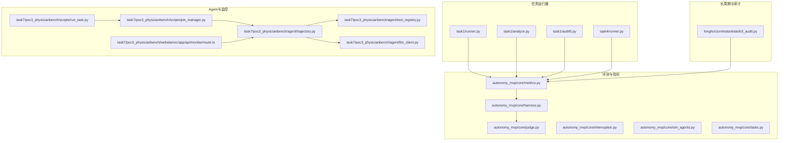
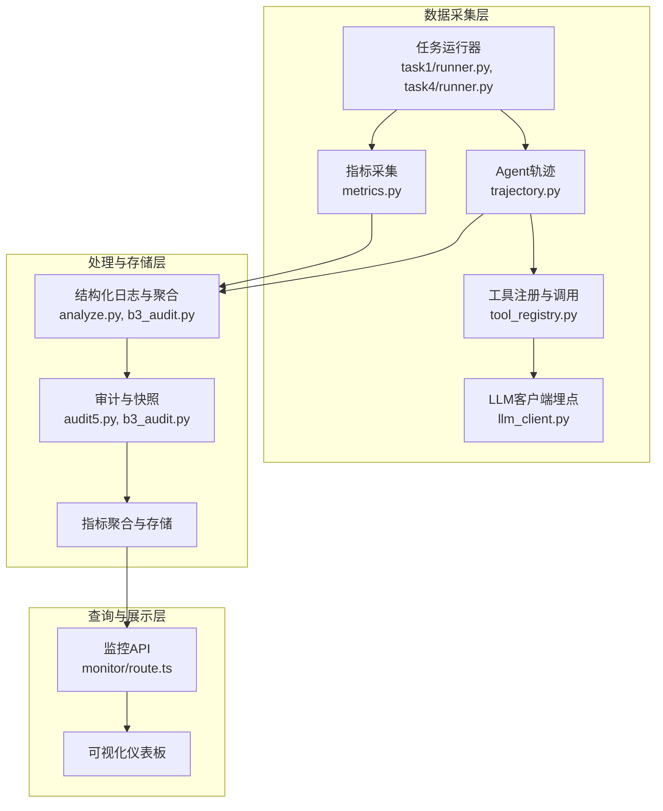
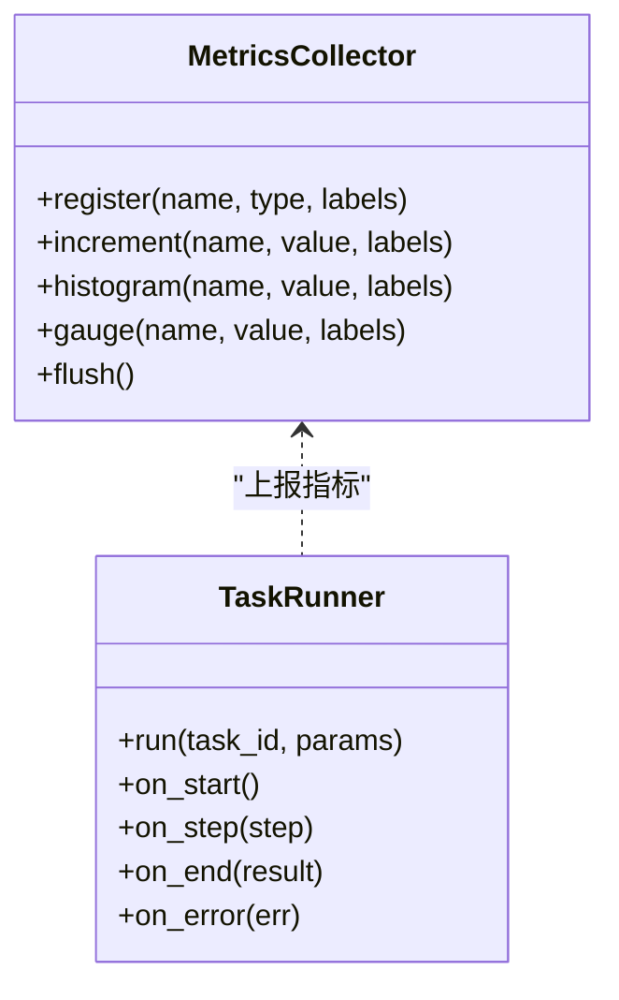
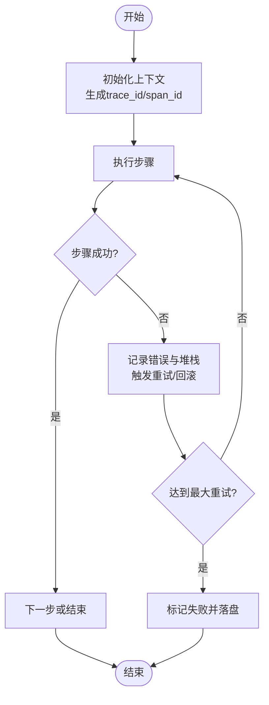
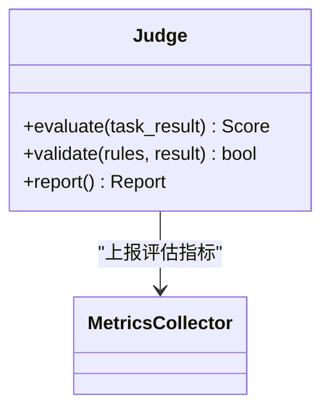
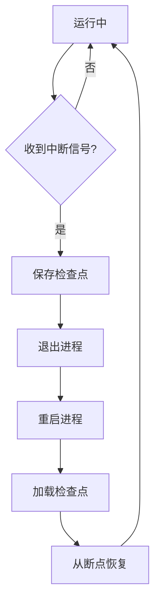
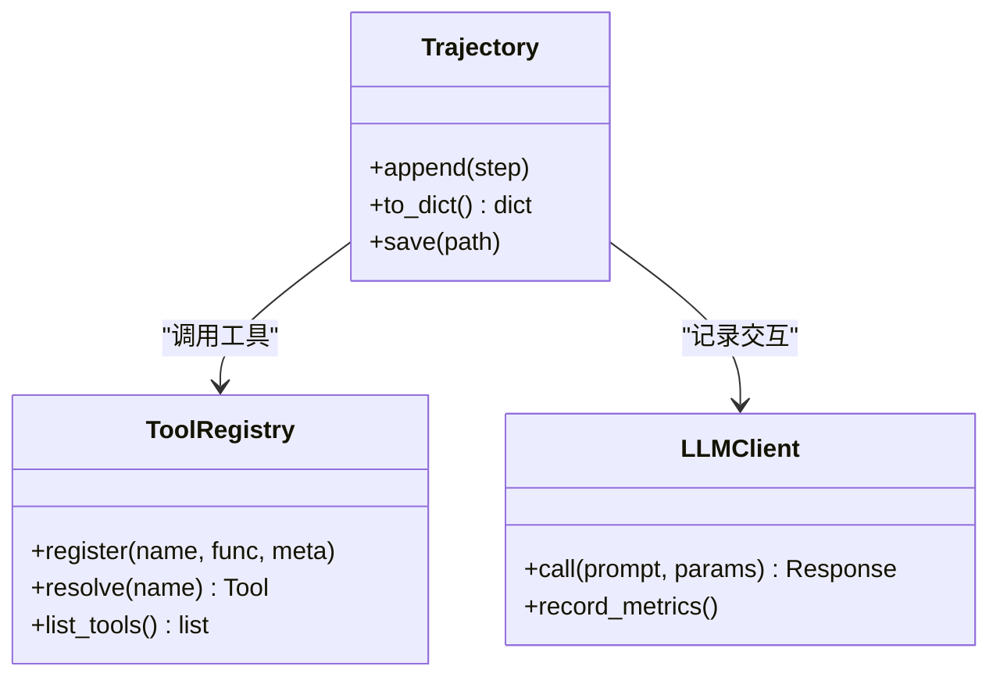
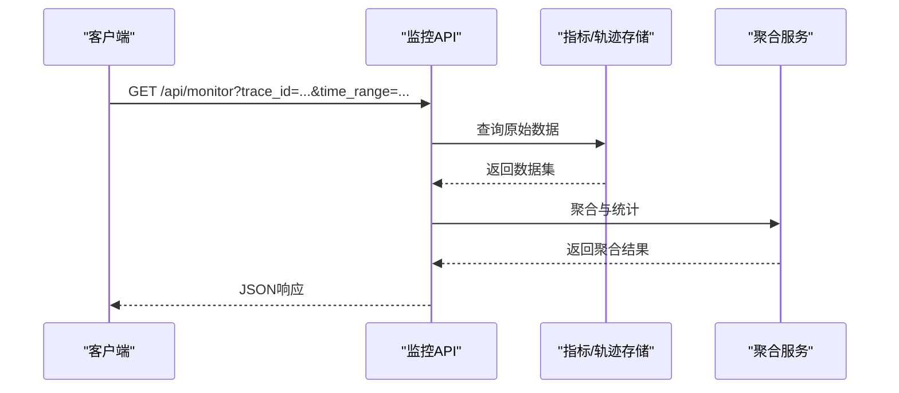
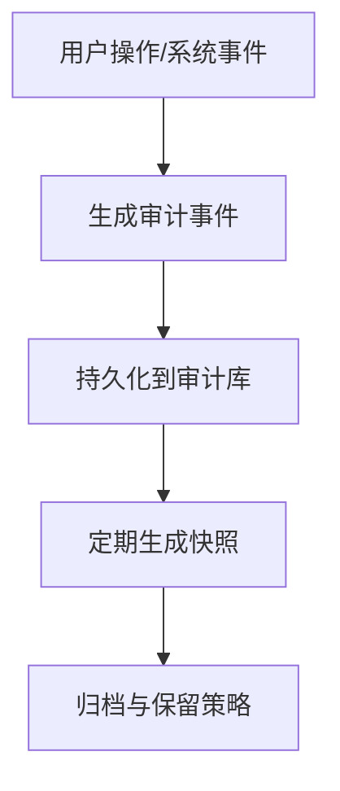
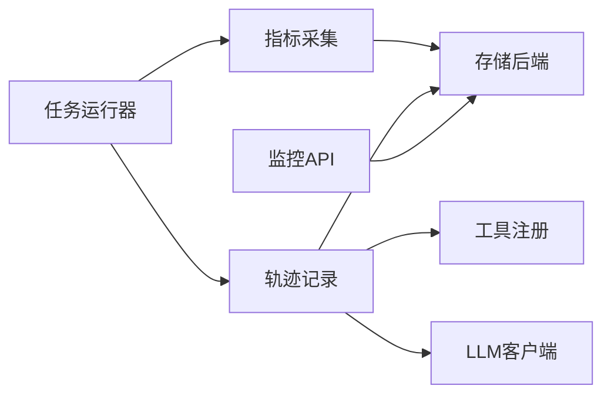

# 监控与追踪

<cite>
**本文引用的文件**   
- [autonomy_mvp/core/metrics.py](file://autonomy_mvp/core/metrics.py)
- [autonomy_mvp/core/harness.py](file://autonomy_mvp/core/harness.py)
- [autonomy_mvp/core/judge.py](file://autonomy_mvp/core/judge.py)
- [autonomy_mvp/core/interruption.py](file://autonomy_mvp/core/interruption.py)
- [autonomy_mvp/core/sim_agents.py](file://autonomy_mvp/core/sim_agents.py)
- [autonomy_mvp/core/tasks.py](file://autonomy_mvp/core/tasks.py)
- [task1/runner.py](file://task1/runner.py)
- [task1/analyze.py](file://task1/analyze.py)
- [task1/audit5.py](file://task1/audit5.py)
- [task4/runner.py](file://task4/runner.py)
- [longhorizon/instantiate/b3_audit.py](file://longhorizon/instantiate/b3_audit.py)
- [task7/poc3_physicianbench/scripts/job_manager.py](file://task7/poc3_physicianbench/scripts/job_manager.py)
- [task7/poc3_physicianbench/scripts/run_task.py](file://task7/poc3_physicianbench/scripts/run_task.py)
- [task7/poc3_physicianbench/agent/trajectory.py](file://task7/poc3_physicianbench/agent/trajectory.py)
- [task7/poc3_physicianbench/agent/tool_registry.py](file://task7/poc3_physicianbench/agent/tool_registry.py)
- [task7/poc3_physicianbench/agent/llm_client.py](file://task7/poc3_physicianbench/agent/llm_client.py)
- [task7/poc3_physicianbench/website/src/app/api/monitor/route.ts](file://task7/poc3_physicianbench/website/src/app/api/monitor/route.ts)
</cite>

## 目录
1. [简介](#简介)
2. [项目结构](#项目结构)
3. [核心组件](#核心组件)
4. [架构总览](#架构总览)
5. [详细组件分析](#详细组件分析)
6. [依赖关系分析](#依赖关系分析)
7. [性能考量](#性能考量)
8. [故障排查指南](#故障排查指南)
9. [结论](#结论)
10. [附录](#附录)

## 简介
本文件面向“工作流监控与追踪系统”，围绕执行日志收集、结构化日志格式、日志聚合策略、分布式追踪ID生成、链路追踪与性能分析集成、关键指标采集、告警规则与可视化仪表板、执行历史与状态快照、审计日志管理、性能瓶颈识别与容量规划，以及监控API、查询语言与自定义指标开发方法进行系统化说明。文档基于仓库中现有实现进行提炼，并给出可操作的扩展建议与最佳实践。

## 项目结构
仓库包含多个任务与实验子项目，其中与工作流监控和追踪相关的代码主要分布在以下位置：
- autonomy_mvp/core：评测与指标核心模块（metrics、harness、judge等）
- task1、task4：不同任务的运行器与分析脚本
- longhorizon/instantiate：批量实例化与审计工具
- task7/poc3_physicianbench：Agent框架、轨迹记录、工具注册、LLM客户端与网站监控API

图表来源
- [autonomy_mvp/core/metrics.py](file://autonomy_mvp/core/metrics.py)
- [autonomy_mvp/core/harness.py](file://autonomy_mvp/core/harness.py)
- [autonomy_mvp/core/judge.py](file://autonomy_mvp/core/judge.py)
- [autonomy_mvp/core/interruption.py](file://autonomy_mvp/core/interruption.py)
- [autonomy_mvp/core/sim_agents.py](file://autonomy_mvp/core/sim_agents.py)
- [autonomy_mvp/core/tasks.py](file://autonomy_mvp/core/tasks.py)
- [task1/runner.py](file://task1/runner.py)
- [task1/analyze.py](file://task1/analyze.py)
- [task1/audit5.py](file://task1/audit5.py)
- [task4/runner.py](file://task4/runner.py)
- [longhorizon/instantiate/b3_audit.py](file://longhorizon/instantiate/b3_audit.py)
- [task7/poc3_physicianbench/agent/trajectory.py](file://task7/poc3_physicianbench/agent/trajectory.py)
- [task7/poc3_physicianbench/agent/tool_registry.py](file://task7/poc3_physicianbench/agent/tool_registry.py)
- [task7/poc3_physicianbench/agent/llm_client.py](file://task7/poc3_physicianbench/agent/llm_client.py)
- [task7/poc3_physicianbench/scripts/job_manager.py](file://task7/poc3_physicianbench/scripts/job_manager.py)
- [task7/poc3_physicianbench/scripts/run_task.py](file://task7/poc3_physicianbench/scripts/run_task.py)
- [task7/poc3_physicianbench/website/src/app/api/monitor/route.ts](file://task7/poc3_physicianbench/website/src/app/api/monitor/route.ts)

章节来源
- [autonomy_mvp/core/metrics.py](file://autonomy_mvp/core/metrics.py)
- [autonomy_mvp/core/harness.py](file://autonomy_mvp/core/harness.py)
- [task1/runner.py](file://task1/runner.py)
- [task7/poc3_physicianbench/agent/trajectory.py](file://task7/poc3_physicianbench/agent/trajectory.py)

## 核心组件
- 指标与度量：提供统一的指标定义、采集与汇总能力，支撑成功率、耗时、资源使用等关键指标。
- 运行编排：统一的任务调度与生命周期管理，负责启动、跟踪、收尾与结果落盘。
- 评估与裁决：对执行结果进行评分与判定，输出结构化评估结果。
- 中断与恢复：支持任务中断、重试与状态恢复，保障长周期任务稳定性。
- 模拟代理：在仿真环境中驱动工作流执行，便于离线验证与回归测试。
- 任务定义：描述工作流步骤、输入输出、依赖与约束。
- 轨迹与审计：记录Agent调用链、工具调用、LLM交互与审计事件，形成可追溯的执行历史。
- 监控API：对外暴露查询接口，供前端或外部系统获取监控数据。

章节来源
- [autonomy_mvp/core/metrics.py](file://autonomy_mvp/core/metrics.py)
- [autonomy_mvp/core/harness.py](file://autonomy_mvp/core/harness.py)
- [autonomy_mvp/core/judge.py](file://autonomy_mvp/core/judge.py)
- [autonomy_mvp/core/interruption.py](file://autonomy_mvp/core/interruption.py)
- [autonomy_mvp/core/sim_agents.py](file://autonomy_mvp/core/sim_agents.py)
- [autonomy_mvp/core/tasks.py](file://autonomy_mvp/core/tasks.py)
- [task7/poc3_physicianbench/agent/trajectory.py](file://task7/poc3_physicianbench/agent/trajectory.py)
- [task7/poc3_physicianbench/website/src/app/api/monitor/route.ts](file://task7/poc3_physicianbench/website/src/app/api/monitor/route.ts)

## 架构总览
整体架构分为数据采集层、处理与存储层、查询与展示层。数据采集层通过运行器、Agent轨迹与工具调用埋点收集日志与指标；处理与存储层进行结构化解析、关联与持久化；查询与展示层提供API与可视化能力。

图表来源
- [task1/runner.py](file://task1/runner.py)
- [task4/runner.py](file://task4/runner.py)
- [task7/poc3_physicianbench/agent/trajectory.py](file://task7/poc3_physicianbench/agent/trajectory.py)
- [task7/poc3_physicianbench/agent/tool_registry.py](file://task7/poc3_physicianbench/agent/tool_registry.py)
- [task7/poc3_physicianbench/agent/llm_client.py](file://task7/poc3_physicianbench/agent/llm_client.py)
- [autonomy_mvp/core/metrics.py](file://autonomy_mvp/core/metrics.py)
- [task1/analyze.py](file://task1/analyze.py)
- [longhorizon/instantiate/b3_audit.py](file://longhorizon/instantiate/b3_audit.py)
- [task1/audit5.py](file://task1/audit5.py)
- [task7/poc3_physicianbench/website/src/app/api/monitor/route.ts](file://task7/poc3_physicianbench/website/src/app/api/monitor/route.ts)

## 详细组件分析

### 指标与度量组件
- 职责：定义指标类型（计数器、直方图、仪表盘）、采样频率、标签维度与聚合方式。
- 关键点：
  - 指标命名规范与维度设计，确保跨任务可对比。
  - 异步写入与批量化，降低对主流程的干扰。
  - 与运行器生命周期绑定，自动上报开始/结束、错误与重试。
- 复杂度：O(1)增量更新，聚合阶段按时间窗口与标签分组计算。

图表来源
- [autonomy_mvp/core/metrics.py](file://autonomy_mvp/core/metrics.py)
- [task1/runner.py](file://task1/runner.py)

章节来源
- [autonomy_mvp/core/metrics.py](file://autonomy_mvp/core/metrics.py)
- [task1/runner.py](file://task1/runner.py)

### 运行编排与生命周期
- 职责：统一调度任务、管理上下文、记录执行阶段、处理异常与重试。
- 关键点：
  - 结构化日志：每个阶段输出标准化字段（trace_id、span_id、step、status、duration_ms）。
  - 分布式追踪ID：为每次执行生成全局唯一trace_id，并在子步骤传播span_id。
  - 状态快照：在关键节点保存中间状态，支持断点续跑与回溯。
- 流程图：

图表来源
- [task1/runner.py](file://task1/runner.py)
- [task4/runner.py](file://task4/runner.py)
- [autonomy_mvp/core/harness.py](file://autonomy_mvp/core/harness.py)

章节来源
- [task1/runner.py](file://task1/runner.py)
- [task4/runner.py](file://task4/runner.py)
- [autonomy_mvp/core/harness.py](file://autonomy_mvp/core/harness.py)

### 评估与裁决
- 职责：对执行结果进行评分、一致性校验与合规性判断。
- 关键点：
  - 多源评估：结合规则与模型打分，输出结构化评估报告。
  - 阈值与告警：当指标越界时触发告警事件。
- 类关系：

图表来源
- [autonomy_mvp/core/judge.py](file://autonomy_mvp/core/judge.py)
- [autonomy_mvp/core/metrics.py](file://autonomy_mvp/core/metrics.py)

章节来源
- [autonomy_mvp/core/judge.py](file://autonomy_mvp/core/judge.py)
- [autonomy_mvp/core/metrics.py](file://autonomy_mvp/core/metrics.py)

### 中断与恢复
- 职责：捕获中断信号、保存检查点、支持重启后继续执行。
- 关键点：
  - 原子性检查点写入，避免部分写导致的状态不一致。
  - 幂等恢复逻辑，保证重复恢复不产生副作用。
- 流程图：

图表来源
- [autonomy_mvp/core/interruption.py](file://autonomy_mvp/core/interruption.py)

章节来源
- [autonomy_mvp/core/interruption.py](file://autonomy_mvp/core/interruption.py)

### Agent轨迹与工具调用
- 职责：记录Agent决策路径、工具调用序列与LLM交互细节，形成完整链路。
- 关键点：
  - 轨迹数据结构：包含步骤、输入输出、耗时、状态码与错误信息。
  - 工具注册表：统一管理可用工具及其元数据，便于动态发现与权限控制。
  - LLM客户端埋点：记录请求参数、响应长度、延迟与错误码。
- 类关系：

图表来源
- [task7/poc3_physicianbench/agent/trajectory.py](file://task7/poc3_physicianbench/agent/trajectory.py)
- [task7/poc3_physicianbench/agent/tool_registry.py](file://task7/poc3_physicianbench/agent/tool_registry.py)
- [task7/poc3_physicianbench/agent/llm_client.py](file://task7/poc3_physicianbench/agent/llm_client.py)

章节来源
- [task7/poc3_physicianbench/agent/trajectory.py](file://task7/poc3_physicianbench/agent/trajectory.py)
- [task7/poc3_physicianbench/agent/tool_registry.py](file://task7/poc3_physicianbench/agent/tool_registry.py)
- [task7/poc3_physicianbench/agent/llm_client.py](file://task7/poc3_physicianbench/agent/llm_client.py)

### 监控API与查询
- 职责：提供REST接口用于查询指标、轨迹与审计事件，支撑前端仪表板。
- 关键点：
  - 查询语言：支持按trace_id、时间范围、任务类型、状态过滤。
  - 分页与排序：提升大数据量下的查询性能。
  - 缓存策略：热点指标短期缓存，减少后端压力。
- 时序图：

图表来源
- [task7/poc3_physicianbench/website/src/app/api/monitor/route.ts](file://task7/poc3_physicianbench/website/src/app/api/monitor/route.ts)

章节来源
- [task7/poc3_physicianbench/website/src/app/api/monitor/route.ts](file://task7/poc3_physicianbench/website/src/app/api/monitor/route.ts)

### 审计与快照
- 职责：生成审计日志与状态快照，满足合规与回溯需求。
- 关键点：
  - 审计事件：操作者、时间戳、动作、对象、结果与原因。
  - 快照粒度：按任务或批次生成，支持差异对比。
- 流程图：

图表来源
- [task1/audit5.py](file://task1/audit5.py)
- [longhorizon/instantiate/b3_audit.py](file://longhorizon/instantiate/b3_audit.py)

章节来源
- [task1/audit5.py](file://task1/audit5.py)
- [longhorizon/instantiate/b3_audit.py](file://longhorizon/instantiate/b3_audit.py)

## 依赖关系分析
- 松耦合：运行器与指标采集解耦，通过回调或事件上报。
- 内聚性：轨迹与工具注册集中在Agent模块，便于扩展新工具。
- 外部依赖：LLM客户端与存储后端（数据库/对象存储）通过配置注入。
- 潜在循环：避免在指标模块反向依赖运行器，保持单向依赖。

图表来源
- [task1/runner.py](file://task1/runner.py)
- [autonomy_mvp/core/metrics.py](file://autonomy_mvp/core/metrics.py)
- [task7/poc3_physicianbench/agent/trajectory.py](file://task7/poc3_physicianbench/agent/trajectory.py)
- [task7/poc3_physicianbench/agent/tool_registry.py](file://task7/poc3_physicianbench/agent/tool_registry.py)
- [task7/poc3_physicianbench/agent/llm_client.py](file://task7/poc3_physicianbench/agent/llm_client.py)
- [task7/poc3_physicianbench/website/src/app/api/monitor/route.ts](file://task7/poc3_physicianbench/website/src/app/api/monitor/route.ts)

章节来源
- [task1/runner.py](file://task1/runner.py)
- [autonomy_mvp/core/metrics.py](file://autonomy_mvp/core/metrics.py)
- [task7/poc3_physicianbench/agent/trajectory.py](file://task7/poc3_physicianbench/agent/trajectory.py)

## 性能考量
- 日志写入：采用异步队列与批量落盘，避免阻塞主流程。
- 指标采样：对高频指标进行降采样与聚合，降低存储压力。
- 追踪开销：限制span深度与属性大小，仅记录必要字段。
- 查询优化：为常用查询建立索引，启用分页与缓存。
- 容量规划：根据峰值QPS与数据保留策略估算存储与计算资源。

[本节为通用指导，不直接分析具体文件]

## 故障排查指南
- 常见问题：
  - 追踪ID缺失：检查运行器是否在入口处生成并传播trace_id。
  - 指标丢失：确认指标上报是否被异步队列丢弃或限流。
  - 轨迹不完整：核查工具调用与LLM客户端埋点是否覆盖所有分支。
  - 审计事件遗漏：确认审计钩子是否正确挂载。
- 定位方法：
  - 通过trace_id串联全链路日志与指标。
  - 使用analyze脚本聚合与过滤异常模式。
  - 查看b3_audit与audit5生成的审计报告。
- 恢复策略：
  - 利用检查点与快照恢复执行。
  - 对失败任务进行重试与降级。

章节来源
- [task1/analyze.py](file://task1/analyze.py)
- [longhorizon/instantiate/b3_audit.py](file://longhorizon/instantiate/b3_audit.py)
- [task1/audit5.py](file://task1/audit5.py)

## 结论
本系统以运行器为核心，结合指标采集、轨迹记录、工具调用与LLM埋点，构建了完整的监控与追踪体系。通过结构化日志、分布式追踪ID与审计快照，实现了端到端可观测性与可回溯性。建议在后续迭代中强化查询语言与可视化能力，完善告警规则与容量规划模型，进一步提升系统的可维护性与可扩展性。

[本节为总结，不直接分析具体文件]

## 附录
- 监控API示例：
  - 查询指定trace_id的轨迹与指标
  - 按时间范围与任务类型聚合成功率与耗时
- 自定义指标开发：
  - 定义指标名称、类型与标签
  - 在关键路径插入上报逻辑
  - 验证聚合与可视化效果
- 告警规则建议：
  - 成功率低于阈值持续N分钟
  - 平均耗时超过基线X%
  - 错误率突增或资源使用超限

[本节为补充说明，不直接分析具体文件]