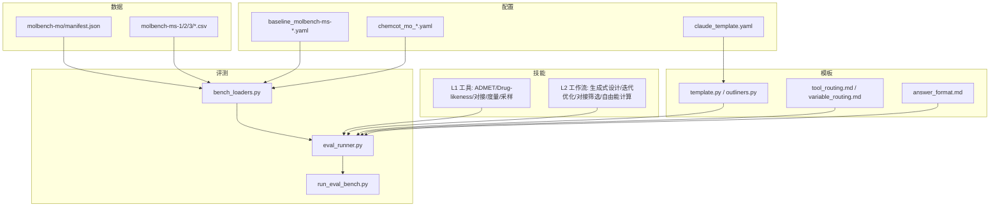
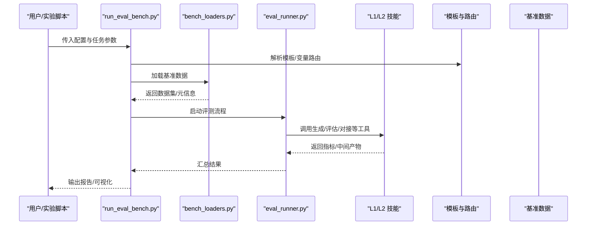
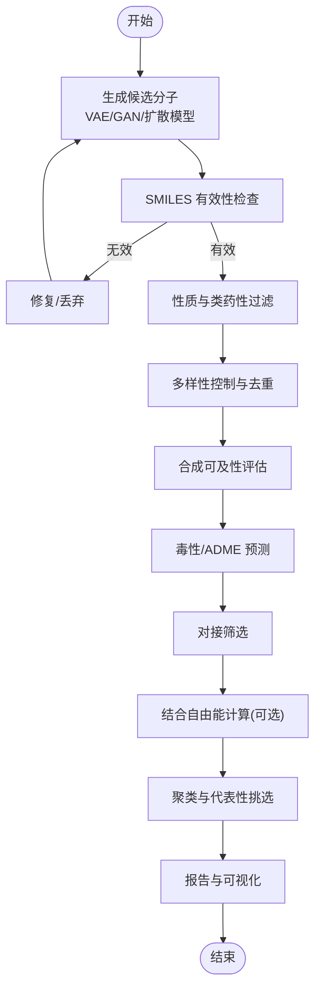
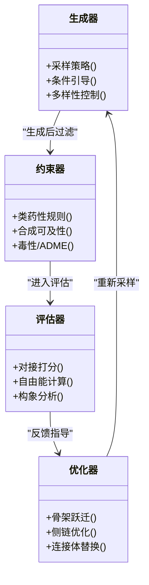
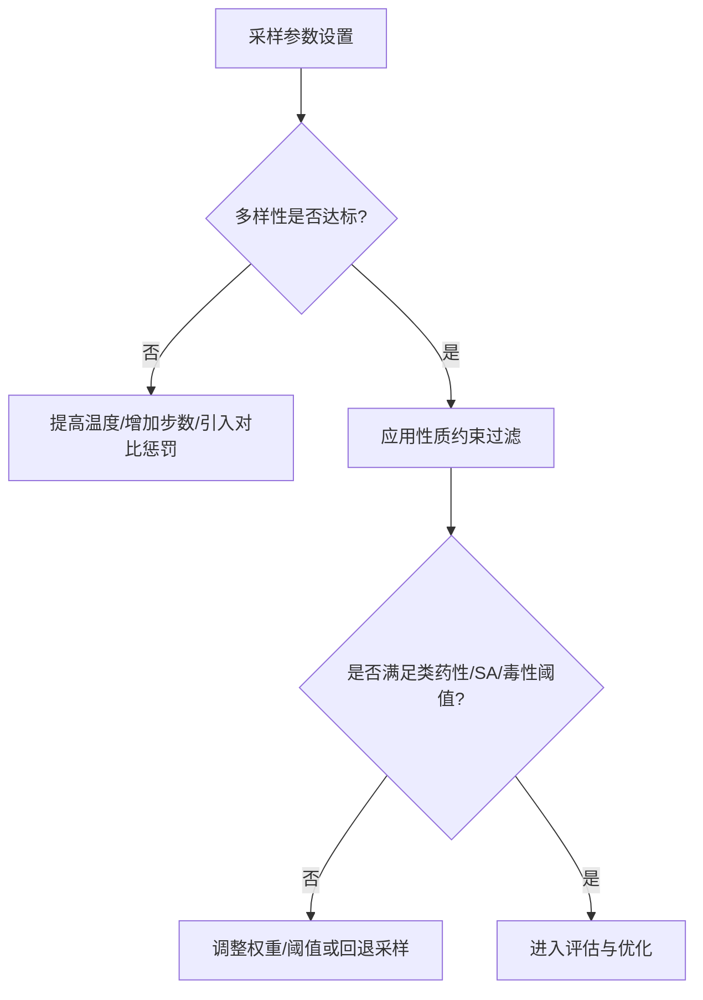
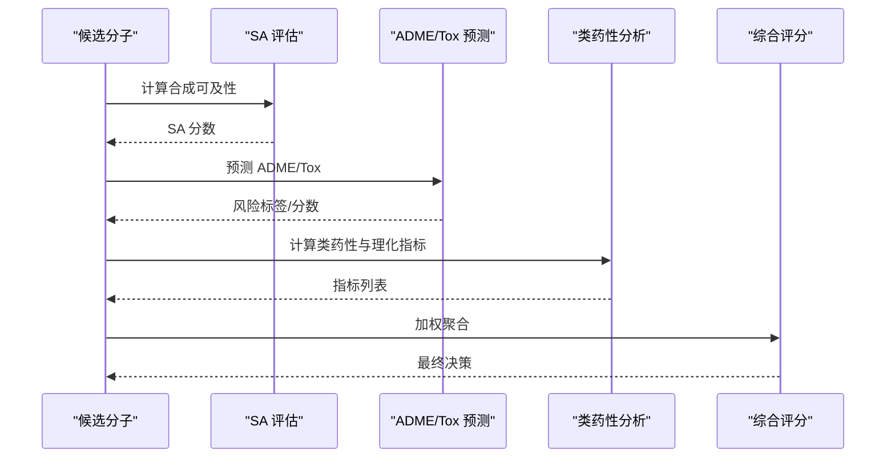
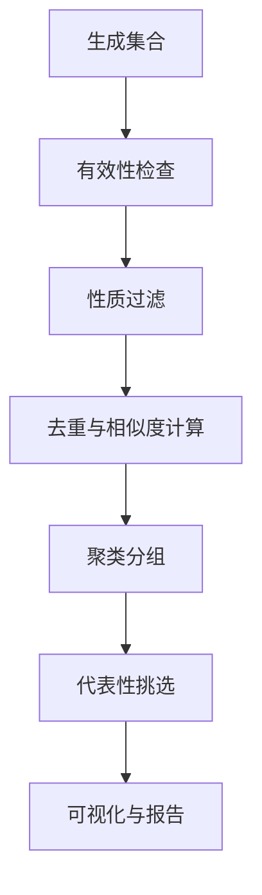
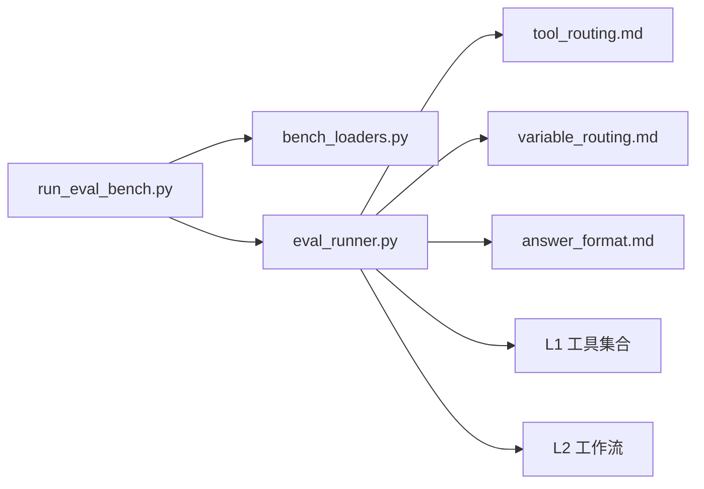

# 生成式分子设计工作流

<cite>
**本文引用的文件**   
- [docs/prd/molbench_repo/config/baseline_molbench-ms-1.yaml](file://docs/prd/molbench_repo/config/baseline_molbench-ms-1.yaml)
- [docs/prd/molbench_repo/config/baseline_molbench-ms-2.yaml](file://docs/prd/molbench_repo/config/baseline_molbench-ms-2.yaml)
- [docs/prd/molbench_repo/config/baseline_molbench-ms-3.yaml](file://docs/prd/molbench_repo/config/baseline_molbench-ms-3.yaml)
- [docs/prd/molbench_repo/config/chemcot_mo_edit.yaml](file://docs/prd/molbench_repo/config/chemcot_mo_edit.yaml)
- [docs/prd/molbench_repo/config/chemcot_mo_opt.yaml](file://docs/prd/molbench_repo/config/chemcot_mo_opt.yaml)
- [docs/prd/molbench_repo/config/claude_template.yaml](file://docs/prd/molbench_repo/config/claude_template.yaml)
- [docs/prd/molbench_repo/data_full/molbench-mo/manifest.json](file://docs/prd/molbench_repo/data_full/molbench-mo/manifest.json)
- [docs/prd/molbench_repo/data_full/molbench-ms-1/molbench-ms-1.csv](file://docs/prd/molbench_repo/data_full/molbench-ms-1/molbench-ms-1.csv)
- [docs/prd/molbench_repo/data_full/molbench-ms-2/molbench-ms-2.csv](file://docs/prd/molbench_repo/data_full/molbench-ms-2/molbench-ms-2.csv)
- [docs/prd/molbench_repo/data_full/molbench-ms-3/molbench-ms-3.csv](file://docs/prd/molbench_repo/data_full/molbench-ms-3/molbench-ms-3.csv)
- [docs/prd/molbench_repo/eval/__init__.py](file://docs/prd/molbench_repo/eval/__init__.py)
- [docs/prd/molbench_repo/eval/bench_loaders.py](file://docs/prd/molbench_repo/eval/bench_loaders.py)
- [docs/prd/molbench_repo/eval/eval_runner.py](file://docs/prd/molbench_repo/eval/eval_runner.py)
- [docs/prd/molbench_repo/eval/run_eval_bench.py](file://docs/prd/molbench_repo/eval/run_eval_bench.py)
- [docs/prd/molbench_repo/skills/L1_tools/molclaw-diffdock-auto/README.md](file://docs/prd/molbench_repo/skills/L1_tools/molclaw-diffdock-auto/README.md)
- [docs/prd/molbench_repo/skills/L1_tools/molclaw-equiscore-tool/README.md](file://docs/prd/molbench_repo/skills/L1_tools/molclaw-equiscore-tool/README.md)
- [docs/prd/molbench_repo/skills/L1_tools/molclaw-drug-likeness/README.md](file://docs/prd/molbench_repo/skills/L1_tools/molclaw-drug-likeness/README.md)
- [docs/prd/molbench_repo/skills/L1_tools/molclaw-admet/README.md](file://docs/prd/molbench_repo/skills/L1_tools/molclaw-admet/README.md)
- [docs/prd/molbench_repo/skills/L1_tools/molclaw-mol-basic-metrics/README.md](file://docs/prd/molbench_repo/skills/L1_tools/molclaw-mol-basic-metrics/README.md)
- [docs/prd/molbench_repo/skills/L1_tools/molclaw-mol-similarity/README.md](file://docs/prd/molbench_repo/skills/L1_tools/molclaw-mol-similarity/README.md)
- [docs/prd/molbench_repo/skills/L1_tools/molclaw-mol-structure-metrics/README.md](file://docs/prd/molbench_repo/skills/L1_tools/molclaw-mol-structure-metrics/README.md)
- [docs/prd/molbench_repo/skills/L1_tools/molclaw-mol-topology-metrics/README.md](file://docs/prd/molbench_repo/skills/L1_tools/molclaw-mol-topology-metrics/README.md)
- [docs/prd/molbench_repo/skills/L1_tools/molclaw-mol-complexity-metrics/README.md](file://docs/prd/molbench_repo/skills/L1_tools/molclaw-mol-complexity-metrics/README.md)
- [docs/prd/molbench_repo/skills/L1_tools/molclaw-mol-hydrophobicity-metrics/README.md](file://docs/prd/molbench_repo/skills/L1_tools/molclaw-mol-hydrophobicity-metrics/README.md)
- [docs/prd/molbench_repo/skills/L1_tools/molclaw-mol-hbond-metrics/README.md](file://docs/prd/molbench_repo/skills/L1_tools/molclaw-mol-hbond-metrics/README.md)
- [docs/prd/molbench_repo/skills/L1_tools/molclaw-mol-opt-physchem/README.md](file://docs/prd/molbench_repo/skills/L1_tools/molclaw-mol-opt-physchem/README.md)
- [docs/prd/molbench_repo/skills/L1_tools/molclaw-mol2mol-sampling/README.md](file://docs/prd/molbench_repo/skills/L1_tools/molclaw-mol2mol-sampling/README.md)
- [docs/prd/molbench_repo/skills/L1_tools/molclaw-smiles-valid-check/README.md](file://docs/prd/molbench_repo/skills/L1_tools/molclaw-smiles-valid-check/README.md)
- [docs/prd/molbench_repo/skills/L1_tools/molclaw-smiles-fg-editor/README.md](file://docs/prd/molbench_repo/skills/L1_tools/molclaw-smiles-fg-editor/README.md)
- [docs/prd/molbench_repo/skills/L1_tools/molclaw-linker-sampling/README.md](file://docs/prd/molbench_repo/skills/L1_tools/molclaw-linker-sampling/README.md)
- [docs/prd/molbench_repo/skills/L1_tools/molclaw-rgroup-sampling/README.md](file://docs/prd/molbench_repo/skills/L1_tools/molclaw-rgroup-sampling/README.md)
- [docs/prd/molbench_repo/skills/L1_tools/molclaw-chroma-toolkit/README.md](file://docs/prd/molbench_repo/skills/L1_tools/molclaw-chroma-toolkit/README.md)
- [docs/prd/molbench_repo/skills/L1_tools/molclaw-compound-retrieve/README.md](file://docs/prd/molbench_repo/skills/L1_tools/molclaw-compound-retrieve/README.md)
- [docs/prd/molbench_repo/skills/L1_tools/molclaw-docking-screening/README.md](file://docs/prd/molbench_repo/skills/L1_tools/molclaw-docking-screening/README.md)
- [docs/prd/molbench_repo/skills/L1_tools/molclaw-quickvina-docking/README.md](file://docs/prd/molbench_repo/skills/L1_tools/molclaw-quickvina-docking/README.md)
- [docs/prd/molbench_repo/skills/L1_tools/molclaw-prolif-tool/README.md](file://docs/prd/molbench_repo/skills/L1_tools/molclaw-prolif-tool/README.md)
- [docs/prd/molbench_repo/skills/L1_tools/molclaw-pdbfixer/README.md](file://docs/prd/molbench_repo/skills/L1_tools/molclaw-pdbfixer/README.md)
- [docs/prd/molbench_repo/skills/L1_tools/molclaw-extract-chains/README.md](file://docs/prd/molbench_repo/skills/L1_tools/molclaw-extract-chains/README.md)
- [docs/prd/molbench_repo/skills/L1_tools/molclaw-interaction-visualizer/README.md](file://docs/prd/molbench_repo/skills/L1_tools/molclaw-interaction-visualizer/README.md)
- [docs/prd/molbench_repo/skills/L1_tools/molclaw-pack-sidechains/README.md](file://docs/prd/molbench_repo/skills/L1_tools/molclaw-pack-sidechains/README.md)
- [docs/prd/molbench_repo/skills/L1_tools/molclaw-protein-openmm/README.md](file://docs/prd/molbench_repo/skills/L1_tools/molclaw-protein-openmm/README.md)
- [docs/prd/molbench_repo/skills/L1_tools/molclaw-prolif-md/README.md](file://docs/prd/molbench_repo/skills/L1_tools/molclaw-prolif-md/README.md)
- [docs/prd/molbench_repo/skills/L1_tools/molclaw-prolif-pdb/README.md](file://docs/prd/molbench_repo/skills/L1_tools/molclaw-prolif-pdb/README.md)
- [docs/prd/molbench_repo/skills/L1_tools/molclaw-protein-ligand-mmpbsa/README.md](file://docs/prd/molbench_repo/skills/L1_tools/molclaw-protein-ligand-mmpbsa/README.md)
- [docs/prd/molbench_repo/skills/L1_tools/molclaw-protein-protein-mmpbsa/README.md](file://docs/prd/molbench_repo/skills/L1_tools/molclaw-protein-protein-mmpbsa/README.md)
- [docs/prd/molbench_repo/skills/L1_tools/molclaw-prolif-protein-protein/README.md](file://docs/prd/molbench_repo/skills/L1_tools/molclaw-prolif-protein-protein/README.md)
- [docs/prd/molbench_repo/skills/L1_tools/molclaw-sequence-retrieve/README.md](file://docs/prd/molbench_repo/skills/L1_tools/molclaw-sequence-retrieve/README.md)
- [docs/prd/molbench_repo/skills/L1_tools/molclaw-protein-structure-retrieve/README.md](file://docs/prd/molbench_repo/skills/L1_tools/molclaw-protein-structure-retrieve/README.md)
- [docs/prd/molbench_repo/skills/L1_tools/molclaw-proteinmpnn-tool/README.md](file://docs/prd/molbench_repo/skills/L1_tools/molclaw-proteinmpnn-tool/README.md)
- [docs/prd/molbench_repo/skills/L1_tools/molclaw-pulchura-rebuild/README.md](file://docs/prd/molbench_repo/skills/L1_tools/molclaw-pulchura-rebuild/README.md)
- [docs/prd/molbench_repo/skills/L1_tools/molclaw-run-bioemu/README.md](file://docs/prd/molbench_repo/skills/L1_tools/molclaw-run-bioemu/README.md)
- [docs/prd/molbench_repo/skills/L1_tools/molclaw-fpocket-toolkit-base/README.md](file://docs/prd/molbench_repo/skills/L1_tools/molclaw-fpocket-toolkit-base/README.md)
- [docs/prd/molbench_repo/skills/L1_tools/molclaw-fpocket/README.md](file://docs/prd/molbench_repo/skills/L1_tools/molclaw-fpocket/README.md)
- [docs/prd/molbench_repo/skills/L1_tools/molclaw-goca-tool/README.md](file://docs/prd/molbench_repo/skills/L1_tools/molclaw-goca-tool/README.md)
- [docs/prd/molbench_repo/skills/L1_tools/molclaw-hdock-tool/README.md](file://docs/prd/molbench_repo/skills/L1_tools/molclaw-hdock-tool/README.md)
- [docs/prd/molbench_repo/skills/L1_tools/molclaw-karmadock-tool/README.md](file://docs/prd/molbench_repo/skills/L1_tools/molclaw-karmadock-tool/README.md)
- [docs/prd/molbench_repo/skills/L1_tools/molclaw-prolif-tool/README.md](file://docs/prd/molbench_repo/skills/L1_tools/molclaw-prolif-tool/README.md)
- [docs/prd/molbench_repo/skills/L1_tools/molclaw-equiscore-docking/README.md](file://docs/prd/molbench_repo/skills/L1_tools/molclaw-equiscore-docking/README.md)
- [docs/prd/molbench_repo/skills/L1_tools/molclaw-dleps/README.md](file://docs/prd/molbench_repo/skills/L1_tools/molclaw-dleps/README.md)
- [docs/prd/molbench_repo/skills/L1_tools/molclaw-evobind-tool/README.md](file://docs/prd/molbench_repo/skills/L1_tools/molclaw-evobind-tool/README.md)
- [docs/prd/molbench_repo/skills/L1_tools/molclaw-chai1-predict/README.md](file://docs/prd/molbench_repo/skills/L1_tools/molclaw-chai1-predict/README.md)
- [docs/prd/molbench_repo/skills/L1_tools/molclaw-esmfold/README.md](file://docs/prd/molbench_repo/skills/L1_tools/molclaw-esmfold/README.md)
- [docs/prd/molbench_repo/skills/L1_tools/molclaw-foldx-tool/README.md](file://docs/prd/molbench_repo/skills/L1_tools/molclaw-foldx-tool/README.md)
- [docs/prd/molbench_repo/skills/L1_tools/molclaw-openawsem-tool/README.md](file://docs/prd/molbench_repo/skills/L1_tools/molclaw-openawsem-tool/README.md)
- [docs/prd/molbench_repo/skills/L1_tools/molclaw-peptide-sampling/README.md](file://docs/prd/molbench_repo/skills/L1_tools/molclaw-peptide-sampling/README.md)
- [docs/prd/molbench_repo/skills/L1_tools/molclaw-p2rank/README.md](file://docs/prd/molbench_repo/skills/L1_tools/molclaw-p2rank/README.md)
- [docs/prd/molbench_repo/skills/L1_tools/molclaw-file-transfer/README.md](file://docs/prd/molbench_repo/skills/L1_tools/molclaw-file-transfer/README.md)
- [docs/prd/molbench_repo/skills/L1_tools/molclaw-fix-pdb/README.md](file://docs/prd/molbench_repo/skills/L1_tools/molclaw-fix-pdb/README.md)
- [docs/prd/molbench_repo/skills/L1_tools/molclaw-scp-server/README.md](file://docs/prd/molbench_repo/skills/L1_tools/molclaw-scp-server/README.md)
- [docs/prd/molbench_repo/skills/L1_tools/molclaw-skill-template-writer/README.md](file://docs/prd/molbench_repo/skills/L1_tools/molclaw-skill-template-writer/README.md)
- [docs/prd/molbench_repo/skills/L1_tools/molclaw-denovo-sampling/README.md](file://docs/prd/molbench_repo/skills/L1_tools/molclaw-denovo-sampling/README.md)
- [docs/prd/molbench_repo/skills/L2_workflows/04-generative-molecular-design.md](file://docs/prd/molbench_repo/skills/L2_workflows/04-generative-molecular-design.md)
- [docs/prd/molbench_repo/skills/L2_workflows/05-iterative-molecular-optimization.md](file://docs/prd/molbench_repo/skills/L2_workflows/05-iterative-molecular-optimization.md)
- [docs/prd/molbench_repo/skills/L2_workflows/03-molecular-property-analysis-filtering.md](file://docs/prd/molbench_repo/skills/L2_workflows/03-molecular-property-analysis-filtering.md)
- [docs/prd/molbench_repo/skills/L2_workflows/02-molecular-docking-screening.md](file://docs/prd/molbench_repo/skills/L2_workflows/02-molecular-docking-screening.md)
- [docs/prd/molbench_repo/skills/L2_workflows/06-binding-free-energy-calculation.md](file://docs/prd/molbench_repo/skills/L2_workflows/06-binding-free-energy-calculation.md)
- [docs/prd/molbench_repo/skills/L2_workflows/07-conformational-sampling-analysis.md](file://docs/prd/molbench_repo/skills/L2_workflows/07-conformational-sampling-analysis.md)
- [docs/prd/molbench_repo/skills/L2_workflows/08-post-docking-evaluation.md](file://docs/prd/molbench_repo/skills/L2_workflows/08-post-docking-evaluation.md)
- [docs/prd/molbench_repo/skills/L2_workflows/01-target-protein-preparation.md](file://docs/prd/molbench_repo/skills/L2_workflows/01-target-protein-preparation.md)
- [docs/prd/molbench_repo/skills/L2_workflows/00-problem-discovery-and-feasibility-triage.md](file://docs/prd/molbench_repo/skills/L2_workflows/00-problem-discovery-and-feasibility-triage.md)
- [docs/prd/molbench_repo/templates/template.py](file://docs/prd/molbench_repo/templates/template.py)
- [docs/prd/molbench_repo/templates/outliners.py](file://docs/prd/molbench_repo/templates/outliners.py)
- [docs/prd/molbench_repo/templates/tool_routing.md](file://docs/prd/molbench_repo/templates/tool_routing.md)
- [docs/prd/molbench_repo/templates/variable_routing.md](file://docs/prd/molbench_repo/templates/variable_routing.md)
- [docs/prd/molbench_repo/templates/answer_format.md](file://docs/prd/molbench_repo/templates/answer_format.md)
- [docs/prd/molbench_repo/README.md](file://docs/prd/molbench_repo/README.md)
- [docs/prd/molbench_repo/env.template](file://docs/prd/molbench_repo/env.template)
- [docs/prd/molbench_repo/environment.yaml](file://docs/prd/molbench_repo/environment.yaml)
</cite>

## 目录
1. [引言](#引言)
2. [项目结构](#项目结构)
3. [核心组件](#核心组件)
4. [架构总览](#架构总览)
5. [详细组件分析](#详细组件分析)
6. [依赖关系分析](#依赖关系分析)
7. [性能与可扩展性](#性能与可扩展性)
8. [故障排查指南](#故障排查指南)
9. [结论](#结论)
10. [附录](#附录)

## 引言
本技术文档面向“生成式分子设计工作流”，聚焦于基于机器学习的分子结构生成算法（VAE、GAN、扩散模型）在工作流中的集成与应用，并系统阐述生成策略、多样性控制与性质约束的实现机制。同时覆盖合成可及性评估、毒性预测与成药性分析流程；提供从头设计、骨架跃迁与侧链优化等典型场景的配置方法；并对生成结果的筛选标准、聚类分析与可视化展示进行说明。

该仓库提供了完整的工具技能集、评测基准与编排模板，支持从数据准备、生成采样、性质评估到对接与自由能计算的全链路闭环。

## 项目结构
整体结构围绕“配置—数据—技能—评测—模板”五层组织：
- 配置层：YAML 定义任务、基线与参数，支撑不同生成与优化场景。
- 数据层：包含 MolBench 系列数据集与清单，用于训练/验证/评测。
- 技能层：L1 原子工具（SMILES 校验、ADMET、对接、打分、拓扑/物化指标等）与 L2 工作流（生成式设计、迭代优化、对接筛选、结合自由能计算等）。
- 评测层：统一加载器与运行器，驱动基准评测与结果汇总。
- 模板层：提示词路由、变量替换与答案格式模板，便于自动化编排。

图表来源
- [docs/prd/molbench_repo/config/baseline_molbench-ms-1.yaml](file://docs/prd/molbench_repo/config/baseline_molbench-ms-1.yaml)
- [docs/prd/molbench_repo/config/chemcot_mo_edit.yaml](file://docs/prd/molbench_repo/config/chemcot_mo_edit.yaml)
- [docs/prd/molbench_repo/data_full/molbench-mo/manifest.json](file://docs/prd/molbench_repo/data_full/molbench-mo/manifest.json)
- [docs/prd/molbench_repo/eval/bench_loaders.py](file://docs/prd/molbench_repo/eval/bench_loaders.py)
- [docs/prd/molbench_repo/eval/eval_runner.py](file://docs/prd/molbench_repo/eval/eval_runner.py)
- [docs/prd/molbench_repo/eval/run_eval_bench.py](file://docs/prd/molbench_repo/eval/run_eval_bench.py)
- [docs/prd/molbench_repo/templates/template.py](file://docs/prd/molbench_repo/templates/template.py)
- [docs/prd/molbench_repo/templates/tool_routing.md](file://docs/prd/molbench_repo/templates/tool_routing.md)
- [docs/prd/molbench_repo/templates/variable_routing.md](file://docs/prd/molbench_repo/templates/variable_routing.md)
- [docs/prd/molbench_repo/templates/answer_format.md](file://docs/prd/molbench_repo/templates/answer_format.md)

章节来源
- [docs/prd/molbench_repo/README.md](file://docs/prd/molbench_repo/README.md)
- [docs/prd/molbench_repo/environment.yaml](file://docs/prd/molbench_repo/environment.yaml)
- [docs/prd/molbench_repo/env.template](file://docs/prd/molbench_repo/env.template)

## 核心组件
- 配置与任务编排
  - 多套 YAML 配置分别对应不同基准与任务类型，如 molbench-ms-* 与 chemcot_mo_*，以及通用模板 claude_template.yaml。
  - 通过模板与变量路由将任务参数注入到工作流中，实现可复现实验。
- 数据与基准
  - manifest.json 描述 MolBench-MO 子集；ms-1/2/3 CSV 提供小分子基准数据。
- 技能与工具
  - L1 工具覆盖 SMILES 有效性检查、基础/拓扑/结构/相似度/复杂度/氢键/疏水性/物化指标、ADMET、药物相似性、对接（QuickVina/EQScore/DLEPS/KarMADock/HDock）、蛋白质处理（PDBFixer/ExtractChains/PackSideChains/OpenMM）、相互作用可视化、口袋检测（FPocket）、序列/结构检索、蛋白折叠与稳定性（ESMFold/FoldX）、肽段采样、结合自由能（MM-PBSA）等。
  - L2 工作流包括问题发现与可行性分诊、靶点蛋白准备、分子对接筛选、性质分析与过滤、生成式分子设计、迭代分子优化、结合自由能计算、构象采样分析、对接后评估等。
- 评测与运行
  - bench_loaders.py 负责基准数据加载；eval_runner.py 执行评测；run_eval_bench.py 作为入口编排。
- 模板与提示工程
  - template.py/outliners.py 提供模板与大纲生成；tool_routing.md/variable_routing.md 管理工具选择与变量绑定；answer_format.md 规范输出格式。

章节来源
- [docs/prd/molbench_repo/config/baseline_molbench-ms-1.yaml](file://docs/prd/molbench_repo/config/baseline_molbench-ms-1.yaml)
- [docs/prd/molbench_repo/config/baseline_molbench-ms-2.yaml](file://docs/prd/molbench_repo/config/baseline_molbench-ms-2.yaml)
- [docs/prd/molbench_repo/config/baseline_molbench-ms-3.yaml](file://docs/prd/molbench_repo/config/baseline_molbench-ms-3.yaml)
- [docs/prd/molbench_repo/config/chemcot_mo_edit.yaml](file://docs/prd/molbench_repo/config/chemcot_mo_edit.yaml)
- [docs/prd/molbench_repo/config/chemcot_mo_opt.yaml](file://docs/prd/molbench_repo/config/chemcot_mo_opt.yaml)
- [docs/prd/molbench_repo/config/claude_template.yaml](file://docs/prd/molbench_repo/config/claude_template.yaml)
- [docs/prd/molbench_repo/data_full/molbench-mo/manifest.json](file://docs/prd/molbench_repo/data_full/molbench-mo/manifest.json)
- [docs/prd/molbench_repo/data_full/molbench-ms-1/molbench-ms-1.csv](file://docs/prd/molbench_repo/data_full/molbench-ms-1/molbench-ms-1.csv)
- [docs/prd/molbench_repo/data_full/molbench-ms-2/molbench-ms-2.csv](file://docs/prd/molbench_repo/data_full/molbench-ms-2/molbench-ms-2.csv)
- [docs/prd/molbench_repo/data_full/molbench-ms-3/molbench-ms-3.csv](file://docs/prd/molbench_repo/data_full/molbench-ms-3/molbench-ms-3.csv)
- [docs/prd/molbench_repo/eval/bench_loaders.py](file://docs/prd/molbench_repo/eval/bench_loaders.py)
- [docs/prd/molbench_repo/eval/eval_runner.py](file://docs/prd/molbench_repo/eval/eval_runner.py)
- [docs/prd/molbench_repo/eval/run_eval_bench.py](file://docs/prd/molbench_repo/eval/run_eval_bench.py)
- [docs/prd/molbench_repo/skills/L1_tools/molclaw-smiles-valid-check/README.md](file://docs/prd/molbench_repo/skills/L1_tools/molclaw-smiles-valid-check/README.md)
- [docs/prd/molbench_repo/skills/L1_tools/molclaw-admet/README.md](file://docs/prd/molbench_repo/skills/L1_tools/molclaw-admet/README.md)
- [docs/prd/molbench_repo/skills/L1_tools/molclaw-drug-likeness/README.md](file://docs/prd/molbench_repo/skills/L1_tools/molclaw-drug-likeness/README.md)
- [docs/prd/molbench_repo/skills/L1_tools/molclaw-mol-similarity/README.md](file://docs/prd/molbench_repo/skills/L1_tools/molclaw-mol-similarity/README.md)
- [docs/prd/molbench_repo/skills/L1_tools/molclaw-mol-structure-metrics/README.md](file://docs/prd/molbench_repo/skills/L1_tools/molclaw-mol-structure-metrics/README.md)
- [docs/prd/molbench_repo/skills/L1_tools/molclaw-mol-topology-metrics/README.md](file://docs/prd/molbench_repo/skills/L1_tools/molclaw-mol-topology-metrics/README.md)
- [docs/prd/molbench_repo/skills/L1_tools/molclaw-mol-complexity-metrics/README.md](file://docs/prd/molbench_repo/skills/L1_tools/molclaw-mol-complexity-metrics/README.md)
- [docs/prd/molbench_repo/skills/L1_tools/molclaw-mol-hydrophobicity-metrics/README.md](file://docs/prd/molbench_repo/skills/L1_tools/molclaw-mol-hydrophobicity-metrics/README.md)
- [docs/prd/molbench_repo/skills/L1_tools/molclaw-mol-hbond-metrics/README.md](file://docs/prd/molbench_repo/skills/L1_tools/molclaw-mol-hbond-metrics/README.md)
- [docs/prd/molbench_repo/skills/L1_tools/molclaw-mol-opt-physchem/README.md](file://docs/prd/molbench_repo/skills/L1_tools/molclaw-mol-opt-physchem/README.md)
- [docs/prd/molbench_repo/skills/L1_tools/molclaw-docking-screening/README.md](file://docs/prd/molbench_repo/skills/L1_tools/molclaw-docking-screening/README.md)
- [docs/prd/molbench_repo/skills/L1_tools/molclaw-quickvina-docking/README.md](file://docs/prd/molbench_repo/skills/L1_tools/molclaw-quickvina-docking/README.md)
- [docs/prd/molbench_repo/skills/L1_tools/molclaw-equiscore-docking/README.md](file://docs/prd/molbench_repo/skills/L1_tools/molclaw-equiscore-docking/README.md)
- [docs/prd/molbench_repo/skills/L1_tools/molclaw-dleps/README.md](file://docs/prd/molbench_repo/skills/L1_tools/molclaw-dleps/README.md)
- [docs/prd/molbench_repo/skills/L1_tools/molclaw-karmadock-tool/README.md](file://docs/prd/molbench_repo/skills/L1_tools/molclaw-karmadock-tool/README.md)
- [docs/prd/molbench_repo/skills/L1_tools/molclaw-hdock-tool/README.md](file://docs/prd/molbench_repo/skills/L1_tools/molclaw-hdock-tool/README.md)
- [docs/prd/molbench_repo/skills/L1_tools/molclaw-prolif-tool/README.md](file://docs/prd/molbench_repo/skills/L1_tools/molclaw-prolif-tool/README.md)
- [docs/prd/molbench_repo/skills/L1_tools/molclaw-pdbfixer/README.md](file://docs/prd/molbench_repo/skills/L1_tools/molclaw-pdbfixer/README.md)
- [docs/prd/molbench_repo/skills/L1_tools/molclaw-extract-chains/README.md](file://docs/prd/molbench_repo/skills/L1_tools/molclaw-extract-chains/README.md)
- [docs/prd/molbench_repo/skills/L1_tools/molclaw-pack-sidechains/README.md](file://docs/prd/molbench_repo/skills/L1_tools/molclaw-pack-sidechains/README.md)
- [docs/prd/molbench_repo/skills/L1_tools/molclaw-protein-openmm/README.md](file://docs/prd/molbench_repo/skills/L1_tools/molclaw-protein-openmm/README.md)
- [docs/prd/molbench_repo/skills/L1_tools/molclaw-prolif-md/README.md](file://docs/prd/molbench_repo/skills/L1_tools/molclaw-prolif-md/README.md)
- [docs/prd/molbench_repo/skills/L1_tools/molclaw-prolif-pdb/README.md](file://docs/prd/molbench_repo/skills/L1_tools/molclaw-prolif-pdb/README.md)
- [docs/prd/molbench_repo/skills/L1_tools/molclaw-protein-ligand-mmpbsa/README.md](file://docs/prd/molbench_repo/skills/L1_tools/molclaw-protein-ligand-mmpbsa/README.md)
- [docs/prd/molbench_repo/skills/L1_tools/molclaw-protein-protein-mmpbsa/README.md](file://docs/prd/molbench_repo/skills/L1_tools/molclaw-protein-protein-mmpbsa/README.md)
- [docs/prd/molbench_repo/skills/L1_tools/molclaw-prolif-protein-protein/README.md](file://docs/prd/molbench_repo/skills/L1_tools/molclaw-prolif-protein-protein/README.md)
- [docs/prd/molbench_repo/skills/L1_tools/molclaw-sequence-retrieve/README.md](file://docs/prd/molbench_repo/skills/L1_tools/molclaw-sequence-retrieve/README.md)
- [docs/prd/molbench_repo/skills/L1_tools/molclaw-protein-structure-retrieve/README.md](file://docs/prd/molbench_repo/skills/L1_tools/molclaw-protein-structure-retrieve/README.md)
- [docs/prd/molbench_repo/skills/L1_tools/molclaw-proteinmpnn-tool/README.md](file://docs/prd/molbench_repo/skills/L1_tools/molclaw-proteinmpnn-tool/README.md)
- [docs/prd/molbench_repo/skills/L1_tools/molclaw-pulchura-rebuild/README.md](file://docs/prd/molbench_repo/skills/L1_tools/molclaw-pulchura-rebuild/README.md)
- [docs/prd/molbench_repo/skills/L1_tools/molclaw-run-bioemu/README.md](file://docs/prd/molbench_repo/skills/L1_tools/molclaw-run-bioemu/README.md)
- [docs/prd/molbench_repo/skills/L1_tools/molclaw-fpocket-toolkit-base/README.md](file://docs/prd/molbench_repo/skills/L1_tools/molclaw-fpocket-toolkit-base/README.md)
- [docs/prd/molbench_repo/skills/L1_tools/molclaw-fpocket/README.md](file://docs/prd/molbench_repo/skills/L1_tools/molclaw-fpocket/README.md)
- [docs/prd/molbench_repo/skills/L1_tools/molclaw-goca-tool/README.md](file://docs/prd/molbench_repo/skills/L1_tools/molclaw-goca-tool/README.md)
- [docs/prd/molbench_repo/skills/L1_tools/molclaw-equiscore-docking/README.md](file://docs/prd/molbench_repo/skills/L1_tools/molclaw-equiscore-docking/README.md)
- [docs/prd/molbench_repo/skills/L1_tools/molclaw-dleps/README.md](file://docs/prd/molbench_repo/skills/L1_tools/molclaw-dleps/README.md)
- [docs/prd/molbench_repo/skills/L1_tools/molclaw-evobind-tool/README.md](file://docs/prd/molbench_repo/skills/L1_tools/molclaw-evobind-tool/README.md)
- [docs/prd/molbench_repo/skills/L1_tools/molclaw-chai1-predict/README.md](file://docs/prd/molbench_repo/skills/L1_tools/molclaw-chai1-predict/README.md)
- [docs/prd/molbench_repo/skills/L1_tools/molclaw-esmfold/README.md](file://docs/prd/molbench_repo/skills/L1_tools/molclaw-esmfold/README.md)
- [docs/prd/molbench_repo/skills/L1_tools/molclaw-foldx-tool/README.md](file://docs/prd/molbench_repo/skills/L1_tools/molclaw-foldx-tool/README.md)
- [docs/prd/molbench_repo/skills/L1_tools/molclaw-openawsem-tool/README.md](file://docs/prd/molbench_repo/skills/L1_tools/molclaw-openawsem-tool/README.md)
- [docs/prd/molbench_repo/skills/L1_tools/molclaw-peptide-sampling/README.md](file://docs/prd/molbench_repo/skills/L1_tools/molclaw-peptide-sampling/README.md)
- [docs/prd/molbench_repo/skills/L1_tools/molclaw-p2rank/README.md](file://docs/prd/molbench_repo/skills/L1_tools/molclaw-p2rank/README.md)
- [docs/prd/molbench_repo/skills/L1_tools/molclaw-file-transfer/README.md](file://docs/prd/molbench_repo/skills/L1_tools/molclaw-file-transfer/README.md)
- [docs/prd/molbench_repo/skills/L1_tools/molclaw-fix-pdb/README.md](file://docs/prd/molbench_repo/skills/L1_tools/molclaw-fix-pdb/README.md)
- [docs/prd/molbench_repo/skills/L1_tools/molclaw-scp-server/README.md](file://docs/prd/molbench_repo/skills/L1_tools/molclaw-scp-server/README.md)
- [docs/prd/molbench_repo/skills/L1_tools/molclaw-skill-template-writer/README.md](file://docs/prd/molbench_repo/skills/L1_tools/molclaw-skill-template-writer/README.md)
- [docs/prd/molbench_repo/skills/L1_tools/molclaw-denovo-sampling/README.md](file://docs/prd/molbench_repo/skills/L1_tools/molclaw-denovo-sampling/README.md)
- [docs/prd/molbench_repo/skills/L2_workflows/04-generative-molecular-design.md](file://docs/prd/molbench_repo/skills/L2_workflows/04-generative-molecular-design.md)
- [docs/prd/molbench_repo/skills/L2_workflows/05-iterative-molecular-optimization.md](file://docs/prd/molbench_repo/skills/L2_workflows/05-iterative-molecular-optimization.md)
- [docs/prd/molbench_repo/skills/L2_workflows/03-molecular-property-analysis-filtering.md](file://docs/prd/molbench_repo/skills/L2_workflows/03-molecular-property-analysis-filtering.md)
- [docs/prd/molbench_repo/skills/L2_workflows/02-molecular-docking-screening.md](file://docs/prd/molbench_repo/skills/L2_workflows/02-molecular-docking-screening.md)
- [docs/prd/molbench_repo/skills/L2_workflows/06-binding-free-energy-calculation.md](file://docs/prd/molbench_repo/skills/L2_workflows/06-binding-free-energy-calculation.md)
- [docs/prd/molbench_repo/skills/L2_workflows/07-conformational-sampling-analysis.md](file://docs/prd/molbench_repo/skills/L2_workflows/07-conformational-sampling-analysis.md)
- [docs/prd/molbench_repo/skills/L2_workflows/08-post-docking-evaluation.md](file://docs/prd/molbench_repo/skills/L2_workflows/08-post-docking-evaluation.md)
- [docs/prd/molbench_repo/skills/L2_workflows/01-target-protein-preparation.md](file://docs/prd/molbench_repo/skills/L2_workflows/01-target-protein-preparation.md)
- [docs/prd/molbench_repo/skills/L2_workflows/00-problem-discovery-and-feasibility-triage.md](file://docs/prd/molbench_repo/skills/L2_workflows/00-problem-discovery-and-feasibility-triage.md)
- [docs/prd/molbench_repo/templates/template.py](file://docs/prd/molbench_repo/templates/template.py)
- [docs/prd/molbench_repo/templates/outliners.py](file://docs/prd/molbench_repo/templates/outliners.py)
- [docs/prd/molbench_repo/templates/tool_routing.md](file://docs/prd/molbench_repo/templates/tool_routing.md)
- [docs/prd/molbench_repo/templates/variable_routing.md](file://docs/prd/molbench_repo/templates/variable_routing.md)
- [docs/prd/molbench_repo/templates/answer_format.md](file://docs/prd/molbench_repo/templates/answer_format.md)

## 架构总览
下图展示了从配置到数据、再到技能与工作流的端到端调用路径，以及评测与模板的协同作用。

图表来源
- [docs/prd/molbench_repo/eval/run_eval_bench.py](file://docs/prd/molbench_repo/eval/run_eval_bench.py)
- [docs/prd/molbench_repo/eval/bench_loaders.py](file://docs/prd/molbench_repo/eval/bench_loaders.py)
- [docs/prd/molbench_repo/eval/eval_runner.py](file://docs/prd/molbench_repo/eval/eval_runner.py)
- [docs/prd/molbench_repo/templates/tool_routing.md](file://docs/prd/molbench_repo/templates/tool_routing.md)
- [docs/prd/molbench_repo/templates/variable_routing.md](file://docs/prd/molbench_repo/templates/variable_routing.md)
- [docs/prd/molbench_repo/templates/answer_format.md](file://docs/prd/molbench_repo/templates/answer_format.md)

## 详细组件分析

### 生成式分子设计工作流（L2）
- 目标：在给定目标或约束下，利用生成模型产出高质量、多样且可合成的候选分子，并通过后续评估与优化形成闭环。
- 关键步骤：
  - 生成策略：支持去噪扩散、变分自编码器、对抗生成等多种范式，通过采样温度、步数、条件引导等超参控制探索与利用平衡。
  - 多样性控制：采用重排/扰动、对比学习惩罚、多样性奖励或聚类后选择策略，避免模式崩溃与同质化。
  - 性质约束：在生成过程中引入软/硬约束（如 QED、LogP、分子量、SA、HBA/HBD、TPSA、环系偏好），或在后处理阶段进行筛选与再优化。
  - 合成可及性与毒性：使用 SA 评分、反应规则库与 ADME/Tox 预测模型对候选分子进行快速筛查。
  - 成药性分析：综合理化性质、类药性规则、暴露与代谢风险，形成多维评分体系。
  - 迭代优化：以对接亲和力、自由能变化、构象稳定性为反馈信号，驱动局部修改（侧链/连接体/骨架）与全局重采样。

图表来源
- [docs/prd/molbench_repo/skills/L2_workflows/04-generative-molecular-design.md](file://docs/prd/molbench_repo/skills/L2_workflows/04-generative-molecular-design.md)
- [docs/prd/molbench_repo/skills/L2_workflows/05-iterative-molecular-optimization.md](file://docs/prd/molbench_repo/skills/L2_workflows/05-iterative-molecular-optimization.md)
- [docs/prd/molbench_repo/skills/L1_tools/molclaw-smiles-valid-check/README.md](file://docs/prd/molbench_repo/skills/L1_tools/molclaw-smiles-valid-check/README.md)
- [docs/prd/molbench_repo/skills/L1_tools/molclaw-admet/README.md](file://docs/prd/molbench_repo/skills/L1_tools/molclaw-admet/README.md)
- [docs/prd/molbench_repo/skills/L1_tools/molclaw-drug-likeness/README.md](file://docs/prd/molbench_repo/skills/L1_tools/molclaw-drug-likeness/README.md)
- [docs/prd/molbench_repo/skills/L1_tools/molclaw-docking-screening/README.md](file://docs/prd/molbench_repo/skills/L1_tools/molclaw-docking-screening/README.md)
- [docs/prd/molbench_repo/skills/L1_tools/molclaw-quickvina-docking/README.md](file://docs/prd/molbench_repo/skills/L1_tools/molclaw-quickvina-docking/README.md)
- [docs/prd/molbench_repo/skills/L1_tools/molclaw-equiscore-docking/README.md](file://docs/prd/molbench_repo/skills/L1_tools/molclaw-equiscore-docking/README.md)
- [docs/prd/molbench_repo/skills/L1_tools/molclaw-dleps/README.md](file://docs/prd/molbench_repo/skills/L1_tools/molclaw-dleps/README.md)
- [docs/prd/molbench_repo/skills/L1_tools/molclaw-karmadock-tool/README.md](file://docs/prd/molbench_repo/skills/L1_tools/molclaw-karmadock-tool/README.md)
- [docs/prd/molbench_repo/skills/L1_tools/molclaw-hdock-tool/README.md](file://docs/prd/molbench_repo/skills/L1_tools/molclaw-hdock-tool/README.md)
- [docs/prd/molbench_repo/skills/L1_tools/molclaw-prolif-tool/README.md](file://docs/prd/molbench_repo/skills/L1_tools/molclaw-prolif-tool/README.md)
- [docs/prd/molbench_repo/skills/L1_tools/molclaw-protein-ligand-mmpbsa/README.md](file://docs/prd/molbench_repo/skills/L1_tools/molclaw-protein-ligand-mmpbsa/README.md)

章节来源
- [docs/prd/molbench_repo/skills/L2_workflows/04-generative-molecular-design.md](file://docs/prd/molbench_repo/skills/L2_workflows/04-generative-molecular-design.md)
- [docs/prd/molbench_repo/skills/L2_workflows/05-iterative-molecular-optimization.md](file://docs/prd/molbench_repo/skills/L2_workflows/05-iterative-molecular-optimization.md)
- [docs/prd/molbench_repo/skills/L2_workflows/03-molecular-property-analysis-filtering.md](file://docs/prd/molbench_repo/skills/L2_workflows/03-molecular-property-analysis-filtering.md)
- [docs/prd/molbench_repo/skills/L2_workflows/02-molecular-docking-screening.md](file://docs/prd/molbench_repo/skills/L2_workflows/02-molecular-docking-screening.md)
- [docs/prd/molbench_repo/skills/L2_workflows/06-binding-free-energy-calculation.md](file://docs/prd/molbench_repo/skills/L2_workflows/06-binding-free-energy-calculation.md)
- [docs/prd/molbench_repo/skills/L2_workflows/07-conformational-sampling-analysis.md](file://docs/prd/molbench_repo/skills/L2_workflows/07-conformational-sampling-analysis.md)
- [docs/prd/molbench_repo/skills/L2_workflows/08-post-docking-evaluation.md](file://docs/prd/molbench_repo/skills/L2_workflows/08-post-docking-evaluation.md)

### 从头设计、骨架跃迁与侧链优化（场景配置）
- 从头设计（De Novo）
  - 输入：目标特性分布或种子片段集合。
  - 生成：扩散/VAE/GAN 在隐空间采样，配合条件引导（如药效团、形状、指纹）。
  - 约束：QED、LogP、MW、SA、HBA/HBD、TPSA、环系偏好等。
  - 参考配置：见 baseline_molbench-ms-* 与 chemcot_mo_* 的任务参数。
- 骨架跃迁（Scaffold Hopping）
  - 输入：已知活性分子的骨架。
  - 策略：保留药效关键特征，替换周边骨架，维持拓扑/几何相似性。
  - 工具：骨架编辑、连接体采样、R 基团替换。
- 侧链优化（Side-chain Optimization）
  - 输入：固定骨架与结合位点。
  - 策略：局部搜索与构象采样，结合对接与 MM-PBSA 精修。
  - 工具：侧链打包、OpenMM 能量最小化、PROLIF 相互作用分析。

图表来源
- [docs/prd/molbench_repo/skills/L1_tools/molclaw-mol2mol-sampling/README.md](file://docs/prd/molbench_repo/skills/L1_tools/molclaw-mol2mol-sampling/README.md)
- [docs/prd/molbench_repo/skills/L1_tools/molclaw-linker-sampling/README.md](file://docs/prd/molbench_repo/skills/L1_tools/molclaw-linker-sampling/README.md)
- [docs/prd/molbench_repo/skills/L1_tools/molclaw-rgroup-sampling/README.md](file://docs/prd/molbench_repo/skills/L1_tools/molclaw-rgroup-sampling/README.md)
- [docs/prd/molbench_repo/skills/L1_tools/molclaw-pack-sidechains/README.md](file://docs/prd/molbench_repo/skills/L1_tools/molclaw-pack-sidechains/README.md)
- [docs/prd/molbench_repo/skills/L1_tools/molclaw-protein-openmm/README.md](file://docs/prd/molbench_repo/skills/L1_tools/molclaw-protein-openmm/README.md)
- [docs/prd/molbench_repo/skills/L1_tools/molclaw-prolif-md/README.md](file://docs/prd/molbench_repo/skills/L1_tools/molclaw-prolif-md/README.md)
- [docs/prd/molbench_repo/skills/L1_tools/molclaw-prolif-pdb/README.md](file://docs/prd/molbench_repo/skills/L1_tools/molclaw-prolif-pdb/README.md)
- [docs/prd/molbench_repo/skills/L1_tools/molclaw-protein-ligand-mmpbsa/README.md](file://docs/prd/molbench_repo/skills/L1_tools/molclaw-protein-ligand-mmpbsa/README.md)

章节来源
- [docs/prd/molbench_repo/config/baseline_molbench-ms-1.yaml](file://docs/prd/molbench_repo/config/baseline_molbench-ms-1.yaml)
- [docs/prd/molbench_repo/config/baseline_molbench-ms-2.yaml](file://docs/prd/molbench_repo/config/baseline_molbench-ms-2.yaml)
- [docs/prd/molbench_repo/config/baseline_molbench-ms-3.yaml](file://docs/prd/molbench_repo/config/baseline_molbench-ms-3.yaml)
- [docs/prd/molbench_repo/config/chemcot_mo_edit.yaml](file://docs/prd/molbench_repo/config/chemcot_mo_edit.yaml)
- [docs/prd/molbench_repo/config/chemcot_mo_opt.yaml](file://docs/prd/molbench_repo/config/chemcot_mo_opt.yaml)
- [docs/prd/molbench_repo/skills/L1_tools/molclaw-mol2mol-sampling/README.md](file://docs/prd/molbench_repo/skills/L1_tools/molclaw-mol2mol-sampling/README.md)
- [docs/prd/molbench_repo/skills/L1_tools/molclaw-linker-sampling/README.md](file://docs/prd/molbench_repo/skills/L1_tools/molclaw-linker-sampling/README.md)
- [docs/prd/molbench_repo/skills/L1_tools/molclaw-rgroup-sampling/README.md](file://docs/prd/molbench_repo/skills/L1_tools/molclaw-rgroup-sampling/README.md)
- [docs/prd/molbench_repo/skills/L1_tools/molclaw-pack-sidechains/README.md](file://docs/prd/molbench_repo/skills/L1_tools/molclaw-pack-sidechains/README.md)
- [docs/prd/molbench_repo/skills/L1_tools/molclaw-protein-openmm/README.md](file://docs/prd/molbench_repo/skills/L1_tools/molclaw-protein-openmm/README.md)
- [docs/prd/molbench_repo/skills/L1_tools/molclaw-prolif-md/README.md](file://docs/prd/molbench_repo/skills/L1_tools/molclaw-prolif-md/README.md)
- [docs/prd/molbench_repo/skills/L1_tools/molclaw-prolif-pdb/README.md](file://docs/prd/molbench_repo/skills/L1_tools/molclaw-prolif-pdb/README.md)
- [docs/prd/molbench_repo/skills/L1_tools/molclaw-protein-ligand-mmpbsa/README.md](file://docs/prd/molbench_repo/skills/L1_tools/molclaw-protein-ligand-mmpbsa/README.md)

### 生成策略、多样性控制与性质约束
- 生成策略
  - 扩散模型：逐步去噪，适合连续结构与构象建模；可通过条件噪声与掩码控制局部修改。
  - VAE：在隐空间插值与采样，利于可控生成与属性回归。
  - GAN：对抗训练提升真实感，但需稳定技巧与正则化。
- 多样性控制
  - 采样层面：温度、Top-K/Top-p、步长调度、随机种子。
  - 结构层面：指纹/图嵌入距离阈值、聚类去重、对比损失。
  - 任务层面：多目标权衡（亲和性 vs 类药性 vs SA）。
- 性质约束
  - 软约束：在损失函数中加入权重项（如 QED、LogP、MW）。
  - 硬约束：通过后处理过滤（如 SA 阈值、毒性预警、结构规则）。
  - 动态约束：根据评估反馈调整权重或阈值。

图表来源
- [docs/prd/molbench_repo/skills/L2_workflows/04-generative-molecular-design.md](file://docs/prd/molbench_repo/skills/L2_workflows/04-generative-molecular-design.md)
- [docs/prd/molbench_repo/skills/L2_workflows/05-iterative-molecular-optimization.md](file://docs/prd/molbench_repo/skills/L2_workflows/05-iterative-molecular-optimization.md)
- [docs/prd/molbench_repo/skills/L1_tools/molclaw-admet/README.md](file://docs/prd/molbench_repo/skills/L1_tools/molclaw-admet/README.md)
- [docs/prd/molbench_repo/skills/L1_tools/molclaw-drug-likeness/README.md](file://docs/prd/molbench_repo/skills/L1_tools/molclaw-drug-likeness/README.md)
- [docs/prd/molbench_repo/skills/L1_tools/molclaw-mol-basic-metrics/README.md](file://docs/prd/molbench_repo/skills/L1_tools/molclaw-mol-basic-metrics/README.md)
- [docs/prd/molbench_repo/skills/L1_tools/molclaw-mol-opt-physchem/README.md](file://docs/prd/molbench_repo/skills/L1_tools/molclaw-mol-opt-physchem/README.md)

章节来源
- [docs/prd/molbench_repo/skills/L2_workflows/04-generative-molecular-design.md](file://docs/prd/molbench_repo/skills/L2_workflows/04-generative-molecular-design.md)
- [docs/prd/molbench_repo/skills/L2_workflows/05-iterative-molecular-optimization.md](file://docs/prd/molbench_repo/skills/L2_workflows/05-iterative-molecular-optimization.md)
- [docs/prd/molbench_repo/skills/L1_tools/molclaw-admet/README.md](file://docs/prd/molbench_repo/skills/L1_tools/molclaw-admet/README.md)
- [docs/prd/molbench_repo/skills/L1_tools/molclaw-drug-likeness/README.md](file://docs/prd/molbench_repo/skills/L1_tools/molclaw-drug-likeness/README.md)
- [docs/prd/molbench_repo/skills/L1_tools/molclaw-mol-basic-metrics/README.md](file://docs/prd/molbench_repo/skills/L1_tools/molclaw-mol-basic-metrics/README.md)
- [docs/prd/molbench_repo/skills/L1_tools/molclaw-mol-opt-physchem/README.md](file://docs/prd/molbench_repo/skills/L1_tools/molclaw-mol-opt-physchem/README.md)

### 合成可及性评估、毒性预测与成药性分析
- 合成可及性（SA）
  - 基于反应规则与片段频率的评分，衡量分子的可合成难度。
  - 工具：molclaw-admet、molclaw-mol-basic-metrics。
- 毒性预测（ADME/Tox）
  - 涵盖吸收、分布、代谢、排泄与潜在毒性标志物。
  - 工具：molclaw-admet。
- 成药性分析
  - 类药性规则（如 Lipinski/Veber）、理化性质窗口、结构警示。
  - 工具：molclaw-drug-likeness、molclaw-mol-opt-physchem、molclaw-mol-hydrophobicity-metrics、molclaw-mol-hbond-metrics。

图表来源
- [docs/prd/molbench_repo/skills/L1_tools/molclaw-admet/README.md](file://docs/prd/molbench_repo/skills/L1_tools/molclaw-admet/README.md)
- [docs/prd/molbench_repo/skills/L1_tools/molclaw-drug-likeness/README.md](file://docs/prd/molbench_repo/skills/L1_tools/molclaw-drug-likeness/README.md)
- [docs/prd/molbench_repo/skills/L1_tools/molclaw-mol-basic-metrics/README.md](file://docs/prd/molbench_repo/skills/L1_tools/molclaw-mol-basic-metrics/README.md)
- [docs/prd/molbench_repo/skills/L1_tools/molclaw-mol-opt-physchem/README.md](file://docs/prd/molbench_repo/skills/L1_tools/molclaw-mol-opt-physchem/README.md)
- [docs/prd/molbench_repo/skills/L1_tools/molclaw-mol-hydrophobicity-metrics/README.md](file://docs/prd/molbench_repo/skills/L1_tools/molclaw-mol-hydrophobicity-metrics/README.md)
- [docs/prd/molbench_repo/skills/L1_tools/molclaw-mol-hbond-metrics/README.md](file://docs/prd/molbench_repo/skills/L1_tools/molclaw-mol-hbond-metrics/README.md)

章节来源
- [docs/prd/molbench_repo/skills/L1_tools/molclaw-admet/README.md](file://docs/prd/molbench_repo/skills/L1_tools/molclaw-admet/README.md)
- [docs/prd/molbench_repo/skills/L1_tools/molclaw-drug-likeness/README.md](file://docs/prd/molbench_repo/skills/L1_tools/molclaw-drug-likeness/README.md)
- [docs/prd/molbench_repo/skills/L1_tools/molclaw-mol-basic-metrics/README.md](file://docs/prd/molbench_repo/skills/L1_tools/molclaw-mol-basic-metrics/README.md)
- [docs/prd/molbench_repo/skills/L1_tools/molclaw-mol-opt-physchem/README.md](file://docs/prd/molbench_repo/skills/L1_tools/molclaw-mol-opt-physchem/README.md)
- [docs/prd/molbench_repo/skills/L1_tools/molclaw-mol-hydrophobicity-metrics/README.md](file://docs/prd/molbench_repo/skills/L1_tools/molclaw-mol-hydrophobicity-metrics/README.md)
- [docs/prd/molbench_repo/skills/L1_tools/molclaw-mol-hbond-metrics/README.md](file://docs/prd/molbench_repo/skills/L1_tools/molclaw-mol-hbond-metrics/README.md)

### 生成结果的筛选标准、聚类分析与可视化
- 筛选标准
  - 结构有效性：SMILES 合法性、价态与立体化学一致性。
  - 性质窗口：QED、LogP、MW、HBA/HBD、TPSA、SA 等阈值。
  - 活性相关：对接得分、相互作用数量、自由能变化。
- 聚类分析
  - 基于指纹/图嵌入的距离矩阵，采用层次聚类或 KMeans/DBSCAN 分组。
  - 按簇内相似度与簇间差异选择代表性分子。
- 可视化展示
  - 二维结构图、三维构象、相互作用热图、PCA/t-SNE 降维散点图。
  - 工具：PROLIF 可视化、FPocket 口袋标注、OpenMM 轨迹分析。

图表来源
- [docs/prd/molbench_repo/skills/L1_tools/molclaw-smiles-valid-check/README.md](file://docs/prd/molbench_repo/skills/L1_tools/molclaw-smiles-valid-check/README.md)
- [docs/prd/molbench_repo/skills/L1_tools/molclaw-mol-similarity/README.md](file://docs/prd/molbench_repo/skills/L1_tools/molclaw-mol-similarity/README.md)
- [docs/prd/molbench_repo/skills/L1_tools/molclaw-mol-structure-metrics/README.md](file://docs/prd/molbench_repo/skills/L1_tools/molclaw-mol-structure-metrics/README.md)
- [docs/prd/molbench_repo/skills/L1_tools/molclaw-mol-topology-metrics/README.md](file://docs/prd/molbench_repo/skills/L1_tools/molclaw-mol-topology-metrics/README.md)
- [docs/prd/molbench_repo/skills/L1_tools/molclaw-mol-complexity-metrics/README.md](file://docs/prd/molbench_repo/skills/L1_tools/molclaw-mol-complexity-metrics/README.md)
- [docs/prd/molbench_repo/skills/L1_tools/molclaw-prolif-tool/README.md](file://docs/prd/molbench_repo/skills/L1_tools/molclaw-prolif-tool/README.md)
- [docs/prd/molbench_repo/skills/L1_tools/molclaw-fpocket/README.md](file://docs/prd/molbench_repo/skills/L1_tools/molclaw-fpocket/README.md)
- [docs/prd/molbench_repo/skills/L1_tools/molclaw-protein-openmm/README.md](file://docs/prd/molbench_repo/skills/L1_tools/molclaw-protein-openmm/README.md)

章节来源
- [docs/prd/molbench_repo/skills/L1_tools/molclaw-smiles-valid-check/README.md](file://docs/prd/molbench_repo/skills/L1_tools/molclaw-smiles-valid-check/README.md)
- [docs/prd/molbench_repo/skills/L1_tools/molclaw-mol-similarity/README.md](file://docs/prd/molbench_repo/skills/L1_tools/molclaw-mol-similarity/README.md)
- [docs/prd/molbench_repo/skills/L1_tools/molclaw-mol-structure-metrics/README.md](file://docs/prd/molbench_repo/skills/L1_tools/molclaw-mol-structure-metrics/README.md)
- [docs/prd/molbench_repo/skills/L1_tools/molclaw-mol-topology-metrics/README.md](file://docs/prd/molbench_repo/skills/L1_tools/molclaw-mol-topology-metrics/README.md)
- [docs/prd/molbench_repo/skills/L1_tools/molclaw-mol-complexity-metrics/README.md](file://docs/prd/molbench_repo/skills/L1_tools/molclaw-mol-complexity-metrics/README.md)
- [docs/prd/molbench_repo/skills/L1_tools/molclaw-prolif-tool/README.md](file://docs/prd/molbench_repo/skills/L1_tools/molclaw-prolif-tool/README.md)
- [docs/prd/molbench_repo/skills/L1_tools/molclaw-fpocket/README.md](file://docs/prd/molbench_repo/skills/L1_tools/molclaw-fpocket/README.md)
- [docs/prd/molbench_repo/skills/L1_tools/molclaw-protein-openmm/README.md](file://docs/prd/molbench_repo/skills/L1_tools/molclaw-protein-openmm/README.md)

## 依赖关系分析
- 评测模块依赖
  - run_eval_bench.py 作为入口，协调 bench_loaders.py 的数据加载与 eval_runner.py 的执行逻辑。
- 技能与工具依赖
  - L1 工具之间通过标准化输入输出（SMILES、PDB、轨迹、指标表）耦合；L2 工作流组合多个 L1 工具完成复杂任务。
- 模板与路由依赖
  - tool_routing.md 与 variable_routing.md 决定工具选择与参数注入；answer_format.md 统一输出格式。

图表来源
- [docs/prd/molbench_repo/eval/run_eval_bench.py](file://docs/prd/molbench_repo/eval/run_eval_bench.py)
- [docs/prd/molbench_repo/eval/bench_loaders.py](file://docs/prd/molbench_repo/eval/bench_loaders.py)
- [docs/prd/molbench_repo/eval/eval_runner.py](file://docs/prd/molbench_repo/eval/eval_runner.py)
- [docs/prd/molbench_repo/templates/tool_routing.md](file://docs/prd/molbench_repo/templates/tool_routing.md)
- [docs/prd/molbench_repo/templates/variable_routing.md](file://docs/prd/molbench_repo/templates/variable_routing.md)
- [docs/prd/molbench_repo/templates/answer_format.md](file://docs/prd/molbench_repo/templates/answer_format.md)

章节来源
- [docs/prd/molbench_repo/eval/run_eval_bench.py](file://docs/prd/molbench_repo/eval/run_eval_bench.py)
- [docs/prd/molbench_repo/eval/bench_loaders.py](file://docs/prd/molbench_repo/eval/bench_loaders.py)
- [docs/prd/molbench_repo/eval/eval_runner.py](file://docs/prd/molbench_repo/eval/eval_runner.py)
- [docs/prd/molbench_repo/templates/tool_routing.md](file://docs/prd/molbench_repo/templates/tool_routing.md)
- [docs/prd/molbench_repo/templates/variable_routing.md](file://docs/prd/molbench_repo/templates/variable_routing.md)
- [docs/prd/molbench_repo/templates/answer_format.md](file://docs/prd/molbench_repo/templates/answer_format.md)

## 性能与可扩展性
- 并行与批处理
  - 对接与自由能计算通常耗时较长，建议按批次并行提交，结合资源队列管理。
- 缓存与复用
  - 对重复的蛋白预处理、口袋检测与构象采样结果进行缓存，减少重复计算。
- 精度与速度权衡
  - 初筛使用快速对接（如 QuickVina），候选集缩小后再用高精度方法（如 EQScore/MM-PBSA）。
- 扩展性
  - 新增工具时遵循标准化接口与模板路由，保持工作流解耦与可插拔。

[本节为通用指导，不直接分析具体文件]

## 故障排查指南
- 常见问题
  - SMILES 无效：检查价态、芳香性与立体化学；必要时启用修复工具。
  - 对接失败：确认受体准备（去水、加氢、电荷分配）、配体质子化状态与网格中心。
  - 自由能计算发散：检查轨迹收敛、采样时长与力场参数。
  - 环境依赖缺失：核对 environment.yaml 与 env.template，确保版本一致。
- 定位与日志
  - 查看评测运行日志与中间产物，定位失败节点。
  - 使用模板输出格式对照，确保下游工具输入正确。

章节来源
- [docs/prd/molbench_repo/skills/L1_tools/molclaw-smiles-valid-check/README.md](file://docs/prd/molbench_repo/skills/L1_tools/molclaw-smiles-valid-check/README.md)
- [docs/prd/molbench_repo/skills/L1_tools/molclaw-pdbfixer/README.md](file://docs/prd/molbench_repo/skills/L1_tools/molclaw-pdbfixer/README.md)
- [docs/prd/molbench_repo/skills/L1_tools/molclaw-extract-chains/README.md](file://docs/prd/molbench_repo/skills/L1_tools/molclaw-extract-chains/README.md)
- [docs/prd/molbench_repo/skills/L1_tools/molclaw-protein-openmm/README.md](file://docs/prd/molbench_repo/skills/L1_tools/molclaw-protein-openmm/README.md)
- [docs/prd/molbench_repo/skills/L1_tools/molclaw-protein-ligand-mmpbsa/README.md](file://docs/prd/molbench_repo/skills/L1_tools/molclaw-protein-ligand-mmpbsa/README.md)
- [docs/prd/molbench_repo/environment.yaml](file://docs/prd/molbench_repo/environment.yaml)
- [docs/prd/molbench_repo/env.template](file://docs/prd/molbench_repo/env.template)

## 结论
本工作流将生成式分子设计与传统计算化学工具深度融合，形成从生成、过滤、评估到优化的完整闭环。通过模块化技能与模板化编排，既保证了灵活性又提升了可复现性。未来可在以下方向持续增强：
- 更精细的条件引导与多目标优化策略
- 更高效的结构表征与相似度度量
- 更完善的合成路线规划与实验验证对接

[本节为总结性内容，不直接分析具体文件]

## 附录
- 环境与安装
  - 参考 environment.yaml 与 env.template 配置依赖与环境变量。
- 基准数据
  - 使用 manifest.json 与 ms-1/2/3 CSV 进行基准测试与对比。
- 模板与提示工程
  - 使用 template.py/outliners.py 与路由模板定制任务流程与输出格式。

章节来源
- [docs/prd/molbench_repo/environment.yaml](file://docs/prd/molbench_repo/environment.yaml)
- [docs/prd/molbench_repo/env.template](file://docs/prd/molbench_repo/env.template)
- [docs/prd/molbench_repo/data_full/molbench-mo/manifest.json](file://docs/prd/molbench_repo/data_full/molbench-mo/manifest.json)
- [docs/prd/molbench_repo/data_full/molbench-ms-1/molbench-ms-1.csv](file://docs/prd/molbench_repo/data_full/molbench-ms-1/molbench-ms-1.csv)
- [docs/prd/molbench_repo/data_full/molbench-ms-2/molbench-ms-2.csv](file://docs/prd/molbench_repo/data_full/molbench-ms-2/molbench-ms-2.csv)
- [docs/prd/molbench_repo/data_full/molbench-ms-3/molbench-ms-3.csv](file://docs/prd/molbench_repo/data_full/molbench-ms-3/molbench-ms-3.csv)
- [docs/prd/molbench_repo/templates/template.py](file://docs/prd/molbench_repo/templates/template.py)
- [docs/prd/molbench_repo/templates/outliners.py](file://docs/prd/molbench_repo/templates/outliners.py)
- [docs/prd/molbench_repo/templates/tool_routing.md](file://docs/prd/molbench_repo/templates/tool_routing.md)
- [docs/prd/molbench_repo/templates/variable_routing.md](file://docs/prd/molbench_repo/templates/variable_routing.md)
- [docs/prd/molbench_repo/templates/answer_format.md](file://docs/prd/molbench_repo/templates/answer_format.md)