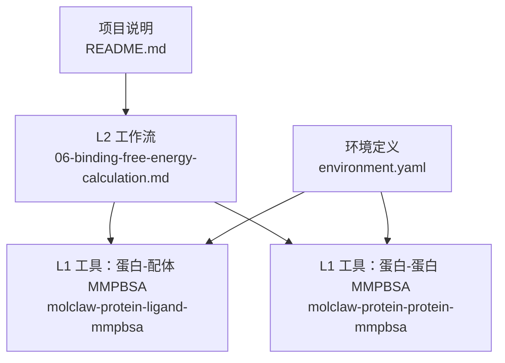
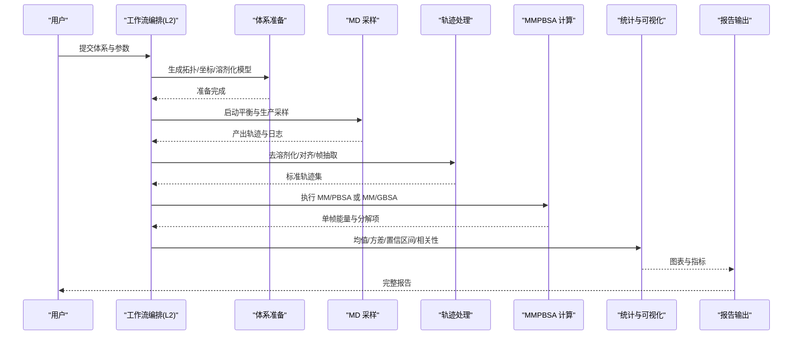
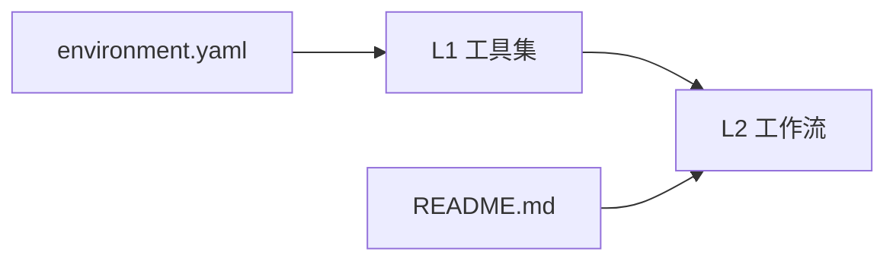

# 结合自由能计算工作流

<cite>
**本文引用的文件**   
- [06-binding-free-energy-calculation.md](file://docs/prd/molbench_repo/skills/L2_workflows/06-binding-free-energy-calculation.md)
- [molclaw-protein-ligand-mmpbsa](file://docs/prd/molbench_repo/skills/L1_tools/molclaw-protein-ligand-mmpbsa)
- [molclaw-protein-protein-mmpbsa](file://docs/prd/molbench_repo/skills/L1_tools/molclaw-protein-protein-mmpbsa)
- [environment.yaml](file://docs/prd/molbench_repo/environment.yaml)
- [README.md](file://docs/prd/molbench_repo/README.md)
</cite>

## 目录
1. [引言](#引言)
2. [项目结构](#项目结构)
3. [核心组件](#核心组件)
4. [架构总览](#架构总览)
5. [详细组件分析](#详细组件分析)
6. [依赖关系分析](#依赖关系分析)
7. [性能与收敛性](#性能与收敛性)
8. [故障排查指南](#故障排查指南)
9. [结论](#结论)
10. [附录](#附录)

## 引言
本技术文档围绕“结合自由能计算工作流”展开，聚焦于在分子动力学（MD）模拟基础上，使用 MM/PBSA 与 MM/GBSA 方法对蛋白质-配体复合物、蛋白质-蛋白质相互作用体系进行结合自由能估算。文档涵盖：
- 工作流目标与适用范围
- MD 模拟设置、轨迹分析与能量分解的技术要点
- 力场选择、采样长度与收敛性检验的标准流程
- 不同体系的配置指南
- 统计分析与误差估计方法
- 与实验数据的对比验证策略

## 项目结构
该仓库中与结合自由能计算相关的资源主要位于 docs/prd/molbench_repo 下，包括：
- L2 工作流：提供端到端的“结合自由能计算”流程说明
- L1 工具：封装了针对蛋白-配体和蛋白-蛋白的 MMPBSA 工具能力
- 环境定义：统一的环境依赖与环境管理
- 顶层说明：项目背景、技能索引与使用说明

图表来源
- [06-binding-free-energy-calculation.md](file://docs/prd/molbench_repo/skills/L2_workflows/06-binding-free-energy-calculation.md)
- [molclaw-protein-ligand-mmpbsa](file://docs/prd/molbench_repo/skills/L1_tools/molclaw-protein-ligand-mmpbsa)
- [molclaw-protein-protein-mmpbsa](file://docs/prd/molbench_repo/skills/L1_tools/molclaw-protein-protein-mmpbsa)
- [environment.yaml](file://docs/prd/molbench_repo/environment.yaml)
- [README.md](file://docs/prd/molbench_repo/README.md)

章节来源
- [06-binding-free-energy-calculation.md](file://docs/prd/molbench_repo/skills/L2_workflows/06-binding-free-energy-calculation.md)
- [README.md](file://docs/prd/molbench_repo/README.md)

## 核心组件
- 工作流编排（L2）
  - 负责将“结合自由能计算”任务拆解为可执行的步骤序列，串联准备、MD 采样、轨迹处理、MMPBSA 计算、结果汇总与分析等阶段。
- 工具封装（L1）
  - 蛋白-配体 MMPBSA：面向复合物-受体-配体的三端点或两端点计算，支持轨迹切片、构象抽取、能量分解等。
  - 蛋白-蛋白 MMPBSA：面向二聚体或多亚基复合物的结合自由能估算，支持链划分与界面残基分析。
- 环境与依赖
  - 通过 environment.yaml 统一管理运行所需软件包与版本，确保跨平台一致性。

章节来源
- [06-binding-free-energy-calculation.md](file://docs/prd/molbench_repo/skills/L2_workflows/06-binding-free-energy-calculation.md)
- [molclaw-protein-ligand-mmpbsa](file://docs/prd/molbench_repo/skills/L1_tools/molclaw-protein-ligand-mmpbsa)
- [molclaw-protein-protein-mmpbsa](file://docs/prd/molbench_repo/skills/L1_tools/molclaw-protein-protein-mmpbsa)
- [environment.yaml](file://docs/prd/molbench_repo/environment.yaml)

## 架构总览
下图展示了从输入结构到最终自由能与分析报告的整体数据流与控制流。

图表来源
- [06-binding-free-energy-calculation.md](file://docs/prd/molbench_repo/skills/L2_workflows/06-binding-free-energy-calculation.md)
- [molclaw-protein-ligand-mmpbsa](file://docs/prd/molbench_repo/skills/L1_tools/molclaw-protein-ligand-mmpbsa)
- [molclaw-protein-protein-mmpbsa](file://docs/prd/molbench_repo/skills/L1_tools/molclaw-protein-protein-mmpbsa)

## 详细组件分析

### 工作流：结合自由能计算（L2）
- 职责
  - 定义端到端步骤：体系准备 → MD 采样 → 轨迹后处理 → MMPBSA 计算 → 统计分析 → 报告生成。
  - 提供参数模板与默认值，便于在不同体系间复用。
- 关键流程
  - 输入校验与参数解析
  - 子任务调度与失败重试
  - 中间产物归档与可追溯性
  - 结果聚合与可视化
- 适用场景
  - 蛋白质-配体结合自由能
  - 蛋白质-蛋白质相互作用自由能
  - 多构象集合的平均与误差评估

章节来源
- [06-binding-free-energy-calculation.md](file://docs/prd/molbench_repo/skills/L2_workflows/06-binding-free-energy-calculation.md)

### 工具：蛋白-配体 MMPBSA（L1）
- 功能范围
  - 读取复合物/受体/配体轨迹，按时间窗口抽取构象
  - 计算内禀能、范德华、静电、极性溶剂化与非极性溶剂化贡献
  - 可选的能量分解（残基级或原子级）
- 典型输入
  - 轨迹文件、拓扑文件、掩码/链标识、采样间隔与帧数
- 典型输出
  - 平均结合自由能、标准差、置信区间
  - 能量分量表与分解结果
- 注意事项
  - 需保证轨迹已去除周期性边界与整体平动/转动
  - 溶剂化半径与介电常数需与所选力场一致

章节来源
- [molclaw-protein-ligand-mmpbsa](file://docs/prd/molbench_repo/skills/L1_tools/molclaw-protein-ligand-mmpbsa)

### 工具：蛋白-蛋白 MMPBSA（L1）
- 功能范围
  - 支持二聚体/寡聚体复合物的结合自由能估算
  - 支持链划分、界面残基识别与贡献排序
- 典型输入
  - 复合物轨迹、链/域掩码、采样策略
- 典型输出
  - 单体与复合物能量、结合自由能及分解项
  - 界面残基贡献排名与热图

章节来源
- [molclaw-protein-protein-mmpbsa](file://docs/prd/molbench_repo/skills/L1_tools/molclaw-protein-protein-mmpbsa)

### 环境与依赖（environment.yaml）
- 作用
  - 集中声明运行所需的科学计算库、可视化工具与脚本依赖
- 建议
  - 固定关键依赖版本，避免漂移导致结果不可复现
  - 提供最小可用环境与扩展环境两套清单

章节来源
- [environment.yaml](file://docs/prd/molbench_repo/environment.yaml)

## 依赖关系分析
- 工作流（L2）依赖若干 L1 工具完成具体计算任务
- 所有工具共享同一环境定义，确保可移植性与一致性
- README 作为入口文档，指引使用者定位相关技能与用法

图表来源
- [environment.yaml](file://docs/prd/molbench_repo/environment.yaml)
- [molclaw-protein-ligand-mmpbsa](file://docs/prd/molbench_repo/skills/L1_tools/molclaw-protein-ligand-mmpbsa)
- [molclaw-protein-protein-mmpbsa](file://docs/prd/molbench_repo/skills/L1_tools/molclaw-protein-protein-mmpbsa)
- [06-binding-free-energy-calculation.md](file://docs/prd/molbench_repo/skills/L2_workflows/06-binding-free-energy-calculation.md)
- [README.md](file://docs/prd/molbench_repo/README.md)

## 性能与收敛性
- 采样长度与独立性
  - 根据体系弛豫时间与特征时间尺度确定生产采样时长
  - 采用块平均法或自相关分析评估样本独立性
- 收敛性检验
  - 绘制累积平均值曲线并观察平台期
  - 比较不同起始段与滑动窗口的稳定性
- 误差估计
  - 使用标准差、标准误与置信区间量化不确定性
  - 对能量分量分别评估以定位主导误差来源
- 并行与加速
  - 轨迹切片并行计算、I/O 批处理与内存映射
  - 合理设置线程/进程数以匹配硬件资源

[本节为通用指导，不直接分析具体文件]

## 故障排查指南
- 常见错误
  - 轨迹缺失或格式不一致：检查路径、后缀与坐标系连续性
  - 掩码/链标识错误：核对链号、残基编号与原子选择
  - 溶剂化参数不匹配：确认半径表与介电常数与力场一致
- 诊断步骤
  - 查看中间日志与退出码
  - 回放前 N 帧与最后 N 帧，确认体系稳定
  - 逐步缩小采样窗口定位异常片段
- 恢复策略
  - 回滚至最近稳定快照
  - 调整采样间隔与帧数，降低 I/O 压力
  - 启用更详细的调试输出

[本节为通用指导，不直接分析具体文件]

## 结论
本工作流将“结合自由能计算”标准化为可重复、可扩展的流程，覆盖从体系准备到结果解释的全链路。通过 L2 编排与 L1 工具的解耦设计，既保证了易用性，也保留了灵活性，适用于蛋白-配体与蛋白-蛋白等多种体系。配合严格的收敛性检验与误差估计，可为药物发现与机制研究提供可靠的定量依据。

[本节为总结性内容，不直接分析具体文件]

## 附录

### 术语与缩写
- MM/PBSA：基于分子力学与泊松-玻尔兹曼表面积的自由能近似
- MM/GBSA：基于分子力学与广义玻尔兹曼表面积的自由能近似
- 轨迹切片：将长轨迹切分为短片段用于独立统计
- 能量分解：将结合自由能分解为各组分或残基贡献

[本节为概念性说明，不直接分析具体文件]