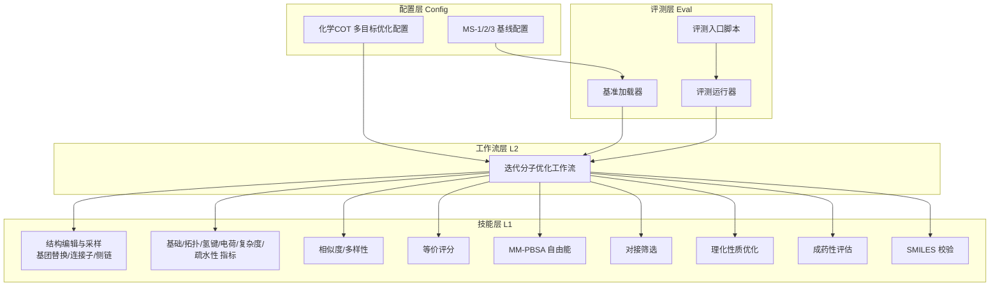
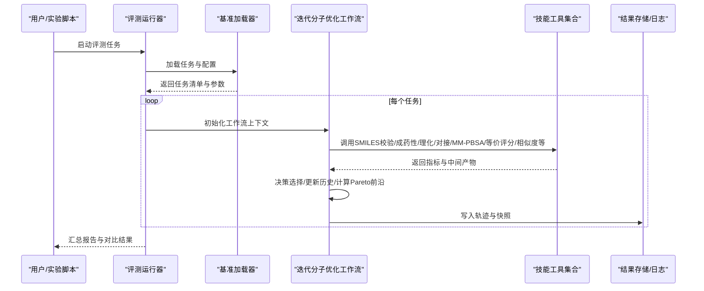
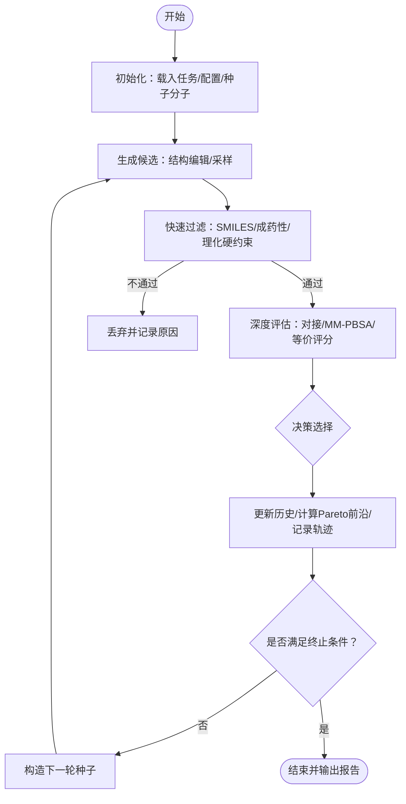
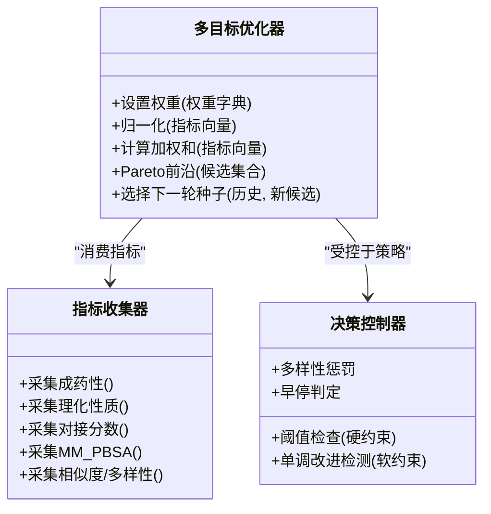
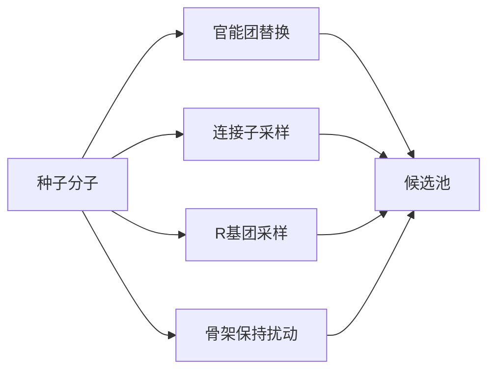
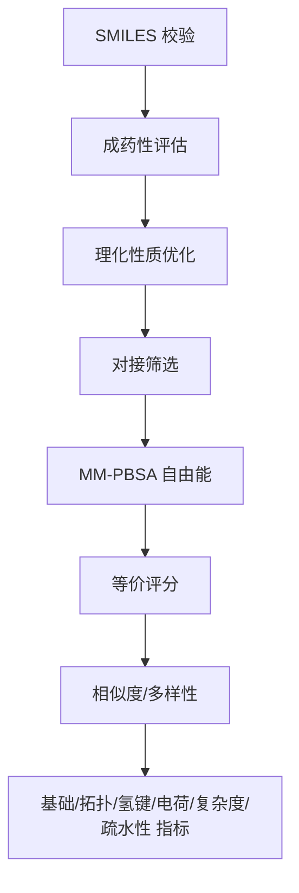
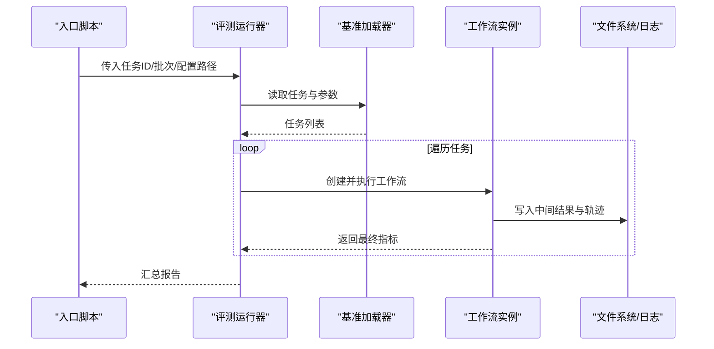
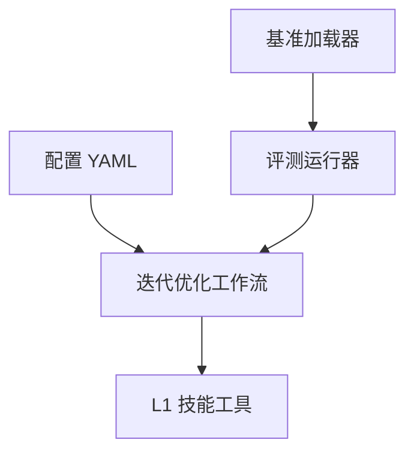

# 迭代分子优化工作流

<cite>
**本文引用的文件**   
- [05-iterative-molecular-optimization.md](file://docs/prd/molbench_repo/skills/L2_workflows/05-iterative-molecular-optimization.md)
- [chemcot_mo_opt.yaml](file://docs/prd/molbench_repo/config/chemcot_mo_opt.yaml)
- [eval_runner.py](file://docs/prd/molbench_repo/eval/eval_runner.py)
- [bench_loaders.py](file://docs/prd/molbench_repo/eval/bench_loaders.py)
- [run_eval_bench.py](file://docs/prd/molbench_repo/eval/run_eval_bench.py)
- [molclaw-smiles-valid-check](file://docs/prd/molbench_repo/skills/L1_tools/molclaw-smiles-valid-check)
- [molclaw-drug-likeness](file://docs/prd/molbench_repo/skills/L1_tools/molclaw-drug-likeness)
- [molclaw-mol-opt-physchem](file://docs/prd/molbench_repo/skills/L1_tools/molclaw-mol-opt-physchem)
- [molclaw-docking-screening](file://docs/prd/molbench_repo/skills/L1_tools/molclaw-docking-screening)
- [molclaw-protein-ligand-mmpbsa](file://docs/prd/molbench_repo/skills/L1_tools/molclaw-protein-ligand-mmpbsa)
- [molclaw-equiscore-tool](file://docs/prd/molbench_repo/skills/L1_tools/molclaw-equiscore-tool)
- [molclaw-mol-similarity](file://docs/prd/molbench_repo/skills/L1_tools/molclaw-mol-similarity)
- [molclaw-mol-basic-metrics](file://docs/prd/molbench_repo/skills/L1_tools/molclaw-mol-basic-metrics)
- [molclaw-mol-complexity-metrics](file://docs/prd/molbench_repo/skills/L1_tools/molclaw-mol-complexity-metrics)
- [molclaw-mol-hydrophobicity-metrics](file://docs/prd/molbench_repo/skills/L1_tools/molclaw-mol-hydrophobicity-metrics)
- [molclaw-mol-topology-metrics](file://docs/prd/molbench_repo/skills/L1_tools/molclaw-mol-topology-metrics)
- [molclaw-mol-structure-metrics](file://docs/prd/molbench_repo/skills/L1_tools/molclaw-mol-structure-metrics)
- [molclaw-mol-hbond-metrics](file://docs/prd/molbench_repo/skills/L1_tools/molclaw-mol-hbond-metrics)
- [molclaw-mol-charge-metrics](file://docs/prd/molbench_repo/skills/L1_tools/molclaw-mol-charge-metrics)
- [molclaw-mol2mol-sampling](file://docs/prd/molbench_repo/skills/L1_tools/molclaw-mol2mol-sampling)
- [molclaw-smiles-fg-editor](file://docs/prd/molbench_repo/skills/L1_tools/molclaw-smiles-fg-editor)
- [molclaw-linker-sampling](file://docs/prd/molbench_repo/skills/L1_tools/molclaw-linker-sampling)
- [molclaw-rgroup-sampling](file://docs/prd/molbench_repo/skills/L1_tools/molclaw-rgroup-sampling)
- [baseline_molbench-ms-1.yaml](file://docs/prd/molbench_repo/config/baseline_molbench-ms-1.yaml)
- [baseline_molbench-ms-2.yaml](file://docs/prd/molbench_repo/config/baseline_molbench-ms-2.yaml)
- [baseline_molbench-ms-3.yaml](file://docs/prd/molbench_repo/config/baseline_molbench-ms-3.yaml)
</cite>

## 目录
1. [引言](#引言)
2. [项目结构](#项目结构)
3. [核心组件](#核心组件)
4. [架构总览](#架构总览)
5. [详细组件分析](#详细组件分析)
6. [依赖关系分析](#依赖关系分析)
7. [性能与收敛性](#性能与收敛性)
8. [故障排查指南](#故障排查指南)
9. [结论](#结论)
10. [附录](#附录)

## 引言
本技术文档面向“迭代分子优化工作流”，围绕基于反馈循环的分子结构优化机制，系统阐述目标性质定义、结构修改策略、性能评估标准、决策逻辑、收敛条件与终止准则。同时给出多目标优化的权重配置方法与Pareto前沿分析思路，并提供药物性质优化、亲和力提升等应用场景的实现指南。最后说明优化过程中的数据追踪、版本管理与结果对比能力，帮助读者在真实研发场景中落地闭环优化。

## 项目结构
该仓库围绕“技能（工具）+ 工作流 + 评测”三层组织：
- 技能层（L1 Tools）：提供SMILES校验、理化性质计算、相似性与多样性度量、对接筛选、MM-PBSA自由能估算、等价评分等原子化能力。
- 工作流层（L2 Workflows）：将多个技能编排为端到端流程，其中“迭代分子优化”是核心闭环。
- 评测层（Eval）：提供基准加载、运行器与入口脚本，用于批量执行与指标汇总。
- 配置层（Config）：以YAML形式定义任务、权重、阈值、终止条件等可复现实验参数。

图表来源
- [05-iterative-molecular-optimization.md](file://docs/prd/molbench_repo/skills/L2_workflows/05-iterative-molecular-optimization.md)
- [chemcot_mo_opt.yaml](file://docs/prd/molbench_repo/config/chemcot_mo_opt.yaml)
- [eval_runner.py](file://docs/prd/molbench_repo/eval/eval_runner.py)
- [bench_loaders.py](file://docs/prd/molbench_repo/eval/bench_loaders.py)
- [run_eval_bench.py](file://docs/prd/molbench_repo/eval/run_eval_bench.py)

章节来源
- [05-iterative-molecular-optimization.md](file://docs/prd/molbench_repo/skills/L2_workflows/05-iterative-molecular-optimization.md)
- [chemcot_mo_opt.yaml](file://docs/prd/molbench_repo/config/chemcot_mo_opt.yaml)
- [eval_runner.py](file://docs/prd/molbench_repo/eval/eval_runner.py)
- [bench_loaders.py](file://docs/prd/molbench_repo/eval/bench_loaders.py)
- [run_eval_bench.py](file://docs/prd/molbench_repo/eval/run_eval_bench.py)

## 核心组件
- 迭代优化工作流：以“生成/编辑候选 → 评估打分 → 决策选择 → 记录与回溯”的闭环驱动结构演化，直至满足收敛或终止条件。
- 多目标评估体系：覆盖成药性、理化性质、结合亲和力、结构约束与多样性等维度，支持加权聚合与Pareto前沿分析。
- 结构修改策略：包括官能团替换、连接子扩展/收缩、R基团采样、骨架保持的局部扰动等，确保化学合理性与探索效率平衡。
- 决策与收敛控制：依据阈值、单调改进窗口、Pareto支配关系与多样性惩罚进行动态选择；支持早停与最大步数限制。
- 评测与基准：通过基准加载器读取任务集，运行器统一调度工具链并输出结构化结果，便于横向对比与复现。

章节来源
- [05-iterative-molecular-optimization.md](file://docs/prd/molbench_repo/skills/L2_workflows/05-iterative-molecular-optimization.md)
- [chemcot_mo_opt.yaml](file://docs/prd/molbench_repo/config/chemcot_mo_opt.yaml)
- [eval_runner.py](file://docs/prd/molbench_repo/eval/eval_runner.py)
- [bench_loaders.py](file://docs/prd/molbench_repo/eval/bench_loaders.py)
- [run_eval_bench.py](file://docs/prd/molbench_repo/eval/run_eval_bench.py)

## 架构总览
下图展示从配置到评测运行的端到端调用链，以及工作流内部对技能工具的编排关系。

图表来源
- [eval_runner.py](file://docs/prd/molbench_repo/eval/eval_runner.py)
- [bench_loaders.py](file://docs/prd/molbench_repo/eval/bench_loaders.py)
- [run_eval_bench.py](file://docs/prd/molbench_repo/eval/run_eval_bench.py)
- [05-iterative-molecular-optimization.md](file://docs/prd/molbench_repo/skills/L2_workflows/05-iterative-molecular-optimization.md)

## 详细组件分析

### 迭代分子优化工作流（L2）
- 输入：初始分子（SMILES）、目标蛋白/靶点信息、目标性质范围、权重与阈值、最大迭代步数。
- 步骤：
  - 候选生成：使用结构编辑与采样技能产生邻域或跨骨架候选。
  - 快速过滤：SMILES合法性、成药性、理化性质硬约束。
  - 深度评估：对接筛选、MM-PBSA自由能、等价评分。
  - 决策：基于加权得分或Pareto支配关系选择下一轮种子。
  - 记录：保存每代分子、指标、选择原因与变更图谱。
- 终止：达到最大步数、连续N步无显著改进、所有候选不可行或多样性低于阈值。

图表来源
- [05-iterative-molecular-optimization.md](file://docs/prd/molbench_repo/skills/L2_workflows/05-iterative-molecular-optimization.md)

章节来源
- [05-iterative-molecular-optimization.md](file://docs/prd/molbench_repo/skills/L2_workflows/05-iterative-molecular-optimization.md)

### 多目标优化与Pareto前沿
- 目标维度示例：成药性、LogP/溶解度、分子量、HBA/HBD、旋转键、TPSA、结合亲和力（对接分数/MM-PBSA）、结构相似度、多样性惩罚。
- 权重配置：通过配置文件指定各目标权重、归一化方式与软/硬约束阈值。
- Pareto分析：在多目标空间中识别非支配解集，辅助权衡取舍与可视化。

图表来源
- [chemcot_mo_opt.yaml](file://docs/prd/molbench_repo/config/chemcot_mo_opt.yaml)
- [05-iterative-molecular-optimization.md](file://docs/prd/molbench_repo/skills/L2_workflows/05-iterative-molecular-optimization.md)

章节来源
- [chemcot_mo_opt.yaml](file://docs/prd/molbench_repo/config/chemcot_mo_opt.yaml)
- [05-iterative-molecular-optimization.md](file://docs/prd/molbench_repo/skills/L2_workflows/05-iterative-molecular-optimization.md)

### 结构修改策略（L1 工具组合）
- 官能团编辑：在保留骨架的前提下替换敏感片段，改善理化与成药性。
- 连接子采样：扩展/收缩连接子长度与类型，调节构象与结合模式。
- R基团采样：在特定位置引入不同取代基，探索结合口袋适配性。
- 骨架保持扰动：小幅度原子级改动，维持整体拓扑稳定性的同时微调性质。

图表来源
- [molclaw-smiles-fg-editor](file://docs/prd/molbench_repo/skills/L1_tools/molclaw-smiles-fg-editor)
- [molclaw-linker-sampling](file://docs/prd/molbench_repo/skills/L1_tools/molclaw-linker-sampling)
- [molclaw-rgroup-sampling](file://docs/prd/molbench_repo/skills/L1_tools/molclaw-rgroup-sampling)
- [molclaw-mol2mol-sampling](file://docs/prd/molbench_repo/skills/L1_tools/molclaw-mol2mol-sampling)

章节来源
- [molclaw-smiles-fg-editor](file://docs/prd/molbench_repo/skills/L1_tools/molclaw-smiles-fg-editor)
- [molclaw-linker-sampling](file://docs/prd/molbench_repo/skills/L1_tools/molclaw-linker-sampling)
- [molclaw-rgroup-sampling](file://docs/prd/molbench_repo/skills/L1_tools/molclaw-rgroup-sampling)
- [molclaw-mol2mol-sampling](file://docs/prd/molbench_repo/skills/L1_tools/molclaw-mol2mol-sampling)

### 评估与验证（L1 工具组合）
- 结构有效性：SMILES合法性、价态与环合理性检查。
- 成药性与理化：QED、LogP、MW、HBA/HBD、TPSA、旋转键等。
- 结合亲和：对接筛选、MM-PBSA自由能估算、等价评分。
- 结构与多样性：Tanimoto相似度、骨架多样性、拓扑/氢键/电荷/复杂度/疏水性指标。

图表来源
- [molclaw-smiles-valid-check](file://docs/prd/molbench_repo/skills/L1_tools/molclaw-smiles-valid-check)
- [molclaw-drug-likeness](file://docs/prd/molbench_repo/skills/L1_tools/molclaw-drug-likeness)
- [molclaw-mol-opt-physchem](file://docs/prd/molbench_repo/skills/L1_tools/molclaw-mol-opt-physchem)
- [molclaw-docking-screening](file://docs/prd/molbench_repo/skills/L1_tools/molclaw-docking-screening)
- [molclaw-protein-ligand-mmpbsa](file://docs/prd/molbench_repo/skills/L1_tools/molclaw-protein-ligand-mmpbsa)
- [molclaw-equiscore-tool](file://docs/prd/molbench_repo/skills/L1_tools/molclaw-equiscore-tool)
- [molclaw-mol-similarity](file://docs/prd/molbench_repo/skills/L1_tools/molclaw-mol-similarity)
- [molclaw-mol-basic-metrics](file://docs/prd/molbench_repo/skills/L1_tools/molclaw-mol-basic-metrics)
- [molclaw-mol-complexity-metrics](file://docs/prd/molbench_repo/skills/L1_tools/molclaw-mol-complexity-metrics)
- [molclaw-mol-hydrophobicity-metrics](file://docs/prd/molbench_repo/skills/L1_tools/molclaw-mol-hydrophobicity-metrics)
- [molclaw-mol-topology-metrics](file://docs/prd/molbench_repo/skills/L1_tools/molclaw-mol-topology-metrics)
- [molclaw-mol-structure-metrics](file://docs/prd/molbench_repo/skills/L1_tools/molclaw-mol-structure-metrics)
- [molclaw-mol-hbond-metrics](file://docs/prd/molbench_repo/skills/L1_tools/molclaw-mol-hbond-metrics)
- [molclaw-mol-charge-metrics](file://docs/prd/molbench_repo/skills/L1_tools/molclaw-mol-charge-metrics)

章节来源
- [molclaw-smiles-valid-check](file://docs/prd/molbench_repo/skills/L1_tools/molclaw-smiles-valid-check)
- [molclaw-drug-likeness](file://docs/prd/molbench_repo/skills/L1_tools/molclaw-drug-likeness)
- [molclaw-mol-opt-physchem](file://docs/prd/molbench_repo/skills/L1_tools/molclaw-mol-opt-physchem)
- [molclaw-docking-screening](file://docs/prd/molbench_repo/skills/L1_tools/molclaw-docking-screening)
- [molclaw-protein-ligand-mmpbsa](file://docs/prd/molbench_repo/skills/L1_tools/molclaw-protein-ligand-mmpbsa)
- [molclaw-equiscore-tool](file://docs/prd/molbench_repo/skills/L1_tools/molclaw-equiscore-tool)
- [molclaw-mol-similarity](file://docs/prd/molbench_repo/skills/L1_tools/molclaw-mol-similarity)
- [molclaw-mol-basic-metrics](file://docs/prd/molbench_repo/skills/L1_tools/molclaw-mol-basic-metrics)
- [molclaw-mol-complexity-metrics](file://docs/prd/molbench_repo/skills/L1_tools/molclaw-mol-complexity-metrics)
- [molclaw-mol-hydrophobicity-metrics](file://docs/prd/molbench_repo/skills/L1_tools/molclaw-mol-hydrophobicity-metrics)
- [molclaw-mol-topology-metrics](file://docs/prd/molbench_repo/skills/L1_tools/molclaw-mol-topology-metrics)
- [molclaw-mol-structure-metrics](file://docs/prd/molbench_repo/skills/L1_tools/molclaw-mol-structure-metrics)
- [molclaw-mol-hbond-metrics](file://docs/prd/molbench_repo/skills/L1_tools/molclaw-mol-hbond-metrics)
- [molclaw-mol-charge-metrics](file://docs/prd/molbench_repo/skills/L1_tools/molclaw-mol-charge-metrics)

### 评测与基准（Eval）
- 基准加载器：解析任务清单与数据集，准备输入上下文。
- 评测运行器：统一调度工作流与工具，管理并发、重试与错误恢复。
- 入口脚本：提供命令行接口，支持批量任务与结果汇总。

图表来源
- [run_eval_bench.py](file://docs/prd/molbench_repo/eval/run_eval_bench.py)
- [eval_runner.py](file://docs/prd/molbench_repo/eval/eval_runner.py)
- [bench_loaders.py](file://docs/prd/molbench_repo/eval/bench_loaders.py)

章节来源
- [run_eval_bench.py](file://docs/prd/molbench_repo/eval/run_eval_bench.py)
- [eval_runner.py](file://docs/prd/molbench_repo/eval/eval_runner.py)
- [bench_loaders.py](file://docs/prd/molbench_repo/eval/bench_loaders.py)

### 配置与可复现性（Config）
- 多目标权重：在配置中声明各目标权重、归一化策略与阈值。
- 基线任务：MS-1/2/3系列配置用于不同难度与场景的基线对比。
- 可复现实验：通过固定随机种子、工具版本与参数，保证结果可重复。

章节来源
- [chemcot_mo_opt.yaml](file://docs/prd/molbench_repo/config/chemcot_mo_opt.yaml)
- [baseline_molbench-ms-1.yaml](file://docs/prd/molbench_repo/config/baseline_molbench-ms-1.yaml)
- [baseline_molbench-ms-2.yaml](file://docs/prd/molbench_repo/config/baseline_molbench-ms-2.yaml)
- [baseline_molbench-ms-3.yaml](file://docs/prd/molbench_repo/config/baseline_molbench-ms-3.yaml)

## 依赖关系分析
- 工作流对技能的强耦合：通过明确的任务编排，将原子化工具串联为完整优化链路。
- 评测层与工作流的松耦合：通过标准化输入输出接口，评测层可独立升级与扩展。
- 配置驱动：YAML配置集中管理权重、阈值与任务元数据，降低代码侵入性。

图表来源
- [chemcot_mo_opt.yaml](file://docs/prd/molbench_repo/config/chemcot_mo_opt.yaml)
- [eval_runner.py](file://docs/prd/molbench_repo/eval/eval_runner.py)
- [bench_loaders.py](file://docs/prd/molbench_repo/eval/bench_loaders.py)
- [05-iterative-molecular-optimization.md](file://docs/prd/molbench_repo/skills/L2_workflows/05-iterative-molecular-optimization.md)

章节来源
- [chemcot_mo_opt.yaml](file://docs/prd/molbench_repo/config/chemcot_mo_opt.yaml)
- [eval_runner.py](file://docs/prd/molbench_repo/eval/eval_runner.py)
- [bench_loaders.py](file://docs/prd/molbench_repo/eval/bench_loaders.py)
- [05-iterative-molecular-optimization.md](file://docs/prd/molbench_repo/skills/L2_workflows/05-iterative-molecular-optimization.md)

## 性能与收敛性
- 并行与批处理：评测运行器支持任务级并行，缩短整体耗时。
- 快速过滤优先：先进行低成本校验与规则过滤，减少昂贵评估次数。
- 早停与单调改进窗口：当连续若干代未出现显著改进时提前终止，避免无效搜索。
- 多样性惩罚：防止种群过早收敛到局部最优，保持探索空间。
- 资源预算：通过最大步数与评估配额控制成本。

[本节为通用指导，无需列出具体文件来源]

## 故障排查指南
- SMILES非法：检查官能团编辑与采样后的结构合法性，必要时回退到上一代种子。
- 成药性失败：调整权重或放宽软约束，定位关键违反项（如LogP、TPSA）。
- 对接失败：确认蛋白配体复合物准备、网格与参数设置是否正确。
- MM-PBSA异常：检查轨迹质量、能量截断与采样时长。
- 结果不一致：核对随机种子、工具版本与配置一致性。

章节来源
- [molclaw-smiles-valid-check](file://docs/prd/molbench_repo/skills/L1_tools/molclaw-smiles-valid-check)
- [molclaw-drug-likeness](file://docs/prd/molbench_repo/skills/L1_tools/molclaw-drug-likeness)
- [molclaw-docking-screening](file://docs/prd/molbench_repo/skills/L1_tools/molclaw-docking-screening)
- [molclaw-protein-ligand-mmpbsa](file://docs/prd/molbench_repo/skills/L1_tools/molclaw-protein-ligand-mmpbsa)

## 结论
本工作流以“轻量快速过滤 + 深度精准评估 + 多目标决策”为核心，结合结构编辑与采样策略，形成可复现、可扩展的迭代分子优化闭环。通过配置驱动的权重与阈值管理，以及完善的评测与结果追踪，可在药物性质优化与亲和力提升等场景中高效落地。建议在实际项目中持续完善Pareto可视化与自动化报告，以提升决策透明度与协作效率。

[本节为总结性内容，无需列出具体文件来源]

## 附录
- 应用场景实现要点
  - 药物性质优化：以成药性与理化性质为主目标，辅以结构相似度约束，确保可合成性与稳定性。
  - 亲和力提升：以对接分数与MM-PBSA为主要目标，配合连接子与R基团采样增强结合模式探索。
- 数据追踪与版本管理
  - 每代分子与指标持久化，记录选择原因与变更图谱。
  - 固定随机种子与工具版本，确保实验可复现。
- 结果对比
  - 基于基准配置进行横向对比，输出汇总报告与趋势图。

[本节为补充说明，无需列出具体文件来源]