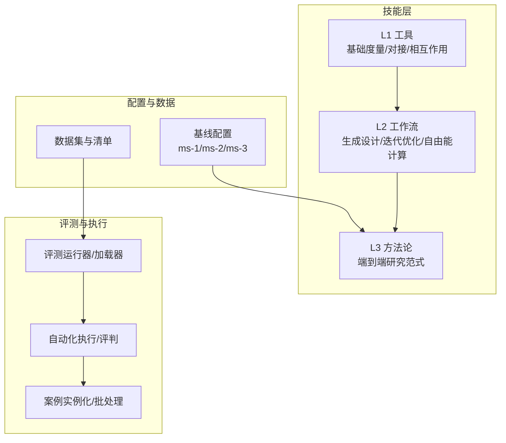
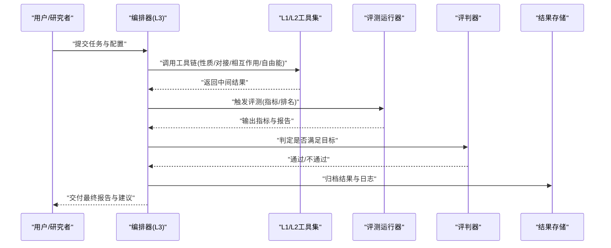
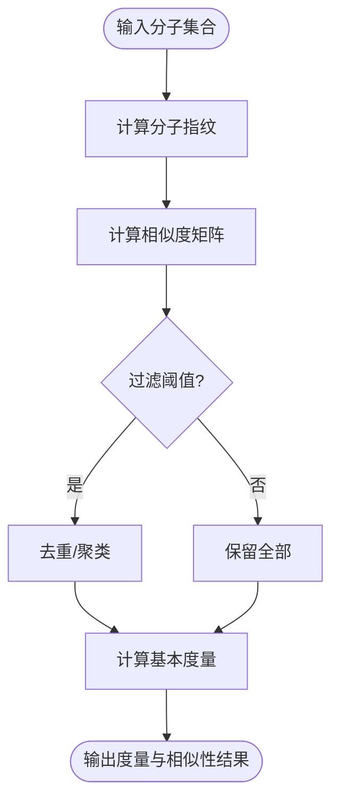
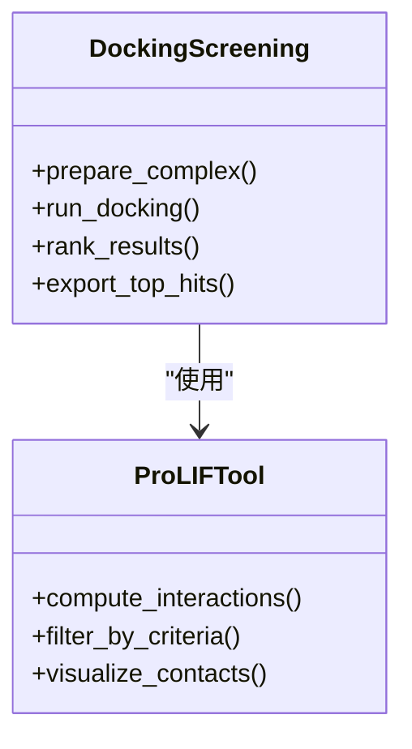
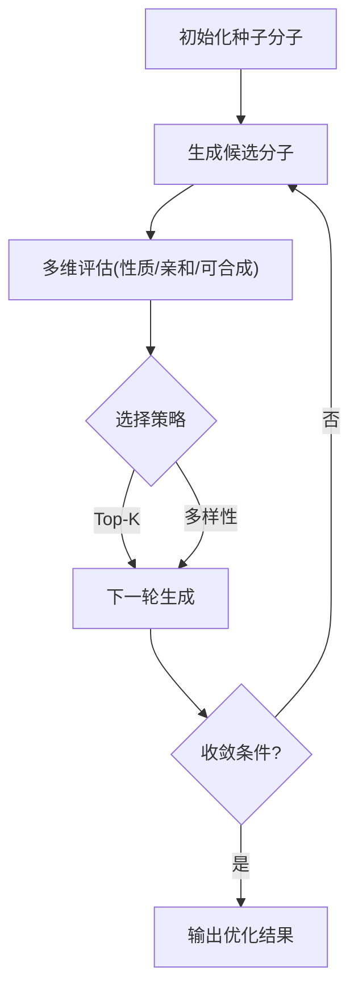
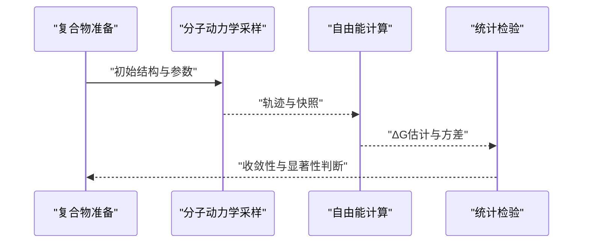
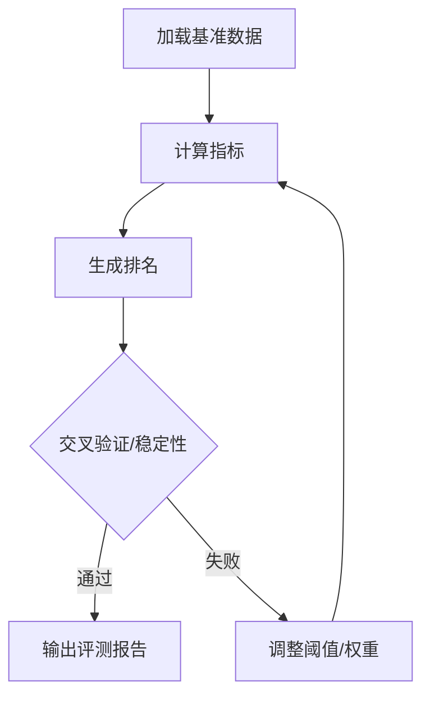
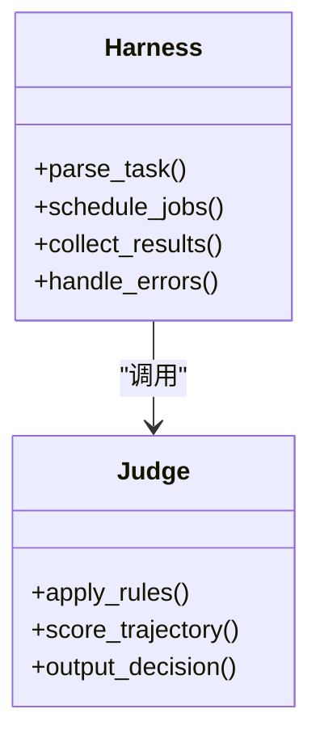
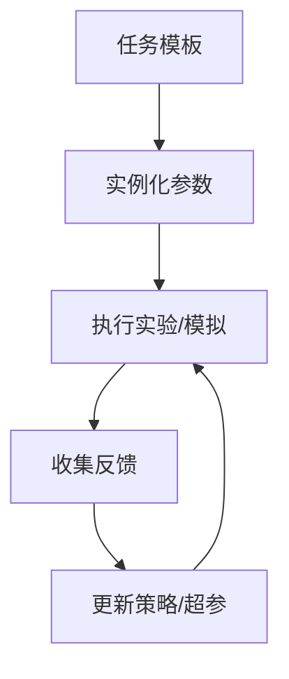
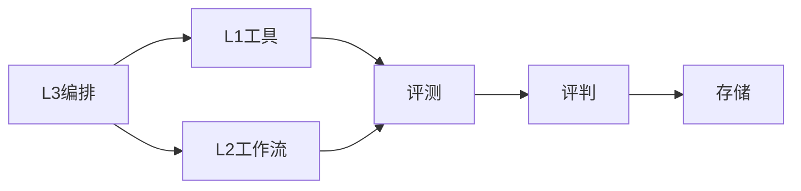

# L3方法论工具

<cite>
**本文引用的文件**   
- [docs/prd/molbench_repo/skills/L3_methodology/README.md](file://docs/prd/molbench_repo/skills/L3_methodology/README.md)
- [docs/prd/molbench_repo/skills/L1_tools/molclaw-mol-basic-metrics/metric.py](file://docs/prd/molbench_repo/skills/L1_tools/molclaw-mol-basic-metrics/metric.py)
- [docs/prd/molbench_repo/skills/L1_tools/molclaw-mol-similarity/metric.py](file://docs/prd/molbench_repo/skills/L1_tools/molclaw-mol-similarity/metric.py)
- [docs/prd/molbench_repo/skills/L1_tools/molclaw-docking-screening/tool.py](file://docs/prd/molbench_repo/skills/L1_tools/molclaw-docking-screening/tool.py)
- [docs/prd/molbench_repo/skills/L1_tools/molclaw-prolif-tool/tool.py](file://docs/prd/molbench_repo/skills/L1_tools/molclaw-prolif-tool/tool.py)
- [docs/prd/molbench_repo/skills/L2_workflows/04-generative-molecular-design.md](file://docs/prd/molbench_repo/skills/L2_workflows/04-generative-molecular-design.md)
- [docs/prd/molbench_repo/skills/L2_workflows/05-iterative-molecular-optimization.md](file://docs/prd/molbench_repo/skills/L2_workflows/05-iterative-molecular-optimization.md)
- [docs/prd/molbench_repo/skills/L2_workflows/06-binding-free-energy-calculation.md](file://docs/prd/molbench_repo/skills/L2_workflows/06-binding-free-energy-calculation.md)
- [docs/prd/molbench_repo/config/baseline_molbench-ms-1.yaml](file://docs/prd/molbench_repo/config/baseline_molbench-ms-1.yaml)
- [docs/prd/molbench_repo/config/baseline_molbench-ms-2.yaml](file://docs/prd/molbench_repo/config/baseline_molbench-ms-2.yaml)
- [docs/prd/molbench_repo/config/baseline_molbench-ms-3.yaml](file://docs/prd/molbench_repo/config/baseline_molbench-ms-3.yaml)
- [docs/prd/molbench_repo/eval/eval_runner.py](file://docs/prd/molbench_repo/eval/eval_runner.py)
- [docs/prd/molbench_repo/eval/bench_loaders.py](file://docs/prd/molbench_repo/eval/bench_loaders.py)
- [autonomy_mvp/core/harness.py](file://autonomy_mvp/core/harness.py)
- [autonomy_mvp/core/judge.py](file://autonomy_mvp/core/judge.py)
- [autonomy_mvp/core/metrics.py](file://autonomy_mvp/core/metrics.py)
- [autonomy_mvp/core/ranking_metrics.py](file://autonomy_mvp/core/ranking_metrics.py)
- [longhorizon/instantiate/caseD_instantiate.py](file://longhorizon/instantiate/caseD_instantiate.py)
- [task3/B_ms3_screening_prototype/ms3_screening_eval.py](file://task3/B_ms3_screening_prototype/ms3_screening_eval.py)
</cite>

## 目录
1. [简介](#简介)
2. [项目结构](#项目结构)
3. [核心组件](#核心组件)
4. [架构总览](#架构总览)
5. [详细组件分析](#详细组件分析)
6. [依赖关系分析](#依赖关系分析)
7. [性能与基准](#性能与基准)
8. [故障排查指南](#故障排查指南)
9. [结论](#结论)
10. [附录](#附录)

## 简介
本技术文档面向“L3方法论工具”，聚焦药物发现方法论、机器学习模型与统计检验工具的高级实现。内容涵盖：
- 算法选择依据与参数调优策略
- 结果验证方法与评估指标体系
- 深度学习模型的训练流程、特征工程与模型评估
- 方法论工具的配置选项、性能基准与最佳实践
- 与传统科学计算方法的对比优势与适用场景

L3方法论强调在复杂任务中，通过“工作流编排 + 工具组合 + 可重复实验”的方式，将分子性质预测、对接筛选、自由能计算、生成式设计与迭代优化等能力整合为可复用的研究范式。

## 项目结构
仓库围绕“技能（Skills）—工作流（Workflows）—评测（Eval）—实例化（Instantiate）”分层组织：
- Skills（L1/L2/L3）：原子工具与复合工作流定义
- Config：基线与任务配置
- Eval：评测加载器与运行器
- Autonomy MVP：自动化执行与评判框架
- Longhorizon：长周期案例与闭环优化实例
- Task3：MS3筛选原型与评估脚本

图表来源
- [docs/prd/molbench_repo/skills/L3_methodology/README.md](file://docs/prd/molbench_repo/skills/L3_methodology/README.md)
- [docs/prd/molbench_repo/config/baseline_molbench-ms-1.yaml](file://docs/prd/molbench_repo/config/baseline_molbench-ms-1.yaml)
- [docs/prd/molbench_repo/eval/eval_runner.py](file://docs/prd/molbench_repo/eval/eval_runner.py)
- [autonomy_mvp/core/harness.py](file://autonomy_mvp/core/harness.py)

章节来源
- [docs/prd/molbench_repo/skills/L3_methodology/README.md](file://docs/prd/molbench_repo/skills/L3_methodology/README.md)
- [docs/prd/molbench_repo/config/baseline_molbench-ms-1.yaml](file://docs/prd/molbench_repo/config/baseline_molbench-ms-1.yaml)
- [docs/prd/molbench_repo/config/baseline_molbench-ms-2.yaml](file://docs/prd/molbench_repo/config/baseline_molbench-ms-2.yaml)
- [docs/prd/molbench_repo/config/baseline_molbench-ms-3.yaml](file://docs/prd/molbench_repo/config/baseline_molbench-ms-3.yaml)
- [docs/prd/molbench_repo/eval/eval_runner.py](file://docs/prd/molbench_repo/eval/eval_runner.py)
- [docs/prd/molbench_repo/eval/bench_loaders.py](file://docs/prd/molbench_repo/eval/bench_loaders.py)
- [autonomy_mvp/core/harness.py](file://autonomy_mvp/core/harness.py)

## 核心组件
- L3方法论编排：以工作流为中心，串联L1工具与外部计算服务，形成可复现的端到端研究路径。
- L1工具集：分子基本度量、相似性、对接筛选、蛋白质-配体相互作用分析等。
- L2工作流：生成式分子设计、迭代优化、结合自由能计算等复合流程。
- 评测与基准：统一的数据加载、指标计算与排名评估，支持多任务基线对比。
- 自动化执行与评判：提供任务调度、结果收集、判定逻辑与指标汇总。
- 长周期案例与闭环优化：将方法落地到具体材料/药物案例，形成持续改进的实验闭环。

章节来源
- [docs/prd/molbench_repo/skills/L3_methodology/README.md](file://docs/prd/molbench_repo/skills/L3_methodology/README.md)
- [docs/prd/molbench_repo/skills/L1_tools/molclaw-mol-basic-metrics/metric.py](file://docs/prd/molbench_repo/skills/L1_tools/molclaw-mol-basic-metrics/metric.py)
- [docs/prd/molbench_repo/skills/L1_tools/molclaw-mol-similarity/metric.py](file://docs/prd/molbench_repo/skills/L1_tools/molclaw-mol-similarity/metric.py)
- [docs/prd/molbench_repo/skills/L1_tools/molclaw-docking-screening/tool.py](file://docs/prd/molbench_repo/skills/L1_tools/molclaw-docking-screening/tool.py)
- [docs/prd/molbench_repo/skills/L1_tools/molclaw-prolif-tool/tool.py](file://docs/prd/molbench_repo/skills/L1_tools/molclaw-prolif-tool/tool.py)
- [docs/prd/molbench_repo/skills/L2_workflows/04-generative-molecular-design.md](file://docs/prd/molbench_repo/skills/L2_workflows/04-generative-molecular-design.md)
- [docs/prd/molbench_repo/skills/L2_workflows/05-iterative-molecular-optimization.md](file://docs/prd/molbench_repo/skills/L2_workflows/05-iterative-molecular-optimization.md)
- [docs/prd/molbench_repo/skills/L2_workflows/06-binding-free-energy-calculation.md](file://docs/prd/molbench_repo/skills/L2_workflows/06-binding-free-energy-calculation.md)
- [docs/prd/molbench_repo/eval/eval_runner.py](file://docs/prd/molbench_repo/eval/eval_runner.py)
- [docs/prd/molbench_repo/eval/bench_loaders.py](file://docs/prd/molbench_repo/eval/bench_loaders.py)
- [autonomy_mvp/core/harness.py](file://autonomy_mvp/core/harness.py)
- [autonomy_mvp/core/judge.py](file://autonomy_mvp/core/judge.py)
- [autonomy_mvp/core/metrics.py](file://autonomy_mvp/core/metrics.py)
- [autonomy_mvp/core/ranking_metrics.py](file://autonomy_mvp/core/ranking_metrics.py)
- [longhorizon/instantiate/caseD_instantiate.py](file://longhorizon/instantiate/caseD_instantiate.py)
- [task3/B_ms3_screening_prototype/ms3_screening_eval.py](file://task3/B_ms3_screening_prototype/ms3_screening_eval.py)

## 架构总览
L3方法论工具采用“编排—工具—评测—执行”的分层架构：
- 编排层：定义任务目标、步骤顺序、条件分支与资源约束
- 工具层：封装化学信息学、分子动力学、对接与评分等能力
- 评测层：统一数据格式、指标计算与排名比较
- 执行层：任务调度、日志记录、错误恢复与结果归档

图表来源
- [docs/prd/molbench_repo/skills/L3_methodology/README.md](file://docs/prd/molbench_repo/skills/L3_methodology/README.md)
- [docs/prd/molbench_repo/eval/eval_runner.py](file://docs/prd/molbench_repo/eval/eval_runner.py)
- [autonomy_mvp/core/harness.py](file://autonomy_mvp/core/harness.py)
- [autonomy_mvp/core/judge.py](file://autonomy_mvp/core/judge.py)

## 详细组件分析

### 分子基本度量与相似性（L1）
- 功能要点
  - 基本理化性质与拓扑度量（如分子量、LogP、氢键供体/受体计数等）
  - 分子指纹与相似性计算（Tanimoto、Dice等），用于候选库去重与聚类
- 复杂度与性能
  - 指纹计算通常为O(n)或O(n log n)，n为原子/键数；相似度矩阵为O(N^2)
- 参数调优
  - 指纹类型与半径、阈值截断、并行度
- 结果验证
  - 与已知基准值对比、分布一致性检查、异常值检测

图表来源
- [docs/prd/molbench_repo/skills/L1_tools/molclaw-mol-basic-metrics/metric.py](file://docs/prd/molbench_repo/skills/L1_tools/molclaw-mol-basic-metrics/metric.py)
- [docs/prd/molbench_repo/skills/L1_tools/molclaw-mol-similarity/metric.py](file://docs/prd/molbench_repo/skills/L1_tools/molclaw-mol-similarity/metric.py)

章节来源
- [docs/prd/molbench_repo/skills/L1_tools/molclaw-mol-basic-metrics/metric.py](file://docs/prd/molbench_repo/skills/L1_tools/molclaw-mol-basic-metrics/metric.py)
- [docs/prd/molbench_repo/skills/L1_tools/molclaw-mol-similarity/metric.py](file://docs/prd/molbench_repo/skills/L1_tools/molclaw-mol-similarity/metric.py)

### 对接筛选与相互作用分析（L1）
- 功能要点
  - 自动对接准备、构象采样、打分与排序
  - 蛋白质-配体相互作用可视化与分析（氢键、疏水、盐桥等）
- 关键参数
  - 搜索空间、柔性残基、力场/评分函数、收敛阈值
- 结果验证
  - 与晶体结构RMSD、结合模式重现率、富集因子（EF）与AUC

图表来源
- [docs/prd/molbench_repo/skills/L1_tools/molclaw-docking-screening/tool.py](file://docs/prd/molbench_repo/skills/L1_tools/molclaw-docking-screening/tool.py)
- [docs/prd/molbench_repo/skills/L1_tools/molclaw-prolif-tool/tool.py](file://docs/prd/molbench_repo/skills/L1_tools/molclaw-prolif-tool/tool.py)

章节来源
- [docs/prd/molbench_repo/skills/L1_tools/molclaw-docking-screening/tool.py](file://docs/prd/molbench_repo/skills/L1_tools/molclaw-docking-screening/tool.py)
- [docs/prd/molbench_repo/skills/L1_tools/molclaw-prolif-tool/tool.py](file://docs/prd/molbench_repo/skills/L1_tools/molclaw-prolif-tool/tool.py)

### 生成式分子设计与迭代优化（L2）
- 生成式设计
  - 基于规则/图模型/深度学习的分子生成
  - 约束条件：合成可及性、类药性、靶点亲和性
- 迭代优化
  - 主动学习循环：生成→评估→反馈→再优化
  - 探索-利用平衡：多样性保持与目标导向
- 评估指标
  - 新颖性、可合成性分数、QED、SA、结合亲和力预测误差

图表来源
- [docs/prd/molbench_repo/skills/L2_workflows/04-generative-molecular-design.md](file://docs/prd/molbench_repo/skills/L2_workflows/04-generative-molecular-design.md)
- [docs/prd/molbench_repo/skills/L2_workflows/05-iterative-molecular-optimization.md](file://docs/prd/molbench_repo/skills/L2_workflows/05-iterative-molecular-optimization.md)

章节来源
- [docs/prd/molbench_repo/skills/L2_workflows/04-generative-molecular-design.md](file://docs/prd/molbench_repo/skills/L2_workflows/04-generative-molecular-design.md)
- [docs/prd/molbench_repo/skills/L2_workflows/05-iterative-molecular-optimization.md](file://docs/prd/molbench_repo/skills/L2_workflows/05-iterative-molecular-optimization.md)

### 结合自由能计算（L2）
- 方法概述
  - MM-PBSA/GBSA、FEP/TI等自由能计算方法
  - 采样策略：MD轨迹长度、温度/压力控制、收敛判据
- 参数调优
  - 采样时长、窗口数、扰动步长、溶剂模型
- 结果验证
  - 与实验ΔG相关性、误差分布、置信区间估计

图表来源
- [docs/prd/molbench_repo/skills/L2_workflows/06-binding-free-energy-calculation.md](file://docs/prd/molbench_repo/skills/L2_workflows/06-binding-free-energy-calculation.md)

章节来源
- [docs/prd/molbench_repo/skills/L2_workflows/06-binding-free-energy-calculation.md](file://docs/prd/molbench_repo/skills/L2_workflows/06-binding-free-energy-calculation.md)

### 评测与排名（Eval）
- 数据加载
  - 统一CSV/JSON格式，支持多任务清单与元数据
- 指标计算
  - 回归误差（RMSE、MAE）、分类指标（AUROC、AUPRC）、富集指标（EF@1%、BEDROC）
- 排名评估
  - 列表相关性（NDCG）、命中率（Hit Rate）、稳定性检验（交叉验证）

图表来源
- [docs/prd/molbench_repo/eval/eval_runner.py](file://docs/prd/molbench_repo/eval/eval_runner.py)
- [docs/prd/molbench_repo/eval/bench_loaders.py](file://docs/prd/molbench_repo/eval/bench_loaders.py)
- [autonomy_mvp/core/metrics.py](file://autonomy_mvp/core/metrics.py)
- [autonomy_mvp/core/ranking_metrics.py](file://autonomy_mvp/core/ranking_metrics.py)

章节来源
- [docs/prd/molbench_repo/eval/eval_runner.py](file://docs/prd/molbench_repo/eval/eval_runner.py)
- [docs/prd/molbench_repo/eval/bench_loaders.py](file://docs/prd/molbench_repo/eval/bench_loaders.py)
- [autonomy_mvp/core/metrics.py](file://autonomy_mvp/core/metrics.py)
- [autonomy_mvp/core/ranking_metrics.py](file://autonomy_mvp/core/ranking_metrics.py)

### 自动化执行与评判（Autonomy MVP）
- 执行编排
  - 任务解析、依赖管理、并发控制、重试与超时
- 评判逻辑
  - 规则与启发式结合，支持自定义判定器
- 指标汇总
  - 聚合多源结果，生成可解释报告

图表来源
- [autonomy_mvp/core/harness.py](file://autonomy_mvp/core/harness.py)
- [autonomy_mvp/core/judge.py](file://autonomy_mvp/core/judge.py)

章节来源
- [autonomy_mvp/core/harness.py](file://autonomy_mvp/core/harness.py)
- [autonomy_mvp/core/judge.py](file://autonomy_mvp/core/judge.py)

### 长周期案例与闭环优化（Longhorizon）
- 案例实例化
  - 从模板生成具体任务实例，注入参数与环境
- 闭环优化
  - 基于反馈的策略更新，持续改进目标函数
- 适用场景
  - 材料性能优化、药物分子迭代、工艺参数调优

图表来源
- [longhorizon/instantiate/caseD_instantiate.py](file://longhorizon/instantiate/caseD_instantiate.py)

章节来源
- [longhorizon/instantiate/caseD_instantiate.py](file://longhorizon/instantiate/caseD_instantiate.py)

### MS3筛选原型（Task3）
- 功能要点
  - 质谱级联碎裂（MS3）筛选流程原型
  - 评估脚本用于快速验证筛选效果
- 适用场景
  - 高通量化合物初筛、谱图匹配与命中确认

章节来源
- [task3/B_ms3_screening_prototype/ms3_screening_eval.py](file://task3/B_ms3_screening_prototype/ms3_screening_eval.py)

## 依赖关系分析
- 模块耦合
  - L3编排对L1/L2工具存在强依赖；评测模块独立但需统一数据接口
- 外部集成
  - 对接与自由能计算依赖外部软件/服务器；可通过配置切换后端
- 潜在循环依赖
  - 建议将指标与工具解耦，避免评测与工具直接互相引用

图表来源
- [docs/prd/molbench_repo/skills/L3_methodology/README.md](file://docs/prd/molbench_repo/skills/L3_methodology/README.md)
- [docs/prd/molbench_repo/eval/eval_runner.py](file://docs/prd/molbench_repo/eval/eval_runner.py)
- [autonomy_mvp/core/judge.py](file://autonomy_mvp/core/judge.py)

章节来源
- [docs/prd/molbench_repo/skills/L3_methodology/README.md](file://docs/prd/molbench_repo/skills/L3_methodology/README.md)
- [docs/prd/molbench_repo/eval/eval_runner.py](file://docs/prd/molbench_repo/eval/eval_runner.py)
- [autonomy_mvp/core/judge.py](file://autonomy_mvp/core/judge.py)

## 性能与基准
- 基线配置
  - ms-1/ms-2/ms-3三套基线，覆盖不同规模与难度任务
- 指标体系
  - 回归：RMSE、MAE、R²
  - 分类：AUROC、AUPRC、准确率、召回率
  - 富集：EF@1%、BEDROC、Hit Rate
  - 排名：NDCG、MRR
- 基准建议
  - 固定随机种子、划分训练/验证/测试集、交叉验证与Bootstrap置信区间
  - 并行化与缓存策略，减少IO与重复计算

章节来源
- [docs/prd/molbench_repo/config/baseline_molbench-ms-1.yaml](file://docs/prd/molbench_repo/config/baseline_molbench-ms-1.yaml)
- [docs/prd/molbench_repo/config/baseline_molbench-ms-2.yaml](file://docs/prd/molbench_repo/config/baseline_molbench-ms-2.yaml)
- [docs/prd/molbench_repo/config/baseline_molbench-ms-3.yaml](file://docs/prd/molbench_repo/config/baseline_molbench-ms-3.yaml)
- [autonomy_mvp/core/metrics.py](file://autonomy_mvp/core/metrics.py)
- [autonomy_mvp/core/ranking_metrics.py](file://autonomy_mvp/core/ranking_metrics.py)

## 故障排查指南
- 常见问题
  - 工具调用失败：检查环境依赖、许可证与网络访问
  - 对接不收敛：调整搜索空间与柔性设置，增加采样次数
  - 自由能计算发散：缩短扰动步长、延长采样时间、检查能量截断
  - 评测不一致：核对数据格式、缺失值处理与指标定义
- 调试建议
  - 启用详细日志、分阶段输出中间结果、逐步缩小问题范围
  - 使用最小可复现实例进行回归测试

章节来源
- [autonomy_mvp/core/harness.py](file://autonomy_mvp/core/harness.py)
- [autonomy_mvp/core/judge.py](file://autonomy_mvp/core/judge.py)

## 结论
L3方法论工具通过系统化的编排与工具组合，将药物发现中的关键步骤标准化与自动化，显著提升研究效率与可重复性。其优势在于：
- 灵活扩展：新增工具与工作流即可快速增强能力
- 可解释性强：每一步均有明确输入输出与指标支撑
- 易于对比：统一评测与排名便于方法间公平比较

与传统科学计算相比，L3方法论更强调“流程化+数据驱动+持续优化”，适用于需要跨尺度、跨模态、多目标的复杂研发场景。

## 附录
- 配置示例与参数说明
  - 基线配置文件包含任务描述、数据路径、工具参数与评测设置
- 最佳实践
  - 小步快跑：先小规模验证，再扩大规模
  - 数据治理：严格校验输入、记录版本与变更
  - 结果归档：保存原始数据、中间产物与完整日志

章节来源
- [docs/prd/molbench_repo/config/baseline_molbench-ms-1.yaml](file://docs/prd/molbench_repo/config/baseline_molbench-ms-1.yaml)
- [docs/prd/molbench_repo/config/baseline_molbench-ms-2.yaml](file://docs/prd/molbench_repo/config/baseline_molbench-ms-2.yaml)
- [docs/prd/molbench_repo/config/baseline_molbench-ms-3.yaml](file://docs/prd/molbench_repo/config/baseline_molbench-ms-3.yaml)