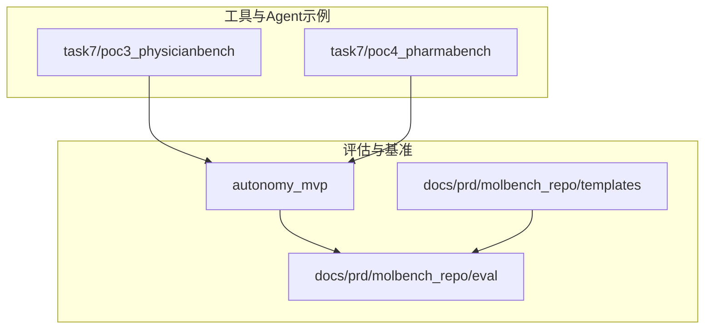
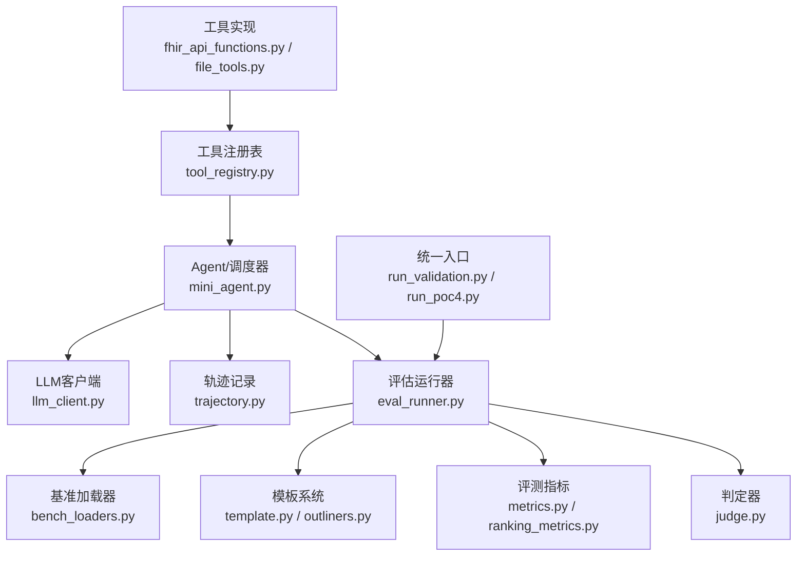
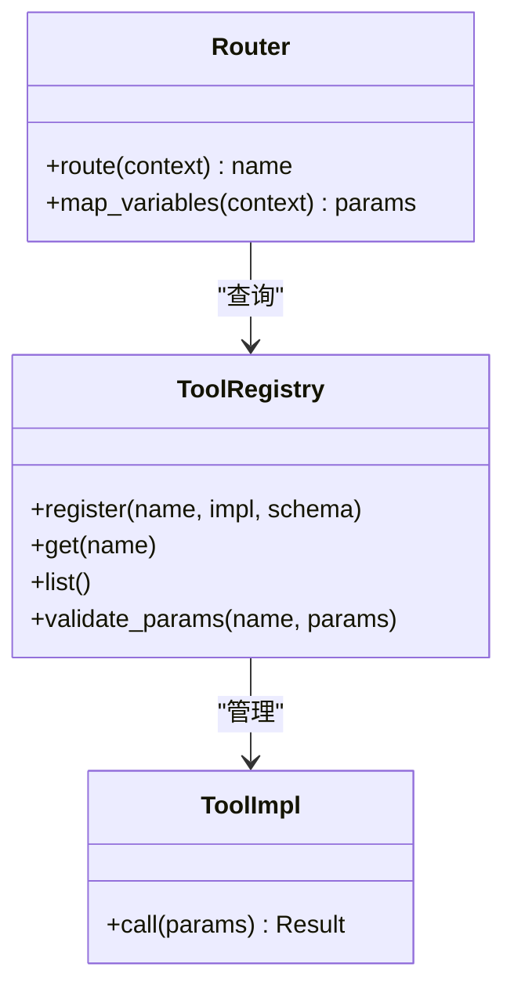
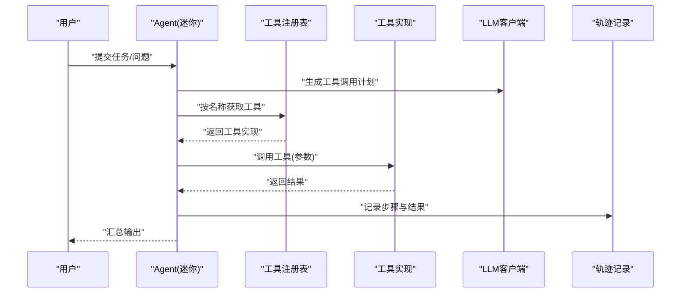
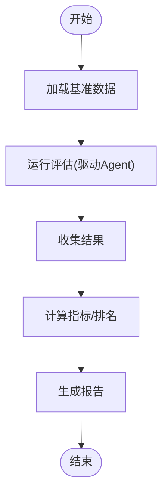
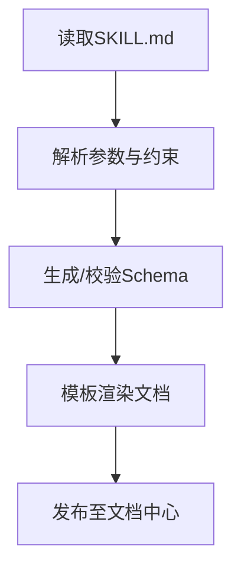
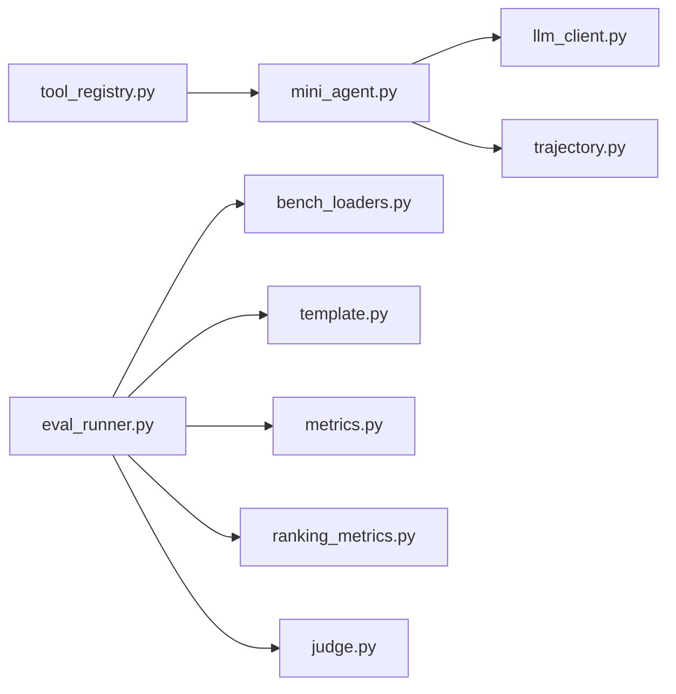

# 工具开发指南

<cite>
**本文引用的文件**   
- [autonomy_mvp/core/harness.py](file://autonomy_mvp/core/harness.py)
- [autonomy_mvp/core/judge.py](file://autonomy_mvp/core/judge.py)
- [autonomy_mvp/core/metrics.py](file://autonomy_mvp/core/metrics.py)
- [autonomy_mvp/core/ranking_metrics.py](file://autonomy_mvp/core/ranking_metrics.py)
- [autonomy_mvp/core/sim_agents.py](file://autonomy_mvp/core/sim_agents.py)
- [autonomy_mvp/core/tasks.py](file://autonomy_mvp/core/tasks.py)
- [autonomy_mvp/run_validation.py](file://autonomy_mvp/run_validation.py)
- [autonomy_mvp/tests/test_core.py](file://autonomy_mvp/tests/test_core.py)
- [autonomy_mvp/schema.md](file://autonomy_mvp/schema.md)
- [docs/prd/molbench_repo/eval/bench_loaders.py](file://docs/prd/molbench_repo/eval/bench_loaders.py)
- [docs/prd/molbench_repo/eval/eval_runner.py](file://docs/prd/molbench_repo/eval/eval_runner.py)
- [docs/prd/molbench_repo/eval/run_eval_bench.py](file://docs/prd/molbench_repo/eval/run_eval_bench.py)
- [docs/prd/molbench_repo/templates/template.py](file://docs/prd/molbench_repo/templates/template.py)
- [docs/prd/molbench_repo/templates/outliners.py](file://docs/prd/molbench_repo/templates/outliners.py)
- [docs/prd/molbench_repo/templates/tool_routing.md](file://docs/prd/molbench_repo/templates/tool_routing.md)
- [docs/prd/molbench_repo/templates/variable_routing.md](file://docs/prd/molbench_repo/templates/variable_routing.md)
- [task7/poc3_physicianbench/agent/tool_registry.py](file://task7/poc3_physicianbench/agent/tool_registry.py)
- [task7/poc3_physicianbench/agent/llm_client.py](file://task7/poc3_physicianbench/agent/llm_client.py)
- [task7/poc3_physicianbench/agent/mini_agent.py](file://task7/poc3_physicianbench/agent/mini_agent.py)
- [task7/poc3_physicianbench/agent/trajectory.py](file://task7/poc3_physicianbench/agent/trajectory.py)
- [task7/poc3_physicianbench/tools/fhir_api_functions.py](file://task7/poc3_physicianbench/tools/fhir_api_functions.py)
- [task7/poc3_physicianbench/tools/file_tools.py](file://task7/poc3_physicianbench/tools/file_tools.py)
- [task7/poc4_pharmabench/pyproject.toml](file://task7/poc4_pharmabench/pyproject.toml)
- [task7/poc4_pharmabench/run_poc4.py](file://task7/poc4_pharmabench/run_poc4.py)
- [task7/poc4_pharmabench/method.md](file://task7/poc4_pharmabench/method.md)
</cite>

## 目录
1. [简介](#简介)
2. [项目结构](#项目结构)
3. [核心组件](#核心组件)
4. [架构总览](#架构总览)
5. [详细组件分析](#详细组件分析)
6. [依赖关系分析](#依赖关系分析)
7. [性能考量](#性能考量)
8. [故障排除指南](#故障排除指南)
9. [结论](#结论)
10. [附录](#附录)

## 简介
本指南面向“工具”开发者，围绕以下目标提供系统化说明：
- 工具注册机制与接口规范
- 开发框架使用方法（以现有评估与Agent框架为参考）
- SKILL.md 编写规范、参数定义与文档生成机制
- 测试策略、调试技巧与性能分析方法
- 打包、部署与版本管理最佳实践
- 与核心框架的集成方式与扩展点使用
- 常见问题与排障建议

本指南基于仓库中已有的评估框架、模板系统、工具注册示例与任务执行脚本进行归纳总结，确保读者可据此快速上手并产出高质量工具。

## 项目结构
仓库采用多任务、多子项目的组织方式，关键与工具开发相关的目录包括：
- autonomy_mvp：核心评估与基准框架（任务、评测、指标、模拟Agent等）
- docs/prd/molbench_repo：工具与技能模板、评测运行器、加载器等
- task7/poc3_physicianbench：包含工具注册表、LLM客户端、最小Agent、轨迹记录与工具实现示例
- task7/poc4_pharmabench：包管理与运行入口示例

图表来源
- [autonomy_mvp/core/harness.py](file://autonomy_mvp/core/harness.py)
- [docs/prd/molbench_repo/eval/eval_runner.py](file://docs/prd/molbench_repo/eval/eval_runner.py)
- [docs/prd/molbench_repo/templates/template.py](file://docs/prd/molbench_repo/templates/template.py)
- [task7/poc3_physicianbench/agent/tool_registry.py](file://task7/poc3_physicianbench/agent/tool_registry.py)
- [task7/poc4_pharmabench/run_poc4.py](file://task7/poc4_pharmabench/run_poc4.py)

章节来源
- [autonomy_mvp/core/harness.py](file://autonomy_mvp/core/harness.py)
- [docs/prd/molbench_repo/eval/eval_runner.py](file://docs/prd/molbench_repo/eval/eval_runner.py)
- [docs/prd/molbench_repo/templates/template.py](file://docs/prd/molbench_repo/templates/template.py)
- [task7/poc3_physicianbench/agent/tool_registry.py](file://task7/poc3_physicianbench/agent/tool_registry.py)
- [task7/poc4_pharmabench/run_poc4.py](file://task7/poc4_pharmabench/run_poc4.py)

## 核心组件
本节聚焦与工具开发直接相关的核心模块与职责划分：
- 评估与基准框架（autonomy_mvp）
  - harness：编排任务执行、结果收集与汇总
  - judge：判定逻辑与评分规则
  - metrics/ranking_metrics：指标计算与排序方法
  - sim_agents：模拟Agent行为，便于离线验证
  - tasks：任务定义与数据加载
- 模板与文档生成（templates）
  - template/outliners：模板渲染与大纲生成
  - tool_routing/variable_routing：工具路由与变量映射
- 工具注册与调用（poc3_physicianbench）
  - tool_registry：工具注册表与发现机制
  - llm_client：与大模型交互的客户端封装
  - mini_agent：最小Agent，演示工具调用流程
  - trajectory：轨迹记录与分析
  - tools：具体工具实现（FHIR API、文件操作等）
- 包管理与运行（poc4_pharmabench）
  - pyproject.toml：依赖与元数据
  - run_poc4.py：统一入口与参数解析

章节来源
- [autonomy_mvp/core/harness.py](file://autonomy_mvp/core/harness.py)
- [autonomy_mvp/core/judge.py](file://autonomy_mvp/core/judge.py)
- [autonomy_mvp/core/metrics.py](file://autonomy_mvp/core/metrics.py)
- [autonomy_mvp/core/ranking_metrics.py](file://autonomy_mvp/core/ranking_metrics.py)
- [autonomy_mvp/core/sim_agents.py](file://autonomy_mvp/core/sim_agents.py)
- [autonomy_mvp/core/tasks.py](file://autonomy_mvp/core/tasks.py)
- [docs/prd/molbench_repo/templates/template.py](file://docs/prd/molbench_repo/templates/template.py)
- [docs/prd/molbench_repo/templates/outliners.py](file://docs/prd/molbench_repo/templates/outliners.py)
- [docs/prd/molbench_repo/templates/tool_routing.md](file://docs/prd/molbench_repo/templates/tool_routing.md)
- [docs/prd/molbench_repo/templates/variable_routing.md](file://docs/prd/molbench_repo/templates/variable_routing.md)
- [task7/poc3_physicianbench/agent/tool_registry.py](file://task7/poc3_physicianbench/agent/tool_registry.py)
- [task7/poc3_physicianbench/agent/llm_client.py](file://task7/poc3_physicianbench/agent/llm_client.py)
- [task7/poc3_physicianbench/agent/mini_agent.py](file://task7/poc3_physicianbench/agent/mini_agent.py)
- [task7/poc3_physicianbench/agent/trajectory.py](file://task7/poc3_physicianbench/agent/trajectory.py)
- [task7/poc3_physicianbench/tools/fhir_api_functions.py](file://task7/poc3_physicianbench/tools/fhir_api_functions.py)
- [task7/poc3_physicianbench/tools/file_tools.py](file://task7/poc3_physicianbench/tools/file_tools.py)
- [task7/poc4_pharmabench/pyproject.toml](file://task7/poc4_pharmabench/pyproject.toml)
- [task7/poc4_pharmabench/run_poc4.py](file://task7/poc4_pharmabench/run_poc4.py)

## 架构总览
下图展示了从“工具注册—路由—调用—评测—输出”的整体流程，以及各模块之间的依赖关系。

图表来源
- [task7/poc3_physicianbench/tools/fhir_api_functions.py](file://task7/poc3_physicianbench/tools/fhir_api_functions.py)
- [task7/poc3_physicianbench/tools/file_tools.py](file://task7/poc3_physicianbench/tools/file_tools.py)
- [task7/poc3_physicianbench/agent/tool_registry.py](file://task7/poc3_physicianbench/agent/tool_registry.py)
- [task7/poc3_physicianbench/agent/mini_agent.py](file://task7/poc3_physicianbench/agent/mini_agent.py)
- [task7/poc3_physicianbench/agent/llm_client.py](file://task7/poc3_physicianbench/agent/llm_client.py)
- [task7/poc3_physicianbench/agent/trajectory.py](file://task7/poc3_physicianbench/agent/trajectory.py)
- [docs/prd/molbench_repo/eval/eval_runner.py](file://docs/prd/molbench_repo/eval/eval_runner.py)
- [docs/prd/molbench_repo/eval/bench_loaders.py](file://docs/prd/molbench_repo/eval/bench_loaders.py)
- [docs/prd/molbench_repo/templates/template.py](file://docs/prd/molbench_repo/templates/template.py)
- [docs/prd/molbench_repo/templates/outliners.py](file://docs/prd/molbench_repo/templates/outliners.py)
- [autonomy_mvp/core/metrics.py](file://autonomy_mvp/core/metrics.py)
- [autonomy_mvp/core/ranking_metrics.py](file://autonomy_mvp/core/ranking_metrics.py)
- [autonomy_mvp/core/judge.py](file://autonomy_mvp/core/judge.py)
- [autonomy_mvp/run_validation.py](file://autonomy_mvp/run_validation.py)
- [task7/poc4_pharmabench/run_poc4.py](file://task7/poc4_pharmabench/run_poc4.py)

## 详细组件分析

### 工具注册机制与接口规范
- 注册表设计
  - 通过集中式注册表维护工具名称到实现的映射，支持动态发现与按需加载
  - 典型能力：注册、列出、获取、校验签名与参数
- 接口规范
  - 输入：结构化参数（键值对），类型与约束由注册表或工具描述声明
  - 输出：标准化结果对象（含状态码、消息、数据体）
  - 错误：异常应被捕获并转换为统一错误格式，便于上层处理与日志追踪
- 路由与变量映射
  - 工具路由根据上下文选择合适工具
  - 变量路由将外部变量注入到工具参数中，减少硬编码

图表来源
- [task7/poc3_physicianbench/agent/tool_registry.py](file://task7/poc3_physicianbench/agent/tool_registry.py)
- [docs/prd/molbench_repo/templates/tool_routing.md](file://docs/prd/molbench_repo/templates/tool_routing.md)
- [docs/prd/molbench_repo/templates/variable_routing.md](file://docs/prd/molbench_repo/templates/variable_routing.md)

章节来源
- [task7/poc3_physicianbench/agent/tool_registry.py](file://task7/poc3_physicianbench/agent/tool_registry.py)
- [docs/prd/molbench_repo/templates/tool_routing.md](file://docs/prd/molbench_repo/templates/tool_routing.md)
- [docs/prd/molbench_repo/templates/variable_routing.md](file://docs/prd/molbench_repo/templates/variable_routing.md)

### Agent与工具调用流程
- 最小Agent负责：
  - 接收用户意图或任务描述
  - 借助LLM客户端生成工具调用计划
  - 通过注册表查找并调用工具
  - 记录轨迹并返回结果
- LLM客户端封装了请求构造、重试与限流策略
- 轨迹记录用于回放与诊断

图表来源
- [task7/poc3_physicianbench/agent/mini_agent.py](file://task7/poc3_physicianbench/agent/mini_agent.py)
- [task7/poc3_physicianbench/agent/tool_registry.py](file://task7/poc3_physicianbench/agent/tool_registry.py)
- [task7/poc3_physicianbench/agent/llm_client.py](file://task7/poc3_physicianbench/agent/llm_client.py)
- [task7/poc3_physicianbench/agent/trajectory.py](file://task7/poc3_physicianbench/agent/trajectory.py)

章节来源
- [task7/poc3_physicianbench/agent/mini_agent.py](file://task7/poc3_physicianbench/agent/mini_agent.py)
- [task7/poc3_physicianbench/agent/tool_registry.py](file://task7/poc3_physicianbench/agent/tool_registry.py)
- [task7/poc3_physicianbench/agent/llm_client.py](file://task7/poc3_physicianbench/agent/llm_client.py)
- [task7/poc3_physicianbench/agent/trajectory.py](file://task7/poc3_physicianbench/agent/trajectory.py)

### 评测与基准框架
- 评估运行器负责：
  - 加载基准数据集
  - 驱动Agent执行任务
  - 收集结果并计算指标
  - 生成报告与可视化
- 基准加载器提供统一的数据读取接口
- 模板系统用于生成提示词、工具路由与变量映射
- 指标与排名模块提供多种度量与排序方法

图表来源
- [docs/prd/molbench_repo/eval/eval_runner.py](file://docs/prd/molbench_repo/eval/eval_runner.py)
- [docs/prd/molbench_repo/eval/bench_loaders.py](file://docs/prd/molbench_repo/eval/bench_loaders.py)
- [docs/prd/molbench_repo/templates/template.py](file://docs/prd/molbench_repo/templates/template.py)
- [autonomy_mvp/core/metrics.py](file://autonomy_mvp/core/metrics.py)
- [autonomy_mvp/core/ranking_metrics.py](file://autonomy_mvp/core/ranking_metrics.py)
- [autonomy_mvp/core/judge.py](file://autonomy_mvp/core/judge.py)

章节来源
- [docs/prd/molbench_repo/eval/eval_runner.py](file://docs/prd/molbench_repo/eval/eval_runner.py)
- [docs/prd/molbench_repo/eval/bench_loaders.py](file://docs/prd/molbench_repo/eval/bench_loaders.py)
- [docs/prd/molbench_repo/templates/template.py](file://docs/prd/molbench_repo/templates/template.py)
- [autonomy_mvp/core/metrics.py](file://autonomy_mvp/core/metrics.py)
- [autonomy_mvp/core/ranking_metrics.py](file://autonomy_mvp/core/ranking_metrics.py)
- [autonomy_mvp/core/judge.py](file://autonomy_mvp/core/judge.py)

### SKILL.md 编写规范、参数定义与文档生成
- 编写规范
  - 明确工具目的、适用场景与前置条件
  - 定义输入参数（名称、类型、默认值、约束）
  - 定义输出结构（字段、含义、单位）
  - 提供错误码与失败处理建议
  - 给出示例用法与边界情况
- 参数定义
  - 建议在注册表中声明schema，并在SKILL.md中保持一致
  - 使用变量路由将外部配置注入参数
- 文档生成
  - 模板系统可将SKILL.md与注册表信息渲染为统一文档
  - 工具路由与变量路由模板帮助自动生成调用说明

图表来源
- [docs/prd/molbench_repo/templates/template.py](file://docs/prd/molbench_repo/templates/template.py)
- [docs/prd/molbench_repo/templates/outliners.py](file://docs/prd/molbench_repo/templates/outliners.py)
- [docs/prd/molbench_repo/templates/tool_routing.md](file://docs/prd/molbench_repo/templates/tool_routing.md)
- [docs/prd/molbench_repo/templates/variable_routing.md](file://docs/prd/molbench_repo/templates/variable_routing.md)

章节来源
- [docs/prd/molbench_repo/templates/template.py](file://docs/prd/molbench_repo/templates/template.py)
- [docs/prd/molbench_repo/templates/outliners.py](file://docs/prd/molbench_repo/templates/outliners.py)
- [docs/prd/molbench_repo/templates/tool_routing.md](file://docs/prd/molbench_repo/templates/tool_routing.md)
- [docs/prd/molbench_repo/templates/variable_routing.md](file://docs/prd/molbench_repo/templates/variable_routing.md)

### 工具测试策略与调试技巧
- 单元测试
  - 针对每个工具的输入/输出进行断言
  - 覆盖正常路径、边界条件与异常分支
- 集成测试
  - 通过最小Agent与注册表端到端验证工具调用链
  - 使用模拟LLM客户端避免外部依赖
- 回归测试
  - 固定基准数据与随机种子，确保结果稳定
- 调试技巧
  - 启用轨迹记录，定位调用顺序与参数传递问题
  - 在注册表层打印工具清单与签名，辅助排查路由问题
  - 使用统一的错误格式，便于日志聚合与分析

章节来源
- [autonomy_mvp/tests/test_core.py](file://autonomy_mvp/tests/test_core.py)
- [task7/poc3_physicianbench/agent/trajectory.py](file://task7/poc3_physicianbench/agent/trajectory.py)
- [task7/poc3_physicianbench/agent/tool_registry.py](file://task7/poc3_physicianbench/agent/tool_registry.py)

### 性能分析与优化建议
- 指标采集
  - 在工具实现中埋点耗时、内存占用与I/O次数
  - 在评估运行器中汇总指标并生成性能报告
- 并行与缓存
  - 对无副作用的工具进行并发调用
  - 对重复查询结果进行缓存（注意失效策略）
- 资源限制
  - 设置超时与重试上限，防止长尾任务拖慢整体评估
- 基准对比
  - 使用ranking_metrics对不同实现进行排序与对比

章节来源
- [autonomy_mvp/core/metrics.py](file://autonomy_mvp/core/metrics.py)
- [autonomy_mvp/core/ranking_metrics.py](file://autonomy_mvp/core/ranking_metrics.py)
- [docs/prd/molbench_repo/eval/eval_runner.py](file://docs/prd/molbench_repo/eval/eval_runner.py)

### 打包、部署与版本管理最佳实践
- 包管理
  - 使用pyproject.toml声明依赖、元数据与构建配置
  - 锁定依赖版本，保证可复现性
- 入口与CLI
  - 提供统一入口脚本，解析参数并启动评估或工具服务
- 版本管理
  - 遵循语义化版本，变更时更新工具schema与文档
  - 在注册表中维护兼容性与弃用标记

章节来源
- [task7/poc4_pharmabench/pyproject.toml](file://task7/poc4_pharmabench/pyproject.toml)
- [task7/poc4_pharmabench/run_poc4.py](file://task7/poc4_pharmabench/run_poc4.py)

### 与核心框架的集成与扩展点
- 集成方式
  - 将工具实现注册到注册表，供Agent与评估框架发现
  - 遵循统一输入/输出格式，确保与评测指标兼容
- 扩展点
  - 自定义指标与排名方法，接入metrics与ranking_metrics
  - 扩展模板系统，生成领域特定的工具文档与提示词
  - 在评估运行器中插入钩子，实现自定义预处理/后处理

章节来源
- [autonomy_mvp/core/harness.py](file://autonomy_mvp/core/harness.py)
- [autonomy_mvp/core/judge.py](file://autonomy_mvp/core/judge.py)
- [autonomy_mvp/core/metrics.py](file://autonomy_mvp/core/metrics.py)
- [autonomy_mvp/core/ranking_metrics.py](file://autonomy_mvp/core/ranking_metrics.py)
- [docs/prd/molbench_repo/eval/eval_runner.py](file://docs/prd/molbench_repo/eval/eval_runner.py)
- [docs/prd/molbench_repo/templates/template.py](file://docs/prd/molbench_repo/templates/template.py)

## 依赖关系分析
下图展示关键模块间的依赖关系，有助于识别耦合点与潜在循环依赖。

图表来源
- [task7/poc3_physicianbench/agent/tool_registry.py](file://task7/poc3_physicianbench/agent/tool_registry.py)
- [task7/poc3_physicianbench/agent/mini_agent.py](file://task7/poc3_physicianbench/agent/mini_agent.py)
- [task7/poc3_physicianbench/agent/llm_client.py](file://task7/poc3_physicianbench/agent/llm_client.py)
- [task7/poc3_physicianbench/agent/trajectory.py](file://task7/poc3_physicianbench/agent/trajectory.py)
- [docs/prd/molbench_repo/eval/eval_runner.py](file://docs/prd/molbench_repo/eval/eval_runner.py)
- [docs/prd/molbench_repo/eval/bench_loaders.py](file://docs/prd/molbench_repo/eval/bench_loaders.py)
- [docs/prd/molbench_repo/templates/template.py](file://docs/prd/molbench_repo/templates/template.py)
- [autonomy_mvp/core/metrics.py](file://autonomy_mvp/core/metrics.py)
- [autonomy_mvp/core/ranking_metrics.py](file://autonomy_mvp/core/ranking_metrics.py)
- [autonomy_mvp/core/judge.py](file://autonomy_mvp/core/judge.py)

章节来源
- [task7/poc3_physicianbench/agent/tool_registry.py](file://task7/poc3_physicianbench/agent/tool_registry.py)
- [task7/poc3_physicianbench/agent/mini_agent.py](file://task7/poc3_physicianbench/agent/mini_agent.py)
- [task7/poc3_physicianbench/agent/llm_client.py](file://task7/poc3_physicianbench/agent/llm_client.py)
- [task7/poc3_physicianbench/agent/trajectory.py](file://task7/poc3_physicianbench/agent/trajectory.py)
- [docs/prd/molbench_repo/eval/eval_runner.py](file://docs/prd/molbench_repo/eval/eval_runner.py)
- [docs/prd/molbench_repo/eval/bench_loaders.py](file://docs/prd/molbench_repo/eval/bench_loaders.py)
- [docs/prd/molbench_repo/templates/template.py](file://docs/prd/molbench_repo/templates/template.py)
- [autonomy_mvp/core/metrics.py](file://autonomy_mvp/core/metrics.py)
- [autonomy_mvp/core/ranking_metrics.py](file://autonomy_mvp/core/ranking_metrics.py)
- [autonomy_mvp/core/judge.py](file://autonomy_mvp/core/judge.py)

## 性能考量
- 工具侧
  - 避免阻塞I/O；必要时异步化
  - 控制单次调用数据量，分块处理大对象
  - 合理设置超时与重试退避策略
- 评估侧
  - 批量加载基准数据，减少重复IO
  - 使用缓存命中热点查询
  - 并行执行独立任务，但需考虑资源竞争
- 监控与告警
  - 记录关键指标（延迟、吞吐、错误率）
  - 设定阈值触发告警，及时定位瓶颈

[本节为通用指导，不直接分析具体文件]

## 故障排除指南
- 工具未找到或路由失败
  - 检查注册表是否成功注册与命名一致性
  - 确认工具schema与调用参数匹配
- 参数校验失败
  - 核对SKILL.md与注册表schema的一致性
  - 使用变量路由前确保外部变量已正确注入
- LLM调用异常
  - 检查网络与认证配置
  - 增加重试与降级策略
- 评估结果不稳定
  - 固定随机种子与基准数据
  - 检查工具幂等性与缓存失效策略
- 性能退化
  - 查看轨迹与指标，定位慢调用
  - 引入并发与缓存，优化I/O路径

章节来源
- [task7/poc3_physicianbench/agent/tool_registry.py](file://task7/poc3_physicianbench/agent/tool_registry.py)
- [task7/poc3_physicianbench/agent/llm_client.py](file://task7/poc3_physicianbench/agent/llm_client.py)
- [task7/poc3_physicianbench/agent/trajectory.py](file://task7/poc3_physicianbench/agent/trajectory.py)
- [autonomy_mvp/core/metrics.py](file://autonomy_mvp/core/metrics.py)
- [autonomy_mvp/core/ranking_metrics.py](file://autonomy_mvp/core/ranking_metrics.py)

## 结论
通过统一的工具注册机制、清晰的接口规范与完善的模板与评测体系，开发者可以快速构建、集成与评估工具。结合严格的测试策略、性能分析与版本管理，能够持续提升工具质量与系统稳定性。建议在实际项目中持续完善SKILL.md与schema，保持文档与实现一致，并通过自动化流水线保障质量。

[本节为总结性内容，不直接分析具体文件]

## 附录
- 参考入口与脚本
  - 评估运行入口：run_validation.py
  - 包管理与运行：pyproject.toml、run_poc4.py
- 相关文档
  - 工具路由与变量路由模板：tool_routing.md、variable_routing.md
  - 模板系统与大纲生成：template.py、outliners.py
  - 基准加载器与评测运行器：bench_loaders.py、eval_runner.py
  - 指标与排名：metrics.py、ranking_metrics.py
  - 判定器：judge.py
  - 工具实现示例：fhir_api_functions.py、file_tools.py
  - Agent与注册表：mini_agent.py、tool_registry.py、llm_client.py、trajectory.py

章节来源
- [autonomy_mvp/run_validation.py](file://autonomy_mvp/run_validation.py)
- [task7/poc4_pharmabench/pyproject.toml](file://task7/poc4_pharmabench/pyproject.toml)
- [task7/poc4_pharmabench/run_poc4.py](file://task7/poc4_pharmabench/run_poc4.py)
- [docs/prd/molbench_repo/templates/tool_routing.md](file://docs/prd/molbench_repo/templates/tool_routing.md)
- [docs/prd/molbench_repo/templates/variable_routing.md](file://docs/prd/molbench_repo/templates/variable_routing.md)
- [docs/prd/molbench_repo/templates/template.py](file://docs/prd/molbench_repo/templates/template.py)
- [docs/prd/molbench_repo/templates/outliners.py](file://docs/prd/molbench_repo/templates/outliners.py)
- [docs/prd/molbench_repo/eval/bench_loaders.py](file://docs/prd/molbench_repo/eval/bench_loaders.py)
- [docs/prd/molbench_repo/eval/eval_runner.py](file://docs/prd/molbench_repo/eval/eval_runner.py)
- [autonomy_mvp/core/metrics.py](file://autonomy_mvp/core/metrics.py)
- [autonomy_mvp/core/ranking_metrics.py](file://autonomy_mvp/core/ranking_metrics.py)
- [autonomy_mvp/core/judge.py](file://autonomy_mvp/core/judge.py)
- [task7/poc3_physicianbench/tools/fhir_api_functions.py](file://task7/poc3_physicianbench/tools/fhir_api_functions.py)
- [task7/poc3_physicianbench/tools/file_tools.py](file://task7/poc3_physicianbench/tools/file_tools.py)
- [task7/poc3_physicianbench/agent/mini_agent.py](file://task7/poc3_physicianbench/agent/mini_agent.py)
- [task7/poc3_physicianbench/agent/tool_registry.py](file://task7/poc3_physicianbench/agent/tool_registry.py)
- [task7/poc3_physicianbench/agent/llm_client.py](file://task7/poc3_physicianbench/agent/llm_client.py)
- [task7/poc3_physicianbench/agent/trajectory.py](file://task7/poc3_physicianbench/agent/trajectory.py)