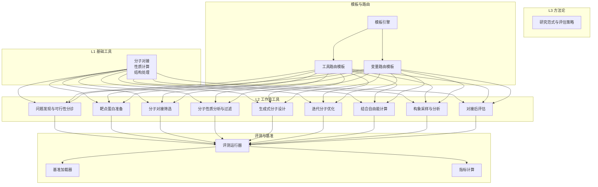
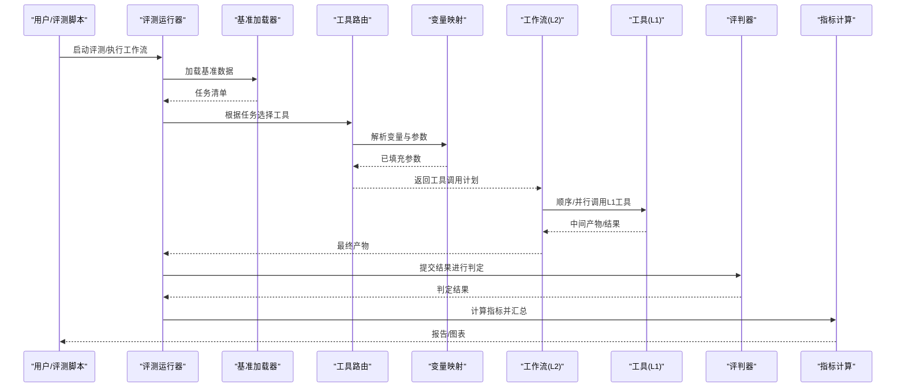
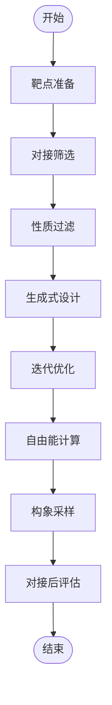
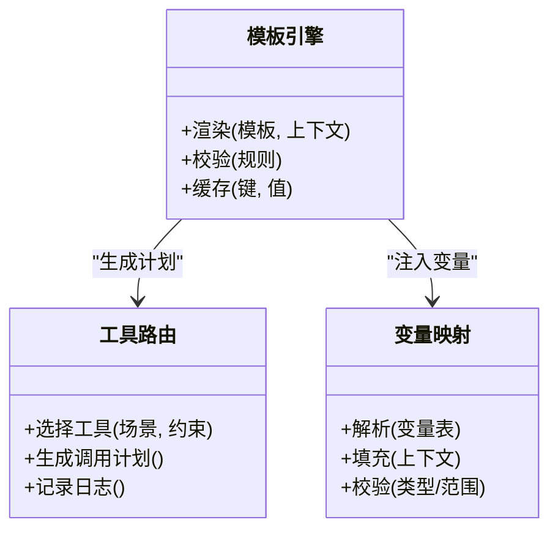
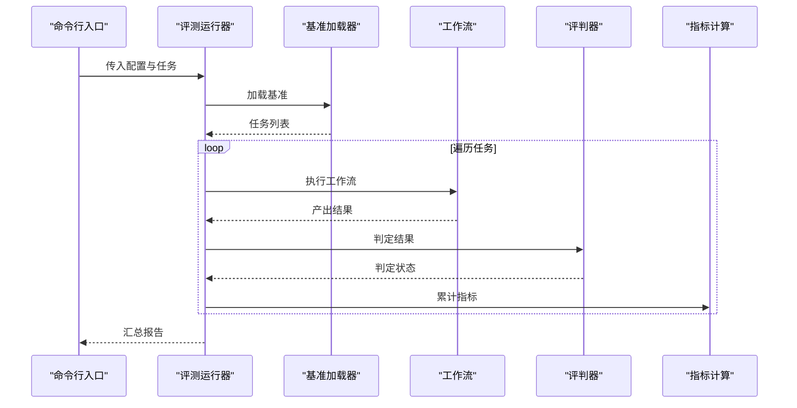
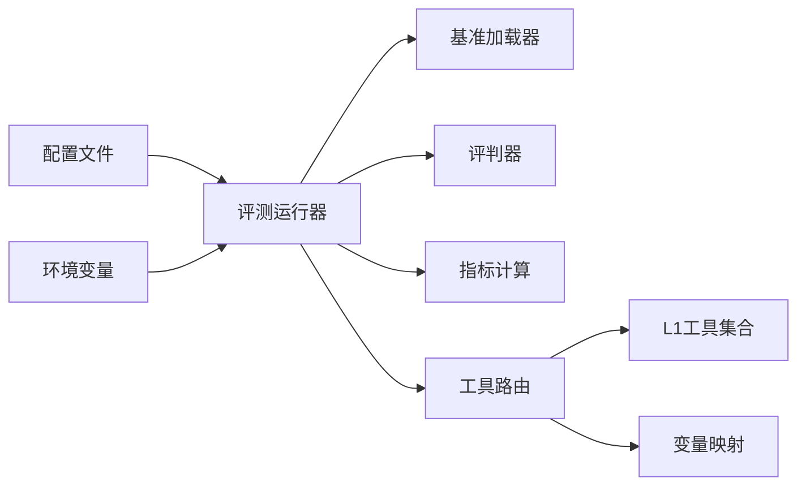

# 工具生态系统

<cite>
**本文引用的文件**   
- [docs/prd/molbench_repo/skills/L1_tools/README.md](file://docs/prd/molbench_repo/skills/L1_tools/README.md)
- [docs/prd/molbench_repo/skills/L2_workflows/00-problem-discovery-and-feasibility-triage.md](file://docs/prd/molbench_repo/skills/L2_workflows/00-problem-discovery-and-feasibility-triage.md)
- [docs/prd/molbench_repo/skills/L2_workflows/01-target-protein-preparation.md](file://docs/prd/molbench_repo/skills/L2_workflows/01-target-protein-preparation.md)
- [docs/prd/molbench_repo/skills/L2_workflows/02-molecular-docking-screening.md](file://docs/prd/molbench_repo/skills/L2_workflows/02-molecular-docking-screening.md)
- [docs/prd/molbench_repo/skills/L2_workflows/03-molecular-property-analysis-filtering.md](file://docs/prd/molbench_repo/skills/L2_workflows/03-molecular-property-analysis-filtering.md)
- [docs/prd/molbench_repo/skills/L2_workflows/04-generative-molecular-design.md](file://docs/prd/molbench_repo/skills/L2_workflows/04-generative-molecular-design.md)
- [docs/prd/molbench_repo/skills/L2_workflows/05-iterative-molecular-optimization.md](file://docs/prd/molbench_repo/skills/L2_workflows/05-iterative-molecular-optimization.md)
- [docs/prd/molbench_repo/skills/L2_workflows/06-binding-free-energy-calculation.md](file://docs/prd/molbench_repo/skills/L2_workflows/06-binding-free-energy-calculation.md)
- [docs/prd/molbench_repo/skills/L2_workflows/07-conformational-sampling-analysis.md](file://docs/prd/molbench_repo/skills/L2_workflows/07-conformational-sampling-analysis.md)
- [docs/prd/molbench_repo/skills/L2_workflows/08-post-docking-evaluation.md](file://docs/prd/molbench_repo/skills/L2_workflows/08-post-docking-evaluation.md)
- [docs/prd/molbench_repo/skills/L3_methodology/README.md](file://docs/prd/molbench_repo/skills/L3_methodology/README.md)
- [docs/prd/molbench_repo/templates/tool_routing.md](file://docs/prd/molbench_repo/templates/tool_routing.md)
- [docs/prd/molbench_repo/templates/variable_routing.md](file://docs/prd/molbench_repo/templates/variable_routing.md)
- [docs/prd/molbench_repo/templates/template.py](file://docs/prd/molbench_repo/templates/template.py)
- [docs/prd/molbench_repo/templates/outliners.py](file://docs/prd/molbench_repo/templates/outliners.py)
- [docs/prd/molbench_repo/config/baseline_molbench-ms-1.yaml](file://docs/prd/molbench_repo/config/baseline_molbench-ms-1.yaml)
- [docs/prd/molbench_repo/config/baseline_molbench-ms-2.yaml](file://docs/prd/molbench_repo/config/baseline_molbench-ms-2.yaml)
- [docs/prd/molbench_repo/config/baseline_molbench-ms-3.yaml](file://docs/prd/molbench_repo/config/baseline_molbench-ms-3.yaml)
- [docs/prd/molbench_repo/config/chemcot_mo_edit.yaml](file://docs/prd/molbench_repo/config/chemcot_mo_edit.yaml)
- [docs/prd/molbench_repo/config/chemcot_mo_opt.yaml](file://docs/prd/molbench_repo/config/chemcot_mo_opt.yaml)
- [docs/prd/molbench_repo/config/claude_template.yaml](file://docs/prd/molbench_repo/config/claude_template.yaml)
- [docs/prd/molbench_repo/env.template](file://docs/prd/molbench_repo/env.template)
- [docs/prd/molbench_repo/environment.yaml](file://docs/prd/molbench_repo/environment.yaml)
- [docs/prd/molbench_repo/eval/eval_runner.py](file://docs/prd/molbench_repo/eval/eval_runner.py)
- [docs/prd/molbench_repo/eval/bench_loaders.py](file://docs/prd/molbench_repo/eval/bench_loaders.py)
- [docs/prd/molbench_repo/eval/run_eval_bench.py](file://docs/prd/molbench_repo/eval/run_eval_bench.py)
- [autonomy_mvp/core/harness.py](file://autonomy_mvp/core/harness.py)
- [autonomy_mvp/core/judge.py](file://autonomy_mvp/core/judge.py)
- [autonomy_mvp/core/metrics.py](file://autonomy_mvp/core/metrics.py)
- [autonomy_mvp/core/tasks.py](file://autonomy_mvp/core/tasks.py)
- [autonomy_mvp/tests/test_core.py](file://autonomy_mvp/tests/test_core.py)
</cite>

## 目录
1. [简介](#简介)
2. [项目结构](#项目结构)
3. [核心组件](#核心组件)
4. [架构总览](#架构总览)
5. [详细组件分析](#详细组件分析)
6. [依赖关系分析](#依赖关系分析)
7. [性能考虑](#性能考虑)
8. [故障排查指南](#故障排查指南)
9. [结论](#结论)
10. [附录](#附录)

## 简介
本文件面向“工具生态系统”的构建与使用，围绕L1基础工具、L2工作流工具、L3方法论工具的层次化设计展开，系统阐述：
- 分层结构与职责边界
- 工具注册机制、调用接口与参数传递方式
- 工具开发指南、技能编写规范与集成测试方法
- 常用工具的使用示例、配置选项与性能优化建议
- 工具链组合与自定义工作流的构建方法

该体系以可插拔的工具集为核心，通过模板与路由将工具编排为可复用的工作流与方法论，支撑从分子筛选到自由能计算、构象采样等复杂科学任务。

## 项目结构
仓库采用“领域驱动+分层能力”的组织方式：
- L1基础工具：提供原子化的化学/生物信息学能力（如对接、性质计算、结构处理等）
- L2工作流工具：将多个L1工具按步骤编排成端到端流程（如靶点准备、对接筛选、生成式设计、迭代优化等）
- L3方法论：定义研究范式与评估策略，指导如何组合工作流完成完整课题
- 模板与路由：统一描述工具选择与变量传递，确保不同运行环境下的稳定编排
- 评测与基准：提供评测加载器、运行器与指标，用于验证工作流与方法论的效果

图表来源
- [docs/prd/molbench_repo/skills/L2_workflows/00-problem-discovery-and-feasibility-triage.md](file://docs/prd/molbench_repo/skills/L2_workflows/00-problem-discovery-and-feasibility-triage.md)
- [docs/prd/molbench_repo/skills/L2_workflows/01-target-protein-preparation.md](file://docs/prd/molbench_repo/skills/L2_workflows/01-target-protein-preparation.md)
- [docs/prd/molbench_repo/skills/L2_workflows/02-molecular-docking-screening.md](file://docs/prd/molbench_repo/skills/L2_workflows/02-molecular-docking-screening.md)
- [docs/prd/molbench_repo/skills/L2_workflows/03-molecular-property-analysis-filtering.md](file://docs/prd/molbench_repo/skills/L2_workflows/03-molecular-property-analysis-filtering.md)
- [docs/prd/molbench_repo/skills/L2_workflows/04-generative-molecular-design.md](file://docs/prd/molbench_repo/skills/L2_workflows/04-generative-molecular-design.md)
- [docs/prd/molbench_repo/skills/L2_workflows/05-iterative-molecular-optimization.md](file://docs/prd/molbench_repo/skills/L2_workflows/05-iterative-molecular-optimization.md)
- [docs/prd/molbench_repo/skills/L2_workflows/06-binding-free-energy-calculation.md](file://docs/prd/molbench_repo/skills/L2_workflows/06-binding-free-energy-calculation.md)
- [docs/prd/molbench_repo/skills/L2_workflows/07-conformational-sampling-analysis.md](file://docs/prd/molbench_repo/skills/L2_workflows/07-conformational-sampling-analysis.md)
- [docs/prd/molbench_repo/skills/L2_workflows/08-post-docking-evaluation.md](file://docs/prd/molbench_repo/skills/L2_workflows/08-post-docking-evaluation.md)
- [docs/prd/molbench_repo/templates/tool_routing.md](file://docs/prd/molbench_repo/templates/tool_routing.md)
- [docs/prd/molbench_repo/templates/variable_routing.md](file://docs/prd/molbench_repo/templates/variable_routing.md)
- [docs/prd/molbench_repo/templates/template.py](file://docs/prd/molbench_repo/templates/template.py)
- [docs/prd/molbench_repo/eval/eval_runner.py](file://docs/prd/molbench_repo/eval/eval_runner.py)
- [docs/prd/molbench_repo/eval/bench_loaders.py](file://docs/prd/molbench_repo/eval/bench_loaders.py)
- [docs/prd/molbench_repo/eval/run_eval_bench.py](file://docs/prd/molbench_repo/eval/run_eval_bench.py)

章节来源
- [docs/prd/molbench_repo/skills/L2_workflows/00-problem-discovery-and-feasibility-triage.md](file://docs/prd/molbench_repo/skills/L2_workflows/00-problem-discovery-and-feasibility-triage.md)
- [docs/prd/molbench_repo/skills/L2_workflows/01-target-protein-preparation.md](file://docs/prd/molbench_repo/skills/L2_workflows/01-target-protein-preparation.md)
- [docs/prd/molbench_repo/skills/L2_workflows/02-molecular-docking-screening.md](file://docs/prd/molbench_repo/skills/L2_workflows/02-molecular-docking-screening.md)
- [docs/prd/molbench_repo/skills/L2_workflows/03-molecular-property-analysis-filtering.md](file://docs/prd/molbench_repo/skills/L2_workflows/03-molecular-property-analysis-filtering.md)
- [docs/prd/molbench_repo/skills/L2_workflows/04-generative-molecular-design.md](file://docs/prd/molbench_repo/skills/L2_workflows/04-generative-molecular-design.md)
- [docs/prd/molbench_repo/skills/L2_workflows/05-iterative-molecular-optimization.md](file://docs/prd/molbench_repo/skills/L2_workflows/05-iterative-molecular-optimization.md)
- [docs/prd/molbench_repo/skills/L2_workflows/06-binding-free-energy-calculation.md](file://docs/prd/molbench_repo/skills/L2_workflows/06-binding-free-energy-calculation.md)
- [docs/prd/molbench_repo/skills/L2_workflows/07-conformational-sampling-analysis.md](file://docs/prd/molbench_repo/skills/L2_workflows/07-conformational-sampling-analysis.md)
- [docs/prd/molbench_repo/skills/L2_workflows/08-post-docking-evaluation.md](file://docs/prd/molbench_repo/skills/L2_workflows/08-post-docking-evaluation.md)
- [docs/prd/molbench_repo/templates/tool_routing.md](file://docs/prd/molbench_repo/templates/tool_routing.md)
- [docs/prd/molbench_repo/templates/variable_routing.md](file://docs/prd/molbench_repo/templates/variable_routing.md)
- [docs/prd/molbench_repo/templates/template.py](file://docs/prd/molbench_repo/templates/template.py)
- [docs/prd/molbench_repo/eval/eval_runner.py](file://docs/prd/molbench_repo/eval/eval_runner.py)
- [docs/prd/molbench_repo/eval/bench_loaders.py](file://docs/prd/molbench_repo/eval/bench_loaders.py)
- [docs/prd/molbench_repo/eval/run_eval_bench.py](file://docs/prd/molbench_repo/eval/run_eval_bench.py)

## 核心组件
- L1基础工具层
  - 职责：封装原子化能力，如分子对接、性质计算、结构修复、序列检索、可视化等
  - 设计原则：单一职责、输入输出明确、幂等性优先、错误可恢复
- L2工作流层
  - 职责：将L1工具按业务逻辑编排为可复用流程，支持条件分支、循环与并行
  - 设计原则：数据契约清晰、中间产物可追踪、失败重试与回滚
- L3方法论层
  - 职责：定义研究范式、评估指标与实验设计，指导工作流组合与结果解释
  - 设计原则：可重复、可对比、可审计
- 模板与路由
  - 职责：统一工具选择与变量传递规则，屏蔽底层差异
  - 设计原则：声明式配置、强类型校验、可扩展占位符
- 评测与基准
  - 职责：加载数据集、执行评测、汇总指标
  - 设计原则：解耦数据源与执行器、指标可插拔、日志可追溯

章节来源
- [docs/prd/molbench_repo/skills/L1_tools/README.md](file://docs/prd/molbench_repo/skills/L1_tools/README.md)
- [docs/prd/molbench_repo/skills/L3_methodology/README.md](file://docs/prd/molbench_repo/skills/L3_methodology/README.md)
- [docs/prd/molbench_repo/templates/tool_routing.md](file://docs/prd/molbench_repo/templates/tool_routing.md)
- [docs/prd/molbench_repo/templates/variable_routing.md](file://docs/prd/molbench_repo/templates/variable_routing.md)
- [docs/prd/molbench_repo/eval/eval_runner.py](file://docs/prd/molbench_repo/eval/eval_runner.py)
- [docs/prd/molbench_repo/eval/bench_loaders.py](file://docs/prd/molbench_repo/eval/bench_loaders.py)
- [docs/prd/molbench_repo/eval/run_eval_bench.py](file://docs/prd/molbench_repo/eval/run_eval_bench.py)

## 架构总览
整体架构遵循“工具即服务、工作流即编排、方法论即策略”的分层模型。模板与路由负责在运行时动态解析工具与变量，评测模块负责闭环验证与度量。

图表来源
- [docs/prd/molbench_repo/eval/eval_runner.py](file://docs/prd/molbench_repo/eval/eval_runner.py)
- [docs/prd/molbench_repo/eval/bench_loaders.py](file://docs/prd/molbench_repo/eval/bench_loaders.py)
- [docs/prd/molbench_repo/eval/run_eval_bench.py](file://docs/prd/molbench_repo/eval/run_eval_bench.py)
- [docs/prd/molbench_repo/templates/tool_routing.md](file://docs/prd/molbench_repo/templates/tool_routing.md)
- [docs/prd/molbench_repo/templates/variable_routing.md](file://docs/prd/molbench_repo/templates/variable_routing.md)
- [autonomy_mvp/core/judge.py](file://autonomy_mvp/core/judge.py)
- [autonomy_mvp/core/metrics.py](file://autonomy_mvp/core/metrics.py)

## 详细组件分析

### L1基础工具层
- 典型能力
  - 分子对接与评分
  - 分子性质与拓扑计算
  - 蛋白质结构准备与修复
  - 序列/结构检索与比对
  - 可视化与交互
- 设计要点
  - 输入输出采用标准化数据结构（如SMILES/PDB/JSON）
  - 错误码与异常信息结构化，便于重试与诊断
  - 资源隔离与并发控制（GPU/CPU/内存）

章节来源
- [docs/prd/molbench_repo/skills/L1_tools/README.md](file://docs/prd/molbench_repo/skills/L1_tools/README.md)

### L2工作流工具层
- 关键工作流
  - 问题发现与可行性分诊：快速评估目标可行性与风险
  - 靶点蛋白准备：结构清洗、加氢、缺失原子补全
  - 分子对接筛选：批量对接、打分排序、初筛候选
  - 分子性质分析与过滤：ADMET、理化性质、类药性
  - 生成式分子设计：基于约束的生成与多样性控制
  - 迭代分子优化：反馈驱动的优化循环
  - 结合自由能计算：MM-PBSA/GBSA或更精确方法
  - 构象采样与分析：MD采样、聚类、稳定性评估
  - 对接后评估：结合模式分析、相互作用指纹
- 编排原则
  - 数据契约：每步输入/输出严格定义
  - 容错与重试：单步失败不影响全局时局部重试
  - 可观测性：中间产物落盘、关键指标上报

图表来源
- [docs/prd/molbench_repo/skills/L2_workflows/01-target-protein-preparation.md](file://docs/prd/molbench_repo/skills/L2_workflows/01-target-protein-preparation.md)
- [docs/prd/molbench_repo/skills/L2_workflows/02-molecular-docking-screening.md](file://docs/prd/molbench_repo/skills/L2_workflows/02-molecular-docking-screening.md)
- [docs/prd/molbench_repo/skills/L2_workflows/03-molecular-property-analysis-filtering.md](file://docs/prd/molbench_repo/skills/L2_workflows/03-molecular-property-analysis-filtering.md)
- [docs/prd/molbench_repo/skills/L2_workflows/04-generative-molecular-design.md](file://docs/prd/molbench_repo/skills/L2_workflows/04-generative-molecular-design.md)
- [docs/prd/molbench_repo/skills/L2_workflows/05-iterative-molecular-optimization.md](file://docs/prd/molbench_repo/skills/L2_workflows/05-iterative-molecular-optimization.md)
- [docs/prd/molbench_repo/skills/L2_workflows/06-binding-free-energy-calculation.md](file://docs/prd/molbench_repo/skills/L2_workflows/06-binding-free-energy-calculation.md)
- [docs/prd/molbench_repo/skills/L2_workflows/07-conformational-sampling-analysis.md](file://docs/prd/molbench_repo/skills/L2_workflows/07-conformational-sampling-analysis.md)
- [docs/prd/molbench_repo/skills/L2_workflows/08-post-docking-evaluation.md](file://docs/prd/molbench_repo/skills/L2_workflows/08-post-docking-evaluation.md)

章节来源
- [docs/prd/molbench_repo/skills/L2_workflows/00-problem-discovery-and-feasibility-triage.md](file://docs/prd/molbench_repo/skills/L2_workflows/00-problem-discovery-and-feasibility-triage.md)
- [docs/prd/molbench_repo/skills/L2_workflows/01-target-protein-preparation.md](file://docs/prd/molbench_repo/skills/L2_workflows/01-target-protein-preparation.md)
- [docs/prd/molbench_repo/skills/L2_workflows/02-molecular-docking-screening.md](file://docs/prd/molbench_repo/skills/L2_workflows/02-molecular-docking-screening.md)
- [docs/prd/molbench_repo/skills/L2_workflows/03-molecular-property-analysis-filtering.md](file://docs/prd/molbench_repo/skills/L2_workflows/03-molecular-property-analysis-filtering.md)
- [docs/prd/molbench_repo/skills/L2_workflows/04-generative-molecular-design.md](file://docs/prd/molbench_repo/skills/L2_workflows/04-generative-molecular-design.md)
- [docs/prd/molbench_repo/skills/L2_workflows/05-iterative-molecular-optimization.md](file://docs/prd/molbench_repo/skills/L2_workflows/05-iterative-molecular-optimization.md)
- [docs/prd/molbench_repo/skills/L2_workflows/06-binding-free-energy-calculation.md](file://docs/prd/molbench_repo/skills/L2_workflows/06-binding-free-energy-calculation.md)
- [docs/prd/molbench_repo/skills/L2_workflows/07-conformational-sampling-analysis.md](file://docs/prd/molbench_repo/skills/L2_workflows/07-conformational-sampling-analysis.md)
- [docs/prd/molbench_repo/skills/L2_workflows/08-post-docking-evaluation.md](file://docs/prd/molbench_repo/skills/L2_workflows/08-post-docking-evaluation.md)

### L3方法论层
- 作用：定义研究范式、评估维度与实验设计，指导工作流组合与结果解读
- 内容：包括基线方案、对比策略、指标体系与可重复性要求

章节来源
- [docs/prd/molbench_repo/skills/L3_methodology/README.md](file://docs/prd/molbench_repo/skills/L3_methodology/README.md)

### 模板与路由
- 工具路由模板：声明式指定在不同场景下选择哪些工具及优先级
- 变量路由模板：定义变量来源、默认值、校验规则与替换策略
- 模板引擎：渲染模板、注入上下文、生成可执行计划

图表来源
- [docs/prd/molbench_repo/templates/tool_routing.md](file://docs/prd/molbench_repo/templates/tool_routing.md)
- [docs/prd/molbench_repo/templates/variable_routing.md](file://docs/prd/molbench_repo/templates/variable_routing.md)
- [docs/prd/molbench_repo/templates/template.py](file://docs/prd/molbench_repo/templates/template.py)
- [docs/prd/molbench_repo/templates/outliners.py](file://docs/prd/molbench_repo/templates/outliners.py)

章节来源
- [docs/prd/molbench_repo/templates/tool_routing.md](file://docs/prd/molbench_repo/templates/tool_routing.md)
- [docs/prd/molbench_repo/templates/variable_routing.md](file://docs/prd/molbench_repo/templates/variable_routing.md)
- [docs/prd/molbench_repo/templates/template.py](file://docs/prd/molbench_repo/templates/template.py)
- [docs/prd/molbench_repo/templates/outliners.py](file://docs/prd/molbench_repo/templates/outliners.py)

### 评测与基准
- 评测运行器：协调数据加载、工作流执行、结果收集与报告生成
- 基准加载器：读取任务清单与样本，支持多格式与分批
- 指标计算：聚合结果、统计显著性、可视化输出

图表来源
- [docs/prd/molbench_repo/eval/run_eval_bench.py](file://docs/prd/molbench_repo/eval/run_eval_bench.py)
- [docs/prd/molbench_repo/eval/eval_runner.py](file://docs/prd/molbench_repo/eval/eval_runner.py)
- [docs/prd/molbench_repo/eval/bench_loaders.py](file://docs/prd/molbench_repo/eval/bench_loaders.py)
- [autonomy_mvp/core/judge.py](file://autonomy_mvp/core/judge.py)
- [autonomy_mvp/core/metrics.py](file://autonomy_mvp/core/metrics.py)

章节来源
- [docs/prd/molbench_repo/eval/run_eval_bench.py](file://docs/prd/molbench_repo/eval/run_eval_bench.py)
- [docs/prd/molbench_repo/eval/eval_runner.py](file://docs/prd/molbench_repo/eval/eval_runner.py)
- [docs/prd/molbench_repo/eval/bench_loaders.py](file://docs/prd/molbench_repo/eval/bench_loaders.py)
- [autonomy_mvp/core/judge.py](file://autonomy_mvp/core/judge.py)
- [autonomy_mvp/core/metrics.py](file://autonomy_mvp/core/metrics.py)

## 依赖关系分析
- 组件耦合
  - 评测运行器依赖基准加载器与指标计算模块
  - 工作流依赖模板与路由进行工具选择与参数注入
  - L2工作流依赖L1工具实现具体能力
- 外部依赖
  - 配置文件与环境变量管理
  - 第三方科学计算库（对接、MD、性质计算等）

图表来源
- [docs/prd/molbench_repo/config/baseline_molbench-ms-1.yaml](file://docs/prd/molbench_repo/config/baseline_molbench-ms-1.yaml)
- [docs/prd/molbench_repo/config/baseline_molbench-ms-2.yaml](file://docs/prd/molbench_repo/config/baseline_molbench-ms-2.yaml)
- [docs/prd/molbench_repo/config/baseline_molbench-ms-3.yaml](file://docs/prd/molbench_repo/config/baseline_molbench-ms-3.yaml)
- [docs/prd/molbench_repo/config/chemcot_mo_edit.yaml](file://docs/prd/molbench_repo/config/chemcot_mo_edit.yaml)
- [docs/prd/molbench_repo/config/chemcot_mo_opt.yaml](file://docs/prd/molbench_repo/config/chemcot_mo_opt.yaml)
- [docs/prd/molbench_repo/config/claude_template.yaml](file://docs/prd/molbench_repo/config/claude_template.yaml)
- [docs/prd/molbench_repo/env.template](file://docs/prd/molbench_repo/env.template)
- [docs/prd/molbench_repo/environment.yaml](file://docs/prd/molbench_repo/environment.yaml)
- [docs/prd/molbench_repo/eval/eval_runner.py](file://docs/prd/molbench_repo/eval/eval_runner.py)
- [docs/prd/molbench_repo/eval/bench_loaders.py](file://docs/prd/molbench_repo/eval/bench_loaders.py)
- [docs/prd/molbench_repo/eval/run_eval_bench.py](file://docs/prd/molbench_repo/eval/run_eval_bench.py)
- [docs/prd/molbench_repo/templates/tool_routing.md](file://docs/prd/molbench_repo/templates/tool_routing.md)
- [docs/prd/molbench_repo/templates/variable_routing.md](file://docs/prd/molbench_repo/templates/variable_routing.md)

章节来源
- [docs/prd/molbench_repo/config/baseline_molbench-ms-1.yaml](file://docs/prd/molbench_repo/config/baseline_molbench-ms-1.yaml)
- [docs/prd/molbench_repo/config/baseline_molbench-ms-2.yaml](file://docs/prd/molbench_repo/config/baseline_molbench-ms-2.yaml)
- [docs/prd/molbench_repo/config/baseline_molbench-ms-3.yaml](file://docs/prd/molbench_repo/config/baseline_molbench-ms-3.yaml)
- [docs/prd/molbench_repo/config/chemcot_mo_edit.yaml](file://docs/prd/molbench_repo/config/chemcot_mo_edit.yaml)
- [docs/prd/molbench_repo/config/chemcot_mo_opt.yaml](file://docs/prd/molbench_repo/config/chemcot_mo_opt.yaml)
- [docs/prd/molbench_repo/config/claude_template.yaml](file://docs/prd/molbench_repo/config/claude_template.yaml)
- [docs/prd/molbench_repo/env.template](file://docs/prd/molbench_repo/env.template)
- [docs/prd/molbench_repo/environment.yaml](file://docs/prd/molbench_repo/environment.yaml)
- [docs/prd/molbench_repo/eval/eval_runner.py](file://docs/prd/molbench_repo/eval/eval_runner.py)
- [docs/prd/molbench_repo/eval/bench_loaders.py](file://docs/prd/molbench_repo/eval/bench_loaders.py)
- [docs/prd/molbench_repo/eval/run_eval_bench.py](file://docs/prd/molbench_repo/eval/run_eval_bench.py)
- [docs/prd/molbench_repo/templates/tool_routing.md](file://docs/prd/molbench_repo/templates/tool_routing.md)
- [docs/prd/molbench_repo/templates/variable_routing.md](file://docs/prd/molbench_repo/templates/variable_routing.md)

## 性能考虑
- 并行与批处理
  - 对接与性质计算适合大规模并行；注意GPU显存与队列长度
  - 工作流内可并行独立步骤，串行依赖需保证数据一致性
- 缓存与中间产物
  - 对昂贵计算结果进行缓存，避免重复计算
  - 中间产物命名规范与版本化，便于回溯与增量更新
- I/O与存储
  - 大文件读写采用流式与压缩；合理设置临时目录与清理策略
- 资源隔离
  - 容器化或沙箱隔离，限制CPU/GPU/内存上限，防止资源争用
- 监控与告警
  - 关键步骤耗时与失败率上报，阈值触发告警与自动重试

[本节为通用指导，不直接分析具体文件]

## 故障排查指南
- 常见问题定位
  - 工具调用失败：检查工具路由与变量映射是否正确，确认依赖环境与权限
  - 工作流中断：查看中间产物与日志，定位失败步骤与原因
  - 指标异常：核对评判器规则与指标计算逻辑，确认输入数据完整性
- 调试建议
  - 启用详细日志与TraceID，串联跨模块调用
  - 小样本回归测试，逐步扩大规模
  - 使用最小可复现配置与数据子集

章节来源
- [autonomy_mvp/core/judge.py](file://autonomy_mvp/core/judge.py)
- [autonomy_mvp/core/metrics.py](file://autonomy_mvp/core/metrics.py)
- [autonomy_mvp/tests/test_core.py](file://autonomy_mvp/tests/test_core.py)

## 结论
本工具生态系统通过清晰的三层架构与模板化路由，实现了从原子化工具到端到端工作流再到方法论的统一编排。配合评测与基准体系，能够高效支撑复杂科学任务的自动化执行与可重复验证。建议在持续演进中强化错误恢复、可观测性与性能优化，进一步提升系统的鲁棒性与扩展性。

[本节为总结性内容，不直接分析具体文件]

## 附录

### 工具注册机制与调用接口
- 注册方式
  - 通过工具路由模板声明工具名称、版本、适用场景与优先级
  - 环境变量与配置文件注入运行时参数
- 调用接口
  - 统一入口由评测运行器与工作流编排器提供
  - 参数通过变量映射模板注入，支持类型校验与默认值
- 参数传递
  - 采用结构化数据（JSON/对象），字段名与类型在模板中约定
  - 支持路径引用与上下文变量，减少冗余复制

章节来源
- [docs/prd/molbench_repo/templates/tool_routing.md](file://docs/prd/molbench_repo/templates/tool_routing.md)
- [docs/prd/molbench_repo/templates/variable_routing.md](file://docs/prd/molbench_repo/templates/variable_routing.md)
- [docs/prd/molbench_repo/templates/template.py](file://docs/prd/molbench_repo/templates/template.py)
- [docs/prd/molbench_repo/config/claude_template.yaml](file://docs/prd/molbench_repo/config/claude_template.yaml)

### 工具开发指南与技能编写规范
- 开发规范
  - 输入输出遵循标准格式，错误码与消息结构化
  - 幂等性优先，支持重试与断点续跑
  - 文档完善：用途、参数、返回值、依赖与示例
- 技能编写
  - 每个技能对应一个工作流或工具包，包含元数据与依赖声明
  - 提供最小可用示例与回归测试用例
- 集成测试
  - 单元测试覆盖核心逻辑
  - 集成测试模拟真实数据与外部依赖，验证端到端流程

章节来源
- [docs/prd/molbench_repo/skills/L1_tools/README.md](file://docs/prd/molbench_repo/skills/L1_tools/README.md)
- [docs/prd/molbench_repo/skills/L2_workflows/00-problem-discovery-and-feasibility-triage.md](file://docs/prd/molbench_repo/skills/L2_workflows/00-problem-discovery-and-feasibility-triage.md)
- [autonomy_mvp/tests/test_core.py](file://autonomy_mvp/tests/test_core.py)

### 常用工具使用示例与配置选项
- 使用示例
  - 对接筛选：配置靶点与配体库，设定打分阈值与并行度
  - 性质过滤：选择指标与阈值，输出候选集
  - 自由能计算：设置采样时长与力场参数，输出ΔG与误差估计
- 配置选项
  - 通过YAML配置文件集中管理参数，区分环境（开发/测试/生产）
  - 环境变量覆盖敏感信息与路径

章节来源
- [docs/prd/molbench_repo/config/baseline_molbench-ms-1.yaml](file://docs/prd/molbench_repo/config/baseline_molbench-ms-1.yaml)
- [docs/prd/molbench_repo/config/baseline_molbench-ms-2.yaml](file://docs/prd/molbench_repo/config/baseline_molbench-ms-2.yaml)
- [docs/prd/molbench_repo/config/baseline_molbench-ms-3.yaml](file://docs/prd/molbench_repo/config/baseline_molbench-ms-3.yaml)
- [docs/prd/molbench_repo/config/chemcot_mo_edit.yaml](file://docs/prd/molbench_repo/config/chemcot_mo_edit.yaml)
- [docs/prd/molbench_repo/config/chemcot_mo_opt.yaml](file://docs/prd/molbench_repo/config/chemcot_mo_opt.yaml)
- [docs/prd/molbench_repo/env.template](file://docs/prd/molbench_repo/env.template)
- [docs/prd/molbench_repo/environment.yaml](file://docs/prd/molbench_repo/environment.yaml)

### 工具链组合与自定义工作流构建
- 组合方法
  - 在工作流模板中声明步骤顺序、条件分支与并行区域
  - 使用变量路由将上游输出绑定到下游输入
- 自定义构建
  - 新增L1工具后，在路由模板中注册并定义参数契约
  - 编写新工作流技能，提供示例数据与评测脚本
  - 通过评测运行器验证端到端效果与指标

章节来源
- [docs/prd/molbench_repo/skills/L2_workflows/02-molecular-docking-screening.md](file://docs/prd/molbench_repo/skills/L2_workflows/02-molecular-docking-screening.md)
- [docs/prd/molbench_repo/skills/L2_workflows/05-iterative-molecular-optimization.md](file://docs/prd/molbench_repo/skills/L2_workflows/05-iterative-molecular-optimization.md)
- [docs/prd/molbench_repo/templates/tool_routing.md](file://docs/prd/molbench_repo/templates/tool_routing.md)
- [docs/prd/molbench_repo/templates/variable_routing.md](file://docs/prd/molbench_repo/templates/variable_routing.md)
- [docs/prd/molbench_repo/eval/run_eval_bench.py](file://docs/prd/molbench_repo/eval/run_eval_bench.py)