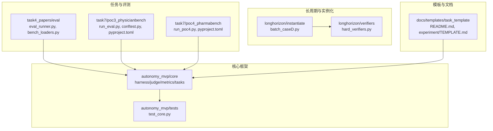
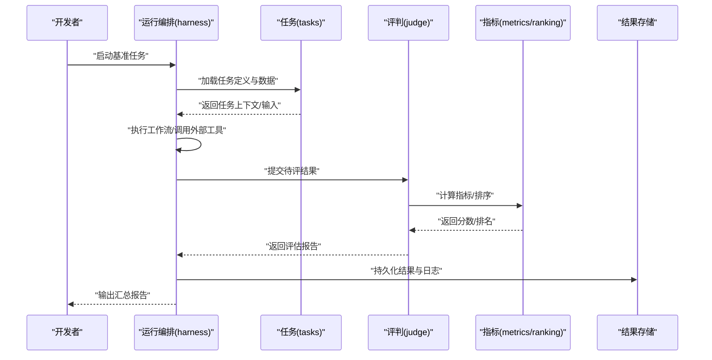
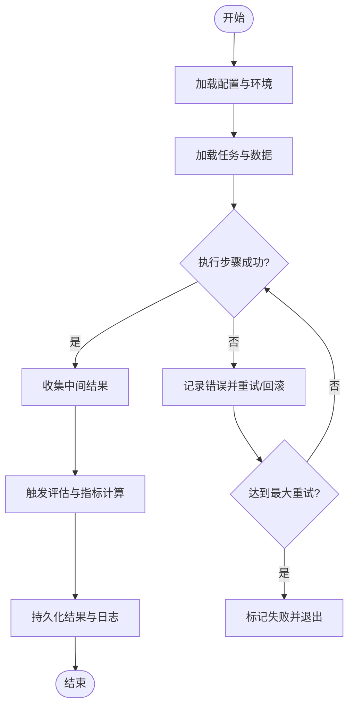
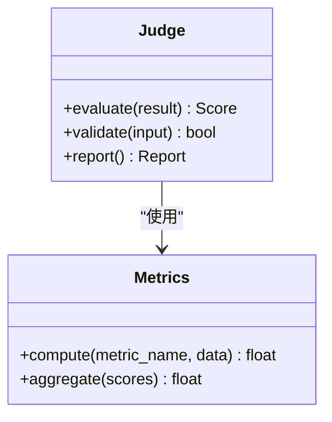
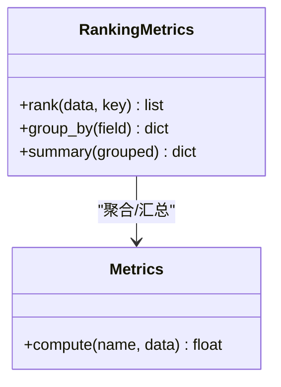
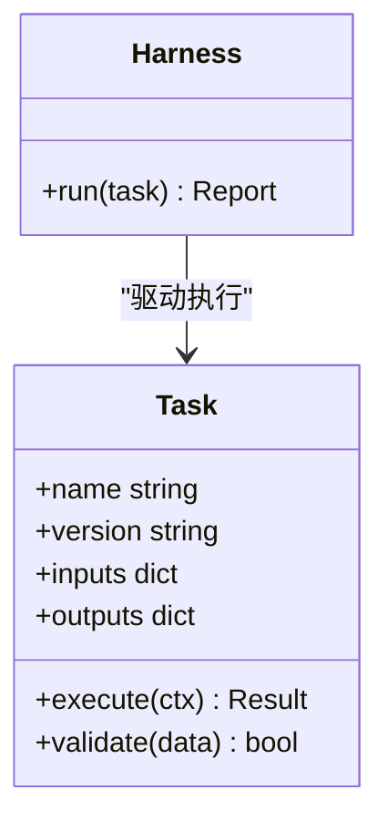
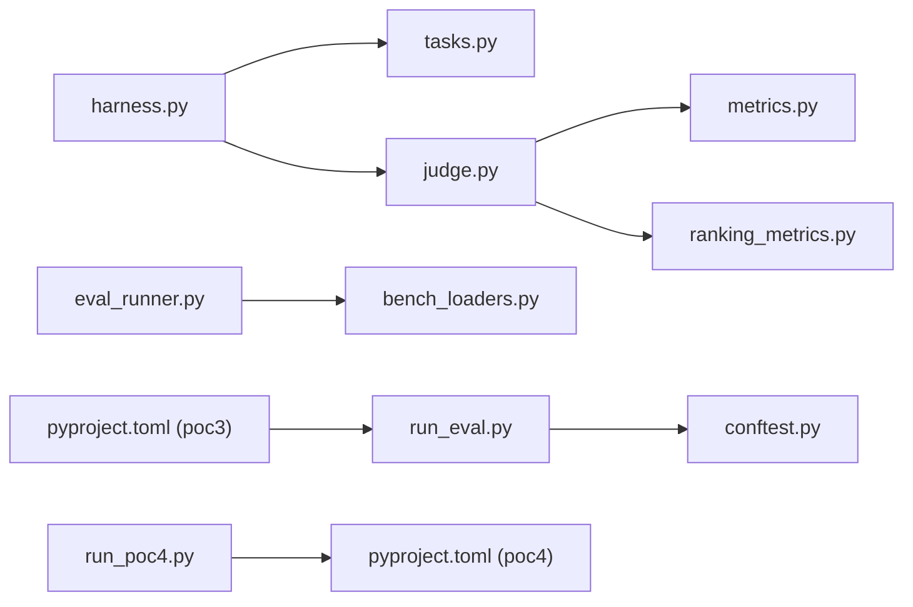

# 开发指南

<cite>
**本文引用的文件**   
- [autonomy_mvp/core/harness.py](file://autonomy_mvp/core/harness.py)
- [autonomy_mvp/core/judge.py](file://autonomy_mvp/core/judge.py)
- [autonomy_mvp/core/metrics.py](file://autonomy_mvp/core/metrics.py)
- [autonomy_mvp/core/ranking_metrics.py](file://autonomy_mvp/core/ranking_metrics.py)
- [autonomy_mvp/core/tasks.py](file://autonomy_mvp/core/tasks.py)
- [autonomy_mvp/tests/test_core.py](file://autonomy_mvp/tests/test_core.py)
- [longhorizon/instantiate/batch_caseD.py](file://longhorizon/instantiate/batch_caseD.py)
- [longhorizon/verifiers/hard_verifiers.py](file://longhorizon/verifiers/hard_verifiers.py)
- [task4_papers/eval/eval_runner.py](file://docs/prd/molbench_repo/eval/eval_runner.py)
- [task4_papers/eval/bench_loaders.py](file://docs/prd/molbench_repo/eval/bench_loaders.py)
- [task4_papers/skills/L1_tools/molclaw-mol-basic-metrics/__init__.py](file://docs/prd/molbench_repo/skills/L1_tools/molclaw-mol-basic-metrics/__init__.py)
- [task7/poc3_physicianbench/scripts/run_eval.py](file://task7/poc3_physicianbench/scripts/run_eval.py)
- [task7/poc3_physicianbench/pyproject.toml](file://task7/poc3_physicianbench/pyproject.toml)
- [task7/poc3_physicianbench/conftest.py](file://task7/poc3_physicianbench/conftest.py)
- [task7/poc4_pharmabench/run_poc4.py](file://task7/poc4_pharmabench/run_poc4.py)
- [task7/poc4_pharmabench/pyproject.toml](file://task7/poc4_pharmabench/pyproject.toml)
- [docs/templates/task_template/README.md](file://docs/templates/task_template/README.md)
- [docs/templates/task_template/experiment/TEMPLATE.md](file://docs/templates/task_template/experiment/TEMPLATE.md)
</cite>

## 目录
1. [简介](#简介)
2. [项目结构](#项目结构)
3. [核心组件](#核心组件)
4. [架构总览](#架构总览)
5. [详细组件分析](#详细组件分析)
6. [依赖分析](#依赖分析)
7. [性能考虑](#性能考虑)
8. [故障排查指南](#故障排查指南)
9. [结论](#结论)
10. [附录](#附录)

## 简介
本指南面向科学计算基准测试框架的开发者，提供从代码规范、开发流程到贡献准则的系统化说明。内容覆盖测试策略（单元测试与集成测试）、调试技巧、性能分析与日志记录最佳实践；并提供新工具开发、自定义评估器与任务创建的完整教程；同时给出代码审查流程、版本控制与发布管理建议，以及常见问题解答与社区资源指引。

## 项目结构
仓库采用“多任务/多子项目”组织方式：
- 核心基准框架位于 autonomy_mvp，包含运行编排、评判、指标与任务定义等核心能力。
- 长周期案例与实例化脚本位于 longhorizon，提供批处理与验证器示例。
- 多个任务目录（task1~task7）承载具体实验、数据与评测脚本。
- docs 下包含模板、配方与样例工程，便于复用与扩展。

图表来源
- [autonomy_mvp/core/harness.py](file://autonomy_mvp/core/harness.py)
- [autonomy_mvp/core/judge.py](file://autonomy_mvp/core/judge.py)
- [autonomy_mvp/core/metrics.py](file://autonomy_mvp/core/metrics.py)
- [autonomy_mvp/core/tasks.py](file://autonomy_mvp/core/tasks.py)
- [autonomy_mvp/tests/test_core.py](file://autonomy_mvp/tests/test_core.py)
- [longhorizon/instantiate/batch_caseD.py](file://longhorizon/instantiate/batch_caseD.py)
- [longhorizon/verifiers/hard_verifiers.py](file://longhorizon/verifiers/hard_verifiers.py)
- [docs/prd/molbench_repo/eval/eval_runner.py](file://docs/prd/molbench_repo/eval/eval_runner.py)
- [docs/prd/molbench_repo/eval/bench_loaders.py](file://docs/prd/molbench_repo/eval/bench_loaders.py)
- [task7/poc3_physicianbench/scripts/run_eval.py](file://task7/poc3_physicianbench/scripts/run_eval.py)
- [task7/poc3_physicianbench/conftest.py](file://task7/poc3_physicianbench/conftest.py)
- [task7/poc4_pharmabench/run_poc4.py](file://task7/poc4_pharmabench/run_poc4.py)
- [docs/templates/task_template/README.md](file://docs/templates/task_template/README.md)

章节来源
- [autonomy_mvp/core/harness.py](file://autonomy_mvp/core/harness.py)
- [autonomy_mvp/core/judge.py](file://autonomy_mvp/core/judge.py)
- [autonomy_mvp/core/metrics.py](file://autonomy_mvp/core/metrics.py)
- [autonomy_mvp/core/tasks.py](file://autonomy_mvp/core/tasks.py)
- [autonomy_mvp/tests/test_core.py](file://autonomy_mvp/tests/test_core.py)
- [longhorizon/instantiate/batch_caseD.py](file://longhorizon/instantiate/batch_caseD.py)
- [longhorizon/verifiers/hard_verifiers.py](file://longhorizon/verifiers/hard_verifiers.py)
- [docs/prd/molbench_repo/eval/eval_runner.py](file://docs/prd/molbench_repo/eval/eval_runner.py)
- [docs/prd/molbench_repo/eval/bench_loaders.py](file://docs/prd/molbench_repo/eval/bench_loaders.py)
- [task7/poc3_physicianbench/scripts/run_eval.py](file://task7/poc3_physicianbench/scripts/run_eval.py)
- [task7/poc3_physicianbench/conftest.py](file://task7/poc3_physicianbench/conftest.py)
- [task7/poc4_pharmabench/run_poc4.py](file://task7/poc4_pharmabench/run_poc4.py)
- [docs/templates/task_template/README.md](file://docs/templates/task_template/README.md)

## 核心组件
- 运行编排（Harness）：负责加载任务、驱动执行、收集中间结果与最终输出，并协调评估流程。
- 评判器（Judge）：封装评分逻辑与判定规则，支持多种评分策略与阈值配置。
- 指标库（Metrics/Ranking Metrics）：提供通用指标计算与排序方法，供不同任务复用。
- 任务定义（Tasks）：抽象任务接口与数据结构，统一输入输出契约，便于扩展新任务。
- 测试套件（tests）：针对核心能力的单测与回归用例，保障稳定性。

章节来源
- [autonomy_mvp/core/harness.py](file://autonomy_mvp/core/harness.py)
- [autonomy_mvp/core/judge.py](file://autonomy_mvp/core/judge.py)
- [autonomy_mvp/core/metrics.py](file://autonomy_mvp/core/metrics.py)
- [autonomy_mvp/core/ranking_metrics.py](file://autonomy_mvp/core/ranking_metrics.py)
- [autonomy_mvp/core/tasks.py](file://autonomy_mvp/core/tasks.py)
- [autonomy_mvp/tests/test_core.py](file://autonomy_mvp/tests/test_core.py)

## 架构总览
整体架构围绕“任务—执行—评估—指标”的流水线展开，通过可插拔的任务与评估器实现多领域基准的统一编排。

图表来源
- [autonomy_mvp/core/harness.py](file://autonomy_mvp/core/harness.py)
- [autonomy_mvp/core/judge.py](file://autonomy_mvp/core/judge.py)
- [autonomy_mvp/core/metrics.py](file://autonomy_mvp/core/metrics.py)
- [autonomy_mvp/core/ranking_metrics.py](file://autonomy_mvp/core/ranking_metrics.py)
- [autonomy_mvp/core/tasks.py](file://autonomy_mvp/core/tasks.py)

## 详细组件分析

### 运行编排（Harness）
职责与要点
- 任务生命周期管理：初始化、执行、清理与结果归档。
- 错误边界与重试：对失败步骤进行捕获、重试或降级。
- 日志与追踪：结构化记录关键事件与耗时，便于回溯。
- 配置注入：从配置文件或环境变量读取参数，保证可复现性。

图表来源
- [autonomy_mvp/core/harness.py](file://autonomy_mvp/core/harness.py)

章节来源
- [autonomy_mvp/core/harness.py](file://autonomy_mvp/core/harness.py)

### 评判器（Judge）
职责与要点
- 评分策略：支持绝对阈值、相对对比、组合打分等模式。
- 容错与校验：对异常输入进行防御性检查，避免污染指标。
- 可观测性：输出细粒度评分明细，便于定位问题。

图表来源
- [autonomy_mvp/core/judge.py](file://autonomy_mvp/core/judge.py)
- [autonomy_mvp/core/metrics.py](file://autonomy_mvp/core/metrics.py)

章节来源
- [autonomy_mvp/core/judge.py](file://autonomy_mvp/core/judge.py)
- [autonomy_mvp/core/metrics.py](file://autonomy_mvp/core/metrics.py)

### 指标与排序（Metrics/Ranking Metrics）
职责与要点
- 指标计算：提供常用科学计算指标（如误差、相关性、AUC等）。
- 排序与分组：按指定维度进行排序、分层统计与显著性检验。
- 可扩展性：以插件形式注册新指标，保持与评判器解耦。

图表来源
- [autonomy_mvp/core/ranking_metrics.py](file://autonomy_mvp/core/ranking_metrics.py)
- [autonomy_mvp/core/metrics.py](file://autonomy_mvp/core/metrics.py)

章节来源
- [autonomy_mvp/core/ranking_metrics.py](file://autonomy_mvp/core/ranking_metrics.py)
- [autonomy_mvp/core/metrics.py](file://autonomy_mvp/core/metrics.py)

### 任务定义（Tasks）
职责与要点
- 统一接口：定义任务的输入输出格式、元数据与依赖声明。
- 数据契约：明确字段类型、取值范围与必填项，便于校验。
- 扩展点：提供钩子用于预处理、后处理与结果格式化。

图表来源
- [autonomy_mvp/core/tasks.py](file://autonomy_mvp/core/tasks.py)
- [autonomy_mvp/core/harness.py](file://autonomy_mvp/core/harness.py)

章节来源
- [autonomy_mvp/core/tasks.py](file://autonomy_mvp/core/tasks.py)
- [autonomy_mvp/core/harness.py](file://autonomy_mvp/core/harness.py)

### 测试策略与编写
- 单元测试：聚焦最小单元（指标函数、校验逻辑、任务片段），确保快速反馈。
- 集成测试：端到端验证任务执行、评估与结果落盘，覆盖典型路径与异常分支。
- 回归测试：基于固定种子与样本数据，保证结果可复现。
- 参考用例：参见自动化测试入口与核心用例文件。

章节来源
- [autonomy_mvp/tests/test_core.py](file://autonomy_mvp/tests/test_core.py)

### 批处理与验证器示例
- 批处理：提供批量实例化与并行执行的脚本范式，适合大规模评测。
- 验证器：封装严格校验逻辑，用于在评测前对输入/输出进行强约束。

章节来源
- [longhorizon/instantiate/batch_caseD.py](file://longhorizon/instantiate/batch_caseD.py)
- [longhorizon/verifiers/hard_verifiers.py](file://longhorizon/verifiers/hard_verifiers.py)

### 第三方评测集成（MolBench/PhysicianBench/PharmaBench）
- MolBench 评测管线：展示如何加载数据集、构建评测器与运行评估。
- PhysicianBench：提供 pytest 配置与评测脚本，体现测试与评测一体化。
- PharmaBench：演示任务运行脚本与依赖声明，便于环境隔离与复现。

章节来源
- [docs/prd/molbench_repo/eval/eval_runner.py](file://docs/prd/molbench_repo/eval/eval_runner.py)
- [docs/prd/molbench_repo/eval/bench_loaders.py](file://docs/prd/molbench_repo/eval/bench_loaders.py)
- [task7/poc3_physicianbench/scripts/run_eval.py](file://task7/poc3_physicianbench/scripts/run_eval.py)
- [task7/poc3_physicianbench/conftest.py](file://task7/poc3_physicianbench/conftest.py)
- [task7/poc3_physicianbench/pyproject.toml](file://task7/poc3_physicianbench/pyproject.toml)
- [task7/poc4_pharmabench/run_poc4.py](file://task7/poc4_pharmabench/run_poc4.py)
- [task7/poc4_pharmabench/pyproject.toml](file://task7/poc4_pharmabench/pyproject.toml)

### 新工具开发教程（以分子基础指标为例）
目标
- 新增一个可被任务调用的工具，遵循统一的注册与调用约定。
- 提供清晰的输入输出契约与错误语义。

步骤
- 创建工具包：在 skills/L1_tools 下新建目录，实现核心逻辑与导出接口。
- 注册与发现：确保工具能被调度器发现与加载（参考现有工具的 __init__ 暴露方式）。
- 单元测试：为工具编写单测，覆盖正常与异常路径。
- 集成验证：在任务中引入工具，完成端到端验证。

章节来源
- [docs/prd/molbench_repo/skills/L1_tools/molclaw-mol-basic-metrics/__init__.py](file://docs/prd/molbench_repo/skills/L1_tools/molclaw-mol-basic-metrics/__init__.py)

### 自定义评估器与任务创建教程
目标
- 基于模板快速创建新任务与评估器，保持与核心框架一致。

步骤
- 复制模板：使用 docs/templates/task_template 作为起点，完善 README 与实验模板。
- 定义任务：在 tasks 中声明任务元数据、输入输出与执行流程。
- 编写评估器：在 judge 或独立模块中实现评分逻辑，复用 metrics。
- 配置与运行：通过 harness 或任务脚本启动评测，产出报告。

章节来源
- [docs/templates/task_template/README.md](file://docs/templates/task_template/README.md)
- [docs/templates/task_template/experiment/TEMPLATE.md](file://docs/templates/task_template/experiment/TEMPLATE.md)
- [autonomy_mvp/core/tasks.py](file://autonomy_mvp/core/tasks.py)
- [autonomy_mvp/core/judge.py](file://autonomy_mvp/core/judge.py)
- [autonomy_mvp/core/metrics.py](file://autonomy_mvp/core/metrics.py)

## 依赖分析
- 核心耦合关系：harness 依赖 tasks、judge 与 metrics；judge 依赖 metrics；ranking_metrics 辅助聚合与排序。
- 任务与评测：各 task 目录通过脚本或配置接入核心框架，形成松耦合扩展。
- 第三方评测：MolBench/PhysicianBench/PharmaBench 各自维护依赖与入口，通过 harness 或独立脚本运行。

图表来源
- [autonomy_mvp/core/harness.py](file://autonomy_mvp/core/harness.py)
- [autonomy_mvp/core/tasks.py](file://autonomy_mvp/core/tasks.py)
- [autonomy_mvp/core/judge.py](file://autonomy_mvp/core/judge.py)
- [autonomy_mvp/core/metrics.py](file://autonomy_mvp/core/metrics.py)
- [autonomy_mvp/core/ranking_metrics.py](file://autonomy_mvp/core/ranking_metrics.py)
- [docs/prd/molbench_repo/eval/eval_runner.py](file://docs/prd/molbench_repo/eval/eval_runner.py)
- [docs/prd/molbench_repo/eval/bench_loaders.py](file://docs/prd/molbench_repo/eval/bench_loaders.py)
- [task7/poc3_physicianbench/scripts/run_eval.py](file://task7/poc3_physicianbench/scripts/run_eval.py)
- [task7/poc3_physicianbench/conftest.py](file://task7/poc3_physicianbench/conftest.py)
- [task7/poc3_physicianbench/pyproject.toml](file://task7/poc3_physicianbench/pyproject.toml)
- [task7/poc4_pharmabench/run_poc4.py](file://task7/poc4_pharmabench/run_poc4.py)
- [task7/poc4_pharmabench/pyproject.toml](file://task7/poc4_pharmabench/pyproject.toml)

章节来源
- [autonomy_mvp/core/harness.py](file://autonomy_mvp/core/harness.py)
- [autonomy_mvp/core/tasks.py](file://autonomy_mvp/core/tasks.py)
- [autonomy_mvp/core/judge.py](file://autonomy_mvp/core/judge.py)
- [autonomy_mvp/core/metrics.py](file://autonomy_mvp/core/metrics.py)
- [autonomy_mvp/core/ranking_metrics.py](file://autonomy_mvp/core/ranking_metrics.py)
- [docs/prd/molbench_repo/eval/eval_runner.py](file://docs/prd/molbench_repo/eval/eval_runner.py)
- [docs/prd/molbench_repo/eval/bench_loaders.py](file://docs/prd/molbench_repo/eval/bench_loaders.py)
- [task7/poc3_physicianbench/scripts/run_eval.py](file://task7/poc3_physicianbench/scripts/run_eval.py)
- [task7/poc3_physicianbench/conftest.py](file://task7/poc3_physicianbench/conftest.py)
- [task7/poc3_physicianbench/pyproject.toml](file://task7/poc3_physicianbench/pyproject.toml)
- [task7/poc4_pharmabench/run_poc4.py](file://task7/poc4_pharmabench/run_poc4.py)
- [task7/poc4_pharmabench/pyproject.toml](file://task7/poc4_pharmabench/pyproject.toml)

## 性能考虑
- 批处理与并行：利用 batch_caseD 等脚本范式进行批量实例化与并行执行，注意资源上限与锁竞争。
- 指标计算优化：将重复计算缓存，避免冗余 IO；对大数据集采用分块处理。
- I/O 与序列化：减少中间文件数量，优先使用内存对象传递；必要时使用高效序列化格式。
- 随机性与复现：固定随机种子与依赖版本，确保结果可复现。
- 监控与剖析：在关键路径埋点计时，结合系统级剖析工具定位瓶颈。

[本节为通用指导，不直接分析具体文件]

## 故障排查指南
- 常见错误
  - 任务加载失败：检查任务定义与数据契约是否匹配，确认依赖已安装。
  - 指标计算异常：核对输入数据类型与取值范围，增加断言与边界检查。
  - 评测中断：查看 harness 日志与重试策略，必要时降低并发度。
- 定位手段
  - 启用详细日志：在 harness 与 judge 的关键分支打印上下文信息。
  - 最小复现：抽取单测或简化任务，逐步缩小问题范围。
  - 依赖隔离：使用 pyproject.toml 与虚拟环境，避免冲突。
- 参考位置
  - 测试入口与用例：用于快速验证核心路径。
  - 评测脚本与配置：用于复现实验环境与流程。

章节来源
- [autonomy_mvp/tests/test_core.py](file://autonomy_mvp/tests/test_core.py)
- [task7/poc3_physicianbench/conftest.py](file://task7/poc3_physicianbench/conftest.py)
- [task7/poc3_physicianbench/pyproject.toml](file://task7/poc3_physicianbench/pyproject.toml)
- [task7/poc4_pharmabench/pyproject.toml](file://task7/poc4_pharmabench/pyproject.toml)

## 结论
本指南梳理了科学计算基准测试框架的核心组件、架构与扩展方式，提供了从开发到发布的实践建议。通过统一的 harness-judge-metrics 分层与可插拔任务/工具机制，团队可以高效地扩展新任务与评估器，并保持评测的一致性与可复现性。

[本节为总结性内容，不直接分析具体文件]

## 附录

### 代码规范与风格
- 命名与结构：模块与函数名清晰表达意图，单一职责，避免过长函数。
- 类型与契约：为关键接口添加类型提示与文档字符串，明确输入输出。
- 错误处理：显式抛出与捕获异常，提供有意义的错误消息。
- 日志与可观测性：结构化日志，分级输出，避免泄露敏感信息。

[本节为通用指导，不直接分析具体文件]

### 开发流程与贡献准则
- 分支策略：功能分支开发，合并前通过单测与集成测试。
- 变更评审：提交 PR 时附带变更说明与影响面评估。
- 文档同步：更新相关 README 与模板，确保使用者能上手。
- 回归保障：新增用例覆盖关键路径与异常分支。

[本节为通用指导，不直接分析具体文件]

### 版本控制与发布管理
- 版本标签：按语义化版本管理，标注破坏性变更。
- 依赖锁定：在 pyproject.toml 中声明精确版本，确保可复现。
- 发布清单：列出新增/变更/修复项，附迁移指南与兼容性说明。

章节来源
- [task7/poc3_physicianbench/pyproject.toml](file://task7/poc3_physicianbench/pyproject.toml)
- [task7/poc4_pharmabench/pyproject.toml](file://task7/poc4_pharmabench/pyproject.toml)

### 常见问题解答（FAQ）
- 如何新增一个任务？
  - 使用任务模板，定义任务元数据与执行流程，并在 harness 中注册。
- 如何编写评估器？
  - 在 judge 或独立模块中实现评分逻辑，复用 metrics 进行计算与汇总。
- 如何调试长时间运行的任务？
  - 开启详细日志，拆分步骤，使用最小数据集复现问题。
- 如何确保结果可复现？
  - 固定随机种子、依赖版本与输入数据，记录运行环境。

[本节为通用指导，不直接分析具体文件]

### 开发者社区资源
- 内部文档：任务模板、评测脚本与示例工程可作为参考。
- 讨论渠道：通过仓库议题与协作平台沟通问题与建议。
- 学习路径：从单测入手，逐步理解 harness 与 judge 的协作方式。

[本节为通用指导，不直接分析具体文件]