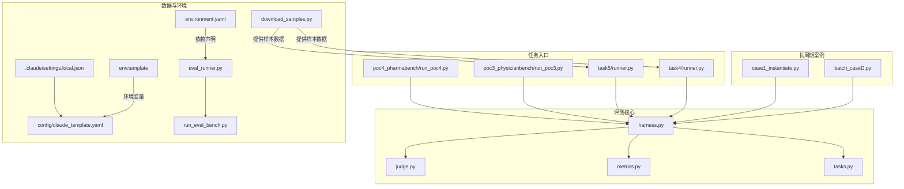
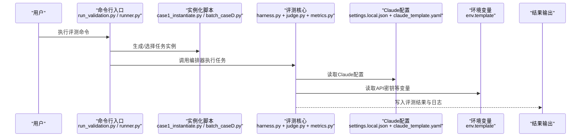
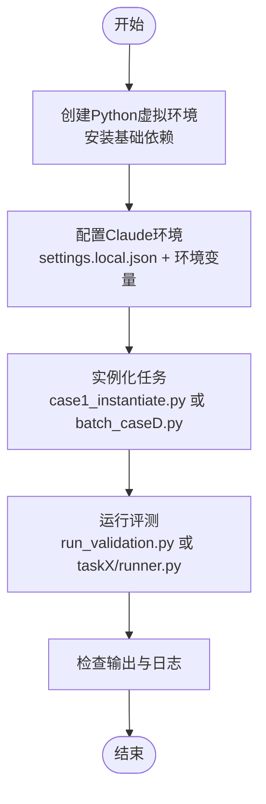
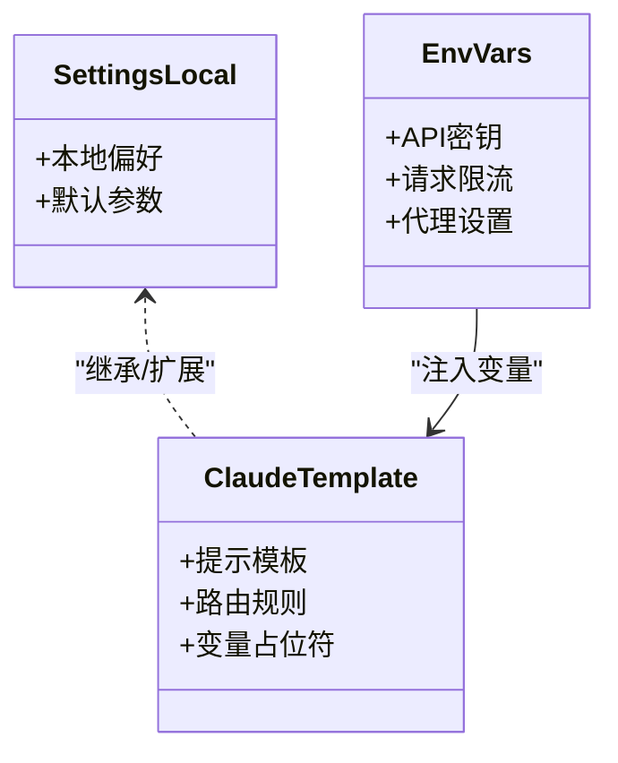
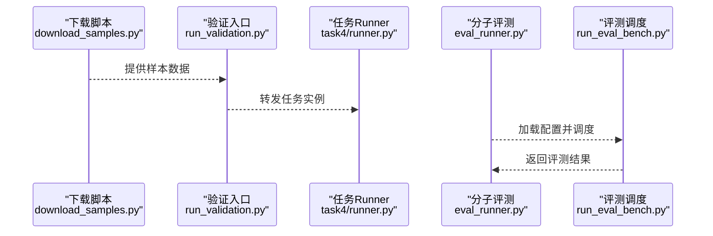
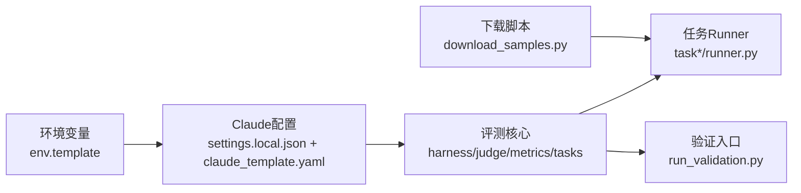

# 快速开始

<cite>
**本文引用的文件**   
- [autonomy_mvp/core/harness.py](file://autonomy_mvp/core/harness.py)
- [autonomy_mvp/core/judge.py](file://autonomy_mvp/core/judge.py)
- [autonomy_mvp/core/metrics.py](file://autonomy_mvp/core/metrics.py)
- [autonomy_mvp/core/tasks.py](file://autonomy_mvp/core/tasks.py)
- [autonomy_mvp/run_validation.py](file://autonomy_mvp/run_validation.py)
- [autonomy_mvp/ACCEPTANCE.md](file://autonomy_mvp/ACCEPTANCE.md)
- [autonomy_mvp/schema.md](file://autonomy_mvp/schema.md)
- [longhorizon/instantiate/batch_caseD.py](file://longhorizon/instantiate/batch_caseD.py)
- [longhorizon/instantiate/case1_instantiate.py](file://longhorizon/instantiate/case1_instantiate.py)
- [task4/runner.py](file://task4/runner.py)
- [task5/runner.py](file://task5/runner.py)
- [task7/poc3_physicianbench/run_poc3.py](file://task7/poc3_physicianbench/run_poc3.py)
- [task7/poc4_pharmabench/run_poc4.py](file://task7/poc4_pharmabench/run_poc4.py)
- [deep_research_longhorizon/download_samples.py](file://deep_research_longhorizon/download_samples.py)
- [docs/prd/molbench_repo/env.template](file://docs/prd/molbench_repo/env.template)
- [docs/prd/molbench_repo/environment.yaml](file://docs/prd/molbench_repo/environment.yaml)
- [docs/prd/molbench_repo/config/claude_template.yaml](file://docs/prd/molbench_repo/config/claude_template.yaml)
- [docs/prd/molbench_repo/eval/eval_runner.py](file://docs/prd/molbench_repo/eval/eval_runner.py)
- [docs/prd/molbench_repo/eval/run_eval_bench.py](file://docs/prd/molbench_repo/eval/run_eval_bench.py)
- [.claude/settings.local.json](file://.claude/settings.local.json)
</cite>

## 目录
1. [简介](#简介)
2. [项目结构](#项目结构)
3. [核心组件](#核心组件)
4. [架构总览](#架构总览)
5. [详细组件分析](#详细组件分析)
6. [依赖分析](#依赖分析)
7. [性能考虑](#性能考虑)
8. [故障排除指南](#故障排除指南)
9. [结论](#结论)
10. [附录](#附录)

## 简介
本指南面向首次接触该科学计算基准测试框架的用户，目标是在30分钟内完成环境安装、依赖配置、Claude AI 环境设置与评估系统启动，并运行第一个最小化基准任务。文档覆盖：
- 环境准备与依赖安装（Python、Conda/Mamba、可选外部工具）
- Claude AI 环境配置与关键环境变量
- 使用内置验证脚本或示例 Runner 执行首个实验
- 常见问题与排错建议

## 项目结构
仓库采用“多任务+可插拔评测”的模块化组织方式：
- autonomy_mvp：轻量级自动化评测核心（任务定义、裁判、指标、编排器）
- longhorizon：长周期案例实例化与批处理入口
- taskN：各子任务的独立运行脚本与结果
- docs/prd/molbench_repo：分子基准相关的环境模板、评测入口与配置样例
- deep_research_longhorizon：数据集下载与采样脚本
- .claude：Claude 本地配置

图表来源
- [autonomy_mvp/core/harness.py](file://autonomy_mvp/core/harness.py)
- [autonomy_mvp/core/judge.py](file://autonomy_mvp/core/judge.py)
- [autonomy_mvp/core/metrics.py](file://autonomy_mvp/core/metrics.py)
- [autonomy_mvp/core/tasks.py](file://autonomy_mvp/core/tasks.py)
- [longhorizon/instantiate/batch_caseD.py](file://longhorizon/instantiate/batch_caseD.py)
- [longhorizon/instantiate/case1_instantiate.py](file://longhorizon/instantiate/case1_instantiate.py)
- [task4/runner.py](file://task4/runner.py)
- [task5/runner.py](file://task5/runner.py)
- [task7/poc3_physicianbench/run_poc3.py](file://task7/poc3_physicianbench/run_poc3.py)
- [task7/poc4_pharmabench/run_poc4.py](file://task7/poc4_pharmabench/run_poc4.py)
- [deep_research_longhorizon/download_samples.py](file://deep_research_longhorizon/download_samples.py)
- [docs/prd/molbench_repo/env.template](file://docs/prd/molbench_repo/env.template)
- [docs/prd/molbench_repo/environment.yaml](file://docs/prd/molbench_repo/environment.yaml)
- [docs/prd/molbench_repo/config/claude_template.yaml](file://docs/prd/molbench_repo/config/claude_template.yaml)
- [docs/prd/molbench_repo/eval/eval_runner.py](file://docs/prd/molbench_repo/eval/eval_runner.py)
- [docs/prd/molbench_repo/eval/run_eval_bench.py](file://docs/prd/molbench_repo/eval/run_eval_bench.py)
- [.claude/settings.local.json](file://.claude/settings.local.json)

章节来源
- [autonomy_mvp/ACCEPTANCE.md](file://autonomy_mvp/ACCEPTANCE.md)
- [autonomy_mvp/schema.md](file://autonomy_mvp/schema.md)

## 核心组件
- 编排器（Harness）：负责加载任务、驱动执行、收集中间结果与最终输出。
- 裁判（Judge）：对模型/Agent 的输出进行判定与打分。
- 指标（Metrics）：提供通用度量函数与聚合逻辑。
- 任务（Tasks）：描述任务输入、约束与期望输出格式。

这些模块共同构成最小可运行的评测闭环：任务定义 → 执行编排 → 裁判评分 → 指标汇总。

章节来源
- [autonomy_mvp/core/harness.py](file://autonomy_mvp/core/harness.py)
- [autonomy_mvp/core/judge.py](file://autonomy_mvp/core/judge.py)
- [autonomy_mvp/core/metrics.py](file://autonomy_mvp/core/metrics.py)
- [autonomy_mvp/core/tasks.py](file://autonomy_mvp/core/tasks.py)

## 架构总览
下图展示了从用户命令到评测落盘的整体流程，以及 Claude 配置与环境变量的注入点。

图表来源
- [autonomy_mvp/run_validation.py](file://autonomy_mvp/run_validation.py)
- [longhorizon/instantiate/case1_instantiate.py](file://longhorizon/instantiate/case1_instantiate.py)
- [longhorizon/instantiate/batch_caseD.py](file://longhorizon/instantiate/batch_caseD.py)
- [autonomy_mvp/core/harness.py](file://autonomy_mvp/core/harness.py)
- [autonomy_mvp/core/judge.py](file://autonomy_mvp/core/judge.py)
- [autonomy_mvp/core/metrics.py](file://autonomy_mvp/core/metrics.py)
- [.claude/settings.local.json](file://.claude/settings.local.json)
- [docs/prd/molbench_repo/config/claude_template.yaml](file://docs/prd/molbench_repo/config/claude_template.yaml)
- [docs/prd/molbench_repo/env.template](file://docs/prd/molbench_repo/env.template)

## 详细组件分析

### 最小化示例：运行第一个基准任务
以下流程帮助你在最短时间内跑通一个端到端实验。

步骤概览
- 准备 Python 环境与依赖
- 配置 Claude 环境与必要变量
- 生成或选择任务实例
- 执行评测并查看结果

图表来源
- [longhorizon/instantiate/case1_instantiate.py](file://longhorizon/instantiate/case1_instantiate.py)
- [longhorizon/instantiate/batch_caseD.py](file://longhorizon/instantiate/batch_caseD.py)
- [autonomy_mvp/run_validation.py](file://autonomy_mvp/run_validation.py)
- [task4/runner.py](file://task4/runner.py)
- [task5/runner.py](file://task5/runner.py)

章节来源
- [autonomy_mvp/run_validation.py](file://autonomy_mvp/run_validation.py)
- [longhorizon/instantiate/case1_instantiate.py](file://longhorizon/instantiate/case1_instantiate.py)
- [longhorizon/instantiate/batch_caseD.py](file://longhorizon/instantiate/batch_caseD.py)
- [task4/runner.py](file://task4/runner.py)
- [task5/runner.py](file://task5/runner.py)

### Claude AI 环境配置
- 本地配置：在 .claude/settings.local.json 中维护本地偏好与默认参数。
- 模板配置：参考 docs/prd/molbench_repo/config/claude_template.yaml 中的键名与结构，用于统一任务提示与路由策略。
- 环境变量：通过 env.template 了解所需变量（如 API Key、Base URL、并发限制等），并在 shell 或进程环境中导出。

图表来源
- [.claude/settings.local.json](file://.claude/settings.local.json)
- [docs/prd/molbench_repo/config/claude_template.yaml](file://docs/prd/molbench_repo/config/claude_template.yaml)
- [docs/prd/molbench_repo/env.template](file://docs/prd/molbench_repo/env.template)

章节来源
- [.claude/settings.local.json](file://.claude/settings.local.json)
- [docs/prd/molbench_repo/config/claude_template.yaml](file://docs/prd/molbench_repo/config/claude_template.yaml)
- [docs/prd/molbench_repo/env.template](file://docs/prd/molbench_repo/env.template)

### 评测入口与数据准备
- 数据下载：deep_research_longhorizon/download_samples.py 提供样本数据获取能力，便于离线或受限网络下运行。
- 评测入口：
  - 通用验证：autonomy_mvp/run_validation.py
  - 任务专用：task4/runner.py、task5/runner.py
  - PoC 示例：task7/poc3_physicianbench/run_poc3.py、task7/poc4_pharmabench/run_poc4.py
- 分子基准：docs/prd/molbench_repo/eval/eval_runner.py 与 run_eval_bench.py 提供统一的评测运行入口。

图表来源
- [deep_research_longhorizon/download_samples.py](file://deep_research_longhorizon/download_samples.py)
- [autonomy_mvp/run_validation.py](file://autonomy_mvp/run_validation.py)
- [task4/runner.py](file://task4/runner.py)
- [docs/prd/molbench_repo/eval/eval_runner.py](file://docs/prd/molbench_repo/eval/eval_runner.py)
- [docs/prd/molbench_repo/eval/run_eval_bench.py](file://docs/prd/molbench_repo/eval/run_eval_bench.py)

章节来源
- [deep_research_longhorizon/download_samples.py](file://deep_research_longhorizon/download_samples.py)
- [autonomy_mvp/run_validation.py](file://autonomy_mvp/run_validation.py)
- [task4/runner.py](file://task4/runner.py)
- [docs/prd/molbench_repo/eval/eval_runner.py](file://docs/prd/molbench_repo/eval/eval_runner.py)
- [docs/prd/molbench_repo/eval/run_eval_bench.py](file://docs/prd/molbench_repo/eval/run_eval_bench.py)

## 依赖分析
- 运行时依赖
  - Python 解释器与包管理（建议使用 venv 或 conda/mamba）
  - Claude SDK/HTTP 客户端（由模板与配置文件驱动）
  - 评测核心库（harness/judge/metrics/tasks）
- 可选依赖
  - 外部科学计算工具（按具体任务需求启用）
  - 数据下载与预处理脚本（download_samples.py）

图表来源
- [autonomy_mvp/core/harness.py](file://autonomy_mvp/core/harness.py)
- [autonomy_mvp/core/judge.py](file://autonomy_mvp/core/judge.py)
- [autonomy_mvp/core/metrics.py](file://autonomy_mvp/core/metrics.py)
- [autonomy_mvp/core/tasks.py](file://autonomy_mvp/core/tasks.py)
- [task4/runner.py](file://task4/runner.py)
- [task5/runner.py](file://task5/runner.py)
- [autonomy_mvp/run_validation.py](file://autonomy_mvp/run_validation.py)
- [deep_research_longhorizon/download_samples.py](file://deep_research_longhorizon/download_samples.py)
- [.claude/settings.local.json](file://.claude/settings.local.json)
- [docs/prd/molbench_repo/config/claude_template.yaml](file://docs/prd/molbench_repo/config/claude_template.yaml)
- [docs/prd/molbench_repo/env.template](file://docs/prd/molbench_repo/env.template)

章节来源
- [docs/prd/molbench_repo/environment.yaml](file://docs/prd/molbench_repo/environment.yaml)

## 性能考虑
- 并发控制：根据 Claude 服务限流与本地资源调整并发度，避免触发速率限制。
- 缓存与断点续跑：利用评测输出目录与日志，结合任务幂等性实现增量重跑。
- I/O 优化：批量写入结果与结构化日志，减少频繁磁盘操作。
- 资源隔离：为重型任务（如分子对接、MD模拟）分配独立工作区与容器环境。

[本节为通用指导，不直接分析具体文件]

## 故障排除指南
- 无法连接 Claude 服务
  - 检查 .claude/settings.local.json 与 claude_template.yaml 的配置项是否完整
  - 确认环境变量已正确导出（参考 env.template）
  - 验证网络与代理设置
- 缺少依赖或版本冲突
  - 使用 environment.yaml 作为参考，优先使用 mamba/conda 创建隔离环境
  - 若存在第三方科学计算工具，按任务 README 单独安装
- 数据缺失或路径错误
  - 先运行 download_samples.py 获取样本数据
  - 核对任务实例路径与输出目录权限
- 评测无输出或中断
  - 查看评测日志与中间结果目录
  - 降低并发或重试失败任务
  - 必要时切换到单任务 Runner 定位问题

章节来源
- [autonomy_mvp/run_validation.py](file://autonomy_mvp/run_validation.py)
- [task4/runner.py](file://task4/runner.py)
- [task5/runner.py](file://task5/runner.py)
- [deep_research_longhorizon/download_samples.py](file://deep_research_longhorizon/download_samples.py)
- [docs/prd/molbench_repo/env.template](file://docs/prd/molbench_repo/env.template)
- [docs/prd/molbench_repo/config/claude_template.yaml](file://docs/prd/molbench_repo/config/claude_template.yaml)
- [.claude/settings.local.json](file://.claude/settings.local.json)

## 结论
通过本指南，你可以在30分钟内完成环境搭建、Claude 配置与首个基准任务的运行。后续可根据任务需求扩展数据、定制提示模板与指标，并利用批处理与并行策略提升整体效率。

## 附录
- 验收标准与数据模式说明可参考：
  - [autonomy_mvp/ACCEPTANCE.md](file://autonomy_mvp/ACCEPTANCE.md)
  - [autonomy_mvp/schema.md](file://autonomy_mvp/schema.md)
- 更多任务入口与示例：
  - [task7/poc3_physicianbench/run_poc3.py](file://task7/poc3_physicianbench/run_poc3.py)
  - [task7/poc4_pharmabench/run_poc4.py](file://task7/poc4_pharmabench/run_poc4.py)