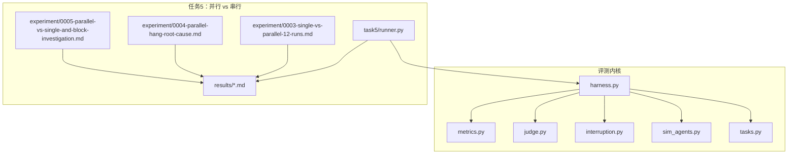
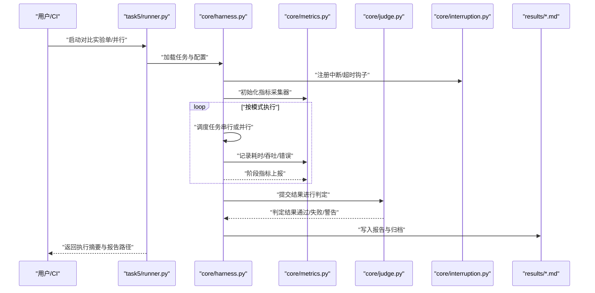
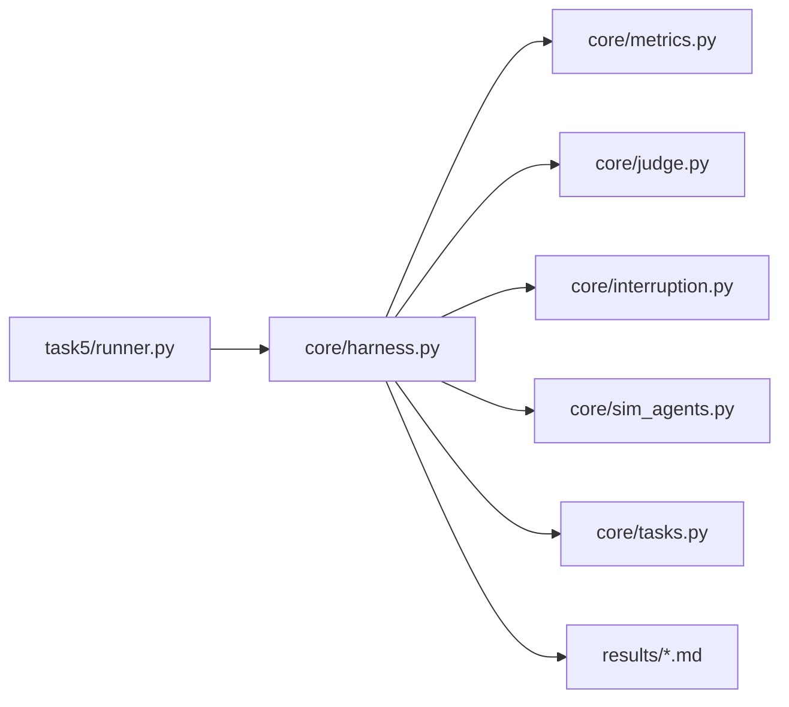

# 性能分析与诊断

<cite>
**本文引用的文件**   
- [autonomy_mvp/core/harness.py](file://autonomy_mvp/core/harness.py)
- [autonomy_mvp/core/metrics.py](file://autonomy_mvp/core/metrics.py)
- [autonomy_mvp/core/judge.py](file://autonomy_mvp/core/judge.py)
- [autonomy_mvp/core/interruption.py](file://autonomy_mvp/core/interruption.py)
- [autonomy_mvp/core/sim_agents.py](file://autonomy_mvp/core/sim_agents.py)
- [autonomy_mvp/core/tasks.py](file://autonomy_mvp/core/tasks.py)
- [autonomy_mvp/run_validation.py](file://autonomy_mvp/run_validation.py)
- [task5/runner.py](file://task5/runner.py)
- [task5/experiment/0003-single-vs-parallel-12-runs.md](file://task5/experiment/0003-single-vs-parallel-12-runs.md)
- [task5/experiment/0004-parallel-hang-root-cause.md](file://task5/experiment/0004-parallel-hang-root-cause.md)
- [task5/experiment/0005-parallel-vs-single-and-block-investigation.md](file://task5/experiment/0005-parallel-vs-single-and-block-investigation.md)
- [task5/results/AD-P2_parallel_report.md](file://task5/results/AD-P2_parallel_report.md)
- [task5/results/AD-P2_single_report.md](file://task5/results/AD-P2_single_report.md)
- [task5/results/SC-P1_parallel_report.md](file://task5/results/SC-P1_parallel_report.md)
- [task5/results/SC-P2_parallel_report.md](file://task5/results/SC-P2_parallel_report.md)
- [task5/results/SC-P2_single_report.md](file://task5/results/SC-P2_single_report.md)
- [task5/results/SE-P1_single_report.md](file://task5/results/SE-P1_single_report.md)
- [task5/results/SE-P2_parallel_report.md](file://task5/results/SE-P2_parallel_report.md)
</cite>

## 目录
1. [简介](#简介)
2. [项目结构](#项目结构)
3. [核心组件](#核心组件)
4. [架构总览](#架构总览)
5. [详细组件分析](#详细组件分析)
6. [依赖关系分析](#依赖关系分析)
7. [性能考量](#性能考量)
8. [故障排查指南](#故障排查指南)
9. [结论](#结论)
10. [附录](#附录)

## 简介
本技术文档面向性能分析与诊断系统，围绕热点分析、调用链追踪与资源使用分析的方法论与工具链展开。结合仓库中已有的并行执行与串行执行对比实验、报告产出与回归验证流程，给出可落地的实现方案与实践建议，涵盖内存泄漏检测、CPU性能分析与I/O瓶颈诊断的技术细节，并说明性能回归测试的自动化流程与基准测试最佳实践。

## 项目结构
仓库包含多任务与多数据集的实验与评测代码，其中与性能分析与诊断直接相关的核心位于：
- autonomy_mvp：统一的评测运行器、指标计算、中断控制与模拟代理等能力
- task5：并行与串行执行的对比实验、根因分析与报告归档

图示来源
- [autonomy_mvp/core/harness.py](file://autonomy_mvp/core/harness.py)
- [autonomy_mvp/core/metrics.py](file://autonomy_mvp/core/metrics.py)
- [autonomy_mvp/core/judge.py](file://autonomy_mvp/core/judge.py)
- [autonomy_mvp/core/interruption.py](file://autonomy_mvp/core/interruption.py)
- [autonomy_mvp/core/sim_agents.py](file://autonomy_mvp/core/sim_agents.py)
- [autonomy_mvp/core/tasks.py](file://autonomy_mvp/core/tasks.py)
- [task5/runner.py](file://task5/runner.py)
- [task5/experiment/0003-single-vs-parallel-12-runs.md](file://task5/experiment/0003-single-vs-parallel-12-runs.md)
- [task5/experiment/0004-parallel-hang-root-cause.md](file://task5/experiment/0004-parallel-hang-root-cause.md)
- [task5/experiment/0005-parallel-vs-single-and-block-investigation.md](file://task5/experiment/0005-parallel-vs-single-and-block-investigation.md)
- [task5/results/AD-P2_parallel_report.md](file://task5/results/AD-P2_parallel_report.md)
- [task5/results/AD-P2_single_report.md](file://task5/results/AD-P2_single_report.md)
- [task5/results/SC-P1_parallel_report.md](file://task5/results/SC-P1_parallel_report.md)
- [task5/results/SC-P2_parallel_report.md](file://task5/results/SC-P2_parallel_report.md)
- [task5/results/SC-P2_single_report.md](file://task5/results/SC-P2_single_report.md)
- [task5/results/SE-P1_single_report.md](file://task5/results/SE-P1_single_report.md)
- [task5/results/SE-P2_parallel_report.md](file://task5/results/SE-P2_parallel_report.md)

章节来源
- [autonomy_mvp/core/harness.py](file://autonomy_mvp/core/harness.py)
- [autonomy_mvp/core/metrics.py](file://autonomy_mvp/core/metrics.py)
- [autonomy_mvp/core/judge.py](file://autonomy_mvp/core/judge.py)
- [autonomy_mvp/core/interruption.py](file://autonomy_mvp/core/interruption.py)
- [autonomy_mvp/core/sim_agents.py](file://autonomy_mvp/core/sim_agents.py)
- [autonomy_mvp/core/tasks.py](file://autonomy_mvp/core/tasks.py)
- [task5/runner.py](file://task5/runner.py)
- [task5/experiment/0003-single-vs-parallel-12-runs.md](file://task5/experiment/0003-single-vs-parallel-12-runs.md)
- [task5/experiment/0004-parallel-hang-root-cause.md](file://task5/experiment/0004-parallel-hang-root-cause.md)
- [task5/experiment/0005-parallel-vs-single-and-block-investigation.md](file://task5/experiment/0005-parallel-vs-single-and-block-investigation.md)
- [task5/results/AD-P2_parallel_report.md](file://task5/results/AD-P2_parallel_report.md)
- [task5/results/AD-P2_single_report.md](file://task5/results/AD-P2_single_report.md)
- [task5/results/SC-P1_parallel_report.md](file://task5/results/SC-P1_parallel_report.md)
- [task5/results/SC-P2_parallel_report.md](file://task5/results/SC-P2_parallel_report.md)
- [task5/results/SC-P2_single_report.md](file://task5/results/SC-P2_single_report.md)
- [task5/results/SE-P1_single_report.md](file://task5/results/SE-P1_single_report.md)
- [task5/results/SE-P2_parallel_report.md](file://task5/results/SE-P2_parallel_report.md)

## 核心组件
- 运行编排与生命周期管理
  - 负责加载任务、调度执行、收集指标、处理中断与异常、输出结果与报告
  - 关键入口与编排逻辑参考路径：[autonomy_mvp/core/harness.py](file://autonomy_mvp/core/harness.py)、[autonomy_mvp/run_validation.py](file://autonomy_mvp/run_validation.py)
- 指标与评估
  - 提供统一指标采集与聚合能力，支撑耗时、吞吐、成功率等维度统计
  - 参考路径：[autonomy_mvp/core/metrics.py](file://autonomy_mvp/core/metrics.py)
- 判定与校验
  - 对执行结果进行断言与质量判定，为回归测试提供依据
  - 参考路径：[autonomy_mvp/core/judge.py](file://autonomy_mvp/core/judge.py)
- 中断与容错
  - 支持超时、外部中断信号与优雅退出，保障长时任务的稳定性
  - 参考路径：[autonomy_mvp/core/interruption.py](file://autonomy_mvp/core/interruption.py)
- 模拟代理与任务定义
  - 提供轻量代理与任务抽象，便于在可控环境中进行性能测量
  - 参考路径：[autonomy_mvp/core/sim_agents.py](file://autonomy_mvp/core/sim_agents.py)、[autonomy_mvp/core/tasks.py](file://autonomy_mvp/core/tasks.py)
- 并行与串行对比实验
  - 通过独立脚本驱动不同并发度与阻塞策略的对比，生成报告并归档
  - 参考路径：[task5/runner.py](file://task5/runner.py)、[task5/experiment/*.md](file://task5/experiment/0003-single-vs-parallel-12-runs.md)

章节来源
- [autonomy_mvp/core/harness.py](file://autonomy_mvp/core/harness.py)
- [autonomy_mvp/run_validation.py](file://autonomy_mvp/run_validation.py)
- [autonomy_mvp/core/metrics.py](file://autonomy_mvp/core/metrics.py)
- [autonomy_mvp/core/judge.py](file://autonomy_mvp/core/judge.py)
- [autonomy_mvp/core/interruption.py](file://autonomy_mvp/core/interruption.py)
- [autonomy_mvp/core/sim_agents.py](file://autonomy_mvp/core/sim_agents.py)
- [autonomy_mvp/core/tasks.py](file://autonomy_mvp/core/tasks.py)
- [task5/runner.py](file://task5/runner.py)
- [task5/experiment/0003-single-vs-parallel-12-runs.md](file://task5/experiment/0003-single-vs-parallel-12-runs.md)

## 架构总览
下图展示了从任务定义到指标采集、判定与报告产出的端到端流程，以及并行与串行两种执行模式的差异点。

图示来源
- [task5/runner.py](file://task5/runner.py)
- [autonomy_mvp/core/harness.py](file://autonomy_mvp/core/harness.py)
- [autonomy_mvp/core/metrics.py](file://autonomy_mvp/core/metrics.py)
- [autonomy_mvp/core/judge.py](file://autonomy_mvp/core/judge.py)
- [autonomy_mvp/core/interruption.py](file://autonomy_mvp/core/interruption.py)
- [task5/results/AD-P2_parallel_report.md](file://task5/results/AD-P2_parallel_report.md)
- [task5/results/AD-P2_single_report.md](file://task5/results/AD-P2_single_report.md)
- [task5/results/SC-P1_parallel_report.md](file://task5/results/SC-P1_parallel_report.md)
- [task5/results/SC-P2_parallel_report.md](file://task5/results/SC-P2_parallel_report.md)
- [task5/results/SC-P2_single_report.md](file://task5/results/SC-P2_single_report.md)
- [task5/results/SE-P1_single_report.md](file://task5/results/SE-P1_single_report.md)
- [task5/results/SE-P2_parallel_report.md](file://task5/results/SE-P2_parallel_report.md)

## 详细组件分析

### 运行编排与生命周期（harness）
- 职责
  - 解析任务清单与参数
  - 选择串行或并行执行策略
  - 注入中断与超时控制
  - 聚合指标并触发判定
- 关键点
  - 执行上下文隔离，避免跨任务状态污染
  - 指标采集点覆盖“准备-执行-收尾”全链路
  - 异常捕获与重试策略的可配置化
- 相关路径
  - [autonomy_mvp/core/harness.py](file://autonomy_mvp/core/harness.py)
  - [autonomy_mvp/run_validation.py](file://autonomy_mvp/run_validation.py)

章节来源
- [autonomy_mvp/core/harness.py](file://autonomy_mvp/core/harness.py)
- [autonomy_mvp/run_validation.py](file://autonomy_mvp/run_validation.py)

### 指标采集与聚合（metrics）
- 职责
  - 提供计时器、计数器、直方图等基础度量
  - 支持分阶段指标汇总与导出
- 关键点
  - 低开销采样，避免影响被测目标
  - 指标命名规范与维度标签（如任务名、并发度、环境）
- 相关路径
  - [autonomy_mvp/core/metrics.py](file://autonomy_mvp/core/metrics.py)

章节来源
- [autonomy_mvp/core/metrics.py](file://autonomy_mvp/core/metrics.py)

### 判定与回归（judge）
- 职责
  - 将指标与阈值/基线比对，输出通过/失败/告警
  - 为CI流水线提供稳定门禁
- 关键点
  - 支持多指标组合判定与权重
  - 允许软阈值与趋势容忍
- 相关路径
  - [autonomy_mvp/core/judge.py](file://autonomy_mvp/core/judge.py)

章节来源
- [autonomy_mvp/core/judge.py](file://autonomy_mvp/core/judge.py)

### 中断与容错（interruption）
- 职责
  - 监听系统信号与自定义中断事件
  - 保证长时任务可被安全终止与清理
- 关键点
  - 优雅关闭：释放锁、持久化中间状态、清理临时文件
  - 超时保护：防止死锁与无限等待
- 相关路径
  - [autonomy_mvp/core/interruption.py](file://autonomy_mvp/core/interruption.py)

章节来源
- [autonomy_mvp/core/interruption.py](file://autonomy_mvp/core/interruption.py)

### 模拟代理与任务（sim_agents, tasks）
- 职责
  - 提供轻量代理与任务接口，用于构造可控的性能负载
- 关键点
  - 可插拔后端（CPU密集、I/O密集、网络延迟）
  - 可调节工作集大小以模拟真实场景
- 相关路径
  - [autonomy_mvp/core/sim_agents.py](file://autonomy_mvp/core/sim_agents.py)
  - [autonomy_mvp/core/tasks.py](file://autonomy_mvp/core/tasks.py)

章节来源
- [autonomy_mvp/core/sim_agents.py](file://autonomy_mvp/core/sim_agents.py)
- [autonomy_mvp/core/tasks.py](file://autonomy_mvp/core/tasks.py)

### 并行与串行对比实验（task5）
- 目标
  - 对比不同并发度下的吞吐与时延
  - 定位并行导致的挂起与阻塞问题
- 方法
  - 固定任务集与数据规模，仅改变调度策略与并发度
  - 输出标准化报告，便于趋势跟踪
- 参考路径
  - [task5/runner.py](file://task5/runner.py)
  - [task5/experiment/0003-single-vs-parallel-12-runs.md](file://task5/experiment/0003-single-vs-parallel-12-runs.md)
  - [task5/experiment/0004-parallel-hang-root-cause.md](file://task5/experiment/0004-parallel-hang-root-cause.md)
  - [task5/experiment/0005-parallel-vs-single-and-block-investigation.md](file://task5/experiment/0005-parallel-vs-single-and-block-investigation.md)
  - [task5/results/*.md](file://task5/results/AD-P2_parallel_report.md)

章节来源
- [task5/runner.py](file://task5/runner.py)
- [task5/experiment/0003-single-vs-parallel-12-runs.md](file://task5/experiment/0003-single-vs-parallel-12-runs.md)
- [task5/experiment/0004-parallel-hang-root-cause.md](file://task5/experiment/0004-parallel-hang-root-cause.md)
- [task5/experiment/0005-parallel-vs-single-and-block-investigation.md](file://task5/experiment/0005-parallel-vs-single-and-block-investigation.md)
- [task5/results/AD-P2_parallel_report.md](file://task5/results/AD-P2_parallel_report.md)
- [task5/results/AD-P2_single_report.md](file://task5/results/AD-P2_single_report.md)
- [task5/results/SC-P1_parallel_report.md](file://task5/results/SC-P1_parallel_report.md)
- [task5/results/SC-P2_parallel_report.md](file://task5/results/SC-P2_parallel_report.md)
- [task5/results/SC-P2_single_report.md](file://task5/results/SC-P2_single_report.md)
- [task5/results/SE-P1_single_report.md](file://task5/results/SE-P1_single_report.md)
- [task5/results/SE-P2_parallel_report.md](file://task5/results/SE-P2_parallel_report.md)

### 热点分析与调用链追踪方法论
- 热点识别
  - 基于指标中的阶段耗时分布，定位Top-N热点函数/阶段
  - 结合任务类型区分CPU密集与I/O密集热点
- 调用链追踪
  - 在关键边界插入时间戳与上下文ID，串联跨进程/线程调用
  - 将追踪数据与指标对齐，形成“慢路径画像”
- 资源使用分析
  - 关联CPU、内存、磁盘与网络指标，识别资源争用与泄漏迹象
- 落地建议
  - 在harness中统一埋点，metrics中统一聚合，judge中统一阈值判定
  - 报告模板固化，确保跨版本可比

章节来源
- [autonomy_mvp/core/harness.py](file://autonomy_mvp/core/harness.py)
- [autonomy_mvp/core/metrics.py](file://autonomy_mvp/core/metrics.py)
- [autonomy_mvp/core/judge.py](file://autonomy_mvp/core/judge.py)

### 并行执行与串行执行对比分析方法
- 设计要点
  - 控制变量：相同任务集、相同数据规模、相同硬件与系统负载
  - 指标口径：P50/P95/P99耗时、吞吐、错误率、资源峰值
- 分析步骤
  - 分别运行串行与并行批次，生成报告
  - 对比关键指标变化，识别退化与收益
  - 针对异常（如挂起）进行根因分析并沉淀结论
- 参考路径
  - [task5/experiment/0003-single-vs-parallel-12-runs.md](file://task5/experiment/0003-single-vs-parallel-12-runs.md)
  - [task5/experiment/0004-parallel-hang-root-cause.md](file://task5/experiment/0004-parallel-hang-root-cause.md)
  - [task5/experiment/0005-parallel-vs-single-and-block-investigation.md](file://task5/experiment/0005-parallel-vs-single-and-block-investigation.md)

章节来源
- [task5/experiment/0003-single-vs-parallel-12-runs.md](file://task5/experiment/0003-single-vs-parallel-12-runs.md)
- [task5/experiment/0004-parallel-hang-root-cause.md](file://task5/experiment/0004-parallel-hang-root-cause.md)
- [task5/experiment/0005-parallel-vs-single-and-block-investigation.md](file://task5/experiment/0005-parallel-vs-single-and-block-investigation.md)

### 性能报告生成与趋势跟踪
- 报告要素
  - 执行摘要（模式、并发度、时长、通过率）
  - 指标明细（分阶段耗时、吞吐、错误分类）
  - 资源概览（CPU/内存/IO峰值与均值）
  - 结论与建议（是否通过、需关注项）
- 趋势跟踪
  - 将每次运行的报告与指标持久化，构建时序数据库或CSV归档
  - 设置阈值与告警规则，自动标记回归
- 参考路径
  - [task5/results/AD-P2_parallel_report.md](file://task5/results/AD-P2_parallel_report.md)
  - [task5/results/AD-P2_single_report.md](file://task5/results/AD-P2_single_report.md)
  - [task5/results/SC-P1_parallel_report.md](file://task5/results/SC-P1_parallel_report.md)
  - [task5/results/SC-P2_parallel_report.md](file://task5/results/SC-P2_parallel_report.md)
  - [task5/results/SC-P2_single_report.md](file://task5/results/SC-P2_single_report.md)
  - [task5/results/SE-P1_single_report.md](file://task5/results/SE-P1_single_report.md)
  - [task5/results/SE-P2_parallel_report.md](file://task5/results/SE-P2_parallel_report.md)

章节来源
- [task5/results/AD-P2_parallel_report.md](file://task5/results/AD-P2_parallel_report.md)
- [task5/results/AD-P2_single_report.md](file://task5/results/AD-P2_single_report.md)
- [task5/results/SC-P1_parallel_report.md](file://task5/results/SC-P1_parallel_report.md)
- [task5/results/SC-P2_parallel_report.md](file://task5/results/SC-P2_parallel_report.md)
- [task5/results/SC-P2_single_report.md](file://task5/results/SC-P2_single_report.md)
- [task5/results/SE-P1_single_report.md](file://task5/results/SE-P1_single_report.md)
- [task5/results/SE-P2_parallel_report.md](file://task5/results/SE-P2_parallel_report.md)

### 内存泄漏检测
- 方法
  - 周期性快照与对象计数对比，识别持续增长的对象集合
  - 结合堆转储与引用图分析，定位持有者
- 指标
  - 常驻内存、峰值内存、分配速率、GC频率与停顿
- 落地
  - 在harness中定时采集，metrics中聚合，judge中设置增长阈值告警

章节来源
- [autonomy_mvp/core/harness.py](file://autonomy_mvp/core/harness.py)
- [autonomy_mvp/core/metrics.py](file://autonomy_mvp/core/metrics.py)
- [autonomy_mvp/core/judge.py](file://autonomy_mvp/core/judge.py)

### CPU性能分析
- 方法
  - 火焰图/采样分析，识别热点函数与调用深度
  - 区分用户态与内核态占比，定位系统调用瓶颈
- 指标
  - CPU利用率、上下文切换、缓存命中率、指令级热点
- 落地
  - 在关键路径插入采样点，结合任务类型调整采样粒度

章节来源
- [autonomy_mvp/core/harness.py](file://autonomy_mvp/core/harness.py)
- [autonomy_mvp/core/metrics.py](file://autonomy_mvp/core/metrics.py)

### I/O瓶颈诊断
- 方法
  - 监控磁盘读写吞吐与延迟、网络请求RTT与丢包
  - 分析队列长度与背压现象
- 指标
  - IOPS、带宽、等待时间、超时率
- 落地
  - 在I/O边界埋点，结合并行度观察竞争与拥塞

章节来源
- [autonomy_mvp/core/harness.py](file://autonomy_mvp/core/harness.py)
- [autonomy_mvp/core/metrics.py](file://autonomy_mvp/core/metrics.py)

### 性能回归测试自动化流程
- 流程
  - 触发：代码变更或定时任务
  - 执行：串行与并行双通道运行，固定数据集与环境
  - 判定：基于judge阈值与历史基线比较
  - 报告：自动生成报告并归档，必要时触发告警
- 参考路径
  - [task5/runner.py](file://task5/runner.py)
  - [autonomy_mvp/core/judge.py](file://autonomy_mvp/core/judge.py)
  - [task5/results/*.md](file://task5/results/AD-P2_parallel_report.md)

章节来源
- [task5/runner.py](file://task5/runner.py)
- [autonomy_mvp/core/judge.py](file://autonomy_mvp/core/judge.py)
- [task5/results/AD-P2_parallel_report.md](file://task5/results/AD-P2_parallel_report.md)

### 基准测试最佳实践
- 环境稳定：固定硬件、操作系统、依赖版本；预热后采集
- 数据代表性：覆盖典型与极端用例；保持数据规模一致
- 指标完备：至少包含时延分位、吞吐、错误率、资源峰值
- 可重复性：随机种子固定、日志完整、报告可追溯
- 持续演进：定期更新基线与阈值，避免误报与漏报

章节来源
- [task5/experiment/0003-single-vs-parallel-12-runs.md](file://task5/experiment/0003-single-vs-parallel-12-runs.md)
- [task5/results/AD-P2_parallel_report.md](file://task5/results/AD-P2_parallel_report.md)

## 依赖关系分析
- 模块耦合
  - runner依赖harness作为统一执行入口
  - harness依赖metrics、judge、interruption完成闭环
  - sim_agents与tasks提供可插拔负载与任务定义
- 外部集成点
  - 文件系统（报告与数据）
  - 操作系统信号与资源监控接口
- 潜在风险
  - 全局状态共享导致并发干扰
  - 指标采集开销过大影响被测目标

图示来源
- [task5/runner.py](file://task5/runner.py)
- [autonomy_mvp/core/harness.py](file://autonomy_mvp/core/harness.py)
- [autonomy_mvp/core/metrics.py](file://autonomy_mvp/core/metrics.py)
- [autonomy_mvp/core/judge.py](file://autonomy_mvp/core/judge.py)
- [autonomy_mvp/core/interruption.py](file://autonomy_mvp/core/interruption.py)
- [autonomy_mvp/core/sim_agents.py](file://autonomy_mvp/core/sim_agents.py)
- [autonomy_mvp/core/tasks.py](file://autonomy_mvp/core/tasks.py)
- [task5/results/AD-P2_parallel_report.md](file://task5/results/AD-P2_parallel_report.md)

章节来源
- [task5/runner.py](file://task5/runner.py)
- [autonomy_mvp/core/harness.py](file://autonomy_mvp/core/harness.py)
- [autonomy_mvp/core/metrics.py](file://autonomy_mvp/core/metrics.py)
- [autonomy_mvp/core/judge.py](file://autonomy_mvp/core/judge.py)
- [autonomy_mvp/core/interruption.py](file://autonomy_mvp/core/interruption.py)
- [autonomy_mvp/core/sim_agents.py](file://autonomy_mvp/core/sim_agents.py)
- [autonomy_mvp/core/tasks.py](file://autonomy_mvp/core/tasks.py)
- [task5/results/AD-P2_parallel_report.md](file://task5/results/AD-P2_parallel_report.md)

## 性能考量
- 采集开销控制：采用异步与采样策略，降低对主流程的影响
- 指标维度设计：合理拆分维度，避免爆炸式组合
- 报告体积控制：分层报告（摘要+详情），按需下载
- 资源隔离：容器化或沙箱化，减少环境噪声
- 容量规划：根据并发度与数据规模预估资源需求

## 故障排查指南
- 常见问题
  - 并行挂起：检查锁竞争、死锁与外部依赖超时
  - 指标缺失：确认埋点位置与上报链路
  - 报告不一致：核对执行环境与数据版本
- 定位手段
  - 启用更细粒度日志与追踪ID
  - 增加关键路径的中间指标
  - 复现实验并逐步缩小范围
- 参考路径
  - [task5/experiment/0004-parallel-hang-root-cause.md](file://task5/experiment/0004-parallel-hang-root-cause.md)
  - [task5/experiment/0005-parallel-vs-single-and-block-investigation.md](file://task5/experiment/0005-parallel-vs-single-and-block-investigation.md)

章节来源
- [task5/experiment/0004-parallel-hang-root-cause.md](file://task5/experiment/0004-parallel-hang-root-cause.md)
- [task5/experiment/0005-parallel-vs-single-and-block-investigation.md](file://task5/experiment/0005-parallel-vs-single-and-block-investigation.md)

## 结论
本系统以统一的运行编排为核心，结合指标采集、判定与中断控制，形成了可复用的性能分析与诊断能力。通过并行与串行对比实验与标准化报告，能够高效识别热点、定位瓶颈并跟踪趋势。建议在CI中常态化运行基准与回归测试，持续优化阈值与基线，保障性能质量。

## 附录
- 术语
  - 热点：占用大量时间的函数或阶段
  - 调用链：一次请求在各组件间的调用序列
  - 回归：相比基线的性能退化
- 参考路径
  - [autonomy_mvp/core/harness.py](file://autonomy_mvp/core/harness.py)
  - [autonomy_mvp/core/metrics.py](file://autonomy_mvp/core/metrics.py)
  - [autonomy_mvp/core/judge.py](file://autonomy_mvp/core/judge.py)
  - [autonomy_mvp/core/interruption.py](file://autonomy_mvp/core/interruption.py)
  - [autonomy_mvp/core/sim_agents.py](file://autonomy_mvp/core/sim_agents.py)
  - [autonomy_mvp/core/tasks.py](file://autonomy_mvp/core/tasks.py)
  - [task5/runner.py](file://task5/runner.py)
  - [task5/experiment/0003-single-vs-parallel-12-runs.md](file://task5/experiment/0003-single-vs-parallel-12-runs.md)
  - [task5/experiment/0004-parallel-hang-root-cause.md](file://task5/experiment/0004-parallel-hang-root-cause.md)
  - [task5/experiment/0005-parallel-vs-single-and-block-investigation.md](file://task5/experiment/0005-parallel-vs-single-and-block-investigation.md)
  - [task5/results/AD-P2_parallel_report.md](file://task5/results/AD-P2_parallel_report.md)
  - [task5/results/AD-P2_single_report.md](file://task5/results/AD-P2_single_report.md)
  - [task5/results/SC-P1_parallel_report.md](file://task5/results/SC-P1_parallel_report.md)
  - [task5/results/SC-P2_parallel_report.md](file://task5/results/SC-P2_parallel_report.md)
  - [task5/results/SC-P2_single_report.md](file://task5/results/SC-P2_single_report.md)
  - [task5/results/SE-P1_single_report.md](file://task5/results/SE-P1_single_report.md)
  - [task5/results/SE-P2_parallel_report.md](file://task5/results/SE-P2_parallel_report.md)