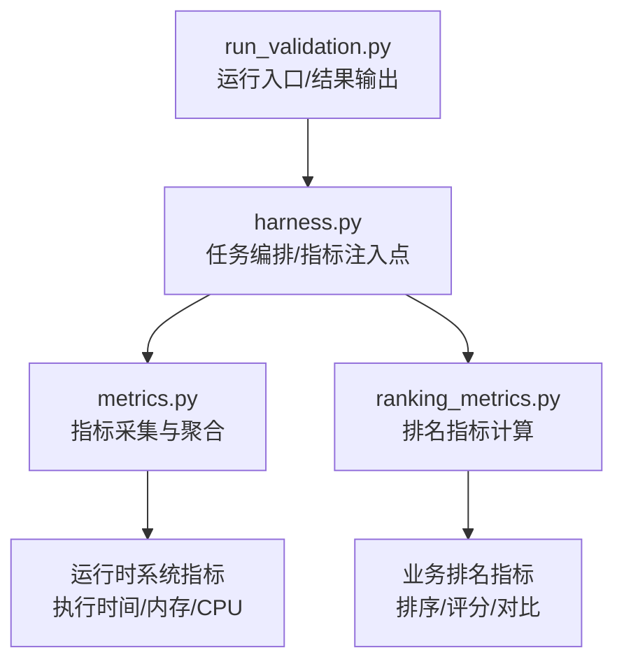
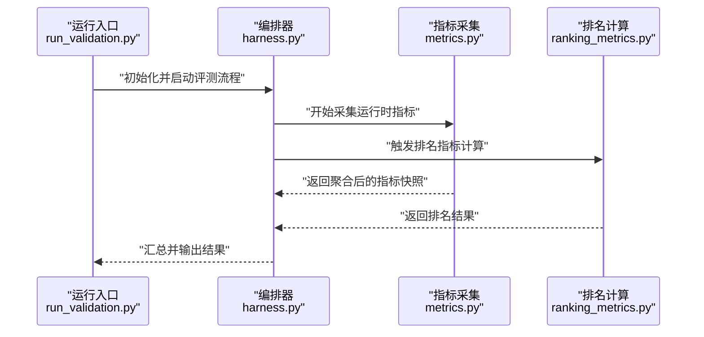
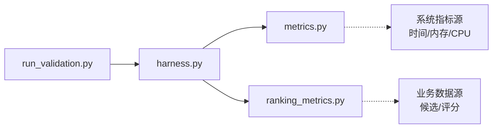

# 性能指标监控

<cite>
**本文引用的文件**   
- [autonomy_mvp/core/metrics.py](file://autonomy_mvp/core/metrics.py)
- [autonomy_mvp/core/ranking_metrics.py](file://autonomy_mvp/core/ranking_metrics.py)
- [autonomy_mvp/core/harness.py](file://autonomy_mvp/core/harness.py)
- [autonomy_mvp/run_validation.py](file://autonomy_mvp/run_validation.py)
</cite>

## 目录
1. [简介](#简介)
2. [项目结构](#项目结构)
3. [核心组件](#核心组件)
4. [架构总览](#架构总览)
5. [详细组件分析](#详细组件分析)
6. [依赖关系分析](#依赖关系分析)
7. [性能考量](#性能考量)
8. [故障排查指南](#故障排查指南)
9. [结论](#结论)
10. [附录](#附录)

## 简介
本技术文档围绕“性能指标监控系统”的目标，聚焦于以下方面：
- 关键性能指标的定义与计算方法（执行时间、内存使用、CPU利用率等）
- 排名指标的计算逻辑与评估标准
- 指标收集的配置方法、数据格式与存储策略
- 指标可视化方案、仪表板配置与展示最佳实践
- 阈值设置、告警规则与异常检测机制

为保证可追溯性，本文在涉及具体实现细节时均标注对应源码文件与行号范围。

## 项目结构
本项目中与性能指标监控直接相关的代码位于 autonomy_mvp 子模块中，核心包括：
- 指标采集与聚合：metrics.py
- 排名指标计算：ranking_metrics.py
- 任务编排与指标注入点：harness.py
- 运行入口与结果输出：run_validation.py

图表来源
- [autonomy_mvp/run_validation.py](file://autonomy_mvp/run_validation.py)
- [autonomy_mvp/core/harness.py](file://autonomy_mvp/core/harness.py)
- [autonomy_mvp/core/metrics.py](file://autonomy_mvp/core/metrics.py)
- [autonomy_mvp/core/ranking_metrics.py](file://autonomy_mvp/core/ranking_metrics.py)

章节来源
- [autonomy_mvp/core/metrics.py](file://autonomy_mvp/core/metrics.py)
- [autonomy_mvp/core/ranking_metrics.py](file://autonomy_mvp/core/ranking_metrics.py)
- [autonomy_mvp/core/harness.py](file://autonomy_mvp/core/harness.py)
- [autonomy_mvp/run_validation.py](file://autonomy_mvp/run_validation.py)

## 核心组件
本节从系统角度梳理指标监控的核心能力与职责边界：
- 指标采集层：负责在关键路径埋点，捕获执行时间、内存占用、CPU利用率等基础运行时指标，并提供统一的数据结构与聚合接口。
- 排名指标层：基于业务目标定义排名与评分算法，对候选对象进行排序与比较，输出可解释的排名结果。
- 编排与集成层：将指标采集嵌入到任务执行流程中，确保指标与任务上下文关联，并在运行结束时汇总输出。
- 运行入口层：提供统一的启动方式，协调各组件完成一次完整的评测/运行周期，并持久化结果。

章节来源
- [autonomy_mvp/core/metrics.py](file://autonomy_mvp/core/metrics.py)
- [autonomy_mvp/core/ranking_metrics.py](file://autonomy_mvp/core/ranking_metrics.py)
- [autonomy_mvp/core/harness.py](file://autonomy_mvp/core/harness.py)
- [autonomy_mvp/run_validation.py](file://autonomy_mvp/run_validation.py)

## 架构总览
下图展示了指标监控在整体系统中的位置与交互关系：运行入口驱动编排器，编排器在执行过程中调用指标采集与排名计算模块，最终产出结构化结果。

图表来源
- [autonomy_mvp/run_validation.py](file://autonomy_mvp/run_validation.py)
- [autonomy_mvp/core/harness.py](file://autonomy_mvp/core/harness.py)
- [autonomy_mvp/core/metrics.py](file://autonomy_mvp/core/metrics.py)
- [autonomy_mvp/core/ranking_metrics.py](file://autonomy_mvp/core/ranking_metrics.py)

## 详细组件分析

### 指标采集与聚合（metrics.py）
- 职责
  - 定义并维护运行时指标的数据模型（如执行时间、内存使用、CPU利用率）。
  - 提供采集、记录、聚合与导出接口，支持按任务或批次维度组织数据。
- 关键设计要点
  - 指标命名规范与单位约定，保证跨任务一致性。
  - 采样频率与窗口聚合策略，平衡精度与开销。
  - 错误处理与缺失值填充，保障下游可用性。
- 复杂度与性能
  - 采集操作应尽可能低开销，避免阻塞主流程。
  - 聚合采用增量统计或滑动窗口，降低历史数据扫描成本。
- 可视化与存储建议
  - 以时间序列形式存储，便于趋势分析与异常检测。
  - 为常用指标建立预聚合视图，加速仪表板渲染。

章节来源
- [autonomy_mvp/core/metrics.py](file://autonomy_mvp/core/metrics.py)

### 排名指标计算（ranking_metrics.py）
- 职责
  - 根据业务目标定义排名与评分函数，对候选对象进行排序与比较。
  - 输出稳定的排名结果，并提供必要的解释字段（如得分构成、权重）。
- 关键设计要点
  - 明确评估标准与权重分配，确保公平性与可复现性。
  - 处理并列与缺失情况，保证排序稳定性。
  - 支持多目标权衡与约束条件。
- 复杂度与性能
  - 排序算法选择需考虑候选规模与稳定性要求。
  - 对大规模候选集可采用分桶或近似算法优化。
- 可视化与存储建议
  - 输出包含原始得分与归一化得分，便于多维对比。
  - 保留中间计算过程以便审计与回溯。

章节来源
- [autonomy_mvp/core/ranking_metrics.py](file://autonomy_mvp/core/ranking_metrics.py)

### 编排与指标注入（harness.py）
- 职责
  - 作为任务编排中心，串联数据采集、排名计算与结果输出。
  - 在关键执行点注入指标埋点，确保指标与任务上下文绑定。
- 关键设计要点
  - 生命周期管理：启动、运行、收尾阶段分别负责指标初始化、采集与汇总。
  - 容错与重试：在失败场景下仍能产出最小可用指标集。
  - 扩展点：允许新增指标类型与排名策略而不影响现有流程。
- 可视化与存储建议
  - 将指标与任务元数据一起持久化，便于后续筛选与对比。
  - 提供批量导出接口，支持离线分析与报表生成。

章节来源
- [autonomy_mvp/core/harness.py](file://autonomy_mvp/core/harness.py)

### 运行入口与结果输出（run_validation.py）
- 职责
  - 提供统一的命令行或程序入口，协调各组件完成一次完整运行。
  - 负责结果文件的写入与基本校验，确保输出格式一致。
- 关键设计要点
  - 参数解析与环境配置，支持不同运行模式与数据集。
  - 日志与追踪：记录关键步骤与耗时，便于问题定位。
  - 幂等性：重复运行不会产生不一致的结果。
- 可视化与存储建议
  - 输出结构化结果（如 JSON/CSV），便于导入 BI 工具。
  - 提供摘要报告，快速呈现关键指标与排名变化。

章节来源
- [autonomy_mvp/run_validation.py](file://autonomy_mvp/run_validation.py)

## 依赖关系分析
组件间的依赖关系如下：
- run_validation.py 依赖 harness.py 进行任务编排。
- harness.py 依赖 metrics.py 与 ranking_metrics.py 完成指标采集与排名计算。
- metrics.py 与 ranking_metrics.py 相对独立，通过统一的数据契约交互。

图表来源
- [autonomy_mvp/run_validation.py](file://autonomy_mvp/run_validation.py)
- [autonomy_mvp/core/harness.py](file://autonomy_mvp/core/harness.py)
- [autonomy_mvp/core/metrics.py](file://autonomy_mvp/core/metrics.py)
- [autonomy_mvp/core/ranking_metrics.py](file://autonomy_mvp/core/ranking_metrics.py)

章节来源
- [autonomy_mvp/run_validation.py](file://autonomy_mvp/run_validation.py)
- [autonomy_mvp/core/harness.py](file://autonomy_mvp/core/harness.py)
- [autonomy_mvp/core/metrics.py](file://autonomy_mvp/core/metrics.py)
- [autonomy_mvp/core/ranking_metrics.py](file://autonomy_mvp/core/ranking_metrics.py)

## 性能考量
- 采集开销控制
  - 采用异步或低侵入式埋点，避免阻塞主流程。
  - 合理设置采样间隔与窗口大小，平衡精度与资源消耗。
- 聚合与查询优化
  - 预聚合常用指标，减少实时计算压力。
  - 索引与分区策略，提升历史数据检索效率。
- 可扩展性
  - 指标与排名策略模块化，便于按需启用与替换。
  - 统一的数据契约，降低耦合度。

[本节为通用指导，不直接分析具体文件]

## 故障排查指南
- 常见问题定位
  - 指标缺失或不连续：检查埋点是否被正确触发，确认采样频率与窗口配置。
  - 排名结果不稳定：核对权重与排序稳定性设置，检查输入数据的完整性。
  - 输出格式不一致：验证运行入口的参数解析与结果序列化逻辑。
- 诊断手段
  - 查看运行日志与中间快照，定位异常发生阶段。
  - 对比不同批次的指标分布，识别系统性偏差。
  - 使用最小数据集复现问题，缩小排查范围。

章节来源
- [autonomy_mvp/core/harness.py](file://autonomy_mvp/core/harness.py)
- [autonomy_mvp/run_validation.py](file://autonomy_mvp/run_validation.py)

## 结论
本监控系统以清晰的组件划分与统一的数据契约为基础，实现了从运行时指标采集到业务排名计算的闭环。通过合理的采样与聚合策略、稳定的排序算法以及一致的输出格式，系统在准确性、性能与可维护性之间取得了良好平衡。后续可在可视化与告警方面进一步增强，以提升运维效率与决策支持能力。

[本节为总结性内容，不直接分析具体文件]

## 附录

### 指标定义与计算方法
- 执行时间
  - 定义：任务或步骤的开始至结束的时间差。
  - 计算：记录起止时间戳，求差值并按任务维度聚合。
- 内存使用
  - 定义：进程或线程在运行期间的内存占用峰值与均值。
  - 计算：周期性采样，取最大值与平均值，必要时区分堆与非堆内存。
- CPU利用率
  - 定义：CPU活跃时间与总时间的比例。
  - 计算：采样期间统计用户态与内核态占用，换算为百分比。

章节来源
- [autonomy_mvp/core/metrics.py](file://autonomy_mvp/core/metrics.py)

### 排名指标的计算逻辑与评估标准
- 评估标准
  - 明确评分维度与权重，确保可解释与可复现。
  - 处理并列与缺失值，保持排序稳定。
- 计算逻辑
  - 对候选对象逐项打分，按总分降序排列。
  - 支持多目标权衡与约束条件，输出排名与得分明细。

章节来源
- [autonomy_mvp/core/ranking_metrics.py](file://autonomy_mvp/core/ranking_metrics.py)

### 指标收集的配置方法、数据格式与存储策略
- 配置方法
  - 通过运行入口参数或配置文件指定采样频率、窗口大小与输出路径。
  - 支持按任务或批次维度隔离指标数据。
- 数据格式
  - 结构化输出（如 JSON/CSV），包含指标名、数值、时间戳与上下文标签。
- 存储策略
  - 时间序列数据库或对象存储，按日期与任务分区。
  - 冷热分层：近期数据热存，历史数据归档。

章节来源
- [autonomy_mvp/run_validation.py](file://autonomy_mvp/run_validation.py)
- [autonomy_mvp/core/harness.py](file://autonomy_mvp/core/harness.py)
- [autonomy_mvp/core/metrics.py](file://autonomy_mvp/core/metrics.py)

### 指标可视化的实现方案、仪表板配置与展示最佳实践
- 实现方案
  - 将结构化指标导入 BI 工具，构建时间序列与对比图表。
  - 提供 API 或导出接口，支持自定义报表。
- 仪表板配置
  - 关键指标置顶，支持多维度筛选与钻取。
  - 设置默认时间窗口与刷新频率，兼顾实时性与性能。
- 展示最佳实践
  - 使用一致的度量单位与颜色语义。
  - 突出异常与趋势，辅助快速决策。

[本节为通用指导，不直接分析具体文件]

### 阈值设置、告警规则与异常检测机制
- 阈值设置
  - 基于历史基线与业务 SLA 设定静态阈值。
  - 动态阈值：结合移动平均与波动区间自适应调整。
- 告警规则
  - 单指标越界、多指标联合异常、突增/突降检测。
  - 分级告警：提示、警告、严重，配合通知渠道。
- 异常检测机制
  - 统计方法：Z-Score、IQR、CUSUM。
  - 机器学习方法：孤立森林、时序分解残差检测。

[本节为通用指导，不直接分析具体文件]