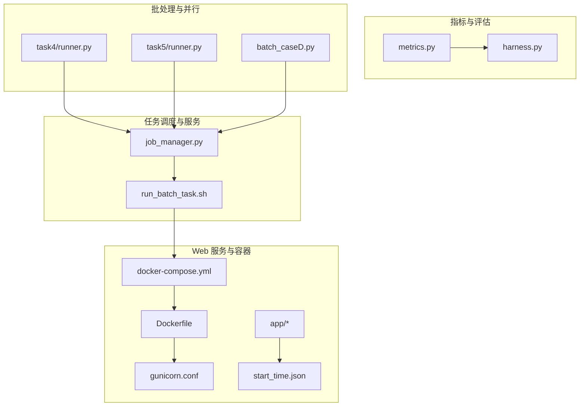
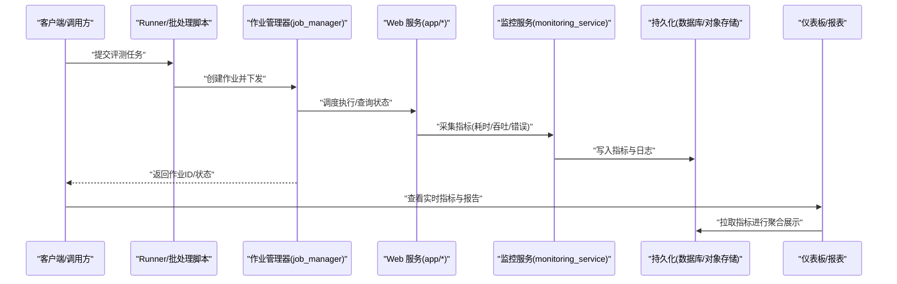
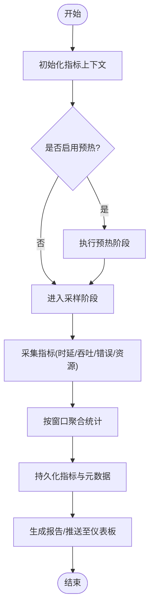
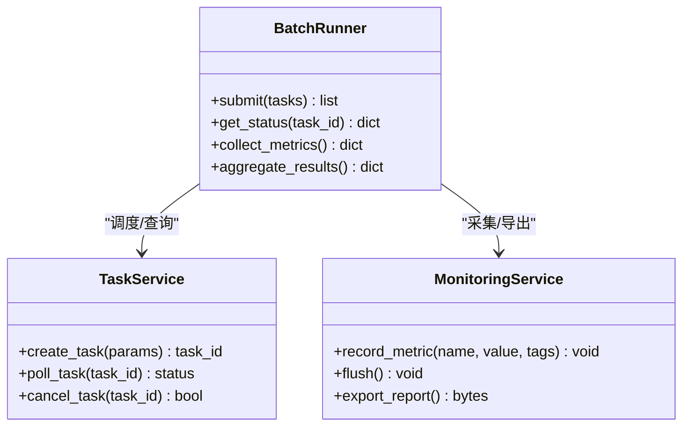
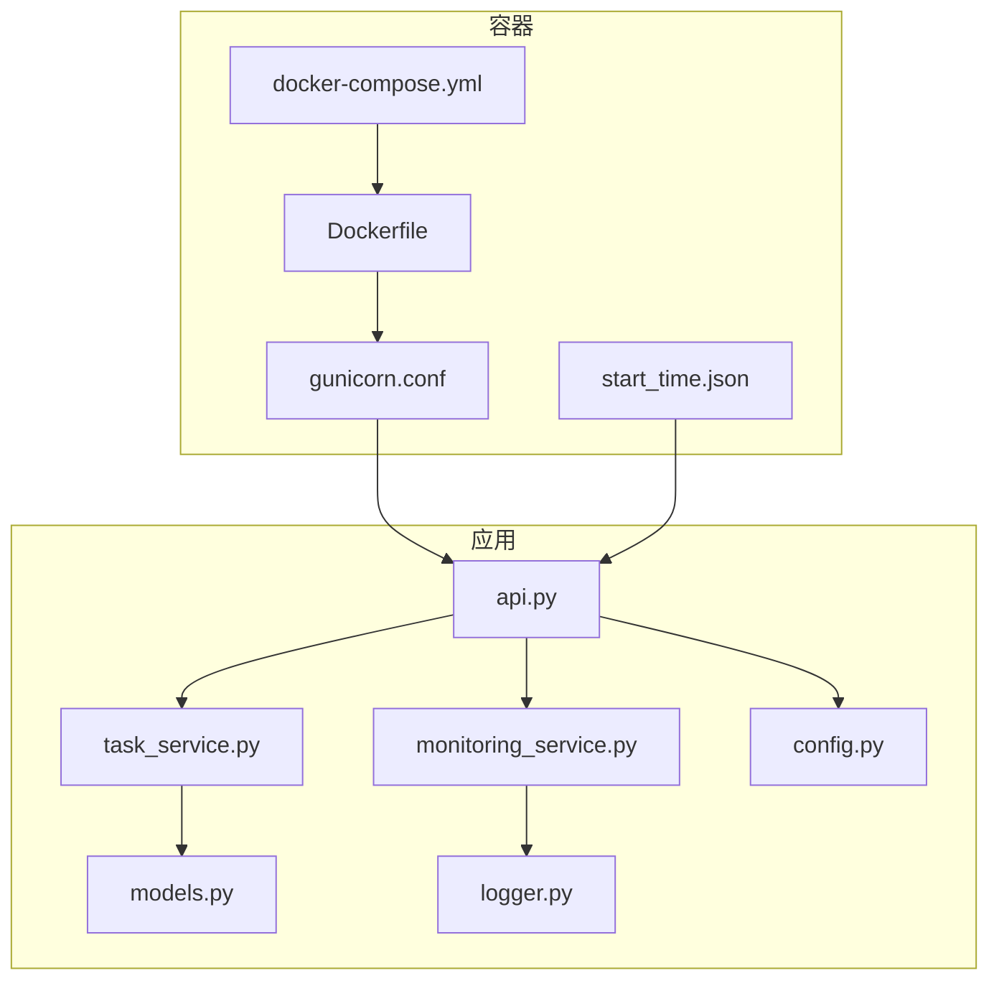
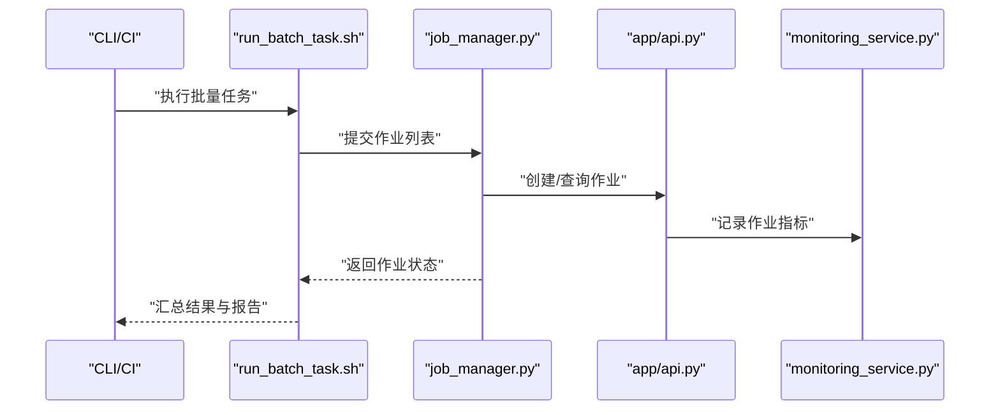
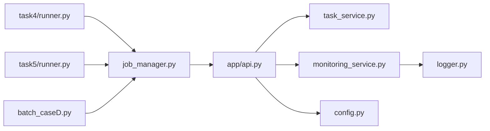

# 性能监控与优化

<cite>
**本文引用的文件**   
- [autonomy_mvp/core/metrics.py](file://autonomy_mvp/core/metrics.py)
- [autonomy_mvp/core/harness.py](file://autonomy_mvp/core/harness.py)
- [task4/runner.py](file://task4/runner.py)
- [task5/runner.py](file://task5/runner.py)
- [longhorizon/instantiate/batch_caseD.py](file://longhorizon/instantiate/batch_caseD.py)
- [task7/poc3_physicianbench/scripts/job_manager.py](file://task7/poc3_physicianbench/scripts/job_manager.py)
- [task7/poc3_physicianbench/scripts/run_batch_task.sh](file://task7/poc3_physicianbench/scripts/run_batch_task.sh)
- [task7/poc1_do_challenge/server/gunicorn.conf](file://task7/poc1_do_challenge/server/gunicorn.conf)
- [task7/poc1_do_challenge/server/docker-compose.yml](file://task7/poc1_do_challenge/server/docker-compose.yml)
- [task7/poc1_do_challenge/server/Dockerfile](file://task7/poc1_do_challenge/server/Dockerfile)
- [task7/poc1_do_challenge/server/start_time.json](file://task7/poc1_do_challenge/server/start_time.json)
- [task7/poc1_do_challenge/server/app/__init__.py](file://task7/poc1_do_challenge/server/app/__init__.py)
- [task7/poc1_do_challenge/server/app/api.py](file://task7/poc1_do_challenge/server/app/api.py)
- [task7/poc1_do_challenge/server/app/models.py](file://task7/poc1_do_challenge/server/app/models.py)
- [task7/poc1_do_challenge/server/app/services/task_service.py](file://task7/poc1_do_challenge/server/app/services/task_service.py)
- [task7/poc1_do_challenge/server/app/services/monitoring_service.py](file://task7/poc1_do_challenge/server/app/services/monitoring_service.py)
- [task7/poc1_do_challenge/server/app/utils/logger.py](file://task7/poc1_do_challenge/server/app/utils/logger.py)
- [task7/poc1_do_challenge/server/app/config.py](file://task7/poc1_do_challenge/server/app/config.py)
</cite>

## 目录
1. [简介](#简介)
2. [项目结构](#项目结构)
3. [核心组件](#核心组件)
4. [架构总览](#架构总览)
5. [详细组件分析](#详细组件分析)
6. [依赖关系分析](#依赖关系分析)
7. [性能考量](#性能考量)
8. [故障排查指南](#故障排查指南)
9. [结论](#结论)
10. [附录](#附录)

## 简介
本技术文档面向“性能监控与优化系统”，聚焦以下目标：
- 性能指标的采集方法、监控仪表板配置与分析工具使用
- 并行执行优化、内存管理与计算资源调度的最佳实践
- 性能瓶颈识别、热点分析与优化策略
- 基准测试结果分析方法、趋势跟踪与报告生成
- 生产环境的监控部署、告警配置与故障诊断流程

本仓库包含多套评测与任务运行脚本，以及一个用于任务调度与监控的示例服务。我们将基于这些代码，提炼出可复用的性能工程方法论与实践路径。

## 项目结构
从仓库视角看，与性能监控与优化相关的代码主要分布在如下位置：
- 指标与评估核心：autonomy_mvp/core 下的 metrics、harness 等模块
- 批处理与并行执行：task4/runner.py、task5/runner.py、longhorizon/instantiate/batch_caseD.py
- 任务调度与服务化：task7/poc3_physicianbench/scripts/job_manager.py 与 run_batch_task.sh
- Web 服务与容器化：task7/poc1_do_challenge/server 下的 gunicorn 配置、docker-compose、Dockerfile、启动时间与 API 路由
- 应用层监控与日志：server/app 下的 services、utils、config 等

图表来源
- [autonomy_mvp/core/metrics.py](file://autonomy_mvp/core/metrics.py)
- [autonomy_mvp/core/harness.py](file://autonomy_mvp/core/harness.py)
- [task4/runner.py](file://task4/runner.py)
- [task5/runner.py](file://task5/runner.py)
- [longhorizon/instantiate/batch_caseD.py](file://longhorizon/instantiate/batch_caseD.py)
- [task7/poc3_physicianbench/scripts/job_manager.py](file://task7/poc3_physicianbench/scripts/job_manager.py)
- [task7/poc3_physicianbench/scripts/run_batch_task.sh](file://task7/poc3_physicianbench/scripts/run_batch_task.sh)
- [task7/poc1_do_challenge/server/gunicorn.conf](file://task7/poc1_do_challenge/server/gunicorn.conf)
- [task7/poc1_do_challenge/server/docker-compose.yml](file://task7/poc1_do_challenge/server/docker-compose.yml)
- [task7/poc1_do_challenge/server/Dockerfile](file://task7/poc1_do_challenge/server/Dockerfile)
- [task7/poc1_do_challenge/server/start_time.json](file://task7/poc1_do_challenge/server/start_time.json)
- [task7/poc1_do_challenge/server/app/__init__.py](file://task7/poc1_do_challenge/server/app/__init__.py)
- [task7/poc1_do_challenge/server/app/api.py](file://task7/poc1_do_challenge/server/app/api.py)
- [task7/poc1_do_challenge/server/app/models.py](file://task7/poc1_do_challenge/server/app/models.py)
- [task7/poc1_do_challenge/server/app/services/task_service.py](file://task7/poc1_do_challenge/server/app/services/task_service.py)
- [task7/poc1_do_challenge/server/app/services/monitoring_service.py](file://task7/poc1_do_challenge/server/app/services/monitoring_service.py)
- [task7/poc1_do_challenge/server/app/utils/logger.py](file://task7/poc1_do_challenge/server/app/utils/logger.py)
- [task7/poc1_do_challenge/server/app/config.py](file://task7/poc1_do_challenge/server/app/config.py)

章节来源
- [autonomy_mvp/core/metrics.py](file://autonomy_mvp/core/metrics.py)
- [autonomy_mvp/core/harness.py](file://autonomy_mvp/core/harness.py)
- [task4/runner.py](file://task4/runner.py)
- [task5/runner.py](file://task5/runner.py)
- [longhorizon/instantiate/batch_caseD.py](file://longhorizon/instantiate/batch_caseD.py)
- [task7/poc3_physicianbench/scripts/job_manager.py](file://task7/poc3_physicianbench/scripts/job_manager.py)
- [task7/poc3_physicianbench/scripts/run_batch_task.sh](file://task7/poc3_physicianbench/scripts/run_batch_task.sh)
- [task7/poc1_do_challenge/server/gunicorn.conf](file://task7/poc1_do_challenge/server/gunicorn.conf)
- [task7/poc1_do_challenge/server/docker-compose.yml](file://task7/poc1_do_challenge/server/docker-compose.yml)
- [task7/poc1_do_challenge/server/Dockerfile](file://task7/poc1_do_challenge/server/Dockerfile)
- [task7/poc1_do_challenge/server/start_time.json](file://task7/poc1_do_challenge/server/start_time.json)
- [task7/poc1_do_challenge/server/app/__init__.py](file://task7/poc1_do_challenge/server/app/__init__.py)
- [task7/poc1_do_challenge/server/app/api.py](file://task7/poc1_do_challenge/server/app/api.py)
- [task7/poc1_do_challenge/server/app/models.py](file://task7/poc1_do_challenge/server/app/models.py)
- [task7/poc1_do_challenge/server/app/services/task_service.py](file://task7/poc1_do_challenge/server/app/services/task_service.py)
- [task7/poc1_do_challenge/server/app/services/monitoring_service.py](file://task7/poc1_do_challenge/server/app/services/monitoring_service.py)
- [task7/poc1_do_challenge/server/app/utils/logger.py](file://task7/poc1_do_challenge/server/app/utils/logger.py)
- [task7/poc1_do_challenge/server/app/config.py](file://task7/poc1_do_challenge/server/app/config.py)

## 核心组件
- 指标与评估核心
  - 指标定义与聚合：在指标模块中定义关键性能指标（如耗时、吞吐、错误率）与统计口径，为上层收集与可视化提供统一数据模型。
  - 评估编排：在编排模块中组织评测流程，串联数据采集、结果落盘与报告生成。
- 批处理与并行执行
  - 任务分发：通过 runner 或 batch 脚本将大规模用例切分并并发执行，提升整体吞吐。
  - 资源控制：限制并发度、隔离工作进程，避免资源争用导致的抖动。
- 任务调度与服务化
  - 作业管理：job_manager 负责作业生命周期管理、状态追踪与重试策略。
  - 批量执行：shell 脚本封装环境准备、参数注入与结果归档。
- Web 服务与容器化
  - 进程与线程：gunicorn 配置决定 worker 数量与超时策略，影响吞吐与延迟。
  - 容器编排：docker-compose 描述服务拓扑与资源约束；Dockerfile 固化运行时依赖。
  - 启动时间：start_time.json 记录服务启动时刻，便于对齐时序与定位冷启动问题。
  - 应用层：API 路由、模型、服务与日志、配置共同构成可观测性基础。

章节来源
- [autonomy_mvp/core/metrics.py](file://autonomy_mvp/core/metrics.py)
- [autonomy_mvp/core/harness.py](file://autonomy_mvp/core/harness.py)
- [task4/runner.py](file://task4/runner.py)
- [task5/runner.py](file://task5/runner.py)
- [longhorizon/instantiate/batch_caseD.py](file://longhorizon/instantiate/batch_caseD.py)
- [task7/poc3_physicianbench/scripts/job_manager.py](file://task7/poc3_physicianbench/scripts/job_manager.py)
- [task7/poc3_physicianbench/scripts/run_batch_task.sh](file://task7/poc3_physicianbench/scripts/run_batch_task.sh)
- [task7/poc1_do_challenge/server/gunicorn.conf](file://task7/poc1_do_challenge/server/gunicorn.conf)
- [task7/poc1_do_challenge/server/docker-compose.yml](file://task7/poc1_do_challenge/server/docker-compose.yml)
- [task7/poc1_do_challenge/server/Dockerfile](file://task7/poc1_do_challenge/server/Dockerfile)
- [task7/poc1_do_challenge/server/start_time.json](file://task7/poc1_do_challenge/server/start_time.json)
- [task7/poc1_do_challenge/server/app/__init__.py](file://task7/poc1_do_challenge/server/app/__init__.py)
- [task7/poc1_do_challenge/server/app/api.py](file://task7/poc1_do_challenge/server/app/api.py)
- [task7/poc1_do_challenge/server/app/models.py](file://task7/poc1_do_challenge/server/app/models.py)
- [task7/poc1_do_challenge/server/app/services/task_service.py](file://task7/poc1_do_challenge/server/app/services/task_service.py)
- [task7/poc1_do_challenge/server/app/services/monitoring_service.py](file://task7/poc1_do_challenge/server/app/services/monitoring_service.py)
- [task7/poc1_do_challenge/server/app/utils/logger.py](file://task7/poc1_do_challenge/server/app/utils/logger.py)
- [task7/poc1_do_challenge/server/app/config.py](file://task7/poc1_do_challenge/server/app/config.py)

## 架构总览
下图展示了从任务提交到指标采集、存储与可视化的端到端链路，涵盖批处理、作业管理、Web 服务与容器化部署。

图表来源
- [task4/runner.py](file://task4/runner.py)
- [task5/runner.py](file://task5/runner.py)
- [longhorizon/instantiate/batch_caseD.py](file://longhorizon/instantiate/batch_caseD.py)
- [task7/poc3_physicianbench/scripts/job_manager.py](file://task7/poc3_physicianbench/scripts/job_manager.py)
- [task7/poc1_do_challenge/server/app/api.py](file://task7/poc1_do_challenge/server/app/api.py)
- [task7/poc1_do_challenge/server/app/services/monitoring_service.py](file://task7/poc1_do_challenge/server/app/services/monitoring_service.py)

## 详细组件分析

### 指标与评估核心
- 指标定义
  - 建议以统一的数据模型表达指标（名称、维度、数值、时间戳），便于跨模块复用与聚合。
  - 典型指标包括：请求时延分布、吞吐、错误率、资源占用（CPU/内存/GPU）、队列长度、背压信号等。
- 评估编排
  - 在编排层组织“预热—采样—统计—落盘”的流程，确保指标采集的一致性与可重复性。
  - 对异常路径进行兜底，保证失败用例不影响整体统计口径。

图表来源
- [autonomy_mvp/core/metrics.py](file://autonomy_mvp/core/metrics.py)
- [autonomy_mvp/core/harness.py](file://autonomy_mvp/core/harness.py)

章节来源
- [autonomy_mvp/core/metrics.py](file://autonomy_mvp/core/metrics.py)
- [autonomy_mvp/core/harness.py](file://autonomy_mvp/core/harness.py)

### 并行执行与批处理
- 并发策略
  - 根据 I/O 密集或 CPU 密集特征选择进程池或线程池，合理设置并发度上限，避免上下文切换开销过大。
  - 对长尾任务采用“分片+重试+熔断”的组合策略，降低单点失败对整体的影响。
- 资源隔离
  - 使用容器或 cgroup 限制 CPU/内存配额，防止邻居噪声干扰。
  - 对共享资源（磁盘、网络、GPU）加锁或队列化访问，减少竞争。
- 结果一致性
  - 为每个子任务分配唯一 ID，合并阶段去重与幂等处理，保障最终结果稳定。

图表来源
- [task4/runner.py](file://task4/runner.py)
- [task5/runner.py](file://task5/runner.py)
- [longhorizon/instantiate/batch_caseD.py](file://longhorizon/instantiate/batch_caseD.py)
- [task7/poc3_physicianbench/scripts/job_manager.py](file://task7/poc3_physicianbench/scripts/job_manager.py)
- [task7/poc1_do_challenge/server/app/services/task_service.py](file://task7/poc1_do_challenge/server/app/services/task_service.py)
- [task7/poc1_do_challenge/server/app/services/monitoring_service.py](file://task7/poc1_do_challenge/server/app/services/monitoring_service.py)

章节来源
- [task4/runner.py](file://task4/runner.py)
- [task5/runner.py](file://task5/runner.py)
- [longhorizon/instantiate/batch_caseD.py](file://longhorizon/instantiate/batch_caseD.py)
- [task7/poc3_physicianbench/scripts/job_manager.py](file://task7/poc3_physicianbench/scripts/job_manager.py)

### Web 服务与容器化部署
- 进程模型
  - gunicorn 的 worker 数与超时需结合业务特性调优，通常以 CPU 核数为参考并结合 I/O 等待比例调整。
- 容器编排
  - docker-compose 定义服务间依赖、端口映射与资源限制；Dockerfile 固定镜像版本，确保可重现。
- 启动时间
  - start_time.json 记录服务启动时间，可用于冷启动时长统计与热修复验证。
- 应用层
  - API 路由暴露指标查询与作业管理接口；models 定义数据结构；services 实现业务逻辑；logger 与 config 支撑可观测性与配置管理。

图表来源
- [task7/poc1_do_challenge/server/gunicorn.conf](file://task7/poc1_do_challenge/server/gunicorn.conf)
- [task7/poc1_do_challenge/server/Dockerfile](file://task7/poc1_do_challenge/server/Dockerfile)
- [task7/poc1_do_challenge/server/docker-compose.yml](file://task7/poc1_do_challenge/server/docker-compose.yml)
- [task7/poc1_do_challenge/server/start_time.json](file://task7/poc1_do_challenge/server/start_time.json)
- [task7/poc1_do_challenge/server/app/api.py](file://task7/poc1_do_challenge/server/app/api.py)
- [task7/poc1_do_challenge/server/app/models.py](file://task7/poc1_do_challenge/server/app/models.py)
- [task7/poc1_do_challenge/server/app/services/task_service.py](file://task7/poc1_do_challenge/server/app/services/task_service.py)
- [task7/poc1_do_challenge/server/app/services/monitoring_service.py](file://task7/poc1_do_challenge/server/app/services/monitoring_service.py)
- [task7/poc1_do_challenge/server/app/utils/logger.py](file://task7/poc1_do_challenge/server/app/utils/logger.py)
- [task7/poc1_do_challenge/server/app/config.py](file://task7/poc1_do_challenge/server/app/config.py)

章节来源
- [task7/poc1_do_challenge/server/gunicorn.conf](file://task7/poc1_do_challenge/server/gunicorn.conf)
- [task7/poc1_do_challenge/server/docker-compose.yml](file://task7/poc1_do_challenge/server/docker-compose.yml)
- [task7/poc1_do_challenge/server/Dockerfile](file://task7/poc1_do_challenge/server/Dockerfile)
- [task7/poc1_do_challenge/server/start_time.json](file://task7/poc1_do_challenge/server/start_time.json)
- [task7/poc1_do_challenge/server/app/api.py](file://task7/poc1_do_challenge/server/app/api.py)
- [task7/poc1_do_challenge/server/app/models.py](file://task7/poc1_do_challenge/server/app/models.py)
- [task7/poc1_do_challenge/server/app/services/task_service.py](file://task7/poc1_do_challenge/server/app/services/task_service.py)
- [task7/poc1_do_challenge/server/app/services/monitoring_service.py](file://task7/poc1_do_challenge/server/app/services/monitoring_service.py)
- [task7/poc1_do_challenge/server/app/utils/logger.py](file://task7/poc1_do_challenge/server/app/utils/logger.py)
- [task7/poc1_do_challenge/server/app/config.py](file://task7/poc1_do_challenge/server/app/config.py)

### 作业管理与批量执行
- 作业生命周期
  - 创建、调度、执行、重试、完成、清理，全链路状态可追踪。
- 批量执行
  - shell 脚本封装环境准备、参数注入、并发控制与结果归档，适合 CI/CD 集成。
- 与指标体系对接
  - 作业级指标（排队时长、执行时长、成功率）与应用级指标（QPS、P99/P95 时延）联动，形成多维视图。

图表来源
- [task7/poc3_physicianbench/scripts/run_batch_task.sh](file://task7/poc3_physicianbench/scripts/run_batch_task.sh)
- [task7/poc3_physicianbench/scripts/job_manager.py](file://task7/poc3_physicianbench/scripts/job_manager.py)
- [task7/poc1_do_challenge/server/app/api.py](file://task7/poc1_do_challenge/server/app/api.py)
- [task7/poc1_do_challenge/server/app/services/monitoring_service.py](file://task7/poc1_do_challenge/server/app/services/monitoring_service.py)

章节来源
- [task7/poc3_physicianbench/scripts/run_batch_task.sh](file://task7/poc3_physicianbench/scripts/run_batch_task.sh)
- [task7/poc3_physicianbench/scripts/job_manager.py](file://task7/poc3_physicianbench/scripts/job_manager.py)
- [task7/poc1_do_challenge/server/app/api.py](file://task7/poc1_do_challenge/server/app/api.py)
- [task7/poc1_do_challenge/server/app/services/monitoring_service.py](file://task7/poc1_do_challenge/server/app/services/monitoring_service.py)

## 依赖关系分析
- 组件耦合
  - 批处理与作业管理松耦合，通过 API 或消息通道交互，利于独立扩展与替换。
  - 监控服务作为横切关注点，被多个组件调用，应保持稳定接口。
- 外部依赖
  - 容器运行时、进程管理器、日志与配置中心为基础设施依赖，需在部署阶段明确版本与兼容性。
- 潜在循环依赖
  - 应避免服务层与监控层互相引用，必要时引入事件总线或异步队列解耦。

图表来源
- [task4/runner.py](file://task4/runner.py)
- [task5/runner.py](file://task5/runner.py)
- [longhorizon/instantiate/batch_caseD.py](file://longhorizon/instantiate/batch_caseD.py)
- [task7/poc3_physicianbench/scripts/job_manager.py](file://task7/poc3_physicianbench/scripts/job_manager.py)
- [task7/poc1_do_challenge/server/app/api.py](file://task7/poc1_do_challenge/server/app/api.py)
- [task7/poc1_do_challenge/server/app/services/task_service.py](file://task7/poc1_do_challenge/server/app/services/task_service.py)
- [task7/poc1_do_challenge/server/app/services/monitoring_service.py](file://task7/poc1_do_challenge/server/app/services/monitoring_service.py)
- [task7/poc1_do_challenge/server/app/utils/logger.py](file://task7/poc1_do_challenge/server/app/utils/logger.py)
- [task7/poc1_do_challenge/server/app/config.py](file://task7/poc1_do_challenge/server/app/config.py)

章节来源
- [task4/runner.py](file://task4/runner.py)
- [task5/runner.py](file://task5/runner.py)
- [longhorizon/instantiate/batch_caseD.py](file://longhorizon/instantiate/batch_caseD.py)
- [task7/poc3_physicianbench/scripts/job_manager.py](file://task7/poc3_physicianbench/scripts/job_manager.py)
- [task7/poc1_do_challenge/server/app/api.py](file://task7/poc1_do_challenge/server/app/api.py)
- [task7/poc1_do_challenge/server/app/services/task_service.py](file://task7/poc1_do_challenge/server/app/services/task_service.py)
- [task7/poc1_do_challenge/server/app/services/monitoring_service.py](file://task7/poc1_do_challenge/server/app/services/monitoring_service.py)
- [task7/poc1_do_challenge/server/app/utils/logger.py](file://task7/poc1_do_challenge/server/app/utils/logger.py)
- [task7/poc1_do_challenge/server/app/config.py](file://task7/poc1_do_challenge/server/app/config.py)

## 性能考量
- 并行执行优化
  - 依据任务类型选择进程/线程模型；设置合理的并发上限与队列长度；对长尾任务实施重试与熔断。
- 内存管理
  - 控制对象生命周期，及时释放大对象；使用流式处理与分页读取避免峰值内存过高；对缓存设置 TTL 与容量上限。
- 计算资源调度
  - 使用容器资源限制与亲和性规则，避免资源争用；对 GPU/CPU 密集型任务分别调度。
- 指标采集与聚合
  - 采用滑动窗口与降采样策略，平衡精度与开销；对高基数标签进行采样或聚合，降低存储压力。
- 报告与趋势
  - 定期生成对比报告（基线 vs 当前），标注显著变化与回归；建立趋势看板，支持回溯与根因定位。

[本节为通用指导，不直接分析具体文件]

## 故障排查指南
- 常见问题定位
  - 启动失败：检查容器镜像、端口冲突、环境变量与配置文件；核对启动时间文件是否存在与格式正确。
  - 性能退化：观察 P95/P99 时延、错误率、资源利用率；对比历史基线与最近变更。
  - 作业挂起：检查作业队列堆积、下游依赖超时、重试风暴与死锁。
- 日志与追踪
  - 统一日志格式与级别，关联 traceId；关键路径埋点，输出结构化日志。
- 告警与回滚
  - 设定阈值告警（错误率、时延、资源水位）；自动触发回滚或降级策略。
- 复盘与改进
  - 记录根因、影响范围、处置过程与后续改进项；沉淀为知识库与自动化检查清单。

章节来源
- [task7/poc1_do_challenge/server/start_time.json](file://task7/poc1_do_challenge/server/start_time.json)
- [task7/poc1_do_challenge/server/app/utils/logger.py](file://task7/poc1_do_challenge/server/app/utils/logger.py)
- [task7/poc1_do_challenge/server/app/config.py](file://task7/poc1_do_challenge/server/app/config.py)

## 结论
通过将指标采集、并行执行、作业管理、Web 服务与容器化部署有机结合，可以构建一套可观测、可扩展、可运维的性能监控与优化体系。建议在持续集成中纳入基准测试与回归检测，在生产环境落实告警与自动化处置，形成闭环的性能治理机制。

[本节为总结性内容，不直接分析具体文件]

## 附录
- 指标字典建议
  - 名称、维度（服务/任务/实例）、单位、采集频率、保留周期、告警阈值。
- 报告模板建议
  - 概览、关键指标趋势、热点分析、回归与改进项、下一步计划。
- 部署清单建议
  - 镜像版本、环境变量、资源限制、健康检查、备份与恢复策略。

[本节为补充信息，不直接分析具体文件]