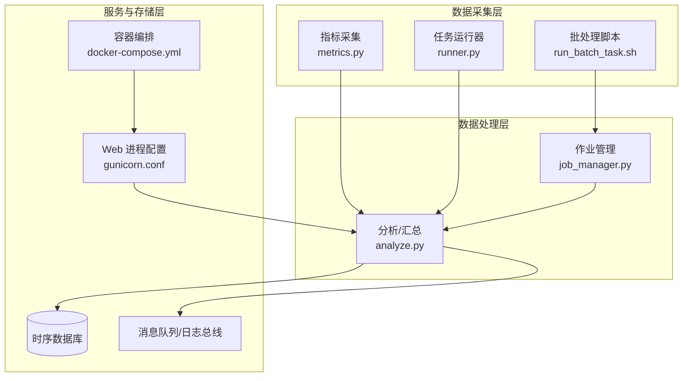
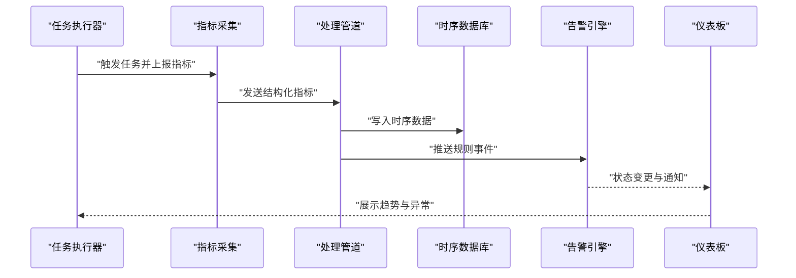
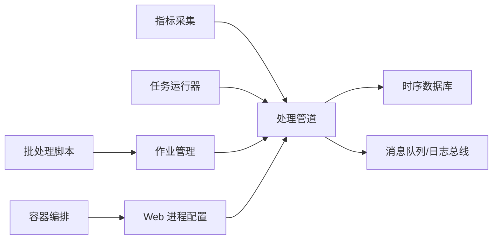

# 监控部署与运维

<cite>
**本文引用的文件**   
- [autonomy_mvp/core/metrics.py](file://autonomy_mvp/core/metrics.py)
- [autonomy_mvp/core/harness.py](file://autonomy_mvp/core/harness.py)
- [task1/runner.py](file://task1/runner.py)
- [task1/analyze.py](file://task1/analyze.py)
- [task4/poc1_do_challenge/server/docker-compose.yml](file://task4/poc1_do_challenge/server/docker-compose.yml)
- [task4/poc1_do_challenge/server/gunicorn.conf](file://task4/poc1_do_challenge/server/gunicorn.conf)
- [task6/poc3_physicianbench/scripts/run_batch_task.sh](file://task6/poc3_physicianbench/scripts/run_batch_task.sh)
- [task6/poc3_physicianbench/scripts/job_manager.py](file://task6/poc3_physicianbench/scripts/job_manager.py)
</cite>

## 目录
1. [简介](#简介)
2. [项目结构](#项目结构)
3. [核心组件](#核心组件)
4. [架构总览](#架构总览)
5. [详细组件分析](#详细组件分析)
6. [依赖关系分析](#依赖关系分析)
7. [性能考虑](#性能考虑)
8. [故障排查指南](#故障排查指南)
9. [结论](#结论)
10. [附录](#附录)

## 简介
本操作指南面向生产环境的监控系统部署与运维，围绕数据采集、传输、存储、告警、可视化、报表导出以及维护策略与容量规划展开。结合仓库中已有的评估与任务执行脚本、服务编排与配置，给出可落地的架构建议与操作步骤，帮助团队快速搭建稳定、可扩展的监控体系。

## 项目结构
仓库包含多个独立的任务与实验模块，其中与监控相关的关键位置包括：
- 指标采集与记录：位于评估核心模块中的指标定义与记录逻辑
- 任务执行与批处理：任务运行器与批处理脚本，用于产生监控数据源
- 服务编排与进程管理：Docker Compose 与 Gunicorn 配置，用于承载后端服务
- 作业调度与管理：批处理脚本与作业管理器，用于规模化执行与结果收集

图表来源
- [autonomy_mvp/core/metrics.py](file://autonomy_mvp/core/metrics.py)
- [task1/runner.py](file://task1/runner.py)
- [task1/analyze.py](file://task1/analyze.py)
- [task6/poc3_physicianbench/scripts/run_batch_task.sh](file://task6/poc3_physicianbench/scripts/run_batch_task.sh)
- [task6/poc3_physicianbench/scripts/job_manager.py](file://task6/poc3_physicianbench/scripts/job_manager.py)
- [task4/poc1_do_challenge/server/docker-compose.yml](file://task4/poc1_do_challenge/server/docker-compose.yml)
- [task4/poc1_do_challenge/server/gunicorn.conf](file://task4/poc1_do_challenge/server/gunicorn.conf)

章节来源
- [autonomy_mvp/core/metrics.py](file://autonomy_mvp/core/metrics.py)
- [task1/runner.py](file://task1/runner.py)
- [task1/analyze.py](file://task1/analyze.py)
- [task4/poc1_do_challenge/server/docker-compose.yml](file://task4/poc1_do_challenge/server/docker-compose.yml)
- [task4/poc1_do_challenge/server/gunicorn.conf](file://task4/poc1_do_challenge/server/gunicorn.conf)
- [task6/poc3_physicianbench/scripts/run_batch_task.sh](file://task6/poc3_physicianbench/scripts/run_batch_task.sh)
- [task6/poc3_physicianbench/scripts/job_manager.py](file://task6/poc3_physicianbench/scripts/job_manager.py)

## 核心组件
- 指标采集与记录
  - 负责在任务执行过程中采集关键指标（如耗时、资源占用、成功率等），并输出为结构化数据供后续处理。
  - 建议在采集点增加标签维度（任务名、批次、节点、环境）以便多维查询与聚合。
- 任务运行器与批处理
  - 提供单任务与批量任务的执行入口，便于在不同规模下产生稳定的监控数据流。
  - 批处理应支持失败重试、断点续跑与结果归档，确保数据完整性。
- 分析与汇总
  - 对原始指标进行清洗、聚合与持久化，生成报表与导出文件，支撑仪表板展示与审计。
- 作业管理与调度
  - 协调多实例并行执行，统一收集结果，避免重复与遗漏，提升吞吐与稳定性。
- 服务编排与进程管理
  - 使用容器编排统一管理服务生命周期，配合 Web 进程配置实现高可用与弹性伸缩。

章节来源
- [autonomy_mvp/core/metrics.py](file://autonomy_mvp/core/metrics.py)
- [task1/runner.py](file://task1/runner.py)
- [task1/analyze.py](file://task1/analyze.py)
- [task6/poc3_physicianbench/scripts/run_batch_task.sh](file://task6/poc3_physicianbench/scripts/run_batch_task.sh)
- [task6/poc3_physicianbench/scripts/job_manager.py](file://task6/poc3_physicianbench/scripts/job_manager.py)
- [task4/poc1_do_challenge/server/docker-compose.yml](file://task4/poc1_do_challenge/server/docker-compose.yml)
- [task4/poc1_do_challenge/server/gunicorn.conf](file://task4/poc1_do_challenge/server/gunicorn.conf)

## 架构总览
下图展示了从采集到可视化的端到端流程，涵盖采集、传输、存储、告警与展示环节。

图表来源
- [autonomy_mvp/core/metrics.py](file://autonomy_mvp/core/metrics.py)
- [task1/runner.py](file://task1/runner.py)
- [task1/analyze.py](file://task1/analyze.py)
- [task4/poc1_do_challenge/server/docker-compose.yml](file://task4/poc1_do_challenge/server/docker-compose.yml)
- [task4/poc1_do_challenge/server/gunicorn.conf](file://task4/poc1_do_challenge/server/gunicorn.conf)

## 详细组件分析

### 指标采集与记录
- 职责
  - 在关键路径埋点，采集系统与应用指标，保证时间戳与标签完整。
  - 提供统一的写入接口，便于替换后端存储或接入不同通道。
- 设计要点
  - 指标命名规范：前缀+业务域+度量类型+单位，避免歧义。
  - 标签维度：任务、批次、节点、版本、环境等，控制基数与粒度。
  - 采样策略：高频指标降采样与聚合，降低存储压力。
- 扩展建议
  - 支持异步写入与批量提交，减少阻塞。
  - 内置健康检查与降级开关，保障主流程稳定性。

章节来源
- [autonomy_mvp/core/metrics.py](file://autonomy_mvp/core/metrics.py)

### 任务运行器与批处理
- 职责
  - 提供任务启动、参数注入、结果收集与错误处理。
  - 批处理支持并发控制、失败重试与结果归档。
- 设计要点
  - 幂等性：同一任务多次执行不产生副作用。
  - 可观测性：每个任务附带唯一 ID，贯穿日志与指标。
  - 资源隔离：按任务或批次限制 CPU/内存，避免雪崩。
- 扩展建议
  - 引入任务队列与优先级，动态扩缩容。
  - 支持灰度发布与回滚，降低变更风险。

章节来源
- [task1/runner.py](file://task1/runner.py)
- [task6/poc3_physicianbench/scripts/run_batch_task.sh](file://task6/poc3_physicianbench/scripts/run_batch_task.sh)

### 分析与汇总
- 职责
  - 对原始指标进行清洗、去噪、聚合与持久化。
  - 生成报表与导出文件，支撑审计与复盘。
- 设计要点
  - 数据质量校验：缺失值、异常值检测与修复策略。
  - 聚合窗口：分钟/小时/天多级聚合，兼顾实时与历史。
  - 导出格式：CSV/JSON/Parquet，适配下游工具。
- 扩展建议
  - 增量计算与物化视图，缩短查询延迟。
  - 冷热分层存储，降低成本。

章节来源
- [task1/analyze.py](file://task1/analyze.py)

### 作业管理与调度
- 职责
  - 协调多实例并行执行，统一收集结果，避免重复与遗漏。
  - 提供作业状态追踪与进度汇报。
- 设计要点
  - 分布式锁与幂等键，防止重复执行。
  - 心跳与健康检查，自动剔除异常节点。
  - 任务拆分与合并，提升吞吐与容错。
- 扩展建议
  - 基于事件驱动的调度，支持复杂工作流。
  - 与外部编排平台集成，统一治理。

章节来源
- [task6/poc3_physicianbench/scripts/job_manager.py](file://task6/poc3_physicianbench/scripts/job_manager.py)

### 服务编排与进程管理
- 职责
  - 通过容器编排管理服务生命周期，配合 Web 进程配置实现高可用与弹性伸缩。
- 设计要点
  - 资源限制与重启策略，保障稳定性。
  - 健康探针与就绪探针，平滑上线与下线。
  - 配置外置与环境隔离，便于多环境管理。
- 扩展建议
  - 水平扩展与滚动更新，零停机发布。
  - 与日志与指标采集系统集成，统一可观测性。

章节来源
- [task4/poc1_do_challenge/server/docker-compose.yml](file://task4/poc1_do_challenge/server/docker-compose.yml)
- [task4/poc1_do_challenge/server/gunicorn.conf](file://task4/poc1_do_challenge/server/gunicorn.conf)

## 依赖关系分析
- 组件耦合
  - 采集与处理解耦：通过统一接口与消息通道，降低直接依赖。
  - 作业管理与任务运行器松耦合：以任务 ID 与状态机驱动交互。
- 外部依赖
  - 时序数据库：选择具备高写入吞吐与高效聚合能力的方案。
  - 消息队列/日志总线：用于削峰填谷与可靠传输。
- 潜在循环依赖
  - 避免处理管道反向调用采集层；通过事件与回调替代直接依赖。

图表来源
- [autonomy_mvp/core/metrics.py](file://autonomy_mvp/core/metrics.py)
- [task1/runner.py](file://task1/runner.py)
- [task1/analyze.py](file://task1/analyze.py)
- [task6/poc3_physicianbench/scripts/run_batch_task.sh](file://task6/poc3_physicianbench/scripts/run_batch_task.sh)
- [task6/poc3_physicianbench/scripts/job_manager.py](file://task6/poc3_physicianbench/scripts/job_manager.py)
- [task4/poc1_do_challenge/server/docker-compose.yml](file://task4/poc1_do_challenge/server/docker-compose.yml)
- [task4/poc1_do_challenge/server/gunicorn.conf](file://task4/poc1_do_challenge/server/gunicorn.conf)

## 性能考虑
- 采集侧
  - 批量写入与异步化，减少网络与序列化开销。
  - 标签基数控制，避免索引膨胀。
- 传输侧
  - 压缩与分片，提高吞吐与可靠性。
  - 背压与限流，保护下游存储。
- 存储侧
  - 多级聚合与降采样，平衡查询性能与成本。
  - 冷热分层与分区策略，优化 I/O。
- 计算侧
  - 增量计算与物化视图，缩短查询延迟。
  - 并行聚合与缓存热点数据。

## 故障排查指南
- 常见问题定位
  - 指标缺失：检查采集埋点与标签一致性，确认写入链路是否畅通。
  - 数据异常：查看处理管道的清洗与校验日志，定位脏数据来源。
  - 任务失败：核对任务运行器的重试与归档策略，确认幂等键与资源限制。
  - 服务不可用：检查容器编排的健康探针与进程配置，确认重启与扩容策略。
- 排障步骤
  - 从任务 ID 入手，串联日志、指标与结果文件。
  - 对比正常与异常样本，定位差异点。
  - 逐步缩小范围至具体组件，验证假设并恢复。

章节来源
- [task1/runner.py](file://task1/runner.py)
- [task1/analyze.py](file://task1/analyze.py)
- [task4/poc1_do_challenge/server/docker-compose.yml](file://task4/poc1_do_challenge/server/docker-compose.yml)
- [task4/poc1_do_challenge/server/gunicorn.conf](file://task4/poc1_do_challenge/server/gunicorn.conf)

## 结论
通过明确的采集、传输、存储、告警与展示分层，结合容器编排与作业管理，可构建稳定、可扩展的生产级监控系统。建议在指标命名、标签维度、聚合策略与存储分层上形成规范，持续优化性能与成本，完善告警与响应流程，提升整体可观测性与运维效率。

## 附录
- 指标命名与标签规范
  - 命名：前缀_业务域_度量类型_单位
  - 标签：任务、批次、节点、版本、环境、区域
- 告警规则与通知渠道
  - 规则：阈值、同比/环比、复合条件
  - 渠道：邮件、即时通讯、短信、电话
- 仪表板与报表
  - 仪表板：概览、趋势、分布、关联分析
  - 报表：日/周/月报，导出 CSV/JSON/Parquet
- 维护策略与容量规划
  - 容量：按写入峰值与保留周期估算存储与带宽
  - 维护：定期清理、升级与演练，建立回滚预案