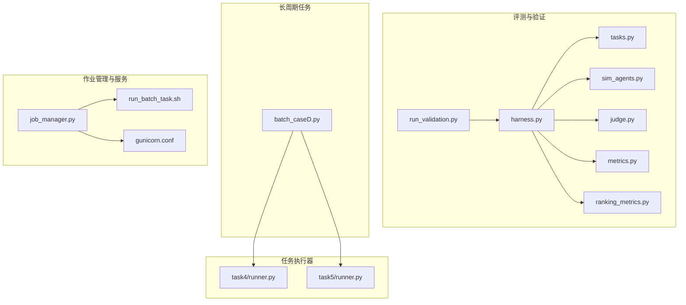
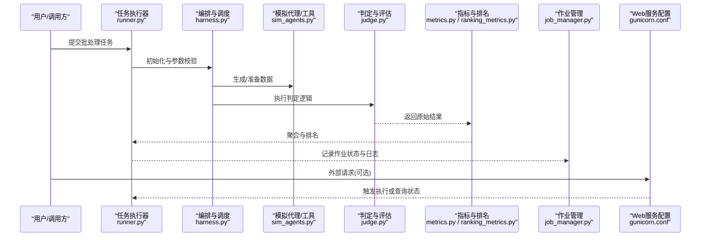
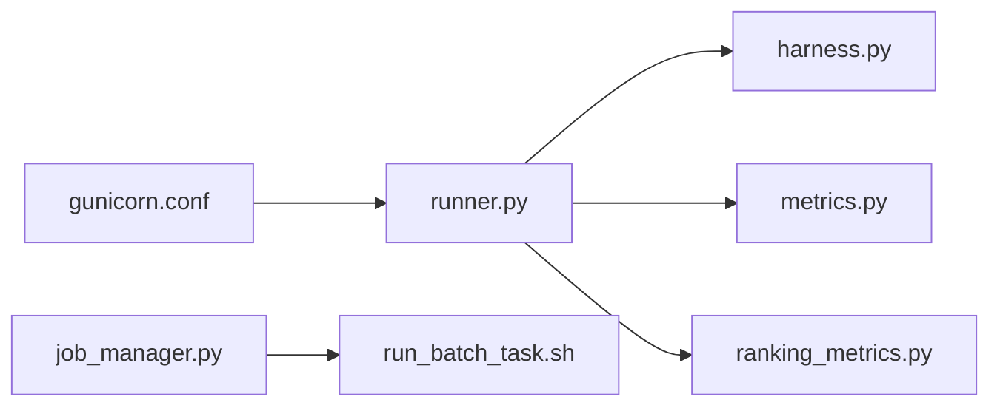

# 资源优化策略

<cite>
**本文引用的文件**   
- [autonomy_mvp/core/harness.py](file://autonomy_mvp/core/harness.py)
- [autonomy_mvp/core/judge.py](file://autonomy_mvp/core/judge.py)
- [autonomy_mvp/core/metrics.py](file://autonomy_mvp/core/metrics.py)
- [autonomy_mvp/core/ranking_metrics.py](file://autonomy_mvp/core/ranking_metrics.py)
- [autonomy_mvp/core/sim_agents.py](file://autonomy_mvp/core/sim_agents.py)
- [autonomy_mvp/core/tasks.py](file://autonomy_mvp/core/tasks.py)
- [autonomy_mvp/run_validation.py](file://autonomy_mvp/run_validation.py)
- [longhorizon/instantiate/batch_caseD.py](file://longhorizon/instantiate/batch_caseD.py)
- [task4/runner.py](file://task4/runner.py)
- [task5/runner.py](file://task5/runner.py)
- [task7/poc3_physicianbench/scripts/job_manager.py](file://task7/poc3_physicianbench/scripts/job_manager.py)
- [task7/poc3_physicianbench/scripts/run_batch_task.sh](file://task7/poc3_physicianbench/scripts/run_batch_task.sh)
- [task7/poc1_do_challenge/server/gunicorn.conf](file://task7/poc1_do_challenge/server/gunicorn.conf)
</cite>

## 目录
1. [引言](#引言)
2. [项目结构](#项目结构)
3. [核心组件](#核心组件)
4. [架构总览](#架构总览)
5. [详细组件分析](#详细组件分析)
6. [依赖关系分析](#依赖关系分析)
7. [性能考量](#性能考量)
8. [故障排查指南](#故障排查指南)
9. [结论](#结论)
10. [附录](#附录)

## 引言
本技术指南围绕“资源优化策略”展开，聚焦于计算资源的调度算法、负载均衡与并发控制；内存管理优化（垃圾回收调优、内存池与缓存）；CPU资源优化（线程池配置、进程间通信优化、计算密集型任务并行化）；I/O优化（异步I/O、批量处理、连接池）；以及资源监控与自动扩缩容的实现方案。文档以仓库中实际存在的脚本与模块为依据，提炼出可落地的工程实践与最佳实践路径。

## 项目结构
仓库包含多个子项目与实验用例，其中与资源优化密切相关的代码主要集中在以下位置：
- autonomy_mvp：评测与验证框架，提供任务编排、指标统计与结果汇总能力
- longhorizon：长周期任务的实例化与批处理入口
- task4/task5：不同场景的批处理与并行执行器
- task7：多POC示例，包含作业管理器、批量运行脚本与Web服务配置

图表来源
- [autonomy_mvp/core/harness.py](file://autonomy_mvp/core/harness.py)
- [autonomy_mvp/core/judge.py](file://autonomy_mvp/core/judge.py)
- [autonomy_mvp/core/metrics.py](file://autonomy_mvp/core/metrics.py)
- [autonomy_mvp/core/ranking_metrics.py](file://autonomy_mvp/core/ranking_metrics.py)
- [autonomy_mvp/core/sim_agents.py](file://autonomy_mvp/core/sim_agents.py)
- [autonomy_mvp/core/tasks.py](file://autonomy_mvp/core/tasks.py)
- [autonomy_mvp/run_validation.py](file://autonomy_mvp/run_validation.py)
- [longhorizon/instantiate/batch_caseD.py](file://longhorizon/instantiate/batch_caseD.py)
- [task4/runner.py](file://task4/runner.py)
- [task5/runner.py](file://task5/runner.py)
- [task7/poc3_physicianbench/scripts/job_manager.py](file://task7/poc3_physicianbench/scripts/job_manager.py)
- [task7/poc3_physicianbench/scripts/run_batch_task.sh](file://task7/poc3_physicianbench/scripts/run_batch_task.sh)
- [task7/poc1_do_challenge/server/gunicorn.conf](file://task7/poc1_do_challenge/server/gunicorn.conf)

章节来源
- [autonomy_mvp/run_validation.py](file://autonomy_mvp/run_validation.py)
- [autonomy_mvp/core/harness.py](file://autonomy_mvp/core/harness.py)
- [longhorizon/instantiate/batch_caseD.py](file://longhorizon/instantiate/batch_caseD.py)
- [task4/runner.py](file://task4/runner.py)
- [task5/runner.py](file://task5/runner.py)
- [task7/poc3_physicianbench/scripts/job_manager.py](file://task7/poc3_physicianbench/scripts/job_manager.py)
- [task7/poc3_physicianbench/scripts/run_batch_task.sh](file://task7/poc3_physicianbench/scripts/run_batch_task.sh)
- [task7/poc1_do_challenge/server/gunicorn.conf](file://task7/poc1_do_challenge/server/gunicorn.conf)

## 核心组件
- 任务编排与执行：通过统一入口加载任务定义、调度执行并收集指标
- 指标与排名：在任务完成后进行结果聚合与排序
- 作业管理：对批量任务进行生命周期管理、状态跟踪与日志输出
- Web服务配置：为外部请求提供服务端并发与资源限制

章节来源
- [autonomy_mvp/core/harness.py](file://autonomy_mvp/core/harness.py)
- [autonomy_mvp/core/metrics.py](file://autonomy_mvp/core/metrics.py)
- [autonomy_mvp/core/ranking_metrics.py](file://autonomy_mvp/core/ranking_metrics.py)
- [task7/poc3_physicianbench/scripts/job_manager.py](file://task7/poc3_physicianbench/scripts/job_manager.py)
- [task7/poc1_do_challenge/server/gunicorn.conf](file://task7/poc1_do_challenge/server/gunicorn.conf)

## 架构总览
整体架构由“任务编排层—执行层—指标与持久化层—服务与运维层”构成。任务编排层负责解析任务与参数；执行层根据资源约束进行并发与批处理；指标层完成结果聚合与排名；服务与运维层提供作业管理与Web服务配置。

图表来源
- [task4/runner.py](file://task4/runner.py)
- [task5/runner.py](file://task5/runner.py)
- [autonomy_mvp/core/harness.py](file://autonomy_mvp/core/harness.py)
- [autonomy_mvp/core/sim_agents.py](file://autonomy_mvp/core/sim_agents.py)
- [autonomy_mvp/core/judge.py](file://autonomy_mvp/core/judge.py)
- [autonomy_mvp/core/metrics.py](file://autonomy_mvp/core/metrics.py)
- [autonomy_mvp/core/ranking_metrics.py](file://autonomy_mvp/core/ranking_metrics.py)
- [task7/poc3_physicianbench/scripts/job_manager.py](file://task7/poc3_physicianbench/scripts/job_manager.py)
- [task7/poc1_do_challenge/server/gunicorn.conf](file://task7/poc1_do_challenge/server/gunicorn.conf)

## 详细组件分析

### 任务编排与调度（harness.py）
- 职责：统一加载任务定义、构建执行上下文、协调Agent与Judge、收集中间结果
- 调度要点：
  - 按任务粒度划分工作单元，避免单任务过大导致内存峰值过高
  - 结合批大小与并发度控制，平衡吞吐与延迟
  - 对失败任务实施重试与降级策略，保障整体稳定性
- 资源优化建议：
  - 使用惰性加载与分块读取，降低初始内存占用
  - 将大对象及时释放或转存到磁盘，减少GC压力
  - 对热点数据进行本地缓存，减少重复计算

章节来源
- [autonomy_mvp/core/harness.py](file://autonomy_mvp/core/harness.py)

### 指标与排名（metrics.py, ranking_metrics.py）
- 职责：对任务结果进行统计、聚合与排序，支持多维度指标对比
- 优化要点：
  - 增量式聚合，避免全量重算
  - 使用高效数据结构（如堆、有序映射）提升排序性能
  - 对大规模结果采用流式处理与分页输出
- 监控与告警：
  - 暴露关键指标（吞吐、延迟、错误率）以便外部监控系统采集
  - 设置阈值触发告警，辅助自动扩缩容决策

章节来源
- [autonomy_mvp/core/metrics.py](file://autonomy_mvp/core/metrics.py)
- [autonomy_mvp/core/ranking_metrics.py](file://autonomy_mvp/core/ranking_metrics.py)

### 作业管理（job_manager.py）
- 职责：管理批量任务的生命周期，包括创建、调度、状态跟踪与日志输出
- 并发与负载均衡：
  - 基于队列的任务分发，避免热点节点过载
  - 动态调整并发度，依据系统负载自适应伸缩
- 可靠性：
  - 断点续跑与幂等设计，确保任务可恢复
  - 失败隔离与快速失败，防止级联故障

章节来源
- [task7/poc3_physicianbench/scripts/job_manager.py](file://task7/poc3_physicianbench/scripts/job_manager.py)

### 批处理与并行执行（task4/runner.py, task5/runner.py）
- 职责：作为具体场景的执行器，驱动任务批处理与并行执行
- 并发模型：
  - 多线程用于I/O密集型任务，提高等待时间利用率
  - 多进程用于CPU密集型任务，绕过GIL限制
- 批处理策略：
  - 合理设置批次大小，平衡内存占用与吞吐
  - 对长尾任务进行切分与超时控制

章节来源
- [task4/runner.py](file://task4/runner.py)
- [task5/runner.py](file://task5/runner.py)

### 长周期任务批处理（batch_caseD.py）
- 职责：针对长周期任务的批处理入口，组织任务序列与资源分配
- 优化要点：
  - 任务优先级与抢占策略，保证高优任务及时完成
  - 资源预留与配额管理，避免资源争用
  - 进度上报与可视化，便于人工干预

章节来源
- [longhorizon/instantiate/batch_caseD.py](file://longhorizon/instantiate/batch_caseD.py)

### Web服务并发与资源限制（gunicorn.conf）
- 职责：配置Web服务的进程/线程数、超时与日志策略
- 并发控制：
  - 根据CPU核数与工作负载类型设置workers与threads
  - 限制最大请求数与连接数，防止资源耗尽
- 监控集成：
  - 暴露健康检查接口，供负载均衡与健康探针使用
  - 结构化日志输出，便于集中采集与分析

章节来源
- [task7/poc1_do_challenge/server/gunicorn.conf](file://task7/poc1_do_challenge/server/gunicorn.conf)

### 批量运行脚本（run_batch_task.sh）
- 职责：封装批量任务的启动命令与环境变量，简化运维操作
- 资源优化：
  - 通过环境变量注入并发度、批大小与超时参数
  - 支持后台运行与日志轮转，提升可观测性

章节来源
- [task7/poc3_physicianbench/scripts/run_batch_task.sh](file://task7/poc3_physicianbench/scripts/run_batch_task.sh)

## 依赖关系分析
- 低耦合高内聚：各模块职责清晰，通过明确接口交互
- 直接依赖：
  - runner.py 依赖 harness.py 进行任务编排
  - job_manager.py 依赖 run_batch_task.sh 提供的运行环境
  - gunicorn.conf 影响Web服务的并发与资源上限
- 潜在风险：
  - 若指标模块与排名模块强耦合，可能影响扩展性
  - 作业管理与执行器之间需保持状态一致性

图表来源
- [task4/runner.py](file://task4/runner.py)
- [task5/runner.py](file://task5/runner.py)
- [autonomy_mvp/core/harness.py](file://autonomy_mvp/core/harness.py)
- [autonomy_mvp/core/metrics.py](file://autonomy_mvp/core/metrics.py)
- [autonomy_mvp/core/ranking_metrics.py](file://autonomy_mvp/core/ranking_metrics.py)
- [task7/poc3_physicianbench/scripts/job_manager.py](file://task7/poc3_physicianbench/scripts/job_manager.py)
- [task7/poc3_physicianbench/scripts/run_batch_task.sh](file://task7/poc3_physicianbench/scripts/run_batch_task.sh)
- [task7/poc1_do_challenge/server/gunicorn.conf](file://task7/poc1_do_challenge/server/gunicorn.conf)

## 性能考量
- 计算资源调度
  - 采用分层调度：先按任务类型分流，再按资源需求分配
  - 引入公平队列与权重机制，避免饥饿现象
- 负载均衡
  - 基于响应时间与队列长度做动态路由
  - 对热点键进行分片与本地缓存，降低跨节点访问
- 并发控制
  - 使用信号量与令牌桶限流，保护后端资源
  - 对阻塞操作设置超时与熔断，防止雪崩
- 内存管理
  - 垃圾回收调优：根据工作负载调整阈值，减少频繁GC
  - 内存池：对高频小对象复用，降低分配开销
  - 缓存策略：LRU/TTL结合，控制命中率与内存占用
- CPU优化
  - 线程池：I/O密集场景提高并发度，注意锁竞争
  - 进程池：CPU密集场景利用多核，避免共享状态
  - IPC优化：使用零拷贝与序列化压缩，降低通信开销
- I/O优化
  - 异步I/O：非阻塞读写，提高吞吐
  - 批量处理：合并小请求，减少系统调用次数
  - 连接池：复用连接，降低握手开销
- 监控与自动扩缩容
  - 采集CPU、内存、I/O、网络与业务指标
  - 基于阈值与预测模型触发扩缩容动作
  - 灰度发布与回滚策略，保障稳定性

[本节为通用指导，不直接分析具体文件]

## 故障排查指南
- 常见问题定位
  - 任务挂起：检查超时与重试配置，确认下游依赖可用性
  - 内存泄漏：观察RSS与GC频率，定位未释放的大对象
  - CPU飙高：分析热点函数与锁竞争，优化算法与并发模型
  - I/O瓶颈：查看磁盘与网络指标，启用异步与批量策略
- 日志与追踪
  - 结构化日志：包含任务ID、阶段、耗时与错误码
  - 分布式追踪：串联跨进程/跨服务调用链
- 恢复与自愈
  - 断点续跑：保存中间状态，支持从失败点继续
  - 自动重试：指数退避与抖动，避免风暴
  - 降级与熔断：在异常时返回兜底结果，保护主流程

章节来源
- [task7/poc3_physicianbench/scripts/job_manager.py](file://task7/poc3_physicianbench/scripts/job_manager.py)
- [task7/poc1_do_challenge/server/gunicorn.conf](file://task7/poc1_do_challenge/server/gunicorn.conf)

## 结论
通过对仓库中任务编排、指标统计、作业管理与服务配置的深入分析，可以形成一套完整的资源优化策略：以分层调度与负载均衡为核心，结合并发控制与内存/CPU/I/O优化手段，辅以完善的监控与自动扩缩容机制，实现高吞吐、低延迟与高可用的系统目标。建议在工程实践中持续迭代参数与策略，结合真实负载进行压测与回归，确保优化效果稳定可靠。

[本节为总结性内容，不直接分析具体文件]

## 附录
- 术语表
  - 批处理：将多个任务打包执行，提升资源利用率
  - 并发控制：通过限流、熔断等手段保护系统资源
  - 自动扩缩容：根据负载动态调整资源规模
- 参考脚本与配置
  - 批处理入口：[longhorizon/instantiate/batch_caseD.py](file://longhorizon/instantiate/batch_caseD.py)
  - 任务执行器：[task4/runner.py](file://task4/runner.py), [task5/runner.py](file://task5/runner.py)
  - 作业管理：[task7/poc3_physicianbench/scripts/job_manager.py](file://task7/poc3_physicianbench/scripts/job_manager.py)
  - 运行脚本：[task7/poc3_physicianbench/scripts/run_batch_task.sh](file://task7/poc3_physicianbench/scripts/run_batch_task.sh)
  - Web服务配置：[task7/poc1_do_challenge/server/gunicorn.conf](file://task7/poc1_do_challenge/server/gunicorn.conf)