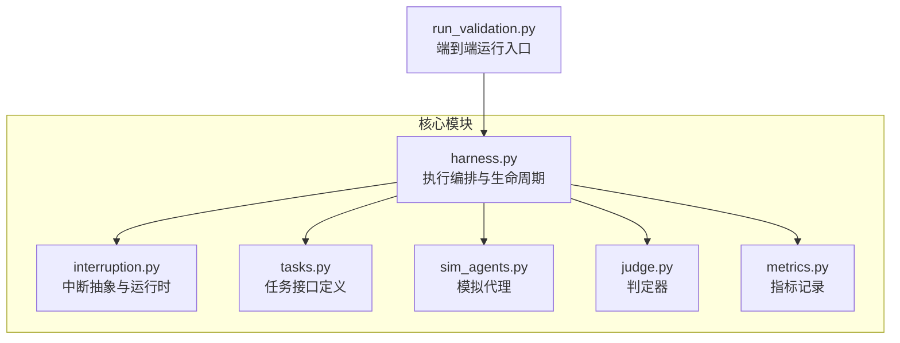
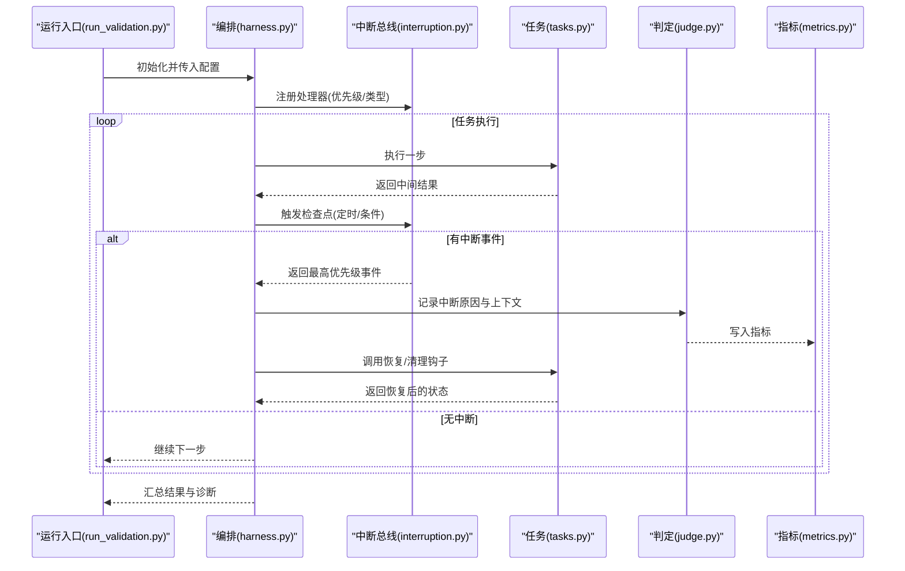
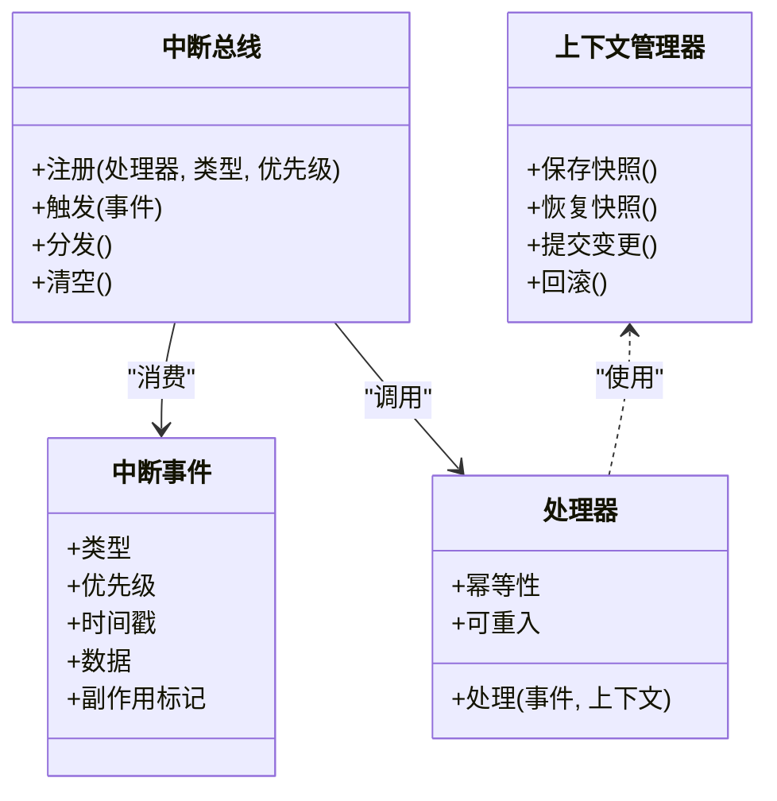
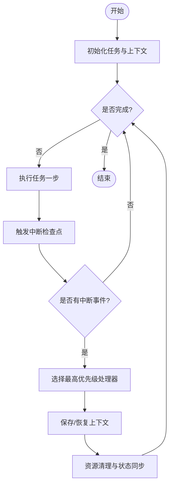
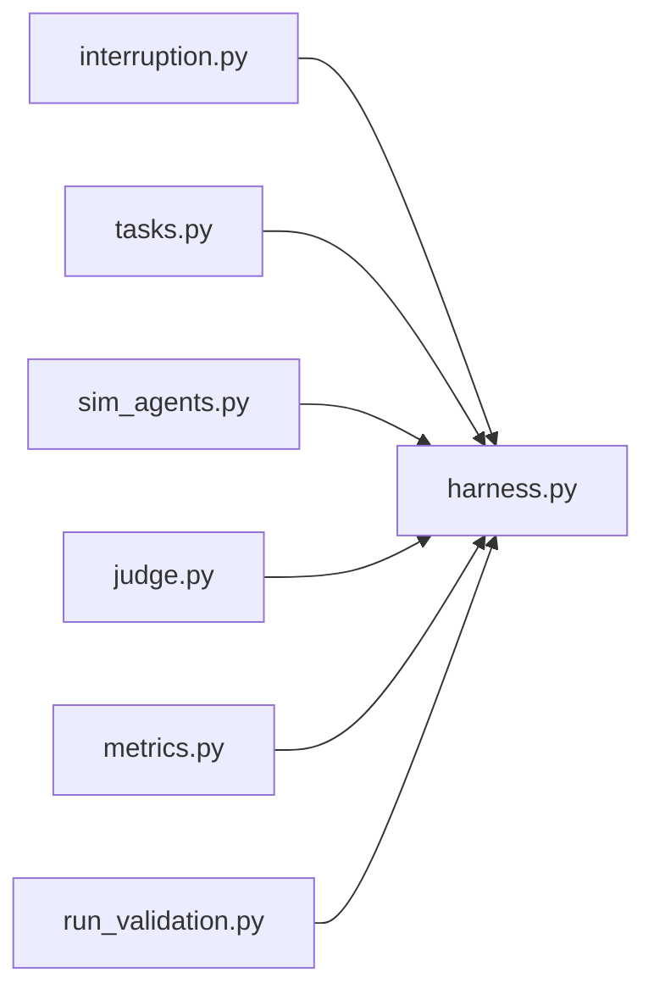

# 中断处理系统

<cite>
**本文引用的文件**   
- [autonomy_mvp/core/interruption.py](file://autonomy_mvp/core/interruption.py)
- [autonomy_mvp/core/harness.py](file://autonomy_mvp/core/harness.py)
- [autonomy_mvp/core/judge.py](file://autonomy_mvp/core/judge.py)
- [autonomy_mvp/core/metrics.py](file://autonomy_mvp/core/metrics.py)
- [autonomy_mvp/core/tasks.py](file://autonomy_mvp/core/tasks.py)
- [autonomy_mvp/core/sim_agents.py](file://autonomy_mvp/core/sim_agents.py)
- [autonomy_mvp/run_validation.py](file://autonomy_mvp/run_validation.py)
</cite>

## 目录
1. [简介](#简介)
2. [项目结构](#项目结构)
3. [核心组件](#核心组件)
4. [架构总览](#架构总览)
5. [详细组件分析](#详细组件分析)
6. [依赖关系分析](#依赖关系分析)
7. [性能考量](#性能考量)
8. [故障排查指南](#故障排查指南)
9. [结论](#结论)
10. [附录](#附录)

## 简介
本文件面向科学计算基准测试框架的中断处理子系统，系统性阐述其设计原理、事件驱动与异步处理能力、中断类型与优先级管理、调度策略、注册/触发/处理流程、上下文管理与状态保存恢复机制、配置选项、错误处理与调试方法，并结合长视域任务给出应用场景与最佳实践。文档以代码仓库中的实际实现为依据，确保内容可追溯、可验证。

## 项目结构
与中断处理直接相关的核心代码位于 autonomy_mvp/core 目录下，其中 interruption.py 提供中断抽象与运行时支持；harness.py 负责编排执行与生命周期；tasks.py 定义任务接口；sim_agents.py 提供模拟代理；judge.py 与 metrics.py 用于评估与指标记录；run_validation.py 为端到端运行入口。

图表来源
- [autonomy_mvp/core/interruption.py](file://autonomy_mvp/core/interruption.py)
- [autonomy_mvp/core/harness.py](file://autonomy_mvp/core/harness.py)
- [autonomy_mvp/core/tasks.py](file://autonomy_mvp/core/tasks.py)
- [autonomy_mvp/core/sim_agents.py](file://autonomy_mvp/core/sim_agents.py)
- [autonomy_mvp/core/judge.py](file://autonomy_mvp/core/judge.py)
- [autonomy_mvp/core/metrics.py](file://autonomy_mvp/core/metrics.py)
- [autonomy_mvp/run_validation.py](file://autonomy_mvp/run_validation.py)

章节来源
- [autonomy_mvp/core/interruption.py](file://autonomy_mvp/core/interruption.py)
- [autonomy_mvp/core/harness.py](file://autonomy_mvp/core/harness.py)
- [autonomy_mvp/core/tasks.py](file://autonomy_mvp/core/tasks.py)
- [autonomy_mvp/core/sim_agents.py](file://autonomy_mvp/core/sim_agents.py)
- [autonomy_mvp/core/judge.py](file://autonomy_mvp/core/judge.py)
- [autonomy_mvp/core/metrics.py](file://autonomy_mvp/core/metrics.py)
- [autonomy_mvp/run_validation.py](file://autonomy_mvp/run_validation.py)

## 核心组件
- 中断抽象与运行时（interruption.py）：定义中断事件模型、优先级、调度策略、上下文管理、注册/触发/分发、以及状态保存与恢复钩子。
- 执行编排（harness.py）：在任务执行前后注入中断检查点，协调中断的注册、触发时机与清理。
- 任务接口（tasks.py）：暴露任务生命周期回调，供中断系统在关键阶段进行干预或采样。
- 模拟代理（sim_agents.py）：在仿真环境中响应中断信号，调整行为或退出路径。
- 判定器（judge.py）与指标（metrics.py）：在中断发生时记录原因、影响范围与结果，便于后续分析与复现。
- 运行入口（run_validation.py）：统一启动、配置与监控中断相关参数，并输出诊断信息。

章节来源
- [autonomy_mvp/core/interruption.py](file://autonomy_mvp/core/interruption.py)
- [autonomy_mvp/core/harness.py](file://autonomy_mvp/core/harness.py)
- [autonomy_mvp/core/tasks.py](file://autonomy_mvp/core/tasks.py)
- [autonomy_mvp/core/sim_agents.py](file://autonomy_mvp/core/sim_agents.py)
- [autonomy_mvp/core/judge.py](file://autonomy_mvp/core/judge.py)
- [autonomy_mvp/core/metrics.py](file://autonomy_mvp/core/metrics.py)
- [autonomy_mvp/run_validation.py](file://autonomy_mvp/run_validation.py)

## 架构总览
中断系统采用事件驱动与异步协作模式：
- 事件源：外部信号（如超时、用户取消、资源不足）、内部条件（如收敛阈值、异常检测）。
- 事件总线：集中注册与分发，按优先级排序并保证线程安全。
- 处理器：针对不同类型中断的专用处理逻辑，支持幂等与可重入。
- 上下文管理器：在执行关键段前保存状态，中断后恢复或持久化。
- 编排层：在任务循环中插入检查点，避免阻塞且最小化开销。

图表来源
- [autonomy_mvp/run_validation.py](file://autonomy_mvp/run_validation.py)
- [autonomy_mvp/core/harness.py](file://autonomy_mvp/core/harness.py)
- [autonomy_mvp/core/interruption.py](file://autonomy_mvp/core/interruption.py)
- [autonomy_mvp/core/tasks.py](file://autonomy_mvp/core/tasks.py)
- [autonomy_mvp/core/judge.py](file://autonomy_mvp/core/judge.py)
- [autonomy_mvp/core/metrics.py](file://autonomy_mvp/core/metrics.py)

## 详细组件分析

### 中断抽象与运行时（interruption.py）
- 事件模型：包含类型、优先级、时间戳、携带数据与可选副作用标记。
- 优先级与调度：基于数值优先级队列，支持动态更新与去重；高优先级先处理，同优先级按到达顺序。
- 注册与分发：提供注册接口，支持一次性与持续监听；分发时按优先级出队并调用处理器。
- 上下文管理：在进入关键段前保存快照（变量、指针、外部句柄），中断后根据策略恢复或回滚。
- 异步能力：通过非阻塞检查点与回调机制，避免主循环阻塞；支持并发注册与线程安全访问。
- 错误处理：处理器异常被捕获并降级为“已记录但忽略”，不影响其他处理器执行。

图表来源
- [autonomy_mvp/core/interruption.py](file://autonomy_mvp/core/interruption.py)

章节来源
- [autonomy_mvp/core/interruption.py](file://autonomy_mvp/core/interruption.py)

### 执行编排（harness.py）
- 生命周期钩子：在任务初始化、每步执行前后、结束阶段注入中断检查点。
- 检查点策略：定时轮询与条件触发结合，降低开销同时保证及时响应。
- 中断集成：将中断事件转化为任务可理解的语义（如暂停、重试、终止），并协调上下文恢复。
- 资源清理：确保中断后释放锁、关闭句柄、清理临时文件。

图表来源
- [autonomy_mvp/core/harness.py](file://autonomy_mvp/core/harness.py)
- [autonomy_mvp/core/interruption.py](file://autonomy_mvp/core/interruption.py)

章节来源
- [autonomy_mvp/core/harness.py](file://autonomy_mvp/core/harness.py)
- [autonomy_mvp/core/interruption.py](file://autonomy_mvp/core/interruption.py)

### 任务接口（tasks.py）
- 标准回调：提供 on_interrupt、on_resume、on_cleanup 等钩子，供中断系统调用。
- 状态契约：明确哪些状态可恢复、哪些需重建，保障中断后一致性。
- 兼容性：对不支持中断的任务提供空实现，确保通用编排。

章节来源
- [autonomy_mvp/core/tasks.py](file://autonomy_mvp/core/tasks.py)

### 模拟代理（sim_agents.py）
- 行为响应：在仿真环境中根据中断类型调整探索策略或提前终止。
- 观测与日志：记录中断前后的决策差异，便于对比分析。

章节来源
- [autonomy_mvp/core/sim_agents.py](file://autonomy_mvp/core/sim_agents.py)

### 判定器（judge.py）与指标（metrics.py）
- 判定规则：依据中断类型与上下文决定最终评分或失败原因。
- 指标采集：记录中断次数、平均响应时间、恢复成功率、资源占用变化等。

章节来源
- [autonomy_mvp/core/judge.py](file://autonomy_mvp/core/judge.py)
- [autonomy_mvp/core/metrics.py](file://autonomy_mvp/core/metrics.py)

### 运行入口（run_validation.py）
- 配置项：启用/禁用中断、设置优先级阈值、检查点间隔、处理器列表。
- 诊断输出：打印中断事件流、处理器耗时、上下文快照摘要。
- 批量执行：在多任务场景下隔离上下文，避免跨任务干扰。

章节来源
- [autonomy_mvp/run_validation.py](file://autonomy_mvp/run_validation.py)

## 依赖关系分析
- 低耦合：中断总线与任务解耦，通过标准回调与事件模型交互。
- 内聚性：中断相关逻辑集中在 interruption.py，便于维护与扩展。
- 外部依赖：仅依赖标准库与轻量级数据结构，避免引入重型框架。

图表来源
- [autonomy_mvp/core/interruption.py](file://autonomy_mvp/core/interruption.py)
- [autonomy_mvp/core/harness.py](file://autonomy_mvp/core/harness.py)
- [autonomy_mvp/core/tasks.py](file://autonomy_mvp/core/tasks.py)
- [autonomy_mvp/core/sim_agents.py](file://autonomy_mvp/core/sim_agents.py)
- [autonomy_mvp/core/judge.py](file://autonomy_mvp/core/judge.py)
- [autonomy_mvp/core/metrics.py](file://autonomy_mvp/core/metrics.py)
- [autonomy_mvp/run_validation.py](file://autonomy_mvp/run_validation.py)

章节来源
- [autonomy_mvp/core/interruption.py](file://autonomy_mvp/core/interruption.py)
- [autonomy_mvp/core/harness.py](file://autonomy_mvp/core/harness.py)
- [autonomy_mvp/core/tasks.py](file://autonomy_mvp/core/tasks.py)
- [autonomy_mvp/core/sim_agents.py](file://autonomy_mvp/core/sim_agents.py)
- [autonomy_mvp/core/judge.py](file://autonomy_mvp/core/judge.py)
- [autonomy_mvp/core/metrics.py](file://autonomy_mvp/core/metrics.py)
- [autonomy_mvp/run_validation.py](file://autonomy_mvp/run_validation.py)

## 性能考量
- 检查点频率：在高吞吐场景中适当降低检查点频率，平衡响应性与开销。
- 处理器粒度：将细粒度处理器合并，减少分发成本。
- 上下文快照大小：仅保存必要状态，必要时使用增量快照与持久化存储。
- 并发控制：限制并发处理器数量，避免争用导致抖动。

[本节为通用指导，不直接分析具体文件]

## 故障排查指南
- 现象：中断未触发
  - 检查检查点是否被正确插入与调用。
  - 确认处理器已注册且类型匹配。
- 现象：中断后状态不一致
  - 核对上下文快照范围与恢复逻辑。
  - 查看判定器与指标记录，定位差异点。
- 现象：处理器异常导致其他处理器失效
  - 确认异常捕获与降级策略生效。
  - 增加处理器日志与耗时统计。
- 现象：性能退化
  - 调整检查点间隔与处理器优先级。
  - 分析上下文快照大小与序列化开销。

章节来源
- [autonomy_mvp/core/harness.py](file://autonomy_mvp/core/harness.py)
- [autonomy_mvp/core/interruption.py](file://autonomy_mvp/core/interruption.py)
- [autonomy_mvp/core/judge.py](file://autonomy_mvp/core/judge.py)
- [autonomy_mvp/core/metrics.py](file://autonomy_mvp/core/metrics.py)

## 结论
该中断处理系统以事件驱动为核心，结合上下文管理与优先级调度，为科学计算基准测试提供了可靠的可中断与可恢复能力。通过模块化设计与清晰的职责划分，系统在保持低耦合的同时具备良好的扩展性与可观测性。在长视域任务中，合理配置检查点与处理器策略，可显著提升鲁棒性与用户体验。

[本节为总结性内容，不直接分析具体文件]

## 附录
- 配置建议：
  - 启用最小化快照，按需持久化。
  - 为关键处理器设置较高优先级。
  - 开启指标采集以便事后分析。
- 最佳实践：
  - 在任务边界处定义明确的恢复点。
  - 处理器保持幂等与可重入。
  - 使用统一的错误码与日志格式。

[本节为补充说明，不直接分析具体文件]