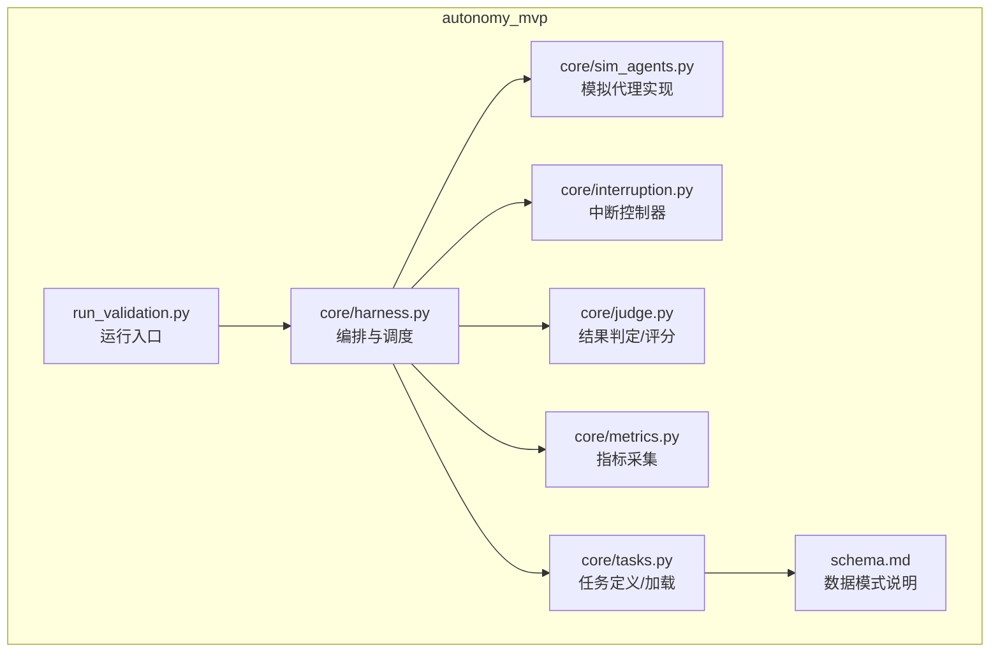
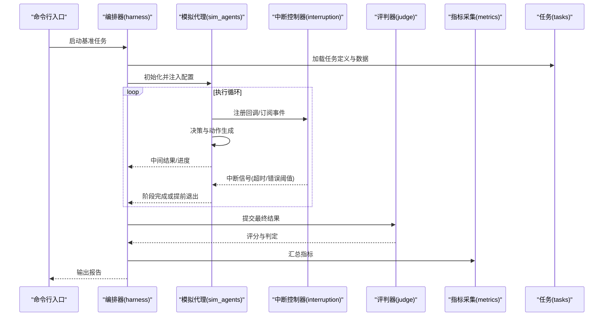
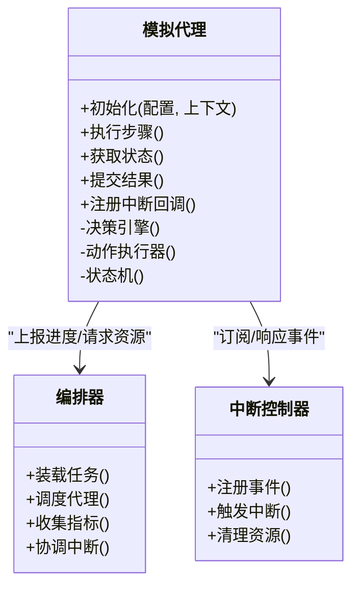
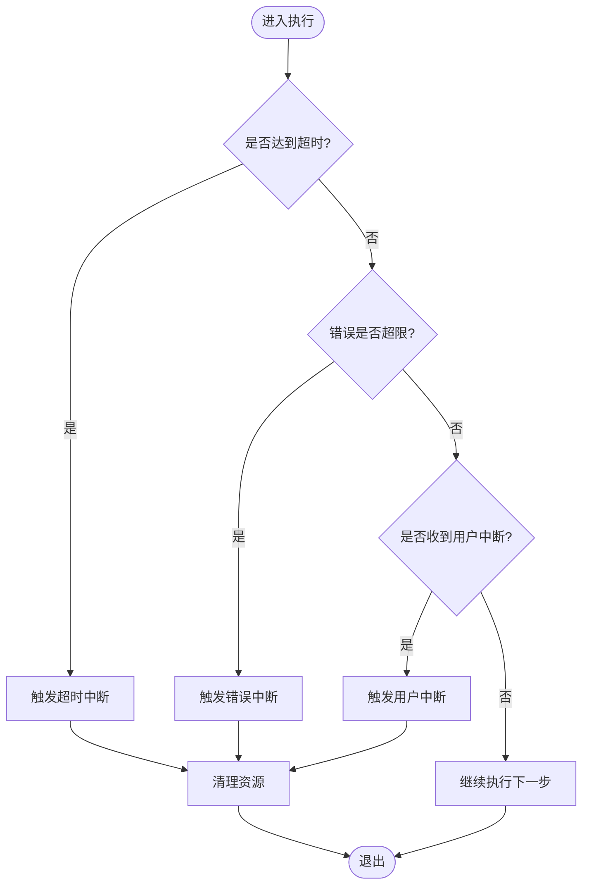
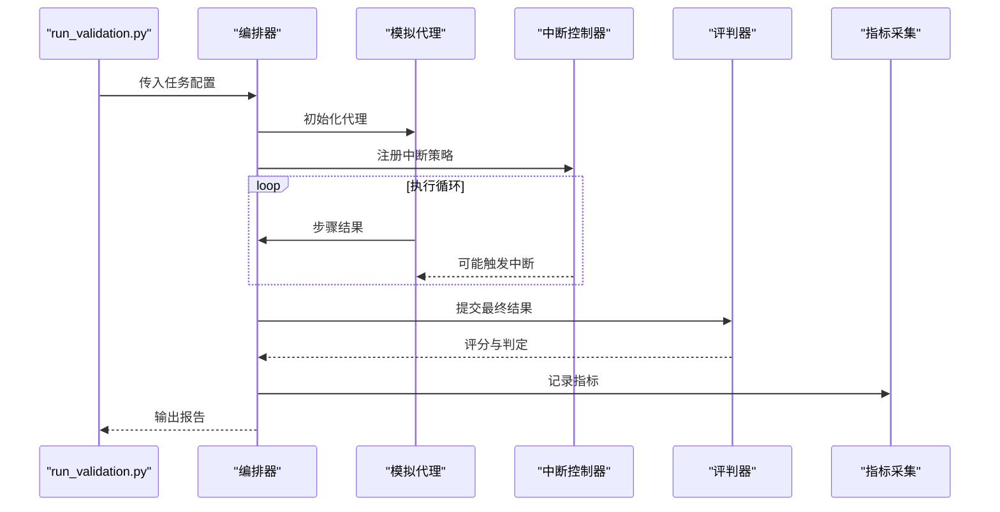
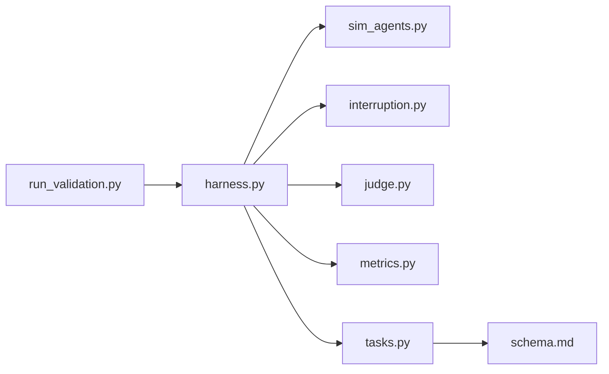

# 代理系统

<cite>
**本文档引用的文件**   
- [autonomy_mvp/core/sim_agents.py](file://autonomy_mvp/core/sim_agents.py)
- [autonomy_mvp/core/interruption.py](file://autonomy_mvp/core/interruption.py)
- [autonomy_mvp/core/harness.py](file://autonomy_mvp/core/harness.py)
- [autonomy_mvp/core/judge.py](file://autonomy_mvp/core/judge.py)
- [autonomy_mvp/core/metrics.py](file://autonomy_mvp/core/metrics.py)
- [autonomy_mvp/core/tasks.py](file://autonomy_mvp/core/tasks.py)
- [autonomy_mvp/run_validation.py](file://autonomy_mvp/run_validation.py)
- [autonomy_mvp/schema.md](file://autonomy_mvp/schema.md)
</cite>

## 目录
1. [简介](#简介)
2. [项目结构](#项目结构)
3. [核心组件](#核心组件)
4. [架构总览](#架构总览)
5. [详细组件分析](#详细组件分析)
6. [依赖关系分析](#依赖关系分析)
7. [性能考量](#性能考量)
8. [故障排查指南](#故障排查指南)
9. [结论](#结论)
10. [附录](#附录)

## 简介
本文件为科学计算基准测试框架中的“代理系统”提供系统化文档。重点覆盖：
- 模拟代理的实现架构、行为模式与决策机制
- 代理生命周期管理、状态转换与通信协议
- 中断处理机制的设计原理、事件驱动架构与异步处理能力
- 代理配置选项、参数调优与性能监控方法
- 代理定制开发与调试指南

该代理系统围绕任务编排、执行与评估闭环构建，通过可插拔的模拟代理、中断控制器与评测器，支撑多场景科学计算基准（如药物筛选、材料属性预测等）。

## 项目结构
代理系统位于 autonomy_mvp 子项目中，核心代码集中在 core 目录，运行入口在 run_validation.py，任务定义与数据模式在 schema.md 中描述。

图表来源
- [autonomy_mvp/run_validation.py](file://autonomy_mvp/run_validation.py)
- [autonomy_mvp/core/harness.py](file://autonomy_mvp/core/harness.py)
- [autonomy_mvp/core/sim_agents.py](file://autonomy_mvp/core/sim_agents.py)
- [autonomy_mvp/core/interruption.py](file://autonomy_mvp/core/interruption.py)
- [autonomy_mvp/core/judge.py](file://autonomy_mvp/core/judge.py)
- [autonomy_mvp/core/metrics.py](file://autonomy_mvp/core/metrics.py)
- [autonomy_mvp/core/tasks.py](file://autonomy_mvp/core/tasks.py)
- [autonomy_mvp/schema.md](file://autonomy_mvp/schema.md)

章节来源
- [autonomy_mvp/run_validation.py](file://autonomy_mvp/run_validation.py)
- [autonomy_mvp/core/harness.py](file://autonomy_mvp/core/harness.py)
- [autonomy_mvp/core/sim_agents.py](file://autonomy_mvp/core/sim_agents.py)
- [autonomy_mvp/core/interruption.py](file://autonomy_mvp/core/interruption.py)
- [autonomy_mvp/core/judge.py](file://autonomy_mvp/core/judge.py)
- [autonomy_mvp/core/metrics.py](file://autonomy_mvp/core/metrics.py)
- [autonomy_mvp/core/tasks.py](file://autonomy_mvp/core/tasks.py)
- [autonomy_mvp/schema.md](file://autonomy_mvp/schema.md)

## 核心组件
- 模拟代理（sim_agents）：封装具体任务的推理与工具调用逻辑，暴露统一的执行接口，支持策略选择、动作序列生成与结果回传。
- 中断控制器（interruption）：提供外部干预能力，支持超时、错误阈值、用户中断等事件触发，保障长时间运行的稳定性。
- 编排器（harness）：负责任务实例化、代理装配、执行循环、资源管理与结果收集，是系统的中枢。
- 评判器（judge）：对代理输出进行校验、打分与一致性检查，产出结构化评估结果。
- 指标采集（metrics）：记录耗时、吞吐、资源占用与自定义业务指标，便于性能分析与对比。
- 任务定义（tasks）：统一的任务描述、输入输出契约与样例数据加载。

章节来源
- [autonomy_mvp/core/sim_agents.py](file://autonomy_mvp/core/sim_agents.py)
- [autonomy_mvp/core/interruption.py](file://autonomy_mvp/core/interruption.py)
- [autonomy_mvp/core/harness.py](file://autonomy_mvp/core/harness.py)
- [autonomy_mvp/core/judge.py](file://autonomy_mvp/core/judge.py)
- [autonomy_mvp/core/metrics.py](file://autonomy_mvp/core/metrics.py)
- [autonomy_mvp/core/tasks.py](file://autonomy_mvp/core/tasks.py)

## 架构总览
代理系统采用“编排-执行-评估”三段式架构，结合事件驱动与中断控制，形成高内聚低耦合的可扩展体系。

图表来源
- [autonomy_mvp/core/harness.py](file://autonomy_mvp/core/harness.py)
- [autonomy_mvp/core/sim_agents.py](file://autonomy_mvp/core/sim_agents.py)
- [autonomy_mvp/core/interruption.py](file://autonomy_mvp/core/interruption.py)
- [autonomy_mvp/core/judge.py](file://autonomy_mvp/core/judge.py)
- [autonomy_mvp/core/metrics.py](file://autonomy_mvp/core/metrics.py)
- [autonomy_mvp/core/tasks.py](file://autonomy_mvp/core/tasks.py)

## 详细组件分析

### 模拟代理（sim_agents）
- 职责：根据任务上下文生成动作序列，调用工具或模型，维护内部状态，返回阶段性或最终结果。
- 行为模式：
  - 策略路由：依据任务类型选择不同推理路径（如检索-推理-验证）。
  - 动作空间：限制为安全可执行的原子操作集合，避免副作用扩散。
  - 状态机：明确初始、进行中、等待外部输入、完成、失败等状态。
- 决策机制：
  - 启发式规则与学习策略结合，支持可配置的探索-利用平衡。
  - 基于指标反馈的动态重规划，提升收敛效率。
- 通信协议：
  - 与编排器通过消息对象交互，包含任务ID、步骤索引、动作、结果与元数据。
  - 支持流式上报与批量提交两种模式。

图表来源
- [autonomy_mvp/core/sim_agents.py](file://autonomy_mvp/core/sim_agents.py)
- [autonomy_mvp/core/harness.py](file://autonomy_mvp/core/harness.py)
- [autonomy_mvp/core/interruption.py](file://autonomy_mvp/core/interruption.py)

章节来源
- [autonomy_mvp/core/sim_agents.py](file://autonomy_mvp/core/sim_agents.py)

### 中断控制器（interruption）
- 设计原则：事件驱动、最小侵入、可组合。
- 支持的事件类型：
  - 超时中断：按步数或时间上限强制退出。
  - 错误阈值：当连续失败次数或损失超过阈值时中止。
  - 用户中断：外部信号（如Ctrl+C）或API调用触发。
- 异步处理：
  - 使用非阻塞回调队列，确保主流程不被阻塞。
  - 支持优先级与去抖，避免风暴式中断。
- 资源清理：
  - 中断后自动释放临时文件、网络连接与锁资源。

图表来源
- [autonomy_mvp/core/interruption.py](file://autonomy_mvp/core/interruption.py)

章节来源
- [autonomy_mvp/core/interruption.py](file://autonomy_mvp/core/interruption.py)

### 编排器（harness）
- 职责：任务装配、代理生命周期管理、执行循环、指标聚合与报告生成。
- 关键流程：
  - 加载任务定义与数据，构造代理实例。
  - 设置中断策略与监控钩子。
  - 驱动代理执行，捕获异常与中断信号。
  - 将结果提交给评判器，汇总指标并持久化。
- 并发与隔离：
  - 支持多任务并行执行，隔离工作空间与日志。
  - 资源配额与限流，防止过载。

图表来源
- [autonomy_mvp/run_validation.py](file://autonomy_mvp/run_validation.py)
- [autonomy_mvp/core/harness.py](file://autonomy_mvp/core/harness.py)
- [autonomy_mvp/core/sim_agents.py](file://autonomy_mvp/core/sim_agents.py)
- [autonomy_mvp/core/interruption.py](file://autonomy_mvp/core/interruption.py)
- [autonomy_mvp/core/judge.py](file://autonomy_mvp/core/judge.py)
- [autonomy_mvp/core/metrics.py](file://autonomy_mvp/core/metrics.py)

章节来源
- [autonomy_mvp/run_validation.py](file://autonomy_mvp/run_validation.py)
- [autonomy_mvp/core/harness.py](file://autonomy_mvp/core/harness.py)

### 评判器（judge）
- 功能：对代理输出进行格式校验、数值范围检查、一致性比对与评分。
- 评分策略：支持加权评分、阈值判定与多级评审。
- 可扩展性：通过插件化评分函数适配不同任务领域。

章节来源
- [autonomy_mvp/core/judge.py](file://autonomy_mvp/core/judge.py)

### 指标采集（metrics）
- 采集项：执行时长、步骤数、成功率、资源占用、自定义业务指标。
- 存储与导出：内存缓存+落盘，支持JSON/CSV导出与可视化对接。
- 实时性：支持增量更新与采样降频，降低开销。

章节来源
- [autonomy_mvp/core/metrics.py](file://autonomy_mvp/core/metrics.py)

### 任务定义（tasks）
- 内容：任务描述、输入输出模式、约束条件、样例数据路径。
- 加载方式：从schema.md定义的契约解析，保证跨模块一致性。
- 版本管理：支持任务版本与向后兼容字段。

章节来源
- [autonomy_mvp/core/tasks.py](file://autonomy_mvp/core/tasks.py)
- [autonomy_mvp/schema.md](file://autonomy_mvp/schema.md)

## 依赖关系分析
- 松耦合：各组件通过清晰接口交互，替换代理或评判器不影响整体流程。
- 事件驱动：中断控制器作为横切关注点，被代理与编排器共同依赖。
- 数据契约：任务定义与schema.md强一致，减少运行时错误。

图表来源
- [autonomy_mvp/run_validation.py](file://autonomy_mvp/run_validation.py)
- [autonomy_mvp/core/harness.py](file://autonomy_mvp/core/harness.py)
- [autonomy_mvp/core/sim_agents.py](file://autonomy_mvp/core/sim_agents.py)
- [autonomy_mvp/core/interruption.py](file://autonomy_mvp/core/interruption.py)
- [autonomy_mvp/core/judge.py](file://autonomy_mvp/core/judge.py)
- [autonomy_mvp/core/metrics.py](file://autonomy_mvp/core/metrics.py)
- [autonomy_mvp/core/tasks.py](file://autonomy_mvp/core/tasks.py)
- [autonomy_mvp/schema.md](file://autonomy_mvp/schema.md)

章节来源
- [autonomy_mvp/core/harness.py](file://autonomy_mvp/core/harness.py)
- [autonomy_mvp/core/tasks.py](file://autonomy_mvp/core/tasks.py)
- [autonomy_mvp/schema.md](file://autonomy_mvp/schema.md)

## 性能考量
- 执行路径优化：
  - 减少不必要的序列化与I/O，优先使用内存数据结构。
  - 批量化提交结果，降低网络与磁盘压力。
- 并发与资源：
  - 合理设置并行度，避免CPU/内存争用。
  - 使用连接池与缓存复用外部服务。
- 监控与诊断：
  - 开启细粒度指标采集，定位瓶颈步骤。
  - 使用采样与延迟直方图观察尾部延迟。
- 中断与容错：
  - 设置合理的超时与重试策略，避免雪崩。
  - 快速失败与优雅降级，保障整体可用性。

[本节为通用指导，不直接分析具体文件]

## 故障排查指南
- 常见问题定位：
  - 代理卡死：检查中断回调是否注册、超时阈值是否过小。
  - 结果不一致：核对任务schema与评判器规则是否匹配。
  - 指标缺失：确认指标采集开关与导出路径配置。
- 调试建议：
  - 启用详细日志，记录每步动作与中间状态。
  - 使用最小用例复现问题，逐步缩小范围。
  - 借助断点与单测验证关键分支。
- 恢复策略：
  - 保存检查点，支持断点续跑。
  - 隔离失败任务，避免污染全局状态。

章节来源
- [autonomy_mvp/core/interruption.py](file://autonomy_mvp/core/interruption.py)
- [autonomy_mvp/core/metrics.py](file://autonomy_mvp/core/metrics.py)
- [autonomy_mvp/core/judge.py](file://autonomy_mvp/core/judge.py)

## 结论
本代理系统以清晰的模块化设计与事件驱动的中断控制为核心，提供了稳定、可扩展且可观测的科学计算基准测试能力。通过统一的代理接口、严格的任务契约与完善的指标采集，能够高效支撑多领域复杂任务的自动化评估与持续优化。

[本节为总结性内容，不直接分析具体文件]

## 附录
- 配置与调优要点：
  - 代理策略参数：探索率、最大步数、重试次数。
  - 中断策略：超时阈值、错误阈值、用户中断开关。
  - 指标采样频率与导出格式。
- 定制开发指南：
  - 继承代理基类，实现决策与动作执行逻辑。
  - 注册自定义中断事件与回调。
  - 扩展评判器评分函数，适配新任务域。
- 调试清单：
  - 日志级别、断点位置、最小复现场景。
  - 资源监控与热点分析工具链。

[本节为补充信息，不直接分析具体文件]