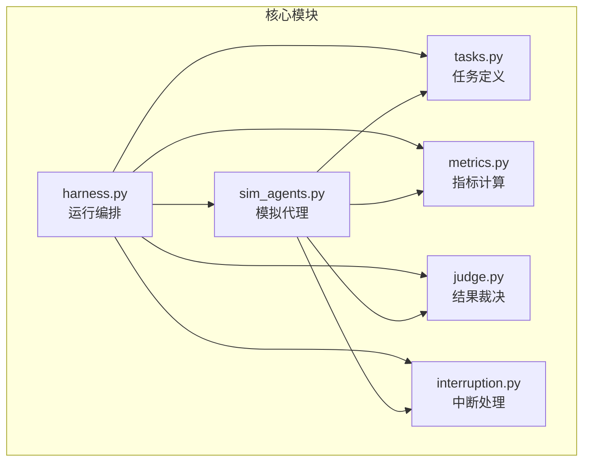
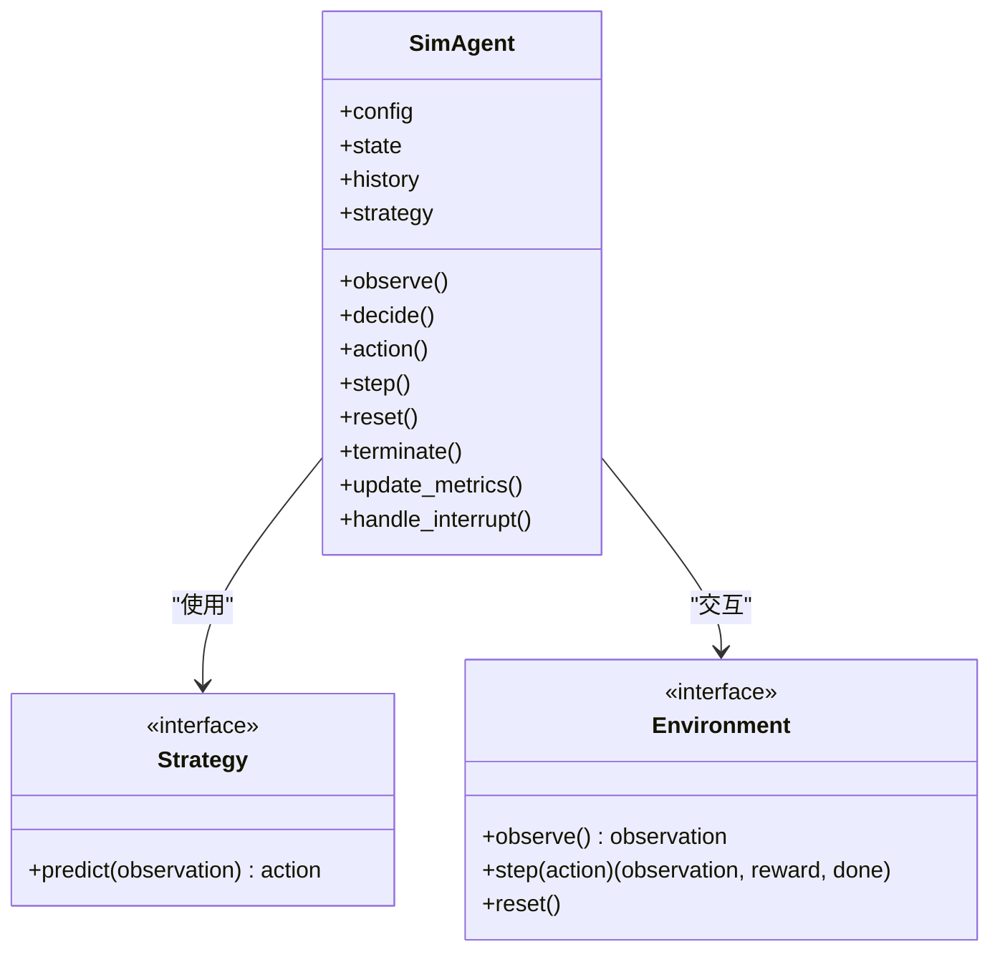
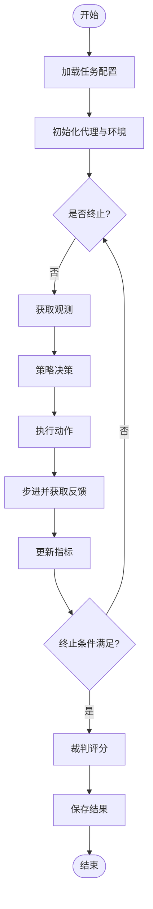
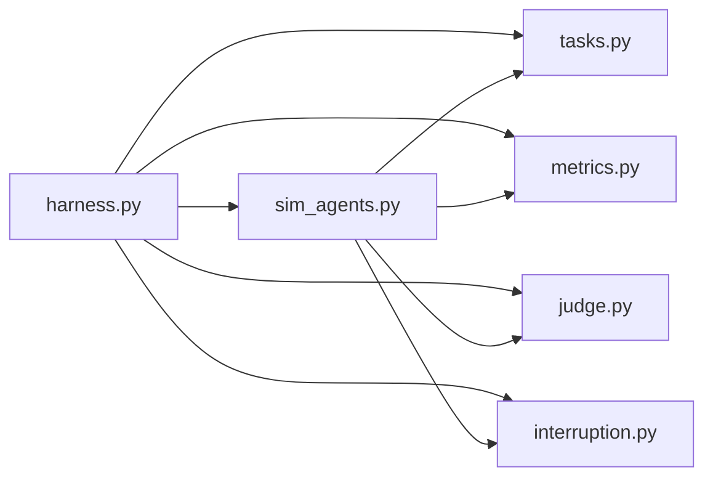

# 模拟代理实现

<cite>
**本文引用的文件**   
- [autonomy_mvp/core/sim_agents.py](file://autonomy_mvp/core/sim_agents.py)
- [autonomy_mvp/core/harness.py](file://autonomy_mvp/core/harness.py)
- [autonomy_mvp/core/tasks.py](file://autonomy_mvp/core/tasks.py)
- [autonomy_mvp/core/metrics.py](file://autonomy_mvp/core/metrics.py)
- [autonomy_mvp/core/judge.py](file://autonomy_mvp/core/judge.py)
- [autonomy_mvp/core/interruption.py](file://autonomy_mvp/core/interruption.py)
- [autonomy_mvp/tests/test_core.py](file://autonomy_mvp/tests/test_core.py)
</cite>

## 目录
1. [简介](#简介)
2. [项目结构](#项目结构)
3. [核心组件](#核心组件)
4. [架构总览](#架构总览)
5. [详细组件分析](#详细组件分析)
6. [依赖关系分析](#依赖关系分析)
7. [性能考量](#性能考量)
8. [故障排查指南](#故障排查指南)
9. [结论](#结论)
10. [附录](#附录)

## 简介
本文件面向科学计算基准测试框架中的“模拟代理”子系统，系统性阐述其架构设计、核心类与接口定义、行为模式与决策逻辑、状态管理机制、与环境交互协议（消息格式与事件流程）、配置参数与初始化生命周期，以及定制开发与性能优化实践。文档力求在保持技术严谨性的同时，对非专业读者友好，并通过图示帮助理解关键流程与数据流。

## 项目结构
autonomy_mvp 模块聚焦于基准测试的核心运行时：任务编排、评测指标、裁判判定、中断处理与模拟代理。其中 sim_agents.py 提供模拟代理的实现；harness.py 负责运行编排与调度；tasks.py 描述任务结构与执行上下文；metrics.py 与 judge.py 分别承担指标计算与结果裁决；interruption.py 提供中断/异常恢复能力；tests/test_core.py 包含基础用例验证。



图表来源
- [autonomy_mvp/core/sim_agents.py](file://autonomy_mvp/core/sim_agents.py)
- [autonomy_mvp/core/harness.py](file://autonomy_mvp/core/harness.py)
- [autonomy_mvp/core/tasks.py](file://autonomy_mvp/core/tasks.py)
- [autonomy_mvp/core/metrics.py](file://autonomy_mvp/core/metrics.py)
- [autonomy_mvp/core/judge.py](file://autonomy_mvp/core/judge.py)
- [autonomy_mvp/core/interruption.py](file://autonomy_mvp/core/interruption.py)

章节来源
- [autonomy_mvp/core/sim_agents.py](file://autonomy_mvp/core/sim_agents.py)
- [autonomy_mvp/core/harness.py](file://autonomy_mvp/core/harness.py)
- [autonomy_mvp/core/tasks.py](file://autonomy_mvp/core/tasks.py)
- [autonomy_mvp/core/metrics.py](file://autonomy_mvp/core/metrics.py)
- [autonomy_mvp/core/judge.py](file://autonomy_mvp/core/judge.py)
- [autonomy_mvp/core/interruption.py](file://autonomy_mvp/core/interruption.py)

## 核心组件
- 模拟代理（SimAgent）：封装代理的状态机、动作空间、观测接口、策略调用入口与日志记录，负责将环境观测转化为动作并维护内部状态。
- 运行编排（Harness）：加载任务、实例化代理、驱动步进循环、收集指标与结果、处理中断与重试。
- 任务（Task）：定义任务元数据、初始观测、动作约束、终止条件与评估函数。
- 指标（Metrics）：提供可插拔的指标计算接口，支持多目标与加权聚合。
- 裁判（Judge）：基于规则或模型对最终结果进行评分与判定。
- 中断（Interruption）：统一捕获中断信号、保存检查点、支持恢复执行。

章节来源
- [autonomy_mvp/core/sim_agents.py](file://autonomy_mvp/core/sim_agents.py)
- [autonomy_mvp/core/harness.py](file://autonomy_mvp/core/harness.py)
- [autonomy_mvp/core/tasks.py](file://autonomy_mvp/core/tasks.py)
- [autonomy_mvp/core/metrics.py](file://autonomy_mvp/core/metrics.py)
- [autonomy_mvp/core/judge.py](file://autonomy_mvp/core/judge.py)
- [autonomy_mvp/core/interruption.py](file://autonomy_mvp/core/interruption.py)

## 架构总览
下图展示代理与环境交互的主循环：编排器加载任务与代理，进入步进循环，代理根据观测选择动作，环境返回新观测与奖励，指标与裁判在适当时机更新与裁决，中断机制保障鲁棒性。

```mermaid
sequenceDiagram
participant Harness as "运行编排"
participant Agent as "模拟代理"
participant Task as "任务"
participant Metrics as "指标"
participant Judge as "裁判"
participant Interruption as "中断"
Harness->>Task : 初始化任务(参数/种子)
Harness->>Agent : 初始化代理(配置/策略)
loop 步进循环
Agent->>Task : 获取观测(observe)
Agent->>Agent : 决策(策略/状态机)
Agent-->>Task : 提交动作(action)
Task-->>Agent : 返回新观测/奖励/终止标志
Agent->>Metrics : 更新指标(观测/动作/奖励)
alt 达到终止条件
Agent->>Judge : 提交轨迹/结果
Judge-->>Agent : 评分/判定
Agent-->>Harness : 返回结果
break
end
end
Note over Harness,Interruption : 中断时保存检查点并恢复
```

图表来源
- [autonomy_mvp/core/harness.py](file://autonomy_mvp/core/harness.py)
- [autonomy_mvp/core/sim_agents.py](file://autonomy_mvp/core/sim_agents.py)
- [autonomy_mvp/core/tasks.py](file://autonomy_mvp/core/tasks.py)
- [autonomy_mvp/core/metrics.py](file://autonomy_mvp/core/metrics.py)
- [autonomy_mvp/core/judge.py](file://autonomy_mvp/core/judge.py)
- [autonomy_mvp/core/interruption.py](file://autonomy_mvp/core/interruption.py)

## 详细组件分析

### 模拟代理（SimAgent）
- 职责
  - 维护代理状态（如步数、历史轨迹、缓存等）。
  - 暴露统一的 observe/action/reset 接口，与环境解耦。
  - 集成策略调用（启发式/学习/外部服务），输出合法动作。
  - 触发指标更新与中断检查。
- 行为模式
  - 状态机：Idle → Observing → Deciding → Acting → Stepping → Terminated。
  - 决策逻辑：基于当前观测与历史，结合策略与约束生成动作；必要时回退到安全策略。
  - 事件处理：接收环境事件（观测变化、奖励、终止），更新内部状态并记录日志。
- 配置参数
  - 策略类型、随机种子、最大步数、超时阈值、日志级别、是否启用回放等。
- 初始化与生命周期
  - 构造阶段：校验配置、加载策略、初始化状态。
  - 运行阶段：步进循环中持续 observe→decide→action。
  - 收尾阶段：汇总指标、生成报告、释放资源。



图表来源
- [autonomy_mvp/core/sim_agents.py](file://autonomy_mvp/core/sim_agents.py)

章节来源
- [autonomy_mvp/core/sim_agents.py](file://autonomy_mvp/core/sim_agents.py)

### 运行编排（Harness）
- 职责
  - 解析任务配置、实例化代理与环境、驱动主循环。
  - 管理指标采集、裁判调用、结果持久化。
  - 集成中断处理，支持断点续跑与重试。
- 控制流
  - 初始化 → 循环步进 → 指标更新 → 裁判判定 → 结果输出。
  - 异常路径：捕获错误、记录诊断信息、尝试恢复或降级。



图表来源
- [autonomy_mvp/core/harness.py](file://autonomy_mvp/core/harness.py)

章节来源
- [autonomy_mvp/core/harness.py](file://autonomy_mvp/core/harness.py)

### 任务（Task）
- 职责
  - 定义任务元数据（名称、版本、难度、约束）。
  - 提供初始观测、动作空间、终止条件与评估函数。
  - 保证观测与动作的合法性校验。
- 数据结构
  - 任务描述、初始状态、动作映射、奖励函数、终止判断。
- 扩展点
  - 自定义任务通过继承或注册表接入，无需修改核心循环。

章节来源
- [autonomy_mvp/core/tasks.py](file://autonomy_mvp/core/tasks.py)

### 指标（Metrics）
- 职责
  - 提供可插拔指标接口，支持单目标与多目标聚合。
  - 增量更新与批量统计，支持权重与归一化。
- 常见指标
  - 成功率、平均奖励、收敛步数、稳定性方差等。
- 扩展点
  - 新增指标只需实现接口并注册，即可被编排器自动采集。

章节来源
- [autonomy_mvp/core/metrics.py](file://autonomy_mvp/core/metrics.py)

### 裁判（Judge）
- 职责
  - 基于规则或模型对轨迹/结果进行评分与判定。
  - 输出结构化评分、置信度与解释字段。
- 扩展点
  - 支持多裁判组合与投票机制，便于对比不同评判标准。

章节来源
- [autonomy_mvp/core/judge.py](file://autonomy_mvp/core/judge.py)

### 中断（Interruption）
- 职责
  - 统一捕获系统中断信号与异常，保存检查点。
  - 支持恢复执行、重试策略与降级运行。
- 特性
  - 原子写入、幂等恢复、可配置的保留策略。

章节来源
- [autonomy_mvp/core/interruption.py](file://autonomy_mvp/core/interruption.py)

### 单元测试（test_core）
- 作用
  - 验证代理初始化、步进循环、指标更新与中断恢复的基本正确性。
  - 覆盖边界条件与异常路径，确保稳定性。

章节来源
- [autonomy_mvp/tests/test_core.py](file://autonomy_mvp/tests/test_core.py)

## 依赖关系分析
- 耦合与内聚
  - 模拟代理与策略/环境松耦合，通过接口抽象降低依赖。
  - 编排器集中管理生命周期，提高内聚性。
- 外部依赖
  - 指标与裁判为可替换组件，便于引入第三方实现。
- 潜在循环依赖
  - 通过接口与回调避免直接循环导入。



图表来源
- [autonomy_mvp/core/harness.py](file://autonomy_mvp/core/harness.py)
- [autonomy_mvp/core/sim_agents.py](file://autonomy_mvp/core/sim_agents.py)
- [autonomy_mvp/core/tasks.py](file://autonomy_mvp/core/tasks.py)
- [autonomy_mvp/core/metrics.py](file://autonomy_mvp/core/metrics.py)
- [autonomy_mvp/core/judge.py](file://autonomy_mvp/core/judge.py)
- [autonomy_mvp/core/interruption.py](file://autonomy_mvp/core/interruption.py)

章节来源
- [autonomy_mvp/core/harness.py](file://autonomy_mvp/core/harness.py)
- [autonomy_mvp/core/sim_agents.py](file://autonomy_mvp/core/sim_agents.py)
- [autonomy_mvp/core/tasks.py](file://autonomy_mvp/core/tasks.py)
- [autonomy_mvp/core/metrics.py](file://autonomy_mvp/core/metrics.py)
- [autonomy_mvp/core/judge.py](file://autonomy_mvp/core/judge.py)
- [autonomy_mvp/core/interruption.py](file://autonomy_mvp/core/interruption.py)

## 性能考量
- 策略推理
  - 优先批量化与缓存中间结果，减少重复计算。
  - 对高开销操作采用异步或并行执行（注意线程安全）。
- 内存与I/O
  - 限制轨迹长度与滑动窗口，避免内存膨胀。
  - 指标与结果采用增量写入与压缩存储。
- 调度与吞吐
  - 合理设置最大步数与超时阈值，防止长尾任务阻塞。
  - 使用轻量级日志与采样式监控降低开销。
- 可扩展性
  - 指标与裁判以插件形式接入，按需加载。
  - 任务与环境通过工厂/注册表动态创建，避免冷启动成本。

[本节为通用指导，不直接分析具体文件]

## 故障排查指南
- 常见问题
  - 代理未收敛：检查策略质量、探索率与奖励设计。
  - 指标异常：确认指标更新时机与数据一致性。
  - 中断恢复失败：检查检查点完整性与幂等性。
- 调试建议
  - 开启详细日志，记录观测、动作与奖励序列。
  - 使用最小复现用例定位问题。
  - 逐步禁用组件（指标/裁判）隔离故障源。

章节来源
- [autonomy_mvp/core/interruption.py](file://autonomy_mvp/core/interruption.py)
- [autonomy_mvp/tests/test_core.py](file://autonomy_mvp/tests/test_core.py)

## 结论
本模拟代理子系统以清晰的职责划分与松耦合接口实现了可扩展的科学计算基准测试框架。通过状态机驱动的代理、可插拔的指标与裁判、以及健壮的中断恢复机制，能够在复杂任务环境中稳定运行并提供一致的评测体验。后续可通过策略升级、指标扩展与任务定制进一步提升框架能力。

[本节为总结性内容，不直接分析具体文件]

## 附录
- 定制开发指南
  - 自定义策略：实现策略接口并在代理构造时注入。
  - 自定义任务：注册任务描述与评估函数，确保动作空间合法。
  - 自定义指标：实现指标接口并注册到采集器。
  - 自定义裁判：实现评分接口并接入编排器。
- 使用模式示例
  - 基本运行：加载任务→初始化代理→步进循环→输出结果。
  - 批量实验：遍历任务与参数网格，并行执行并汇总指标。
  - 断点续跑：读取检查点→恢复状态→继续执行至终止。

[本节为概念性说明，不直接分析具体文件]