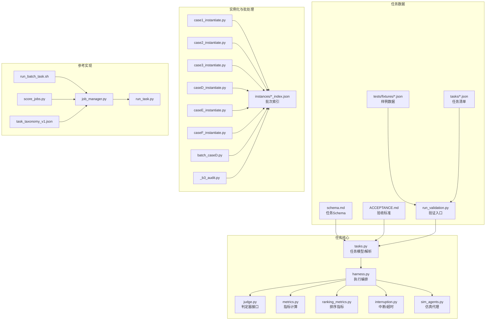
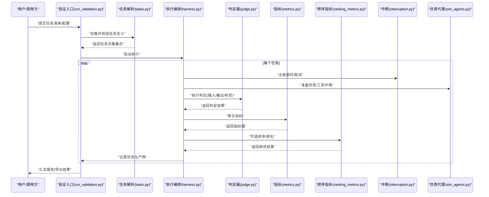
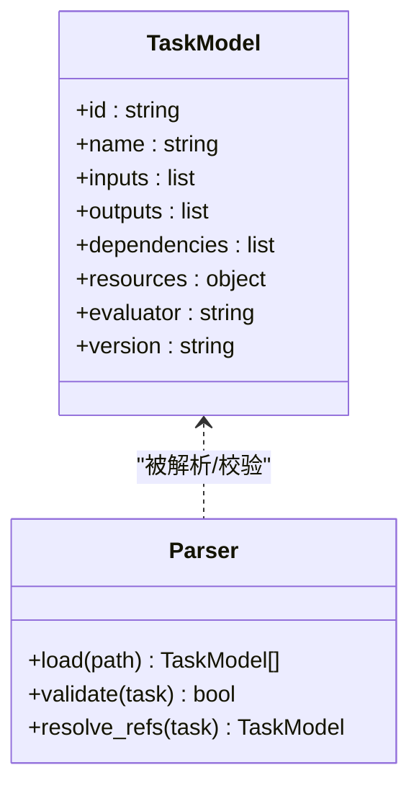
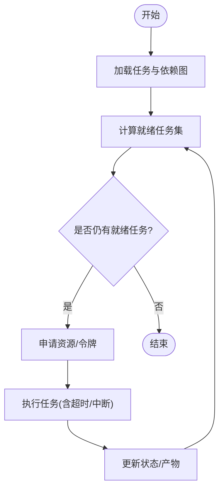
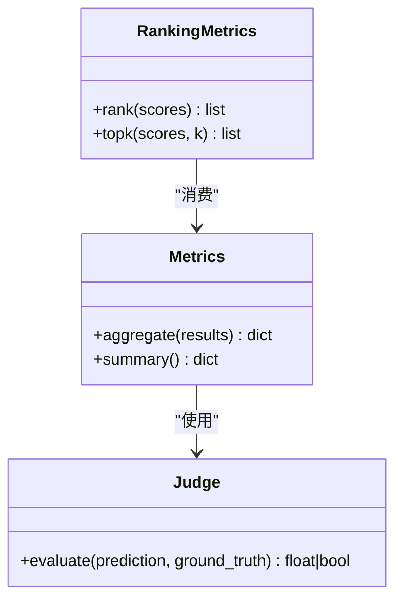
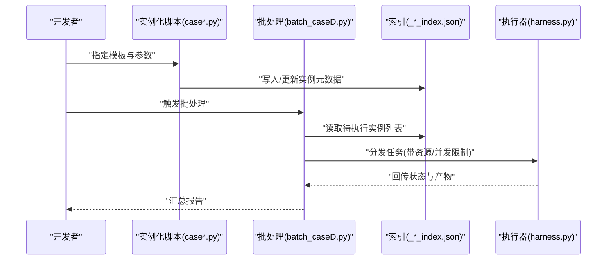
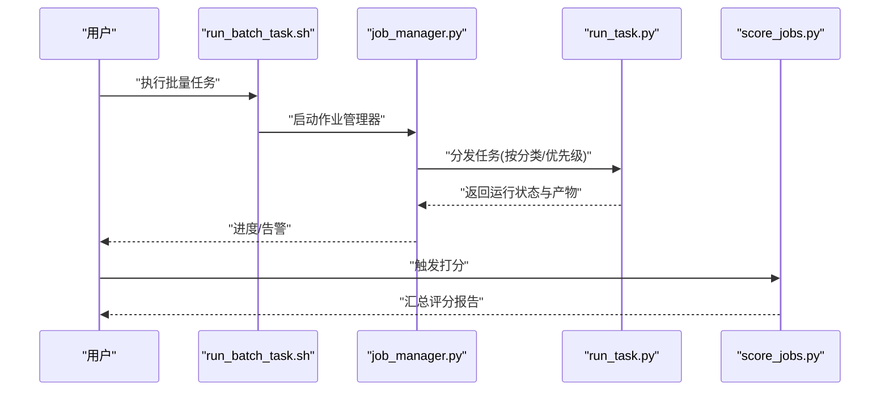
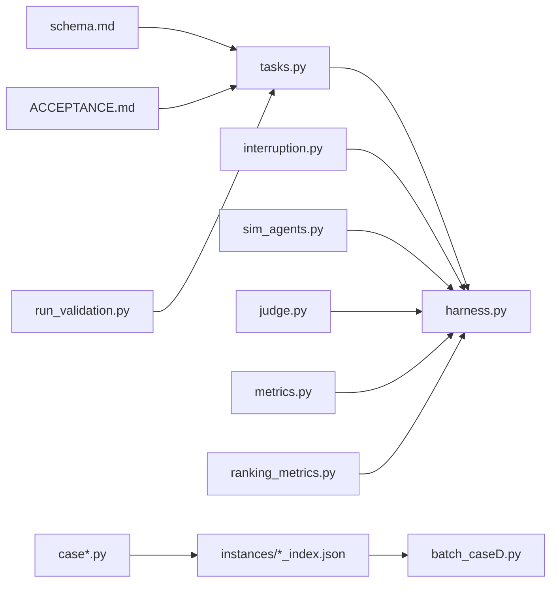

# 任务管理系统

<cite>
**本文引用的文件**   
- [autonomy_mvp/core/tasks.py](file://autonomy_mvp/core/tasks.py)
- [autonomy_mvp/core/harness.py](file://autonomy_mvp/core/harness.py)
- [autonomy_mvp/core/judge.py](file://autonomy_mvp/core/judge.py)
- [autonomy_mvp/core/metrics.py](file://autonomy_mvp/core/metrics.py)
- [autonomy_mvp/core/ranking_metrics.py](file://autonomy_mvp/core/ranking_metrics.py)
- [autonomy_mvp/core/interruption.py](file://autonomy_mvp/core/interruption.py)
- [autonomy_mvp/core/sim_agents.py](file://autonomy_mvp/core/sim_agents.py)
- [autonomy_mvp/schema.md](file://autonomy_mvp/schema.md)
- [autonomy_mvp/ACCEPTANCE.md](file://autonomy_mvp/ACCEPTANCE.md)
- [autonomy_mvp/run_validation.py](file://autonomy_mvp/run_validation.py)
- [autonomy_mvp/tests/test_core.py](file://autonomy_mvp/tests/test_core.py)
- [autonomy_mvp/tests/fixtures/fixture_drugscreen.json](file://autonomy_mvp/tests/fixtures/fixture_drugscreen.json)
- [autonomy_mvp/tests/fixtures/fixture_materials.json](file://autonomy_mvp/tests/fixtures/fixture_materials.json)
- [autonomy_mvp/tasks/drug_admet.json](file://autonomy_mvp/tasks/drug_admet.json)
- [autonomy_mvp/tasks/drug_screen_ms3.json](file://autonomy_mvp/tasks/drug_screen_ms3.json)
- [autonomy_mvp/tasks/materials_semiconductor_bandgap.json](file://autonomy_mvp/tasks/materials_semiconductor_bandgap.json)
- [longhorizon/instantiate/case1_instantiate.py](file://longhorizon/instantiate/case1_instantiate.py)
- [longhorizon/instantiate/case2_instantiate.py](file://longhorizon/instantiate/case2_instantiate.py)
- [longhorizon/instantiate/case3_instantiate.py](file://longhorizon/instantiate/case3_instantiate.py)
- [longhorizon/instantiate/caseD_instantiate.py](file://longhorizon/instantiate/caseD_instantiate.py)
- [longhorizon/instantiate/caseE_instantiate.py](file://longhorizon/instantiate/caseE_instantiate.py)
- [longhorizon/instantiate/caseF_instantiate.py](file://longhorizon/instantiate/caseF_instantiate.py)
- [longhorizon/instantiate/batch_caseD.py](file://longhorizon/instantiate/batch_caseD.py)
- [longhorizon/instantiate/_b3_audit.py](file://longhorizon/instantiate/_b3_audit.py)
- [longhorizon/instantiate/instances/_batch_index.json](file://longhorizon/instantiate/instances/_batch_index.json)
- [longhorizon/instantiate/instances/_case2_index.json](file://longhorizon/instantiate/instances/_case2_index.json)
- [longhorizon/instantiate/instances/_case3_index.json](file://longhorizon/instantiate/instances/_case3_index.json)
- [longhorizon/instantiate/instances/_caseE_index.json](file://longhorizon/instantiate/instances/_caseE_index.json)
- [longhorizon/instantiate/instances/_caseF_index.json](file://longhorizon/instantiate/instances/_caseF_index.json)
- [longhorizon/instantiate/README_case3_机理模拟.md](file://longhorizon/instantiate/README_case3_机理模拟.md)
- [longhorizon/instantiate/README_caseD_闭环优化.md](file://longhorizon/instantiate/README_caseD_闭环优化.md)
- [longhorizon/instantiate/README_caseE_逆合成.md](file://longhorizon/instantiate/README_caseE_逆合成.md)
- [task4/poc3_physicianbench/scripts/job_manager.py](file://task4/poc3_physicianbench/scripts/job_manager.py)
- [task4/poc3_physicianbench/scripts/run_task.py](file://task4/poc3_physicianbench/scripts/run_task.py)
- [task4/poc3_physicianbench/scripts/run_batch_task.sh](file://task4/poc3_physicianbench/scripts/run_batch_task.sh)
- [task4/poc3_physicianbench/scripts/score_jobs.py](file://task4/poc3_physicianbench/scripts/score_jobs.py)
- [task4/poc3_physicianbench/scripts/task_taxonomy_v1.json](file://task4/poc3_physicianbench/scripts/task_taxonomy_v1.json)
</cite>

## 目录
1. [引言](#引言)
2. [项目结构](#项目结构)
3. [核心组件](#核心组件)
4. [架构总览](#架构总览)
5. [详细组件分析](#详细组件分析)
6. [依赖关系分析](#依赖关系分析)
7. [性能与并发](#性能与并发)
8. [故障排查指南](#故障排查指南)
9. [结论](#结论)
10. [附录：任务开发指南与最佳实践](#附录任务开发指南与最佳实践)

## 引言
本文件面向科学计算基准测试框架的任务管理系统，聚焦以下目标：
- 明确任务定义规范与解析机制
- 描述执行流程、调度器设计模式、资源分配策略与并发控制
- 说明任务依赖管理、工作流编排与状态跟踪
- 介绍任务模板系统、动态生成机制与版本管理
- 提供可操作的任务开发与集成指南

## 项目结构
仓库采用“领域子项目 + 通用核心”的混合组织方式。与任务管理直接相关的代码集中在 autonomy_mvp 与 longhorizon/instantiate 两个区域：
- autonomy_mvp：定义任务模型、解析、执行与评测的核心能力
- longhorizon/instantiate：负责从模板批量实例化具体任务案例，并维护索引与批处理脚本
- task4/poc3_physicianbench：提供另一个任务运行与评分的参考实现（job_manager、run_task、score_jobs）

图表来源
- [autonomy_mvp/core/tasks.py](file://autonomy_mvp/core/tasks.py)
- [autonomy_mvp/core/harness.py](file://autonomy_mvp/core/harness.py)
- [autonomy_mvp/core/judge.py](file://autonomy_mvp/core/judge.py)
- [autonomy_mvp/core/metrics.py](file://autonomy_mvp/core/metrics.py)
- [autonomy_mvp/core/ranking_metrics.py](file://autonomy_mvp/core/ranking_metrics.py)
- [autonomy_mvp/core/interruption.py](file://autonomy_mvp/core/interruption.py)
- [autonomy_mvp/core/sim_agents.py](file://autonomy_mvp/core/sim_agents.py)
- [autonomy_mvp/schema.md](file://autonomy_mvp/schema.md)
- [autonomy_mvp/ACCEPTANCE.md](file://autonomy_mvp/ACCEPTANCE.md)
- [autonomy_mvp/run_validation.py](file://autonomy_mvp/run_validation.py)
- [autonomy_mvp/tests/fixtures/fixture_drugscreen.json](file://autonomy_mvp/tests/fixtures/fixture_drugscreen.json)
- [autonomy_mvp/tests/fixtures/fixture_materials.json](file://autonomy_mvp/tests/fixtures/fixture_materials.json)
- [autonomy_mvp/tasks/drug_admet.json](file://autonomy_mvp/tasks/drug_admet.json)
- [autonomy_mvp/tasks/drug_screen_ms3.json](file://autonomy_mvp/tasks/drug_screen_ms3.json)
- [autonomy_mvp/tasks/materials_semiconductor_bandgap.json](file://autonomy_mvp/tasks/materials_semiconductor_bandgap.json)
- [longhorizon/instantiate/case1_instantiate.py](file://longhorizon/instantiate/case1_instantiate.py)
- [longhorizon/instantiate/case2_instantiate.py](file://longhorizon/instantiate/case2_instantiate.py)
- [longhorizon/instantiate/case3_instantiate.py](file://longhorizon/instantiate/case3_instantiate.py)
- [longhorizon/instantiate/caseD_instantiate.py](file://longhorizon/instantiate/caseD_instantiate.py)
- [longhorizon/instantiate/caseE_instantiate.py](file://longhorizon/instantiate/caseE_instantiate.py)
- [longhorizon/instantiate/caseF_instantiate.py](file://longhorizon/instantiate/caseF_instantiate.py)
- [longhorizon/instantiate/batch_caseD.py](file://longhorizon/instantiate/batch_caseD.py)
- [longhorizon/instantiate/_b3_audit.py](file://longhorizon/instantiate/_b3_audit.py)
- [longhorizon/instantiate/instances/_batch_index.json](file://longhorizon/instantiate/instances/_batch_index.json)
- [longhorizon/instantiate/instances/_case2_index.json](file://longhorizon/instantiate/instances/_case2_index.json)
- [longhorizon/instantiate/instances/_case3_index.json](file://longhorizon/instantiate/instances/_case3_index.json)
- [longhorizon/instantiate/instances/_caseE_index.json](file://longhorizon/instantiate/instances/_caseE_index.json)
- [longhorizon/instantiate/instances/_caseF_index.json](file://longhorizon/instantiate/instances/_caseF_index.json)
- [task4/poc3_physicianbench/scripts/job_manager.py](file://task4/poc3_physicianbench/scripts/job_manager.py)
- [task4/poc3_physicianbench/scripts/run_task.py](file://task4/poc3_physicianbench/scripts/run_task.py)
- [task4/poc3_physicianbench/scripts/run_batch_task.sh](file://task4/poc3_physicianbench/scripts/run_batch_task.sh)
- [task4/poc3_physicianbench/scripts/score_jobs.py](file://task4/poc3_physicianbench/scripts/score_jobs.py)
- [task4/poc3_physicianbench/scripts/task_taxonomy_v1.json](file://task4/poc3_physicianbench/scripts/task_taxonomy_v1.json)

章节来源
- [autonomy_mvp/schema.md](file://autonomy_mvp/schema.md)
- [autonomy_mvp/ACCEPTANCE.md](file://autonomy_mvp/ACCEPTANCE.md)
- [autonomy_mvp/run_validation.py](file://autonomy_mvp/run_validation.py)
- [autonomy_mvp/core/tasks.py](file://autonomy_mvp/core/tasks.py)
- [autonomy_mvp/core/harness.py](file://autonomy_mvp/core/harness.py)
- [autonomy_mvp/core/judge.py](file://autonomy_mvp/core/judge.py)
- [autonomy_mvp/core/metrics.py](file://autonomy_mvp/core/metrics.py)
- [autonomy_mvp/core/ranking_metrics.py](file://autonomy_mvp/core/ranking_metrics.py)
- [autonomy_mvp/core/interruption.py](file://autonomy_mvp/core/interruption.py)
- [autonomy_mvp/core/sim_agents.py](file://autonomy_mvp/core/sim_agents.py)
- [longhorizon/instantiate/case1_instantiate.py](file://longhorizon/instantiate/case1_instantiate.py)
- [longhorizon/instantiate/case2_instantiate.py](file://longhorizon/instantiate/case2_instantiate.py)
- [longhorizon/instantiate/case3_instantiate.py](file://longhorizon/instantiate/case3_instantiate.py)
- [longhorizon/instantiate/caseD_instantiate.py](file://longhorizon/instantiate/caseD_instantiate.py)
- [longhorizon/instantiate/caseE_instantiate.py](file://longhorizon/instantiate/caseE_instantiate.py)
- [longhorizon/instantiate/caseF_instantiate.py](file://longhorizon/instantiate/caseF_instantiate.py)
- [longhorizon/instantiate/batch_caseD.py](file://longhorizon/instantiate/batch_caseD.py)
- [longhorizon/instantiate/_b3_audit.py](file://longhorizon/instantiate/_b3_audit.py)
- [task4/poc3_physicianbench/scripts/job_manager.py](file://task4/poc3_physicianbench/scripts/job_manager.py)
- [task4/poc3_physicianbench/scripts/run_task.py](file://task4/poc3_physicianbench/scripts/run_task.py)
- [task4/poc3_physicianbench/scripts/run_batch_task.sh](file://task4/poc3_physicianbench/scripts/run_batch_task.sh)
- [task4/poc3_physicianbench/scripts/score_jobs.py](file://task4/poc3_physicianbench/scripts/score_jobs.py)
- [task4/poc3_physicianbench/scripts/task_taxonomy_v1.json](file://task4/poc3_physicianbench/scripts/task_taxonomy_v1.json)

## 核心组件
- 任务模型与解析
  - 通过统一 Schema 定义任务元数据、输入输出、依赖、资源约束与评估方法
  - 解析器负责将 JSON/YAML 任务清单转换为运行时对象，并进行校验与默认值填充
- 执行编排（Harness）
  - 负责加载任务、准备环境、启动执行、收集中间结果与最终产出
  - 协调中断/超时、重试、日志与状态持久化
- 判定器与指标
  - 判定器接口定义如何对比“期望/真实标签”与“模型输出”，返回布尔或分数
  - 指标模块聚合单样本得分，支持多种统计与排序指标
- 中断与仿真代理
  - 中断模块提供超时、取消信号与资源回收
  - 仿真代理用于在离线模式下回放或模拟外部工具/服务
- 实例化与批处理
  - 按场景（case）将模板参数化，批量生成具体任务实例，并维护索引
  - 批处理脚本驱动并行执行与汇总

章节来源
- [autonomy_mvp/core/tasks.py](file://autonomy_mvp/core/tasks.py)
- [autonomy_mvp/core/harness.py](file://autonomy_mvp/core/harness.py)
- [autonomy_mvp/core/judge.py](file://autonomy_mvp/core/judge.py)
- [autonomy_mvp/core/metrics.py](file://autonomy_mvp/core/metrics.py)
- [autonomy_mvp/core/ranking_metrics.py](file://autonomy_mvp/core/ranking_metrics.py)
- [autonomy_mvp/core/interruption.py](file://autonomy_mvp/core/interruption.py)
- [autonomy_mvp/core/sim_agents.py](file://autonomy_mvp/core/sim_agents.py)
- [autonomy_mvp/schema.md](file://autonomy_mvp/schema.md)
- [autonomy_mvp/ACCEPTANCE.md](file://autonomy_mvp/ACCEPTANCE.md)
- [autonomy_mvp/run_validation.py](file://autonomy_mvp/run_validation.py)
- [longhorizon/instantiate/case1_instantiate.py](file://longhorizon/instantiate/case1_instantiate.py)
- [longhorizon/instantiate/case2_instantiate.py](file://longhorizon/instantiate/case2_instantiate.py)
- [longhorizon/instantiate/case3_instantiate.py](file://longhorizon/instantiate/case3_instantiate.py)
- [longhorizon/instantiate/caseD_instantiate.py](file://longhorizon/instantiate/caseD_instantiate.py)
- [longhorizon/instantiate/caseE_instantiate.py](file://longhorizon/instantiate/caseE_instantiate.py)
- [longhorizon/instantiate/caseF_instantiate.py](file://longhorizon/instantiate/caseF_instantiate.py)
- [longhorizon/instantiate/batch_caseD.py](file://longhorizon/instantiate/batch_caseD.py)
- [longhorizon/instantiate/_b3_audit.py](file://longhorizon/instantiate/_b3_audit.py)

## 架构总览
下图展示任务从定义到执行的端到端流程，以及关键子系统之间的交互。

图表来源
- [autonomy_mvp/run_validation.py](file://autonomy_mvp/run_validation.py)
- [autonomy_mvp/core/tasks.py](file://autonomy_mvp/core/tasks.py)
- [autonomy_mvp/core/harness.py](file://autonomy_mvp/core/harness.py)
- [autonomy_mvp/core/judge.py](file://autonomy_mvp/core/judge.py)
- [autonomy_mvp/core/metrics.py](file://autonomy_mvp/core/metrics.py)
- [autonomy_mvp/core/ranking_metrics.py](file://autonomy_mvp/core/ranking_metrics.py)
- [autonomy_mvp/core/interruption.py](file://autonomy_mvp/core/interruption.py)
- [autonomy_mvp/core/sim_agents.py](file://autonomy_mvp/core/sim_agents.py)

## 详细组件分析

### 任务模型与解析（tasks.py）
- 职责
  - 定义任务的数据模型（字段、类型、约束）
  - 提供解析函数，将 JSON/YAML 任务清单转为内部对象
  - 进行必填项校验、默认值填充与引用解析（如依赖、资源）
- 关键点
  - 字段命名与类型需与 schema.md 保持一致
  - 对循环依赖与不可达节点进行提前检测
  - 为后续执行阶段暴露统一的访问接口

图表来源
- [autonomy_mvp/core/tasks.py](file://autonomy_mvp/core/tasks.py)
- [autonomy_mvp/schema.md](file://autonomy_mvp/schema.md)

章节来源
- [autonomy_mvp/core/tasks.py](file://autonomy_mvp/core/tasks.py)
- [autonomy_mvp/schema.md](file://autonomy_mvp/schema.md)

### 执行编排（harness.py）
- 职责
  - 生命周期管理：初始化、准备、执行、收尾
  - 并发控制：基于资源配额与依赖图进行调度
  - 状态跟踪：持久化任务状态、中间产物与错误信息
- 关键点
  - 使用有界并发队列限制同时运行的任务数
  - 依据依赖拓扑进行就绪任务发现与推进
  - 与中断模块协作，确保异常退出时的资源清理

图表来源
- [autonomy_mvp/core/harness.py](file://autonomy_mvp/core/harness.py)
- [autonomy_mvp/core/interruption.py](file://autonomy_mvp/core/interruption.py)

章节来源
- [autonomy_mvp/core/harness.py](file://autonomy_mvp/core/harness.py)
- [autonomy_mvp/core/interruption.py](file://autonomy_mvp/core/interruption.py)

### 判定器与指标（judge.py, metrics.py, ranking_metrics.py）
- 职责
  - judge：定义判定接口，比较预测与标签，返回布尔/分数
  - metrics：聚合单样本结果，计算均值、方差等统计量
  - ranking_metrics：提供排序与排名相关指标（如 Top-K、AUC 等）
- 关键点
  - 判定器应幂等且无副作用
  - 指标计算需考虑缺失值与异常值
  - 排序指标应与业务目标对齐

图表来源
- [autonomy_mvp/core/judge.py](file://autonomy_mvp/core/judge.py)
- [autonomy_mvp/core/metrics.py](file://autonomy_mvp/core/metrics.py)
- [autonomy_mvp/core/ranking_metrics.py](file://autonomy_mvp/core/ranking_metrics.py)

章节来源
- [autonomy_mvp/core/judge.py](file://autonomy_mvp/core/judge.py)
- [autonomy_mvp/core/metrics.py](file://autonomy_mvp/core/metrics.py)
- [autonomy_mvp/core/ranking_metrics.py](file://autonomy_mvp/core/ranking_metrics.py)

### 中断与仿真代理（interruption.py, sim_agents.py）
- 职责
  - interruption：提供超时、取消信号、资源回收钩子
  - sim_agents：在离线环境下模拟外部工具或服务，保证可复现性
- 关键点
  - 所有长耗时操作必须接入中断检查
  - 仿真代理需与真实接口保持等价语义

章节来源
- [autonomy_mvp/core/interruption.py](file://autonomy_mvp/core/interruption.py)
- [autonomy_mvp/core/sim_agents.py](file://autonomy_mvp/core/sim_agents.py)

### 任务清单与样例（tasks/*.json, tests/fixtures/*.json）
- 用途
  - tasks/*.json：生产任务清单，包含待测任务的基本信息与参数
  - tests/fixtures/*.json：单元测试与回归用例的固定输入
- 建议
  - 清单中显式声明依赖、资源与评估器
  - 为不同场景维护独立清单，便于隔离与复用

章节来源
- [autonomy_mvp/tasks/drug_admet.json](file://autonomy_mvp/tasks/drug_admet.json)
- [autonomy_mvp/tasks/drug_screen_ms3.json](file://autonomy_mvp/tasks/drug_screen_ms3.json)
- [autonomy_mvp/tasks/materials_semiconductor_bandgap.json](file://autonomy_mvp/tasks/materials_semiconductor_bandgap.json)
- [autonomy_mvp/tests/fixtures/fixture_drugscreen.json](file://autonomy_mvp/tests/fixtures/fixture_drugscreen.json)
- [autonomy_mvp/tests/fixtures/fixture_materials.json](file://autonomy_mvp/tests/fixtures/fixture_materials.json)

### 实例化与批处理（longhorizon/instantiate/*）
- 职责
  - caseX_instantiate.py：按场景将模板参数化，生成具体任务实例
  - batch_caseD.py：针对特定场景的批处理入口
  - _b3_audit.py：审计/一致性检查
  - instances/*_index.json：批次索引，记录已生成的实例与元数据
- 关键点
  - 实例化过程应幂等，避免重复生成
  - 索引文件作为任务发现的权威来源
  - 批处理脚本应支持断点续跑与失败重试

图表来源
- [longhorizon/instantiate/case1_instantiate.py](file://longhorizon/instantiate/case1_instantiate.py)
- [longhorizon/instantiate/case2_instantiate.py](file://longhorizon/instantiate/case2_instantiate.py)
- [longhorizon/instantiate/case3_instantiate.py](file://longhorizon/instantiate/case3_instantiate.py)
- [longhorizon/instantiate/caseD_instantiate.py](file://longhorizon/instantiate/caseD_instantiate.py)
- [longhorizon/instantiate/caseE_instantiate.py](file://longhorizon/instantiate/caseE_instantiate.py)
- [longhorizon/instantiate/caseF_instantiate.py](file://longhorizon/instantiate/caseF_instantiate.py)
- [longhorizon/instantiate/batch_caseD.py](file://longhorizon/instantiate/batch_caseD.py)
- [longhorizon/instantiate/_b3_audit.py](file://longhorizon/instantiate/_b3_audit.py)
- [longhorizon/instantiate/instances/_batch_index.json](file://longhorizon/instantiate/instances/_batch_index.json)
- [longhorizon/instantiate/instances/_case2_index.json](file://longhorizon/instantiate/instances/_case2_index.json)
- [longhorizon/instantiate/instances/_case3_index.json](file://longhorizon/instantiate/instances/_case3_index.json)
- [longhorizon/instantiate/instances/_caseE_index.json](file://longhorizon/instantiate/instances/_caseE_index.json)
- [longhorizon/instantiate/instances/_caseF_index.json](file://longhorizon/instantiate/instances/_caseF_index.json)
- [autonomy_mvp/core/harness.py](file://autonomy_mvp/core/harness.py)

章节来源
- [longhorizon/instantiate/case1_instantiate.py](file://longhorizon/instantiate/case1_instantiate.py)
- [longhorizon/instantiate/case2_instantiate.py](file://longhorizon/instantiate/case2_instantiate.py)
- [longhorizon/instantiate/case3_instantiate.py](file://longhorizon/instantiate/case3_instantiate.py)
- [longhorizon/instantiate/caseD_instantiate.py](file://longhorizon/instantiate/caseD_instantiate.py)
- [longhorizon/instantiate/caseE_instantiate.py](file://longhorizon/instantiate/caseE_instantiate.py)
- [longhorizon/instantiate/caseF_instantiate.py](file://longhorizon/instantiate/caseF_instantiate.py)
- [longhorizon/instantiate/batch_caseD.py](file://longhorizon/instantiate/batch_caseD.py)
- [longhorizon/instantiate/_b3_audit.py](file://longhorizon/instantiate/_b3_audit.py)
- [longhorizon/instantiate/instances/_batch_index.json](file://longhorizon/instantiate/instances/_batch_index.json)
- [longhorizon/instantiate/instances/_case2_index.json](file://longhorizon/instantiate/instances/_case2_index.json)
- [longhorizon/instantiate/instances/_case3_index.json](file://longhorizon/instantiate/instances/_case3_index.json)
- [longhorizon/instantiate/instances/_caseE_index.json](file://longhorizon/instantiate/instances/_caseE_index.json)
- [longhorizon/instantiate/instances/_caseF_index.json](file://longhorizon/instantiate/instances/_caseF_index.json)
- [autonomy_mvp/core/harness.py](file://autonomy_mvp/core/harness.py)

### 参考实现：任务运行与评分（task4/poc3_physicianbench）
- job_manager.py：作业管理与调度
- run_task.py：单任务运行入口
- run_batch_task.sh：批量运行脚本
- score_jobs.py：结果打分与汇总
- task_taxonomy_v1.json：任务分类与属性

图表来源
- [task4/poc3_physicianbench/scripts/job_manager.py](file://task4/poc3_physicianbench/scripts/job_manager.py)
- [task4/poc3_physicianbench/scripts/run_task.py](file://task4/poc3_physicianbench/scripts/run_task.py)
- [task4/poc3_physicianbench/scripts/run_batch_task.sh](file://task4/poc3_physicianbench/scripts/run_batch_task.sh)
- [task4/poc3_physicianbench/scripts/score_jobs.py](file://task4/poc3_physicianbench/scripts/score_jobs.py)
- [task4/poc3_physicianbench/scripts/task_taxonomy_v1.json](file://task4/poc3_physicianbench/scripts/task_taxonomy_v1.json)

章节来源
- [task4/poc3_physicianbench/scripts/job_manager.py](file://task4/poc3_physicianbench/scripts/job_manager.py)
- [task4/poc3_physicianbench/scripts/run_task.py](file://task4/poc3_physicianbench/scripts/run_task.py)
- [task4/poc3_physicianbench/scripts/run_batch_task.sh](file://task4/poc3_physicianbench/scripts/run_batch_task.sh)
- [task4/poc3_physicianbench/scripts/score_jobs.py](file://task4/poc3_physicianbench/scripts/score_jobs.py)
- [task4/poc3_physicianbench/scripts/task_taxonomy_v1.json](file://task4/poc3_physicianbench/scripts/task_taxonomy_v1.json)

## 依赖关系分析
- 模块耦合
  - harness 强依赖 tasks、interruption、sim_agents；弱依赖 judge、metrics、ranking_metrics
  - 实例化脚本仅依赖文件系统与索引，不直接耦合执行逻辑
- 外部依赖
  - 任务清单与索引为外部数据源
  - 参考实现中的 taxonomy 提供任务分类维度
- 潜在风险
  - 若 tasks 与 schema 不一致，解析阶段会失败
  - 若依赖图存在环，调度器无法推进

图表来源
- [autonomy_mvp/core/tasks.py](file://autonomy_mvp/core/tasks.py)
- [autonomy_mvp/core/harness.py](file://autonomy_mvp/core/harness.py)
- [autonomy_mvp/core/judge.py](file://autonomy_mvp/core/judge.py)
- [autonomy_mvp/core/metrics.py](file://autonomy_mvp/core/metrics.py)
- [autonomy_mvp/core/ranking_metrics.py](file://autonomy_mvp/core/ranking_metrics.py)
- [autonomy_mvp/core/interruption.py](file://autonomy_mvp/core/interruption.py)
- [autonomy_mvp/core/sim_agents.py](file://autonomy_mvp/core/sim_agents.py)
- [autonomy_mvp/schema.md](file://autonomy_mvp/schema.md)
- [autonomy_mvp/ACCEPTANCE.md](file://autonomy_mvp/ACCEPTANCE.md)
- [autonomy_mvp/run_validation.py](file://autonomy_mvp/run_validation.py)
- [longhorizon/instantiate/batch_caseD.py](file://longhorizon/instantiate/batch_caseD.py)
- [longhorizon/instantiate/instances/_batch_index.json](file://longhorizon/instantiate/instances/_batch_index.json)

章节来源
- [autonomy_mvp/core/tasks.py](file://autonomy_mvp/core/tasks.py)
- [autonomy_mvp/core/harness.py](file://autonomy_mvp/core/harness.py)
- [autonomy_mvp/core/judge.py](file://autonomy_mvp/core/judge.py)
- [autonomy_mvp/core/metrics.py](file://autonomy_mvp/core/metrics.py)
- [autonomy_mvp/core/ranking_metrics.py](file://autonomy_mvp/core/ranking_metrics.py)
- [autonomy_mvp/core/interruption.py](file://autonomy_mvp/core/interruption.py)
- [autonomy_mvp/core/sim_agents.py](file://autonomy_mvp/core/sim_agents.py)
- [autonomy_mvp/schema.md](file://autonomy_mvp/schema.md)
- [autonomy_mvp/ACCEPTANCE.md](file://autonomy_mvp/ACCEPTANCE.md)
- [autonomy_mvp/run_validation.py](file://autonomy_mvp/run_validation.py)
- [longhorizon/instantiate/batch_caseD.py](file://longhorizon/instantiate/batch_caseD.py)
- [longhorizon/instantiate/instances/_batch_index.json](file://longhorizon/instantiate/instances/_batch_index.json)

## 性能与并发
- 并发模型
  - 基于资源令牌池的有界并发，避免资源争用与 OOM
  - 依赖拓扑驱动的“就绪任务”队列，最大化吞吐
- 资源分配
  - 按任务声明的资源需求进行分配（CPU/GPU/内存/磁盘）
  - 支持抢占与公平排队（可扩展）
- 容错与恢复
  - 任务级超时与全局中断
  - 失败重试与断点续跑（基于索引与产物完整性）
- 监控与观测
  - 结构化日志、指标埋点与产物快照
  - 可视化看板（可扩展）

[本节为通用指导，无需列出具体文件来源]

## 故障排查指南
- 常见问题
  - 任务解析失败：检查 schema 一致性与必填字段
  - 依赖环导致死锁：使用拓扑检查工具定位环
  - 资源不足：调整并发上限与资源配额
  - 超时/中断：确认长耗时操作是否接入中断检查
- 诊断步骤
  - 查看任务状态与产物路径
  - 核对索引文件与实例元数据
  - 启用更详细的日志级别
  - 使用最小样例复现问题

章节来源
- [autonomy_mvp/run_validation.py](file://autonomy_mvp/run_validation.py)
- [autonomy_mvp/core/harness.py](file://autonomy_mvp/core/harness.py)
- [autonomy_mvp/core/interruption.py](file://autonomy_mvp/core/interruption.py)
- [longhorizon/instantiate/_b3_audit.py](file://longhorizon/instantiate/_b3_audit.py)

## 结论
该任务管理系统以“清晰的任务模型 + 可插拔的执行编排 + 严格的依赖与资源控制”为核心，结合模板化实例化与批处理能力，形成从任务定义到结果产出的完整闭环。通过统一的判定器与指标体系，保证了评测的一致性与可复现性。

[本节为总结性内容，无需列出具体文件来源]

## 附录：任务开发指南与最佳实践
- 任务定义
  - 遵循 schema.md 的字段约定，明确输入/输出、依赖与资源
  - 为任务标注版本，便于回溯与升级
- 任务解析与校验
  - 在解析阶段完成缺省值填充与引用解析
  - 对依赖图进行环检测与可达性检查
- 执行与编排
  - 所有外部调用需接入中断检查
  - 合理设置并发上限与资源配额
  - 持久化中间产物，支持断点续跑
- 判定与指标
  - 判定器保持幂等与无副作用
  - 指标计算需处理缺失与异常
- 模板与实例化
  - 使用模板参数化，减少重复定义
  - 维护索引文件，确保幂等与可追溯
- 测试与验收
  - 使用 fixtures 覆盖边界条件
  - 通过 acceptance 标准进行回归验证

章节来源
- [autonomy_mvp/schema.md](file://autonomy_mvp/schema.md)
- [autonomy_mvp/ACCEPTANCE.md](file://autonomy_mvp/ACCEPTANCE.md)
- [autonomy_mvp/run_validation.py](file://autonomy_mvp/run_validation.py)
- [autonomy_mvp/tests/test_core.py](file://autonomy_mvp/tests/test_core.py)
- [autonomy_mvp/tests/fixtures/fixture_drugscreen.json](file://autonomy_mvp/tests/fixtures/fixture_drugscreen.json)
- [autonomy_mvp/tests/fixtures/fixture_materials.json](file://autonomy_mvp/tests/fixtures/fixture_materials.json)
- [longhorizon/instantiate/README_case3_机理模拟.md](file://longhorizon/instantiate/README_case3_机理模拟.md)
- [longhorizon/instantiate/README_caseD_闭环优化.md](file://longhorizon/instantiate/README_caseD_闭环优化.md)
- [longhorizon/instantiate/README_caseE_逆合成.md](file://longhorizon/instantiate/README_caseE_逆合成.md)